# Naming the platform

The record of how "Tutor Portal" became **Aimtrue**: the brief, every name considered, the logo
sketches, and what the trademark register, the domain registries and the App Store said about
each. Researched on 12 and 13 October 2026. The figures are a snapshot of those days.

## Decision (owner, 2026-10-13)

- **Name: Aimtrue.** Tagline: "Set the goal. Aim true."
- **Logo: the "bullseye a"**, a lowercase a whose bowl is a target with the centre hit. It
  replaces the pi mark as the app icon, the favicon and the default mark an organization wears
  until it uploads its own. Inside the product it is drawn in one colour on the palette's
  primary, so it works on every organization's palette; the app icon and splash give the centre
  an amber dot.
  - The board's own sketch for Aimtrue, an arrow flying level into a ring
    ([logos/aimtrue.svg](logos/aimtrue.svg)), was applied first and rejected by the owner the same
    day: an arrow entering a circle reads as "sign in", and its thin lines faded at small sizes.
  - The bullseye a was then chosen from eight alternatives ([icon-options.html](icon-options.html)).
    It is the closest to the owner's first idea, the pin landing in the P of Pinpoint.
- **Identifiers renamed too.** The app's bundle id is `com.aimtrue.app` (with `.dev`, `.e2e` and
  `.personal`) and its link scheme is `aimtrue://`. The Cloudflare Workers, their addresses and the
  databases keep their names.
- **No domains were registered.** The owner chose not to hold any.

Still open:

- **Google sign-in on iPhone needs new OAuth clients.** An iOS client is tied to a bundle id, so the
  renamed builds need one each (`docs/mobile/google-sign-in.md`).
- **A trademark attorney should clear the name** before it is filed, printed or submitted to a
  store. What follows is a screening, not legal advice.
- **No overseas check for Aimtrue.** The EU/UK lookup service stopped answering automated queries
  before batch two was run.
- **The name on Google's consent screen** is set in Google Cloud, not in this repository.

## What the name had to do

1. **Say plan and progress**, for any subject and any age. Tutoring-only or maths-only is too small.
2. **Sit beside another name.** Every organization keeps its own name and logo, and the platform's
   appears next to it, so a school-sounding name ("Pinpoint Academy") competes with them.
3. **Work as an icon** at 60 pixels in one colour.
4. **Be free to use**: no live trademark in software or education, nobody already trading under it
   in learning, and a domain that can be registered.

The owner's starting idea was **Pinpoint Academy**, with a pin hitting a target in the P.

## The six finalists

"US marks" gives three figures: live marks that contain the word, live marks that are exactly the
word, and exact marks in the three classes that matter here: 9 (downloadable software), 41
(education and training) and 42 (online software).

| Name | Verdict | US marks | Who else uses the name | Best domains not registered |
| --- | --- | --- | --- | --- |
| [Pinpath](#pinpath) | Small namesake | 0 / 0 / 0 | PinPath, a travel app. Shares four letters with PINPOINT. | pinpath.ai, pinpath.org, pinpathapp.com |
| [Aimtrue](#aimtrue) | Clear | 0 / 0 / 0 | Nobody found. | aimtrue.app, aimtrue.ai, aimtrueapp.com |
| [Aimwell](#aimwell) | Small namesake | 2 / 1 / 1 | A wellness app and a staffing firm. AIMSWEB, Pearson's progress software, is a look-alike. | aimwell.io, aimwellapp.com |
| [Toehold](#toehold) | Small namesake | 0 / 0 / 0 | A getting-started web tool and a sudoku game. | toehold.io, toehold.co, toeholdapp.com |
| [Stonestep](#stonestep) | Clear | 0 / 0 / 0 | Nobody found. | stonestep.app, .io, .co, .ai |
| [Goalpin](#goalpin) | Clear | 0 / 0 / 0 | Nobody found; goalpin.com was registered in 2026. | goalpin.app, .io, .co, .ai |

Verdicts: **Clear** means nothing found on the register, in the App Store or on the web. **Small
namesake** means no mark in software or education, but a small app or firm in another field uses
the name. **Caution** means a neighbour in or near learning, or one a lawyer should look at.
**Avoid** means taken in education, or blocked for software.

## Batch two: sixteen names that came through the checks

Built the other way round from batch one: 123 candidates were screened first, 82 were verified
against the register, 33 went on to the full domain, website and App Store check, and these sixteen
are shown. Invented compounds cleared far more easily than dictionary words. "Education endings"
means .education, .academy, .school and .study.

| Name | Verdict | US marks | Closest conflict or namesake | The exact .com | Not registered on 13 Oct 2026 |
| --- | --- | --- | --- | --- | --- |
| [Aimtrue](#aimtrue) | Clear | 0 / 0 / 0 | Nobody found. | Registered 2001, placeholder | aimtrue.app, aimtrue.ai, the education endings, all eleven .com variants |
| [Stonestep](#stonestep) | Clear | 0 / 0 / 0 | Nobody found. | Registered 2001, bare page | stonestep.app, .io, .co, .ai, .net, the education endings, all eleven variants |
| [Lessonmark](#lessonmark) | Clear | 0 / 0 / 0 | Nobody found. | Registered 2014, blank | Every other ending and variant checked |
| [Goalpin](#goalpin) | Clear | 0 / 0 / 0 | Nobody found, though goalpin.com was registered this year. | Registered 2026, blank | Every other ending and variant checked |
| [Pinpath](#pinpath) | Small namesake | 0 / 0 / 0 | PinPath, a travel app. PINPOINT is a distant look-alike. | Registered 2005, blank | pinpath.ai, pinpath.org, the education endings, ten variants |
| [Toehold](#toehold) | Small namesake | 0 / 0 / 0 | A getting-started web tool and a sudoku game. | Registered 2010, no site | toehold.io, toehold.co, three education endings, ten variants |
| [Pinwell](#pinwell) | Small namesake | 0 / 0 / 0 | Pinwell, a dose-tracking app. | Registered 2007, no site | pinwell.ai, pinwell.org, the education endings, all eleven variants |
| [Waypin](#waypin) | Small namesake | 1 / 0 / 0 | WayPin, a place-notes app, and a travel journal. | Registered 2023, blank | waypin.io, .co, .ai, the education endings, ten variants |
| [Pointwell](#pointwell) | Small namesake | 4 / 0 / 0 | Pointwell firms in investments, consulting and health care. | An investment firm | pointwell.app, pointwell.org, the education endings, all eleven variants |
| [Pushpin](#pushpin) | Small namesake | 1 / 0 / 0 | Pushpin for Pinboard, a bookmarking app. | Registered 1997, no site | The education endings, eight variants |
| [Steprise](#steprise) | Small namesake | 0 / 0 / 0 | Two step-counting apps. | For sale | steprise.co, steprise.ai, the education endings, ten variants |
| [Plotwell](#plotwell) | Caution | 0 / 0 / 0 | Plotwell, paid screenwriting software. | Registered 2009, blank | plotwell.io, .ai, .org, .net, the education endings, ten variants |
| [Levelwise](#levelwise) | Caution | 0 / 0 / 0 | Levelwise, a learning-workflow tool begun in 2026. | For sale | levelwise.co, levelwise.ai, the education endings, nine variants |
| [Tallymark](#tallymark) | Caution | 0 / 0 / 0 | Tallymark, student-organization software in beta. | Registered 2009 | The education endings, ten variants |
| [Sopan](#sopan) | Caution | 2 / 1 / 0 | A cancelled mark, SOPAN EDUCATION SERVICES. | For sale | sopan.app, sopan.io, sopan.ai, the education endings, seven variants |
| [Markstone](#markstone) | Caution | 2 / 1 / 0 | Markstone, a Markdown notes app. | Registered 1997, no site | The education endings, ten variants |

#### Aimtrue (Clear)

*Set the goal. Aim true.*

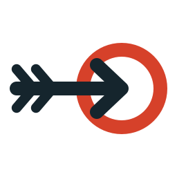

- **Why it fits.** Two plain words that say the whole method: choose a goal and keep your aim honest. It carries Pinpoint's precision and Aimwell's warmth, and “true” is a carpenter's word for straight and level.
- **The mark.** An arrow flying level into a ring, its tip stopping exactly at the centre.
- **Trademark register.** No live US mark contains AIMTRUE or AIM TRUE in any class.
- **Domains and use.** No app of this name in the App Store, and no education use found on the web. aimtrue.com (2001) shows a placeholder; .io, .co, .org and .net are held. Not registered: aimtrue.app, aimtrue.ai, the education endings, and all eleven .com variants, including aimtrueapp.com and getaimtrue.com.

#### Pinpath (Small namesake)

*Pin the goal. Walk the path.*

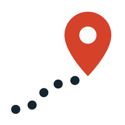

- **Why it fits.** The closest relative of your Pinpoint that is still free. A plan is a path with pins along it: where you start, each milestone, the goal. It says plan and progress in two syllables.
- **The mark.** A dotted path that ends at a map pin. Your pin survives, and the path is the plan.
- **Trademark register.** No live US mark contains PINPATH or PIN PATH in any class.
- **Domains and use.** A travel app, PinPath, uses the name for saved places and audio tours (pinpath.app, and in the App Store under Travel). pinpath.com (2005) is blank; .io, .co and .net are held. Not registered: pinpath.ai, pinpath.org, the education endings, and ten .com variants, including pinpathapp.com and getpinpath.com.

#### Waypin (Small namesake)

*A pin for every step of the way.*

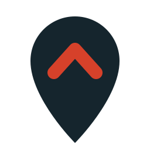

- **Why it fits.** Waypoint and Pinpoint folded into one word. A waypin marks a place on the route: the last lesson, the next one, the goal.
- **The mark.** A map pin with an upward chevron inside it: here, and onward.
- **Trademark register.** One live US mark contains the word: [WAYPIN SION](https://tsdr.uspto.gov/#caseNumber=90631122&caseType=SERIAL_NO&searchType=statusSearch), for kitchenware. Nothing in software or education.
- **Domains and use.** Two small apps use the name: WayPin, which pins notes to places, and a travel journal. waypin.com (2023) is blank; .app, .org and .net are held. Not registered: waypin.io, waypin.co, waypin.ai, the education endings, and ten .com variants, including waypinapp.com.

#### Pinwell (Small namesake)

*Pin the goal. Do it well.*

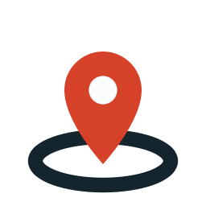

- **Why it fits.** Your Pinpoint crossed with Aimwell, the one clear name from the first batch. Friendly, short and easy to spell.
- **The mark.** A pin landing in the centre of a ring.
- **Trademark register.** No live US mark contains PINWELL or PIN WELL in any class.
- **Domains and use.** A new app, Pinwell, tracks medication doses (pinwell.app, registered in 2026, and in the App Store). pinwell.com (2007) shows no site; .io, .co and .net are held. Not registered: pinwell.ai, pinwell.org, the education endings, and all eleven .com variants.

#### Goalpin (Clear)

*Every plan needs a pin to aim at.*

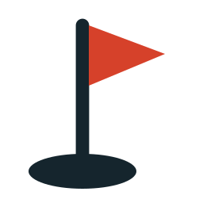

- **Why it fits.** In golf, the flag you aim at is called the pin. Goalpin names the thing a plan points toward, and it keeps your pin.
- **The mark.** A golf pin: a flag standing in its hole.
- **Trademark register.** No live US mark contains GOALPIN or GOAL PIN in any class.
- **Domains and use.** No app of this name and no use found on the web. goalpin.com was registered in 2026 and shows a blank page, so someone else has had the idea. Not registered: goalpin.app, .io, .co, .ai, .org, .net, the education endings, and all eleven .com variants.

#### Pushpin (Small namesake)

*Pin the plan where everyone can see it.*

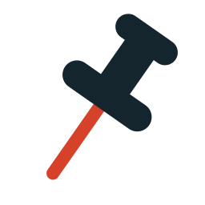

- **Why it fits.** The friendliest pin there is. A pushpin holds a plan on the wall where the tutor, the student and the parent can all see it.
- **The mark.** A pushpin at an angle, its needle in the accent colour.
- **Trademark register.** One live US mark contains the word: [PUSHPIN PAINTING](https://tsdr.uspto.gov/#caseNumber=90578254&caseType=SERIAL_NO&searchType=statusSearch), in the paper-goods class. Nothing in software or education.
- **Domains and use.** An established bookmarking app, Pushpin for Pinboard, uses the name. Every main ending is taken, and pushpin.co and pushpin.ai are for sale. Not registered: the education endings and eight .com variants, including usepushpin.com and pushpinhq.com.

#### Pointwell (Small namesake)

*Know the point. Make it well.*

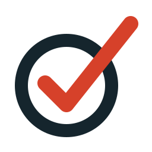

- **Why it fits.** Pinpoint's “point” with Aimwell's “well”. It sounds established, like a place name, which suits a platform that sits behind other organizations.
- **The mark.** A ring with a tick striking through it.
- **Trademark register.** Four live US marks contain the words, none in software or education: [POINTWELL CONSULTING](https://tsdr.uspto.gov/#caseNumber=87853245&caseType=SERIAL_NO&searchType=statusSearch) (twice), POINT WELL TAKEN and POINT WELL MADE.
- **Domains and use.** Other Pointwells trade in investments (pointwell.com), consulting, and health care (pointwell.co). pointwell.io and .ai were registered in 2026 and are parked. Not registered: pointwell.app, pointwell.org, the education endings, and all eleven .com variants.

#### Toehold (Small namesake)

*Every hard thing starts with a toehold.*

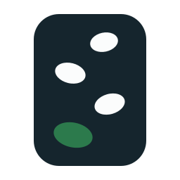

- **Why it fits.** A toehold is the first small grip that lets you start a climb. It is honest about how learning begins: with one secure place to stand. It is a real word with no trademark on it at all.
- **The mark.** A climbing wall with four holds, the lowest in the accent colour: the first grip.
- **Trademark register.** No live US mark contains TOEHOLD or TOE HOLD in any class. For a dictionary word that is rare.
- **Domains and use.** Small namesakes: a web tool for getting started on a task (toehold.app, 2026) and a sudoku-teaching game in the App Store. toehold.academy was registered in 2026 and shows a blank page. toehold.com (2010) shows no site. Not registered: toehold.io, toehold.co, toehold.education, .school and .study, and ten .com variants, including toeholdapp.com.

#### Stonestep (Clear)

*One stone, then the next.*

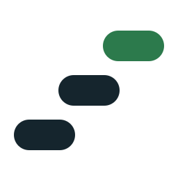

- **Why it fits.** Stepping stones across a stream: you reach the next one only from the one you are standing on. It keeps the calm of Cairn, which was taken.
- **The mark.** Three stones rising left to right, the top one in the accent colour.
- **Trademark register.** No live US mark contains STONESTEP or STONE STEP in any class.
- **Domains and use.** No app of this name and no education use found. stonestep.com (2001) carries a bare page and stonestep.org is held. Not registered: stonestep.app, .io, .co, .ai, .net, the education endings, and all eleven .com variants. This is the emptiest field of all thirty-two names.

#### Steprise (Small namesake)

*Each step has a rise.*

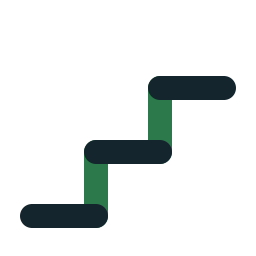

- **Why it fits.** Stair builders measure every step by its rise. The name puts progress into the unit of the plan: step, rise, step, rise.
- **The mark.** A stair in profile with the risers in the accent colour.
- **Trademark register.** No live US mark contains STEPRISE or STEP RISE in any class.
- **Domains and use.** Two small apps, StepRise and StepRise Fitness, are in the App Store. steprise.com is for sale and steprise.io is in use. Not registered: steprise.co, steprise.ai, the education endings, and ten .com variants.

#### Levelwise (Caution)

*Level by level.*

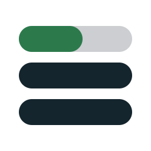

- **Why it fits.** The app already measures progress in levels, and “-wise” means both “in the manner of” and “sensible”. It describes how the product works more exactly than any other name here.
- **The mark.** Three stacked bars: two levels complete and the third part-filled in the accent colour.
- **Trademark register.** No live US mark contains LEVELWISE or LEVEL WISE in any class.
- **Domains and use.** Two start-ups took the name in 2026. levelwise.app describes tools for “clearer learning and research workflows”, which is close to home, and levelwise.io is a stock-chart product. levelwise.com is for sale. Not registered: levelwise.co, levelwise.ai, the education endings, and nine .com variants.

#### Sopan (Caution)

*A flight of steps.*

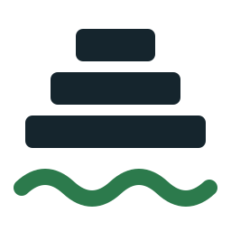

- **Why it fits.** Sopan is the Sanskrit and Marathi word for a staircase: the broad steps that lead up to a temple or down to the water. Five letters, easy to say, almost unclaimed.
- **The mark.** Broad steps narrowing as they rise, with water at their foot.
- **Trademark register.** Two live US marks contain the word, for shirts and for phone accessories. A registration for [SOPAN EDUCATION SERVICES](https://tsdr.uspto.gov/#caseNumber=77532163&caseType=SERIAL_NO&searchType=statusSearch), covering academic monitoring for children, was cancelled. Check whether that business still trades.
- **Domains and use.** No app of note. sopan.com is for sale; .co, .org and .net are held. Not registered: sopan.app, sopan.io, sopan.ai, the education endings, and seven .com variants.

#### Plotwell (Caution)

*Plot the course well.*

- **Why it fits.** The cleaner cousin of Plotpoint: plot a course, plot the points, and do it well.
- **The mark.** A pair of axes with a tick drawn where the line would be.
- **Trademark register.** No live US mark contains PLOTWELL or PLOT WELL in any class.
- **Domains and use.** Plotwell is a paid screenwriting product (plotwell.co), and an allotment-management app of the same name is announced at plotwell.app. plotwell.com (2009) is blank. Not registered: plotwell.io, plotwell.ai, .org, .net, the education endings, and ten .com variants.

#### Lessonmark (Clear)

*Mark every lesson.*

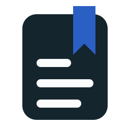

- **Why it fits.** It says what the product does: each lesson leaves a mark, and the marks add up to progress. Nobody will need it explained.
- **The mark.** A page of notes with a bookmark ribbon.
- **Trademark register.** No live US mark contains LESSONMARK or LESSON MARK in any class.
- **Domains and use.** No app of this name and no use found. Only lessonmark.com (2014, blank) is registered. Not registered: lessonmark.app, .io, .co, .ai, .org, .net, the education endings, and all eleven .com variants.

#### Tallymark (Caution)

*Count what you have learned.*

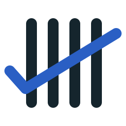

- **Why it fits.** The oldest record of progress there is, and it suits the app's 1 to 5 scale. It keeps Notch's idea without Notch's 179 trademarks.
- **The mark.** A tally of five whose cross-stroke is a tick.
- **Trademark register.** No live US mark contains TALLYMARK or TALLY MARK in any class.
- **Domains and use.** Tallymark is also a student-organization management product in beta (tallymark.io), which is close to education, and a chemical-reporting tool (tallymark.co). Every main ending is taken. Not registered: the education endings and ten .com variants, including tallymarkapp.com.

#### Markstone (Caution)

*Set a stone at every mark.*

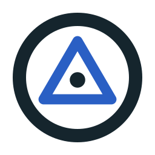

- **Why it fits.** A milestone turned around. Surveyors set a marked stone or disc at each fixed point and measure everything else from it.
- **The mark.** A survey marker: a disc with a triangle and a centre point.
- **Trademark register.** Two live US marks, neither in software or education: [MARKSTONE](https://tsdr.uspto.gov/#caseNumber=90893757&caseType=SERIAL_NO&searchType=statusSearch) for wine, and MARC STONE, pending, for clothing.
- **Domains and use.** Markstone is a Markdown notes app for Mac and iPhone (markstone.app) and a merchandise company (markstone.co). Every main ending is taken. Not registered: the education endings and ten .com variants.

### Good names the screen removed

| Name | The appeal | What ruled it out |
| --- | --- | --- |
| Planwell | Plan well. | PLANWELL is registered for document software and was filed again in October 2026 for benefits-plan software. |
| Planwise | Plan wisely. | ETS owns PLANWISE for a lesson-planning app for teachers. |
| Planrise | Plan, then rise. | No US mark, but PlanRise is an exam-preparation planner for school pupils in Turkey, listed in the App Store under Education. |
| Waymark | A marker on the trail. | Eleven exact marks, six in these classes, one for a children's education programme. |
| Tern | A set of three, and a bird that crosses the world. | Eight exact marks, four in these classes. |
| Lemma | In mathematics, a stepping-stone result. | Registered three times in these classes, once for software-design training. |
| Belay | The rope a partner holds while you climb. | Registered for children's mental-health education, among at least 17 exact marks. |
| Daymark | A beacon you steer by in daylight. | At least four exact marks in these classes, including care-management software. |
| Coursewell | Stay the course, well. | Registered for educational assessment services. |
| Handrail | Something steady to hold on the stairs. | A pending application covers training and education for veterans. |
| Nockpoint | The spot on a bowstring where the arrow always sits. | No mark, but a data-platform company trades as Nockpoint. |
| Gradus | Latin for step, as in the old teaching title Gradus ad Parnassum. | No software marks, but education apps already use it and every main domain is gone. |

## Batch one: the first sixteen, checked afterwards

Mostly real words. Nine turned out to be taken or too close to an education mark, the owner's
Pinpoint among them, and a tenth (Stepwell) fell on a second look: it is an education product with
no federal registration, so the register missed it.

| Name | Verdict | US marks | Closest conflict or namesake | The exact .com | Not registered on 13 Oct 2026 |
| --- | --- | --- | --- | --- | --- |
| [Aimwell](#aimwell) | Small namesake | 2 / 1 / 1 | AIMSWEB, Pearson's student-progress software (a look-alike). The one exact mark is breath-training hardware. | Textile wholesaler (registered 1999) | aimwell.io, the four education endings, and eight .com variants such as aimwellapp.com and tryaimwell.com |
| [Plotpoint](#plotpoint) | Caution | 1 / 1 / 0 | PlotPoint, a literature app for grades 6 to 12, in use but not registered. | Registered 1997, no site | The education endings, and eight .com variants such as plotpointapp.com and useplotpoint.com |
| [Foothold](#foothold) | Caution | 15 / 5 / 0 | MYFOOTHOLD, pending since June 2026 for an exam-prep and course-delivery app. | Registered 1996, no site | The education endings, and footholdlearn.com |
| [Uptick](#uptick) | Caution | 13 / 6 / 5 | Five UPTICK software marks, all outside education. | E-commerce company | The education endings, and joinuptick.com, upticklearn.com, uptickacademy.com |
| [Chalkline](#chalkline) | Caution | 5 / 5 / 2 | CHALKLINE, registered for sports-betting app software. | That betting-software company | The education endings, and chalklinelearning.com, chalklinelearn.com, chalklineacademy.com |
| [Fletch](#fletch) | Caution | 21 / 5 / 1 | FLETCH, F5's cloud-monitoring software. | Redirects to a broadcast company | fletch.education, .school, .study, and six .com variants such as usefletch.com |
| [Stepwell](#stepwell) | Avoid | 3 / 2 / 0 | Stepwell, a special-education compliance platform for school districts, partnered with PowerSchool. Unregistered, so the register missed it. | Registered 2002, no site | The education endings and seven .com variants, which no longer matters |
| [Pinpoint](#pinpoint) | Avoid | 151 / 65 / 35 | PINPOINT for software that trains and tests office-software users (Kelly). Also Google and LinkedIn. | Redirects to a personal profile | pinpoint.school, pinpoint.study, pinpointlearn.com |
| [Trigpoint](#trigpoint) | Avoid | 1 / 1 / 0 | Trigpoint, AI tutoring for UK schools, with a UK mark in all three classes. | Registered 2011, no site | The education endings and the .com variants, which no longer matters |
| [Rung](#rung) | Avoid | 18 / 2 / 1 | RUNG FOR WOMEN, registered for training. Rung Learning is in use. | Held by a domain investor | rung.school, runglearn.com |
| [Cairn](#cairn) | Avoid | 59 / 17 / 6 | CAIRN UNIVERSITY, and CAIRNLARK, pending for learning software. | In use | cairn.study only |
| [Throughline](#throughline) | Avoid | 22 / 5 / 4 | THROUGHLINE for online courses, and for progress-tracker software. | In use | The education endings, and throughlinelearn.com, throughlineacademy.com |
| [Notch](#notch) | Avoid | 179 / 18 / 5 | Five NOTCH software marks. TOP NOTCH TUTORING. | Mechanical contractor | The education endings, and notchlearning.com, notchlearn.com |
| [Trellis](#trellis) | Avoid | 70 / 23 / 9 | TRELLIS, a learning management system. | In use (Trellis Partners) | Nothing |
| [Tessera](#tessera) | Avoid | 38 / 23 / 14 | TESSERA, ACT's educational assessment. | Redirects to a licensing company | Nothing |
| [Crescendo](#crescendo) | Avoid | 68 / 28 / 9 | CRESCENDO for “computer programs”. CRESCENDO EDUCATION GROUP. | Documentation-software company | crescendo.school, crescendohq.com, crescendolearn.com |

#### Pinpoint (Avoid)

*Know exactly where you are. Aim at where you are going.*

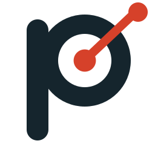

- **Why it fits.** It covers both halves of the product: an assessment pins down where a learner stands, and a plan aims at the goal. Everyone knows the word and can spell it.
- **The mark.** Your idea, drawn: the bowl of the P is a target and a pin lands in the centre. Keep the pin short so it survives at icon size. The second version puts the pin and the target on the two i dots.
- **Trademark register.** 151 live US marks contain the word. 65 are exactly PINPOINT and 35 of those are in the software and education classes. Owners include [Google](https://tsdr.uspto.gov/#caseNumber=90572678&caseType=SERIAL_NO&searchType=statusSearch) (journalism software), [LinkedIn](https://tsdr.uspto.gov/#caseNumber=98476725&caseType=SERIAL_NO&searchType=statusSearch) (games), Bose, Stryker and Cognex. The closest is [Kelly's PINPOINT](https://tsdr.uspto.gov/#caseNumber=74573403&caseType=SERIAL_NO&searchType=statusSearch), filed in 1994 and still renewed, for software that trains and tests users of office software. Adding “Academy” is unlikely to help, because a descriptive word carries little weight when marks are compared. No live mark is PINPOINT ACADEMY or PINPOINT LEARNING. Abroad there are 60 more exact marks in these classes.
- **Domains and use.** pinpoint.com, .app, .io, .co, .ai, .org, .net, .education and .academy are all registered. So are pinpointacademy.com (2009) and pinpointlearning.com (an advisory firm). Only pinpoint.school, pinpoint.study and pinpointlearn.com are not.

#### Aimwell (Small namesake)

*Set the aim. Mark the progress.*

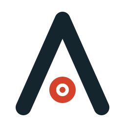

- **Why it fits.** A warmer cousin of Pinpoint. “Aim” is the plan and “well” is the encouragement, and it works for a seven-year-old and an adult alike.
- **The mark.** A capital A drawn as an arrowhead pointing up, with a small target sitting where the crossbar would be.
- **Trademark register.** Two live US marks contain the word and neither is software or education: [AIMWELL](https://tsdr.uspto.gov/#caseNumber=79230097&caseType=SERIAL_NO&searchType=statusSearch) for breath-training masks and devices (an Australian company, also registered in the UK and at WIPO) and AIMWELL FINANCIAL. The one to ask a lawyer about is Pearson's AIMSWEB, registered for software that tracks student achievement. It is a different word in the same field with the same first syllable.
- **Domains and use.** aimwell.com, registered in 1999, is a textile wholesaler; .app is parked and .co and .ai are held. Not registered: aimwell.io, aimwell.education, .academy, .school and .study, and tryaimwell.com, useaimwell.com, joinaimwell.com, aimwellapp.com and aimwelllearning.com. A staffing firm, Aimwell AI, registered getaimwell.com and aimwellhq.com on 9 October 2026.

#### Fletch (Caution)

*The part of the arrow that keeps it true.*

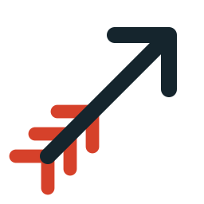

- **Why it fits.** The fletching is the feathers at the back of an arrow: it does not supply the force, it keeps the flight straight. That is a fair description of a tutor and a plan.
- **The mark.** An arrow in flight with three accent vanes at the tail. The vanes are the logo; the arrow is the learner.
- **Trademark register.** F5, a large networking company, owns [FLETCH](https://tsdr.uspto.gov/#caseNumber=90045845&caseType=SERIAL_NO&searchType=statusSearch) for cloud-monitoring software as a service. Other exact marks cover marketing and finance. None covers education.
- **Domains and use.** fletch.ai redirects to F5, fletch.co is a fintech, fletch.com redirects to a broadcast company and fletch.io is held by a brand-protection registrar. Not registered: fletch.education, .school and .study, and usefletch.com, joinfletch.com, fletchhq.com, fletchlearning.com and fletchacademy.com.

#### Trigpoint (Avoid)

*Fix your position, then climb.*

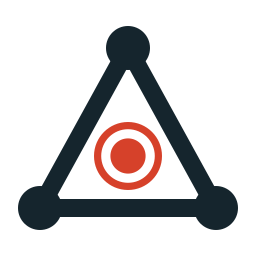

- **Why it fits.** A trig point is the surveyor's pillar on a hilltop, used to fix a position by triangulation. It joins the pinpoint idea to the triangle in the first organization's name.
- **The mark.** A triangle with a station at each corner and one accent point fixed inside it.
- **Trademark register.** The US register has only [TRIG POINT](https://tsdr.uspto.gov/#caseNumber=85245409&caseType=SERIAL_NO&searchType=statusSearch) for wine. But a UK company, Trigpoint OS Ltd, registered Trigpoint in classes 9, 41 and 42 in March 2026.
- **Domains and use.** trigpoint.ai is “AI tutoring with safeguarding for UK schools”: the name belongs to a direct competitor. trigpoint.io, .org and .ai were registered within two days of each other in March 2026. The .com variants are free, which no longer matters.

#### Foothold (Caution)

*Every lesson, a place to stand.*

- **Why it fits.** Whatever you have mastered is where you stand to reach the next thing. It works for algebra, Spanish or guitar, it is modest, and people already say “get a foothold in” a subject.
- **The mark.** A flight of steps cut into solid ground, with the learner on the middle one: part of the way up and still climbing.
- **Trademark register.** No live mark is FOOTHOLD alone in software or education, in the US or abroad. Three neighbours matter. [MYFOOTHOLD](https://tsdr.uspto.gov/#caseNumber=99883222&caseType=SERIAL_NO&searchType=statusSearch): two applications filed on 13 June 2026 for an app covering licensure exam preparation and continuing-education course delivery for health professionals. They are pending and have the earlier filing date. [FOOTHOLD TECHNOLOGY](https://tsdr.uspto.gov/#caseNumber=76167014&caseType=SERIAL_NO&searchType=statusSearch): registered for database software for non-profits. [FIND YOUR FOOTHOLD.](https://tsdr.uspto.gov/#caseNumber=97179931&caseType=SERIAL_NO&searchType=statusSearch): registered for IT training.
- **Domains and use.** Every main ending is taken: foothold.com (1996, no site), .app, .io and .co; foothold.ai, .net and .org are parked or for sale. Start-ups took the variants in 2025 and 2026: a personal-finance app at usefoothold.com, a strategy workspace at footholdapp.com, and footholdlearning.com was registered in June 2026. Not registered: foothold.education, .academy, .school and .study, and footholdlearn.com.

#### Rung (Avoid)

*One rung at a time.*

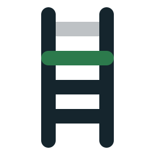

- **Why it fits.** The app already measures progress on a curriculum ladder of levels and topics. This names the unit of that ladder, in four letters.
- **The mark.** A ladder whose lower rungs are solid, the next rung is in the accent colour and the one above is faint. The logo is a progress indicator.
- **Trademark register.** [RUNG](https://tsdr.uspto.gov/#caseNumber=88056086&caseType=SERIAL_NO&searchType=statusSearch) and [RUNG FOR WOMEN](https://tsdr.uspto.gov/#caseNumber=97347418&caseType=SERIAL_NO&searchType=statusSearch) are registered to the Rung Foundation for career counselling, training and coaching. RUNG for education would sit directly beside that training mark. RUNGS is pending for online games.
- **Domains and use.** Rung Learning (runglearning.com) sells live AI lessons with the line “one rung at a time”. rung.education is in use, and rung.academy and rung.study were both registered on 13 October 2026. Only rung.school and runglearn.com are not registered.

#### Cairn (Avoid)

*Stone by stone, the way gets marked.*

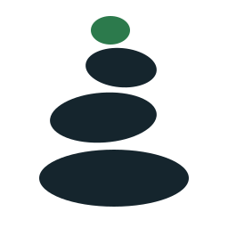

- **Why it fits.** A cairn is the pile of stones that marks a trail. Someone who walked it before you built it, each traveller adds a stone, and it tells you that you are still on the route. Plan, guide and progress in one image.
- **The mark.** Three stacked stones with a small accent pebble on top. It is the simplest mark on this page and the best at 60 pixels.
- **Trademark register.** 59 live US marks contain the word and 17 are exact. [CAIRN UNIVERSITY](https://tsdr.uspto.gov/#caseNumber=98052182&caseType=SERIAL_NO&searchType=statusSearch) is registered for college courses. [CAIRNLARK](https://tsdr.uspto.gov/#caseNumber=50131908&caseType=SERIAL_NO&searchType=statusSearch) was filed in September 2026 for learning-simulation and assessment software. CAIRN alone is registered for a [wilderness-safety app](https://tsdr.uspto.gov/#caseNumber=86312021&caseType=SERIAL_NO&searchType=statusSearch) and a video game, and three more software applications for CAIRN were filed between July and October 2026. Abroad, 20 exact marks sit in these classes.
- **Domains and use.** Everything is taken, including cairn.education, .academy and .school and every .com variant checked. Only cairn.study is not registered.

#### Stepwell (Avoid)

*Step by step, down to the source.*

- **Why it fits.** A stepwell is the stone well of western India where flights of steps lead down to the water. It turns the climb upside down: you go deeper, towards the source. “Step” and “well” are both friendly words on their own.
- **The mark.** The well in cross-section: steps descending from both sides to a pool in the accent colour.
- **Trademark register.** Three live US marks, none in software or education: STEPWELL for floor matting and for a medical device, and [TREND BY STEPWELL](https://tsdr.uspto.gov/#caseNumber=98891797&caseType=SERIAL_NO&searchType=statusSearch) for digital signage. The register looked clean because the education product below has no federal registration.
- **Domains and use.** Stepwell is a special-education compliance platform sold to school districts by Red Cedar Solutions Group, [in partnership with PowerSchool since June 2023](https://www.businesswire.com/news/home/20230608005712/en). I missed it in the first pass. stepwell.app is also a family memorisation app, and gostepwell.com offers training. The domains that are free no longer matter.

#### Trellis (Avoid)

*Structure that things grow on.*

- **Why it fits.** The best metaphor for tutoring on this page. A trellis does none of the growing; it gives the plant a shape to grow along, and then disappears behind it.
- **The mark.** A diamond lattice with two accent leaves climbing one diagonal.
- **Trademark register.** TRELLIS is registered for a [learning management system](https://tsdr.uspto.gov/#caseNumber=97269546&caseType=SERIAL_NO&searchType=statusSearch) (Crescere Frameworks, North Carolina) and for [special-education courses](https://tsdr.uspto.gov/#caseNumber=86708361&caseType=SERIAL_NO&searchType=statusSearch) (Learn-It Systems). Nine exact marks sit in these classes in the US and 18 abroad.
- **Domains and use.** Nothing checked is free: all eleven endings and all eleven .com variants are registered.

#### Throughline (Avoid)

*From the first lesson to the goal, one line.*

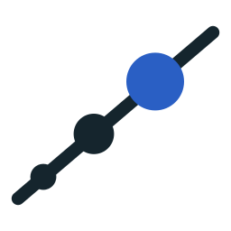

- **Why it fits.** A throughline is the thread that holds a story together. Here it is the plan: the one line that connects this week's lesson to the goal set months ago.
- **The mark.** A single rising line with points that grow as they go, the latest one in the accent colour. It doubles as a progress chart.
- **Trademark register.** THROUGHLINE is registered for [online courses and training](https://tsdr.uspto.gov/#caseNumber=88166853&caseType=SERIAL_NO&searchType=statusSearch) (Throughline Group) and for podcasts (NPR). A third, allowed in 2026, covers [software for therapy plans, schedules and progress trackers](https://tsdr.uspto.gov/#caseNumber=99665384&caseType=SERIAL_NO&searchType=statusSearch), and a fourth is pending for project-management software.
- **Domains and use.** throughline.com is in use, and throughline.ai redirects to Lexsee, an AI reading tool for learners. Not registered: throughline.education, .academy, .school and .study, and throughlinelearn.com and throughlineacademy.com.

#### Chalkline (Caution)

*Mark the line, then follow it.*

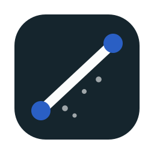

- **Why it fits.** A chalk line is the builder's string that snaps a straight mark before any cutting starts. That is planning. And chalk still means teaching to everyone.
- **The mark.** A slate tile with one chalk stroke snapped between two pins.
- **Trademark register.** [CHALKLINE](https://tsdr.uspto.gov/#caseNumber=87027215&caseType=SERIAL_NO&searchType=statusSearch) is registered for mobile-app software for sports-betting analysis, and CHALK LINE for graphic design. An identical mark for mobile apps in another field is a real chance of an objection. Nothing abroad.
- **Domains and use.** chalkline.com belongs to that betting-software company and chalkline.app is an invoicing app for contractors. A web-design business registered getchalkline.com and four more variants on 2 August 2026. Not registered: chalkline.education, .academy, .school and .study, and chalklinelearning.com, chalklinelearn.com and chalklineacademy.com.

#### Plotpoint (Caution)

*Plot the course. Plot the points.*

- **Why it fits.** Two meanings that are both true of the app: you plot a course, and each assessment is a point plotted on a chart. It keeps the rhythm of Pinpoint.
- **The mark.** Two axes and one plotted point, with dashed guides down to each axis.
- **Trademark register.** The US register is nearly empty: one live mark, [PLOT + POINT](https://tsdr.uspto.gov/#caseNumber=88768167&caseType=SERIAL_NO&searchType=statusSearch), for wine. Nothing in software or education, here or abroad.
- **Domains and use.** The register misses use without registration. PlotPoint is a literature app for grades 6 to 12, and plotpoint.io is a location-based storytelling app. plotpoint.com (1997), .app and .ai are registered with no site. Not registered: plotpoint.education, .academy, .school and .study, and tryplotpoint.com, useplotpoint.com, joinplotpoint.com, plotpointapp.com and plotpointlearning.com.

#### Uptick (Caution)

*Small ticks, steady climb.*

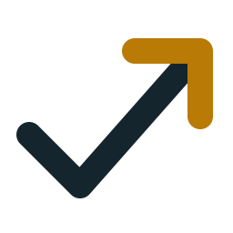

- **Why it fits.** A tick is a thing done; an uptick is a small rise. Put together it is the product's promise in six letters, and it is cheerful without being childish.
- **The mark.** A tick whose long stroke keeps going and turns into a rising arrow. One gesture, readable at any size.
- **Trademark register.** Six live US marks are exactly UPTICK and five sit in the software classes, all in other fields: an [investing app](https://tsdr.uspto.gov/#caseNumber=97341018&caseType=SERIAL_NO&searchType=statusSearch) (pending), ticket repricing, [building-maintenance software](https://tsdr.uspto.gov/#caseNumber=79319725&caseType=SERIAL_NO&searchType=statusSearch) (also registered in Canada and at WIPO) and crypto articles. None covers education. Each is a possible objection.
- **Domains and use.** uptick.com is an e-commerce company; uptick.app is for sale, uptick.io is parked and uptick.ai is a finance product. Not registered: uptick.education, .academy, .school and .study, and joinuptick.com, upticklearn.com and uptickacademy.com.

#### Notch (Avoid)

*Take it up a notch.*

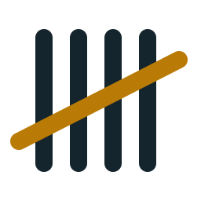

- **Why it fits.** Notches on a stick are the oldest progress tracker there is, and the phrase everyone knows is about getting better. The app's 1 to 5 scale fits a five-mark tally exactly.
- **The mark.** A tally of five: four strokes and the accent stroke across them.
- **Trademark register.** 179 live US marks contain the word. NOTCH alone is registered five times in these classes, including [real-time graphics software](https://tsdr.uspto.gov/#caseNumber=97389938&caseType=SERIAL_NO&searchType=statusSearch) and a restaurant-supply app. In education: [TOP NOTCH TUTORING](https://tsdr.uspto.gov/#caseNumber=97028303&caseType=SERIAL_NO&searchType=statusSearch) for maths and science tutoring, [UPNOTCH](https://tsdr.uspto.gov/#caseNumber=90817767&caseType=SERIAL_NO&searchType=statusSearch) for mentoring through an app, and Pearson's TOP NOTCH.
- **Domains and use.** notch.com is a mechanical contractor; .app, .io, .co and .ai are taken. Not registered: notch.education, .academy, .school and .study, and notchlearning.com and notchlearn.com.

#### Tessera (Avoid)

*Each lesson, a piece of the picture.*

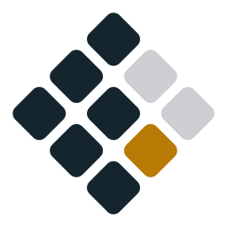

- **Why it fits.** A tessera is one tile of a mosaic. No single tile means much; the picture appears as they accumulate. That suits a record built from many short lessons.
- **The mark.** A diamond of nine tiles, most laid, one in the accent colour, two still empty.
- **Trademark register.** ACT owns [TESSERA](https://tsdr.uspto.gov/#caseNumber=98590314&caseType=SERIAL_NO&searchType=statusSearch) and [ACT TESSERA](https://tsdr.uspto.gov/#caseNumber=87501125&caseType=SERIAL_NO&searchType=statusSearch), registered for educational assessment of social and emotional skills. Fourteen exact marks sit in these classes, and Microsoft filed for TESSERA on 12 October 2026.
- **Domains and use.** Nothing checked is free: all eleven endings and all eleven .com variants are registered.

#### Crescendo (Avoid)

*Learning that builds.*

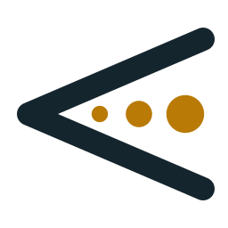

- **Why it fits.** The musical term for growing gradually louder. It describes steady improvement and it carries some joy, which the practical names do not.
- **The mark.** The crescendo hairpin from sheet music, opening to the right, with three points growing inside it.
- **Trademark register.** [CRESCENDO](https://tsdr.uspto.gov/#caseNumber=73507151&caseType=SERIAL_NO&searchType=statusSearch) was filed in 1984 for “computer programs” with no limit on field and is still renewed, which stands in the way of any software of that name. [CRESCENDO EDUCATION GROUP](https://tsdr.uspto.gov/#caseNumber=98318676&caseType=SERIAL_NO&searchType=statusSearch) is registered for online training about student grading and achievement. 27 exact marks abroad sit in these classes.
- **Domains and use.** crescendo.com is a documentation-software company and crescendo.app is for sale. Only crescendo.school, crescendohq.com and crescendolearn.com are not registered.

### Names dropped before batch one

| Name | The appeal | The problem | Basis |
| --- | --- | --- | --- |
| Stepwise | The obvious name for plans made of steps. | [Querium's StepWise](https://craft.co/querium) is an AI maths tutor, and STEPWISE is registered for tutoring software. | searched |
| Waypoint | Marks along a planned route. | [Mathspace Waypoints](https://mathspace.co/au/get-started) is a maths assessment tool, and there is a [Waypoint School](https://apps.apple.com/us/app/id6504808348) app. | searched |
| Lodestar | The star you steer by. | [Lodestar LMS](https://apps.apple.com/py/app/lodestar-lms/id6450936980) exists, and [L0destar](https://www.startuphub.ai/startups/l0destar) sells learning paths with progress tracking. | searched |
| Stride | Hitting your stride. | Stride, Inc. is one of the largest online-schooling companies in the US. | from memory |
| Summit | The top of the climb. | Summit Learning is an established school platform. | from memory |
| Headway | Making headway. | Headway is a large daily-learning app. | from memory |
| Upswing | Things getting better. | Upswing provides online tutoring to colleges. | from memory |
| Tandem | Tutor and learner pedalling together. | Tandem is a well-known language-exchange app. | from memory |
| Delta | The symbol for change, and a triangle. | DeltaMath is widely used in schools. | from memory |
| Two Sigma | Bloom's finding that one-to-one tutoring lifts a student two standard deviations. The best story in tutoring research. | It is the name of a large investment firm. | from memory |

## How it was checked, and what it does not cover

- **US trademarks.** The USPTO's own search, live marks only (registered or pending), for each
  name and its spaced spelling. Every name shown was also searched in the pseudo-mark field, which
  catches sound-alikes. 900 live marks were read across both batches.
- **A rate limit.** The USPTO limits automated lookups, and part-way through batch two it began
  refusing them, which made some names look falsely clean. The lookups were slowed to stay inside
  the limit and every name was re-run. No result here rests on a failed lookup.
- **Abroad.** Batch one was checked at the EU, UK, Canadian, Australian and Indian offices and at
  WIPO through TMview. TMview stopped answering automated lookups during batch two, so batch two
  has no overseas check.
- **Domains.** 1,078 lookups at the registries themselves (RDAP, and WHOIS where a registry has no
  RDAP): each name on eleven endings and in eleven common .com patterns such as get-, try-, -app
  and -learning. "Not registered" says nothing about price.
- **Use without registration.** Each registered exact domain was opened to see who is there, batch
  two was also searched in the App Store, and each shown name was searched on the web. Stepwell
  shows that this still misses things.
- **Not covered.** State trademark registers, logo marks, Google Play, and a lawyer's judgment of
  how close is too close.

## Files here

| File | What it holds |
| --- | --- |
| [name-board.html](name-board.html) | The board as it was presented: both batches, with logos. Open it in a browser. |
| [logos/](logos/) | One SVG per name, 32 in all: ink plus one accent, on a 64-unit canvas. |
| [icon-options.html](icon-options.html) | The eight app icons drawn for Aimtrue after the first was rejected; option 7 was chosen. |
| [data/trademarks.csv](data/trademarks.csv) | Every live US mark read: batch, name, word mark, status, classes, owner, serial number. |
| [data/domains.csv](data/domains.csv) | Every domain looked up in full: batch, name, domain, status, year registered. |

## Sources for use found on the web

- [PowerSchool and Stepwell partnership](https://www.businesswire.com/news/home/20230608005712/en)
- [Stepwell platform coverage](https://thejournal.com/articles/2023/06/15/new-platform-supports-compliance-and-monitoring-for-special-ed.aspx)
- [Pinpoint Learning](https://podcast.mrbartonmaths.com/?p=2380), [Pearson Pinpoint](https://pearson.com/international-schools/british-curriculum/primary-curriculum/pinpoint-family.html)
- [Querium StepWise](https://craft.co/querium), [Trellis LMS](https://elearningindustry.com/directory/elearning-software/trellis-lms)
- [Plotwell screenwriting software](https://alternativeto.net/software/plotwell/about/), [WayPin app](https://apps.apple.com/app/id6479329104)
- Trademark records link to the USPTO's status page by serial number.
