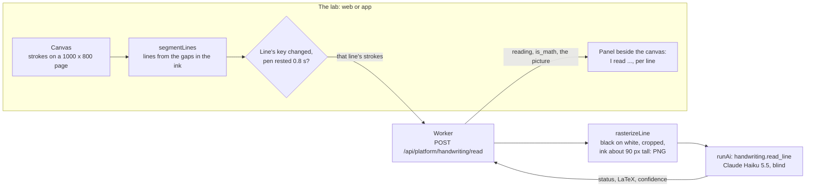

# The think-aloud canvas (AI-13), stage by stage

Requested by the owner on 2026-10-28: "an agentic development environment towards building AI-13,
the think-aloud canvas". The Assessment canvas already lets a student work maths by hand; the
eventual goal is to read what they write as they write it, check it, and show them at once whether
they are heading the right way. **Phase one: read what is being written, and show what was read in
a panel beside the canvas.** Later phases are planned as we go.

Built on its own branch (`claude/great-turing-em8i3e`) while other work continues on `main`. The
phase is numbered 54 here, the next after 53; renumber it if `main` takes 54 first.

The research and the full design are in the roadmap: [AI-13](roadmap/future-ai.md#ai-13--the-think-aloud-canvas)
and [think-aloud-canvas.md](roadmap/think-aloud-canvas.md). This page is what is built, and how to
carry it on.

## Where phase one sits

The roadmap stages AI-13 so that nothing a child writes reaches a model before consent exists:

| Stage | What | A child's ink leaves the tablet? |
| --- | --- | --- |
| **0. The spike** | Measure readers on adults' handwriting | No: adults only |
| 1. Hints on request | Approved hint ladders in the bank; no AI at run time | No |
| 2. The canvas reads | Each line read, code judges it, a "?" with "I read: …" | One line's picture, with `ai_processing` consent |
| 3. Practising alone | Signed-in students, a summary for the tutor | The same |
| 4. What code cannot check | A model's view of words and drawings, to the tutor first | The same |

**Phase 54 is stage 0, built as a tool rather than a one-off spike**: the reader, the panel beside
the canvas, a lab to write in, a corpus of samples, and an evaluation that scores the reader against
them. Everything stage 2 needs to read a line is here; what stage 2 adds is the consent, the
student's canvas wiring, and code judging what was read.

**Why the lab, and not the Assessment canvas, first.** `runAi` refuses every `child_input` task until
parental consent for AI processing exists (AG1, roadmap F7), and whoever holds the pen on an
assessment is presumed to be the student. The Handwriting lab is in the platform console, which only
platform admins reach, so every line read in Phase 54 is an adult's. The reading panel and the
line-reading hook are written to drop in beside the student's canvas at stage 2, with their own
`child_input` task.

## How a line is read

- **Finding lines** (`segmentLines`, shared). Strokes sorted by their top; a stroke joins the line
  above when its top is within `lineGap` of that line's lowest ink (40% of the hand's typical
  height, 8 to 30 units), so a stacked fraction stays one line and the next step starts a new one.
  Faint rules on the page (every 100 units) invite one step per line. Each line has a **key**, a
  hash of its strokes, so only a line whose ink changed is read again.
- **When.** Once the pen has rested `HANDWRITING_LIMITS.pauseMs` (800 ms), every line without a
  reading is sent, up to four a request; "Read now" sends at once. While a line is re-read, the panel
  keeps the last words read in its place, greyed.
- **The picture** (`apps/api/src/lib/raster.ts`). Drawn in the Worker from the strokes, so the web
  and the app send the same thing: black ink on white, anti-aliased, cropped to the ink with a margin,
  scaled so the writing is about 90 px tall, as an 8-bit grey PNG (a few KB; roughly 150-300 image
  tokens). The strokes themselves never leave the Worker.
- **The reader** (`apps/api/src/lib/ai/handwriting.ts`). Task `handwriting.read_line`: Claude Haiku
  5.5, effort `low`, tool chosen by name (`tool_choice: 'auto'`). It is given the picture and nothing
  else: no question, no answer, no other line. Its instructions: transcribe exactly, as LaTeX, never
  correct, complete or evaluate ("7 × 8 = 54" stays 7\times8=54), stacked fractions as `\frac`,
  crossed-out marks left out, "unreadable" when unsure. It answers `{status, latex, confidence}`.
  About $0.0001 a line at list price; caps $1 a day, $5 a month until changed on the AI page.
- **What is shown.** "I read: …" typeset, with the reader's confidence. A reading that is not plain
  maths (`isMathReading`: digits, short runs of letters, operators and an allowlist of LaTeX
  commands; never `\text` or a word) would never be shown to a student; the lab shows it with a
  warning, so the rate is visible.
- **Locally**, the provider is `fake`: it cannot see, so it reads each line as its number of
  strokes. That is enough to see the pipeline work. To read for real, put `AI_PROVIDER=anthropic`
  and `ANTHROPIC_API_KEY` in `apps/api/.dev.vars` (never commit the key); production reads with
  the key already set on both Workers.

## The Handwriting lab (`/platform/handwriting`)

- **The page.** Pen, Eraser, Undo, Clear page, **Write a sample line** (the synthetic hand writes the
  next line of `SYNTHETIC_LINES` on the first free rule: no pen needed) and Read now. Each line found
  is marked and numbered on the page, matching the panel; pointing at a row lights its line.
- **The panel**, beside the page (below it on a phone): per line, what was read, its confidence, and:
  - **Right**: keeps the line as a sample, read right.
  - **Not what I wrote** (or **Say what it says** when unreadable): the LaTeX field, prefilled with
    the reading, a typeset preview, Save sample. Keeps the line as a sample with what it says.
  - **What the reader saw**: the PNG the model was given.
  - "Saving lines as" sets the kind of line: a clear step, a slip, messy writing, a stacked fraction,
    half-finished, column arithmetic, something else (the spike's list).
- **Samples.** How many, how many were read right when saved (overall and by kind), the newest 50
  with what they say and what was read, delete, and downloads of the corpus and of the synthetic set.
- **The app.** The same lab, in the console of the iOS and Android app (parity).

## Making the reader better: the loop

The point of the environment: change one thing, measure, keep what helps. **The skill
`.claude/skills/think-aloud-reader/SKILL.md` is the procedure** for an agent; in short:

1. A corpus: the lab's samples (`--corpus=samples`, or a file the lab exported) or the synthetic set
   (`--corpus=synthetic`, built from the shared synthetic hand: 20 lines, each written neatly and
   hurriedly).
2. `npm run handwriting:eval -- --corpus=… --label="what changed"` sends every line through the
   Worker's own read route, so it measures exactly what ships, and prints: read exactly, misread,
   unreadable, failed, not plain maths, how often a confident (≥ 0.9) reading was right, latency,
   and each kind of line. `.handwriting-eval/<time>/report.md` lists every line not read right with
   the picture the reader was given.
3. Look at the misreads, change one of: the instructions (`READ_SYSTEM`), the picture
   (`LINE_IMAGE`), how lines are found (`segmentLines`, `lineGap`), the model or effort
   (`AI_TASKS`), how readings are compared (`normalizeReading`, only for a spelling that genuinely
   means the same).
4. Run it again; record the change and both scores in [think-aloud/reader-log.md](think-aloud/reader-log.md).

Against the fake reader the scores measure the pipeline only (the report says so). Real scores need
the key, locally.

## Routes (`/api/platform/handwriting`, behind `requirePlatformAdmin`)

| Route | What |
| --- | --- |
| `POST /read` `{lines: [{key, strokes, truth?}], include_image?}` | Reads 1-4 lines, each its own blind call. With `truth`, says whether the reading matched. A failed line says why (`error`); the others still come back. |
| `GET /samples?limit=50` | The newest samples and the counts over all of them |
| `POST /samples` | Keeps a line: its strokes, what it says (`truth`, LaTeX, SSN-guarded), its kind, the reading at the time and its model; the Worker decides `matched` |
| `DELETE /samples/:id` | Deletes one (404 when gone) |
| `GET /corpus?source=samples\|synthetic` | The corpus as a JSON file (a plain link) |

Every route is 403 for anyone who is not a platform admin (R14). Reading writes an `ai_runs` row and
no audit line, as a Quest answer writes none; saving and deleting a sample are logged
(`handwriting.sample_saved`, `handwriting.sample_deleted`) with the sample's kind, never what was
written (AG7).

## Data

`handwriting_samples` (platform table, no organization): the line's strokes (wire format, one stroke
per line of text), `truth`, `category`, the reading, its status and model, `matched`, who wrote it and
when. Production SQL: `docs/database.md`, `release=phase-54`. The corpus files and the evaluation's
reports are not committed (`.handwriting-eval/` is ignored); whether staff samples should ever be
committed is the owner's call.

## Tests

- `e2e/tests/handwriting-lab.spec.ts`: the pure parts (finding lines, fractions staying one line,
  keys, `isMathReading`, `normalizeReading`); the routes (validation, the 4-line cap, the SSN guard,
  403 for an organization admin, a tutor and a student; a PNG that really is one); the lab in the
  browser (synthetic lines read, a line re-read only when it changes, Right and a correction saved,
  the summary, delete). Tagged `@smoke` on its main path.
- The app: Jest for its model; a Maestro flow under `apps/mobile/.maestro/flows/handwriting-lab/`.
- `npm run handwriting:eval` against the synthetic set, with the fake: the pipeline end to end.

## Decisions for the owner

1. **Pass marks.** The spike suggested: ≥ 95% of clear lines read exactly; ≤ 2% of wrong lines read as
   right; ≤ 3% of right lines read as wrong; under 2 s from pause to reading for 90% of lines. Stage
   0 measures the first and the last; the middle two need code to judge (stage 2).
2. **Who writes samples.** Platform admins only, for now (the console). Staff could be made platform
   admins for a session, or a later phase could open the lab to an organization's adult staff.
3. **Other readers.** Sonnet 5.5 is one task away. Mathpix and a Workers AI vision model need a new
   provider in `runAi`'s allowlist (AG3) and their terms recorded first.
4. **Forced tool use.** The AI reference consulted on 2026-10-28 says Sonnet 5.5 and Opus 5.5 refuse a
   forced tool (`tool_choice: tool`), which Phase 36's two tasks use. The reader avoids it; the
   question bank's tasks should be checked against the live API (a follow-up, not changed here).
5. **Release.** Production SQL, then both Workers, as CLAUDE.md lays out, once the owner approves.

## Next

- **Stage 1** (no AI at run time): hint ladders, key values and known wrong answers in the bank;
  the student's canvas gains a Hint button.
- **Stage 2**: an `ai_processing` consent purpose (the smallest slice of F7, as Phase 39 planned); a
  `canvas_assessment.read_line` task with `child_input` set; the reading panel beside the
  Assessment canvas, showing only `is_math` readings; code judging each line (`evaluateExact`, the
  question's key values); the "?" in the margin with "I read: …", "That's not what I wrote" and Hint.
- **On the device**, later: a recogniser in the browser or the app, so the ink never leaves the tablet.
