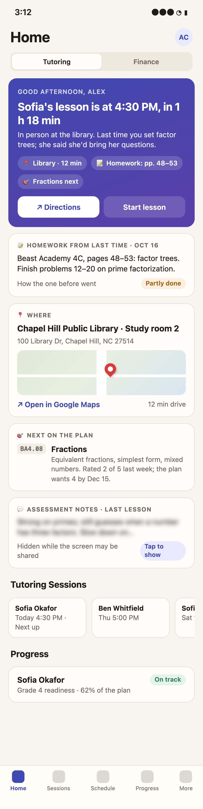
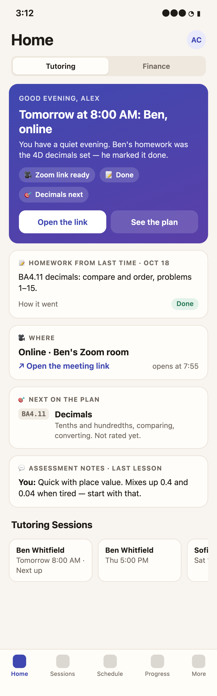
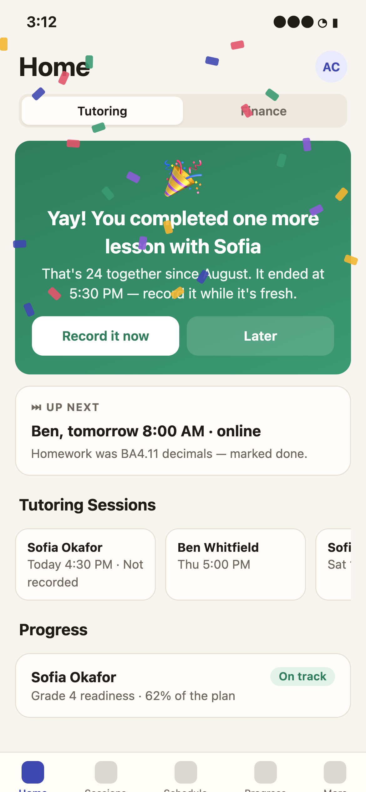
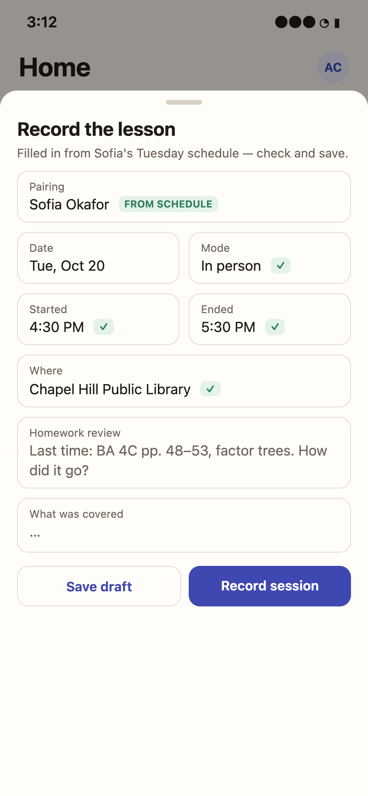
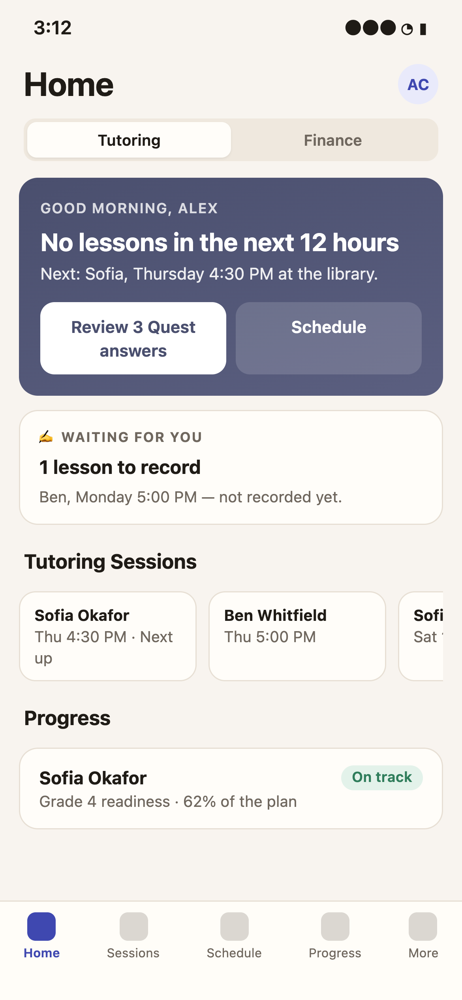

# Phase 43: the tutor's Home

Requested by the owner on 2026-10-20: "This phase is about making the most of the Home Screen for the
tutor. The current Home Screen - dashboard isn't really useful for the tutor." Planned to come next,
ahead of the gamification follow-ons (now Phases 44 and 45). Web and the app, as every phase.

Mockups (phone, the app's colours; rendered from `docs/tutor-home/mockups.html`):

| | |
| --- | --- |
|  |  |
| 1. A lesson later today: the personal message, homework and the place | 2. A lesson tomorrow morning, online |
|  |  |
| 3. Opened after a lesson not yet recorded | 4. Record it now: filled in from the schedule |
|  | |
| 5. Nothing in the next 12 hours | |

The mockups are illustrations: the map tile and the "12 min drive" in mockup 1 are **not** proposed
(they need a Google Maps API key, billing and the phone's location); the card shows the address and an
"Open in Google Maps" link instead.

## What the owner asked for

1. Remove Recent Activity from **everyone's** Home.
2. On a tutor's Home:
   - if the next lesson is within 12 hours, a personal message about it;
   - a card with the homework set at the last lesson;
   - a card with the lesson's place, opening in Google Maps;
   - a card with the next topic on the student's plan;
   - a card with the assessment notes from the previous lesson.
3. When a tutor opens the app after a lesson that has not been recorded: a "Yay, you completed one more
   lesson with STUDENT" banner with confetti, which brings up the record screen filled in from the
   schedule.
4. The "Now" card for a lesson today: the homework from the previous lesson and the link to the place.

## The proposal

### Recent Activity leaves every Home

The admin's, tutor's, parent's and student's dashboards lose their Recent Activity section, on the web
and in the app. The Activity page (`/activity`, More → Activity) stays: the log is still one tap away.
`CLAUDE.md`'s "four sections" rule for the Tutoring tab is rewritten to the new order.

### The "Now" card (top of a tutor's Home)

One card, whichever state applies first:

1. **A lesson ended and not recorded** (mockup 3). A scheduled lesson of the tutor's own pairings whose
   end has passed within the last 24 hours, on the organization's clock, that has no recorded session,
   is not cancelled and is not running. Green card: "Yay! You completed one more lesson with Sofia",
   with "That's 24 together since August" (the pairing's recorded lessons) and when it ended. Confetti
   falls once per lesson per device (stilled by reduce motion), with a success haptic. **Record it now**
   opens the record sheet filled in from the schedule (mockup 4): pairing, date, start and end, mode and
   place, and the homework set last time in "Homework review". This is the app's existing
   record-as-planned sheet (and the web's record dialog, preset) with the homework line added. **Later**
   hides the banner until the next time the app is opened that day; anything older than 24 hours moves
   to a quiet "Waiting for you: 1 lesson to record" line (mockup 5).
2. **A lesson running**: the existing live-lesson bar and "Now" card, unchanged.
3. **A lesson within the next 12 hours** (mockups 1 and 2). A greeting by the time of day ("Good
   afternoon, Alex"), then the lesson: "Sofia's lesson is at 4:30 PM, in 1 h 18 min" (or "Tomorrow at
   8:00 AM: Ben, online"), one sentence built from the brief (the place, the homework), and chips for the
   place, the homework and the next topic. Buttons: **Directions** (a physical place) or **Open the link**
   (virtual), and **Start lesson** from 15 minutes before (before that, **See the plan**). The message
   is put together from the fields below by a template, not written by a model: no student data goes to
   AI (roadmap AI-12, the pre-lesson brief, is the later, consented version).
4. **Nothing in 12 hours** (mockup 5): the next lesson's day and student, and what is waiting (lessons to
   record, Quest answers to review).

### The lesson brief (under the Now card)

For the lesson in the Now card (states 1 and 3), the four cards the owner asked for:

- **Homework from last time**: the last recorded lesson of this pairing's `homework_assigned`, its date,
  and how the homework before it went (`homework_status`). None set: "No homework was set last time."
- **Where**: the schedule's place for this lesson's mode (`schedule_locations`). Physical: name, address
  and **Open in Google Maps** (`https://www.google.com/maps/search/?api=1&query=<address>`, which opens
  the Google Maps app where installed, else the browser; Apple Maps is offered too on iOS). Virtual: the
  meeting link. The address is shown only to the people who already see the location (R16).
- **Next on the plan**: the student's current learning plan, the first topic in plan order whose latest
  rating is below the plan's target, with its code, name, description, latest rating and the plan's
  target date. No plan: "No plan yet" with a link to Progress.
- **Assessment notes from the last lesson**: the assessments on the last recorded lesson that the tutor
  can read (their own, and the student's and parent's, R-rules of Phase 23), **hidden until tapped**:
  the Tutoring tab is used with the student beside the tutor, and these are notes about them.

### What the tutor's Home looks like after

1. The Now card. 2. The lesson brief (when there is a lesson). 3. Tutoring Sessions (the carousel, as
now). 4. Student Reflections (tutor). 5. Progress. Analytics moves below Progress, or onto the Finance
tab's neighbour -- see the open questions. No money anywhere on it (the Tutoring tab rule stands).

## How it is built

- **One read route**, `GET /api/home/tutor`: the Now card's state and the brief, for the viewer's own
  pairings only (`tutor_user_id` = the viewer, as the carousel does). It reuses `expandUpcoming` and
  `NOT_OVERTAKEN_SQL` for the lessons, `session_write_ups` and `session_assessments` for the last
  lesson, `computeProgress` for the next topic, and the schedule's locations. A handful of indexed reads
  per open; no schema change.
- **The celebration's "once"** is kept on the device (the lesson's schedule id and date), not on the
  server: nothing new is stored about a tutor.
- **Exposure**: everything shown is already readable by the tutor of that pairing; a new rule R19 says
  so and is crawled (a tutor sees only their own pairings' brief; an admin who also tutors sees their
  own; parents and students get 403).
- **Web**: the same Now card and brief cards lead the Tutoring tab for a tutor (and an admin who
  tutors); the record dialog is opened preset from the schedule.
- **App**: the Home screen; confetti with Reanimated (no new native dependency), stilled by reduce
  motion; Directions through `Linking.openURL`.
- **Tests**: unit tests of the state choice with an injected clock; e2e for the route across the four
  states (schedules seeded relative to now) and the exposure crawl; Maestro flows for the celebration →
  record path and the Directions link on iOS and Android; the smoke test.

## Decisions (owner, 2026-10-20)

1. **Analytics leaves the tutor's (and admin's) Home**, reachable instead through the menu: More →
   Dashboard opens the stat cards.
2. **No 12-hour window: the Now card is about the next lesson**, whenever it is ("today at 4:30 PM, in
   1 h 18 min", "tomorrow at 8:00 AM", "Saturday at 10:00 AM").
3. **Assessment notes: every one the tutor can read** on the last lesson (their own, the student's, a
   parent's), hidden until tapped.
4. **Admins who tutor get the same Now card and brief**, for their own pairings.
5. **The app first** ("implement it on app"): the API and the app now; the web dashboard follows.

## The questions as they were asked

1. **Analytics on the tutor's Home**: keep the four counts (below Progress), or drop them for tutors?
2. **The 12-hour window**: fixed, or an organization setting?
3. **Assessment notes**: the tutor's own only, or also the student's and the parent's (shown in the
   mockup)?
4. **Admins who also tutor** (like Priya): show them the Now card and brief on their dashboard too?
5. **Parents and students**: this phase only removes their Recent Activity. A family version (the next
   lesson, the homework due) could follow later.
