# CUJ Audit — J01: adult player signs up from the guest page, approved

## Executive summary

**Who:** Jordan Avery, 36 (born March 1990), an adult who enjoys maths puzzles. A friend mentioned Aimtrue and
Jordan opened it on a phone. Jordan belongs to cohort **C6, the Quest player** ("Let me play.") in
`docs/member-home-plan.md`, and arrives as a signed-out guest. Jordan wants more puzzles than the free ones, with the
scores kept, so Jordan takes the sign-up offer after the first question.

**Outcome: 1/1 journeys passed, 0 skipped, 15 of 16 steps verified.** Jordan played one guest question and took the
offer. Signing up was one Google tap, a birth month and year, and a terms box. It ended on "Waiting for approval"
(step 10). The platform admin approved Jordan. A day later Jordan came back to the guest page and tapped "Sign in". Two
taps later Jordan was home in "Jordan's space", with no question asked again (step 13). One more tap, on a tile that
had been locked the day before, started a 10-question quest: question 1 was on screen (step 15) and still there after
a reload (step 16). Step 7 was not fully observed: the Terms page opens in a new tab the driver does not follow.

**Conversion figures** (counted from the entry point, the signed-out guest page):

| Stretch | Screens | Taps | Inputs | Waits | Dead ends |
| --- | --- | --- | --- | --- | --- |
| Entry to "Waiting for approval" (steps 1-10) | 6 | 10 (+1 swipe of the grade row) | 1 typed ("30%"), 2 selects, 1 checkbox | 0 | 0 (1 detour: Terms opens a new tab) |
| Return to the quest's first question (steps 11-15) | 4 | 3 (+1 scroll) | 0 | 1 (a 3 s countdown) | 0 (1 hesitation: "Sign in" opens "Sign up free") |
| **Whole journey** | **10** | **13** | **1 typed, 3 other** | **the approval (unbounded, unannounced) + 3 s** | **0** |

The path is short: 13 taps and one typed field from a stranger's first screen to a quest in their own space. The
risk is the gap in the middle. Nothing tells Jordan how long approval takes, or that it has happened. The journey
completes only because Jordan comes back on their own and tries "Sign in" on a hunch.

For stickiness, the return works: the device kept grade 8, and the guest's Quick 5 came back as a favorite. Every
tile is open now, as the sign-up offer promised. The home leads with a zero, though, and offers the same daily
challenge twice under two names.

**The 3 screens Jordan would notice most:**

- **Step 10, "Waiting for approval".** The quest's momentum stops dead. The sheet does not say who approves, how long
  it takes, or how Jordan will hear. It has no "keep playing" button, and its heading still reads "Almost there". The
  one action, "Contact us", writes to a personal Gmail address. For a curious adult with no stake yet, this is where
  the journey is most likely to end for good.
  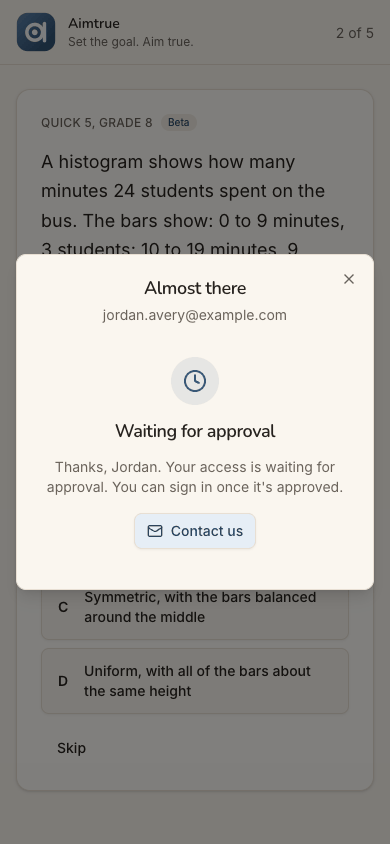
- **Step 13, the first screen inside the space.** It worked, and the greeting is personal. But the first fact is "0
  of 3 days played this week", minutes after Jordan played. "Today's 5" (Next up) and "Today's Daily" (just below) are
  the same challenge under two names. "Jordan's space" is never explained.
  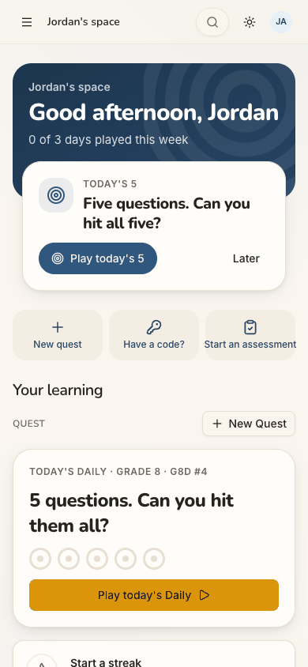
- **Step 14, what the guest play left behind.** Grade 8 is selected and the Quick 5 Jordan played is a favorite. It
  feels like the same place, which is the stickiness win of this journey. The favorite reads only "G8Q5", though, and
  on a phone the remembered grade 8 sits half off the right edge.
  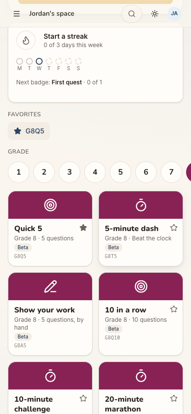

**Contact sheet** (all 16 phone steps):

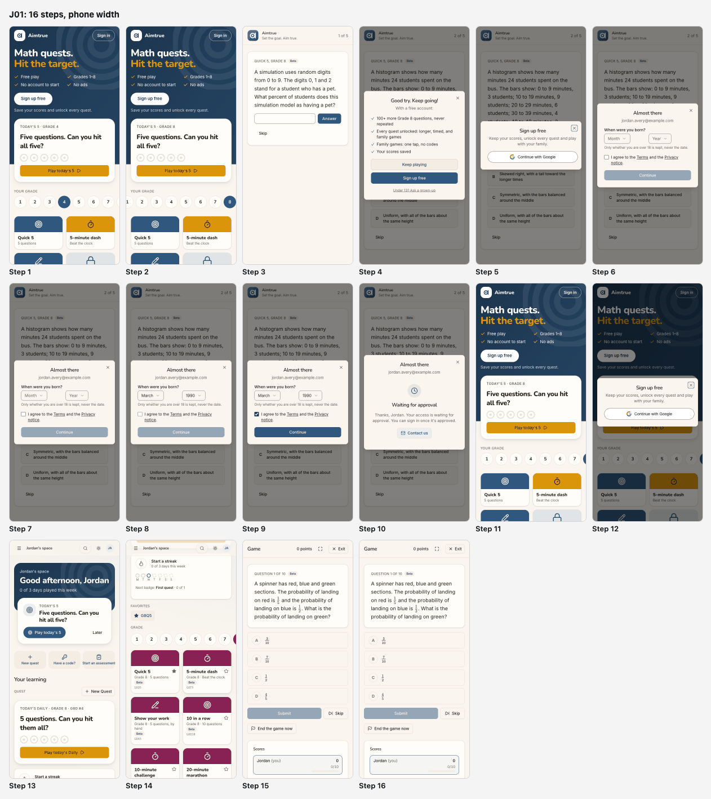

| Severity | Count |
| --- | --- |
| sev4 (catastrophe) | 0 |
| sev3 (major) | 1 |
| sev2 (minor) | 4 |
| sev1 (cosmetic) | 2 |
| **Total** | **7** |

## Prioritized fixes

1. [sev3] [The approval wait is silent: no time frame, no notice, nothing to do meanwhile](#sev3-the-approval-wait-is-silent-no-time-frame-no-notice-nothing-to-do-meanwhile): say who decides, how long, and how Jordan hears; offer "Keep playing"; greet the approved person on return (steps 10, 11).
2. [sev2] [After question 1, "Good try" with no mark: a right answer reads as wrong](#sev2-after-question-1-good-try-with-no-mark-a-right-answer-reads-as-wrong): show right or wrong before the offer (step 4).
3. [sev2] [The guest page and the offer speak only to children and parents](#sev2-the-guest-page-and-the-offer-speak-only-to-children-and-parents): add one line and one door for adult players (steps 1, 4, 5).
4. [sev2] ["Sign in" opens a sheet titled "Sign up free"](#sev2-sign-in-opens-a-sheet-titled-sign-up-free): title the sheet by the button that opened it (step 12).
5. [sev2] [The new home offers the same daily twice, under two names, and leads with a zero](#sev2-the-new-home-offers-the-same-daily-twice-under-two-names-and-leads-with-a-zero): one name, one card; a first-day line instead of "0 of 3" (step 13).
6. [sev1] [On a phone the grade row hides grade 8, even when 8 is the remembered grade](#sev1-on-a-phone-the-grade-row-hides-grade-8-even-when-8-is-the-remembered-grade): scroll the selected grade into view and show a scroll cue (steps 1, 11, 14).
7. [sev1] [Codes and labels Jordan cannot read: "G8Q5", "G8D #4", "Beta", "Game"](#sev1-codes-and-labels-jordan-cannot-read-g8q5-g8d-4-beta-game): name things in words (steps 3, 13-15).

## Findings

### [sev3] The approval wait is silent: no time frame, no notice, nothing to do meanwhile

- **Issue Description:** After Continue (step 10) the sheet shows a clock, "Waiting for approval" and "Thanks, Jordan.
  Your access is waiting for approval. You can sign in once it's approved." It does not say who approves, how long it
  usually takes, or whether Jordan will be told. It has no "Keep playing" button, although guest play is still open:
  only an X, which drops Jordan back on question 2. The sheet's heading still reads "Almost there" above "Waiting for
  approval", two messages at once. Its only action, "Contact us", opens a mail to a personal Gmail address, which looks
  unofficial to a stranger. When Jordan comes back a day later (step 11), the guest page is unchanged. It says nothing
  about the account, the approval or yesterday's play, so Jordan tries "Sign in" on a hunch. Behind the screen, the
  sign-up request answered 403, the way "pending" is reported. The browser console logs it as an error, which Jordan
  does not see.
- **Framework Violation:** cuj-contract, step 10 (expected: told that access waits, and what happens next; observed:
  told only that it waits) and step 11 (expected: some sign that the account is ready; observed: none); Nielsen #1
  Visibility of system status; Nielsen #3 User control and freedom (no "keep playing" from the wait).
- **Severity:** 3. Classify: a workaround is needed. Jordan must remember, unprompted, to come back and try signing
  in, with no idea when that would work. For this cohort it is the main conversion risk. An adult who came to "just
  play" has no stake yet, and one unexplained wait is enough to never return. It is not a 4, because coming back and
  signing in does work (step 13).
- **Evidence:**  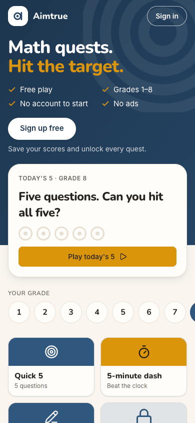
  Repro: Sign-up access Post-approved. Signed out at `/`, play a guest question, take "Sign up free", then Continue
  with Google. Answer the age question, tick the terms box and tap Continue: "Waiting for approval". After the console
  approves, open `/` in a new tab: the guest page shows nothing about the account.
- **Recommended Fix:** Give the wait three lines and two buttons. The lines: "We check new accounts by hand, usually
  within a day." "We'll email you at jordan.avery@example.com when you're in." And who "we" are. The primary button,
  "Keep playing", closes the sheet and leaves Jordan on the guest board. Then make the email true: send one plain
  "You're in" message on approval, with the link back. Without email, the guest page could check on the next visit
  and show "Your account is ready: Sign in". Drop the "Almost there" heading once the state is "waiting". Point
  "Contact us" at a product address rather than a personal one.

### [sev2] After question 1, "Good try" with no mark: a right answer reads as wrong

- **Issue Description:** Question 1 (step 3) asks what percent of students a simulation models as having a pet:
  digits 0-9, with 0, 1 and 2 meaning "has a pet". The answer is 3 in 10, 30%. Jordan types "30%" and taps Answer
  (step 4). The page moves on to question 2, and the sign-up offer opens over it: "Good try. Keep going!". No right or
  wrong mark is shown and the expected answer is not given. "Good try" reads as "wrong", so Jordan cannot tell whether
  the "%" cost the mark or every answer gets the same words. The free-text box had given no hint of the expected
  format. Whether "30%" was marked right was not checked (see Coverage); the finding is what the screen says.
- **Framework Violation:** cuj-contract, step 4 (expected: told whether the answer was right, then question 2;
  observed: an ambiguous "Good try" over question 2); Nielsen #1 Visibility of system status; Nielsen #5 Error
  prevention (no format hint on a free-text answer).
- **Severity:** 2. Classify: an observable mismatch and real friction. For a puzzle-lover the mark is the reward, and
  a possibly-wrong verdict on an easy first question is deflating, at the very moment the product asks for a sign-up.
  It does not block anything.
- **Evidence:** 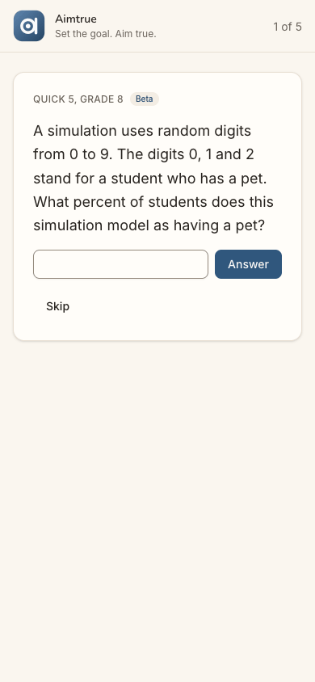 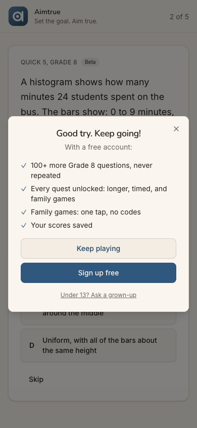
  Repro: signed out at `/`, pick grade 8, tap Quick 5, type "30%", then Answer.
- **Recommended Fix:** Mark the answer before the offer opens: a tick or a cross on question 1, and "The answer was
  30%" when wrong. Word the offer's headline from that mark: "Nice, 1 of 1!" or "Good try. The answer was 30%." Put
  the expected form beside the box ("a number; % is fine"), and accept "30%", "30" and "0.3" alike.

### [sev2] The guest page and the offer speak only to children and parents

- **Issue Description:** Everything Jordan reads before signing up is written for a child or a parent. The guest page
  says "Grades 1–8" and has an FAQ headed "Questions from grown-ups", with "Is it safe for my child?". It ends with
  "Create a free family space" (step 1). The sign-up offer lists "Family games: one tap, no codes" and "Under 13? Ask
  a grown-up" (step 4). The Sign up sheet says "play with your family" (step 5). Nothing tells an adult that it is for
  them too, or that there is anything past grade 8. "Advanced" and "More levels" (Math 1, AoPS Geometry) only appear
  inside the space, below the fold (step 14). Jordan picked grade 8 as the hardest thing on offer (step 2).
- **Framework Violation:** cuj-contract, steps 1, 4 and 5 (expected: a page an adult puzzle-lover recognises as for
  them; observed: a children's page); Nielsen #2 Match between system and the real world.
- **Severity:** 2. Classify: real friction to conversion, with no workaround needed. Adults who come by word of mouth
  are part of C6. Some may read "Grades 1–8" and "my child" and leave before playing, and the journey loses them
  before it starts. Jordan stayed only because the play was one tap away.
- **Evidence:**  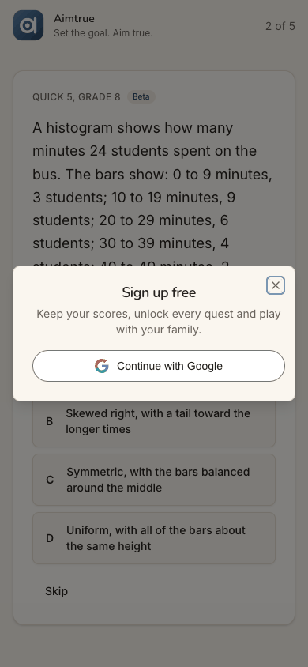
  Repro: signed out at `/` on a phone; read the hero, the FAQ and the sign-up offer after question 1.
- **Recommended Fix:** Add one tick to the hero ("Grades 1–8 and beyond, for every age"), and an FAQ entry "Can adults
  play?". Show "Math 1" and the advanced levels on the guest board, after grade 8. Write the offer's benefits for
  whoever is playing: "Your scores saved" and "100+ more Grade 8 questions" first, and the family line last.

### [sev2] "Sign in" opens a sheet titled "Sign up free"

- **Issue Description:** A day later, Jordan taps "Sign in" in the guest page's header (step 12). It opens the same
  sheet as the hero's "Sign up free": the title "Sign up free", "Keep your scores, unlock every quest and play with
  your family." and Continue with Google. No sign-in wording appears. Jordan, who signed up yesterday, wonders whether
  that counted, and whether this makes a second account. The same mismatch is reported in J05 (step 15).
- **Framework Violation:** cuj-contract, step 12 (expected: a sign-in step; observed: a sign-up sheet); Nielsen #4
  Consistency and standards; Nielsen #1 Visibility of system status.
- **Severity:** 2. Classify: an observable mismatch between a button and what it opens. For a returning member who was
  never told the approval happened (finding above), it adds doubt at the one moment they act on a hunch. The Google
  step is the same either way, so it does not block.
- **Evidence:** 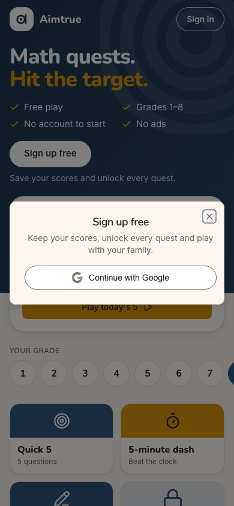
  Repro: signed out at `/`, tap "Sign in" in the header.
- **Recommended Fix:** Title the sheet by the button that opened it. From "Sign in": "Welcome back", "Sign in with the
  account you used before. New here? The same button makes you a free account." Keep "Sign up free" for the hero, the
  tiles and the nudges.

### [sev2] The new home offers the same daily twice, under two names, and leads with a zero

- **Issue Description:** Jordan's first screen inside the space (step 13) offers one daily challenge twice. The Next
  up card says "TODAY'S 5 / Five questions. Can you hit all five?" and "Play today's 5". The card just below says
  "TODAY'S DAILY · GRADE 8 · G8D #4 / 5 questions. Can you hit them all?" and "Play today's Daily". Whether they are
  one quest or two is left to Jordan. "New quest" also appears twice: a quick action, and "+ New Quest" two rows down.
  The band's only fact is "0 of 3 days played this week", and the streak card repeats it ("0 of 3 days this week"),
  minutes after Jordan played as a guest. Guest play is kept on the device only, by design, but nothing says so. The
  first number the new member reads is a zero.
- **Framework Violation:** cuj-contract, step 13 (expected: a clear first move in the new space; observed: two names
  for one action); Nielsen #4 Consistency and standards; Nielsen #8 Aesthetic and minimalist design.
- **Severity:** 2. Classify: an observable mismatch and real friction on the screen that most decides whether
  Jordan comes back. A Quest player's question is "let me play", and two near-identical primary buttons slow the
  first tap. A zero as a welcome undercuts the habit layer's "never a loss message" rule in spirit.
- **Evidence:**  
  Repro: as an approved new member who played a guest tile, sign in from `/` and land on the home.
- **Recommended Fix:** Use one name, "Today's 5" or "the Daily", everywhere. When Next up is the Daily, do not repeat
  its card in the Quest section: show only the rings and the streak there. Drop the second "New Quest" button. On a
  member's first day, replace "0 of 3 days played this week" with a starting line such as "Play 3 days a week to
  start a streak". Better still, count the day the device already played as a guest, since the device carries the
  grade and favorites over anyway.

### [sev1] On a phone the grade row hides grade 8, even when 8 is the remembered grade

- **Issue Description:** At 390 px the grade row shows 1-7, with 8 off the right edge and no cue that the row
  scrolls. On the guest page (step 1) Jordan has to discover the swipe to find 8 (step 2). When the page remembers
  grade 8 (step 11), and inside the space (step 14), the selected 8 is only a sliver of dark circle at the edge, so
  the choice that was carried over is barely visible.
- **Framework Violation:** cuj-contract, steps 2, 11 and 14 (expected: the grade choice visible; observed: clipped);
  Nielsen #6 Recognition rather than recall.
- **Severity:** 1. Classify: cosmetic, with a minor discovery cost. For an adult looking for the hardest grade, the
  hardest grade is the hidden one.
- **Evidence:**  
  Repro: open `/` at 390×844 with grade 8 remembered, or sign in and scroll to "Grade".
- **Recommended Fix:** Scroll the selected grade into view on load. Make the row fit eight circles at 360 px by
  shrinking them slightly, or show a fade and a chevron at the edge while more is hidden.

### [sev1] Codes and labels Jordan cannot read: "G8Q5", "G8D #4", "Beta", "Game"

- **Issue Description:** Several labels are internal names. The favorite the guest play left behind is a chip reading
  only "G8Q5" with a star (step 14). Jordan has to match it to the Quick 5 tile with the filled star. The daily card
  reads "G8D #4" (step 13), and each tile carries its code (G8T5, G8Q10...). Every question carries a "Beta" pill that
  nothing explains: beta question, or beta site (steps 3, 15)? The game Jordan started from "10 in a row" is headed
  "Game" on the phone and "Quest game · G8" on desktop (step 15). Its name never appears.
- **Framework Violation:** cuj-contract, steps 13-15 (expected: the things Jordan chose, named as chosen; observed:
  codes); Nielsen #2 Match between system and the real world.
- **Severity:** 1. Classify: cosmetic. Each label can be worked out, but each costs a moment of doubt, and the
  favorite is the one piece of continuity the guest play left behind.
- **Evidence:**  
  Repro: as above; look at Favorites, the daily card and the game header.
- **Recommended Fix:** Label a favorite chip with the tile's name and grade ("Quick 5 · Grade 8"), keeping the code
  for the tooltip or a code box. Drop "G8D #4" from the card, or say "Daily #4". Head the game with the tile's name
  ("10 in a row · Grade 8"). Give "Beta" a tap-to-explain: "New question: tell us if something looks wrong."

## Walkthrough

### Step 1 — Open http://localhost:8797/ signed out (landing)

> Expected: a page that shows a newcomer what this is and lets them try it. Observed: match, for a child. "Math
> quests. Hit the target." with ticks for Free play, Grades 1–8, No account to start and No ads. "Sign up free" sits
> above "Save your scores and unlock every quest.", followed by a "Today's 5 · Grade 4" card and a grade row (4
> preselected). Grade-4 tiles follow, three open and three locked "Free account", then Advanced, "Play together" and
> "Questions from grown-ups". Desktop puts Today's 5 beside the hero with all eight grades visible; dark mode is
> readable.

**What Jordan notices:** play is one tap away with no account, which is inviting. But it is plainly a children's site
("Grades 1–8", "Is it safe for my child?"), and on the phone grade 8 is off the edge.

### Step 2 — Swipe the grade row and pick 8

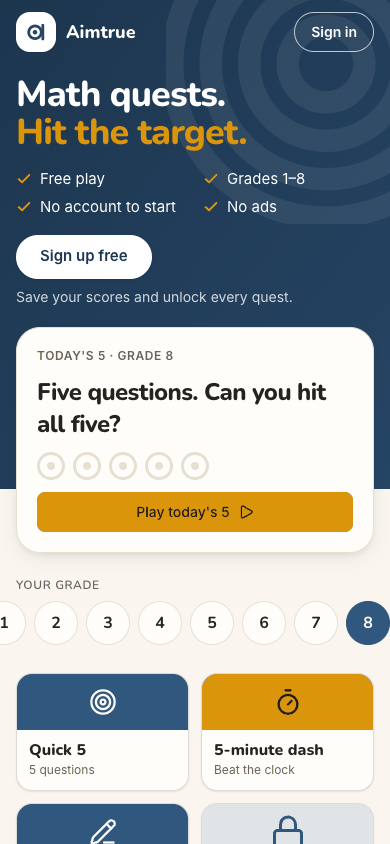

> Expected: harder questions for an adult. Observed: match. 8 is selected, and Today's 5 and the tiles switch to Grade
> 8.

**What Jordan notices:** had to find 8 by swiping. Nothing above grade 8 is offered.

### Step 3 — Tap "Quick 5" (Grade 8)

> Expected: a question straight away. Observed: match. `/play/G8Q5`, "1 of 5", "Quick 5, Grade 8" with a "Beta" pill,
> a simulation question, a free-text box, Answer and Skip.

**What Jordan notices:** an instant start with no sign-up wall. "Beta" is unexplained, and the box gives no hint of
the format (a number? with %?).

### Step 4 — Type "30%" and tap Answer: the sign-up offer (landing)

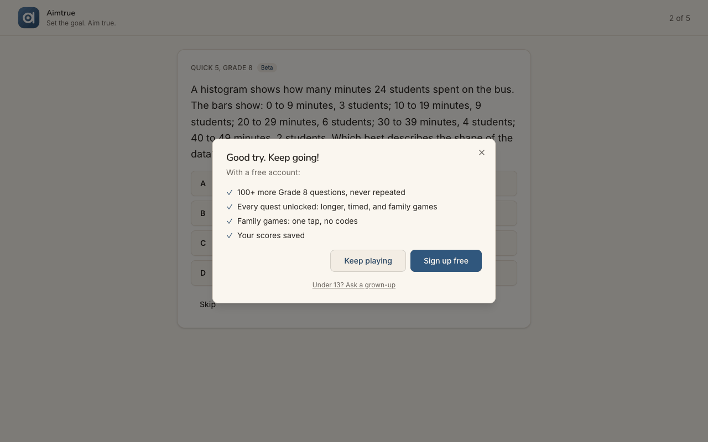
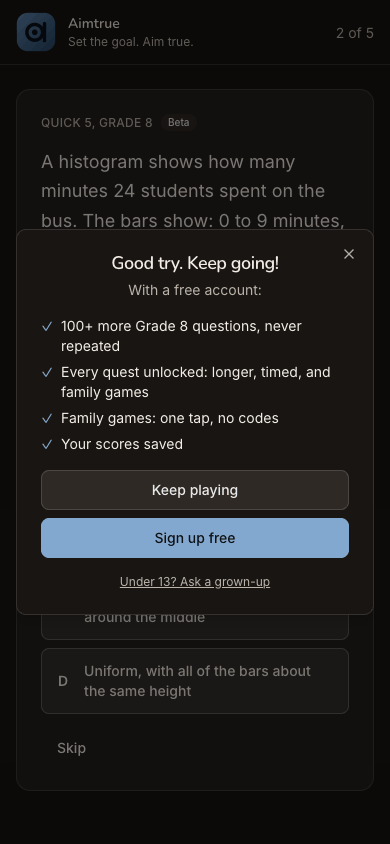

> Expected: told whether 30% is right, then question 2. Observed: the page moves to "2 of 5", and a modal opens over
> it: "Good try. Keep going!", four benefits of a free account, "Keep playing", "Sign up free" and "Under 13? Ask a
> grown-up". No mark is shown.

**What Jordan notices:** "Good try" after what Jordan is sure is right. Did the % cost it? "Your scores saved" is the
one benefit written for Jordan; the rest is about families.

### Step 5 — Tap "Sign up free"

> Expected: a sign-up choice. Observed: match. A sheet "Sign up free / Keep your scores, unlock every quest and play
> with your family." with one button, Continue with Google.

**What Jordan notices:** Google only is fine for Jordan, who has an account. The copy again speaks to families.

### Step 6 — Tap "Continue with Google"

> Expected: Google, then back to the app. Observed: match. The sheet becomes "Almost there" with Jordan's email, "When
> were you born?" (month and year), "Only whether you are over 18 is kept, never the date.", the terms box and a
> disabled Continue.

**What Jordan notices:** quick, and the email confirms the right account. Being asked a birth date at 36 is a small
friction; the line about keeping only "over 18" reassures.

### Step 7 — Tap "Terms" to glance at it

> Expected: to read the terms without losing the form. Observed: the sign-up tab is unchanged (form kept, box still
> unticked); the link opens a new tab. The Terms page itself was not observed (see Coverage).

**What Jordan notices:** on a phone the Terms open in another tab, and Jordan has to switch back to the sign-up. A
detour, not a dead end.

### Step 8 — Choose March and 1990

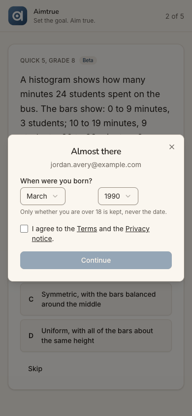

> Expected: the date accepted. Observed: match. Both dropdowns show March / 1990; Continue stays disabled until the
> box is ticked.

**What Jordan notices:** 1990 is 36 entries down the year list, a long spin on a phone.

### Step 9 — Tick "I agree to the Terms and the Privacy notice."

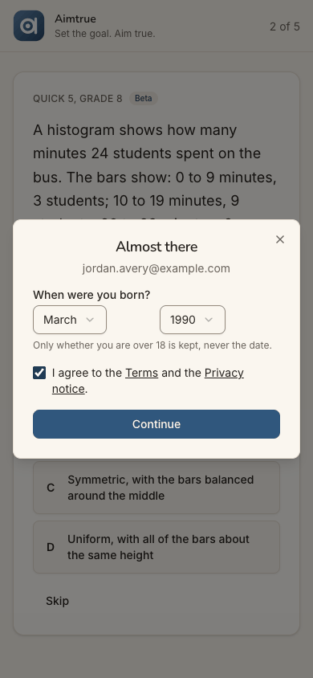

> Expected: Continue enabled. Observed: match. It turns dark blue.

**What Jordan notices:** clear cause and effect.

### Step 10 — Tap Continue: "Waiting for approval" (landing)

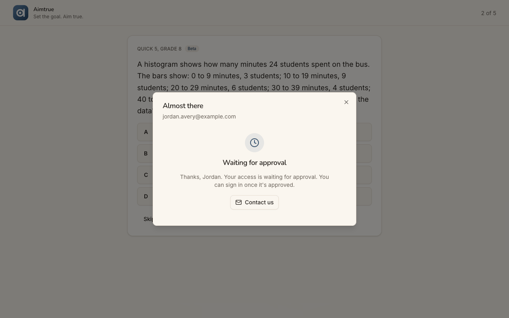
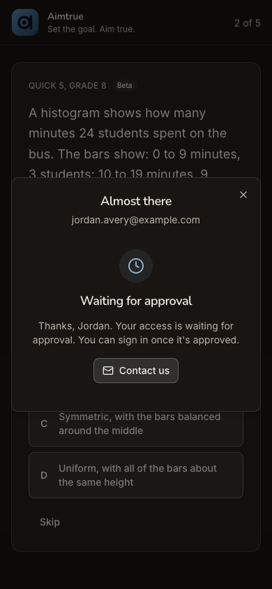

> Expected (sign-up access Post-approved): told that access waits for approval. Observed: match, within a second.
> Under the heading "Almost there" and the email, a clock icon and "Waiting for approval": "Thanks, Jordan. Your
> access is waiting for approval. You can sign in once it's approved." One button, "Contact us", and the X; question 2
> still behind.

**What Jordan notices:** two messages at once ("Almost there", "Waiting"). No word on who approves, how long, or how
Jordan will find out, and no way to keep playing except the X. The momentum stops here.

### Step 11 — A day later: a new tab on the guest page (landing)

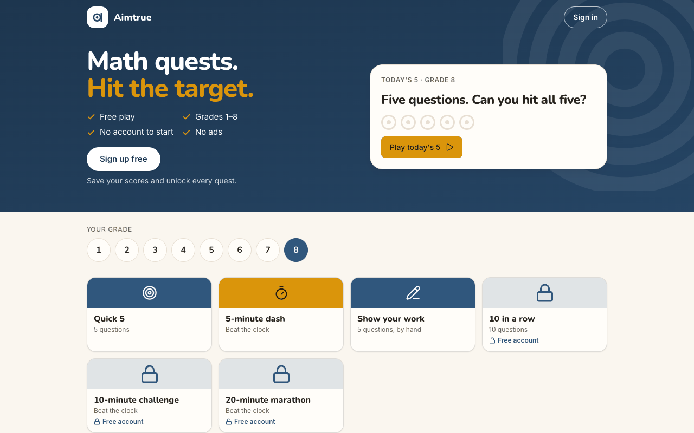
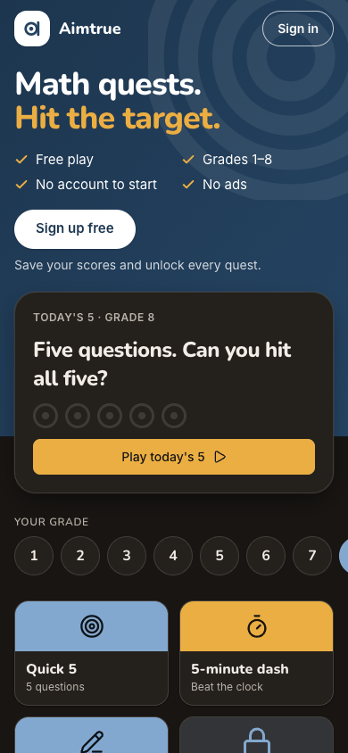

> Expected: the guest page, perhaps with a sign that the account is ready. Observed: the guest page as on step 1,
> except that it remembered the grade: "Today's 5 · Grade 8", grade 8 selected, grade-8 tiles. Nothing about the
> account, the approval or yesterday's Quick 5. "Sign in" is top right.

**What Jordan notices:** it looks like yesterday. "Sign in" is the obvious door for someone who signed up, so Jordan
tries it without knowing whether the approval has happened. On the phone, the remembered 8 is half off the edge.

### Step 12 — Tap "Sign in"

> Expected: a sign-in step. Observed: the sheet titled "Sign up free", the same as step 5, with Continue with Google.

**What Jordan notices:** "I tapped Sign in and it says Sign up. Did yesterday not count? Is this a second account?" A
hesitation, but Continue with Google is the only way on.

### Step 13 — Tap "Continue with Google": signed in, home in "Jordan's space" (landing)

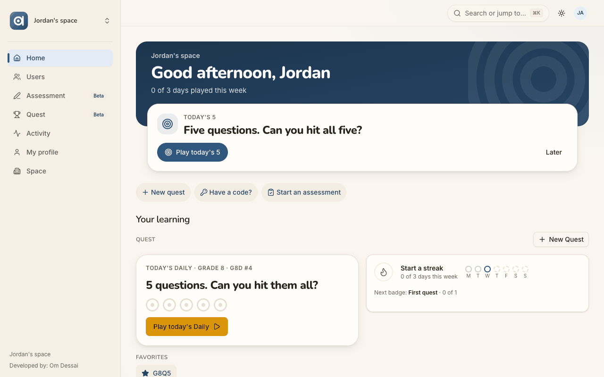
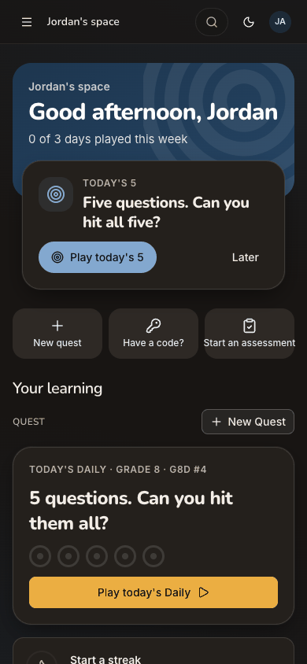

> Expected: into the product. Observed: match, in about 1-2 s with nothing asked again: the member home of "Jordan's
> space". The band says "Good afternoon, Jordan" and "0 of 3 days played this week". Next up is "Today's 5" (Play
> today's 5, Later), with quick actions New quest, Have a code? and Start an assessment. Under "Your learning", Quest
> has "+ New Quest" and "Today's Daily · Grade 8 · G8D #4" with "Play today's Daily". Desktop adds a menu: Home,
> Users, Assessment (Beta), Quest (Beta), Activity, My profile, Space. No welcome, no "you're approved", and no tour
> (by design the tour is Tutoring's). The only console error is the signed-out 401 at page load.

**What Jordan notices:** relief, and a personal greeting. But the first fact is a zero. "Today's 5" and "Today's Daily"
look like two things. "Jordan's space" is not explained, and on desktop "Users" and "Space" look like admin tools.

### Step 14 — Scroll down: what the guest play left behind

> Expected: some continuity with yesterday. Observed: match. "Start a streak" shows M T W dots and "Next badge: First
> quest · 0 of 1". Under Favorites, one chip: a star and "G8Q5", the tile played as a guest. The Grade row has 8
> selected, carried over, but clipped at the edge. All six grade-8 tiles are open now, each with "Beta" and its code.
> Below: Advanced (AoPS Geometry), More levels (Math 1...), and Start an assessment.

**What Jordan notices:** it remembered grade 8 and yesterday's quest, so it feels like the same place. The favorite is a
code, though, and every padlock is gone, as the offer promised.

### Step 15 — Tap "10 in a row" (Grade 8; locked yesterday): the quest starts (landing)

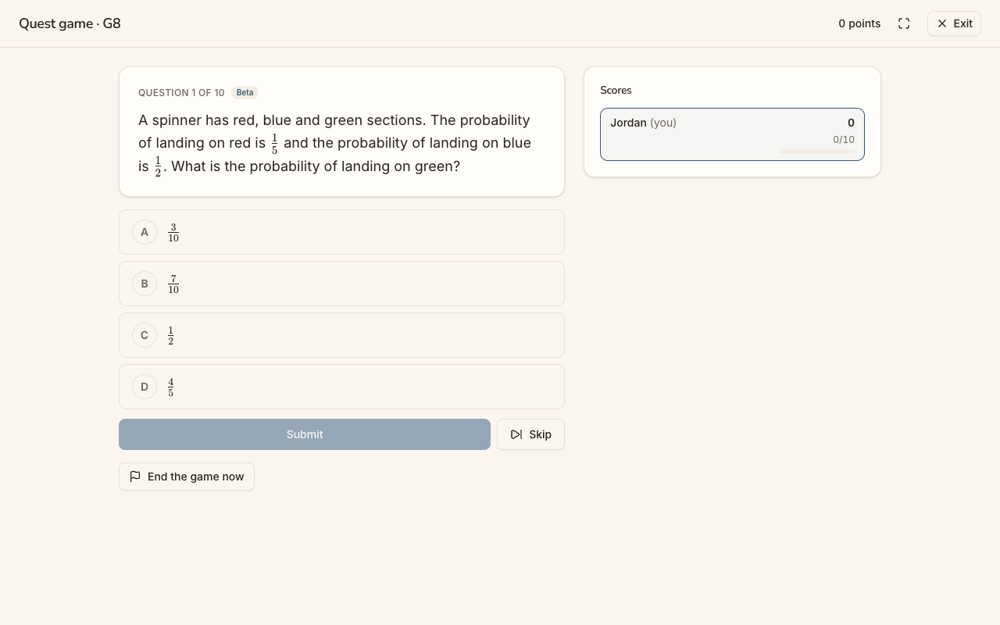
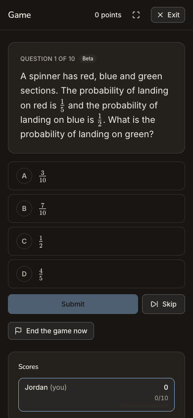

> Expected: the quest's first question. Observed: match. One tap made the game (`/quest/games/<id>`), then a 3-second
> countdown ("The Quest begins / Get ready: the doors are opening…", read from the page, not captured). Then
> "Question 1 of 10" with a "Beta" pill, a spinner probability question and choices A-D. Submit stays disabled until a
> choice; Skip and "End the game now" sit beside it. A "Scores" card lists only "Jordan (you) 0, 0/10". The header
> reads "Game" on the phone and "Quest game · G8" on desktop. **The journey's end: the quest has started.**

**What Jordan notices:** fast, with no setup: tap, countdown, question, and a real grade-8 question. The name "10 in a
row" is gone. The fractions in the choices are the smallest text on the page, and a scoreboard of one is odd in a
solo game.

### Step 16 — Reload the game (end-state check)

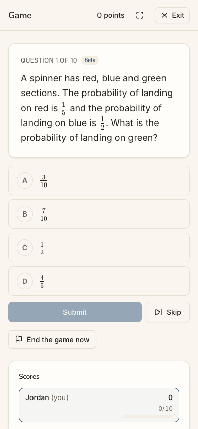

> Expected: the started quest survives a refresh. Observed: match. The same game is still at "Question 1 of 10", with
> the same question, 0 points and no console errors.

**What Jordan notices:** nothing lost. A phone that refreshes the page mid-quest puts Jordan back where they were.

## Appendix

- **Mode:** live. The web app at `http://localhost:8797` is a frozen copy of commit `2d6e7d3` with sign-in on, driven
  in headless Chrome at 390×844 (phone), plus 1280×800 and dark mode at the landing steps (1, 4, 10, 11, 13, 15). Two
  stages in one browser profile: steps 1-10, then the platform admin's approval, then steps 11-16 in a new tab.
- **Frameworks applied:** cuj-contract (every step against its expected result); task-completion (the journey ran
  to its defined end, a quest started in Jordan's own space); success-criteria (the end state checked again after a
  reload at step 16).
- **CUJ manifest:** J01, 16 steps. Verified: steps 1-6 and 8-16 (15). Partly observed: step 7, where the tap and the
  unchanged sign-up tab were seen but the Terms page was not.
- **Coverage / not inspected:**
  - The Terms and Privacy pages' content: their links open a new tab, which the driver does not follow (step 7).
  - Whether "30%" was marked right or wrong on question 1. The screen shows no mark (step 4); the server's marking and
    the guest's device-side mark were not read.
  - Whether Jordan was told of the approval by any channel outside the page (an email). No mailbox was available; the
    screens at steps 10 and 11 say nothing about one.
  - The approval itself: the platform admin approved Jordan, a separate agent's step outside this journey; the
    console was not seen from Jordan's side.
  - Closing the waiting sheet and going on as a guest (step 10's X); "Contact us" was read from the link, not sent.
  - The rest of the quest past question 1, the Daily ("Play today's 5"), favorites' star buttons, "Make this my home",
    the desktop menu's pages, and the account menu.
  - Keyboard-only and screen-reader use; the accessibility tree was read only to find controls.
  - The iOS app; it is covered by separate journeys (J01A).
  - Other sign-in providers (the production web offers Google only).
- **Access:** through the app's real sign-in and sign-up screens; the Google provider step is simulated (a stand-in for
  Google's button hands the app a local test token for the persona).
- **Preconditions made outside the UI:** none by this journey. The run's platform settings (web sign-in Google only
  with sign-up open, sign-up access Post-approved, guest play and the Daily on) were set through the console API before
  the journeys, as `docs/userjourney/README.md` "The run" records. Between the two stages the platform admin approved
  Jordan (outside this journey).
