# CUJ Audit — J01A: adult player signs up from the guest offer in the app, approved, starts a quest

## Executive summary

**Who:** Morgan Lee, 38 (born May 1988), an adult who likes maths puzzles and installed the app on an iPhone. Morgan
belongs to cohort **C6, the Quest player** ("Let me play.") in `docs/member-home-plan.md`, and arrives as a signed-out
guest. Morgan wants more puzzles than the free ones, with the scores kept, so Morgan takes the sign-up offer after the
first question. This is the app replay of the web journey J01 (`J01-adult-player.md`).

**Outcome: 1/1 journeys passed, 0 skipped, 24 of 24 steps verified.** Morgan opened the app, picked grade 8 and
answered question 1 of Quick 5. The offer said "Nice! That one is right." and Morgan signed up from it: an address, a
name, May 1988 and the terms box, all in one sheet. It ended on a full-screen "Waiting for approval" (step 13). The
platform admin approved Morgan in the web console. "A day later" Morgan reopened the app, which still showed the guest
home, tapped "Sign in" and landed in "Morgan's space" (step 18). One tap on "10 in a row", a tile locked to guests,
started a 10-question quest: after a countdown, question 1 was on screen (step 22). The end state was checked by closing
and reopening the app (steps 23-24). Morgan stayed signed in, but "Continue G8Q10" started the quest again with a
different first question.

**Conversion figures** (counted from the entry point, the app's first screen; the address and name are typed into the
developer sign-in, which stands in for the provider step, see the Appendix):

| Stretch | Screens | Taps | Inputs | Waits | Dead ends |
| --- | --- | --- | --- | --- | --- |
| Entry to "Waiting for approval" (steps 1-13) | 6 | 15 (+1 swipe of the grade row) | 4 typed (answer "30", address, name, year search), 2 pickers, 1 checkbox | 0 | 0 |
| Detour: Back from the wait (step 14) | 1 | 1 | 0 | 0 | 1 (the quest in progress is not offered again) |
| Return to the quest's first question (steps 15-22) | 5 | 4 (+3 scrolls) | 1 typed (address) | 1 (a ~3 s countdown) | 0 |
| **Whole journey (steps 1-13, 15-22)** | **11** | **19** | **5 typed, 3 other** | **the approval (unbounded, unannounced) + ~3 s** | **0** |

The path is short: 19 taps from a stranger's first screen to a quest in their own space. Three of the five typed
fields (the address twice, the name) belong to the developer sign-in and would be a provider tap in production. As on
the web, the risk is the gap in the middle. The waiting screen does not say how long approval takes or how Morgan will
hear. The app still opens on the unchanged guest home after the approval. Its most prominent button is "Contact us",
and its "Back" drops the quest Morgan was playing.

For stickiness, the return works: the app kept Morgan signed in across a relaunch. The guest play carried over: grade 8
leads the board, today's Daily is grade 8, and the Quick 5 played as a guest is a favorite. All six grade-8 tiles are
open, as the offer promised. Two things weaken it. The home offers the daily challenge twice under two names. And the
"Continue" button that should bring Morgan back to a half-played quest starts it over instead.

**The 3 screens Morgan would notice most:**

- **Step 13, "Waiting for approval".** Momentum stops dead. The screen is clean, one message rather than the web's two,
  but it says nothing of who approves, how long it takes, or how Morgan will find out. The big button is "Contact us".
  "Back" goes to the guest home, not to question 2 of the quest Morgan was in.
  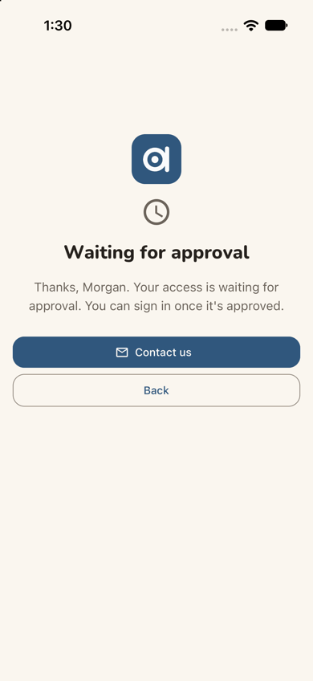
- **Step 19, what the guest play left behind.** Grade 8 tiles, "Today's Daily · G8D" and the favorite "G8Q5" are all
  there, so it feels like the same place. But the favorite is a code, the selected grade 8 is off the edge of the grade
  row, and the Daily repeats the "Today's 5" Next up card above it.
  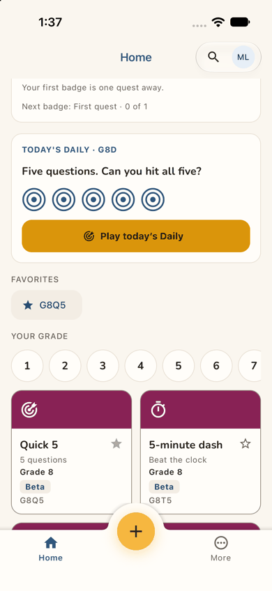
- **Step 24, "Continue G8Q10".** After reopening the app, Morgan taps Continue and gets "Question 1 of 10" again, but
  a different question from the one left on screen. The label promises a resume; the screen shows a fresh start.
  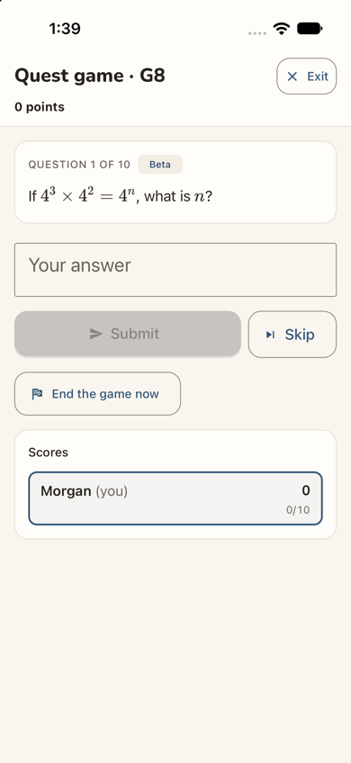

**Contact sheet** (all 24 phone steps):

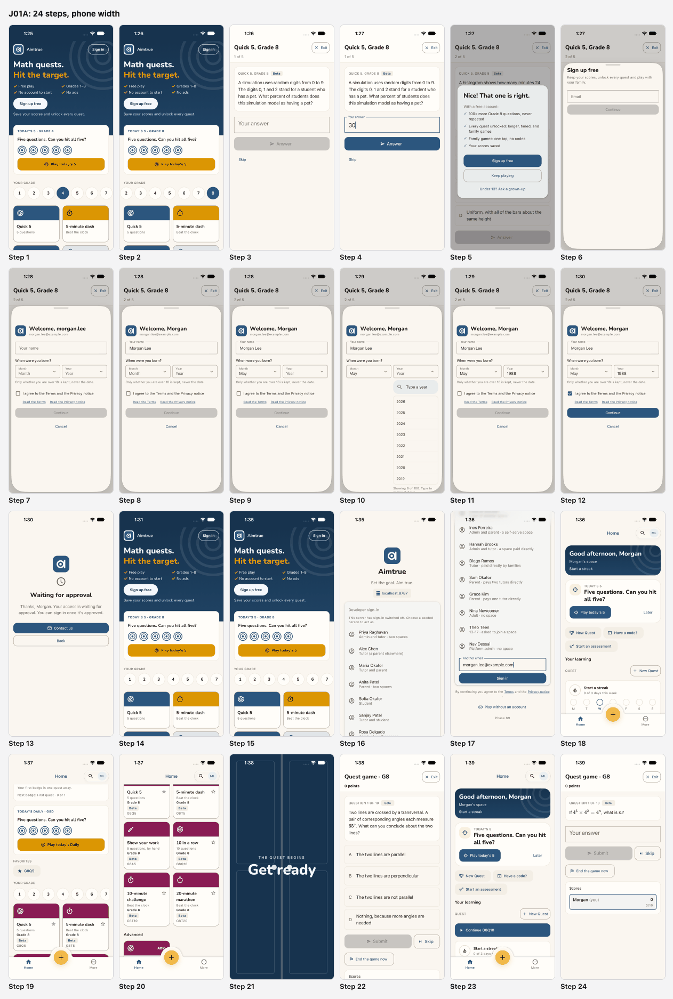

**Web and app.** Compared with the web journey J01 (`J01-adult-player.md`, Jordan Avery), the app differs in eight ways:

- **The offer marks the answer.** For "30" it said "Nice! That one is right." The web said "Good try" for "30%";
  whether the app accepts "30%" was not checked. The app's offer puts "Sign up free" first and "Keep playing" second,
  with no X. The web has Keep playing first and an X.
- **Easier date picker.** The year has a type-to-search list ("Showing 8 of 100. Type to narrow it down."), where the
  web has a long select.
- **A full-screen wait.** The wait fills the screen, without the web's leftover "Almost there" heading. "Back" lands
  on the guest home and drops the quest; the web's X went back to question 2.
- **"Sign in" opens a sign-in screen.** In this build it is a full-screen sign-in, not the "Sign up free" sheet of the
  web's sev2. Production's provider screen was not seen.
- **A softer first line at home.** The band reads "Start a streak" where the web led with "0 of 3 days played this
  week". The streak card below still says "0 of 3 days this week".
- **The same duplicates, plus one.** The daily twice and "New Quest" twice, as on the web. The app adds a yellow "+"
  in the tab bar.
- **The same carry-over:** grade 8 and a "G8Q5" favorite.
- **Quest name and resume.** The quest's header reads "Quest game · G8" where the web phone said "Game". After a
  relaunch, the app does not resume the quest the way the web's reload did.

| Severity | Count |
| --- | --- |
| sev4 (catastrophe) | 0 |
| sev3 (major) | 1 |
| sev2 (minor) | 2 |
| sev1 (cosmetic) | 3 |
| **Total** | **6** |

## Prioritized fixes

1. [sev3] [The approval wait is a dead stop: no time frame, no notice, and Back drops the quest](#sev3-the-approval-wait-is-a-dead-stop-no-time-frame-no-notice-and-back-drops-the-quest): say who decides, how long and how Morgan hears; make "Keep playing" the primary button and return to the quest; show "You're in" on the next launch (steps 13-15).
2. [sev2] [Continue G8Q10 starts the quest over instead of resuming it](#sev2-continue-g8q10-starts-the-quest-over-instead-of-resuming-it): resume the open game, or name the button "Play G8Q10 again"; offer the open game in Next up (steps 23-24).
3. [sev2] [The new home offers the same daily twice and New Quest twice](#sev2-the-new-home-offers-the-same-daily-twice-and-new-quest-twice): one name and one card for the daily, one New Quest, a label on the "+" (steps 18-19).
4. [sev1] [Nothing on the guest page or the offer tells an adult it is for them](#sev1-nothing-on-the-guest-page-or-the-offer-tells-an-adult-it-is-for-them): one line and one door for adult players (steps 1, 5, 6).
5. [sev1] [The remembered grade 8 is off the edge of the grade row](#sev1-the-remembered-grade-8-is-off-the-edge-of-the-grade-row): scroll the selected grade into view (steps 14, 15, 19).
6. [sev1] [Codes where Morgan expects names: G8Q5, G8D and G8Q10](#sev1-codes-where-morgan-expects-names-g8q5-g8d-and-g8q10): name favorites, the Daily, Continue and the game header in words (steps 19, 22-24).

## Findings

### [sev3] The approval wait is a dead stop: no time frame, no notice, and Back drops the quest

- **Issue Description:** After Continue (step 13) the app replaces everything with a full screen: the logo, a clock,
  "Waiting for approval" and "Thanks, Morgan. Your access is waiting for approval. You can sign in once it's approved."
  It does not say who approves, how long it usually takes, or whether Morgan will be told. The primary (filled) button
  is "Contact us"; the only other is "Back". Back (step 14) lands on the guest home, not on question 2 of the Quick 5
  that Morgan was halfway through, and nothing there offers that quest again. When Morgan reopens the app "a day
  later" (step 15), the guest home is unchanged: "Sign up free" is still its main button, and nothing says the account
  exists or has been approved. Morgan has to think of "Sign in" alone.
- **Framework Violation:** cuj-contract, step 13 (expected: told that access waits, and what happens next; observed:
  told only that it waits), step 14 (expected: a way to keep playing; observed: the quest dropped) and step 15
  (expected: some sign that the account is ready; observed: none); Nielsen #1 Visibility of system status; Nielsen #3
  User control and freedom.
- **Severity:** 3. Classify: a workaround is needed. Morgan must remember, unprompted, to come back and sign in, with
  no idea when that would work. For a curious adult with no stake yet this is the main conversion risk. The app makes
  it slightly worse than the web: the most prominent action is to write an email, and the way out loses the quest. It
  is not a 4, because signing in after the approval works (step 18).
- **Evidence:**  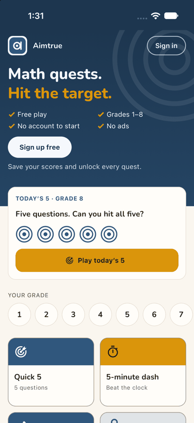
  
  Repro: sign-up access Post-approved. Fresh install; play a guest tile, answer question 1, then Sign up free on the
  offer. Fill the sign-up and tap Continue: "Waiting for approval". Tap Back: the guest home, quest gone. After the
  console approves, close and reopen the app: the guest home, unchanged.
- **Recommended Fix:** Give the wait three lines and two buttons. The lines: "We check new accounts by hand, usually
  within a day." "We'll email you at morgan.lee@example.com when you're in." And who "we" are. The primary button,
  "Keep playing", goes back to the quest at question 2. Make "Contact us" a text link. Then make the email true: one
  plain "You're in" message on approval. The app could also check on its next launch and greet an approved account on
  the guest home: "Your account is ready: Sign in".

### [sev2] Continue G8Q10 starts the quest over instead of resuming it

- **Issue Description:** Morgan started "10 in a row" and had question 1 on screen, a multiple-choice question about a
  transversal (step 22). Morgan closed the app and opened it again (step 23). It opened on Home, still signed in, not on
  the quest. Next up still offered "Today's 5". Under Quest a new full-width button read "Continue G8Q10". Tapping it
  (step 24) showed "Quest game · G8", "Question 1 of 10" and 0 points, but a different question: "If 4³ × 4² = 4ⁿ, what
  is n?", with a free-text box. The label promised a resume and the screen showed a fresh start. Reading the source
  explains it: `Continue <label>` in `apps/mobile/src/features/play/play-home.tsx` makes a new game from the last tile.
  Whether the step-22 game is still open somewhere was not inspected. On the web (J01 step 16) a reload kept the same
  game at the same question.
- **Framework Violation:** cuj-contract, steps 23-24 (success-criteria: expected the started quest to survive closing
  the app; observed: a new quest); Nielsen #4 Consistency and standards (the label "Continue" means resume); Nielsen #1
  Visibility of system status.
- **Severity:** 2. Classify: an observable mismatch between a label and its result. At question 1 Morgan loses
  nothing, but phones close apps all the time, and at question 7 of 10 the same tap would quietly discard a run. It is
  also a parity gap with the web.
- **Evidence:** 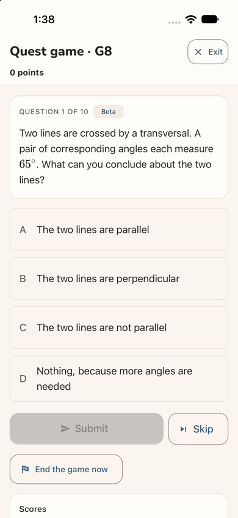 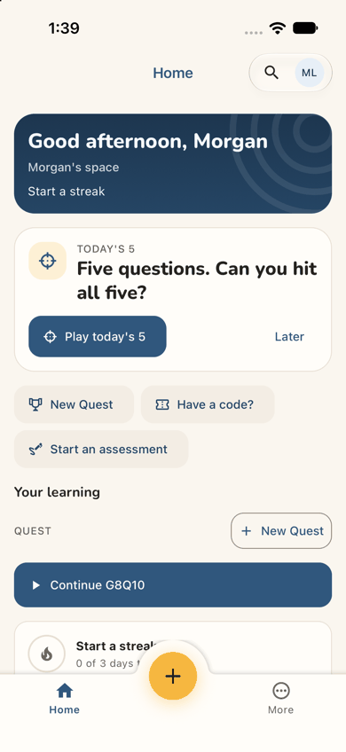
  
  Repro: as a member, start a 10-question tile, close the app at question 1, open it, tap "Continue G8Q10".
- **Recommended Fix:** When the last quest is still running, make Continue open that game where it was, as the web's
  reload does, and put "Pick up where you left off" in Next up. When it has ended, name the button "Play 10 in a row
  again". Never call a new game "Continue".

### [sev2] The new home offers the same daily twice and New Quest twice

- **Issue Description:** Morgan's first screen inside the space (step 18) leads with a Next up card, "TODAY'S 5 / Five
  questions. Can you hit all five?" and "Play today's 5". One scroll down (step 19) a second card reads "TODAY'S DAILY ·
  G8D / Five questions. Can you hit all five?" with five rings and "Play today's Daily". Whether these are one challenge
  or two is left to Morgan. "New Quest" appears twice: a quick action and the "+ New Quest" button beside "Quest". A
  third large yellow "+" button sits in the tab bar with no label. The streak card says "0 of 3 days this week" and
  "Next badge: First quest · 0 of 1", minutes after Morgan played as a guest. The band's own line is the friendlier
  "Start a streak".
- **Framework Violation:** cuj-contract, steps 18-19 (expected: one clear first move in the new space; observed: two
  names for one action, three "new" buttons); Nielsen #4 Consistency and standards; Nielsen #8 Aesthetic and
  minimalist design.
- **Severity:** 2. Classify: an observable mismatch and real friction on the screen that most decides whether Morgan
  comes back. A Quest player wants "let me play", and near-identical primary buttons slow the first tap.
- **Evidence:** 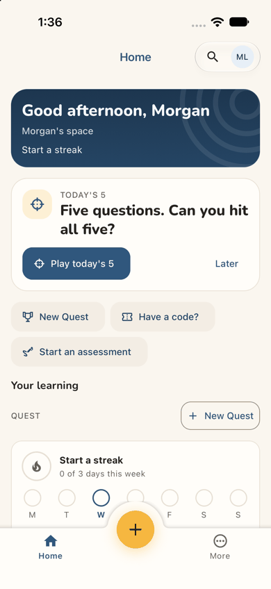 
  Repro: as an approved new member who played a guest tile, sign in and land on Home; scroll once.
- **Recommended Fix:** Use one name, "Today's 5" or "the Daily", everywhere. When Next up is the Daily, show only its
  rings in the Quest section. Keep one "New Quest", and label the tab bar's "+" (or drop it where it repeats New Quest).
  On a member's first day, count the day the device already played as a guest, or say "Play 3 days a week to start a
  streak" instead of "0 of 3".

### [sev1] Nothing on the guest page or the offer tells an adult it is for them

- **Issue Description:** What Morgan reads before signing up is written for families. The guest home's ticks say
  "Grades 1–8" (step 1). Below the offer's "100+ more Grade 8 questions" it lists "Family games: one tap, no codes" and
  "Under 13? Ask a grown-up" (step 5). The sign-up sheet says "play with your family" (step 6). Nothing says adults are
  welcome or that anything lies past grade 8. Advanced tiles appear only inside the space (step 20). The guest page's
  lower part (its FAQ) was not scrolled in the app; on the web it adds "Is it safe for my child?".
- **Framework Violation:** cuj-contract, steps 1, 5 and 6 (expected: a page an adult puzzle-lover recognises as for
  them; observed: a family page); Nielsen #2 Match between system and the real world.
- **Severity:** 1. Classify: wording friction. Morgan stayed because play was one tap away, and the offer's first
  benefit is about grade 8 questions. Graded 1 rather than the web's 2, because the screens seen in the app carry fewer
  of the child-only signals.
- **Evidence:** 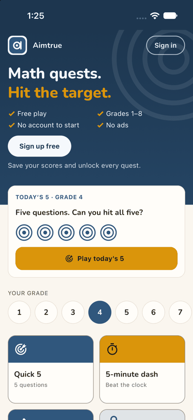 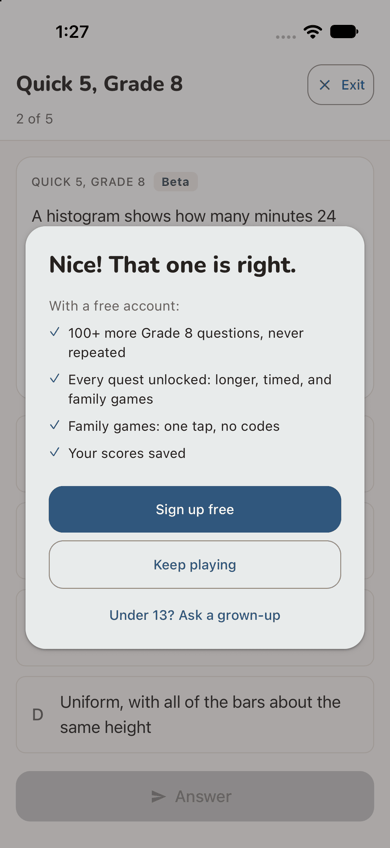
  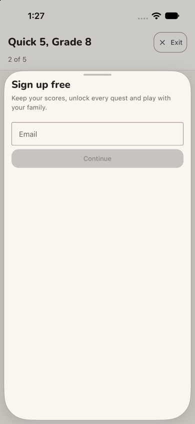
  Repro: fresh install; read the guest home's hero, answer one question, read the offer and the sheet.
- **Recommended Fix:** Add "and beyond, for every age" to the grades tick. Show Math 1 and the advanced levels on the
  guest board after grade 8. Write the sheet's line for whoever is playing ("Keep your scores and unlock every quest"),
  with the family line last.

### [sev1] The remembered grade 8 is off the edge of the grade row

- **Issue Description:** On the phone the grade row shows 1-7; 8 is off the right edge with no cue that the row
  scrolls. Morgan swiped to find it (step 2). After Back (step 14), after reopening the app (step 15) and inside the
  space (step 19), the row is reset to 1-7. The selected 8 is hidden, while the cards above and below say Grade 8.
- **Framework Violation:** cuj-contract, steps 14, 15 and 19 (expected: the remembered grade visible; observed: off
  screen); Nielsen #6 Recognition rather than recall.
- **Severity:** 1. Classify: cosmetic, with a small discovery cost. The hardest grade, the one an adult looks for, is
  the hidden one.
- **Evidence:**  
  Repro: pick grade 8 on the guest home, then reopen the app; or sign in and scroll to "Your grade".
- **Recommended Fix:** Scroll the selected grade into view on load. Fit eight circles at phone width, or show a fade
  and a chevron at the edge while more is hidden.

### [sev1] Codes where Morgan expects names: G8Q5, G8D and G8Q10

- **Issue Description:** Several labels are internal codes. The one favorite the guest play left behind is a chip
  reading "★ G8Q5" (step 19), and Morgan has to match it to the Quick 5 tile. The Daily is "TODAY'S DAILY · G8D". Every
  tile carries its code (G8Q5, G8T5, G8A5...) beside an unexplained "Beta" pill (step 20). Morgan started "10 in a row"
  and the game is headed "Quest game · G8" (step 22). The way back to it reads "Continue G8Q10" (step 23). The name
  Morgan chose never appears again.
- **Framework Violation:** cuj-contract, steps 19-24 (expected: the things Morgan chose, named as chosen; observed:
  codes); Nielsen #2 Match between system and the real world.
- **Severity:** 1. Classify: cosmetic. Each code can be worked out, but each costs a moment of doubt, and the favorite
  and Continue are the two pieces of continuity this journey is about.
- **Evidence:**  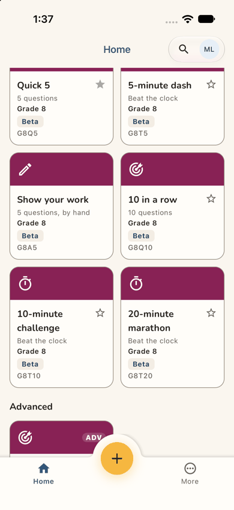
  
  Repro: as above; read Favorites, the Daily card, the tiles, the game header and Continue.
- **Recommended Fix:** Label a favorite "Quick 5 · Grade 8". Say "Today's Daily · Grade 8". Head the game "10 in a row
  · Grade 8" and the button "Continue 10 in a row". Keep codes for the code box. Give "Beta" a tap-to-explain: "New
  question: tell us if something looks wrong."

## Walkthrough

### Step 1 — Open the app for the first time (landing)

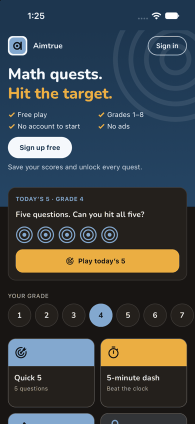

> Expected: a screen that shows a newcomer what this is and lets them try it. Observed: match. The guest home: "Math
> quests. Hit the target.", ticks for Free play, Grades 1–8, No account to start and No ads, "Sign up free" above "Save
> your scores and unlock every quest.", "Sign in" top right. Then a "Today's 5 · Grade 4" card, "Your grade" 1-7 with 4
> selected, and grade-4 tiles (Quick 5, 5-minute dash). Dark mode is readable; the hero stays navy.

**What Morgan notices:** play is one tap away with no account, which is inviting. "Grades 1–8" reads like a school
app, and there is no grade 8 in the row at first glance.

### Step 2 — Swipe the grade row and pick 8

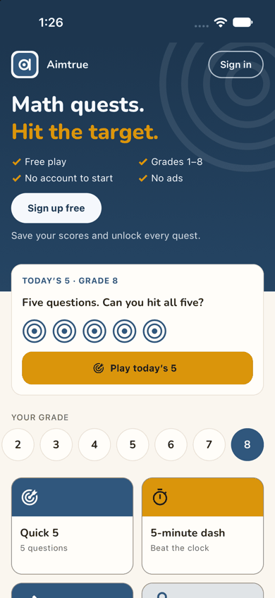

> Expected: harder questions for an adult. Observed: match. The row slides to 2-8, 8 is selected, and Today's 5
> switches to Grade 8.

**What Morgan notices:** had to guess that the row scrolls. Nothing above grade 8 is offered.

### Step 3 — Tap "Quick 5" (Grade 8)

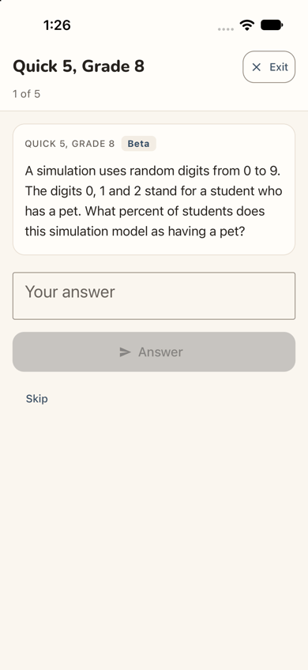

> Expected: a question straight away. Observed: match. A full screen "Quick 5, Grade 8", "1 of 5", an Exit button, and
> a card with a "Beta" pill: a simulation question (digits 0-9, with 0, 1 and 2 meaning "has a pet"; what percent?).
> A "Your answer" box, a disabled Answer and Skip.

**What Morgan notices:** an instant start with no sign-up wall. "Beta" is unexplained.

### Step 4 — Tap the answer box and type 30

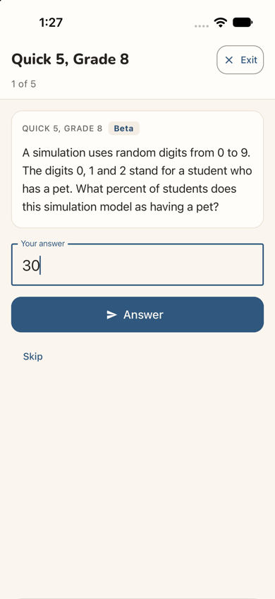

> Expected: the answer accepted for sending. Observed: match. "30" in the box, Answer turns dark blue. (The simulator's
> hardware keyboard was on, so the on-screen keyboard and its type were not seen.)

**What Morgan notices:** nothing says whether "%" is wanted; Morgan types the plain number.

### Step 5 — Tap Answer: the sign-up offer (landing)

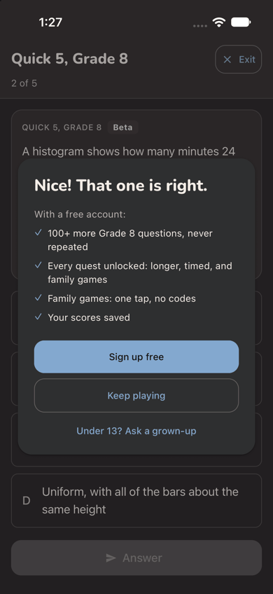

> Expected: told whether 30 is right, then question 2. Observed: match. The quest moves to "2 of 5" and a dialog opens
> over it: "Nice! That one is right.", "With a free account:" and four ticks: 100+ more Grade 8 questions, never
> repeated; Every quest unlocked: longer, timed, and family games; Family games: one tap, no codes; Your scores saved.
> Then "Sign up free" (filled), "Keep playing" and "Under 13? Ask a grown-up". No close X. Dark mode is readable.

**What Morgan notices:** a clear "right", which feels good, and the first benefit (more grade 8 questions) is exactly
what Morgan wants. The family lines are for someone else.

### Step 6 — Tap "Sign up free"

> Expected: a sign-up choice. Observed: a bottom sheet over the quest: "Sign up free / Keep your scores, unlock every
> quest and play with your family." with an Email field and a disabled Continue. This is the developer sign-up (the
> local server runs with sign-in off); production shows provider buttons here. The sheet is full height, mostly
> empty.

**What Morgan notices:** a short form. "Play with your family" again.

### Step 7 — Type the address and tap Continue

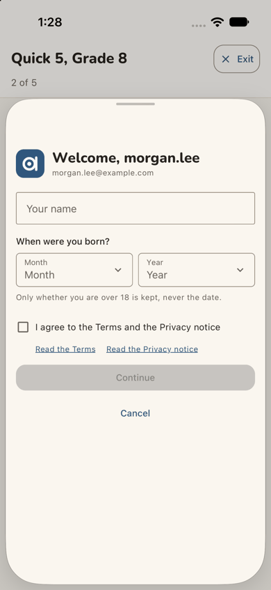

> Expected: the next sign-up step. Observed: match. In the same sheet: "Welcome, morgan.lee" with the address, "Your
> name", "When were you born?" (Month, Year), "Only whether you are over 18 is kept, never the date.", the terms box,
> "Read the Terms" and "Read the Privacy notice" links, a disabled Continue and Cancel.

**What Morgan notices:** greeted by the address's first half until the name is in (a developer-form detail). The line
about keeping only "over 18" reassures.

### Step 8 — Type the name "Morgan Lee"

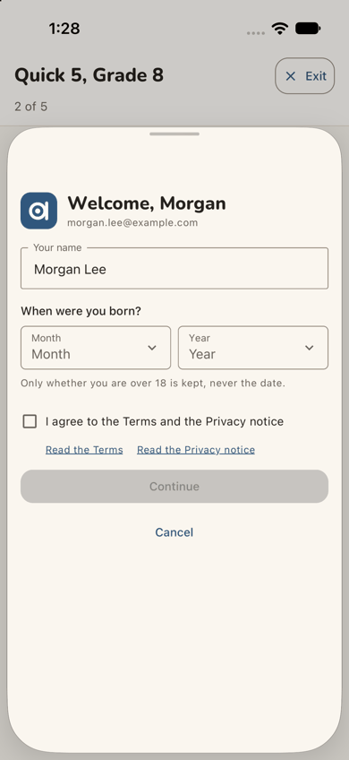

> Expected: the name taken. Observed: match. The greeting becomes "Welcome, Morgan".

**What Morgan notices:** a personal touch, at once.

### Step 9 — Open Month and pick May

> Expected: the month set. Observed: match. Month shows "May".

**What Morgan notices:** two taps, no fuss.

### Step 10 — Open Year

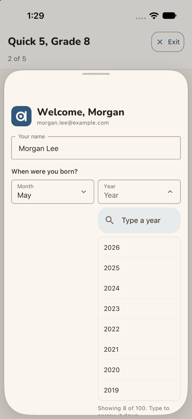

> Expected: a way to reach 1988. Observed: match. A list opens under Year with a "Type a year" search box, 2026 to 2019
> showing, and "Showing 8 of 100. Type to narrow it down."

**What Morgan notices:** the list starts at this year, 38 rows from 1988, but the search box makes that painless.

### Step 11 — Type 1988 and pick it

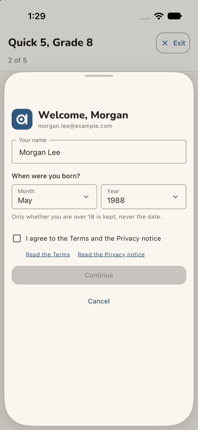

> Expected: the year set. Observed: match. Year shows "1988"; Continue stays disabled until the box is ticked.

**What Morgan notices:** quicker than scrolling.

### Step 12 — Tick "I agree to the Terms and the Privacy notice"

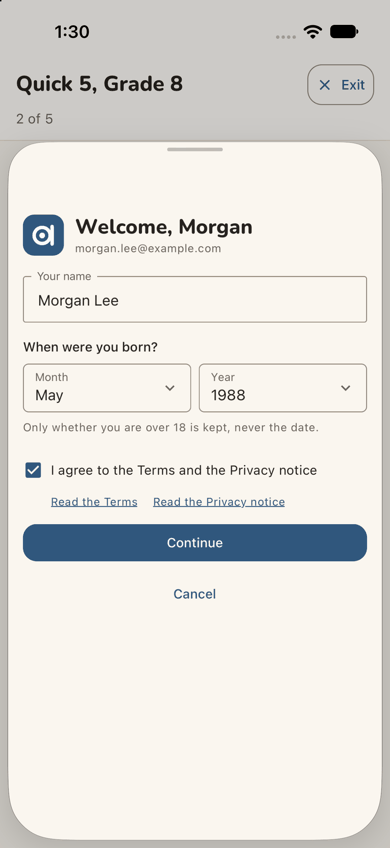

> Expected: Continue enabled. Observed: match. The box is ticked and Continue turns dark blue.

**What Morgan notices:** clear cause and effect. The terms were not opened (see Coverage).

### Step 13 — Tap Continue: "Waiting for approval" (landing)

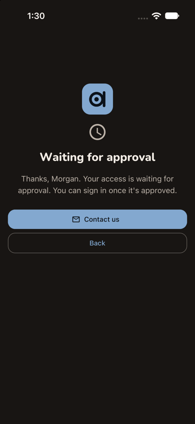

> Expected (sign-up access Post-approved): told that access waits for approval, and what happens next. Observed: told
> that it waits, within a second, on a full screen: the logo, a clock, "Waiting for approval", "Thanks, Morgan. Your
> access is waiting for approval. You can sign in once it's approved.", a filled "Contact us" and an outlined "Back".
> The quest is no longer in view. Dark mode is readable.

**What Morgan notices:** one clear message, but no word on who approves, how long, or how Morgan will find out. The
big button asks Morgan to write to someone. The momentum stops here.

### Step 14 — Tap Back

> Expected: back to the quest, to keep playing while waiting. Observed: the guest home, with "Today's 5 · Grade 8"
> remembered but the grade row back at 1-7. Nothing offers the Quick 5 that was at question 2, and nothing mentions the
> account.

**What Morgan notices:** "Where did my quest go?" Signing up cost the game in progress, and the page looks as if
nothing happened.

### Step 15 — A day later: open the app again (landing)

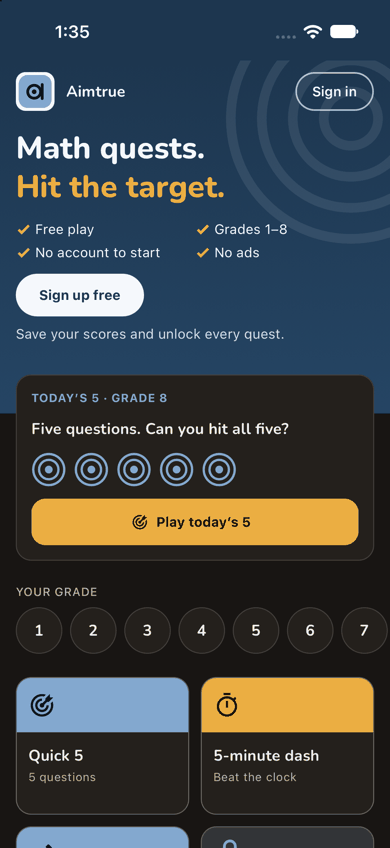

> Expected: the app, perhaps with a sign that the account is ready. Observed: the guest home exactly as on step 14:
> Today's 5 · Grade 8, the grade row at 1-7, "Sign up free" as the main button, "Sign in" top right. Nothing about
> the account or the approval. (Approval was given in the web console between the two stages.)

**What Morgan notices:** it looks like yesterday. "Sign in" is the obvious door for someone who signed up, so Morgan
tries it without knowing whether the approval has happened.

### Step 16 — Tap "Sign in"

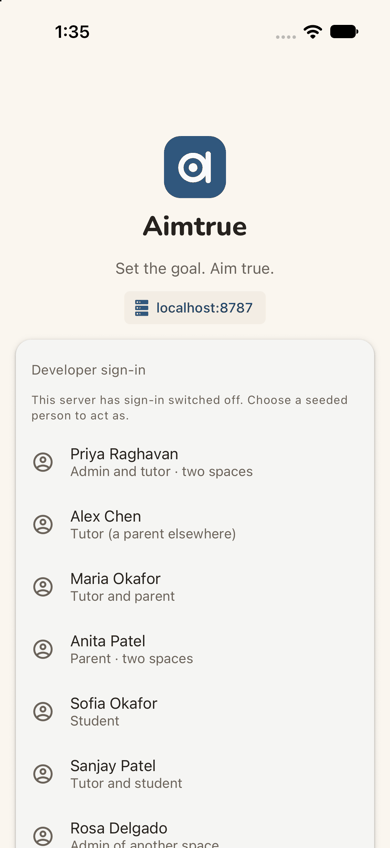

> Expected: a sign-in step. Observed: a full-screen sign-in: the logo, "Aimtrue", "Set the goal. Aim true.", a
> "localhost:8787" chip and "Developer sign-in: This server has sign-in switched off. Choose a seeded person to act
> as." with a list of seeded people. This is the development build's screen; production's provider buttons were not
> seen.

**What Morgan notices:** in this build, a list of strangers' names. Unlike the web, the button labelled "Sign in"
opens a sign-in screen, not a "Sign up free" sheet.

### Step 17 — Scroll to "Another email" and type the address

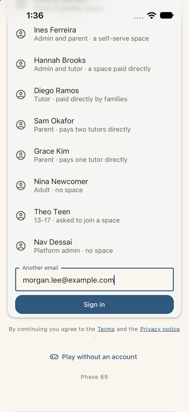

> Expected: a place for Morgan's address. Observed: match. Under the list, "Another email" with the address typed, a
> "Sign in" button, "By continuing you agree to the Terms and the Privacy notice", "Play without an account" and
> "Phase 69".

**What Morgan notices:** a developer-only detour; "Play without an account" is a reassuring way back.

### Step 18 — Tap Sign in: home in "Morgan's space" (landing)

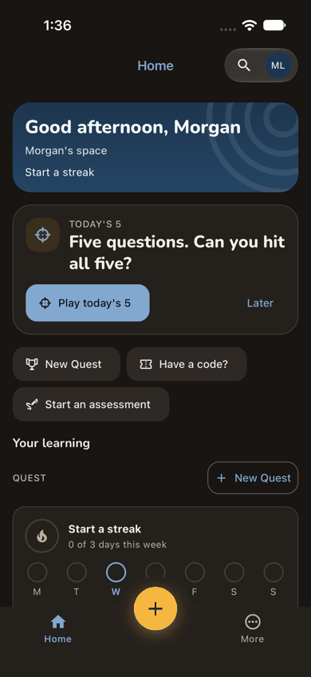

> Expected: into the product. Observed: match, in about a second with nothing asked again. Home of "Morgan's space":
> the band "Good afternoon, Morgan / Morgan's space / Start a streak". Next up "TODAY'S 5 / Five questions. Can you hit
> all five?" with "Play today's 5" and "Later". Quick actions New Quest, Have a code? and Start an assessment. "Your
> learning" with QUEST and "+ New Quest", and a "Start a streak / 0 of 3 days this week" card with Monday-Sunday dots.
> The tab bar has Home, a yellow "+" and More. No welcome, no "you're approved", no tour. Dark mode is readable.

**What Morgan notices:** relief and a personal greeting. "Start a streak" is a friendlier first line than a zero. But
"New Quest" twice, a "+" with no label, and "Morgan's space" unexplained.

### Step 19 — Scroll down: what the guest play left behind

> Expected: some continuity with yesterday. Observed: match. The streak card ends "Your first badge is one quest
> away." and "Next badge: First quest · 0 of 1". Then "TODAY'S DAILY · G8D", five rings and "Play today's Daily". Under
> Favorites, one chip: "★ G8Q5", the tile played as a guest. "Your grade" shows 1-7, and the selected 8 is off the
> edge. Grade-8 tiles follow in the grade's magenta: Quick 5 (its star filled) and 5-minute dash, each with "Grade 8",
> "Beta" and its code.

**What Morgan notices:** it remembered grade 8 and yesterday's quest. But "Today's Daily" looks like a second copy of
"Today's 5", and the favorite is a code.

### Step 20 — Scroll on to the grade-8 tiles

> Expected: the tiles the offer said would unlock. Observed: match. Six grade-8 tiles, none locked: Quick 5, 5-minute
> dash, Show your work, 10 in a row, 10-minute challenge, 20-minute marathon, each with an outline star to favorite.
> "Advanced" begins below with an "ADV" tile.

**What Morgan notices:** every padlock is gone, as promised, and there is an "Advanced" row for an adult.

### Step 21 — Tap "10 in a row" (locked as a guest): the countdown

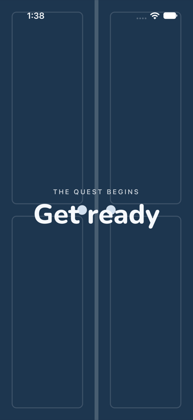

> Expected: the quest starts. Observed: match. A full-screen navy countdown with two doors, "THE QUEST BEGINS / Get
> ready". In this frame, captured mid-animation, two pale dots sit over the letters of "Get ready". It lasted about 3
> seconds.

**What Morgan notices:** a bit of theatre, then straight in.

### Step 22 — Question 1 on screen (landing)

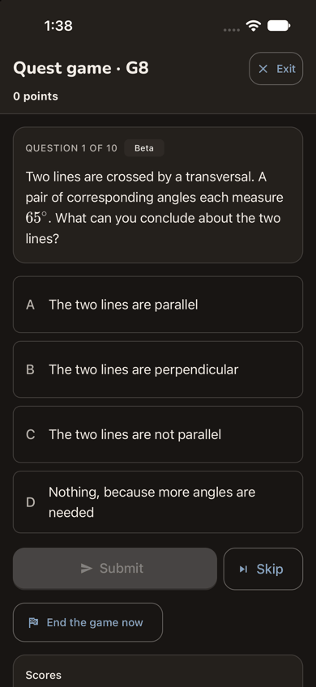

> Expected: the quest's first question. Observed: match. Header "Quest game · G8", "0 points" and Exit. "QUESTION 1
> OF 10" with "Beta": two lines crossed by a transversal, corresponding angles of 65°, choices A-D. A disabled Submit,
> Skip, "End the game now", and a "Scores" card below. Dark mode is readable. **The journey's end: the quest has
> started.**

**What Morgan notices:** fast, with no setup: tap, countdown, a real grade-8 question. The name "10 in a row" is gone
from the header.

### Step 23 — Close the app and open it again (end-state check)

> Expected: the started quest survives. Observed: partly. Morgan is still signed in, with no sign-in asked. The app
> opens on Home, not the quest. Next up still offers "Today's 5". A new full-width "▶ Continue G8Q10" button sits under
> Quest.

**What Morgan notices:** good that nothing was asked again. The quest is one tap away, under a code.

### Step 24 — Tap "Continue G8Q10" (end-state check)

> Expected: back at question 1 of the same quest. Observed: "Quest game · G8", 0 points, "QUESTION 1 OF 10", but a
> different question ("If 4³ × 4² = 4ⁿ, what is n?", typed answer) from step 22's. The Scores card: "Morgan (you) 0,
> 0/10".

**What Morgan notices:** "That's not the question I had." Continue started over.

## Appendix

- **Mode:** live. The iOS app, development build `com.aimtrue.app.dev`, on the iPhone 17 simulator (iOS 27.0), loading
  its bundle from Metro, against the local Worker at `http://localhost:8787` (the run's data and settings, sign-in off).
  Driven with Maestro, one small flow per step (`apps/mobile/.maestro/journeys/j01a-*.yaml`), each screen captured with
  `simctl` and resampled to 390 px wide. Dark mode at the landing steps (1, 5, 13, 15, 18, 22). Two stages on one device
  with no state cleared between them: steps 1-14, then the platform admin's approval, then steps 15-24 after a
  relaunch.
- **Frameworks applied:** cuj-contract (every step against its expected result); task-completion (the journey ran to
  its defined end, a quest started in Morgan's own space, step 22); success-criteria (the end state checked again after
  closing and reopening the app, steps 23-24).
- **CUJ manifest:** J01A, 24 steps, all verified: steps 1-22 are the journey and 23-24 the end-state check. Step 14
  (Back from the wait) is a detour Morgan tried, outside the shortest path.
- **Coverage / not inspected:**
  - The production sign-in and sign-up screens (Google, Microsoft, Facebook buttons): the local server ran with
    sign-in off, so the app showed its developer forms (steps 6-8, 16-17). Their wording ("Welcome, morgan.lee", the
    seeded list, "Phase 69") is not what a stranger sees and was not judged.
  - The Terms and Privacy notice: not opened.
  - "Contact us" on the waiting screen: not tapped; its destination was not seen.
  - The on-screen keyboard (the simulator's hardware keyboard was on), so the answer box's keyboard type and hint.
  - Whether the app accepts "30%" for question 1 (the web's "Good try"); only "30" was tried.
  - Whether Morgan was told of the approval outside the app (an email); no mailbox was available.
  - Whether the game started at step 22 is still open after step 24, and what happens to it.
  - The guest home below the tiles (Advanced, Play together, the FAQ), the yellow "+" in the tab bar, More, the
    account menu, "Make this my home", favorites' stars, the Daily, and the rest of the quest past question 1.
  - VoiceOver, Dynamic Type and Android.
- **Access:** the app's developer sign-in (the local server ran with sign-in off, because the native Google step cannot
  be driven on the simulator); the development build; the approval and any space decision were made in the web console
  and are not part of the journey.
- **Preconditions made outside the app:** none by this journey. The run's platform settings (sign-up access
  Post-approved, guest play and the Daily on, the default tiles) were set before the journeys, as
  `docs/userjourney/README.md` "The run" records. Between the two stages the platform admin approved Morgan in the web
  console on `:8787` (Sign-up access, Waiting for approval, Approve).
