# CUJ Audit — J02: adult player signs up from the guest page, declined

## Executive summary

**Who:** Casey Morgan, 41, born November 1985, an adult who wants to brush up on maths. Casey belongs to cohort
**C6, the Quest player** ("Let me play.") in `docs/member-home-plan.md` and arrives as a signed-out guest. Casey wants
what the guest page promises: an account to save scores and open the longer quests. The platform runs
**Post-approved** sign-up access, and in this journey the platform admin **declines** Casey's request.

**Outcome: 1/1 journeys passed, 0 skipped, 20 of 20 steps verified.** The journey expects a refusal, and it came.

- **Stage 1 (steps 1-9).** Casey played one Grade 8 question as a guest, took the sign-up offer, gave a birth month and
  year, agreed to the terms, and got "Waiting for approval" (step 9).
- **Stage 2 (steps 10-20), "a day later" in a new tab.** Casey tapped Sign in and was told "Access not approved"
  (step 12). Casey tried again later through the guest play's sign-up offer and got the same words (step 17).
- **What is left.** Guest play still works (steps 15 and 18), and "Contact us" is a mailto link to a personal Gmail
  address. Trying again only repeats the refusal.

**What went wrong along the way:**
- Casey never hears the decision. Casey finds out only by trying to sign in.
- The refusal gives no reason and offers no next step except an email.
- "Back" returns Casey to the sign-up sheet.
- The app keeps offering the sign-up Casey was refused.
- After a refusal, the refusal opens again by itself whenever Casey returns to the home page (step 19).

**Conversion figures** (counted from the entry point, the signed-out guest page):

| Stretch | Screens | Taps | Typed fields | Waits | Dead ends |
| --- | --- | --- | --- | --- | --- |
| Entry to "Waiting for approval" (steps 1-9) | 6 | 10 | 3 (an answer, birth month, birth year) | 0 | 0 |
| ...of which the sign-up itself, offer to waiting (steps 4-9) | 4 | 7 | 2 | 0 | 0 |
| Return visit to the first refusal (steps 10-12) | 3 | 2 | 0 | 0 (about 1 s) | 0 |
| First refusal to the second, "later" (steps 13-17) | 5 | 9 | 1 (a guest answer) | 0 | 3 |
| Second refusal to the end (steps 18-20) | 2 | 3 (+1 reload) | 0 | 0 | 1 |
| Whole run, 20 steps | 7 distinct | 24 | 4 | 0 | 4 |

The 7 distinct screens are the guest page, guest play, the offer, the "Sign up free" sheet, "Almost there" (birth date
and terms), "Waiting for approval" and "Access not approved".

For **conversion**, the sign-up itself is short and clean: 7 taps and 2 choices. Under Post-approved access, though,
nothing told Casey beforehand that a person decides, and nothing tells Casey afterwards what they decided. The
"no" arrives only when Casey thinks to come back and sign in.

For **stickiness**, the only reason left to return is guest play. It stays open, and the device keeps Casey's grade
(step 10). But Casey gets the same first question as before (step 15), and the longer quests stay locked behind
"Free account". The home page now shows Casey the refusal again each time Casey comes back to it in that tab (step 19).

**The 3 screens Casey would notice most:**

- **Step 9, "Waiting for approval".** This is the first time Casey learns a person must approve the account, and it
  comes after the whole sign-up. The screen says "You can sign in once it's approved". It does not say who decides,
  how long it takes, or whether Casey will hear back. It sits under the heading "Almost there". An adult who wanted to
  start today is left to check back on their own.
  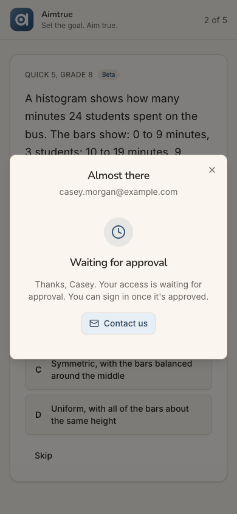
- **Step 12, "Access not approved".** The verdict is quick and polite, but it is all Casey gets: no reason, no word that
  guest play is still open, and no way to ask again except "Contact us", a mailto link to a personal Gmail address.
  "Back" leads straight back into "Sign up free" (step 13).
  
- **Step 19, the refusal comes back by itself.** Casey closed it and went on as a guest. On tapping the Aimtrue logo
  to go home, "Access not approved" is open again over the guest page without Casey asking. Casey has to dismiss it on
  every return until a reload. The one door still open, guest play, now greets Casey with a "no".
  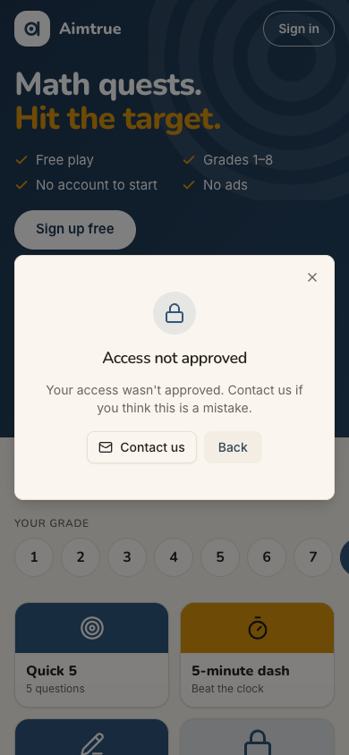

**Contact sheet** (all 20 phone steps):

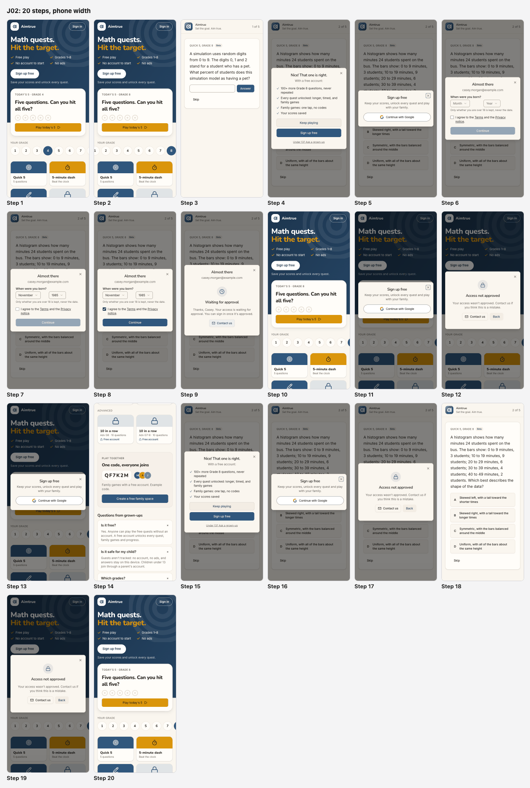

| Severity | Count |
| --- | --- |
| sev4 (catastrophe) | 0 |
| sev3 (major) | 2 |
| sev2 (minor) | 3 |
| sev1 (cosmetic) | 2 |
| **Total** | **7** |

## Prioritized fixes

1. [sev3] [Casey is never told the decision: the refusal is found only by trying to sign in](#sev3-casey-is-never-told-the-decision-the-refusal-is-found-only-by-trying-to-sign-in): say before sign-up that a person approves, and give a time frame and a notice (steps 4-12).
2. [sev3] [The refusal is a dead end: no reason, no guest play, only an email to a personal address](#sev3-the-refusal-is-a-dead-end-no-reason-no-guest-play-only-an-email-to-a-personal-address): add "Keep playing as a guest", a reason category, a real support channel, and make Back leave the loop (steps 12, 13, 17).
3. [sev2] [After a refusal, the refusal reopens by itself on the home page](#sev2-after-a-refusal-the-refusal-reopens-by-itself-on-the-home-page): clear the refusal state when it is dismissed (step 19).
4. [sev2] [The app keeps selling the sign-up Casey was refused, and a second try changes nothing](#sev2-the-app-keeps-selling-the-sign-up-casey-was-refused-and-a-second-try-changes-nothing): remember the refusal on the device, tone the offer down, and say whether trying later can help (steps 15-17, 20).
5. [sev2] ["Sign in" opens a sheet titled "Sign up free"](#sev2-sign-in-opens-a-sheet-titled-sign-up-free): title the sheet by the button that opened it (step 11).
6. [sev1] [The guest page and the offer speak to children and families, not to an adult learner](#sev1-the-guest-page-and-the-offer-speak-to-children-and-families-not-to-an-adult-learner): add a line for adults and a "Grade 8 and up" hint (steps 1, 2, 4).
7. [sev1] ["Almost there" stays above "Waiting for approval"](#sev1-almost-there-stays-above-waiting-for-approval): retitle the sheet when its state changes, and align it on desktop (step 9).

## Findings

### [sev3] Casey is never told the decision: the refusal is found only by trying to sign in

- **Issue Description:** Nothing before or during sign-up says that a person approves new accounts. The guest page
  (step 1), the offer (step 4), "Sign up free" (step 5) and "Almost there" (steps 6-8) all read as an open, instant
  sign-up. The FAQ adds "A free account unlocks every quest" (step 14). Casey learns about approval only on the
  waiting screen, after the whole sign-up (step 9). That screen says "Your access is waiting for approval. You can sign in once it's
  approved." It does not say who decides, how long it takes, or that Casey will be told: no email is promised, and
  none is mentioned. The guest page on the return visit has no trace of the pending request (step 10). Casey learns
  the outcome only by tapping Sign in and Continue with Google (step 12). Someone who never comes back to check never
  learns it. An approved person would not know to come back either; that branch was not run here.
- **Framework Violation:** cuj-contract, steps 9 and 12 (expected: told that approval is needed, when, and how the
  answer arrives; observed: approval revealed at the end, the answer only discovered on a retry); Nielsen #1
  Visibility of system status; Nielsen #2 Match between system and the real world ("Sign up free" promises an account,
  not a request).
- **Severity:** 3. Classify: workaround needed. Casey has to keep returning and trying to sign in to learn where the
  request stands, and Casey has no way to know when to try. For an adult who wanted to start brushing up that day, the
  sign-up turns into an open-ended wait with no signal. This costs conversion when the answer is yes, and goodwill when
  it is no. It is not a 4: the verdict does arrive, quickly, on a retry.
- **Evidence:**  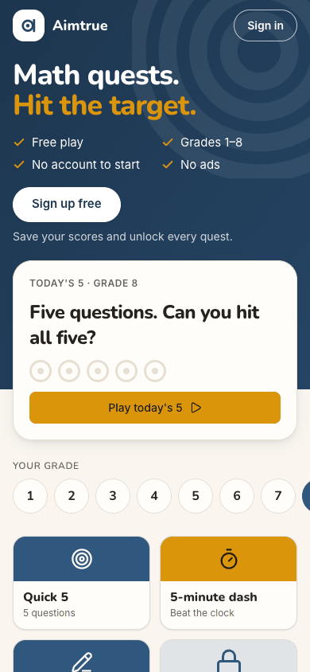
  
  Repro, with sign-up access Post-approved: signed out at `/`, play a guest tile, answer, then "Sign up free",
  "Continue with Google", a birth month and year, the terms box and Continue. "Waiting for approval" shows. Have the
  platform admin decline the request in the console. Open `/` in a new tab: the page shows nothing about the request.
  Tap "Sign in", then "Continue with Google": "Access not approved". The browser log shows
  `POST /api/auth/signup` 403 at the waiting screen and `POST /api/auth/google` 403 at the refusal. Neither appears
  on screen.
- **Recommended Fix:**
  - While access is Post-approved, say so before the work: one line on the "Sign up free" sheet and in the offer,
    e.g. "New accounts are checked by a person, usually within a day."
  - On the waiting screen, say who decides, the usual time, and how Casey will hear. Send an email on approve and on
    decline, from the platform's verified sender, carrying no reason text beyond a category. Until email exists, say
    plainly: "Come back and sign in to see if you're approved."
  - Let the guest page recognise the device that asked: a device-local flag set at the waiting screen could show "Your
    request is waiting" or "Check your request" instead of a plain "Sign up free".

### [sev3] The refusal is a dead end: no reason, no guest play, only an email to a personal address

- **Issue Description:** "Access not approved" (steps 12 and 17) says only "Your access wasn't approved. Contact us if
  you think this is a mistake." It has two controls, "Contact us" and "Back", plus a close X.
  - **No reason, no date, no word on permanence.** Casey cannot tell whether "a mistake" is likely, or whether trying
    later could help.
  - **No word that guest play is still open.** Casey found it only by closing the dialog and trying a tile (steps 15
    and 18).
  - **"Contact us" is a mailto link to a personal Gmail address.** The waiting screen and the footer use the same
    link, which looks unofficial on a screen that just turned someone away. No form, no subject line, no reference.
  - **"Back" leads back into the refusal loop.** It returns to the "Sign up free" sheet with "Continue with Google",
    the very action just refused (step 13). Only the X leaves.
  - **No account named.** Unlike the waiting screen, the refusal does not show which account was refused. In the aria
    tree the dialog has no accessible name; only the alert inside it has a heading.
- **Framework Violation:** cuj-contract, steps 12, 13 and 17 (expected: the outcome and what Casey can do next;
  observed: the outcome, an email, and a Back that loops); Nielsen #9 Help users recognize, diagnose, and recover from
  errors; Nielsen #3 User control and freedom (Back does not go back out).
- **Severity:** 3. Classify: workaround needed. Casey's one remaining use of the product, guest play, has to be
  discovered by dismissing the refusal. An appeal means writing an unprompted email to a private address. For an adult
  learner, being told "no" with no reason and no path makes it unlikely Casey keeps playing even as a guest. It is not
  a 4: the X and the tiles still work.
- **Evidence:**  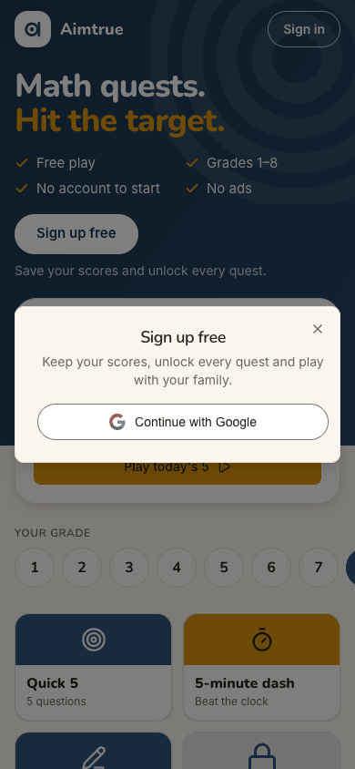
  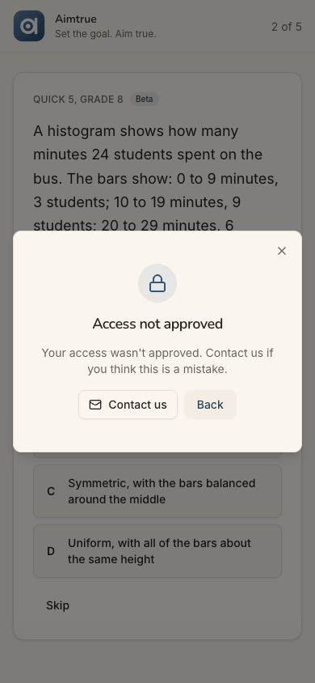
  Repro: with the request declined, at `/` tap "Sign in", then "Continue with Google". The alert "Access not approved"
  opens, with "Contact us" (a `mailto:` link to a personal Gmail address) and "Back". Tap Back: "Sign up free" with
  "Continue with Google" is open again.
- **Recommended Fix:**
  - Make the refusal a fork, not a wall. Lead with a primary "Keep playing as a guest" that closes the dialog onto the
    tiles. Keep "Contact us" as secondary, and make "Back" close the dialog rather than reopen the sign-up sheet.
  - Add one line on permanence, e.g. "This decision is final for this account" or "You can ask again in 30 days".
    Where the console records why, add a category such as "Sign-ups are limited right now", never free text.
  - Point "Contact us" at a platform support address or a short contact form with the account prefilled, not a
    personal inbox.
  - Show which account was refused, as the waiting screen does, and give the dialog an accessible name.

### [sev2] After a refusal, the refusal reopens by itself on the home page

- **Issue Description:** After "Access not approved" is closed with the X, the next return to `/` within the same tab
  opens it again unasked. The first time, Casey closed refusal #2 on the guest play page (step 18) and tapped the
  Aimtrue logo ("Home"). The guest page came up with "Access not approved" already open. A re-run confirmed it from the
  home page too: refusal, X, open a tile, then the logo. Only a reload, or a new tab, clears it (step 20). Every return
  to the home page in that tab therefore starts with a "no".
- **Framework Violation:** cuj-contract, step 19 (expected: the guest page; observed: the guest page with the refusal
  open over it); Nielsen #3 User control and freedom (a dismissed dialog that comes back unasked).
- **Severity:** 2. Classify: an observable mismatch and real friction. One tap closes it each time, so no workaround
  beyond that is needed. For Casey, guest play is the only thing left, and the page meant to welcome Casey back now
  opens on the refusal. It wears down the last reason to stay.
- **Evidence:**  
  Repro: with the request declined, at `/` tap "Sign in", then "Continue with Google". Close "Access not approved"
  with the X. Tap "Play Quick 5, Grade 8", then the Aimtrue logo: `/` opens with "Access not approved" over it. A
  reload shows the plain guest page. The run first saw it when closing refusal #2 on `/play/G8Q5` and tapping the logo.
  The screenshot is from that re-run, which made a third, identical refusal; the re-run is not counted in the figures.
  J05 reports the same class of bug for the under-13 refusal: the sign-up state is kept after it is dismissed.
- **Recommended Fix:** When the refusal is dismissed (X, Back or "Keep playing"), reset the page's sign-up state in the
  same handler: the open flag, the refusal result and any sign-up token. The refusal should then open only as the
  direct answer to a Continue with Google tap. Add a web e2e check: decline a request, sign in to see the refusal,
  close it, open `/play/G8Q5`, return to `/`, and assert that no dialog is open. Check the app's sign-in sheet for the
  same.

### [sev2] The app keeps selling the sign-up Casey was refused, and a second try changes nothing

- **Issue Description:** Nothing on the device remembers the refusal, so every surface goes on pitching the account.
  - **The guest page** shows "Sign up free" and "Save your scores and unlock every quest." in the hero (steps 10 and
    20). The longer tiles stay marked "Free account".
  - **The guest play** offers it again after question 1 (step 15): "Nice! That one is right. With a free account:
    100+ more Grade 8 questions, never repeated…" with "Sign up free" as the primary button. This came about ten
    minutes, in real time, after it was last shown, although the run sets the offer to wait 24 hours. The likely
    reason is that Casey took the offer rather than dismissing it; the code was not checked.
  - **The second try** goes through the same "Sign up free" sheet (step 16) and gets word-for-word the same refusal
    (step 17). Nothing says whether a later try could ever succeed.
  - **The guest play repeats itself.** Casey gets the same first question as the day before (step 15): the guest pool
    is a few questions a level.
- **Framework Violation:** cuj-contract, steps 15-17 (expected: the device knows the account was refused, or the refusal
  says what a later attempt can do; observed: the full sales pitch and an identical refusal); Nielsen #2 Match between
  system and the real world (offers a benefit the person cannot get).
- **Severity:** 2. Classify: real friction. It costs one extra round of taps for nothing, plus a second "no". For a
  refused adult, being sold the thing they were just refused reads as careless. The repeated first question removes the
  novelty guest play relies on. It is not a 3: Casey can ignore the offer and keep playing.
- **Evidence:** 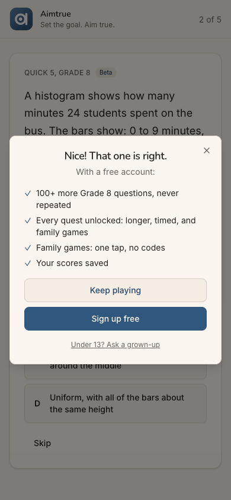 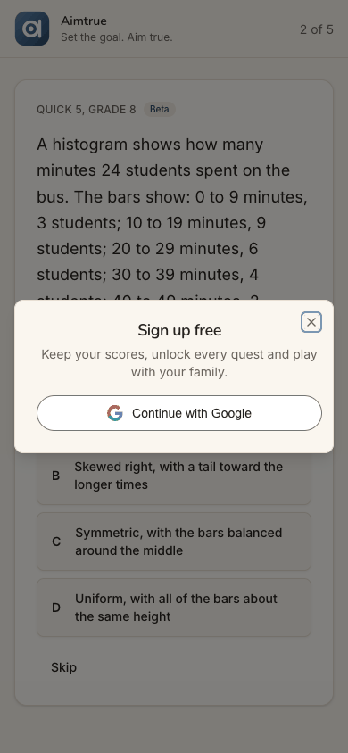
  
  Repro: after the first refusal, at `/` tap "Play Quick 5, Grade 8", type 30 and tap Answer. The offer with "Sign up
  free" appears. Tap it, then "Continue with Google": "Access not approved", unchanged.
- **Recommended Fix:**
  - Keep a device-local "refused" flag, never sent to the server, like the guest's other keys. While it is set, skip
    the after-question offer, change the hero's "Sign up free" to a quiet "Signed up before? Sign in", and drop the
    "Free account" padlock copy in favour of plain locks.
  - Say on the refusal whether and when asking again is possible (see the sev3 above). If re-asking is allowed, make
    the second attempt a real new request ("Ask again") rather than a silent repeat.
  - Rotate the guest pool's first question per device, so a returning guest does not start on the same one.

### [sev2] "Sign in" opens a sheet titled "Sign up free"

- **Issue Description:** On the return visit Casey taps the header's "Sign in", as the waiting screen implied ("You can
  sign in once it's approved"). The sheet that opens is headed "Sign up free" and reads "Keep your scores, unlock every
  quest and play with your family." It is the same sheet as the hero's and the offer's (steps 5, 11, 13, 16). A
  returning person reads it as "they lost my account" or "I'm signing up twice".
- **Framework Violation:** cuj-contract, step 11 (expected: a sign-in screen; observed: a sign-up sheet); Nielsen #4
  Consistency and standards (the button and the sheet disagree).
- **Severity:** 2. Classify: an observable mismatch. Casey continues anyway, since Google is the only button, but at the
  very moment Casey is anxious about the request. J05 records the same mismatch.
- **Evidence:** 
  Repro: signed out at `/`, tap "Sign in" in the header. The dialog is titled "Sign up free".
- **Recommended Fix:** Title the sheet by the button that opened it. From "Sign in", use "Sign in" with "Welcome back.
  Use the account you signed up with." From "Sign up free", keep the current copy, and keep a small "Already have an
  account? It's the same button." line under the Google button on both.

### [sev1] The guest page and the offer speak to children and families, not to an adult learner

- **Issue Description:** Nothing on the page tells an adult that they are welcome or where to start.
  - **The guest page is framed for children.** It says "Grades 1–8". The FAQ is "Questions from grown-ups", and its
    answers are about "my child" (steps 1 and 14).
  - **The offer leans on family games.** Two of its four benefits are about them (step 4). The "Sign up free" sheet
    says "play with your family" (step 5).
  - **The top grade is hidden on a phone.** The highest level is Grade 8, and on a phone the grade row cuts "8" off at
    the right edge, so it is not visible at first (step 1).
  - **Casey picked Grade 8 as the closest to "brush up"** (step 2). The page gave no hint that Grade 8 and the
    "Advanced" quests are where an adult would start.
- **Framework Violation:** cuj-contract, steps 1-2 and 4 (expected: an adult can tell the product is for them and
  which level to pick; observed: a child-and-family framing); Nielsen #2 Match between system and the real world.
- **Severity:** 1. Classify: cosmetic for this run, because Casey went on to sign up. But it is the first impression
  for every adult in C6, and with a "no" at the end it confirms "this wasn't for me".
- **Evidence:**  
  Repro: signed out at `/` on a 390-px-wide screen. The grade row clips 8. Answer the first guest question to see the
  offer's four benefits.
- **Recommended Fix:** Add one line to the FAQ, "Is it only for children?", answered with "Grown-ups brushing up are
  welcome: start at Grade 8 or the Advanced quests." Lead the offer with the two benefits that speak to anyone, saved
  scores and new questions, before the family ones. On phones, scroll the grade row so the selected grade and 8 are
  both in view, or wrap it onto two lines.

### [sev1] "Almost there" stays above "Waiting for approval"

- **Issue Description:** When sign-up ends in the pending state, the sheet keeps its heading "Almost there" and the
  email, and shows "Waiting for approval" under it (step 9). Casey is not almost there: Casey is stopped and waiting on
  a person. On desktop the heading and email are left-aligned, while the waiting block below is centred.
- **Framework Violation:** cuj-contract, step 9 (expected: one clear state; observed: two headings that disagree);
  Nielsen #8 Aesthetic and minimalist design.
- **Severity:** 1. Classify: cosmetic wording and alignment. The waiting text itself is clear.
- **Evidence:**  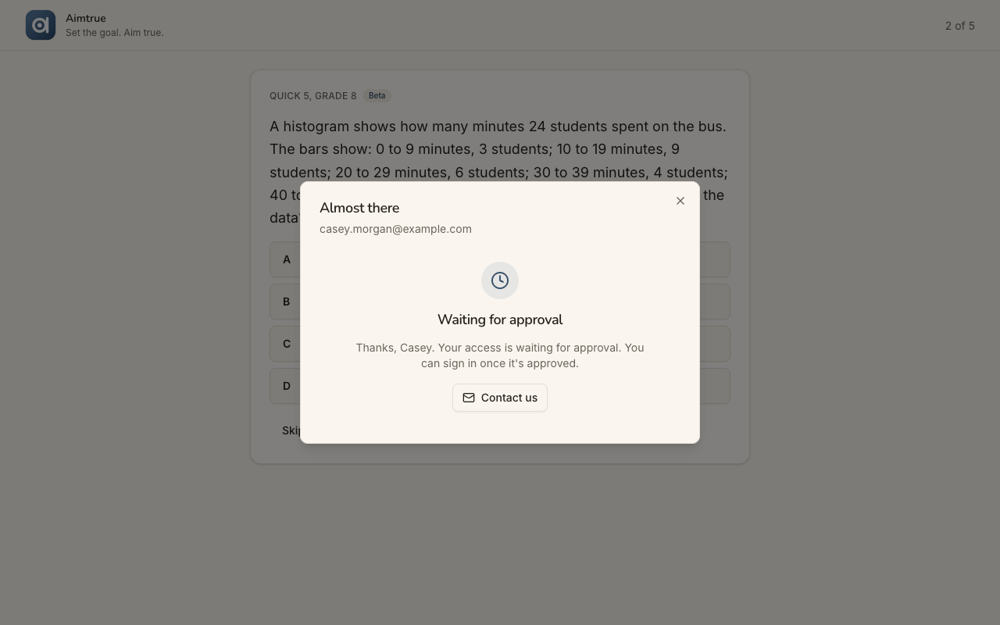
  Repro: complete a sign-up while access is Post-approved, then compare the phone and desktop widths.
- **Recommended Fix:** Replace the sheet's heading with "Request sent" once it is pending, keeping the email as the
  subtitle. Use the same centred layout at every width.

## Walkthrough

### Step 1 — Open http://localhost:8797/ signed out (landing)

> Expected: a page that says what this is and lets a newcomer try it. Observed: match. The page reads "Math quests. Hit
> the target." with ticks for Free play, Grades 1–8, No account to start and No ads. Below are "Sign up free", a
> "Today's 5 · Grade 4" card with "Play today's 5", and the grade row 1–8 with 4 selected. On a phone, 8 is off the
> right edge. Tiles follow, three of them locked "Free account". Then Advanced, Play together, "Questions from
> grown-ups" and the footer. Desktop and dark mode render cleanly.

**What Casey notices:** play with no account, which is inviting. But it reads as a children's product: grades 1 to 8,
and questions "from grown-ups" about "my child". Nothing says an adult is welcome or where to start.

### Step 2 — Tap grade 8

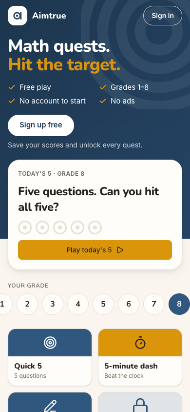

> Expected: the highest level on offer. Observed: match. Grade 8 is selected, Today's 5 follows it, and the tiles are
> relabelled. The row now clips 1 on the left.

**What Casey notices:** 8 is the top. There is no adult or high-school level, so Casey takes the closest.

### Step 3 — Tap the "Quick 5" tile (Grade 8)

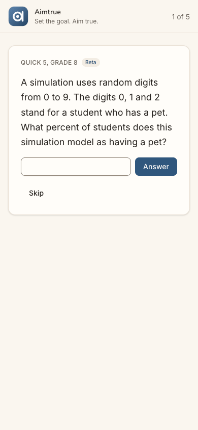

> Expected: a first question straight away. Observed: match. `/play/G8Q5` opens full screen, "1 of 5", with "Quick 5,
> Grade 8" and a "Beta" badge. A free-answer question (a percent from a digit simulation) has one box, Answer and
> Skip.

**What Casey notices:** instant, with no wall. The "Beta" badge is unexplained, and the only way out is the logo.

### Step 4 — Type 30 and tap Answer

> Expected: right or wrong, then the sign-up offer. Observed: match. A dialog over question 2 says "Nice! That one is
> right." Under "With a free account:" it lists 100+ more Grade 8 questions never repeated, every quest unlocked,
> family games, and your scores saved. Buttons: "Keep playing" and "Sign up free", a link "Under 13? Ask a grown-up",
> and an X.

**What Casey notices:** a good moment for the pitch. "Scores saved" and "never repeated" speak to Casey; the two family
lines do not.

### Step 5 — Tap "Sign up free"

> Expected: the Google step. Observed: a second sheet, "Sign up free / Keep your scores, unlock every quest and play
> with your family.", with one "Continue with Google" button.

**What Casey notices:** the pitch again, one more tap before anything happens. Nothing hints that a person will review
the sign-up.

### Step 6 — Tap "Continue with Google" (the stand-in signs in as Casey)

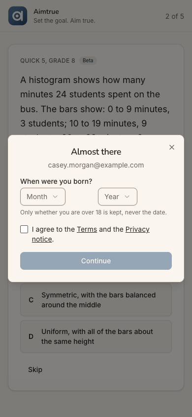

> Expected: Google, then back to the app. Observed: at once, "Almost there", showing Casey's email. It asks "When were
> you born?" with Month and Year lists, says "Only whether you are over 18 is kept, never the date.", and has a terms
> box and a disabled Continue.

**What Casey notices:** quick, and the email confirms the account. The privacy line reassures. The year list starts at
2026, so 1985 is a long way down.

### Step 7 — Choose November and 1985

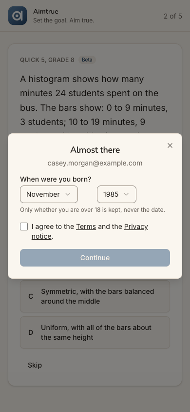

> Expected: Continue enabled once the details are in. Observed: both lists show the choice, and Continue stays greyed
> because the terms box is unticked.

**What Casey notices:** no hint of what is missing, though the checkbox sits right above the button.

### Step 8 — Glance at the Terms link, then tick "I agree…"

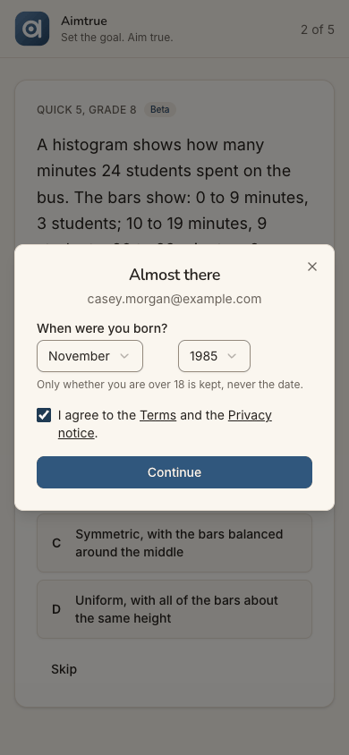

> Expected: agreement enables Continue. Observed: match. The Terms link opens in a new tab and the sheet keeps
> November and 1985. Ticking the box enables Continue.

**What Casey notices:** nothing is lost by reading the terms. Agreeing is one tick.

### Step 9 — Tap Continue: "Waiting for approval" (landing)

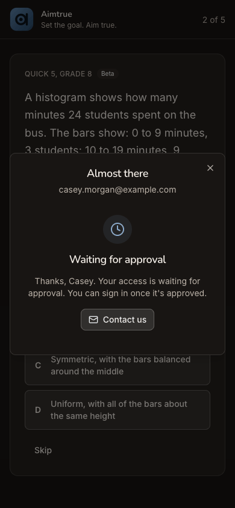

> Expected: with Post-approved access, a screen saying the request waits for approval. Observed: match in substance.
> Within about a second the sheet, still headed "Almost there" with Casey's email, shows a clock, "Waiting for
> approval" and "Thanks, Casey. Your access is waiting for approval. You can sign in once it's approved.", with a
> "Contact us" mailto. Question 2 waits behind it. On desktop the heading is left-aligned and the body centred. Dark
> mode is readable.

**What Casey notices:** the first word that someone must approve, after everything was filled in. "Almost there" over
"Waiting" is a mixed message. Casey cannot tell who decides, how long it takes, or whether there will be an email.

### Step 10 — A day later: new tab, open / signed out (landing)

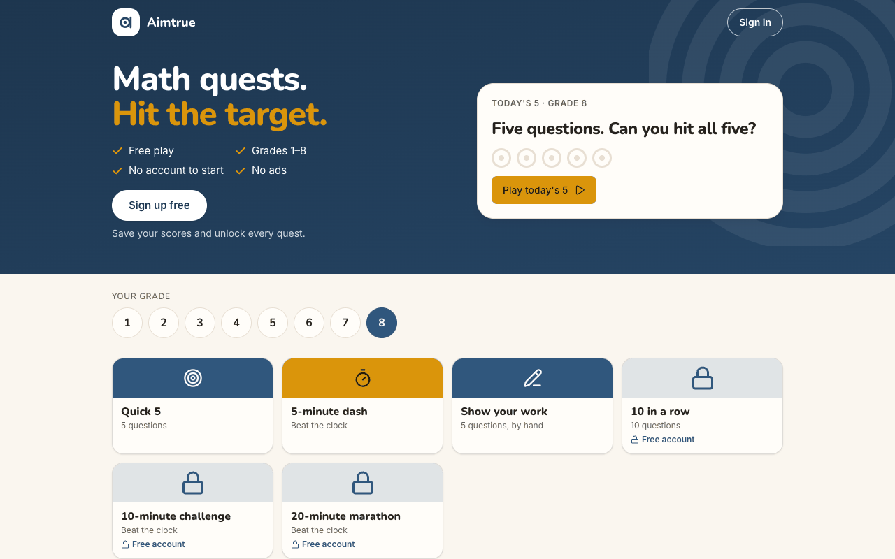
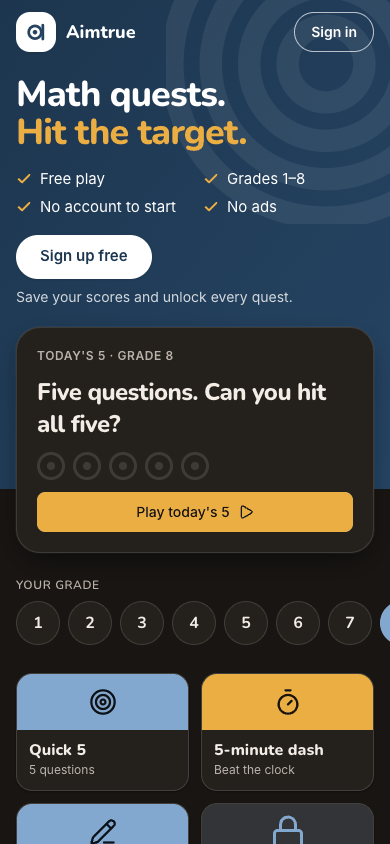

> Expected: the guest page, perhaps with a word on the pending request. Observed: the guest page as before, with Grade 8
> kept from the guest play ("Today's 5 · Grade 8", Grade 8 tiles). There is no "welcome back" and no word on the
> request. Desktop shows the full grade row, and dark mode is consistent.

**What Casey notices:** the page remembers the grade, which is nice. But it treats Casey as a stranger, so Casey reaches
for "Sign in", as the waiting screen implied.

### Step 11 — Tap "Sign in"

> Expected: a sign-in screen. Observed: a sheet titled "Sign up free", with "Keep your scores, unlock every quest and
> play with your family." and "Continue with Google". It is the same sheet as step 5.

**What Casey notices:** "I tapped Sign in and it says Sign up free. Am I signing up again?" Google is the only button,
so Casey goes on.

### Step 12 — Tap "Continue with Google": the first refusal (landing)

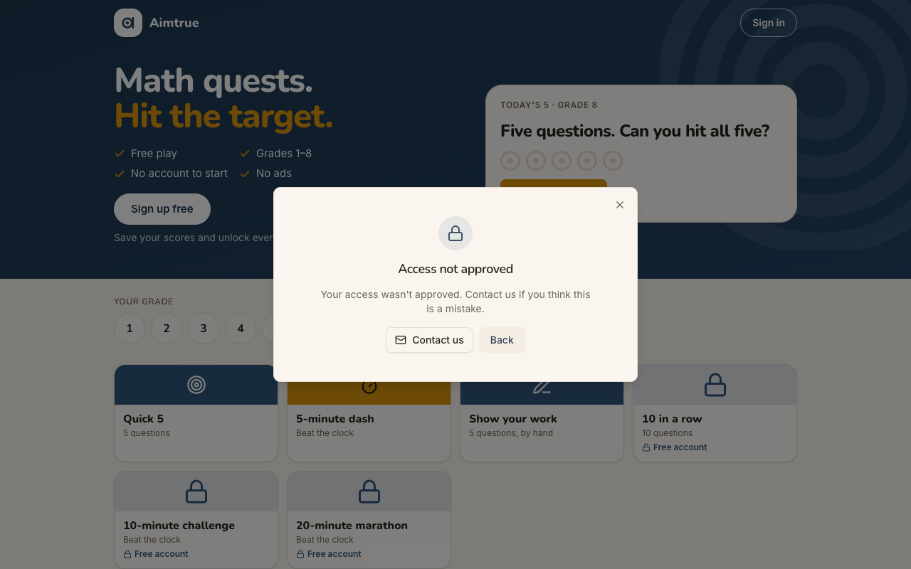
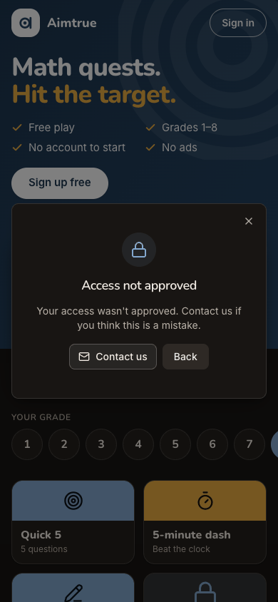

> Expected: Casey's account, or a clear outcome and next step. Observed: within about a second, a lock icon with
> "Access not approved" and "Your access wasn't approved. Contact us if you think this is a mistake.", plus "Contact
> us" (a mailto link to a personal Gmail address), "Back" and an X. No account is named. The browser log shows
> `POST /api/auth/google` 403. Desktop is centred, and dark mode is readable.

**What Casey notices:** a clear, polite "no", but no reason, no word on guest play, and no way forward except an email
to what looks like a private address. Casey learned it only by trying to sign in.

### Step 13 — Tap "Back"

> Expected: out of the dialog, back to the page. Observed: the "Sign up free" sheet with "Continue with Google", the
> action just refused.

**What Casey notices:** Back goes back into the loop, not out of it. This is a dead end, and Casey has to find the X.

### Step 14 — Close the sheet and open the three FAQ answers

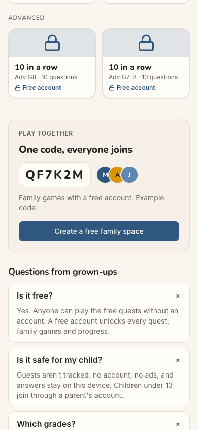

> Expected: a word somewhere about approval or who may sign up. Observed: no such word. "Is it free?" says "Yes. Anyone
> can play the free quests without an account. A free account unlocks every quest, family games and progress." "Is it
> safe for my child?" covers guests and under-13s. "Which grades?" says "Grades 1 to 8, with harder Adv quests for a
> stretch." Nothing mentions approval.

**What Casey notices:** "A free account unlocks every quest" sounds open to anyone, which contradicts the refusal. The
useful part is that the free quests need no account. The search was a dead end.

### Step 15 — Tap "Quick 5" (Grade 8) and answer 30

> Expected: guest play still open. Observed: match. `/play/G8Q5` opens on the same first question as the day before,
> 30 is right, and the full offer appears again with "Sign up free" as the primary button. The run sets the offer to
> wait 24 hours, and it came about ten minutes, in real time, after it was last shown.

**What Casey notices:** relief that play still works. But it is the same question again, and the screen pitches the
account Casey was just refused.

### Step 16 — Tap "Sign up free" in the offer (trying again later)

> Expected: the Google step, as the day before. Observed: match. The "Sign up free" sheet with "Continue with Google"
> appears over question 2.

**What Casey notices:** nothing acknowledges the earlier refusal. Casey hopes a second request gets a fresh look.

### Step 17 — Tap "Continue with Google": the second refusal (landing)

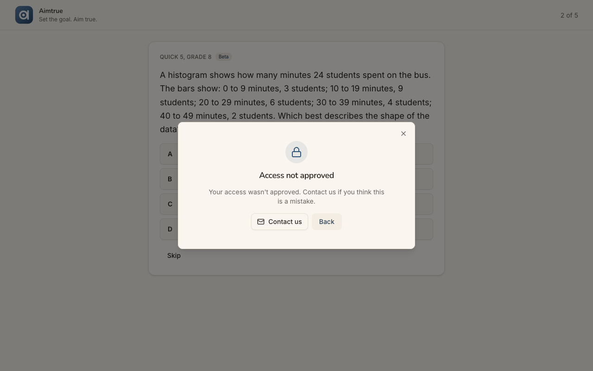
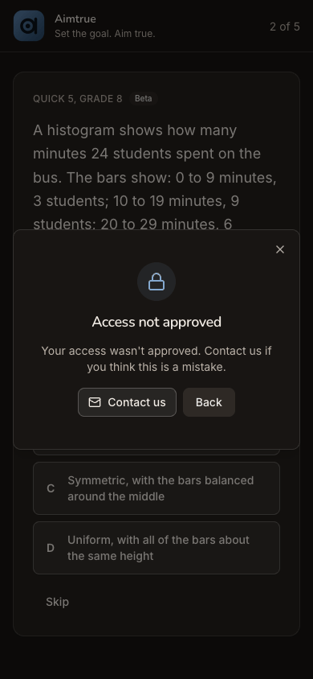

> Expected: the same refusal, or a way to ask again. Observed: word-for-word the same "Access not approved" with
> "Contact us" and "Back", over question 2. No new request is made, and there is no hint whether a later try could work.
> The browser log shows `POST /api/auth/google` 403.

**What Casey notices:** the answer is final, but the screen never says so. All that is left is an email or guest play.

### Step 18 — Close the refusal

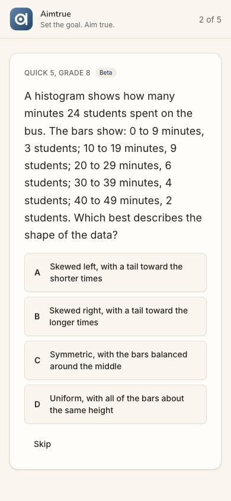

> Expected: back to whatever Casey can still do. Observed: the guest Quick 5 at "2 of 5", with question 2 (a histogram,
> A–D) and Skip, ready to answer.

**What Casey notices:** guest play is what remains: a few questions a level, nothing saved, the longer quests locked.

### Step 19 — Tap the Aimtrue logo ("Home"): the refusal is back

> Expected: the guest page. Observed: the guest page with "Access not approved" open over it, without Casey asking. The
> run saw this first after step 18, with no screenshot. This image is from one re-run of refusal, X, a tile, and the
> logo; the re-run is not counted in the figures. A reload clears it.

**What Casey notices:** coming back to the home page now means being told "no" again. Casey has to close it every time.

### Step 20 — Close it and reload / (end-state check)

> Expected: a signed-out guest page with nothing changed. Observed: match. The plain guest page shows "Sign in", "Sign
> up free", Today's 5 at Grade 8 and tiles with "Free account" locks. The browser log shows `GET /api/auth/session` 401
> (signed out). There is no dialog and no trace of the refusal.

**What Casey notices:** the page is back to inviting Casey to sign up, as if nothing had happened. Casey can play the
free quests, email the contact address, or try again and be refused again.

## Appendix

- **Mode:** live. The web app at `http://localhost:8797` is a frozen copy of commit `2d6e7d3` with sign-in on. It was
  driven in headless Chrome at 390×844 (phone), plus 1280×800 and dark mode at the landing steps (1, 9, 10, 12, 17).
- **Frameworks applied:**
  - cuj-contract: every step against its expected result.
  - task-completion: the journey ran to its defined end, the refusal seen twice and what is left to do recorded.
  - success-criteria: the end state was checked again after a reload at step 20. Casey was signed out (`GET
    /api/auth/session` 401), no dialog was open, and the guest page was unchanged.
- **CUJ manifest:** J02, 20 steps over two stages. Stage 1 is steps 1-9 and stage 2 is steps 10-20. All 20 were
  observed. Steps 9, 11, 13, 15, 17 and 19 did not fully match what a newcomer would expect; see the findings above.
  Step 19's screenshot comes from one re-run made to capture what the run had first seen without a picture. That re-run
  made a third, identical refusal and is not counted in the conversion figures.
- **Coverage / not inspected:**
  - **"A day later" was simulated.** Stage 2 ran about seven minutes after stage 1 in the same browser profile, in a
    new tab, so nothing time-based was a real day. The offer's 24-hour wait in particular was not tested over a day.
  - **The decline itself.** The platform admin declined the request in the console between the stages; that screen
    belongs to the admin's journey and was not seen here.
  - **Whether any email was sent to Casey** about the decision. None is promised on screen, and the audit has no
    mailbox to check. "Contact us" was not used, by the run's rules.
  - **The Terms and Privacy pages' content.** The Terms opened in a background tab at step 8 that the driver does not
    read.
  - **"Keep playing" in the offer, and the guest play beyond question 2.** The guest's play is out of scope.
  - **The approved branch.** Whether an approved person is told, or must also come back and try, was not run here.
  - **Keyboard-only and screen-reader use.** The accessibility tree was read only to find controls. It shows the
    refusal dialog without a name.
  - **The iOS app.** It is covered by separate journeys.
  - **Other sign-in providers.** Only Google is offered on the web.
  - **The server's records.** By the audit's rules there were no API or database reads, so the 403s are from the
    browser's network log only.
- **Access:** through the app's real sign-in and sign-up screens; the Google provider step is simulated (a stand-in for Google's button hands the app a local test token for the persona).
- **Preconditions made outside the UI:**
  - The run's platform settings, set through the console API before the journeys as `docs/userjourney/README.md` "The
    run" records: web sign-in Google only with sign-up open, sign-up access Post-approved, and guest play with the
    offer after question 1 and 24 hours before it shows again.
  - The decline of Casey's request by the platform admin between stage 1 and stage 2, made by the run's admin step and
    logged in the run's status log; it was not observed in this journey.
