# CUJ Audit — J03: parent plays a tile as a guest, signs up, starts practice for their child

## Executive summary

**Who:** Renee Shah, 44 (born July 1982), parent of Maya, a 9-year-old in grade 4. Renee is looking for maths
practice for her daughter. She belongs to cohort **C4, the practice parent who signed up from the guest page** ("Is my
child practising, and getting it?") in `docs/member-home-plan.md`. That plan expects her home to centre on "a child's
reviewed assessment; give one; **Play with <child>**". She arrives signed out on the guest page with her child beside
her. She wants to try a few questions, then set up proper practice for Maya: an assessment or "Show your work".

**Outcome: 1/1 journeys passed, 0 skipped, 32 of 33 steps verified.** The end the journey defines was reached:
Maya's assessment, "Question 1 of 10", was on screen (step 32) and still there after a reload (step 33). It passed
only through a workaround:

- **Day one (steps 1-11).** The child played Quick 5 as a guest and scored 5 of 5. Renee took "Save this score: sign
  up free": one Google tap, a birth month and year, and a terms box. It ended on "Waiting for approval".
- **A day later (steps 12-15).** The platform admin had approved her. She came back and signed in, and landed in
  "Renee's space". The carry-over worked: grade 4 leads the Play home, and the tile she played (G4Q5) is a favorite.
- **Setting up Maya (steps 16-28).** "Start an assessment" offered an empty Student list. The menu has no child
  entry. In "Users" she is listed as an Admin, not a parent, and the form refused her own email as the parent ("Someone
  in this space already has that email address."). She got through only by editing her own record to add "Parent",
  then adding Maya.

Step 10 was only partly observed: the Terms open in a new tab, which the driver does not follow.

**Conversion figures** (from the entry point, the signed-out guest page):

| Stretch | Screens | Taps | Inputs | Waits | Dead ends |
| --- | --- | --- | --- | --- | --- |
| Entry to "Waiting for approval" (steps 1-11) | 7 | 9 | 2 selects (birth month, year) | 0 | 0 (1 interruption: the sign-up offer after question 1) |
| Return to Renee's home (steps 12-15) | 3 | 2 | 0 | 0 | 0 (1 hesitation: "Sign in" opens "Sign up free") |
| Home to Maya's first question (steps 16-32) | 8 | 29 | 4 typed (2 of them refused) | 0 | 3 |
| **Whole journey** | **15 distinct** | **40** | **4 typed, 2 selects** | **the approval (unbounded, unannounced)** | **3** |

The child's own answers inside the guest quest are not counted. "Start an assessment" is a quick action on the home,
so a parent who knew the way would need two taps. Renee needed 29 taps and three wrong turns. Even knowing the
workaround, it takes about 19 taps and 2 typed fields to go from the home to a child's first question. The plan's
target for giving an assessment is 2 taps or fewer (C7).

**The 3 screens Renee would notice most:**

- **Step 11, "Waiting for approval".** The child has just scored 5 of 5, and the next screen is a wait with no time
  frame. It names no approver and says nothing about how Renee will hear. It has no "keep playing" for the child. Its
  one action is "Contact us", which writes to a personal Gmail address. A parent deciding whether this is a serious
  product for her child gets an unexplained queue.
  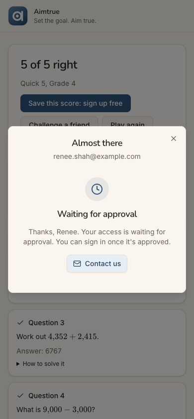
- **Step 23, "Someone in this space already has that email address."** Renee tries to name herself as her child's
  parent and is told that "someone" already has her address. That someone is her: the only person in her own space.
  For a parent whose whole reason to sign up is her child, this is the moment the product does not know she is a
  parent.
  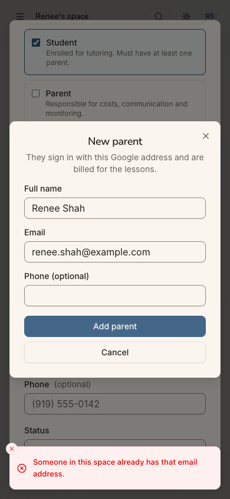
- **Step 32, Maya's first question.** It worked: "Maya Shah · G4" is at the top. But the line beneath tells a
  9-year-old "Nothing is marked until your tutor reviews it", and Maya has no tutor. The question says "Type the
  greater number", but the page has only a drawing canvas. A full-width "Submit" sits above question 1. Renee's
  question for this cohort is "is my child getting it?", and nothing here tells her that she is the one who will see
  the answers, or where.
  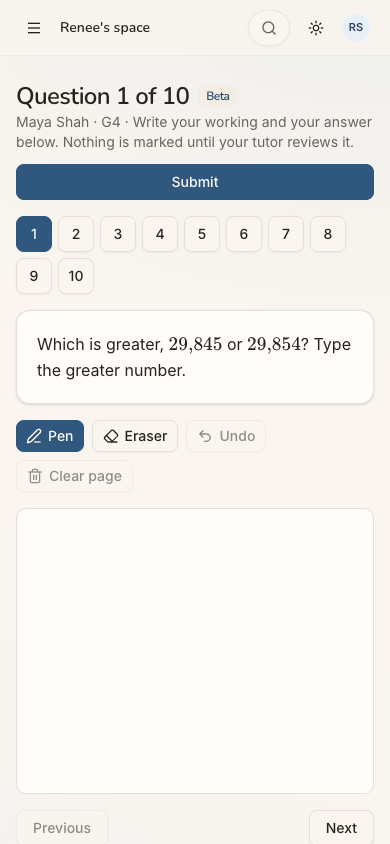

**Contact sheet** (all 33 phone steps):

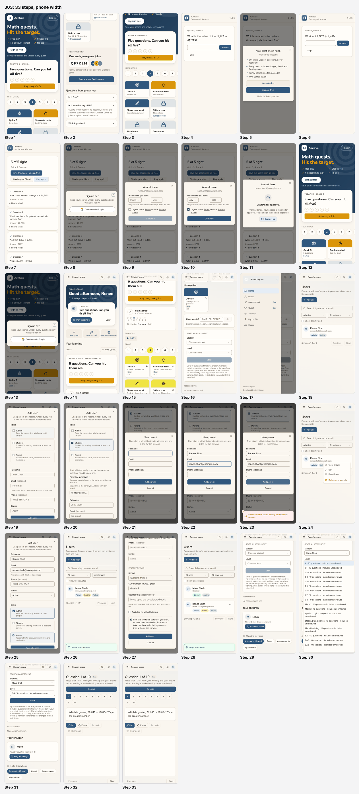

| Severity | Count |
| --- | --- |
| sev4 (catastrophe) | 0 |
| sev3 (major) | 2 |
| sev2 (minor) | 6 |
| sev1 (cosmetic) | 1 |
| **Total** | **9** |

## Prioritized fixes

1. [sev3] [In her own space Renee is not a parent, so adding her child takes a workaround](#sev3-in-her-own-space-renee-is-not-a-parent-so-adding-her-child-takes-a-workaround): offer "Add your child" that makes the signed-in adult the parent in one form (steps 20-25).
2. [sev3] [The approval wait is silent, and the return shows nothing](#sev3-the-approval-wait-is-silent-and-the-return-shows-nothing): say who approves, how long, and how she hears; offer "Keep playing"; greet the approved person on return (steps 11, 12).
3. [sev2] [Nothing leads a parent to add her child, and the assessment's Student list is empty without a word](#sev2-nothing-leads-a-parent-to-add-her-child-and-the-assessments-student-list-is-empty-without-a-word): an empty state with "Add your child" in the Student list, and a child entry on the home and in the menu (steps 14, 16-18).
4. [sev2] [The assessment tells a 9-year-old a tutor will mark it, in a space with no tutor](#sev2-the-assessment-tells-a-9-year-old-a-tutor-will-mark-it-in-a-space-with-no-tutor): name the real reviewer, word questions for the canvas, and move Submit to the end (step 32).
5. [sev2] [The home talks to Renee as the learner, and her child comes last](#sev2-the-home-talks-to-renee-as-the-learner-and-her-child-comes-last): lead a parent's home with her child (steps 14, 29).
6. [sev2] ["Save this score" is not kept: the guest's 5 of 5 is gone after sign-up](#sev2-save-this-score-is-not-kept-the-guests-5-of-5-is-gone-after-sign-up): carry the device's best score over, or stop promising it (steps 7, 12, 15).
7. [sev2] [The family form speaks a tutoring office's language](#sev2-the-family-form-speaks-a-tutoring-offices-language): in a personal space, word roles and fields for a family, with a grade picker (steps 19-21, 27).
8. [sev2] ["Sign in" opens a sheet titled "Sign up free"](#sev2-sign-in-opens-a-sheet-titled-sign-up-free): title the sheet by the button that opened it (step 13).
9. [sev1] [Codes where a parent needs words: G4Q5, G4D #4, G4, BA4, "includes unreviewed"](#sev1-codes-where-a-parent-needs-words-g4q5-g4d-4-g4-ba4-includes-unreviewed): name levels and tiles in words and preselect the child's grade (steps 15, 30).

## Findings

### [sev3] In her own space Renee is not a parent, so adding her child takes a workaround

- **Issue Description:** Sign-up made Renee a space of her own, with her as its only member, holding "Admin" (step
  18). She is not a parent there, though the guest page told her that "Children under 13 join through a parent's
  account". She opens Users → Add user and ticks Student for her child (step 20). The form then requires "Parents /
  guardians *" and says "No parents in the portal yet. Add one with New parent." She is not offered, although she is
  the one person in the list above. "New parent…" opens a second sheet: "They sign in with this Google address and
  are billed for the lessons." She types her own name and address, the only honest answer (step 22). The form refuses
  it with a red toast, "Someone in this space already has that email address." (step 23). The toast fades after a few
  seconds and does not say who "someone" is or what to do. The way through is to deduce it:
  1. cancel both sheets;
  2. find that tapping her name opens a read-only "User details" with no Edit (a wrong turn);
  3. open "…" → Edit on her own record and tick "Parent" (step 25);
  4. save, then start Add user again, tick Student, and pick herself from the parent list that now appears (step 27).

  Nothing in the product suggests this sequence.
- **Framework Violation:** cuj-contract, steps 20-25. Expected: add her child with herself as parent. Observed: told
  there are no parents, then refused as a duplicate of herself. Nielsen #9 Help users recognize, diagnose, and recover
  from errors (the toast names no person and no remedy). Nielsen #2 Match between system and the real world (the
  mother of the child is "Admin", not "Parent").
- **Severity:** 3. Classify: a workaround was needed. For this cohort the child is the only reason to have an account,
  and adding her is the first thing a practice parent does. Renee got through only by reasoning about a data model she
  should never have to see. Many parents would stop at step 23, which leaves the account with no child and the
  assessment unusable. It is not a 4, because the workaround exists and works (step 28).
- **Evidence:** 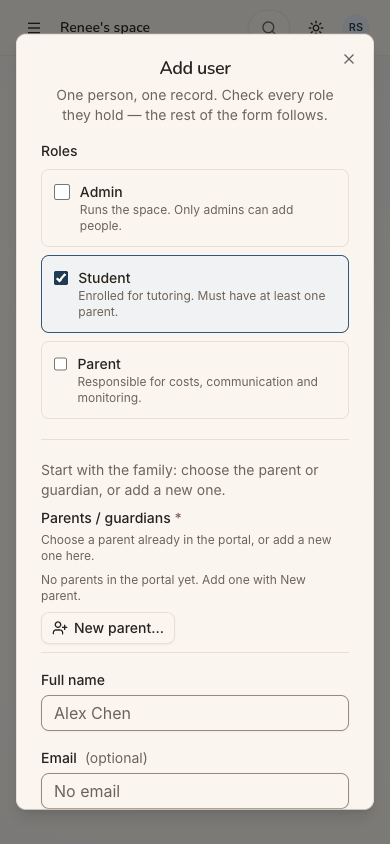 
  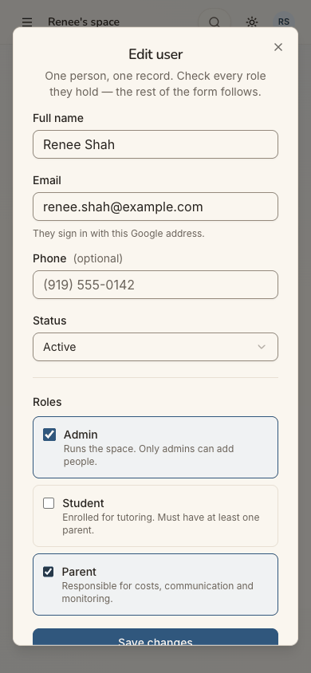
  Repro: sign up from the guest page as a new adult (Post-approved, then approved), sign in, open Users → Add user and
  tick Student. The parent list is empty. Tap New parent… and enter your own name and sign-in address, then Add
  parent: the toast "Someone in this space already has that email address." appears, and the browser logs a 409 on
  POST /api/users.
- **Recommended Fix:** Give a personal space an "Add your child" form that makes the signed-in adult the parent
  without asking: name, grade (a picker), and the consent box, nothing else. In the general form, always list the
  signed-in admin under "Parents / guardians" as "Me (Renee Shah)". Choosing it should add the Parent role in the same
  request. When "New parent" gets an address that belongs to someone already in the space, offer that person ("That's
  Renee Shah, already here. Make her the parent?") rather than refusing. Keep the error in place under the Email
  field, not in a toast that fades.

### [sev3] The approval wait is silent, and the return shows nothing

- **Issue Description:** After Continue (step 11) the sheet keeps the heading "Almost there" and then says "Waiting
  for approval. Thanks, Renee. Your access is waiting for approval. You can sign in once it's approved." It does not
  say who approves (Aimtrue? a teacher?) or how long it usually takes. It does not say whether she will get an email,
  or whether her child may keep playing as a guest in the meantime: there is no "Keep playing", only an X. The one
  button, "Contact us", is a mailto to a personal Gmail address. Behind the sheet, the result page still offers "Save
  this score: sign up free", so Renee cannot tell whether the score she was promised was saved. A day later the guest
  page (step 12) says nothing about her account or the approval, so she tries "Sign in" on a hunch.
- **Framework Violation:** cuj-contract, step 11 (expected: told access waits and what happens next; observed: told
  only that it waits) and step 12 (expected: some sign the account is ready; observed: none). Nielsen #1 Visibility of
  system status. Nielsen #3 User control and freedom.
- **Severity:** 3. Classify: a workaround is needed. Renee has to remember, unprompted, to come back and try to sign
  in, without knowing when that will work. For a parent, an unexplained queue before a children's product lets her in
  also raises the question "who is checking, and what about?". She needs that answered to trust it. Not a 4: signing
  in later works (step 14).
- **Evidence:**  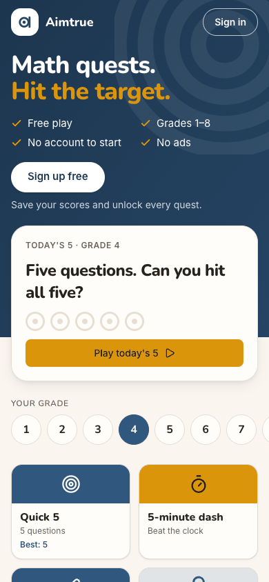
  Repro: with Sign-up access Post-approved, play a guest tile at `/` signed out, then tap "Save this score: sign up
  free" → Continue with Google. Answer the birth month and year, tick the terms box and tap Continue. After the
  console approves, open `/` in a new tab: the page is unchanged apart from "Best: 5" on the tile.
- **Recommended Fix:** Give the waiting sheet three lines: who decides ("We check every new family account by hand"),
  how long ("usually within a day"), and how she will hear ("We'll email renee.shah@example.com when you're in").
  Make the email true. Add a primary "Keep playing" that returns the child to the guest board. Drop "Almost there"
  once the state is "waiting". Point "Contact us" at a product address. On the next visit from that device, show
  "Your account is ready: Sign in" on the guest page.

### [sev2] Nothing leads a parent to add her child, and the assessment's Student list is empty without a word

- **Issue Description:** On her first screen inside the space (step 14) nothing mentions a child. There is no "Add
  your child" in Next up, the quick actions, or the sections. The quick action "Start an assessment" leads to a form
  whose Student dropdown opens an empty list (step 16): a 10-px popover with no option and no "no students yet" line.
  It has no link to add one, and Renee herself is not offered either. The menu (step 17) has Home, Users, Assessment,
  Quest, Activity, My profile and Space, but no "My children" or "Family". "Users" (step 18) is an office directory:
  roles, statuses, "Show deactivated", paging.
- **Framework Violation:** cuj-contract, steps 14-18 (expected: a visible way to set up her child; observed: an empty
  picker and a staff menu). Nielsen #1 Visibility of system status (an empty list with no explanation). Nielsen #6
  Recognition rather than recall.
- **Severity:** 2. Classify: real friction and a dead end. The empty list is the first thing she meets when she goes
  for her goal, and it gives no reason or next step. She found "Users" by guessing. For this cohort, the gap between
  signing in and the child's first practice is where the product is judged.
- **Evidence:** 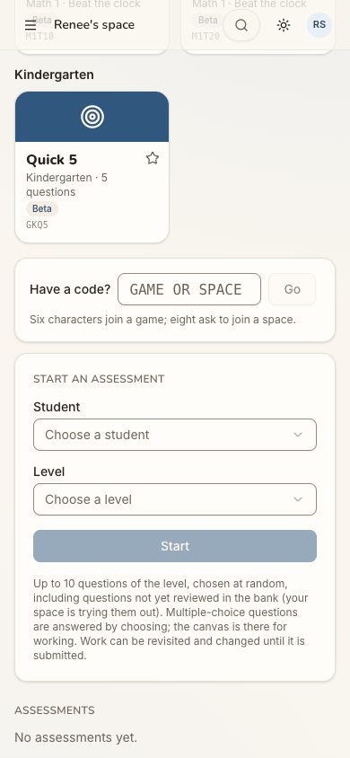 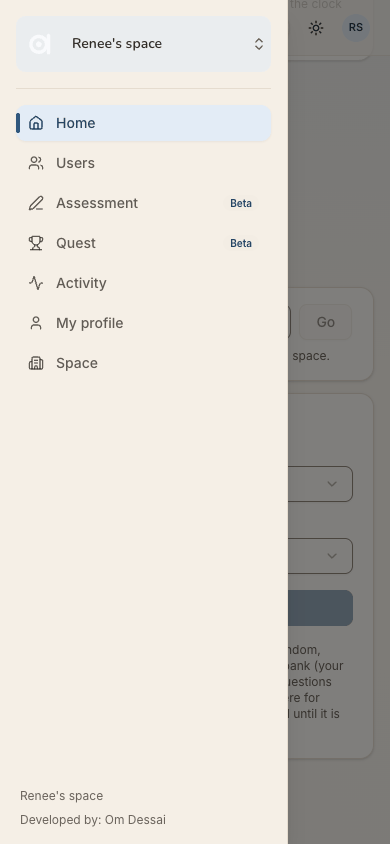
  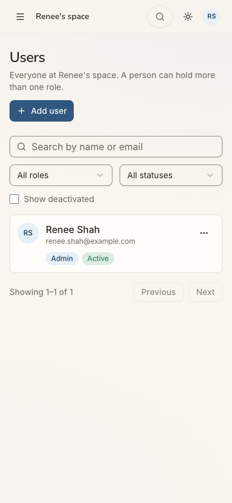
  Repro: as a newly approved adult with no one else in the space, open Home → Start an assessment → Student.
- **Recommended Fix:** When the Student list is empty, show "No children yet" with an "Add your child" button that
  opens the child form and returns to the assessment with the child selected. In a personal space with no child, put
  "Add your child" in Next up on the first visit, and name the menu entry for people "Family" (or add "My children").

### [sev2] The assessment tells a 9-year-old a tutor will mark it, in a space with no tutor

- **Issue Description:** Maya's assessment opens (step 32) with "Maya Shah · G4 · Write your working and your answer
  below. Nothing is marked until your tutor reviews it." Maya has no tutor: the space is Renee's own and has no
  Tutoring. Nothing tells Renee that she reviews it, or where the answers will appear. The first question reads "Which
  is greater, 29,845 or 29,854? Type the greater number." There is no text box, only a drawing canvas with Pen, Eraser,
  Undo and Clear page. A full-width "Submit" sits above question 1, before anything is answered, where a child can end
  the test with one tap. The assessment has 10 questions, while the guest tile her child saw promised "Show your work —
  5 questions, by hand". The page keeps Renee's portal frame, so the child answers inside her parent's admin account,
  one tap from Users and Space.
- **Framework Violation:** cuj-contract, step 32 (expected: the child's first question, with clear instructions;
  observed: the question, with instructions that do not fit this space). Nielsen #2 Match between system and the real
  world. Nielsen #5 Error prevention (Submit first).
- **Severity:** 2. Classify: an observable mismatch at the feature's start. It does not stop Maya from answering. But
  it promises a review by someone who does not exist, and this cohort's question is "is my child getting it?". Whether
  Renee can review the work was not inspected (see Coverage).
- **Evidence:**  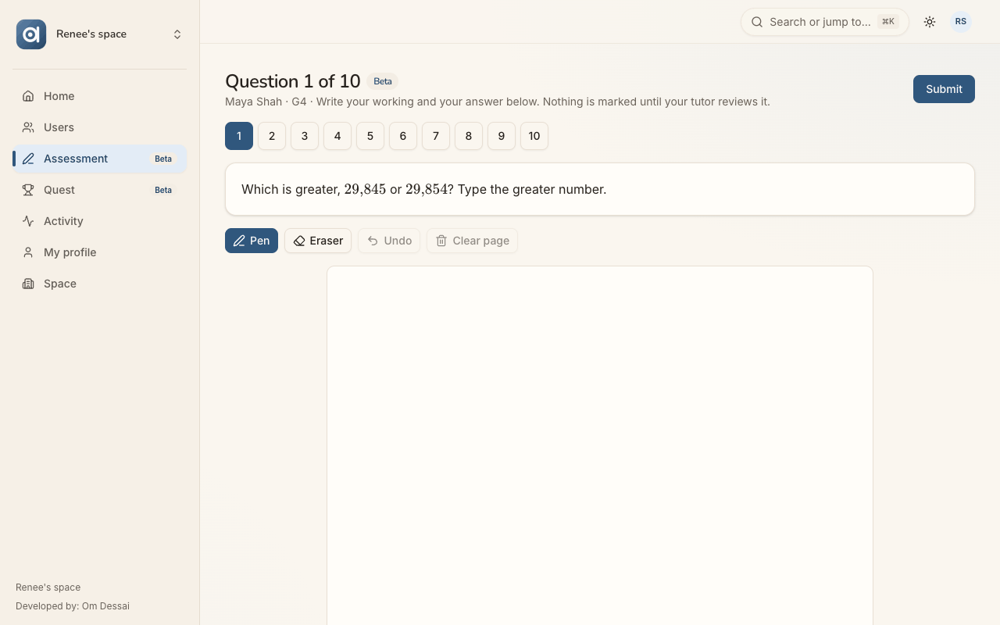
  Repro: in a personal space, add a child, then Home → Start an assessment → the child → G4 → Start.
- **Recommended Fix:** Word the line by who reviews in this space. In a personal space: "When you're done, tap Submit.
  Mum or Dad will see your answers." Tell the parent where the answers will be ("You'll find Maya's answers under
  Assessments"). Replace "Type" with "Write" in canvas questions, or show the text box they ask for. Move Submit to the
  end, after question 10, with a confirmation. Consider a child mode that hides the portal frame while the assessment
  runs.

### [sev2] The home talks to Renee as the learner, and her child comes last

- **Issue Description:** Renee's first screen (step 14) is addressed to her as the player. "Your learning", "0 of 3
  days played this week", "Start a streak" and "Next badge: First quest · 0 of 1" all describe Renee. The same daily
  challenge is offered twice under two names: "Today's 5" in Next up and "Today's Daily · Grade 4 · G4D #4" below it.
  After Maya is added, she appears only at the very bottom (step 29). "Your children — Maya — Played 0 days this week
  (aim: 3) — Play with Maya" sits below Renee's tiles, three levels of "More levels", the code box and the assessment
  form. The home's focus stays "Automatic (Quest)". "My children" is offered, but only as one of four pills at the end
  of the page.
- **Framework Violation:** cuj-contract, steps 14 and 29 (expected per `docs/member-home-plan.md` C4: a home led by
  the child, with "Play with <child>" and the child's days played; observed: those exist, but last). Nielsen #2 Match
  between system and the real world. Nielsen #8 Aesthetic and minimalist design (the Daily twice).
- **Severity:** 2. Classify: real friction for stickiness. A parent comes back to see her child's practice. A home that
  greets her with her own zero streak, and puts her child below the fold, gives her no reason to return.
- **Evidence:** 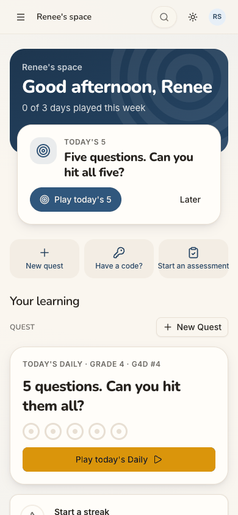 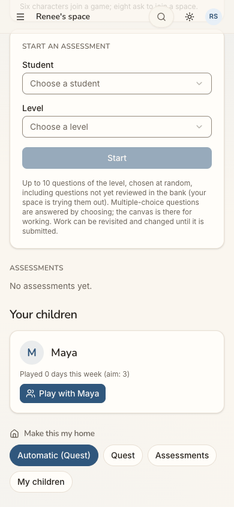
  Repro: sign up from the guest page, add a child through Users, then open Home.
- **Recommended Fix:** Once a personal space has a child, lead the home with the child card ("Maya: 0 of 3 days this
  week · Play with Maya · Give Maya an assessment"), the way the focus would after "Make this my home → My children".
  Better, ask at sign-up "Who is this for? Me / My child" and set the focus from the answer. Show the Daily once.

### [sev2] "Save this score" is not kept: the guest's 5 of 5 is gone after sign-up

- **Issue Description:** The guest result page (step 7) offered "Save this score: sign up free", and the in-play offer
  listed "Your scores saved" (step 5). Renee signed up from that button. A day later the guest page still shows "Best:
  5" on Quick 5 (step 12), on the device. Inside her space the same tile shows no best score, and the progress card
  reads "Next badge: First quest · 0 of 1" and "0 of 3 days played this week" (step 15). The carry-over did keep the
  grade and the favorite tile, which is a stickiness win, but not the score the button promised.
- **Framework Violation:** cuj-contract, step 15 (expected: the 5 of 5 she signed up to save; observed: grade and
  favorite kept, score gone). Nielsen #1 Visibility of system status. Trust: a promise made at the conversion moment
  is not kept.
- **Severity:** 2. Classify: an observable mismatch between the offer and the result. The child's first success is
  what turned Renee into a member, and losing it on day one undercuts the reason to come back.
- **Evidence:** 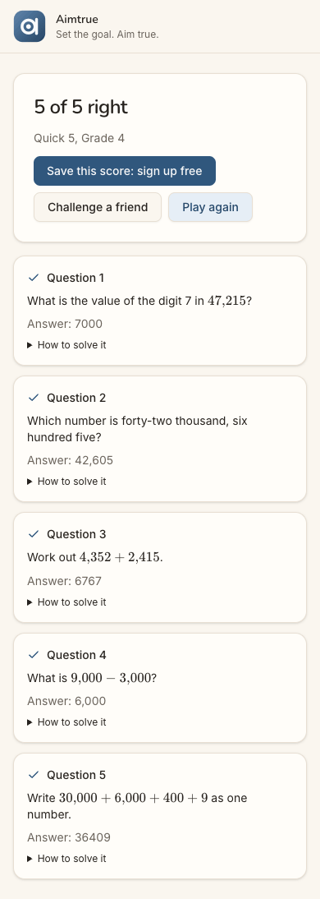 
  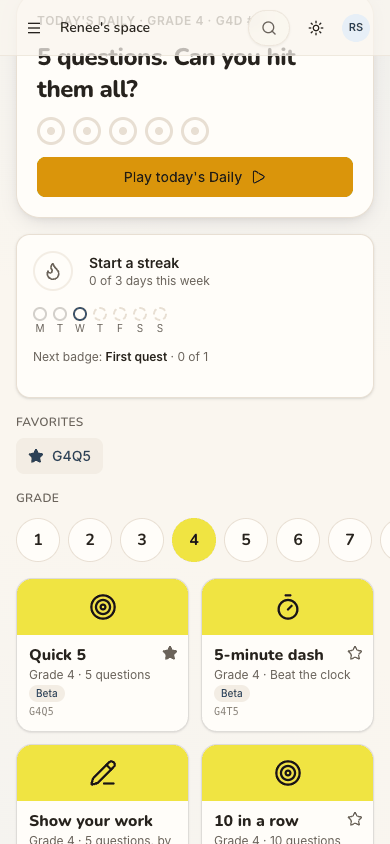
  Repro: play Quick 5 as a guest, finish, then tap "Save this score: sign up free" and complete sign-up. After
  approval, sign in on the same device and look at the Quick 5 tile and the badge line.
- **Recommended Fix:** Carry the device's best score over with the grade and the favorites. It is already on the
  device, as "Best: 5" shows. Show it on the member tile, and count the guest quest toward "First quest". If the guest
  score must not be kept, reword the button "Sign up free to keep your next scores", and drop "Your scores saved" from
  the offer.

### [sev2] The family form speaks a tutoring office's language

- **Issue Description:** Adding her child in her own family space (steps 19-21, 27), Renee reads:
  - roles described for a tutoring business: Student "Enrolled for tutoring. Must have at least one parent.", Parent
    "Responsible for costs, communication and monitoring.", Admin "Runs the space";
  - "New parent — They sign in with this Google address and are billed for the lessons.";
  - Student details for an office: "School" ("Culbreth Middle"), "Goal for this academic year", "Becomes the goal of
    their learning plan", "Available for virtual tutoring";
  - "Current math course / grade" as free text ("Grade 7 Mathematics"), not the grade picker the Play home uses;
  - Relationship defaulting to "Guardian" for a mother.

  The consent box ("I am this student's parent or guardian…") is the one line written for her.
- **Framework Violation:** cuj-contract, steps 19-21 and 27 (expected: a short child form; observed: a tutoring
  office's intake form). Nielsen #2 Match between system and the real world. Nielsen #8 Aesthetic and minimalist
  design.
- **Severity:** 2. Classify: real friction. "Billed for the lessons" and "Responsible for costs" make a parent who
  signed up for free practice wonder what she has agreed to. The extra fields make adding a child feel like
  enrolment.
- **Evidence:** 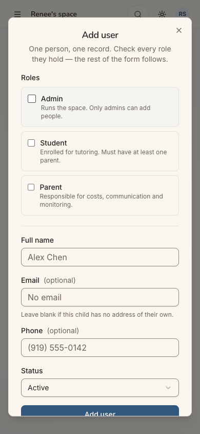 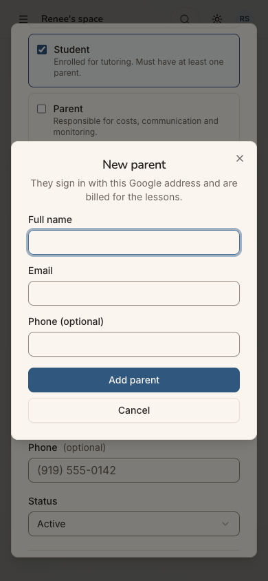
  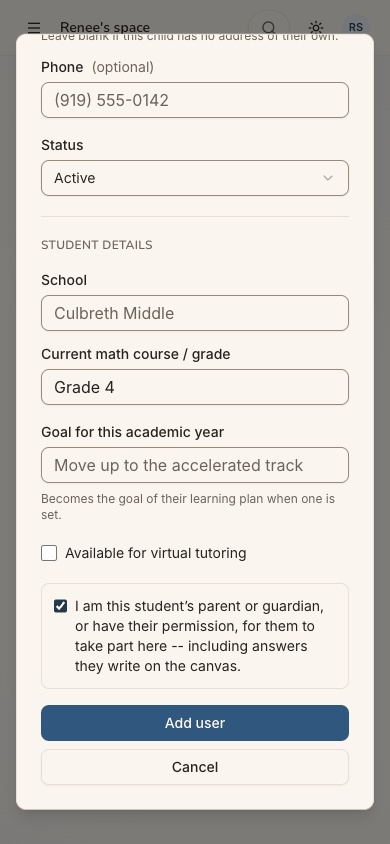
  Repro: in a personal space, Users → Add user, tick Student, then tap New parent….
- **Recommended Fix:** Where the space has no Tutoring, hide the tutoring fields (School, Goal, virtual tutoring) and
  the billing wording. Describe the roles as "Child" ("plays and takes assessments; needs a parent here") and "Parent"
  ("sees their child's practice and answers"). Replace the free-text grade with the grade picker, which can then set
  the child's default level. Offer "Mother / Father / Guardian" with no default.

### [sev2] "Sign in" opens a sheet titled "Sign up free"

- **Issue Description:** A day later, Renee taps "Sign in" in the guest page's header (step 13). It opens the same
  sheet as the hero's "Sign up free": the title "Sign up free", "Keep your scores, unlock every quest and play with
  your family." and Continue with Google. No sign-in wording appears. She signed up yesterday and was never told the
  approval happened, so she wonders whether this makes a second account. The same mismatch is reported in J01 (step
  12).
- **Framework Violation:** cuj-contract, step 13 (expected: a sign-in step; observed: a sign-up sheet). Nielsen #4
  Consistency and standards.
- **Severity:** 2. Classify: an observable mismatch between a button and what it opens, at the moment a returning
  member acts on a hunch. The Google step is the same either way, so it does not block.
- **Evidence:** 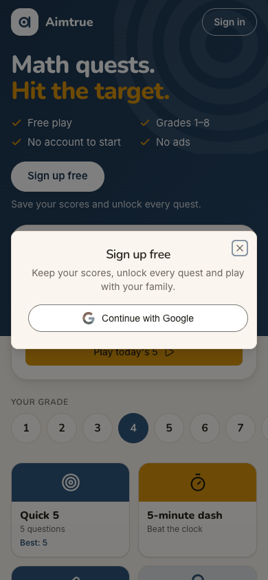
  Repro: signed out at `/`, tap "Sign in" in the header.
- **Recommended Fix:** Title the sheet by the button that opened it. From "Sign in": "Welcome back. Sign in with the
  account you used before. New here? The same button makes you a free account."

### [sev1] Codes where a parent needs words: G4Q5, G4D #4, G4, BA4, "includes unreviewed"

- **Issue Description:** The favorite carried over from guest play is a chip reading only "G4Q5" (step 15). Renee
  recognises it only from the star on the Quick 5 tile. Every member tile carries a "Beta" pill and its code. The
  Daily is "G4D #4". The assessment's Level list (step 30) starts at "K" and offers "G4 · 10 questions · includes
  unreviewed", BA1-BA5 and AoPS levels. Every line ends "includes unreviewed", and nothing is preselected, although
  Maya's record says "Grade 4" and the Play home leads with grade 4.
- **Framework Violation:** cuj-contract, steps 15 and 30. Nielsen #2 Match between system and the real world. Nielsen
  #6 Recognition rather than recall.
- **Severity:** 1. Classify: cosmetic labelling. Renee works each one out, but "includes unreviewed" on every level
  is an odd thing to show a parent choosing her child's test.
- **Evidence:**  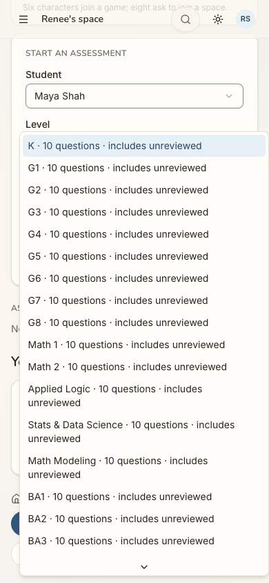
  Repro: as a member who played G4Q5 as a guest, look at Favorites. Then Home → Start an assessment → a child → Level.
- **Recommended Fix:** Show favorites as "Quick 5 · Grade 4". Write levels as "Grade 4", "Beast Academy 4 (advanced)".
  Preselect the child's grade. Replace the per-line "includes unreviewed" with one sentence under the picker, in plain
  words ("A few questions are new and still being checked").

## Walkthrough

### Step 1 — Open http://localhost:8797/ signed out (landing)

> Expected: the guest Play home. Observed: match. The hero says "Math quests. Hit the target." with ticks for Free
> play, Grades 1–8, No account to start and No ads, then "Sign up free" and "Save your scores and unlock every
> quest.". Below it: a "Today's 5 · Grade 4" card and a grade row with 4 already selected. The grade-4 tiles are Quick
> 5, 5-minute dash and Show your work, plus three locked "Free account" tiles, then Advanced, "Play together" and
> "Questions from grown-ups". On a phone the grade row runs off the right edge at 7. Desktop puts Today's 5 beside the
> hero. Dark mode is legible.

**What Renee notices:** "Grades 1–8", "No account to start", "No ads": exactly what a parent scans for. A section
speaks to her ("Questions from grown-ups"). Grade 4 is already picked; she did not choose it.

### Step 2 — Scroll down and open "Is it safe for my child?"

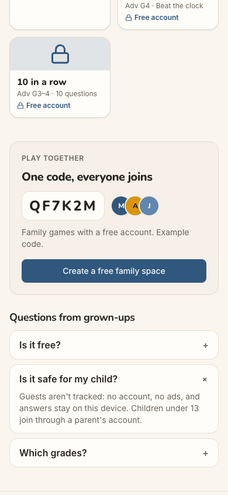

> Expected: a short reassurance. Observed: match. "Guests aren't tracked: no account, no ads, and answers stay on this
> device. Children under 13 join through a parent's account." Above it, "One code, everyone joins" with an example
> code and "Create a free family space".

**What Renee notices:** the answer she wanted, and it tells her that she must be the one to sign up. "Create a free
family space" and "Sign up free" sound like two different things.

### Step 3 — Tap grade 4

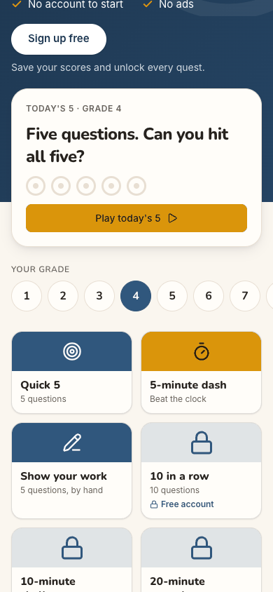

> Expected: grade 4's quests. Observed: nothing changes, because grade 4 was already selected; the tiles stay the
> same.

**What Renee notices:** reads it as "grade 4 is set".

### Step 4 — Tap "Quick 5" (grade 4) (landing)

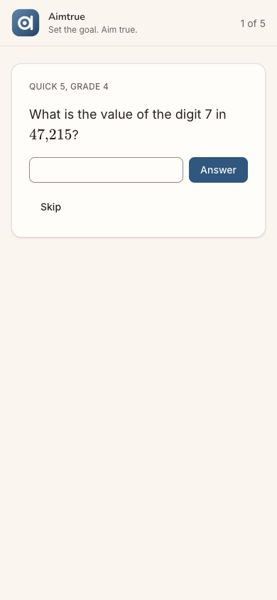
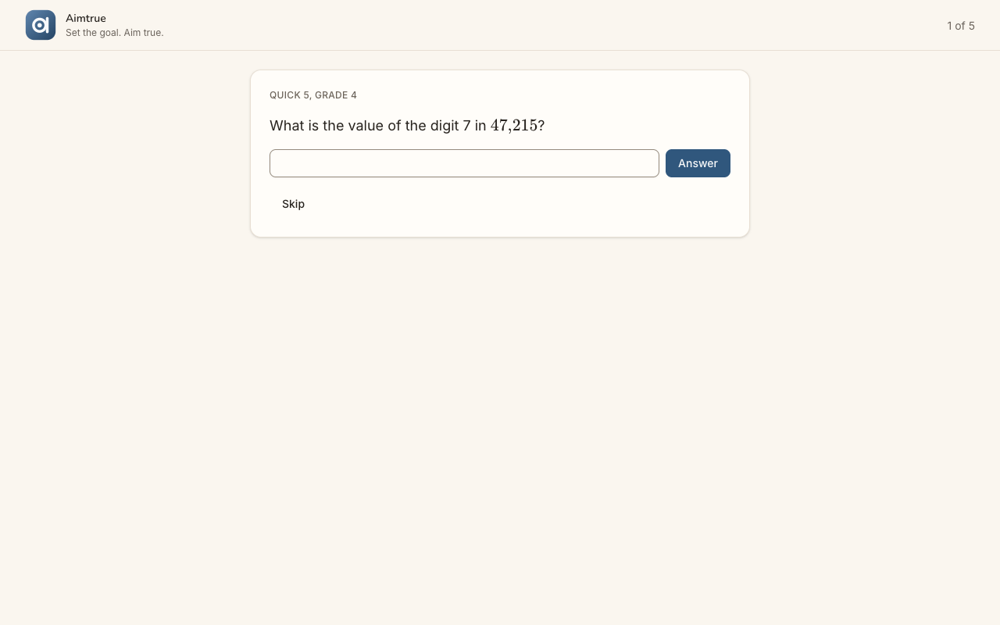
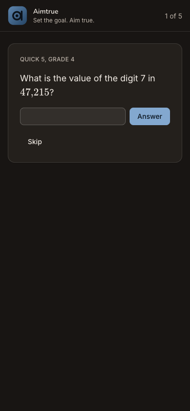

> Expected: a short quest starts. Observed: match. `/play/G4Q5` full screen, "1 of 5", "QUICK 5, GRADE 4 — What is
> the value of the digit 7 in 47,215?", a text box, Answer and Skip. There is no visible way back or home on the play
> screen. Desktop shows a narrow card on a wide empty page.

**What Renee notices:** one tap from the home to a question, with no sign-up wall. There is no way out except the
browser's back button.

### Step 5 — The child types 7000 and taps Answer: the sign-up offer

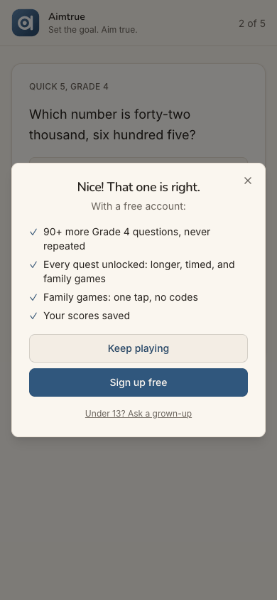

> Expected: marked, then question 2. Observed: "Nice! That one is right." opens as a sheet over question 2, listing
> "90+ more Grade 4 questions", "Every quest unlocked", "Family games: one tap, no codes" and "Your scores saved", with
> "Keep playing", "Sign up free" and "Under 13? Ask a grown-up".

**What Renee notices:** a clear, honest offer, but it lands on the child's turn after one question. "Family games: one
tap, no codes" contradicts the guest page's "One code, everyone joins".

### Step 6 — "Keep playing"; the child answers question 2 and reaches question 3

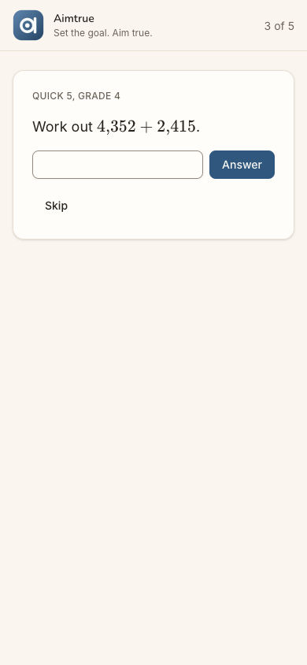

> Expected: back to question 2, then on. Observed: match. A choice tap moves straight on to "3 of 5 — Work out 4,352 +
> 2,415.". No right/wrong message was on the settled page (a brief flash was not checked).

**What Renee notices:** quick, plain play, with a mix of typed and multiple-choice questions.

### Step 7 — Questions 3-5 answered: the result

> Expected: a score and a way on. Observed: "5 of 5 right — Quick 5, Grade 4" with "Save this score: sign up free",
> "Challenge a friend" and "Play again". Each question follows with a tick, "Answer: …" and "How to solve it". Typed
> answers echo unformatted ("7000", "36409") beside formatted choices ("42,605").

**What Renee notices:** a result her child is proud of, and worked answers to go through together. "Save this score"
is the promise she acts on.

### Step 8 — Tap "Save this score: sign up free" (landing)

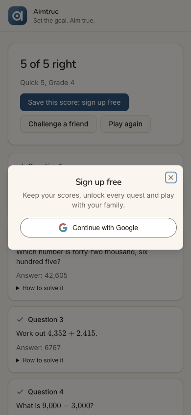
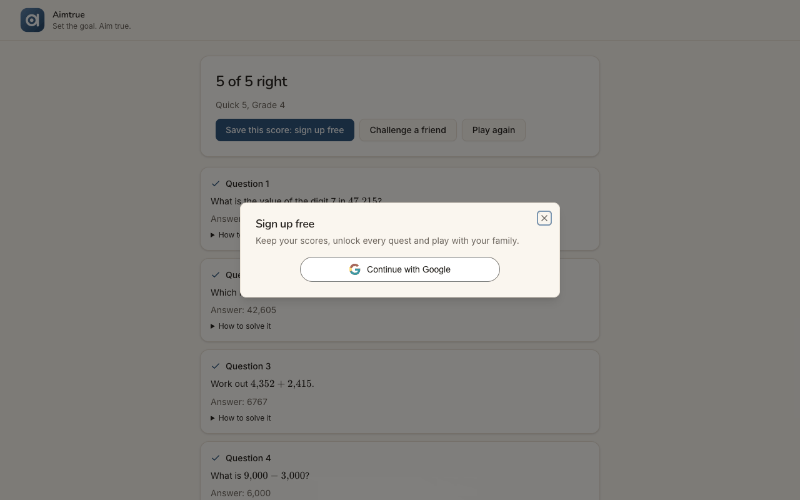
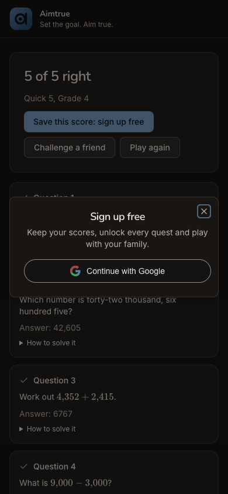

> Expected: a sign-up step. Observed: the sheet "Sign up free — Keep your scores, unlock every quest and play with
> your family." with one button, "Continue with Google". It says nothing about age, terms or approval. In dark mode the
> overlay barely separates the sheet from the page.

**What Renee notices:** one button, with no form and no password. "Play with your family" is what she came for.

### Step 9 — Tap "Continue with Google" (landing)

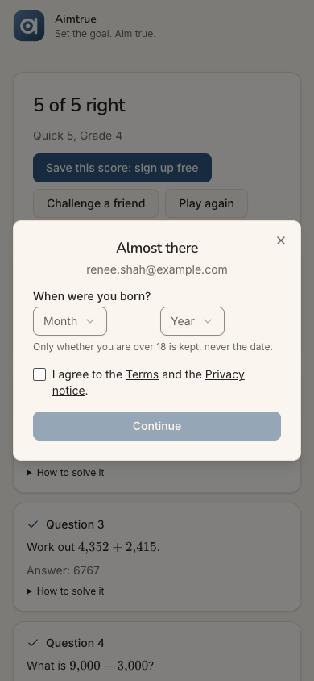
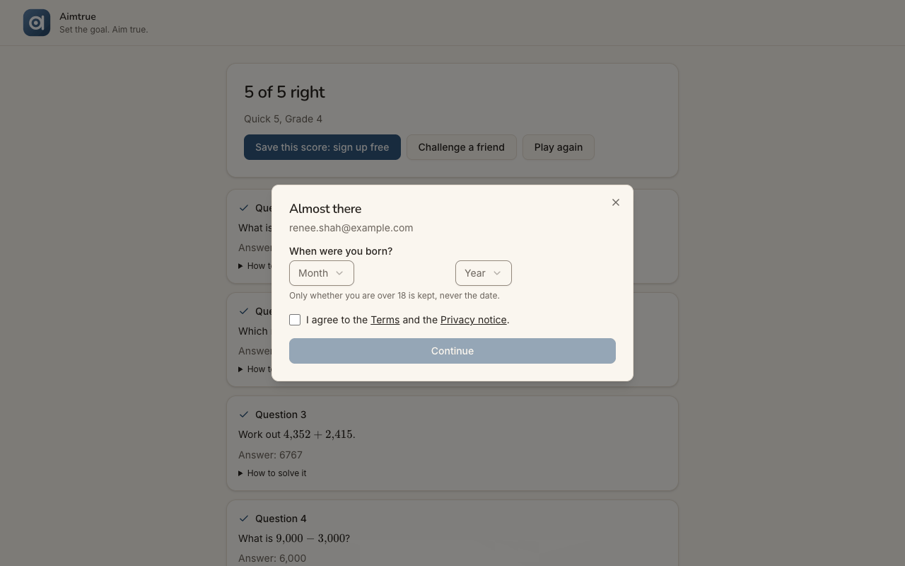
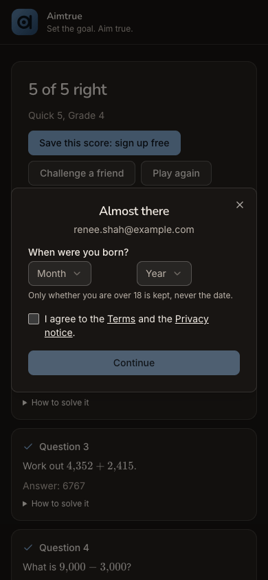

> Expected: Google, then back to the app. Observed: "Almost there — renee.shah@example.com — When were you born? [Month]
> [Year]", "Only whether you are over 18 is kept, never the date.", a terms box, and Continue (disabled until filled).

**What Renee notices:** her address is shown, and "never the date" reassures her. Month and Year sit far apart. The
form asks nothing about her child.

### Step 10 — Glance at the Terms, choose July / 1982, tick "I agree"

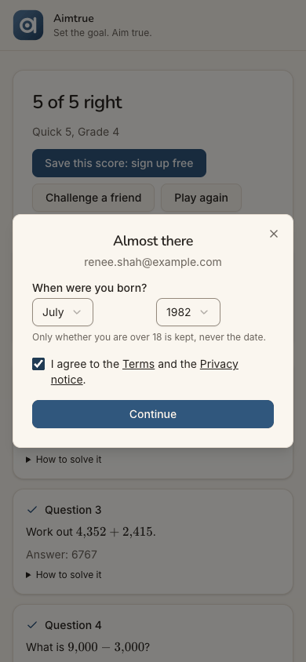

> Expected: the Terms readable without losing the form. Observed: Terms open in a new tab and the form is kept (the
> Terms' content was not seen). July and 1982 chosen, box ticked, Continue turns solid blue.

**What Renee notices:** a short form. Nothing says an approval is needed.

### Step 11 — Tap "Continue": "Waiting for approval" (landing)

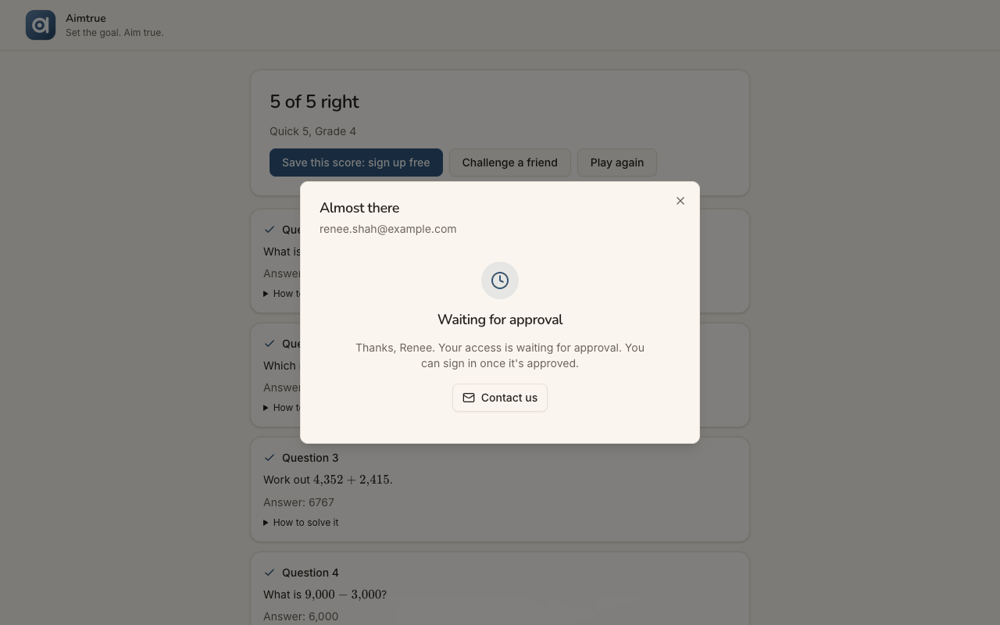
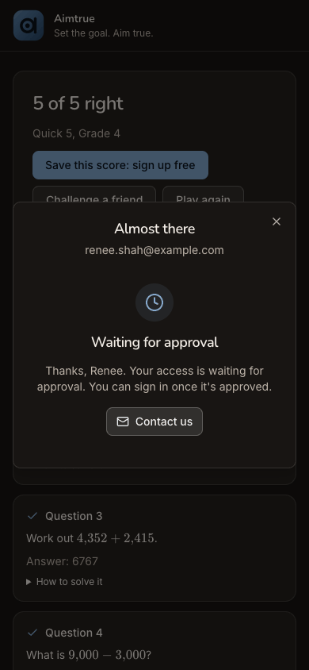

> Expected: under Post-approved, a waiting state. Observed: match. "Almost there" with her address, then a clock icon,
> "Waiting for approval", "Thanks, Renee. Your access is waiting for approval. You can sign in once it's approved.",
> and "Contact us" (a personal Gmail address). Behind it the result still offers "Save this score: sign up free". The
> browser logged the designed 403 on POST /api/auth/signup.

**What Renee notices:** polite, but no answer to who approves, how long it takes, how she'll hear, or whether the child
can keep playing. "Almost there" and "Waiting" read as two states.

### Step 12 — A day later, new tab, open http://localhost:8797/ (landing)

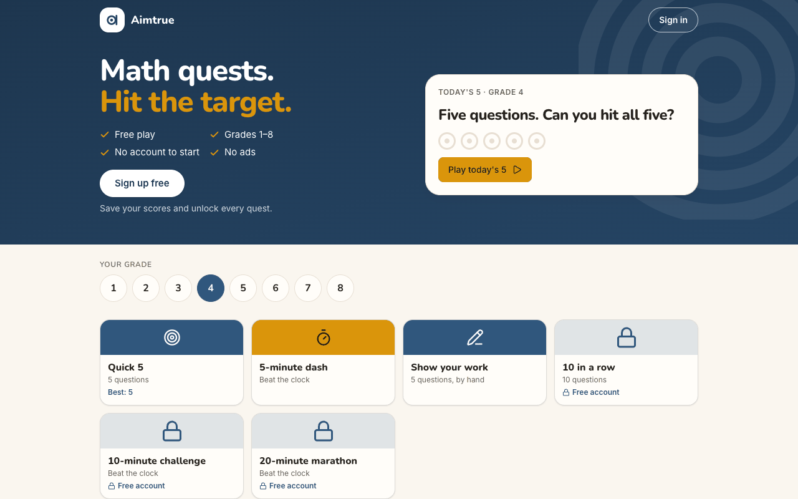
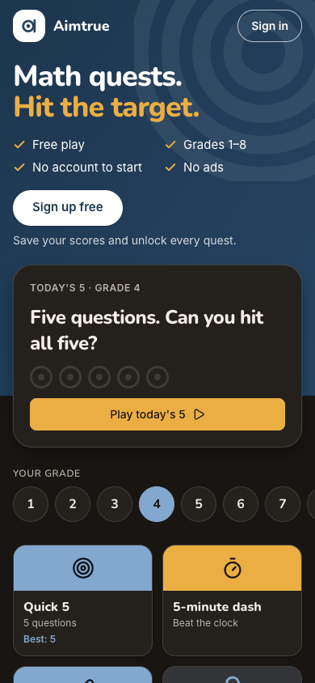

> Expected: the signed-out guest page, perhaps aware of yesterday. Observed: the same guest page as step 1, except
> "Best: 5" on the Quick 5 tile. Nothing about her account or the approval.

**What Renee notices:** the child's score is still on this device, which reassures her. She signed up yesterday, so
she goes for "Sign in".

### Step 13 — Tap "Sign in"

> Expected: a sign-in step. Observed: the sheet titled "Sign up free — Keep your scores, unlock every quest and play
> with your family." with "Continue with Google".

**What Renee notices:** she pressed "Sign in" and is offered "Sign up free". She worries about a second account, but
there is only one button.

### Step 14 — Tap "Continue with Google": straight into "Renee's space" (landing)

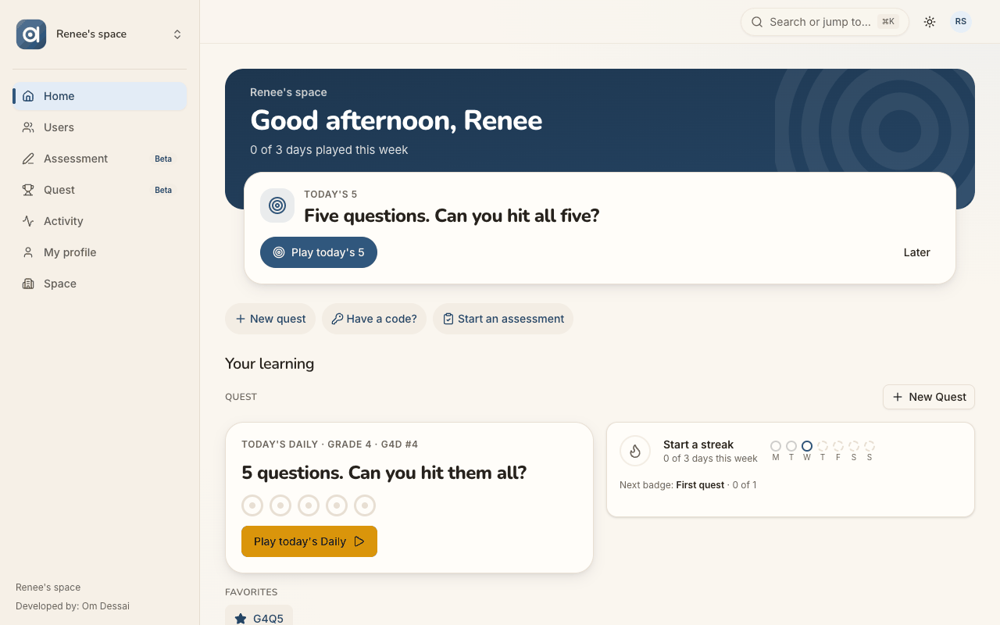
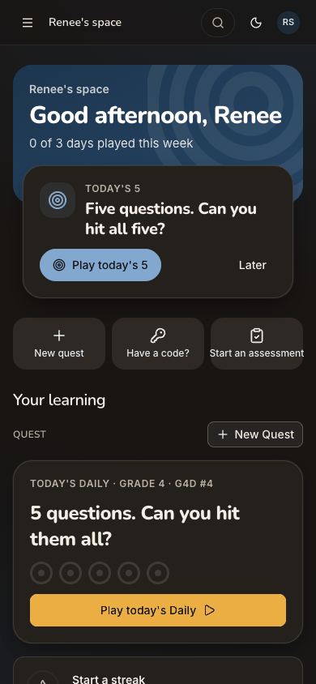

> Expected: approved, so signed in to her own space. Observed: match, with no further question. "Renee's space — Good
> afternoon, Renee — 0 of 3 days played this week". Next up offers "Today's 5" (Play today's 5 / Later). Three quick
> actions follow: New quest, Have a code?, Start an assessment. Then "Your learning → Quest → Today's Daily · Grade 4 ·
> G4D #4" with "Play today's Daily". The desktop sidebar has Home, Users, Assessment, Quest, Activity, My profile and
> Space.

**What Renee notices:** she is in, by name, and quicker than she feared. But the page talks to her as the learner, has
no word about her child, and offers the Daily twice under two names.

### Step 15 — Scroll to Favorites and the grade row (carry-over check)

> Expected: grade 4 leading, and the guest tile as a favorite. Observed: carry-over works for both. "FAVORITES ★
> G4Q5", the grade row with 4 selected, and Quick 5 first with a filled star. The guest's "Best: 5" is not on the
> member tile, and the progress card says "Next badge: First quest · 0 of 1".

**What Renee notices:** grade 4 is already set, which is good. The favorite is a code. Her child's 5 of 5, which she
signed up to save, is nowhere.

### Step 16 — "Start an assessment": open the Student list

> Expected: her child, or at least herself. Observed: the Student dropdown opens an empty list, with no option and no
> explanation. Level reads "Choose a level" and Start is disabled. The help text mentions "questions not yet reviewed
> in the bank (your space is trying them out)". Below: "Assessments — No assessments yet." Dead end 1.

**What Renee notices:** the one form that says "Student" offers nobody and does not say why. She closes the list and
looks elsewhere.

### Step 17 — Open the menu

> Expected: somewhere to add her child. Observed: Home, Users, Assessment (Beta), Quest (Beta), Activity, My profile,
> Space. No "child" or "family".

**What Renee notices:** "Users" is the nearest guess, a word from work software.

### Step 18 — Tap "Users"

> Expected: people, with a way to add her child. Observed: "Users — Everyone at Renee's space. A person can hold more
> than one role.", "+ Add user", search, role and status filters, "Show deactivated", and one card: Renee Shah, Admin,
> Active.

**What Renee notices:** she is an "Admin". It looks like an office directory, but "Add user" is the only "add".

### Step 19 — Tap "+ Add user"

> Expected: a form for her child. Observed: "Add user — One person, one record. Check every role they hold". The roles
> are Admin ("Runs the space"), Student ("Enrolled for tutoring. Must have at least one parent.") and Parent
> ("Responsible for costs, communication and monitoring."). Then Full name, Email (optional, "Leave blank if this child
> has no address of their own."), Phone and Status.

**What Renee notices:** the email hint mentions "this child", so this is the place. But "tutoring" and "costs" are
not her situation.

### Step 20 — Tick "Student"

> Expected: fields for her child, with herself as parent. Observed: "Parents / guardians *" appears with "No parents in
> the portal yet. Add one with New parent." and a "New parent…" button. Student details follow: School, "Current math
> course / grade" (free text), "Goal for this academic year", "Available for virtual tutoring", and a consent box.

**What Renee notices:** "No parents"? She is the parent, and she is in the list on the page behind.

### Step 21 — Tap "New parent…"

> Expected: a way to say "that's me". Observed: a second sheet, "New parent — They sign in with this Google address
> and are billed for the lessons.", with Full name, Email and Phone. There is nothing to pick an existing person.

**What Renee notices:** "billed for the lessons": what lessons? She enters herself, the honest answer.

### Step 22 — Type her own name and email

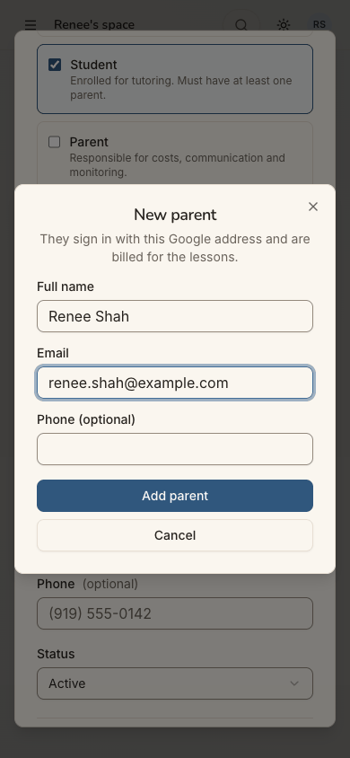

> Expected: accepted. Observed: "Renee Shah" and "renee.shah@example.com" entered.

**What Renee notices:** nothing yet; it looks right.

### Step 23 — Tap "Add parent": refused

> Expected: she becomes the parent. Observed: a red toast, "Someone in this space already has that email address."
> The sheet stays open, and the toast fades after a few seconds (409 on POST /api/users). Dead end 2.

**What Renee notices:** "Someone" is her. The product knows her, but not as a parent, and does not say what to do.

### Step 24 — Cancel both sheets; tap her own name (read-only), then "…"

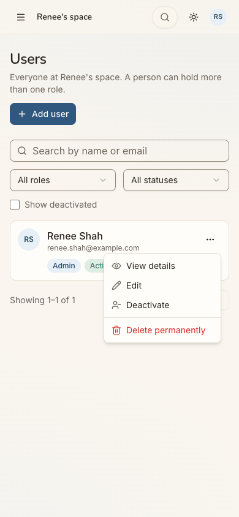

> Expected: a way to make herself the parent. Observed: tapping "Renee Shah" opens "User details — Everything on file
> for this person", with a Comments box and recent activity but no Edit (dead end 3). Its comments request answered 403
> in the browser log. The "…" menu offers View details, Edit, Deactivate and "Delete permanently" on her own, only-admin
> record.

**What Renee notices:** Edit is in the "…" menu. Deactivate and Delete sit one tap away from her own account, which
alarms her (not tapped).

### Step 25 — "Edit", tick "Parent"

> Expected: making herself a parent. Observed: "Edit user" with her details, and Roles Admin + Parent ticked. No
> children field appears. (The driver first ticked Student by mistake, because its description contains "parent"; it
> was undone at once and is not counted as Renee's action.)

**What Renee notices:** a guess drawn from the refusal. Nothing confirms it is the right way.

### Step 26 — "Save changes"

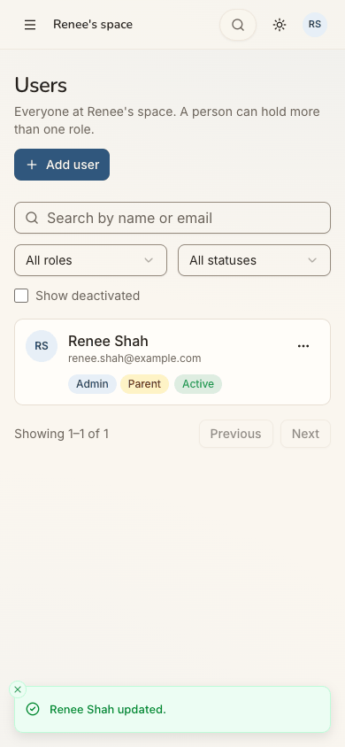

> Expected: saved. Observed: "Renee Shah updated."; her card reads Admin · Parent · Active.

**What Renee notices:** done, but nothing points to "now add your child".

### Step 27 — Add user again: Student, parent "Renee Shah", "Maya Shah", "Grade 4", consent

> Expected: she can name herself as parent. Observed: an "Add a parent or guardian" picker now lists "Renee Shah
> renee.shah@example.com". Chosen, it shows Relationship "Guardian", Primary. Full name "Maya Shah", no email, grade
> typed "Grade 4", and the consent box ticked. School, Goal and virtual tutoring are left empty.

**What Renee notices:** at last she is the parent, though labelled "Guardian". She has to type the grade, which the
Play home already knew.

### Step 28 — Tap "Add user"

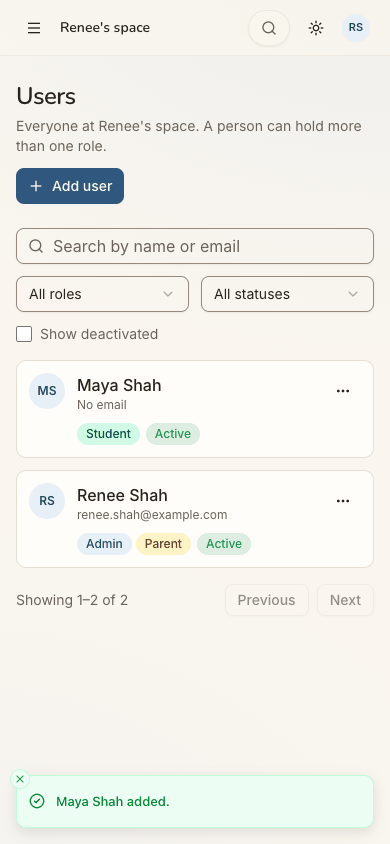

> Expected: Maya added. Observed: "Maya Shah added."; the list shows Maya (No email, Student, Active) and Renee (Admin,
> Parent, Active).

**What Renee notices:** her child is in. Nothing suggests the next step.

### Step 29 — Menu → Home; scroll down

> Expected: the home knows Maya. Observed: the top is unchanged ("Your learning"). At the very bottom, a new "Your
> children — Maya — Played 0 days this week (aim: 3) — Play with Maya" section appears. "Make this my home" adds "My
> children"; the focus stays "Automatic (Quest)".

**What Renee notices:** Maya is there, but last, under Renee's own tiles. The card offers "Play with Maya", but not an
assessment.

### Step 30 — Student: "Maya Shah"; open Level

> Expected: Maya, and grade 4 suggested. Observed: Maya Shah is offered (Renee still is not). The Level list has no
> default: K, G1-G8, Math 1, Math 2, Applied Logic, Stats & Data Science, Math Modeling, BA1-BA5 and AoPS levels, each
> "· 10 questions · includes unreviewed".

**What Renee notices:** "G4" is a code. "Includes unreviewed" on every line worries her: unreviewed by whom?

### Step 31 — Choose "G4 · 10 questions · includes unreviewed"

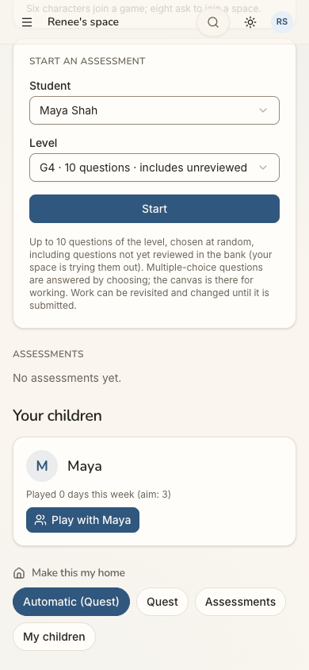

> Expected: Start enabled. Observed: match. Maya Shah and G4 are chosen, and Start turns solid blue.

**What Renee notices:** ready, after a long way round.

### Step 32 — Tap "Start": Maya's first question (landing)

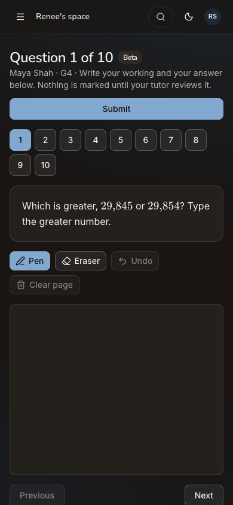

> Expected: the child's first question on screen (the journey's end). Observed: match. "Question 1 of 10 · Beta —
> Maya Shah · G4 · Write your working and your answer below. Nothing is marked until your tutor reviews it." A
> full-width Submit sits above the question tabs 1-10. The question reads "Which is greater, 29,845 or 29,854? Type the
> greater number.", followed by Pen, Eraser, Undo, Clear page, a blank canvas, and Previous/Next. The portal frame
> stays around it.

**What Renee notices:** it is Maya's, at grade 4. But "your tutor" does not exist, "Type" fits no box, and Submit is
first. She does not know where she will see Maya's answers.

### Step 33 — Reload the assessment (end-state check)

> Expected: the started assessment survives a reload. Observed: match. Same URL, same "Question 1 of 10" for Maya
> Shah · G4, same first question.

**What Renee notices:** Maya can come back to it.

## Appendix

- **Mode:** live. The web app at `http://localhost:8797` is a frozen copy of commit `2d6e7d3` with sign-in on,
  driven in headless Chrome at 390×844 (phone). Landing steps (1, 4, 8, 9, 11, 12, 14, 32) were also captured at
  1280×800 and in dark mode. Two stages in one browser profile: steps 1-11, then the platform admin's approval, then
  steps 12-33 in a new tab a "day later".
- **Frameworks applied:**
  - cuj-contract: every step against its expected result;
  - task-completion: the journey ran to its defined end, the first question of an assessment for the child, on
    screen at step 32;
  - success-criteria: the end state was checked again after a reload at step 33.
- **CUJ manifest:** J03, 33 steps. Verified: steps 1-9 and 11-33 (32). Partly observed: step 10, where the Terms tab
  was opened but its page was not seen.
- **Carry-over check (requested):**
  - grade 4 leads the member's Play home: yes (step 15);
  - the tile played as a guest became a favorite: yes, "G4Q5", once (step 15);
  - the guest's best score: no (steps 12, 15).
- **Coverage / not inspected:**
  - The Terms and Privacy pages' content: their links open a new tab, which the driver does not follow (step 10).
  - Whether a right/wrong flash appears between guest questions 2-5 (only the settled page was read, step 6).
  - "Is it free?" and "Which grades?" FAQ answers; "Create a free family space"; the guest "Show your work" tile;
    Today's 5; "Challenge a friend"; "How to solve it"; "Under 13? Ask a grown-up".
  - Whether Renee was told of the approval outside the page (an email). No mailbox was available, and the screens at
    steps 11-12 mention none.
  - The approval itself: a separate agent's step in the platform console, not seen from Renee's side.
  - The member home's "Show your work" tile (G4A5): never tapped. Whether it starts an assessment for Renee herself,
    or asks for a child, was not checked. Nor was any assessment only for herself (her name never appeared in the
    Student list).
  - Answering and submitting the assessment, and whether and where Renee can review Maya's work.
  - "Play with Maya", the Daily, "Make this my home → My children", Deactivate / Delete permanently on her own record
    (seen, not tapped), the Comments box in User details (seen; its request answered 403), the Relationship options
    other than the default.
  - Keyboard-only and screen-reader use; the accessibility tree was read only to find controls.
  - The iOS app; it is covered by separate journeys.
- **Access:** through the app's real sign-in and sign-up screens; the Google provider step is simulated (a stand-in
  for Google's button hands the app a local test token for the persona).
- **Preconditions made outside the UI:** none by this journey. The run's platform settings (web sign-in Google only
  with sign-up open, sign-up access Post-approved, guest play and the guest assessment on, the Daily on) were set
  through the console API before the journeys, as `docs/userjourney/README.md` "The run" records. Between the two
  stages the platform admin approved Renee (outside this journey). The child, "Maya Shah", is invented and was added
  through the UI at step 27.
