# CUJ Audit — J04: teen (13-17) signs up, tries a space and a code, plays

## Executive summary

**Who:** Theo Brooks, 15 (born June 2011). He likes maths competitions and runs a small maths club. He belongs to
cohort **C6, the Quest player** ("Let me play.") in `docs/member-home-plan.md`. He arrives as a signed-out guest and
signs up straight away, without playing first. He wants three things: an account that saves his scores, a space for
his club, and a way into his school club's space with its code (RVRS2345). Then he wants to play something at his own
level.

**Outcome: 1/1 journeys passed, 0 skipped, 23 of 24 steps verified.** The sign-up works and ends, as the platform's
Post-approved access intends, on "Waiting for approval" (step 7). A day later, after the platform admin approved him,
"Sign in" and one Google tap put him straight into his personal space, "Theo's space" (step 10). Both teen limits hold,
as this journey expects:

- **Start a space:** refused by a grey line on the Spaces page, "To start a space of your own you need to be 18 or
  older." (step 13).
- **Adding club members to his own space:** refused, but only after he had filled in the whole Add user form: "Adding
  people to a space is for adults. Ask a parent to start a family space." (step 15).
- **Joining with a code:** works for a teen. RVRS2345 finds "Riverside Tutoring", and "Ask to join" leaves a pending
  request (step 18).

He then starts an AoPS Algebra quest and the first question is on screen (step 24). It is still there after a reload.
Step 5 is only partly verified: the Terms page opened in a new tab that was not inspected.

**Conversion figures** (counted from the entry point):

| Stretch | Screens | Taps | Inputs | Waits | Dead ends |
| --- | --- | --- | --- | --- | --- |
| Day 1: guest page to "Waiting for approval" (steps 1-7) | 4 | 9 | 3 (month, year, terms box) | 1 (the approval, open-ended) | 0 |
| Day 2: guest page to his home (steps 8-10) | 3 (1 new: the home) | 2 | 0 | 0 | 0 |
| Day 2: the club attempts, Start a space and the code (steps 11-18) | 5 new (menu, switcher, Spaces, Users, Add user) | 14 | 3 (name, email, code) | 1 (the join request, open-ended) | 1 (Users > Add user) |
| Day 2: home to the first question (steps 19-24) | 5 new (Level, Score Setup, Who plays?, Ready?, the game) | 9 | 0 | 1 (a 3-second countdown) | 0 |
| **Whole journey (steps 1-24)** | **15 distinct (23 views)** | **34** | **6** | **3** | **1** |

The shortest path from signing in to a question is 3 taps: Sign in, Continue with Google, a home tile. Theo did not
take it, because no tile on his home was at his level. Through "New quest" it is 9 taps.

For **conversion**, the teen gets in, and the code works. But two open-ended waits (the platform's approval, then the
club's admins) each end in silence. Nothing on screen says he will be told. His club has no way in at all: the "no"
names no next step, such as asking a teacher or parent to start the space.

For **stickiness**, the hook is real: a competition-style AoPS problem on the first question. But it sits four wizard
steps away. His home opens on Grade 1 and Kindergarten.

**The 3 screens Theo would notice most:**

- **Step 10, his first home.** "Good afternoon, Theo" is warm, but the board below is "Today's Daily · Grade 1", a pink
  grade-1 pill and "Quick 5 · Grade 1". The only level near his own is "Math 1" under More levels. For a 15-year-old
  who does competitions, this says "for little kids" before he has played once.
  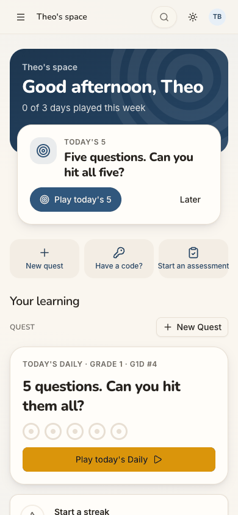
- **Step 15, the club refused after the form.** He is "Admin" of his space, so he tries Users > Add user for a club
  member. The form lets him fill in roles, a name, an email and a growing "Student details" section. Only then does a
  red toast say adults only, and it points him to a "family space", which is not what a club is. He loses effort and
  trust on the one thing he came to do for his club.
  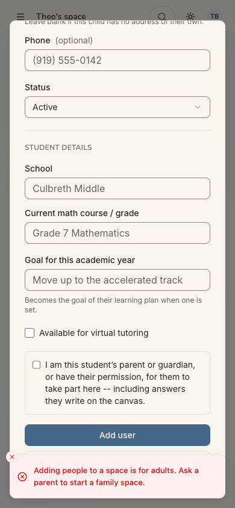
- **Step 24, the first question.** "How many terms of 1+3+5+7+⋯ are needed to make a sum of 144?" This is the problem
  a competition kid wants. It is the strongest reason he has to come back, and he reached it only through the New quest
  wizard.
  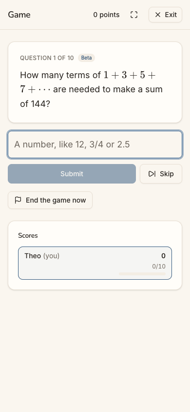

**Contact sheet** (all 24 phone steps):

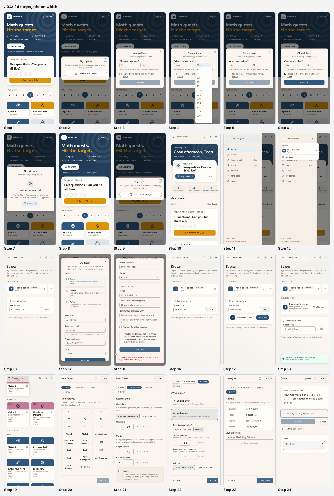

| Severity | Count |
| --- | --- |
| sev4 (catastrophe) | 0 |
| sev3 (major) | 0 |
| sev2 (minor) | 5 |
| sev1 (cosmetic) | 4 |
| **Total** | **9** |

## Prioritized fixes

1. [sev2] [The approval is silent, and Sign in opens Sign up free](#sev2-the-approval-is-silent-and-sign-in-opens-sign-up-free): say on the waiting screen how he will hear, email him on approval, and title the sheet "Sign in" when Sign in opened it (steps 7-9).
2. [sev2] [The home leads a 15-year-old with Grade 1 and Kindergarten](#sev2-the-home-leads-a-15-year-old-with-grade-1-and-kindergarten): ask a newcomer's grade or level once, and lead the board with it (steps 10, 19, 20).
3. [sev2] [A teen admin is offered Add user and refused only after filling it in](#sev2-a-teen-admin-is-offered-add-user-and-refused-only-after-filling-it-in): hide Add user (and the admin furniture) in a teen's personal space, or say so before the form (steps 14-15).
4. [sev2] [The no to Start a space is a grey footnote with no way forward for a club](#sev2-the-no-to-start-a-space-is-a-grey-footnote-with-no-way-forward-for-a-club): give the teen a next step he can act on (step 13).
5. [sev2] [The guest page and sign-up speak only to families and young children](#sev2-the-guest-page-and-sign-up-speak-only-to-families-and-young-children): add a line and a level row for teens and competitions (steps 1, 2, 9).
6. [sev1] [Solo practice takes four wizard steps, with Multiplayer preselected](#sev1-solo-practice-takes-four-wizard-steps-with-multiplayer-preselected): preselect Single player, or let a level start a solo game at once (steps 20-23).
7. [sev1] [The join request cuts the space's name and says nothing of when](#sev1-the-join-request-cuts-the-spaces-name-and-says-nothing-of-when): show the full name and say how he will be told (steps 17-18).
8. [sev1] [The waiting dialog shows two headings and a personal Gmail contact](#sev1-the-waiting-dialog-shows-two-headings-and-a-personal-gmail-contact): one heading, and an official support address (step 7).
9. [sev1] [The age form talks about 18 and starts its year list at 2026](#sev1-the-age-form-talks-about-18-and-starts-its-year-list-at-2026): word the note for every age band, and open the year list near a likely year (steps 3-4).

## Findings

### [sev2] The approval is silent, and Sign in opens Sign up free

- **Issue Description:** The waiting screen (step 7) says only "Your access is waiting for approval. You can sign in
  once it's approved." It gives no time frame, does not say who approves, and does not say whether he will be told. On
  this run no message reached him: none is sent locally, and nothing on screen promised one. The next day the guest
  page (step 8) is exactly as before, with nothing to show that his account now exists or has been approved. Theo has
  to guess that "Sign in" is the way back. When he taps it, the sheet is titled "Sign up free", with "Keep your scores,
  unlock every quest and play with your family." (step 9), as if his sign-up had not counted. The approval does work:
  one Google tap puts him in his space (step 10).
- **Framework Violation:** cuj-contract, steps 7-9 (expected: told what happens next, then a sign-in screen; observed:
  no next step, then a sign-up sheet); Nielsen #1 Visibility of system status (an approval he cannot see); Nielsen #4
  Consistency and standards (the "Sign in" button opens "Sign up free").
- **Severity:** 2. Classify: real friction at the journey's main conversion point, with no workaround needed (Sign in
  works). For a teen who signed up on impulse, an open-ended wait with no word that he will be told is where the
  journey quietly ends. Nothing brings him back on the day he is approved. It is not a 3: when he does return, the path
  in is two taps.
- **Evidence:** 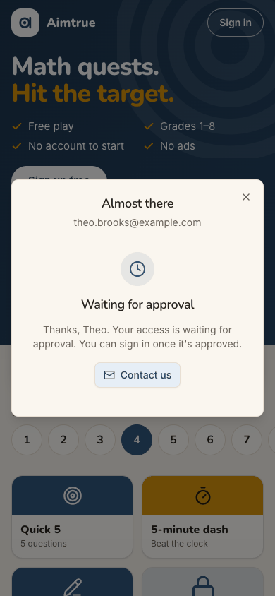 
  
  Repro: under Post-approved sign-up access, sign up as a new Google account and stop at "Waiting for approval". Approve
  the account in the console. Open `/` signed out in a new tab: the same guest page. Tap "Sign in": "Sign up free".
  J05 saw the same title on its step 15.
- **Recommended Fix:**
  - Waiting screen: add one sentence saying what happens next, for example "We'll email theo.brooks@… when you're in.
    Most requests are answered within a day. Until then you can keep playing as a guest." Add a "Keep playing" button
    beside Contact us.
  - Approval: send the approval email (from the production pair, where email is set up).
  - Sign-in sheet: when the sheet is opened from "Sign in", title it "Sign in" with "Welcome back" copy. Keep "Sign up
    free" for the hero button.

### [sev2] The home leads a 15-year-old with Grade 1 and Kindergarten

- **Issue Description:** His first home (step 10) shows:
  - Next up: "Today's 5".
  - The Quest board: "Today's Daily · Grade 1 · G1D #4".
  - A grade row with Grade 1 selected (pink), then "Quick 5 · Grade 1".
  - Advanced: "Beast Academy 1".
  - More levels: Math 1 and Kindergarten (step 19).

  The levels that fit a 15-year-old competition fan (Math 2, AoPS Prealgebra, Algebra and Geometry) appear only inside
  the New quest wizard (step 20). The Next up card's "Play today's 5" link points to the Grade 3 Daily
  (`/quest/daily/NC26.3`; read from the accessibility tree, not opened), while the board's Daily says Grade 1. So one
  screen offers two "today" quests at two different grades, neither of them his. His birth year is known at sign-up,
  but nothing asks his grade or level.
- **Framework Violation:** cuj-contract, steps 10 and 19 (expected: a home that leads with something at his level;
  observed: Grade 1 first, his levels only in the wizard); Nielsen #2 Match between system and the real world (the
  board's default does not match the person); Nielsen #4 Consistency (two "today" quests, two grades).
- **Severity:** 2. Classify: an observable mismatch with real friction for stickiness. For this cohort the first board
  is the product's promise, and "Grade 1" tells a teen it is not for him. The workaround is to find New quest (step
  20), so it is not a 3.
- **Evidence:**  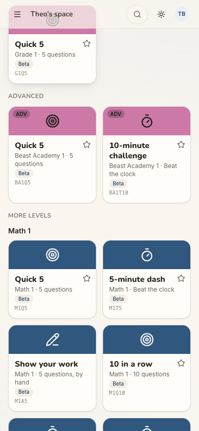
  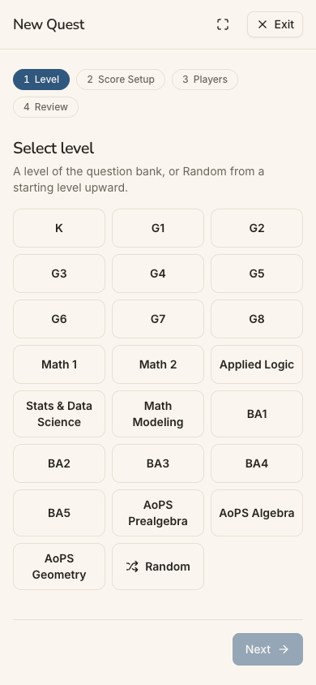
  Repro: sign up as a new account born in 2011 without playing as a guest first, get approved, and sign in. The home
  board opens on Grade 1.
- **Recommended Fix:**
  - Ask once, on the first home of a personal space with no guest history: "What are you working on?" Offer grade
    chips, plus Math 1 or 2 and AoPS, Kangaroo or competitions. Store it as the lead level that the guest's grade
    already feeds.
  - Until he answers, lead the grade row with a level near his age band (13-17: Grade 8 / Math 1) rather than Grade 1.
  - Make Next up's "Today's 5" and the board's Daily use the same level.
  - Show the competition levels (AoPS, Beast Academy 5) in "Advanced" for that band.

### [sev2] A teen admin is offered Add user and refused only after filling it in

- **Issue Description:** In his personal space Theo is labelled "Admin" (step 12). His menu has Users and Space, and
  his home shows "Start an assessment · Student: Choose a student". Looking for a way to bring his club in, he opens
  Users > Add user (step 14). The full staff form opens:
  - roles Admin, Student and Parent;
  - Full name, Email and Phone;
  - after ticking Student, a parent section, Student details and a parental-consent box.

  Nothing says a teen cannot use it. Only when he submits does a red toast say "Adding people to a space is for adults.
  Ask a parent to start a family space." (step 15, a 403). The advice points to a "family space", not to his club.
- **Framework Violation:** cuj-contract, steps 14-15 (expected, for the persona: a way to add club members, or a clear
  "not for you" before the effort; observed: the form, then a late refusal); Nielsen #5 Error prevention (the error is
  allowed to happen after the work); Nielsen #8 Aesthetic and minimalist design (admin tools a teen cannot use are on
  his menu and home).
- **Severity:** 2. Classify: real friction and a dead end. The refusal itself is right and expected, and nothing is
  saved. But a teen fills in another person's details and is told no only at the end. The "family space" advice does
  not fit a club. Not a 3: he backs out with Cancel and loses nothing else.
- **Evidence:** 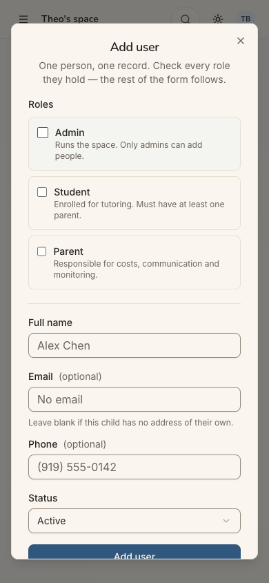 
  Repro: as an approved 13-17 account in his personal space, Menu > Users > Add user. Tick Student, type a name and an
  email, and tap Add user. The toast shows; the console shows `403 POST /api/users`.
- **Recommended Fix:**
  - In a teen's personal space, hide Add user. Better, hide the Users and Space items and the "Start an assessment"
    student picker too, and keep "Show your work" for himself.
  - If Users stays, replace the Add user button with one line, the same message the refusal gives: "Adding people is
    for adults. To play with your club, ask a teacher or parent to start a space and share its code."
  - Don't label him "Admin" of a space of one: "Just you" or "Personal" says what it is.

### [sev2] The no to Start a space is a grey footnote with no way forward for a club

- **Issue Description:** Theo finds no "Start a space" in the menu (step 11). The switcher offers only "All spaces"
  (step 12). On the Spaces page the answer is a line of small grey text under the code box: "To start a space of your
  own you need to be 18 or older." (step 13). It has no button and no alternative. It does not say that an adult
  (teacher, parent, club sponsor) can start one and give him its code, though the code box right above is exactly how
  he would then join. It does not say that he can play multiplayer games from his own space.
- **Framework Violation:** cuj-contract, step 13 (expected for a teen: a refusal that says what he can do instead;
  observed: refusal only); Nielsen #9 Help users recognize, diagnose, and recover from errors; Nielsen #10 Help and
  documentation (no pointer to the club route).
- **Severity:** 2. Classify: the refusal is expected and correct (a pass for this journey), but it ends his club goal
  with no next step. That is a lost conversion for exactly the people who would bring a group in. Not a 3: no end state
  is wrong.
- **Evidence:** 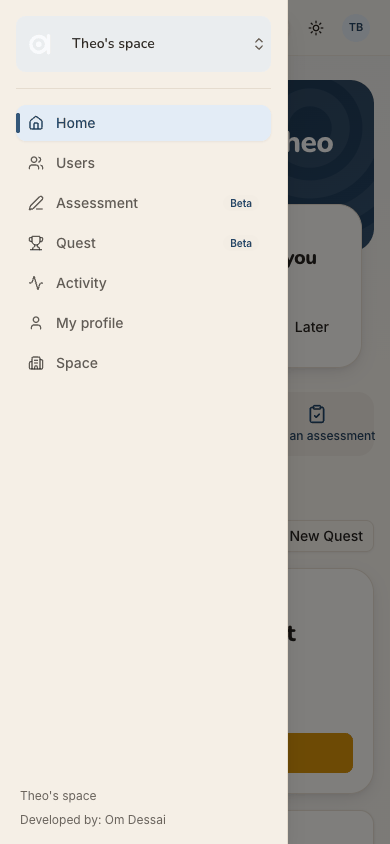 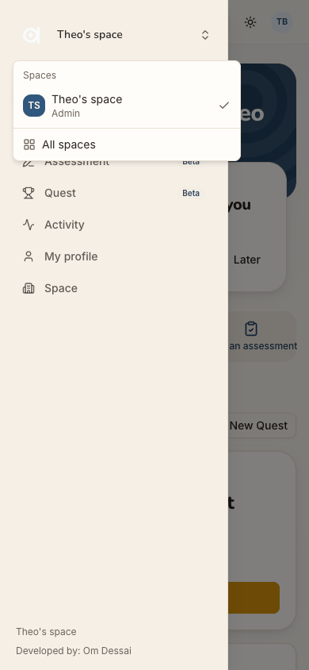
  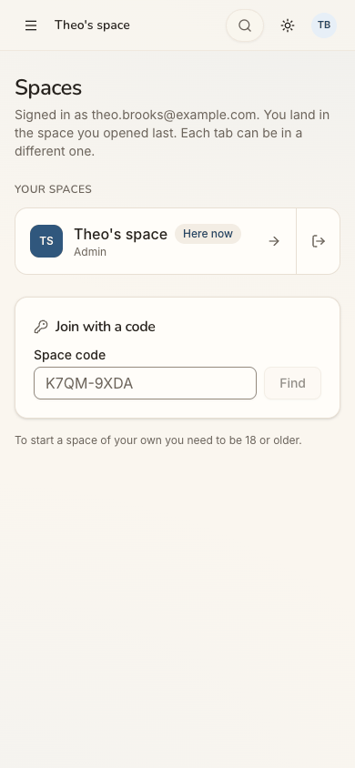
  Repro: as an approved 13-17 account, Menu > the space switcher > All spaces.
- **Recommended Fix:**
  - Turn the footnote into a small card: "Running a club? Spaces are started by an adult: ask your teacher or a parent
    to start one at <link>, then join it with its code above."
  - Add a "Share this with an adult" action (the same share-or-copy pattern as "Under 13? Ask a grown-up").
  - Add a pointer to "Play with friends: start a multiplayer quest and share its code", if friends outside his space
    can join one (not checked here).

### [sev2] The guest page and sign-up speak only to families and young children

- **Issue Description:** The guest page (steps 1 and 8) promises "Grades 1-8". It preselects Grade 4 and ends with
  "Questions from grown-ups" ("Is it safe for my child?") and "Create a free family space". The sign-up sheet says
  "play with your family" (steps 2 and 9). Nothing names high-school courses, competitions (AoPS appears only as "Adv
  G4"; Kangaroo is not mentioned), friends or clubs. A 15-year-old has to look past the copy to believe the product is
  for him.
- **Framework Violation:** cuj-contract, steps 1-2 (expected: a reason for this persona to sign up; observed: copy aimed
  at parents and young children); Nielsen #2 Match between system and the real world.
- **Severity:** 2. Classify: real friction at the first impression, the conversion point for the 13-17 band. Theo signs
  up anyway because "Save your scores and unlock every quest" is enough, but a less motivated teen would not. No
  workaround is needed.
- **Evidence:**  
  Repro: open `/` signed out on a phone.
- **Recommended Fix:**
  - Add a tick or a line for teens: "Grades 1-8, Math 1-2 and competition prep".
  - Name the advanced tracks in words: "AoPS Algebra", "Beast Academy 5".
  - Let the grade row reach "Math 1+".
  - Word the sign-up sheet for everyone: "play with friends and family".

### [sev1] Solo practice takes four wizard steps, with Multiplayer preselected

- **Issue Description:** To play one level on his own, Theo goes through Level, Score Setup, Who plays? and Ready?
  (steps 20-23). That is 7 taps after New quest. On "Who plays?" Multiplayer is already selected, with teams of 4 and
  10 teams, although Single player says "It starts straight away" (step 22).
- **Framework Violation:** cuj-contract, steps 20-23; Nielsen #7 Flexibility and efficiency of use (no shortcut for
  the common solo case).
- **Severity:** 1. Classify: cosmetic friction. Each screen is clear, the defaults are sensible, and he reaches the
  question. A shorter path matters most for a returning player.
- **Evidence:** 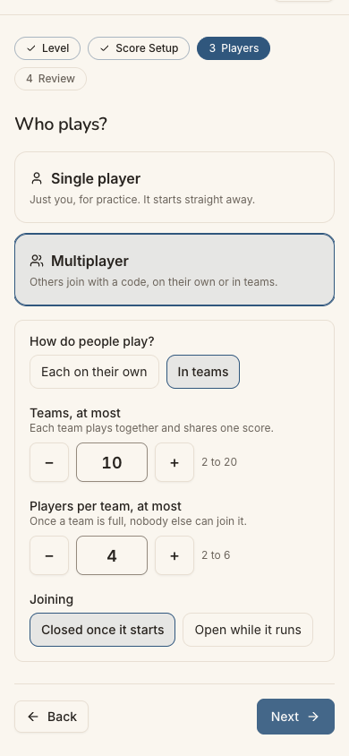 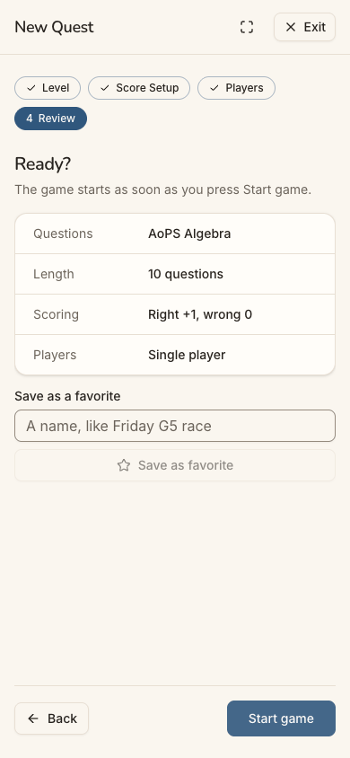
  Repro: home > New quest > a level > Next > Next.
- **Recommended Fix:** Preselect Single player. Offer "Play solo now" on the Level step once a level is chosen, using
  the default scoring, and skip Score Setup and Review. Keep the full wizard for multiplayer.

### [sev1] The join request cuts the space's name and says nothing of when

- **Issue Description:** After Find, the match reads "Riverside Tutori…", cut off on a phone, with an "R" avatar and
  nothing else (step 17). Theo cannot confirm that it is his school club before asking. After "Ask to join", "Asked
  just now. Its administrators will let you in." (step 18) does not say when, or whether he will be notified. As a
  teen, he is not told whether a parent has to be involved.
- **Framework Violation:** cuj-contract, steps 17-18; Nielsen #1 Visibility of system status.
- **Severity:** 1. Classify: small but real uncertainty. The request itself works, and he can withdraw it.
- **Evidence:** 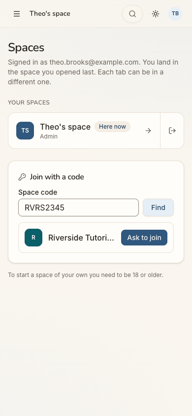 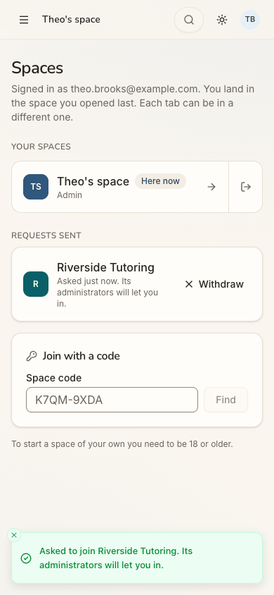
  Repro: Spaces > Space code `RVRS2345` > Find > Ask to join.
- **Recommended Fix:**
  - Let the match wrap to two lines. Add one identifying detail (the space's town or its admin's first name, if
    shareable).
  - After asking, say "You'll see it here and on your home when they let you in" and, where email is on, "and we'll
    email you".

### [sev1] The waiting dialog shows two headings and a personal Gmail contact

- **Issue Description:** The waiting state keeps the form's title "Almost there" above its own heading "Waiting for
  approval" (step 7). Its only button, "Contact us", opens an email to a personal Gmail address. The menu footer's
  "Developed by: Om Dessai" link goes to the same address.
- **Framework Violation:** cuj-contract, step 7; Nielsen #4 Consistency and standards.
- **Severity:** 1. Classify: cosmetic. The message is clear enough, but the mixed title and a personal address make
  the product look less official to a teen and to the parent he might show it to.
- **Evidence:** 
  Repro: complete sign-up under Post-approved access.
- **Recommended Fix:** Retitle the dialog "Waiting for approval" once it reaches that state. Point Contact us at a
  support address on the product's own domain.

### [sev1] The age form talks about 18 and starts its year list at 2026

- **Issue Description:** "Only whether you are over 18 is kept, never the date." (step 3) is the only age note a 15-year-old
  sees. It makes him wonder whether being under 18 is a problem, and it does not say what a 13-17 account can or
  cannot do (start a space, add people). The Year list opens at 2026, so he scrolls past fifteen years to reach 2011
  (step 4).
- **Framework Violation:** cuj-contract, steps 3-4; Nielsen #2 Match between system and the real world; Nielsen #7
  Flexibility and efficiency of use.
- **Severity:** 1. Classify: cosmetic friction. He completes the form in seconds.
- **Evidence:**  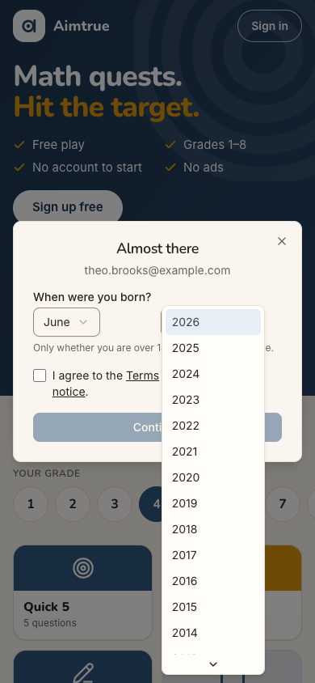
  Repro: sign up as a new account and open the Year list.
- **Recommended Fix:** Reword it as "We keep only your age band, never the date", which is true for every band. Start
  the year list at the youngest year allowed (13 years ago), or let the year be typed.

## Walkthrough

### Step 1 — Open http://localhost:8797/ signed out (landing)

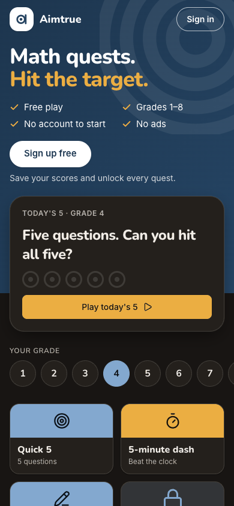
> Expected: the guest page and a way to sign up. Observed: match. The guest Play home shows "Math quests. Hit the
> target." with Free play, Grades 1-8, No account to start and No ads, then "Sign up free". Below are Today's 5
> (Grade 4 preselected), the grade row, tiles (three locked "Free account"), Advanced "Adv G4", "One code, everyone
> joins", and "Questions from grown-ups". Desktop and dark mode carry the same content and are readable.

**What Theo notices:** everything is pitched at grades 1-8 and at parents. Nothing speaks to a 15-year-old, to
competitions or to a club, but "Save your scores and unlock every quest" is reason enough to tap Sign up free.

### Step 2 — Tap "Sign up free"

> Expected: a sign-up screen. Observed: match. A centred dialog, "Sign up free: Keep your scores, unlock every quest and
> play with your family.", with one "Continue with Google" button and a close X.

**What Theo notices:** one clear button. The copy says "family" again, not friends or a club.

### Step 3 — Tap "Continue with Google"

> Expected: Google, then a short form about him. Observed: match. The dialog becomes "Almost there" with his email, then
> "When were you born?" (Month and Year), "Only whether you are over 18 is kept, never the date.", the terms box and a
> disabled Continue.

**What Theo notices:** a short form. The note about being over 18 makes him wonder whether 15 is a problem.

### Step 4 — Month: June; open the Year list and pick 2011

> Expected: pick his birth month and year. Observed: match. The Year list starts at 2026; 2011 is the 16th row, below the
> list's fold.

**What Theo notices:** he scrolls past fifteen years, starting from a baby's, to reach his own. A small thing.

### Step 5 — Tap the "Terms" link before ticking
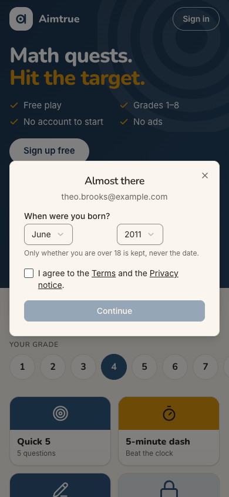
> Expected: see the terms without losing the form. Observed: partly verified. The link opens a new browser tab, and the
> form keeps June and 2011. The terms page itself was not inspected (see Coverage).

**What Theo notices:** his answers are still there, which is good. On a phone the new tab is a small jump away and
back.

### Step 6 — Tick "I agree to the Terms and the Privacy notice."
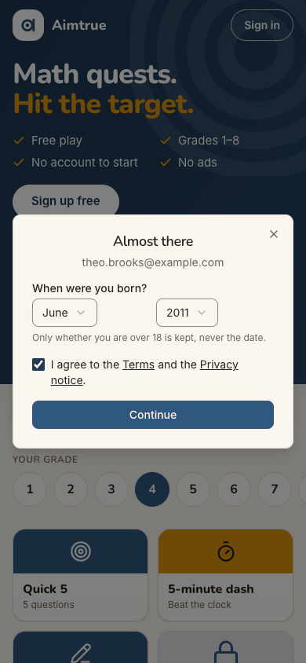
> Expected: Continue becomes active. Observed: match. Continue turns dark blue.

**What Theo notices:** nothing asks for a parent and nothing says a 13-17 account differs. The button lighting up tells
him the tick was the missing piece.

### Step 7 — Tap "Continue" (landing)

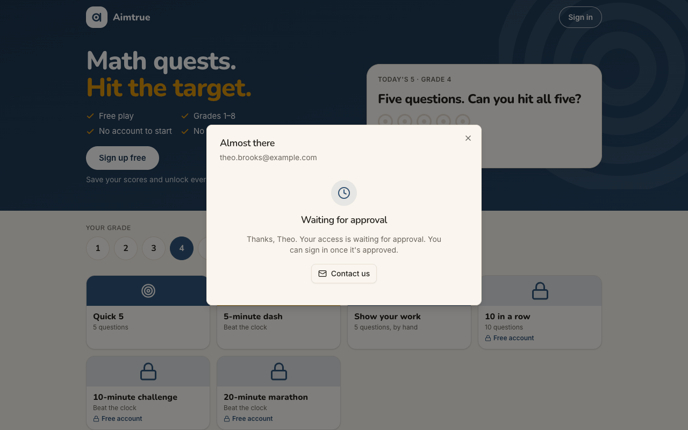
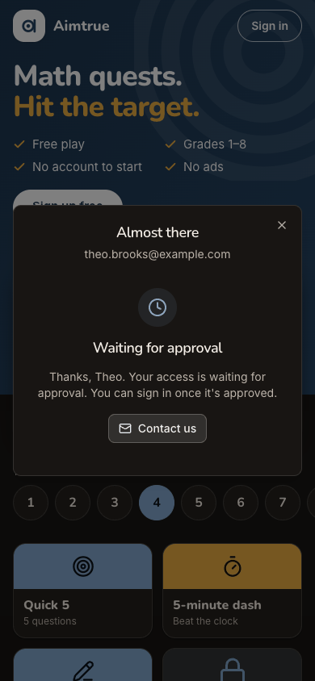
> Expected: under Post-approved access, "Waiting for approval". Observed: match. The dialog is still titled "Almost
> there", with a clock icon and "Waiting for approval: Thanks, Theo. Your access is waiting for approval. You can sign
> in once it's approved." Its one button, "Contact us", is a mailto to a personal Gmail address. `POST
> /api/auth/signup` answered the designed 403. That is the end of day 1.

**What Theo notices:** "Almost there" and "Waiting" at once. He has no idea how long it takes, who decides, or whether
he will be told, and nothing suggests he can keep playing meanwhile.

### Step 8 — A day later: new tab, open / signed out (landing)

> Expected: the guest page, with a way to sign in. Observed: match. The page is identical to step 1, with "Sign in" at
> the top right. It shows no trace of his sign-up or approval.

**What Theo notices:** nothing says "you're approved". He guesses that Sign in, top right, is the way back.

### Step 9 — Tap "Sign in"

> Expected: a sign-in sheet. Observed: mismatch. The sheet is titled "Sign up free", with "Keep your scores, unlock
> every quest and play with your family." and Continue with Google, the same as step 2.

**What Theo notices:** he pressed Sign in and is asked to sign up again. Did yesterday not count?

### Step 10 — Tap "Continue with Google" (landing)

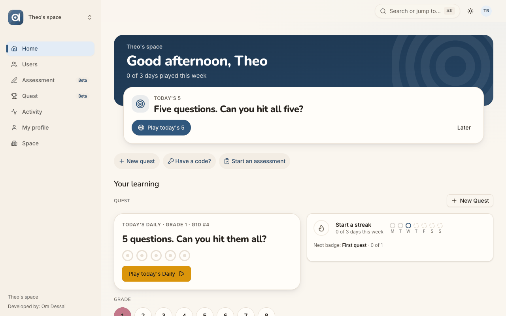
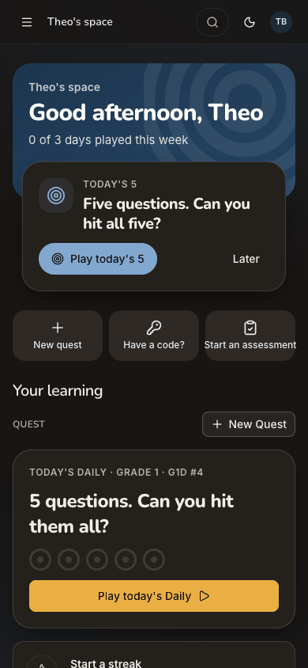
> Expected: approved, signed in, a home. Observed: match. He goes straight into "Theo's space": "Good afternoon, Theo",
> "0 of 3 days played this week", and Next up "Today's 5" with Play and Later. Below are New quest, Have a code? and
> Start an assessment, then "Your learning" with Today's Daily · Grade 1, the streak dots, "Next badge: First quest",
> and a grade row on Grade 1. The desktop menu has Home, Users, Assessment, Quest, Activity, My profile and Space.
> Dark mode is readable.

**What Theo notices:** a friendly greeting, then Grade 1 everywhere. Two "today" cards, and nothing at a 15-year-old's
level in sight.

### Step 11 — Open the menu, looking for a way to start his club's space

> Expected (Theo): a "Start a space" or "New space" item. Observed: the drawer has the space switcher "Theo's space",
> then Home, Users, Assessment, Quest, Activity, My profile and Space. There is no "Start a space". On a phone the
> space mark at the top-left is white on a pale tile and barely visible.

**What Theo notices:** "Space" might be it, but the switcher at the top looks more like where spaces live.

### Step 12 — Tap the space switcher

> Expected: his spaces and a way to add one. Observed: "Spaces: Theo's space, Admin (ticked)", then "All spaces".

**What Theo notices:** he is "Admin" of a space of one he never asked for. "All spaces" is the only door.

### Step 13 — Tap "All spaces" (landing)

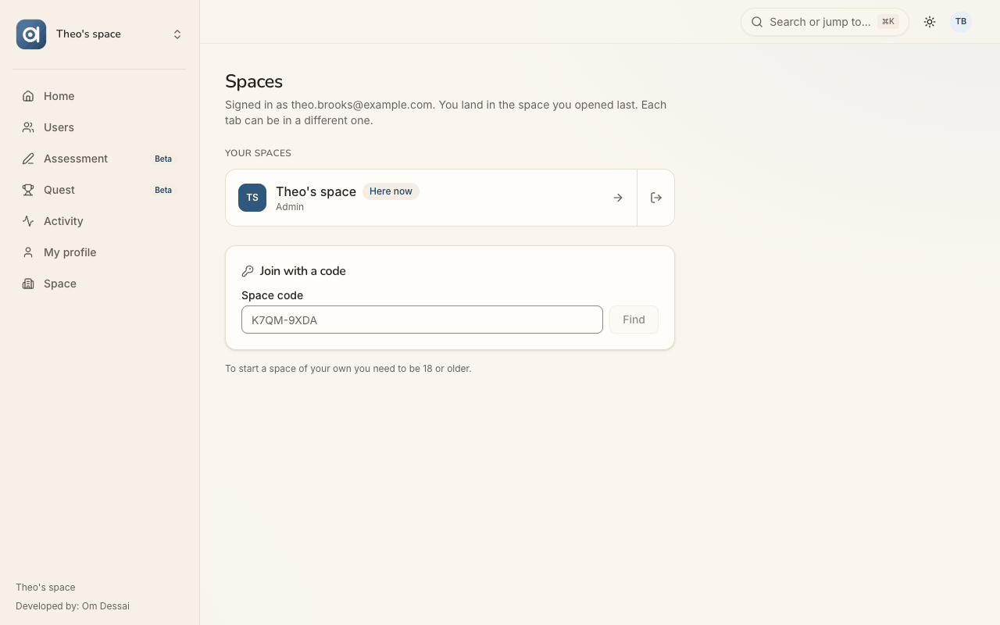
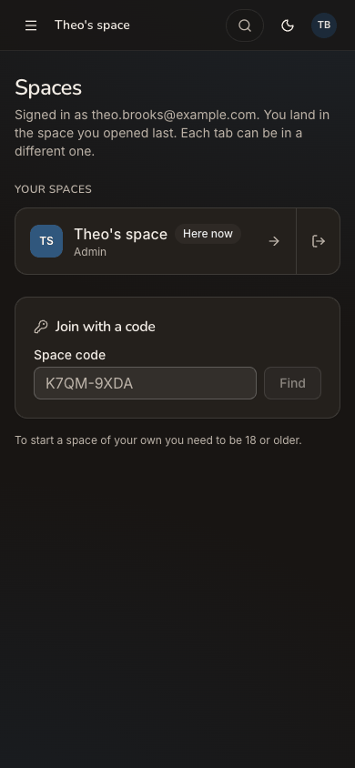
> Expected: for a teen, Start a space refused. Observed: match. The Spaces page shows "Signed in as …" and YOUR SPACES
> (Theo's space, Here now, Admin). Below are the "Join with a code" card and, in small grey text, "To start a space of
> your own you need to be 18 or older." There is no button and no alternative.

**What Theo notices:** the answer to his club question is a footnote saying no, with nothing about what he can do
instead.

### Step 14 — Wrong turn: Menu > Users > Add user, to add club members to his own space

> Expected (Theo): since he is Admin, perhaps he can add his club here. Observed: Users ("Everyone at Theo's space",
> just him), then the full "Add user" dialog. It lists the roles Admin ("Only admins can add people."), Student
> ("Enrolled for tutoring. Must have at least one parent.") and Parent, then Full name, Email, Phone and Status. Nothing
> says a teen cannot use it.

**What Theo notices:** "Only admins can add people", and he is an admin, so this looks like the way.

### Step 15 — Tick Student, type a club member's name and email, tap Add user

> Expected: either a way to add a club member, or a clear "not for you". Observed: the form grows to include a parent
> or guardian (required), Student details and a parental-consent box. On submit, a red toast says "Adding people to a
> space is for adults. Ask a parent to start a family space." (403). He taps Cancel. Dead end 1.

**What Theo notices:** he filled it all in before being told no, and the advice is about a family space, not a club.

### Step 16 — Back to Spaces (Menu > switcher > All spaces); type RVRS2345
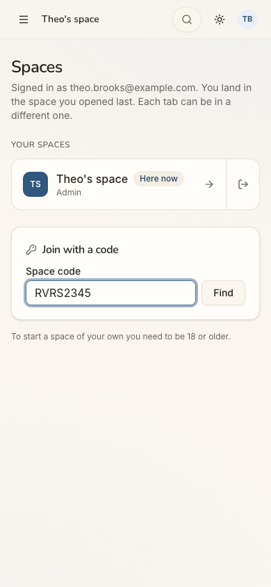
> Expected: the code box takes his club's code. Observed: match. RVRS2345 is typed, and Find becomes active. The
> placeholder shows a hyphenated code, and his code without a hyphen is accepted.

**What Theo notices:** a clear box with a clear button.

### Step 17 — Tap Find

> Expected: the club's space. Observed: match. A row shows an "R" avatar, "Riverside Tutori…" (cut off on a phone) and
> "Ask to join".

**What Theo notices:** is "Riverside Tutori…" his school club? He cannot see the whole name or anything else about it.

### Step 18 — Tap "Ask to join" (landing)

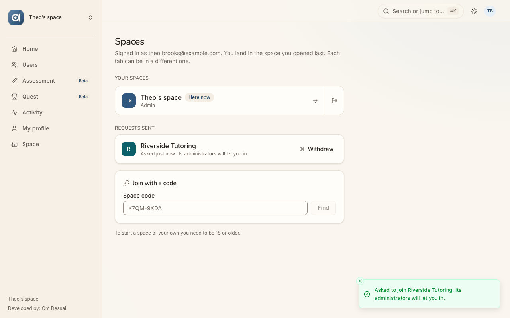
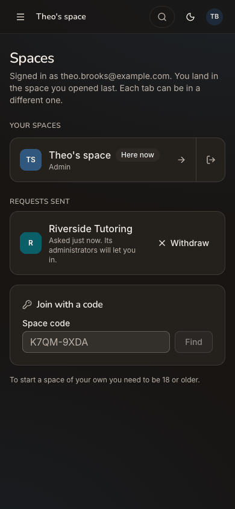
> Expected: a teen may ask to join. Observed: match. A toast says "Asked to join Riverside Tutoring. Its administrators
> will let you in.", and a new section, REQUESTS SENT, shows "Riverside Tutoring: Asked just now. Its administrators
> will let you in." with a Withdraw button. The request was left pending (not waited out).

**What Theo notices:** it worked, and teens may ask. But this is a second wait with no "when" and no "we'll tell you".

### Step 19 — Menu > Home; scroll the board looking for his level

> Expected (Theo): something at his level. Observed: the board shows Quick 5 · Grade 1, Advanced Beast Academy 1 (Quick
> 5, 10-minute challenge), and More levels Math 1 (six tiles) and Kindergarten. There are no AoPS or competition tiles.

**What Theo notices:** Math 1 is the closest thing to him, and it sits beside Kindergarten.

### Step 20 — Tap "New quest" (landing)

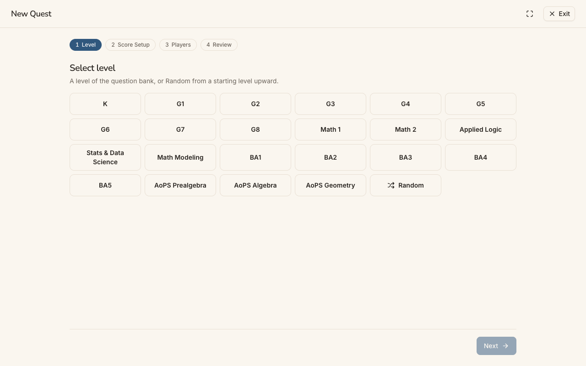
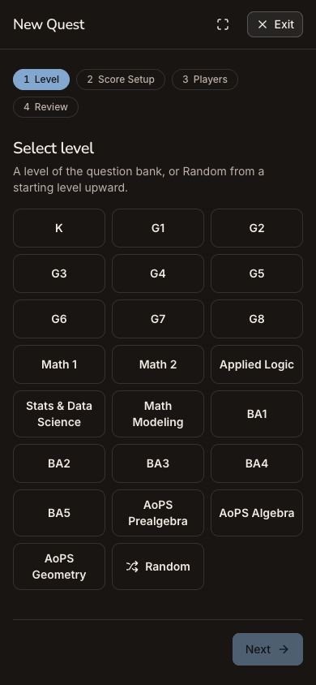
> Expected: a way to choose his own level. Observed: match. A full-screen "New Quest" wizard with four steps (Level,
> Score Setup, Players, Review). "Select level" offers K, G1-G8, Math 1, Math 2, Applied Logic, Stats & Data Science,
> Math Modeling, BA1-BA5, AoPS Prealgebra, Algebra and Geometry, and Random. Next stays disabled until he picks one.

**What Theo notices:** at last, AoPS Algebra and Math 2, levels for him that the home never showed.

### Step 21 — Tap AoPS Algebra, then Next
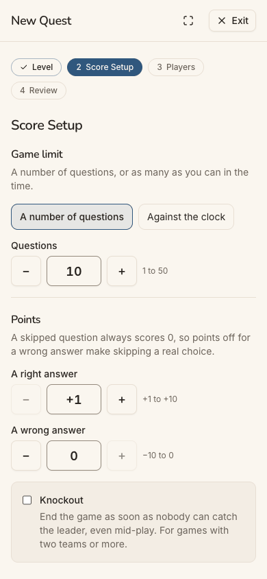
> Expected: the next step. Observed: Score Setup shows the game limit (10 questions, or Against the clock), points for a
> right answer (+1) and a wrong one (0), and Knockout ("for games with two teams or more").

**What Theo notices:** negative marking is an option, which he knows from competitions. He leaves the defaults.

### Step 22 — Tap Next

> Expected: choose solo play. Observed: "Who plays?" offers Single player ("Just you, for practice. It starts straight
> away.") and Multiplayer, which is preselected with teams of 4, 10 teams, and joining closed once the game starts.

**What Theo notices:** Multiplayer was chosen for him. He wants to practise alone.

### Step 23 — Tap Single player, then Next

> Expected: a summary and a start button. Observed: match. "Ready? The game starts as soon as you press Start game."
> The summary reads AoPS Algebra, 10 questions, right +1 and wrong 0, Single player. There is an optional "Save as a
> favorite" name, then Back and Start game.

**What Theo notices:** a clear summary. Four screens for a solo game feels long.

### Step 24 — Tap "Start game" (landing; the journey's end)

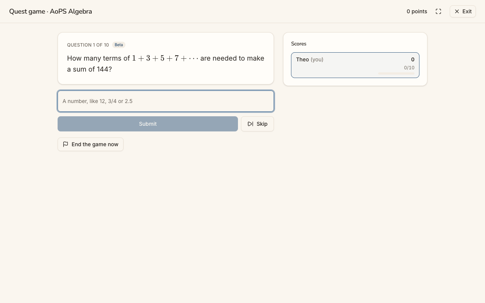
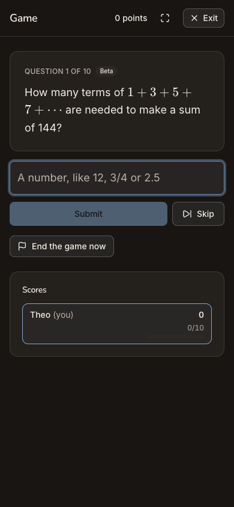
> Expected: the first question on screen. Observed: match. "THE QUEST BEGINS / Get ready" and "Go!" (about 3 s), then
> "QUESTION 1 OF 10 · Beta: How many terms of 1+3+5+7+⋯ are needed to make a sum of 144?", with an answer box ("A
> number, like 12, 3/4 or 2.5"), Submit, Skip, End the game now, and Scores showing Theo (you) 0, 0/10. The phone
> header says "Game"; the desktop header says "Quest game · AoPS Algebra". After a reload the same question 1 of 10 is
> on screen, with score 0.

**What Theo notices:** a real competition-style problem, typeset properly. This is what he came for and what would bring
him back.

## Appendix

- **Mode:** live. The web app at `http://localhost:8797` is a frozen copy of commit `2d6e7d3` with sign-in on. It was
  driven in headless Chrome at 390×844 (phone), plus 1280×800 and dark mode at the landing steps (1, 7, 8, 10, 13, 18,
  20 and 24). The journey ran in two stages a "day" apart in one browser profile: steps 1-7, then steps 8-24 in a new
  tab.
- **Frameworks applied:**
  - cuj-contract: every step against its expected result.
  - task-completion: the journey ran to its defined end, the first quest question, and the space and code attempts
    were recorded.
  - success-criteria: the end state was checked again after a reload at step 24, with the same game and question 1 of
    10 on screen.
- **CUJ manifest:** J04, 24 steps. Verified: steps 1-4 and 6-24 (23). Partly verified: step 5 (the form kept its
  answers; the Terms page was not inspected). Observed and not matching expectation: step 9 (Sign in opens "Sign up
  free"). Steps 13 and 15 are refusals this journey expects (passes).
- **Errors seen:**
  - `401 GET /api/auth/session` on each signed-out load (expected);
  - `403 POST /api/auth/signup` at step 7 (the designed `access_pending`);
  - `403 POST /api/users` at step 15 (the teen refusal; submitted twice, the second time only to capture the toast in
    the screenshot).

  There were no other console errors.
- **Coverage / not inspected:**
  - The Terms and Privacy pages' content: they open in a new tab that the driver does not follow.
  - The "Contact us" mail client, and any email at all. Nothing is sent locally, so whether production emails Theo on
    approval, or when the club's admins let him in, was not checked.
  - What Riverside Tutoring's admins see of Theo's request, and whether a 13-17 request is treated differently. The
    request was left pending in the local database, not withdrawn.
  - Whether club friends outside Theo's space could join a multiplayer quest he starts (Multiplayer was not tried).
  - The Next up "Play today's 5" (its link targets the Grade 3 Daily, read from the accessibility tree) and the board's
    Daily: neither was opened.
  - The home's "Have a code?" quick action: the Spaces page's code box was used instead.
  - Answering the question and the rest of the game. The journey ends at the first question.
  - Make this my home, Assessment, Activity, My profile and the Space page: not opened.
  - Keyboard-only and screen-reader use. The accessibility tree was read only to find controls.
  - The iOS app: it is covered by separate journeys.
  - Other sign-in providers: not offered on the production web.
- **Access:** through the app's real sign-in and sign-up screens; the Google provider step is simulated (a stand-in for
  Google's button hands the app a local test token for the persona).
- **Preconditions made outside the UI:**
  - The platform admin approved Theo's pending account between the two stages, outside this journey's browser.
  - The run's platform settings (web sign-in Google only with sign-up open, sign-up access Post-approved, guest play
    and the Daily on) and Quest switched on in `riverside` (whose space code is RVRS2345) were set before the journeys,
    as `docs/userjourney/README.md` "The run" records.
