# CUJ Audit — J04A: teen (13-17) signs up in the app, tries a space and a code, plays

## Executive summary

**Who:** Ava Grant, 16 (born March 2010). She likes maths competitions and runs a maths club at school. She belongs to
cohort **C6, the Quest player** ("Let me play.") in `docs/member-home-plan.md`. She opens the app on an iPhone as a
signed-out guest and signs up straight away, without playing first. She wants three things: an account that keeps her
scores, a space for her club, and a way into her school club's space with its code (RVRS2345). Then she wants to play
something at her own level. This is the app replay of the web journey J04 (`J04-teen.md`).

**Outcome: 1/1 journeys passed, 0 skipped, 32 of 32 steps verified.** The sign-up (address, name, March 2010, the terms
box, all in one sheet) ends on a full-screen "Waiting for approval" (step 8), as Post-approved access intends. The
platform admin approved her in the web console. "A day later" the app still opened on the guest home. "Sign in" and her
address put her in "Ava's space" (step 12). Both teen limits hold, as this journey expects:

- **Start a space:** the account sheet's "All spaces" promises "starting or leaving a space". The Spaces page then
  refuses in a grey line: "To start a space of your own you need to be 18 or older." (step 15).
- **Joining with a code:** works for a teen. RVRS2345 finds "Riverside Tutoring", and "Ask to join" leaves a pending
  request (step 18).

The app also offers her, as "Admin" of her own space, the yellow (+) with "Add a student". It opens on "Who is their
family? The parent or guardian who is billed…", which is not her club, so she cancels (steps 20-22). She then starts an
AoPS Geometry quest through the four-step New Quest wizard: question 1 of 10 is on screen (step 29). The end state was
checked by closing and reopening the app (steps 30-32). She stays signed in, but her home does not offer the open game.
Only More > Quest lists it ("Playing now"), and it resumes on the same question.

**Conversion figures** (counted from the entry point, the app's first screen; the address and name are typed into the
developer sign-in, which stands in for the provider step, see the Appendix):

| Stretch | Screens | Taps | Inputs | Waits | Dead ends |
| --- | --- | --- | --- | --- | --- |
| Day 1: guest home to "Waiting for approval" (steps 1-8) | 4 | 11 | 3 typed (address, name, year search), 2 pickers, 1 checkbox | 1 (the approval, open-ended) | 0 |
| Day 2: relaunch to her home (steps 9-12) | 3 (1 new: the sign-in screen, then the home) | 3 (+1 scroll) | 1 typed (address) | 0 | 0 |
| Day 2: the club attempts, Start a space and the code (steps 13-22) | 6 new (More, account sheet, Spaces, Users, Create, Add a student) | 13 | 1 typed (the code) | 1 (the join request, open-ended) | 1 (Users > (+) > Add a student) |
| Day 2: home to the first question (steps 23-29) | 5 new (Select level, Score Setup, Who plays?, Ready?, the game) | 8 (+4 scrolls) | 0 | 1 (a ~3 s countdown) | 0 |
| **Whole journey (steps 1-29)** | **17 distinct (29 views)** | **35** | **5 typed, 3 other** | **3** | **1** |

Two of the five typed fields (the address on day 1, the name) belong to the developer sign-up, and the address on day 2
to the developer sign-in; in production each is one provider tap. The shortest path from her home to a question is one
tap on a home tile (a Math 1 tile, step 24). Ava did not take it, because no tile on her home was at her level. Through
New Quest it is 7 taps.

For **conversion**, the teen gets in, and the code works. But the two waits (the platform's approval, then the club's
admins) each end with no word on when, or how she will hear. Her club has no way in. The "no" to Start a space names no
next step, and the one door the app does offer ("Add a student") asks for a billed parent.

For **stickiness**, the hook is real: a typeset AoPS geometry problem as question 1. But it sits four wizard steps away,
her home leads with Grade 1 and a Grade 3 Daily, and after a relaunch her home forgets the game she started.

**The 3 screens Ava would notice most:**

- **Step 15, the "no" for her club.** The account sheet promised "starting… a space". The Spaces page answers with one
  line of small grey text, "To start a space of your own you need to be 18 or older.", and nothing she can do instead.
  The code box right above it is how her club would get in, if an adult started the space, but the page does not say so.
  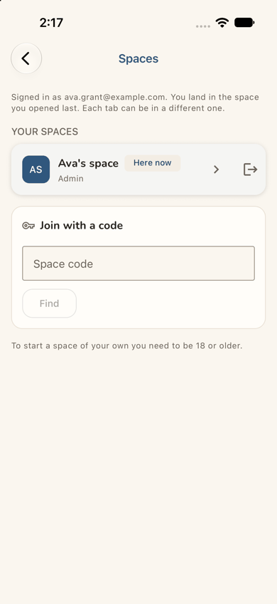
- **Step 23, her board.** "Today's Daily · G3D", then "YOUR GRADE" with a pink 1 selected and "Quick 5 · Grade 1". The
  nearest thing to her level (Math 1) comes later, next to Kindergarten (step 24). For a 16-year-old competition fan
  this says "for little kids" before she has played once.
  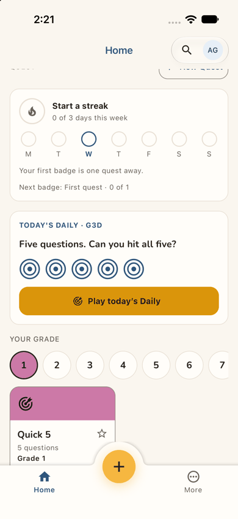
- **Step 29, the first question.** "A right triangle has legs 6 and 8 and hypotenuse 10… What is tan A?", typeset, in an
  AoPS Geometry game. This is what she came for, and it is her strongest reason to come back. She reached it only
  through the New Quest wizard.
  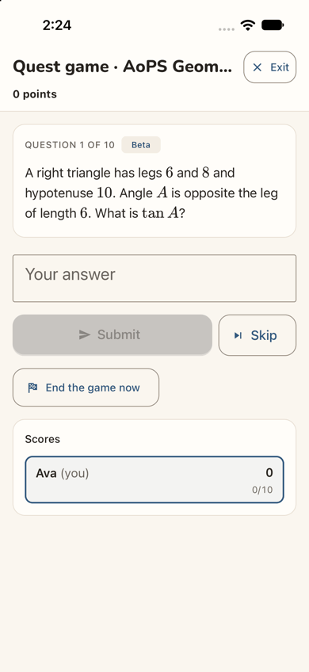

**Contact sheet** (all 32 phone steps):

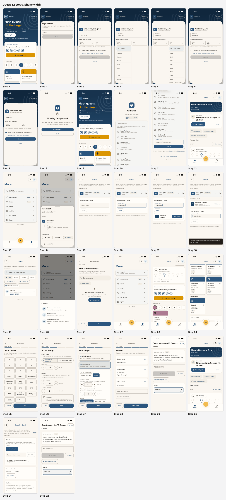

**Web and app.** Compared with the web journey J04 (`J04-teen.md`, Theo Brooks), the app differs in eight ways:

- **The sign-up form.** It has a type-to-search year list ("Showing 8 of 100. Type to narrow it down."), where the web
  has a long select. The month list also carries a search box, for twelve months. The copy is the same, down to "play
  with your family" and "Only whether you are over 18 is kept".
- **A full-screen wait.** "Waiting for approval" fills the screen, without the web's leftover "Almost there" heading. It
  has two buttons, "Contact us" (filled) and "Back", where the web has "Contact us" alone.
- **"Sign in" opens a sign-in screen.** In this build that is the developer sign-in, not the "Sign up free" sheet of the
  web's sev2. Production's provider screen was not seen.
- **Where spaces live.** The app has no drawer with a space switcher. More has no spaces entry (step 13), and her
  initials open an account sheet whose "All spaces" reads "Invitations, codes, starting or leaving a space" (step 14).
  The Spaces page itself is the web's, including "Each tab can be in a different one."
- **The code.** The match shows the full name "Riverside Tutoring" on two lines, where the web phone cut it to
  "Riverside Tutori…". The toast and "Requests sent" are the same.
- **Adding people.** The Users page has no "Add user" (step 19). Adding is the yellow (+) in the tab bar: "Add a
  student" asks first for the student's billed family (step 21). The web let Theo fill the whole Add user form and then
  refused him with a toast. In the app the refusal was not reached, because Ava stopped at the family step.
- **The home and the wizard.** The board's Daily is labelled by its code, "G3D" (Grade 3), above a grade row on Grade 1.
  On the web, the board's Daily said Grade 1 and Next up pointed to Grade 3. The wizard has the same four steps and
  the same Multiplayer default, but its Next button looks active before a level is chosen. The game's header reads
  "Quest game · AoPS Geom…", cut off, where the web phone said "Game".
- **Coming back to a game.** After the app is closed and reopened, her home shows no "Continue". The game is found only
  under More > Quest, and it resumes on the same question. On the web, a reload kept the question on screen.

| Severity | Count |
| --- | --- |
| sev4 (catastrophe) | 0 |
| sev3 (major) | 0 |
| sev2 (minor) | 6 |
| sev1 (cosmetic) | 4 |
| **Total** | **10** |

## Prioritized fixes

1. [sev2] [The approval is silent and the app reopens on the same guest home](#sev2-the-approval-is-silent-and-the-app-reopens-on-the-same-guest-home): say on the waiting screen who decides, how long and how she hears; make "Keep playing" the main button; show "You're in" on the next launch (steps 8-10).
2. [sev2] [Start a space is promised in the account sheet and refused by a grey footnote](#sev2-start-a-space-is-promised-in-the-account-sheet-and-refused-by-a-grey-footnote): word "All spaces" for a teen, and turn the footnote into a card with the club route (steps 13-15).
3. [sev2] [A teen is offered Add a student and asked for a family who is billed](#sev2-a-teen-is-offered-add-a-student-and-asked-for-a-family-who-is-billed): hide Add a student, Add someone else and the tutor sections from a 13-17 account's personal space (steps 19-22, 31).
4. [sev2] [The home leads a 16-year-old with Grade 1 and a Grade 3 Daily](#sev2-the-home-leads-a-16-year-old-with-grade-1-and-a-grade-3-daily): ask a newcomer's level once and lead the board with it (steps 12, 23, 24).
5. [sev2] [After a relaunch the quest she started is not on her home](#sev2-after-a-relaunch-the-quest-she-started-is-not-on-her-home): put the open game on her home, in Next up or as "Continue" (steps 30-32).
6. [sev2] [The guest home and sign-up speak only to families and young children](#sev2-the-guest-home-and-sign-up-speak-only-to-families-and-young-children): add a line and a level row for teens and competitions (steps 1-2, 9).
7. [sev1] [Solo practice takes four wizard steps with Multiplayer preselected](#sev1-solo-practice-takes-four-wizard-steps-with-multiplayer-preselected): preselect Single player, or let a level start a solo game at once (steps 25-28).
8. [sev1] [The join request says nothing of when or how she will hear](#sev1-the-join-request-says-nothing-of-when-or-how-she-will-hear): say how she will be told (steps 17-18).
9. [sev1] [The age form talks about 18 and its year list starts at 2026](#sev1-the-age-form-talks-about-18-and-its-year-list-starts-at-2026): word the note for every age band; open the year list near a likely year (steps 3-6).
10. [sev1] [Web words codes and cut titles on phone screens](#sev1-web-words-codes-and-cut-titles-on-phone-screens): drop "tab" and "portal", name levels in words, let the game title wrap (steps 15, 21, 23, 29).

## Findings

### [sev2] The approval is silent and the app reopens on the same guest home

- **Issue Description:** After Continue (step 8) the app replaces everything with a full screen: the logo, a clock,
  "Waiting for approval" and "Thanks, Ava. Your access is waiting for approval. You can sign in once it's approved." It
  does not say who approves, how long it usually takes, or whether she will be told. The filled, most prominent button
  is "Contact us"; the only other is "Back". Nothing offers to let her play while she waits. When she reopens the app "a
  day later" (step 9), the guest home is exactly as on step 1: "Sign up free" is still its main button, and nothing says
  her account exists or has been approved. She has to think of the small "Sign in" at the top right by herself (step 10).
- **Framework Violation:** cuj-contract, step 8 (expected: told that access waits, and what happens next; observed:
  told only that it waits) and step 9 (expected: some sign that the account is ready; observed: none); Nielsen #1
  Visibility of system status; Nielsen #3 User control and freedom (no way to keep playing from the wait).
- **Severity:** 2. Classify: real friction at the journey's main conversion point. A teen who signed up on impulse is
  left with an open-ended wait and nothing that brings her back on the day she is approved. It is rated 2, as on the web
  (J04), because when she does return the path in is short (steps 10-12). J01A rated the same screen 3 because its Back
  also dropped a quest in progress; Ava had not played, so that part does not apply here.
- **Evidence:** 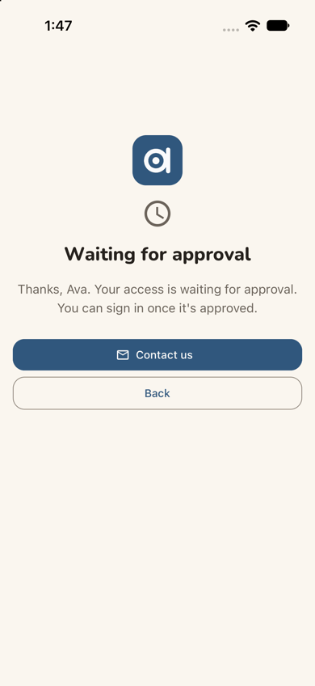 
  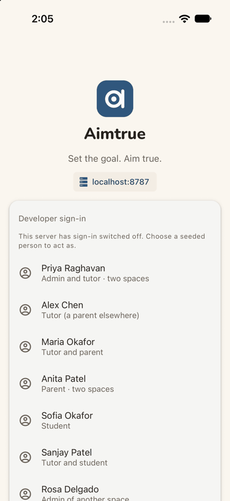
  Repro: sign-up access Post-approved. Fresh install; "Sign up free" on the guest home; fill the sheet and tap Continue:
  "Waiting for approval". Approve the account in the console, then close and reopen the app: the guest home, unchanged.
- **Recommended Fix:**
  - Waiting screen: add what happens next, for example "We check new accounts by hand, usually within a day. We'll
    email ava.grant@… when you're in." Make "Keep playing" the filled button, back to the guest home's tiles, and make
    "Contact us" a text link.
  - Send the approval email from the production pair, where email is set up.
  - On the next launch after a sign-up on this device, lead the guest home with "Welcome back, Ava: sign in" in place of
    "Sign up free".

### [sev2] Start a space is promised in the account sheet and refused by a grey footnote

- **Issue Description:** Ava looks for a way to start her club's space. More lists Search, Assessment, Quest, Users,
  Activity, My profile and Space, with no spaces entry (step 13). Her initials open an account sheet whose "All spaces"
  reads "Invitations, codes, starting or leaving a space" (step 14). The Spaces page it opens has no Start a space: only
  a line of small grey text at the bottom, "To start a space of your own you need to be 18 or older." (step 15). The line
  has no button and no alternative. It does not say that an adult (a teacher, a parent, the club's sponsor) can start
  the space and share its code, though the "Join with a code" box right above it is exactly how she would then join.
- **Framework Violation:** cuj-contract, steps 13-15 (expected for a teen: a refusal that says what she can do instead;
  observed: a promise, then a refusal only); Nielsen #4 Consistency and standards (the sheet promises what the page
  refuses); Nielsen #9 Help users recognize, diagnose, and recover from errors.
- **Severity:** 2. Classify: the refusal is expected and correct (a pass for this journey), but it ends her club goal
  with no next step. That is a lost conversion for exactly the people who would bring a group in. Not a 3: no end state
  is wrong.
- **Evidence:** 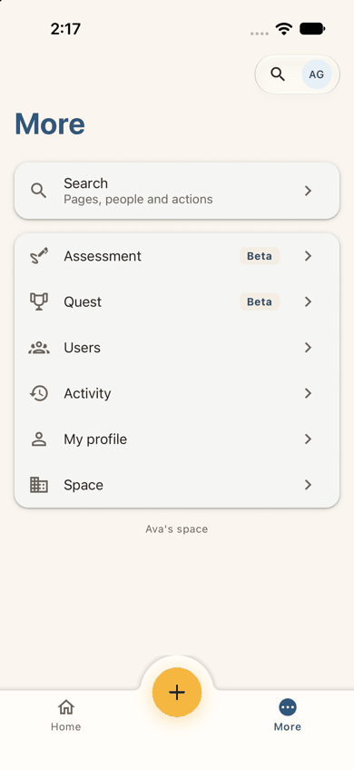 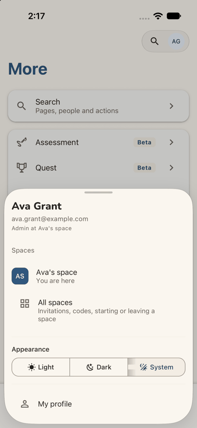
  
  Repro: as an approved 13-17 account in the app, tap the initials at the top right, then "All spaces".
- **Recommended Fix:**
  - For a 13-17 account, word the sheet's line "Invitations, codes and leaving a space".
  - Turn the footnote into a small card: "Running a club? A space is started by an adult. Ask your teacher or a parent
    to start one, then join it with its code above." Add "Share this with an adult" (the share sheet), as the guest
    page's "Under 13? Ask a grown-up" does.

### [sev2] A teen is offered Add a student and asked for a family who is billed

- **Issue Description:** In her personal space Ava is "Admin at Ava's space" (step 14). Looking for a way to bring club
  members into her own space, she opens More > Users: it lists only her, with role and status filters, and no Add button
  (step 19). The yellow (+) in the tab bar opens "Create": Start an assessment, Add a student ("With their parent or
  guardian.") and Add someone else ("A parent, an admin, or several roles at once.") (step 20). Nothing says a 13-17
  account cannot add people. "Add a student" opens a four-step flow whose first question is "Who is their family? The
  parent or guardian who is billed and kept informed." with "No parents in the portal yet." (step 21). A club member's
  billed parent is not something she has, so she cancels (step 22). The same tutor-shaped furniture appears on More >
  Quest: "Tutors check each answer…", "Answers to review" and "Students: Set where each student starts" (step 31).
- **Framework Violation:** cuj-contract, steps 19-22 (expected, for the persona: a way to add club members, or a clear
  "not for you" before the effort; observed: offered, then asked for a billed family); Nielsen #5 Error prevention;
  Nielsen #8 Aesthetic and minimalist design (tools she cannot use are on her tab bar and pages); Nielsen #2 Match
  between system and the real world ("billed" in a personal practice space).
- **Severity:** 2. Classify: a dead end with real friction. Nothing is saved and Cancel works. The refusal the web
  showed (a toast after the whole form) was not reached here. But the app offers a 16-year-old three create actions on
  its most prominent button, and the one that fits her goal leads to a question about billing.
- **Evidence:** 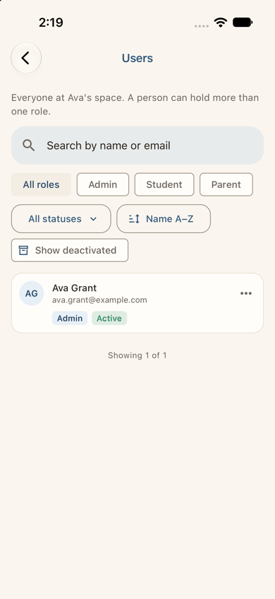 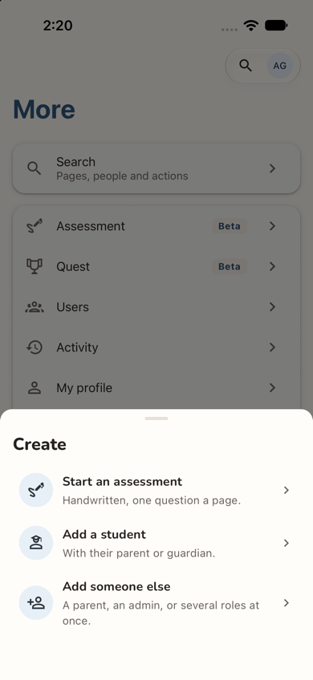
  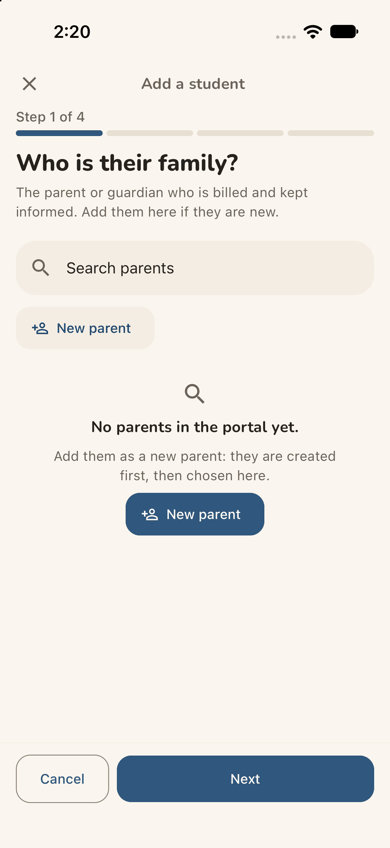 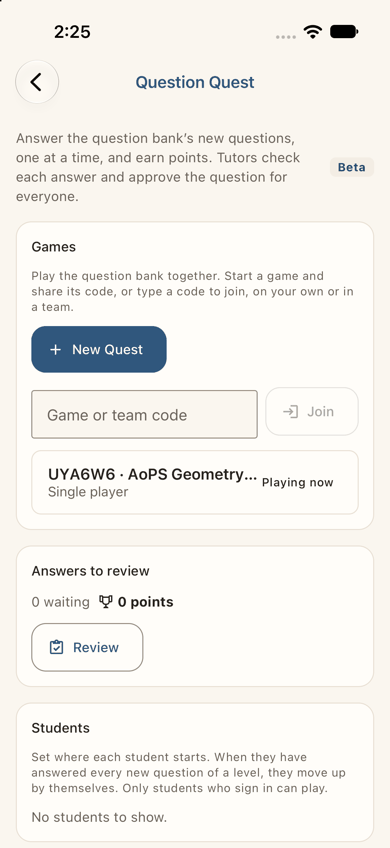
  Repro: as an approved 13-17 account in her personal space, tap the yellow (+), then "Add a student".
- **Recommended Fix:**
  - In a 13-17 account's personal space, leave Add a student and Add someone else out of Create, and keep "Start an
    assessment" for herself (the "Show your work" for oneself that a personal space allows).
  - Hide Users, and Question Quest's "Answers to review" and "Students", where she is the only member.
  - Don't label her "Admin" of a space of one: "Just you" or "Personal" says what it is.

### [sev2] The home leads a 16-year-old with Grade 1 and a Grade 3 Daily

- **Issue Description:** Her first home (step 12) offers Next up "Today's 5" and the quick actions. Scrolling (step 23)
  shows "TODAY'S DAILY · G3D", then "YOUR GRADE" with a pink 1 selected and a "Quick 5 · Grade 1" tile. Further down
  (step 24) come Math 1's tiles and then "Kindergarten". The levels that fit a 16-year-old competition fan (Math 2, AoPS
  Prealgebra, Algebra and Geometry) appear only inside the New Quest wizard (step 25). The board's Daily (Grade 3, named
  by its code) and its grade row (Grade 1) disagree, and neither is hers. Her birth year is known from the sign-up, but
  nothing asks her grade or level.
- **Framework Violation:** cuj-contract, steps 12 and 23-24 (expected: a home that leads with something at her level;
  observed: Grade 1 and Grade 3 first, her levels only in the wizard); Nielsen #2 Match between system and the real
  world; Nielsen #4 Consistency and standards (two levels on one board).
- **Severity:** 2. Classify: an observable mismatch with real friction for stickiness. For this cohort the first board
  is the product's promise, and "Grade 1" tells a teen it is not for her. The workaround is New Quest (step 25), so it
  is not a 3.
- **Evidence:**  
  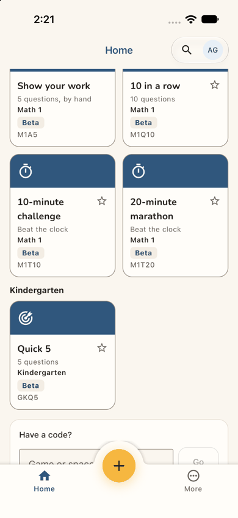
  Repro: sign up in the app as a new account born in 2010 without playing as a guest first, get approved, sign in, and
  scroll the home.
- **Recommended Fix:**
  - Ask once, on the first home of a personal space with no guest history: "What are you working on?" Offer grade chips,
    plus Math 1 or 2 and AoPS or competitions. Store it as the lead level that the guest's grade already feeds.
  - Until she answers, lead the grade row with a level near her age band (13-17: Grade 8 or Math 1), not Grade 1.
  - Make the Daily and the grade row the same level, and name it in words.

### [sev2] After a relaunch the quest she started is not on her home

- **Issue Description:** Ava closes the app with question 1 of her AoPS Geometry game on screen and opens it again (step
  30). She is still signed in, but her home is exactly as on step 12. It has no "Continue", and Next up still offers
  "Today's 5". Nothing says a game is open. She finds it only under More > Quest, as a row "UYA6W6 · AoPS Geometry… ·
  Single player · Playing now" (step 31), on a page titled "Question Quest" that talks about tutors. Tapping the row
  resumes the same game on the same question (step 32), so the game itself is kept.
- **Framework Violation:** cuj-contract, steps 30-32 (success-criteria: the started quest should be reachable from where
  she lands; observed: only two levels down); Nielsen #6 Recognition rather than recall.
- **Severity:** 2. Classify: real friction for a returning player. The game is not lost, but the place she lands does
  not show it, and the path to it runs through a tutor-oriented page. Not a 3: More > Quest works.
- **Evidence:** 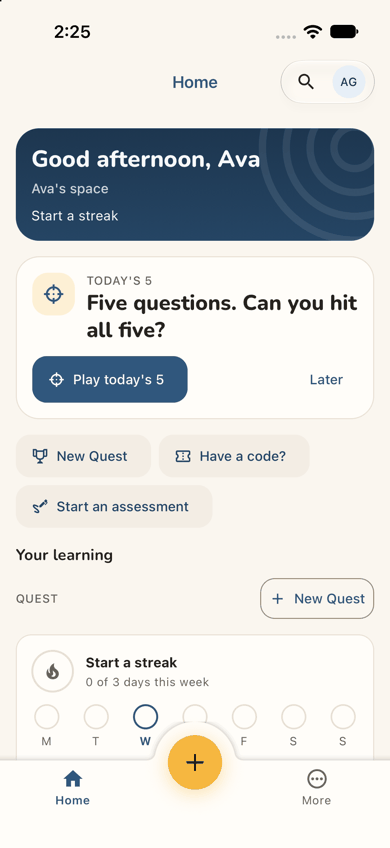 
  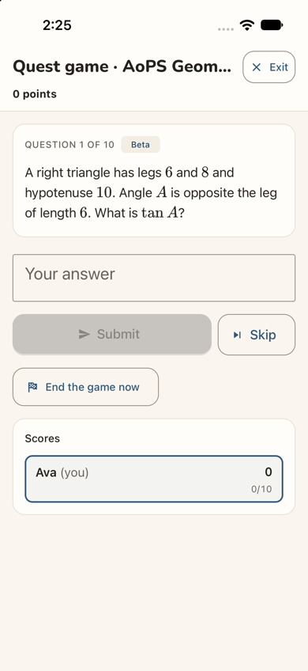
  Repro: start a single-player game from New Quest, close the app at question 1, reopen it.
- **Recommended Fix:** Make an open game of hers a Next up item ("Continue AoPS Geometry, question 1 of 10"), above
  Today's 5. Have the Quest board's "Continue" resume an open game, whether it was started from a tile or from New Quest.

### [sev2] The guest home and sign-up speak only to families and young children

- **Issue Description:** The guest home (steps 1 and 9) promises "Grades 1–8", preselects Grade 4, and its grade row
  shows 1 to 7. The sign-up sheet says "Keep your scores, unlock every quest and play with your family." (step 2).
  Nothing in view names high-school courses, competitions (AoPS, Beast Academy, Kangaroo), friends or clubs. A
  16-year-old has to look past the copy to believe the app is for her.
- **Framework Violation:** cuj-contract, steps 1-2 (expected: a reason for this persona to sign up; observed: copy aimed
  at parents and young children); Nielsen #2 Match between system and the real world.
- **Severity:** 2. Classify: real friction at the first impression, the conversion point for the 13-17 band. Ava signs up
  anyway, because "Save your scores and unlock every quest" is enough, but a less motivated teen would not. No
  workaround is needed. The same rating as the web (J04).
- **Evidence:** 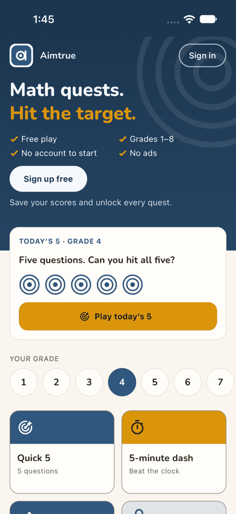 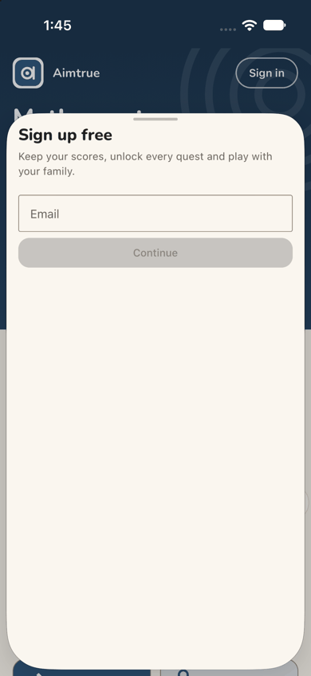
  Repro: fresh install, open the app.
- **Recommended Fix:** Add a tick for teens ("Grades 1–8, Math 1–2 and competition prep"). Name the advanced tracks in
  words. Let the grade row reach "Math 1+". Word the sheet for everyone: "play with friends and family".

### [sev1] Solo practice takes four wizard steps with Multiplayer preselected

- **Issue Description:** To play one level on her own, Ava goes through Select level, Score Setup, Who plays? and Ready?
  (steps 25-28): 7 taps after New Quest. On "Who plays?" Multiplayer is already selected, with teams of 4 and 10 teams,
  although Single player says "It starts straight away." (step 27). On the first step, Next looks active before any
  level is chosen (step 25); what it does then was not tried.
- **Framework Violation:** cuj-contract, steps 25-28; Nielsen #7 Flexibility and efficiency of use (no shortcut for the
  common solo case).
- **Severity:** 1. Classify: cosmetic friction. Each screen is clear, the defaults are sensible, and she reaches the
  question. A shorter path matters most for a returning player.
- **Evidence:** 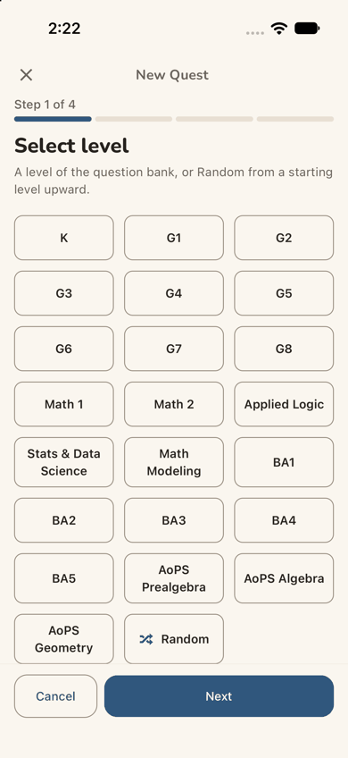 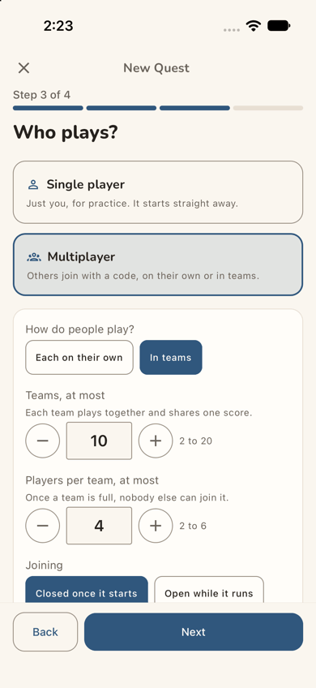
  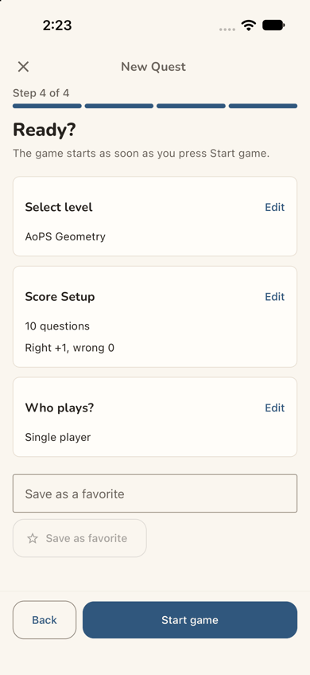
  Repro: home > New Quest > a level > Next > Next.
- **Recommended Fix:** Preselect Single player. Offer "Play solo now" on Select level once a level is chosen, with the
  default scoring, and keep the full wizard for multiplayer. Show Next as inactive until a level is chosen, as the web
  does.

### [sev1] The join request says nothing of when or how she will hear

- **Issue Description:** After Find, the match shows a teal "R" and "Riverside Tutoring" (step 17), with nothing else to
  confirm that it is her school club. After "Ask to join", a toast and a new "Requests sent" row say "Asked just now. Its
  administrators will let you in." (step 18). Neither says when, or whether she will be told. As a teen, she is not told
  whether a parent has to be involved.
- **Framework Violation:** cuj-contract, steps 17-18; Nielsen #1 Visibility of system status.
- **Severity:** 1. Classify: small but real uncertainty. The request itself works, and she can withdraw it.
- **Evidence:** 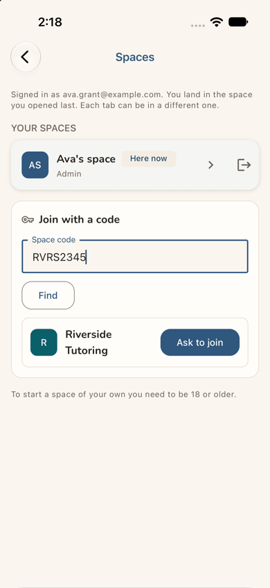 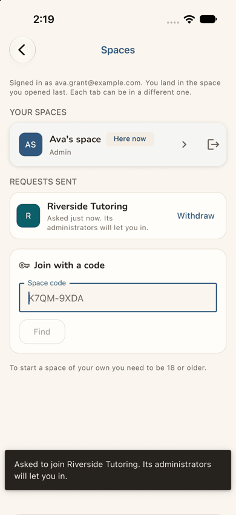
  Repro: Spaces > Space code `RVRS2345` > Find > Ask to join.
- **Recommended Fix:** After asking, say "You'll see it here and on your home when they let you in" and, where email is
  on, "and we'll email you". Add one identifying detail to the match (the space's town or its admin's first name, if
  shareable).

### [sev1] The age form talks about 18 and its year list starts at 2026

- **Issue Description:** "Only whether you are over 18 is kept, never the date." (step 3) is the only age note a
  16-year-old sees. It makes her wonder whether being under 18 is a problem, and it does not say what a 13-17 account
  can or cannot do. The Month list opens with a "Search" box above twelve months (step 4). The Year list opens at 2026,
  a newborn's year (step 5); its "Type a year" search box gets her to 2010 quickly (step 6).
- **Framework Violation:** cuj-contract, steps 3-6; Nielsen #2 Match between system and the real world; Nielsen #8
  Aesthetic and minimalist design (a search box for twelve items).
- **Severity:** 1. Classify: cosmetic friction. She completes the form in seconds.
- **Evidence:** 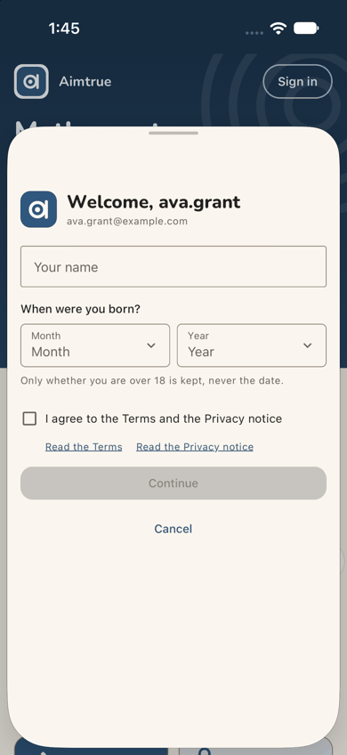 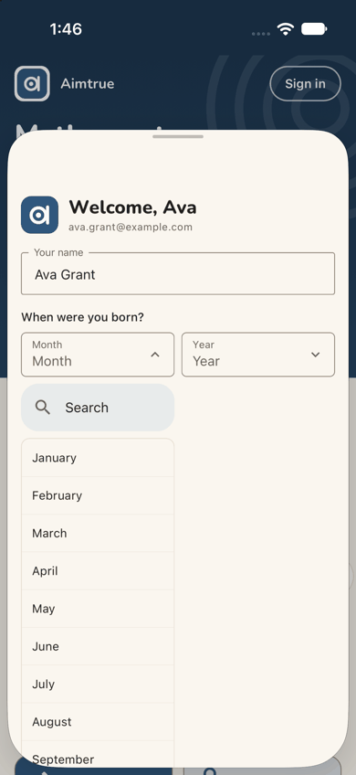
  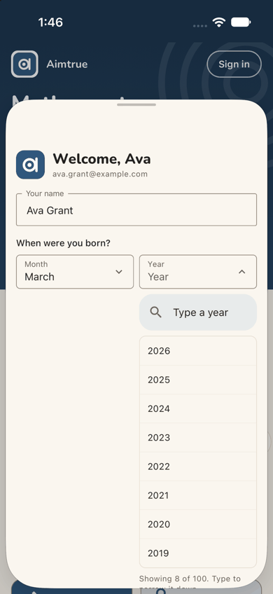
  Repro: sign up as a new account in the app and open Month, then Year.
- **Recommended Fix:** Reword the note as "We keep only your age band, never the date", which is true for every band.
  Drop the month list's search box. Start the year list at the youngest year allowed (13 years ago).

### [sev1] Web words codes and cut titles on phone screens

- **Issue Description:** A few lines read like the web, or like codes, on a phone:
  - the Spaces page says "Each tab can be in a different one." (step 15); a phone app has no tabs in that sense;
  - "No parents in the portal yet." (step 21), where the product calls itself a space;
  - "TODAY'S DAILY · G3D" names the Daily by its code (step 23), and tiles carry codes such as "M1Q10" (step 24);
  - the game's header is cut to "Quest game · AoPS Geom…" (step 29).
- **Framework Violation:** cuj-contract, steps 15, 21, 23-24 and 29; Nielsen #2 Match between system and the real
  world; Nielsen #4 Consistency and standards.
- **Severity:** 1. Classify: cosmetic. Each screen is still understood, but together they make the app feel like a
  port.
- **Evidence:**  
   
  Repro: as above, steps 15, 21, 23 and 29.
- **Recommended Fix:** In the app, drop the "tab" sentence, and say "space" for "portal". Name the Daily by its level
  ("Today's Daily · Grade 3"), and keep codes out of the main text. Let the game header wrap to two lines, or show the
  level under it.

## Walkthrough

### Step 1 — Open the app for the first time (landing)

> Expected: the guest home and a way to sign up. Observed: match. The band reads "Math quests. Hit the target." with
> Free play, Grades 1–8, No account to start and No ads, then a white "Sign up free" and "Save your scores and unlock
> every quest.", with "Sign in" at the top right. Below are "Today's 5 · Grade 4", the grade row (1 to 7 in view, 4
> selected) and the first tiles. Dark mode is readable.

**What Ava notices:** everything is pitched at grades 1-8. Nothing speaks to a 16-year-old, to competitions or to a club,
but "Save your scores" is reason enough to tap Sign up free.

### Step 2 — Tap "Sign up free"

> Expected: a sign-up screen. Observed: match. A sheet rises over the guest home: "Sign up free: Keep your scores, unlock
> every quest and play with your family.", an Email field and an inactive Continue. This is the developer sign-up (see
> the Appendix). Most of the sheet is empty.

**What Ava notices:** one field and one button. The copy says "family" again, not friends or a club.

### Step 3 — Type the address, tap Continue

> Expected: a short form about her. Observed: match. "Welcome, ava.grant" with the address, then Your name, "When were
> you born?" (Month, Year), "Only whether you are over 18 is kept, never the date.", the terms box with "Read the Terms"
> and "Read the Privacy notice", an inactive Continue and Cancel.

**What Ava notices:** a short form. The note about being over 18 makes her wonder whether 16 is a problem.

### Step 4 — Type her name, open Month

> Expected: the month list. Observed: match. The greeting becomes "Welcome, Ava". The Month list opens under the field
> with a "Search" box, then January to September in view.

**What Ava notices:** a search box for twelve months. March is in view anyway.

### Step 5 — Pick March, open Year

> Expected: the year list. Observed: match. Month reads March. The Year list opens at 2026 (2026 to 2019 in view) with a
> "Type a year" box and "Showing 8 of 100. Type to narrow it down.", cut by the sheet's edge.

**What Ava notices:** the list starts at a baby's year; the search box is the quick way.

### Step 6 — Type 2010 in the year search and pick it
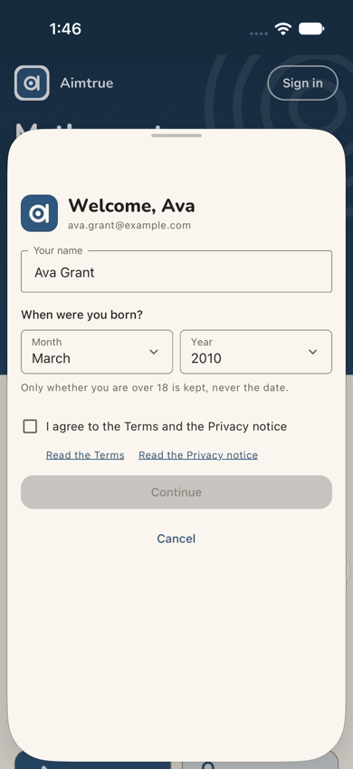
> Expected: March 2010 set. Observed: match. Month March, Year 2010. The over-18 note is still the only line about age.

**What Ava notices:** quick. Nothing says what a 16-year-old's account can do.

### Step 7 — Tick "I agree to the Terms and the Privacy notice"
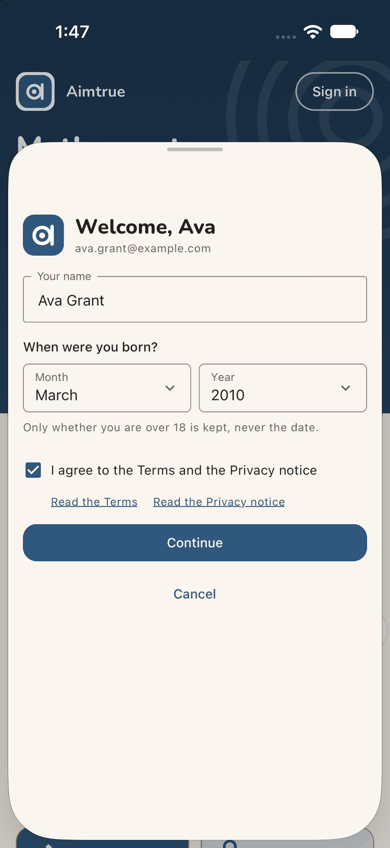
> Expected: Continue becomes active. Observed: match. The box is ticked and Continue turns dark blue.

**What Ava notices:** nothing asks for a parent. The button lighting up tells her the tick was the missing piece.

### Step 8 — Tap Continue (landing)

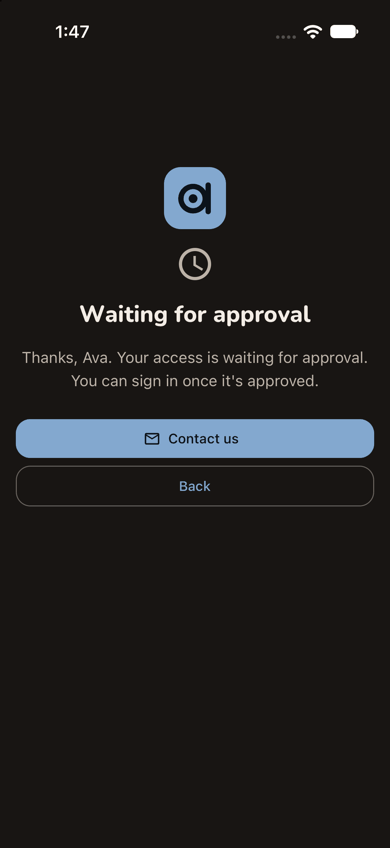
> Expected: under Post-approved access, "Waiting for approval". Observed: match. A full screen: the logo, a clock,
> "Waiting for approval" and "Thanks, Ava. Your access is waiting for approval. You can sign in once it's approved.",
> then "Contact us" (filled) and "Back". Dark mode is readable. That is the end of day 1.

**What Ava notices:** a clean message, but no idea how long it takes, who decides, or whether she will be told. The big
button asks her to write an email.

### Step 9 — A day later: open the app again (landing)

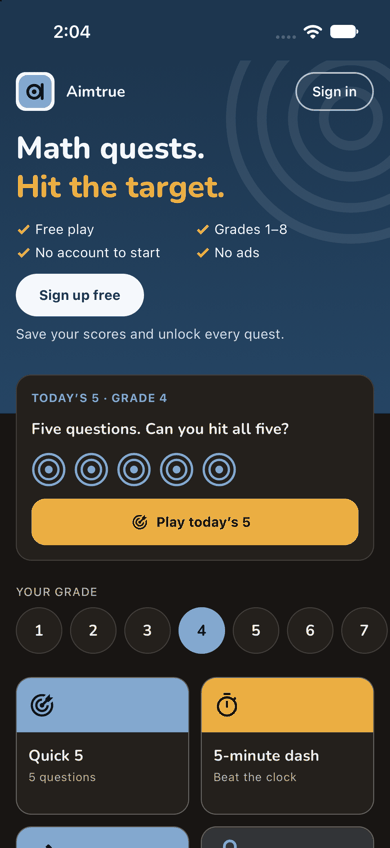
> Expected: a way back in, ideally a sign that she is approved. Observed: the app reopens on the guest home, identical to
> step 1, with "Sign up free" as its main button and "Sign in" at the top right. Nothing mentions her account.

**What Ava notices:** nothing says "you're in". She guesses that "Sign in" is the way back.

### Step 10 — Tap "Sign in"

> Expected: a sign-in screen. Observed: match. A full-screen sign-in: the logo, "Aimtrue", "Set the goal. Aim true.", and
> in this build the developer sign-in (a list of seeded people; see the Appendix).

**What Ava notices:** a sign-in screen, not another sign-up sheet. (The production provider buttons were not seen.)

### Step 11 — Scroll to "Another email" and type her address
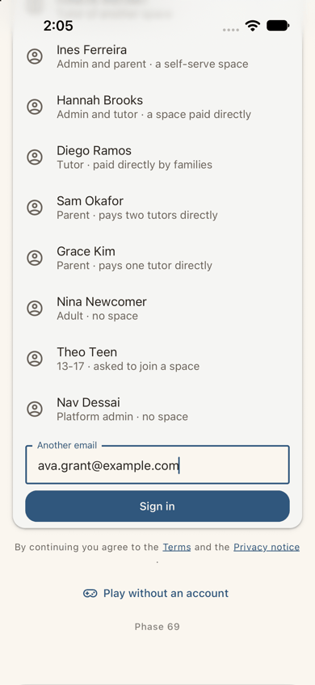
> Expected: a place for her address. Observed: match. Her address is in the "Another email" field, above Sign in, the
> legal line and "Play without an account".

**What Ava notices:** developer screen only; in production this is one provider tap.

### Step 12 — Tap Sign in (landing)

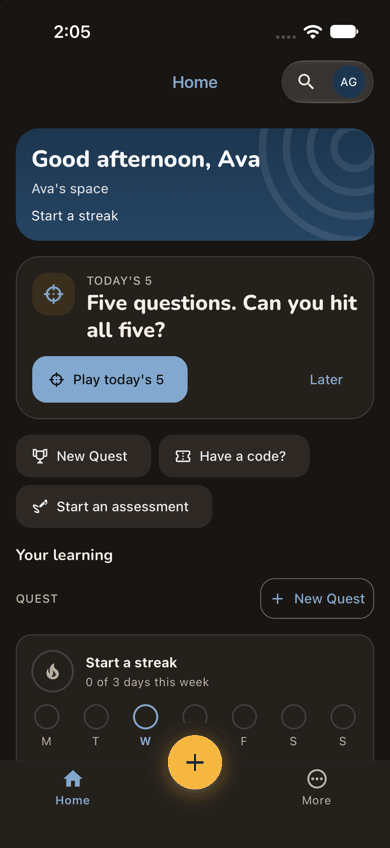
> Expected: approved, signed in, a home. Observed: match. Within a second or two, "Good afternoon, Ava / Ava's space /
> Start a streak". Next up "TODAY'S 5: Five questions. Can you hit all five?" with "Play today's 5" and Later. Quick
> actions New Quest, Have a code? and Start an assessment. "Your learning" > QUEST with "+ New Quest", then "Start a
> streak · 0 of 3 days this week". The tab bar has Home, a yellow (+) and More. Dark mode is readable.

**What Ava notices:** a friendly greeting and "Ava's space", a space she never asked for. Nothing yet at her level, and
no word that she was approved.

### Step 13 — Open More, looking for a way to start her club's space

> Expected (Ava): a "Start a space" or a list of spaces. Observed: More lists Search, Assessment (Beta), Quest (Beta),
> Users, Activity, My profile and Space, with "Ava's space" under them. No Start a space.

**What Ava notices:** "Space" might be it, but it sounds like settings for this one.

### Step 14 — Tap her initials at the top right

> Expected: her account and her spaces. Observed: a sheet: "Ava Grant", her address, "Admin at Ava's space"; Spaces: "Ava's
> space · You are here" and "All spaces · Invitations, codes, starting or leaving a space"; Appearance; My profile.

**What Ava notices:** "starting… a space". That is what she wants.

### Step 15 — Tap "All spaces" (landing)

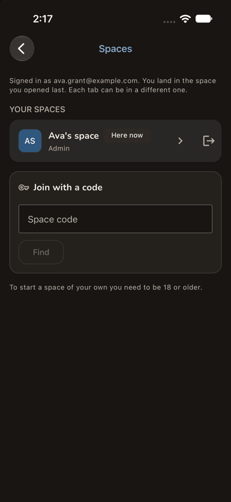
> Expected: for a teen, Start a space refused. Observed: match. The Spaces page: "Signed in as ava.grant@example.com.
> You land in the space you opened last. Each tab can be in a different one." YOUR SPACES shows "Ava's space · Here now ·
> Admin" with a leave icon. Below are "Join with a code" (Space code, Find) and, in small grey text, "To start a space of
> your own you need to be 18 or older." No button, no alternative. Dark mode is readable.

**What Ava notices:** the sheet promised starting a space; the page says no in a footnote, with nothing about what she
can do for her club.

### Step 16 — Type her school club's code, RVRS2345
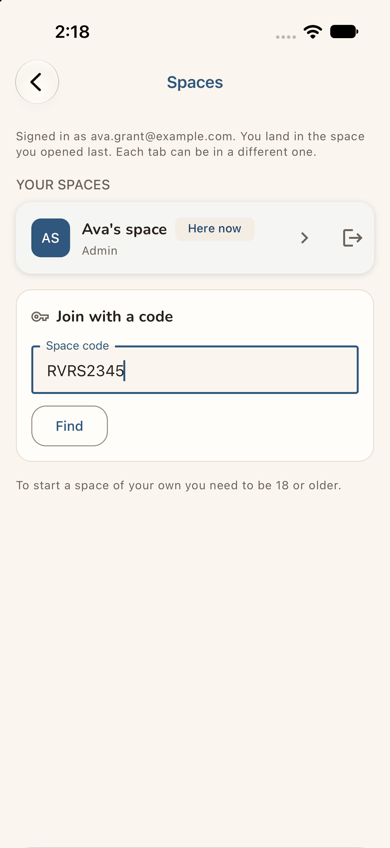
> Expected: the code box takes it. Observed: match. RVRS2345 is in the field and Find becomes active.

**What Ava notices:** a clear box with a clear button.

### Step 17 — Tap Find

> Expected: the club's space. Observed: match. A row with a teal "R", "Riverside Tutoring" over two lines, and a filled
> "Ask to join".

**What Ava notices:** "Riverside Tutoring" is a tutoring business, not obviously her school club, and nothing else on the
row confirms it.

### Step 18 — Tap "Ask to join" (landing)

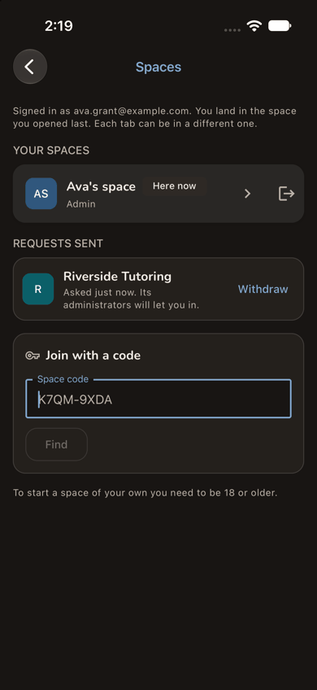
> Expected: a teen may ask to join. Observed: match. A toast, "Asked to join Riverside Tutoring. Its administrators will
> let you in.", and a new REQUESTS SENT row with the same words and Withdraw. The code box is cleared, with "K7QM-9XDA" as
> its example. The request was left pending (not waited out).

**What Ava notices:** it worked, and teens may ask. But this is a second wait with no "when" and no "we'll tell you".

### Step 19 — Wrong turn: back, More > Users, to add club members to her own space

> Expected (Ava): since she is Admin, perhaps she can add her club here. Observed: "Users: Everyone at Ava's space. A
> person can hold more than one role.", a search, role chips (All roles, Admin, Student, Parent), status and sort, and one
> card, Ava Grant (Admin, Active). "Showing 1 of 1". There is no Add button on the page.

**What Ava notices:** a staff directory of one, and no way to add anyone from it.

### Step 20 — Back, tap the yellow (+) in the tab bar

> Expected (Ava): a way to add people. Observed: a "Create" sheet: Start an assessment ("Handwritten, one question a
> page."), Add a student ("With their parent or guardian.") and Add someone else ("A parent, an admin, or several roles
> at once."). Nothing says a teen cannot use them.

**What Ava notices:** "Add a student" looks like the way to add a club member.

### Step 21 — Tap "Add a student"

> Expected: either a way to add a club member, or a clear "not for you". Observed: a full-screen "Add a student", Step 1
> of 4: "Who is their family? The parent or guardian who is billed and kept informed. Add them here if they are new.",
> Search parents, New parent, "No parents in the portal yet.", then Cancel and Next.

**What Ava notices:** billing and parents. This is a tutoring business's form, not a club's.

### Step 22 — Tap Cancel
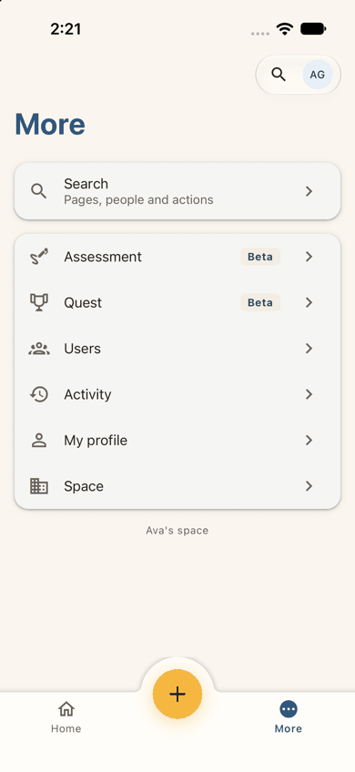
> Expected: back where she was. Observed: match. More, as at step 13. Nothing was saved and nothing explains why her club
> cannot be added. Dead end 1.

**What Ava notices:** she gives up on bringing the club in and goes to play.

### Step 23 — Home, scroll the board looking for her level

> Expected (Ava): something at her level. Observed: the streak card ("Your first badge is one quest away."), "TODAY'S DAILY
> · G3D" with five rings and "Play today's Daily", then YOUR GRADE with a pink 1 selected and "Quick 5 · Grade 1".

**What Ava notices:** a Grade 3 Daily above a Grade 1 board. Neither is hers.

### Step 24 — Scroll on

> Expected (Ava): her level further down. Observed: Math 1 tiles (Show your work, 10 in a row, 10-minute challenge,
> 20-minute marathon, each "Math 1", Beta and a code such as M1Q10), then "Kindergarten · Quick 5", then a "Have a code?"
> box. What the two swipes passed between steps 23 and 24 was not captured.

**What Ava notices:** Math 1 is the closest thing to her, and it sits beside Kindergarten.

### Step 25 — Scroll back up, tap "New Quest" (landing)

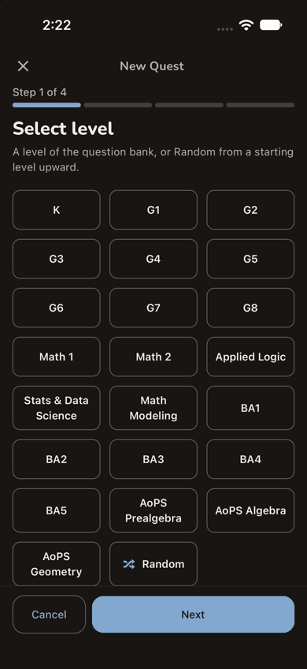
> Expected: a way to choose her own level. Observed: match. A full-screen "New Quest", Step 1 of 4, "Select level: A
> level of the question bank, or Random from a starting level upward." with K, G1-G8, Math 1, Math 2, Applied Logic,
> Stats & Data Science, Math Modeling, BA1-BA5, AoPS Prealgebra, AoPS Algebra, AoPS Geometry and Random. Next looks active
> before a level is chosen. Dark mode is readable.

**What Ava notices:** at last, AoPS Geometry and Math 2, levels the home never showed.

### Step 26 — Tap AoPS Geometry, then Next
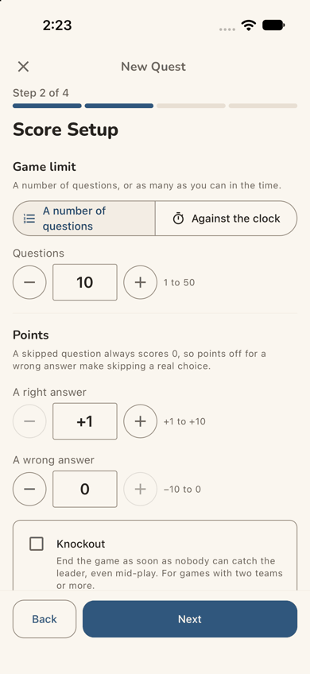
> Expected: the next step. Observed: Step 2 of 4, "Score Setup": A number of questions (10, 1 to 50) or Against the clock;
> points for a right answer (+1) and a wrong one (0), with "A skipped question always scores 0, so points off for a
> wrong answer make skipping a real choice."; Knockout ("For games with two teams or more"). Back and Next.

**What Ava notices:** negative marking, as in competitions. She keeps the defaults.

### Step 27 — Tap Next

> Expected: choose solo play. Observed: Step 3 of 4, "Who plays?": Single player ("Just you, for practice. It starts
> straight away.") and Multiplayer ("Others join with a code, on their own or in teams."), which is preselected, in teams,
> 10 teams at most, 4 a team, joining closed once it starts.

**What Ava notices:** "Others join with a code" sounds like her club, but today she wants to practise alone.

### Step 28 — Tap Single player, then Next

> Expected: a summary and a start button. Observed: match. Step 4 of 4, "Ready? The game starts as soon as you press Start
> game." with AoPS Geometry; 10 questions, Right +1, wrong 0; Single player, each with Edit; an optional "Save as a
> favorite" name; Back and Start game.

**What Ava notices:** a clear summary. Four screens for a solo game feels long.

### Step 29 — Tap "Start game" (landing; the journey's end)

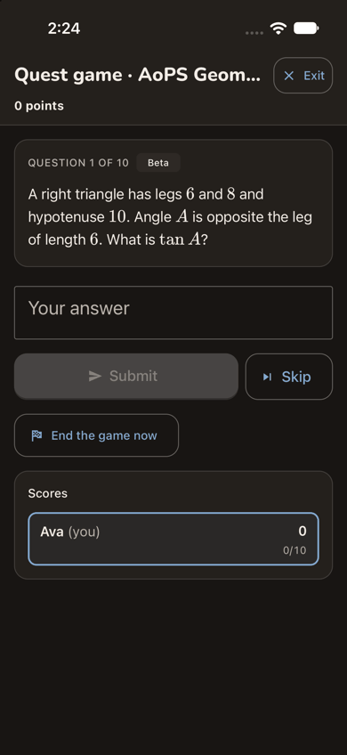
> Expected: the first question on screen. Observed: match. After a short countdown (passed inside the flow, not
> captured): "Quest game · AoPS Geom…", "0 points", Exit; "QUESTION 1 OF 10 · Beta: A right triangle has legs 6 and 8 and
> hypotenuse 10. Angle A is opposite the leg of length 6. What is tan A?", typeset; "Your answer", Submit (inactive),
> Skip, "End the game now", and Scores with "Ava (you) 0, 0/10". Dark mode is readable.

**What Ava notices:** a real geometry problem, properly typeset. This is what she came for.

### Step 30 — End-state check: close the app mid-quest and open it again

> Expected: still signed in, and a way back to the game. Observed: still signed in, on her home, identical to step 12:
> Next up "Today's 5", the quick actions, QUEST with "+ New Quest", the streak card. No "Continue" and no mention of the
> open game.

**What Ava notices:** where did her game go?

### Step 31 — End-state check: More > Quest

> Expected: her game somewhere. Observed: a "Question Quest" page (Beta): "Answer the question bank's new questions, one
> at a time, and earn points. Tutors check each answer and approve the question for everyone." Its Games card has New
> Quest, a game or team code box, and a row "UYA6W6 · AoPS Geometry… · Single player · Playing now". Below are "Answers to
> review" (0 waiting, 0 points, Review) and "Students: Set where each student starts… No students to show."

**What Ava notices:** her game is here, "Playing now", among sections for tutors.

### Step 32 — End-state check: tap the game

> Expected: the same game resumes. Observed: match. "Quest game · AoPS Geom…", QUESTION 1 OF 10, the same tan A question,
> and "Ava (you) 0, 0/10". The end state holds.

**What Ava notices:** good, nothing lost. But she would not have found it from her home.

## Appendix

- **Mode:** live. The iOS app, development build `com.aimtrue.app.dev`, on the iPhone 17 simulator (iOS 27.0), loading
  its bundle from Metro, against the local Worker at `http://localhost:8787` (the run's data and settings, sign-in off).
  Driven with Maestro, one small flow per step (`apps/mobile/.maestro/journeys/j04a-*.yaml`), each screen captured with
  `simctl` and resampled to 390 px wide. Dark mode at the landing steps (1, 8, 9, 12, 15, 18, 25, 29). Two stages on one
  device with no state cleared between them: steps 1-8, then the platform admin's approval, then steps 9-32 after a
  relaunch. One run of step 13's flow hung for ten minutes before any tap (Maestro's iOS driver found its port taken by
  another local process); it was stopped and run again. That is the harness, not the app.
- **Frameworks applied:** cuj-contract (every step against its expected result); task-completion (the journey ran to
  its defined end, a quest's first question in Ava's own space, step 29, with the space and code attempts recorded);
  success-criteria (the end state checked again after closing and reopening the app, steps 30-32).
- **CUJ manifest:** J04A, 32 steps, all verified: steps 1-29 are the journey and 30-32 the end-state check. Step 15
  (Start a space refused) and step 18 (a pending join request) are the outcomes this journey expects for a teen (passes).
  Steps 19-22 are a detour Ava tried, outside the shortest path. Observed and not matching expectation: step 9 (nothing
  about the approval) and step 30 (the open game not on her home).
- **Coverage / not inspected:**
  - The production sign-in and sign-up screens (Google, Microsoft, Facebook buttons): the local server ran with sign-in
    off, so the app showed its developer forms (steps 2-3, 10-11). Their wording ("Welcome, ava.grant", the seeded list,
    "Phase 69") is not what a stranger sees and was not judged.
  - The Terms and the Privacy notice: not opened. "Contact us" on the waiting screen: not tapped.
  - Whether Ava was told of the approval outside the app (an email); no mailbox was available.
  - Whether the app refuses a 13-17 account that adds a person, and where: "Add a student" was cancelled at its first
    step, and "Add someone else" was not opened. The web refused with a toast after the form (J04).
  - What Riverside Tutoring's admins see of Ava's request, and whether a 13-17 request is treated differently. The
    request was left pending in the local database, not withdrawn.
  - Whether club friends outside Ava's space could join a multiplayer quest she starts (Multiplayer was not tried).
  - What Next does on Select level before a level is chosen; the selected AoPS Geometry tile (passed inside step 26's
    flow, not captured); the countdown screen (step 29).
  - The board between steps 23 and 24 (two swipes; for example an Advanced row), the Daily and "Play today's 5", the
    home's "Have a code?" quick action and box (the Spaces page's code box was used), Start an assessment, favorites'
    stars and "Make this my home".
  - The leave icon on her space's row, Space, Activity, My profile, Search and Appearance.
  - Answering the question and the rest of the game. The journey ends at the first question.
  - The on-screen keyboard (the simulator's hardware keyboard was on), VoiceOver, Dynamic Type and Android.
- **Access:** the app's developer sign-in (the local server ran with sign-in off, because the native Google step cannot
  be driven on the simulator); the development build; the approval and any space decision were made in the web console
  and are not part of the journey.
- **Preconditions made outside the app:** none by this journey. The run's platform settings (sign-up access
  Post-approved, guest play and the Daily on, the default tiles) and Quest switched on in `riverside` (space code
  RVRS2345) were set before the journeys, as `docs/userjourney/README.md` "The run" records. Between the two stages the
  platform admin approved Ava in the web console on `:8787` (Sign-up access, Waiting for approval, Approve; "Ava Grant
  approved.").
