# CUJ Audit — J05: under 13 tries to sign up and is refused

## Executive summary

**Who:** Mia Lopez, 11, in grade 6 (born May 2015), playing on her own. She belongs to cohort **C6, the Quest player**
("Let me play.") in `docs/member-home-plan.md`, and arrives as a signed-out guest. She wants what the guest page
promises: to save her scores and unlock the padlocked quests. She does not know there is an age limit.

**Outcome: 1/1 journeys passed, 0 skipped, 18 of 19 steps verified.** The refusal works as this journey expects.
At the first Continue (step 6) Mia is refused with "Ask a parent to add you … Nothing about you has been kept." After a
reload she is signed out (step 18). Signing in again with the same Google account treats her as new: the age question
comes back blank (step 16). A second honest answer is refused the same way (step 17). She can still play as a guest:
Today's 5 and three grade-6 tiles (step 12).

Two steps did not match. After the refusal, the sign-up form came back by itself, showing her email, the next two times
she moved around the app (steps 11 and 13). Step 10 is the share sheet behind "Under 13? Ask a grown-up". Headless
Chrome cannot show it, so it was not observed.

**Conversion figures** (counted from the entry point):

| Stretch | Screens | Taps | Inputs | Waits | Dead ends |
| --- | --- | --- | --- | --- | --- |
| Entry to the refusal (steps 1-6) | 4 | 8 | 3 (month, year, terms box; nothing typed) | 0 | 0 |
| Refusal to playing as a guest, shortest path | 2 | 4 (X, grade 6, Quick 5, X on the form that reopened) | 0 | 0 | 1 |
| Whole run, 19 steps | 6 distinct (11 views) | about 30 | 6 | 0 (2 reloads were audit checks) | 3 |

For this cohort the journey cannot convert on its own: Mia can only join through a parent. The refusal hands her
nothing to take to one.

For stickiness, two things work: guest play stays open, and the device remembers her grade (steps 14 and 18). Two do
not. Five of the eight grade-6 tiles stay locked behind "Free account", an account she has just been refused. And
nothing invites her parent in.

**The 3 screens Mia would notice most:**

- **Step 6, the refusal.** The words are polite and plain, with no blame, and "Nothing about you has been kept"
  reassures her parent. But the only control is an X. Nothing says "you can keep playing", and nothing gives her
  something to show a parent. For an 11-year-old who wanted to save her scores, the screen just ends.
  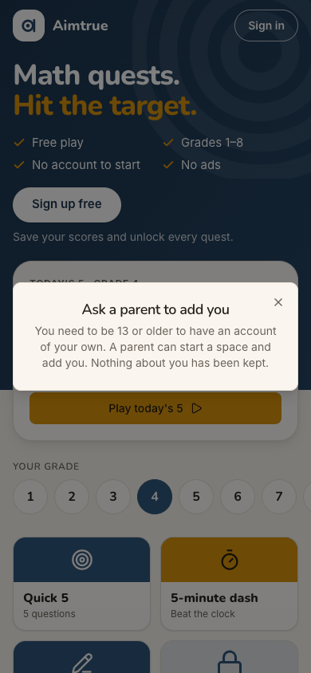
- **Step 11, the form comes back.** She taps a free grade-6 quest. "Almost there", with her email and a blank birthday,
  opens over the question, seconds after she was told nothing was kept. It looks like a second chance to answer, and
  an older year would be the easy pick.
  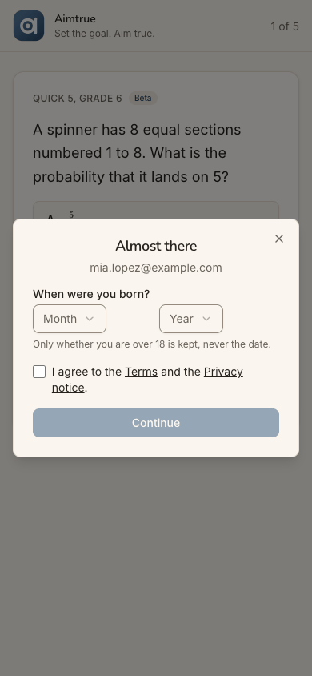
- **Step 9, the padlocks.** Five of her eight tiles say "Free account". Tapping one pitches the account again. Her only
  door is a small grey link under the two big buttons, "Under 13? Ask a grown-up". The hero's "Sign up free" sheet
  (step 2) and the refusal (step 6) do not have it.
  

**Contact sheet** (all 19 phone steps):

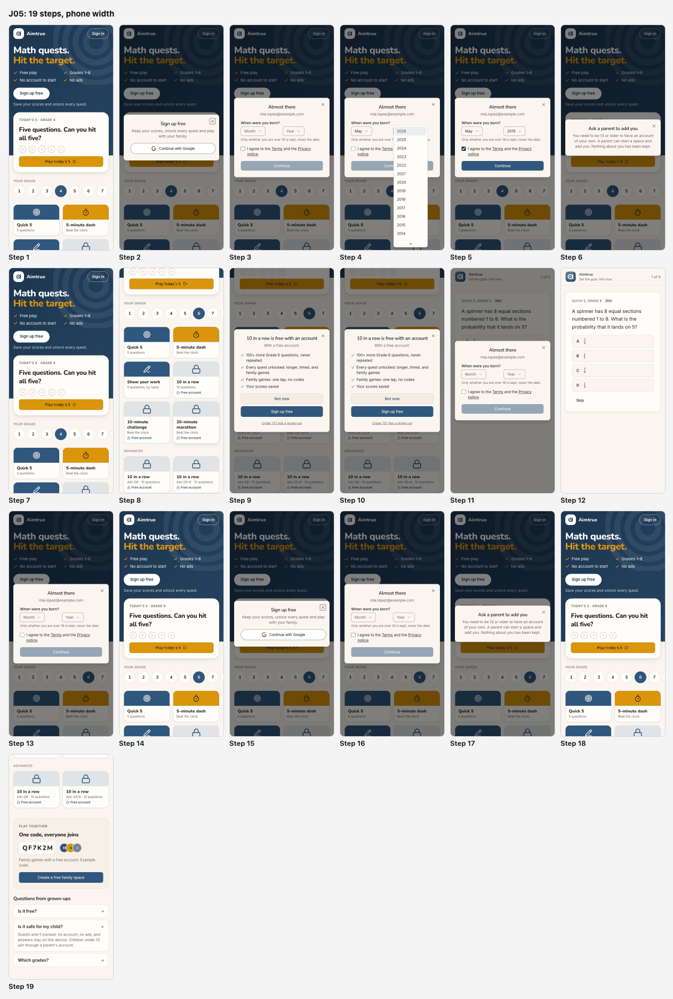

| Severity | Count |
| --- | --- |
| sev4 (catastrophe) | 0 |
| sev3 (major) | 1 |
| sev2 (minor) | 3 |
| sev1 (cosmetic) | 0 |
| **Total** | **4** |

## Prioritized fixes

1. [sev3] [After the refusal, the sign-up form reopens by itself with her email](#sev3-after-the-refusal-the-sign-up-form-reopens-by-itself-with-her-email): clear the pending sign-up when the under-13 refusal is shown (steps 11, 13).
2. [sev2] [The refusal is a dead end: one X, no next step for Mia or her parent](#sev2-the-refusal-is-a-dead-end-one-x-no-next-step-for-mia-or-her-parent): add "Keep playing" and "Ask a grown-up" to it (steps 6, 7).
3. [sev2] [Nothing on the device remembers the refusal, so the age question can be re-answered at once](#sev2-nothing-on-the-device-remembers-the-refusal-so-the-age-question-can-be-re-answered-at-once): keep a device-local flag (steps 8, 9, 16).
4. [sev2] ["Sign in" opens a sheet titled "Sign up free"](#sev2-sign-in-opens-a-sheet-titled-sign-up-free): title the sheet by the button that opened it (step 15).

## Findings

### [sev3] After the refusal, the sign-up form reopens by itself with her email

- **Issue Description:** Mia was refused with "Ask a parent to add you … Nothing about you has been kept." The next
  two times she moved within the app, the sign-up form opened again without being asked: a guest tile
  (`/play/G6Q5`) at step 11, and the Aimtrue logo back to `/` at step 13. Each time it showed "Almost there" with
  `mia.lopez@example.com`, a blank birth month and year, and the terms box unticked. At step 11 it covered the quest she
  had chosen. She had tapped no sign-up button. It went away only when she closed it, each time, or after a full reload
  (step 14). So the page still holds the refused sign-up, and her email with it, in memory.
- **Framework Violation:** cuj-contract, step 11 (expected: the guest quest; observed: the sign-up form over it) and
  step 13 (expected: the guest page; observed: the same form); Nielsen #3 User control and freedom (a dialog she
  dismissed and did not ask for keeps returning); Nielsen #1 Visibility of system status (the screen says nothing is
  kept, then shows her email).
- **Severity:** 3. Classify: a workaround is needed (close it on every screen, or reload), and the end state is wrong:
  the refused sign-up is still pending in the page. For an 11-year-old this is worse than friction. It re-asks the age
  question seconds after a "no", which invites picking an older year. It also breaks the promise the refusal just made
  to her and her parent. It is not a 4: guest play is still reachable.
- **Evidence:**  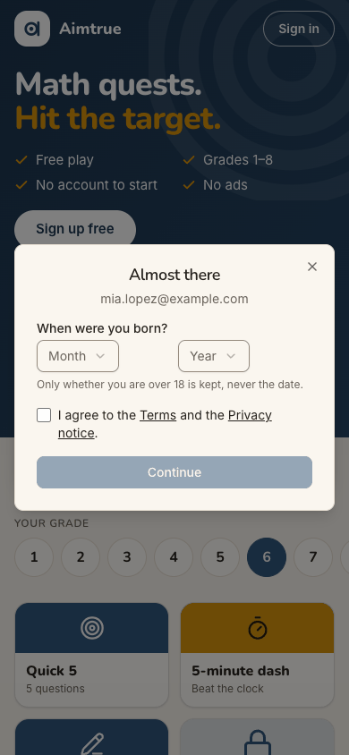
  Repro: signed out at `/`, tap Sign up free, then Continue with Google. Choose May and 2015, tick the terms box and tap
  Continue. Close "Ask a parent to add you". Tap any free tile, or the logo from a quest: "Almost there" reopens.
  The audit's stand-in for Google's script does nothing on `prompt()`, and no button was tapped, so this is the app's
  own behaviour. After a reload it is gone and the tile opens cleanly (step 14). No console error accompanied it.
- **Recommended Fix:** When `POST /api/auth/signup` returns the under-13 refusal, clear the page's pending sign-up in
  the same handler that shows "Ask a parent to add you": the sign-up token, the email and the "Almost there" open
  state. After that, "Almost there" should open only from a Continue with Google click. Add a web e2e check: refuse an
  under-13 answer, close the refusal, navigate to `/play/G6Q5` and then `/`, and assert that no "Almost there" dialog
  and no email are on screen. Check the app's sign-up sheet for the same behaviour.

### [sev2] The refusal is a dead end: one X, no next step for Mia or her parent

- **Issue Description:** "Ask a parent to add you" (step 6) has only a close X. It has no "Keep playing", although
  guest play is still open to her. It has no way to show or send the message to a parent. It does not link to "Create a
  free family space", the parent's way in, which sits at the bottom of the guest page (step 19). It also lacks the
  "Under 13? Ask a grown-up" action that the locked-tile offer carries (step 9). "A parent can start a space and add
  you" uses the product's own word, "space", which a parent who has never seen the product will not know. The FAQ says
  the same thing differently: "Children under 13 join through a parent's account" (step 19). After the X she is back
  on the unchanged guest page (step 7), where "Sign up free" is still the main button.
- **Framework Violation:** cuj-contract, steps 6-7 (expected: the screen asks her to ask a parent and leaves her
  something to do; observed: one X); Nielsen #9 Help users recognize, diagnose, and recover from errors (no way
  forward from the refusal); Nielsen #4 Consistency and standards (the child's door is on one offer, not on the
  refusal or the hero's sheet).
- **Severity:** 2. Classify: real friction and a lost conversion, with no workaround needed to keep playing. For this
  cohort the only route to an account is through a parent, and the refusal gives her nothing to carry to one. She also
  has to find out by herself that she can still play. It is not a 3, because closing it and playing works.
- **Evidence:**  
  Repro: as in the finding above, up to the refusal. Compare the locked-tile offer
  (), which has "Not now", "Sign up free" and "Under 13? Ask a grown-up", with
  the refusal, which has none of them.
- **Recommended Fix:** Give the refusal two buttons. The primary, "Keep playing", closes it and scrolls to her
  grade's tiles. The secondary, "Ask a grown-up", is the same share-or-copy action as on the locked-tile offer, sharing
  a link that opens the guest page at "Create a free family space". Reword the body for the parent who will read it:
  "You need to be 13 or older to have your own account. A grown-up can make a free family space and add you. Nothing
  about you has been kept." Use one wording here and in the FAQ answer. Make the hero's "Sign up free" sheet carry the
  same small "Under 13? Ask a grown-up" line as the locked-tile offer, so both sign-up offers have the same door.

### [sev2] Nothing on the device remembers the refusal, so the age question can be re-answered at once

- **Issue Description:** "Nothing about you has been kept" holds on the server, as far as the screen shows. After a
  reload she is signed out (step 18), and signing in again with the same Google account starts over (step 16). But
  the browser keeps no note that it was just told "ask a parent". The next "Sign in" leads straight back to the same
  blank birth month and year, with the terms unticked: two dropdowns away from a different answer. The page also keeps
  selling the account. Five of her eight grade-6 tiles stay locked with "Free account" (step 8), and each opens another
  sign-up pitch (step 9). "Sign up free" stays the hero's main button. All of these lead back to the same age question.
- **Framework Violation:** cuj-contract, step 16. "Treated as new" matched what the journey expects, and it is also
  what leaves the gate open. Nielsen #5 Error prevention. FTC COPPA FAQ guidance on neutral age screens: stop a child
  from going straight back to enter a different age, for example with a cookie.
- **Severity:** 2. Classify: an observable gap with a policy risk for this cohort, an under-13 holding an account she
  was refused. The audit did not try a false year, because that would have created an account and put it in the
  platform's approval queue. Since the bypass was not verified, this is a 2, not a 3.
- **Evidence:**  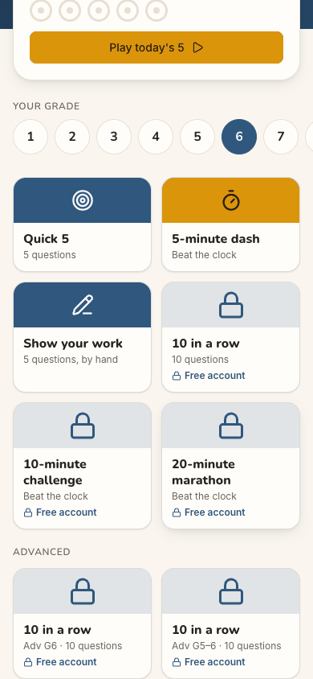
  Repro: be refused as under 13, close the refusal, tap Sign in, then Continue with Google. "Almost there" opens
  exactly as the first time (step 3), and a second honest answer is refused again (step 17).
- **Recommended Fix:** When the under-13 refusal is shown, write a device-local flag with its date, beside the guest
  storage the page already keeps (`aimtrue.guest`, never sent). While the flag is set:
  - "Sign up free", "Sign in" and the locked tiles open the refusal's "Ask a grown-up" screen instead of the age
    question, with a quiet "Not you? Use another account" for a grown-up on the same device;
  - the padlocks read "Ask a grown-up" instead of "Free account";
  - the hero's main button becomes "Ask a grown-up".

  This keeps "nothing about you is kept" true on the server. **Owner decision:** how long the flag lasts (for example
  a day or a week), and whether a grown-up's "Not you?" clears it.

### [sev2] "Sign in" opens a sheet titled "Sign up free"

- **Issue Description:** Signed out, Mia taps the header's "Sign in" (step 15) and gets the same dialog as the hero's
  "Sign up free": the title "Sign up free", "Keep your scores, unlock every quest and play with your family.", and
  Continue with Google. No sign-in wording appears anywhere.
- **Framework Violation:** cuj-contract, step 15 (expected: a sign-in step; observed: a sign-up sheet); Nielsen #4
  Consistency and standards; Nielsen #2 Match between system and the real world (the label and what opens disagree).
- **Severity:** 2. Classify: an observable mismatch between the button and the dialog it opens. For Mia it is
  harmless, because both lead to the same Google step. But a returning member, or a parent coming to add her, may
  stop, thinking they are about to make a second account.
- **Evidence:** 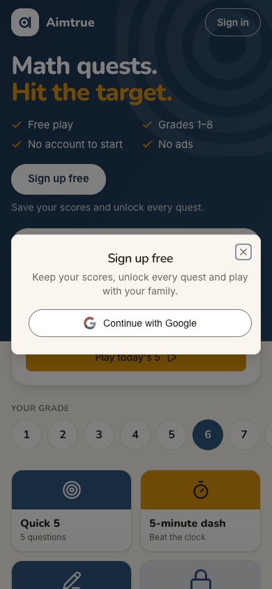
  Repro: signed out at `/`, tap "Sign in" in the header.
- **Recommended Fix:** Title the sheet by the button that opened it. From "Sign in", use "Sign in" and "Welcome back.
  New here? The same button makes you a free account." The Google button stays the same. Keep "Sign up free" for the
  hero, the tiles and the nudges.

## Walkthrough

### Step 1 — Open http://localhost:8797/ signed out (landing)

> Expected: the guest page with a way to sign up. Observed: match. "Math quests. Hit the target.", with ticks for Free
> play, Grades 1–8, No account to start and No ads. A white "Sign up free" button sits over "Save your scores and
> unlock every quest." Today's 5 is set to Grade 4, and the grade row runs 1-8 with 4 selected; on a phone, 8 is off
> the right edge. Tiles follow, three of them locked with "Free account". Light, desktop and dark all render cleanly.

**What Mia notices:** a bright, friendly page that says "Free play" and "No account to start". The grade is set to 4,
not hers, and "Sign up free" is the big white button.

### Step 2 — Tap "Sign up free"

> Expected: the sign-up sheet. Observed: match. A dialog reads "Sign up free / Keep your scores, unlock every quest and
> play with your family.", with one "Continue with Google" button and an X. Nothing mentions age or grown-ups, and the
> page behind is only lightly dimmed.

**What Mia notices:** one button, easy. Nothing hints that her age matters.

### Step 3 — Tap "Continue with Google" (the stand-in signs in as Mia)

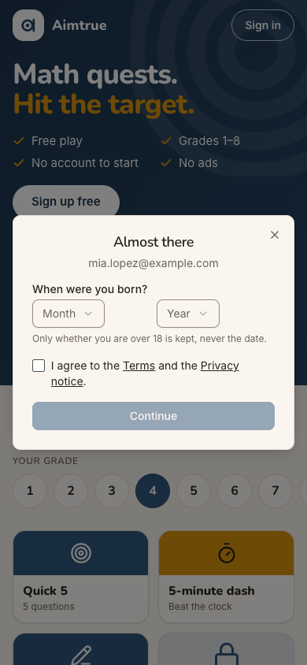

> Expected: back from Google, the "about you" step. Observed: match. "Almost there" shows her email, then "When were
> you born?" with Month and Year dropdowns, "Only whether you are over 18 is kept, never the date.", and a box for "I
> agree to the Terms and the Privacy notice." Continue is disabled.

**What Mia notices:** a short, friendly form asking her birthday. The line about 18 is not about her.

### Step 4 — Choose May, open the Year list

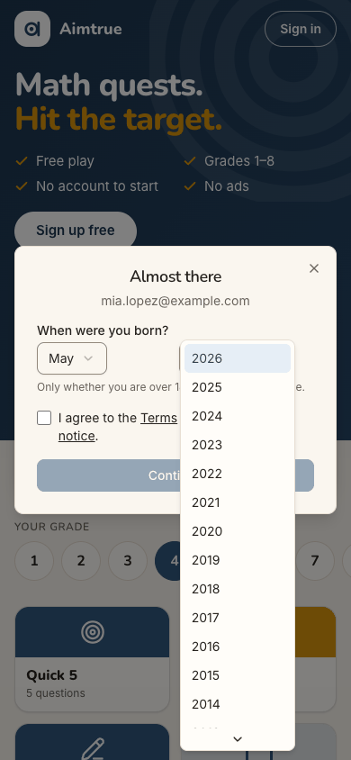

> Expected: a list where she can find 2015. Observed: match. The list runs newest first, from 2026, and 2015 shows
> without scrolling. Nothing is pre-filled and nothing hints which answer "works": a neutral age question.

**What Mia notices:** her year is right there.

### Step 5 — Choose 2015 and tick the terms box

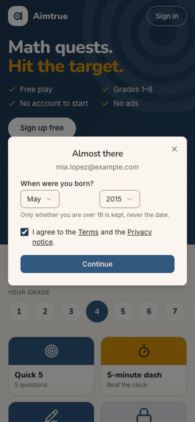

> Expected: Continue becomes active; nothing reacts to her age before she submits. Observed: match. May and 2015 are
> chosen, the box is ticked and Continue turns dark blue. No inline message appears.

**What Mia notices:** she ticks the box without opening the Terms, as children do, and the button lights up.

### Step 6 — Tap Continue: the refusal (landing)

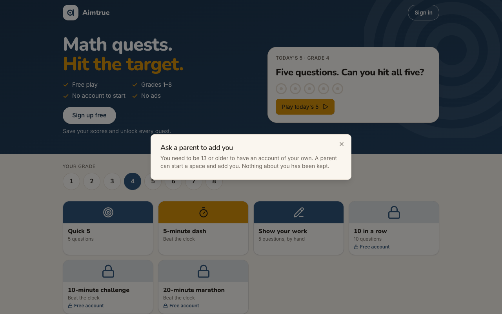
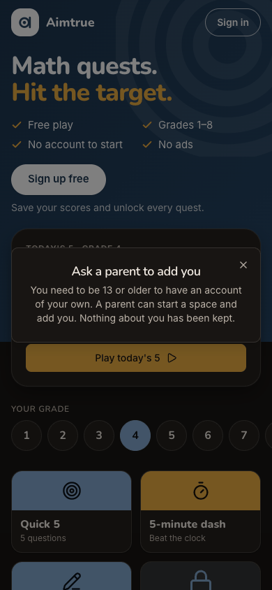

> Expected: under 13 is refused, nothing is kept, and the screen asks her to ask a parent. Observed: match. "Ask a
> parent to add you: You need to be 13 or older to have an account of your own. A parent can start a space and add
> you. Nothing about you has been kept." The only control is an X. The header still says "Sign in", and the console
> shows `403 POST /api/auth/signup`. On desktop the title is left-aligned; dark mode reads well.

**What Mia notices:** a kind, clear "no" that does not blame her. But all she can do is close it. She does not know
what "start a space" means, or whether she can still play.

### Step 7 — Close the refusal

> Expected: back on the guest page, still able to play. Observed: the guest page exactly as at step 1. "Sign up free"
> is still the main button and the locks still say "Free account". Nothing reminds her that she can play without an
> account.

**What Mia notices:** she is back where she started, and the big "Sign up free" still calls to her.

### Step 8 — Pick her grade (6)

> Expected: grade-6 quests she can play as a guest. Observed: match. Today's 5 switches to Grade 6. Quick 5, the
> 5-minute dash and Show your work are playable. Ten in a row, the 10-minute challenge, the 20-minute marathon and
> both Advanced tiles are locked with "Free account": 5 of 8.

**What Mia notices:** three things to play now, and a wall of padlocks for an account she was just told she cannot
have.

### Step 9 — Tap the locked "10 in a row"

> Expected: an offer to sign up. Observed: match. "10 in a row is free with an account" lists four benefits ("100+
> more Grade 6 questions…", "Your scores saved"), with "Not now" and "Sign up free" buttons. Below them is a small grey
> underlined link, "Under 13? Ask a grown-up". The hero's sheet (step 2) and the refusal (step 6) have no such link.

**What Mia notices:** finally, a line meant for her, but it is the smallest text in the dialog.

### Step 10 — Tap "Under 13? Ask a grown-up"

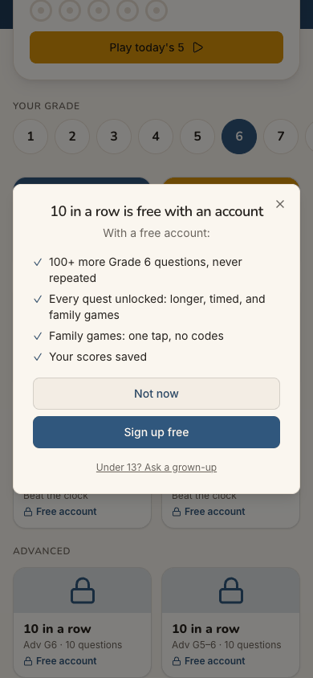

> Expected: something she can hand to a parent: the phone's share sheet, or a copied message. Observed: not
> verifiable here. In headless Chrome nothing visible changed, even on a second tap: no toast, no text change, no
> navigation, an empty clipboard and no console error. The browser exposes `navigator.share`, so on a phone this is
> meant to open the share sheet, which headless Chrome cannot show. This step is not counted as verified.

**What Mia notices (in this browser):** nothing happens when she taps the one link meant for her.

### Step 11 — "Not now", then tap "Play Quick 5, Grade 6"

> Expected: the guest quest starts. Observed: mismatch. The quest opened at `/play/G6Q5` ("Quick 5, Grade 6 · Beta",
> 1 of 5, a spinner question), but "Almost there" opened on top by itself, with `mia.lopez@example.com`, a blank
> birth date and the terms unticked. See the sev3 finding.

**What Mia notices:** her email and the birthday question again, right after "Nothing about you has been kept". The
question she wanted is hidden behind it, and this time she could simply pick an older year.

### Step 12 — Close the form

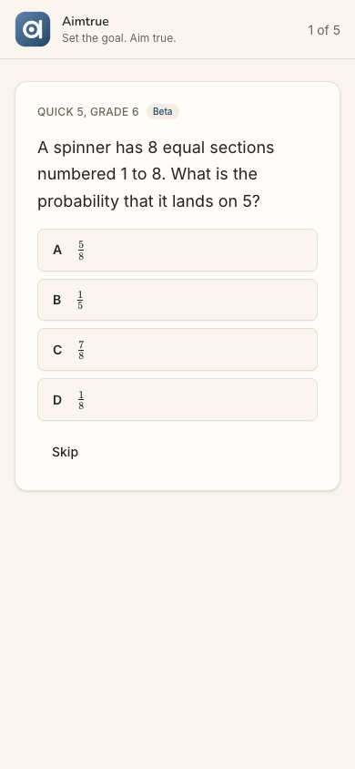

> Expected: the guest quest. Observed: match. Question 1 of 5 with choices A-D and Skip; guest play works. Playing on
> is out of scope.

**What Mia notices:** she can play after all, though nothing on screen ever told her so.

### Step 13 — Tap the Aimtrue logo (Home) from the quest

> Expected: the guest page. Observed: mismatch. The guest page, with "Almost there" (her email, a blank birth date)
> open again by itself. The audit's stand-in for Google does nothing on `prompt()` and nothing was tapped, so this is
> the app.

**What Mia notices:** the same form keeps popping up, and she has to close it every time she moves.

### Step 14 — Close it and reload the page

> Expected: the guest page, with nothing remembered of the sign-up. Observed: match. After the reload no dialog opens.
> The page keeps her grade (Today's 5 · Grade 6, from the device's own guest storage). Tapping Quick 5 then opened
> `/play/G6Q5` with no form: the driver reported no dialog, but this was not screenshotted. The refused sign-up lived
> in page memory only.

**What Mia notices:** the page is back to normal and still knows her grade.

### Step 15 — Tap "Sign in" in the header to sign in again

> Expected: a sign-in step. Observed: mismatch. The same "Sign up free" dialog as step 2, with no sign-in wording.

**What Mia notices:** she pressed "Sign in" and is offered "Sign up free" again.

### Step 16 — "Continue with Google" with the same account (landing)

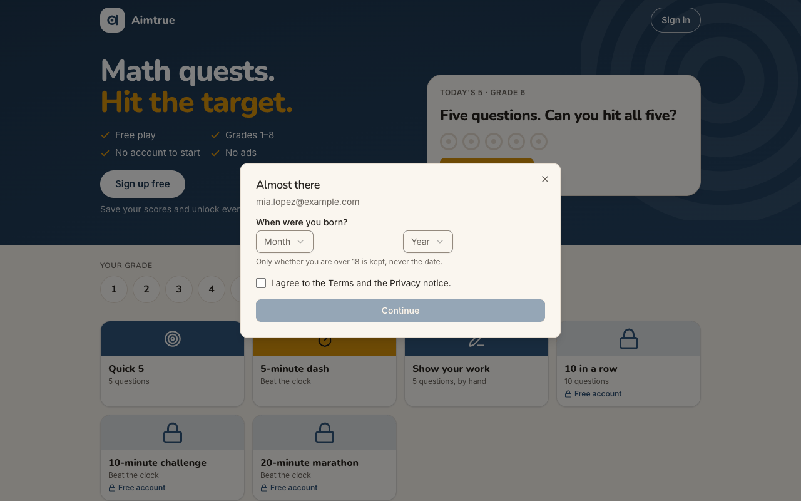
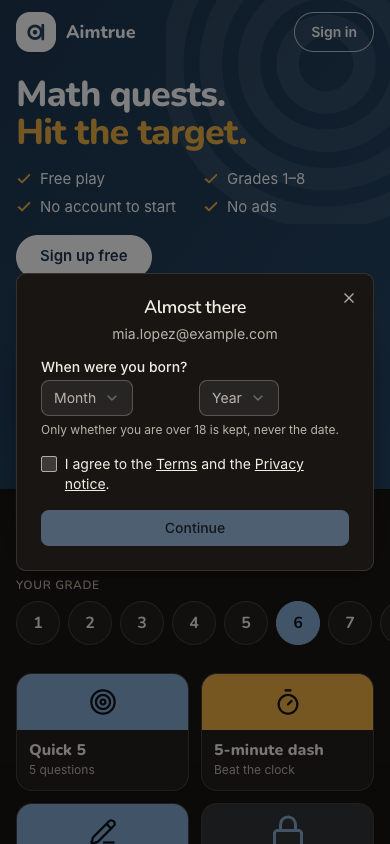

> Expected: nothing was kept, so she is treated as new. Observed: match. "Almost there" with her email, a blank
> birth month and year, the terms unticked and Continue disabled: identical to step 3, with no sign of the earlier
> refusal. On desktop the month and year boxes sit far apart.

**What Mia notices:** the same question again, and nothing stops her choosing a different year.

### Step 17 — Answer May 2015 again, tick the box, Continue

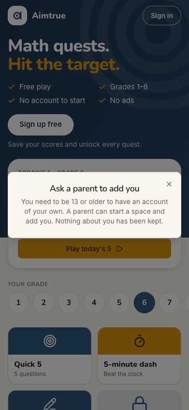

> Expected: the same refusal. Observed: match. "Ask a parent to add you", word for word, with only the X. The
> console shows `403 POST /api/auth/signup` again.

**What Mia notices:** the same polite "no".

### Step 18 — Close and reload (end-state check)

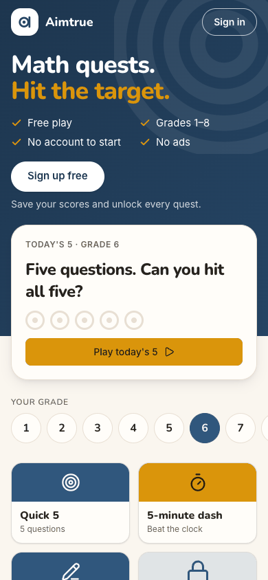

> Expected: signed out, nothing of her kept, the guest page. Observed: match. The guest page opens with no dialog and
> "Sign in" in the header; `GET /api/auth/session` answers 401 after the reload. Grade 6 stays selected, from the
> device's guest storage, which is never sent.

**What Mia notices:** she is a guest again, with her grade remembered.

### Step 19 — Scroll to "Questions from grown-ups" and open "Is it safe for my child?"

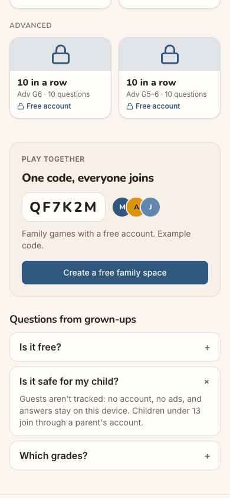

> Expected: something for her parent. Observed: match, far down the page. First the "Play together" card ("One code,
> everyone joins", "Family games with a free account", a "Create a free family space" button). Then the answer:
> "Guests aren't tracked: no account, no ads, and answers stay on this device. Children under 13 join through a
> parent's account." Neither the refusal nor this answer links to "Create a free family space".

**What Mia notices:** this part is for grown-ups. The button her parent needs is here, at the bottom of the page, not
on the screen that told her to ask one.

## Appendix

- **Mode:** live. The web app at `http://localhost:8797` is a frozen copy of commit `2d6e7d3` with sign-in on, driven
  in headless Chrome at 390×844 (phone), plus 1280×800 and dark mode at the landing steps (1, 6, 16).
- **Frameworks applied:** cuj-contract (every step against its expected result); task-completion (the journey ran to
  its defined end, the refusal and what is left to do); success-criteria (the end state was checked again after a
  reload at step 18: signed out, no dialog, and the same account treated as new at step 16).
- **CUJ manifest:** J05, 19 steps. Verified: steps 1-9 and 11-19 (18). Not observed: step 10, the share sheet. Steps
  11, 13 and 15 were observed and did not match (findings above).
- **Coverage / not inspected:**
  - The OS share sheet behind "Under 13? Ask a grown-up" (step 10). Headless Chrome cannot show one, so the message it
    shares and its "Copied" fallback were not seen. Check it on a phone.
  - A false birth year. The audit did not try one: it would have created an account and put it in the platform's
    approval queue. Whether the second attempt would accept an older year is therefore not verified.
  - The server's records. By the audit's rules there were no database or API reads. "Nothing kept" is judged from the
    screen and the browser: signed out after a reload (401), the same account treated as new, and only the guest keys
    `aimtrue.guest` and `aimtrue.guest-quest` in the tab's storage. Whether the email reached a log or a table was not
    checked.
  - The Terms and Privacy pages' content (Mia ticked the box without opening them, as the journey intends).
  - The parent's own path ("Create a free family space", adding a child); J03 and J06 cover it.
  - The guest's play beyond question 1 (out of scope), and the Daily.
  - Keyboard-only and screen-reader use; the accessibility tree was read only to find controls.
  - The iOS app; it is covered by separate journeys, and J05 has no app replay.
  - Other sign-in providers (not offered on the production web).
- **Access:** through the app's real sign-in and sign-up screens; the Google provider step is simulated (a stand-in for
  Google's button hands the app a local test token for the persona).
- **Preconditions made outside the UI:** none for J05 itself. The run's platform settings (web sign-in Google only with
  sign-up open, sign-up access Post-approved, guest play and the Daily on) were set through the console API before the
  journeys, as `docs/userjourney/README.md` "The run" records.
