# CUJ Audit — J06: teacher signs up from the sign-in link, starts a space, invites, starts an assessment

## Executive summary

**Who:** Sam Rivera, 47 (born February 1979). Sam is a maths teacher who runs an after-school club and wants a space of
their own for its students and parents. Sam is the owner of a space, cohort **C1** in `docs/member-home-plan.md` ("What
needs me today?"), and gives assessments, cohort **C7** ("give one, see results"; Start an assessment in at most two
taps). Sam arrives on the signed-out guest page and comes in through the **Sign in** link, not the sign-up offer. Sam
wants to start a space called "Rivera Math Club", invite a parent, and start an assessment.

**Outcome: 1/1 journeys passed, 0 skipped, 27 of 27 steps verified.**
- **Signing up** (steps 1-7) took four screens and nine taps, with nothing typed. It ended on "Waiting for approval".
- **Coming back** (steps 8-10): the platform admin approved Sam. A day later, "Sign in" and one Google tap took Sam
  into "Sam's space". This is a personal space the app had made for Sam, and its home is a child's practice board.
- **Starting the space** (steps 11-16): Sam found "Start a space" on the third try. Sam opened the menu and tried
  "Space" first, which was a dead end. Then Sam opened the space switcher and chose "All spaces", and the card was at
  the bottom of that page.
- **Inviting** (steps 16-19): from there the path is good. The new space opens on "Invite people", and Sam invited
  Ana Costa as a Parent. "Copy invitation" put a short invitation on the clipboard.
- **The assessment** (steps 20-27): the welcome wizard led Sam through "Add a student", with Ana, who had not yet
  accepted, already listed as the family. "Leo Costa is set up" then offered "Start an assessment" with Leo already
  chosen. Question 1 of 10 (Grade 4) was on screen at step 27, and still there after a reload.

**Conversion figures** (from the entry point, the signed-out guest page):

| Stretch | Screens | Taps | Typed fields | Waits | Dead ends |
| --- | --- | --- | --- | --- | --- |
| Entry to "Waiting for approval" (steps 1-7) | 4 | 9 | 0 (2 dropdowns, 1 checkbox) | 0 | 0 |
| Return to "Invite people" in the new space (steps 8-16) | 8 | 8 | 1 (the space's name) | 0 | 1 (the Space page) |
| Invite, add a student, start the assessment (steps 17-27) | 7 | 16 | 4 (2 required) | 0 | 0 |
| **Whole journey** | **17 distinct (19 visits)** | **33** | **5 (3 required)** | **the approval: unbounded, unannounced** | **1** |

Once Sam found "Start a space", the work was quick and well guided. Each screen handed on to the next: Invite people,
Add a student, then Start an assessment. The cost is in the gaps:
- an approval wait that promises nothing;
- a landing that does not know Sam is a teacher;
- "Start a space" kept three levels down, below the personal space Sam never asked for.

For C7, the assessment was 12 taps after the invitation was copied (steps 20-27), not two, because a student had to
be made first. The wizard did make the student quick.

For stickiness, nothing in the new space tells Sam what to come back for. The space's home is the same player board,
with "0 of 3 days played this week". "Running the space" is only an option under "Make this my home". Nothing says
that Ana has not accepted yet, or that Leo's assessment is waiting.

**The 3 screens Sam would notice most:**

- **Step 7, "Waiting for approval".** Sam has said nothing about being a teacher, and the sheet says nothing about
  what happens next. It does not say who approves, how long it takes, or whether Sam will be told. The heading above
  it still reads "Almost there". For an adult who came to set something up for a club, an open-ended wait with no
  promise is where the plan can quietly die.
  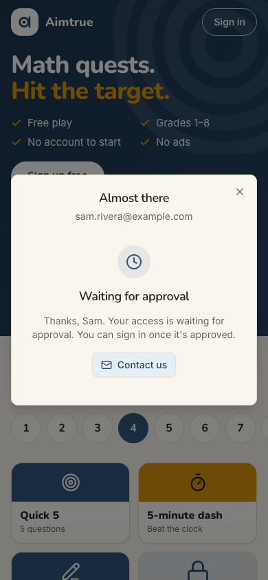
- **Step 10, the first screen after approval.** Sam lands in "Sam's space", a space Sam did not ask for. It leads with
  "0 of 3 days played this week", a Grade 1 Daily and a streak: a practice board for a child. Nothing on the page,
  the menu or the switcher says "Start a space". It took a wrong turn (step 12) and the "All spaces" page (step 14) to
  find it.
  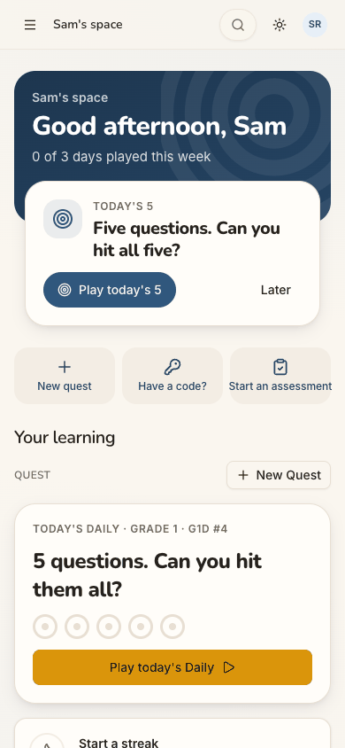
- **Step 21, "Add a student" in a free club.** "Every student needs a parent or guardian on file, who is billed and
  kept informed", and "the student, their assessment, their plan and a tutor". Sam runs a free club with no tutors.
  For a teacher about to ask parents to join, "billed" is the word that raises a doubt.
  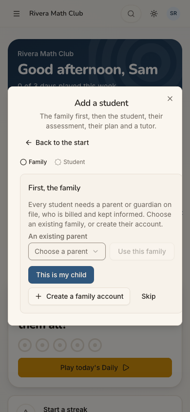

**Contact sheet** (all 27 phone steps):

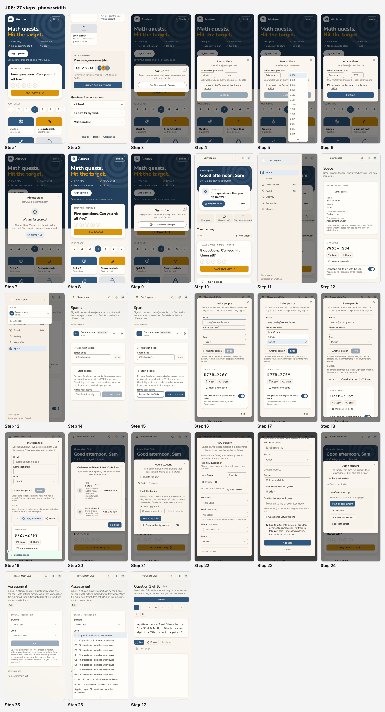

| Severity | Count |
| --- | --- |
| sev4 (catastrophe) | 0 |
| sev3 (major) | 2 |
| sev2 (minor) | 6 |
| sev1 (cosmetic) | 3 |
| **Total** | **11** |

## Prioritized fixes

1. [sev3] [Starting a space is hidden three menus deep, behind a dead end](#sev3-starting-a-space-is-hidden-three-menus-deep-behind-a-dead-end): put "Start a space" on the personal home, in the switcher and on the Space page (steps 10-14).
2. [sev3] [The approval wait is silent, and the return shows nothing](#sev3-the-approval-wait-is-silent-and-the-return-shows-nothing): say who approves, how long it takes and how Sam will hear, and greet the approved account on return (steps 7, 8).
3. [sev2] ["Sign in" opens a sheet titled "Sign up free", even for an approved account](#sev2-sign-in-opens-a-sheet-titled-sign-up-free-even-for-an-approved-account): title the sheet after the button that opened it (steps 3, 9).
4. [sev2] [The app never learns Sam is a teacher, so every home is a child's practice board](#sev2-the-app-never-learns-sam-is-a-teacher-so-every-home-is-a-childs-practice-board): ask one question at sign-up and lead a new space's home with running it (steps 1-4, 10, 16).
5. [sev2] [A space without Tutoring still speaks of billing, tutors and plans](#sev2-a-space-without-tutoring-still-speaks-of-billing-tutors-and-plans): word the student and assessment screens from the space's sets (steps 12, 21-25, 27).
6. [sev2] [The welcome wizard offers the tour in a space without Tutoring](#sev2-the-welcome-wizard-offers-the-tour-in-a-space-without-tutoring): apply the tour rule to the wizard's welcome screen too (step 20).
7. [sev2] [On a phone the invited row shows "a.." instead of the email](#sev2-on-a-phone-the-invited-row-shows-a-instead-of-the-email): give the email its own line (steps 18, 19).
8. [sev2] [The copied invitation does not say how to sign in or what the club is](#sev2-the-copied-invitation-does-not-say-how-to-sign-in-or-what-the-club-is): name Google, the space code and the sender's purpose (step 19).
9. [sev1] [The family card in Add a student runs off the dialog on a phone](#sev1-the-family-card-in-add-a-student-runs-off-the-dialog-on-a-phone): let the row wrap inside the card (step 21).
10. [sev1] [The level picker reads in codes and does not use the grade just typed](#sev1-the-level-picker-reads-in-codes-and-does-not-use-the-grade-just-typed): name levels in words and preselect from the student (step 26).
11. [sev1] [The birth-year list opens at 2026, 48 rows from 1979](#sev1-the-birth-year-list-opens-at-2026-48-rows-from-1979): open the list near adult years, or take typed digits (step 5).

## Findings

### [sev3] Starting a space is hidden three menus deep, behind a dead end

- **Issue Description:** Sam signed up to start a space. After approval, the app puts Sam in "Sam's space", a
  personal space made automatically (step 10). Its home is a player's board: Today's 5, a Grade 1 Daily, a streak,
  tiles. "Start a space" is not on it.
  - **The menu** (step 11) lists Home, Users, Assessment, Quest, Activity, My profile and Space. Sam tried "Space" (step
    12). It is the settings of the personal space, and the only thing Sam might have used, the name, is "Set by the
    platform": "To change the name ... ask the platform administrator". Sam can neither rename this space to "Rivera
    Math Club" nor start a new one from there. That was a dead end.
  - **The switcher** (step 13) offers only "Sam's space" and "All spaces".
  - **"All spaces"** (step 14) finally shows "Start a space: For your family or your students ... you can invite
    people next". The card is at the bottom, under "Your spaces" and "Join with a code".

  Reaching it took five taps from the home, one of them a wrong turn. The card itself is clear, and the rest of the path is good.
- **Framework Violation:** cuj-contract, steps 10-14. Expected: from the first screen after approval, a visible way to
  start the space Sam came for. Observed: none on the home, the menu or the switcher, and a dead end on the Space page.
  Nielsen #6 Recognition rather than recall; Nielsen #7 Flexibility and efficiency of use.
- **Severity:** 3. Classify: workaround needed. This is the cohort's whole reason to sign up, and the app answers with
  a different space they did not ask for. A teacher who does not think to open the switcher and choose "All spaces"
  stays in a child's practice board, and may decide the product is not for clubs. It is not a 4: the path exists, and
  Sam found it.
- **Evidence:**  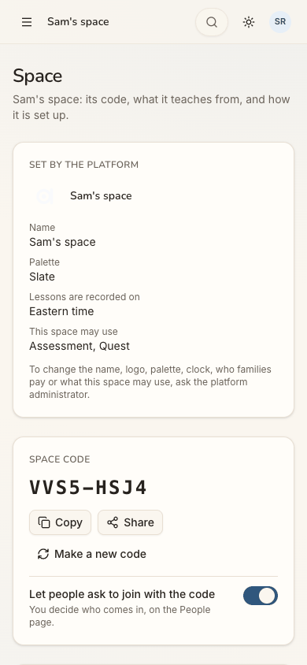
  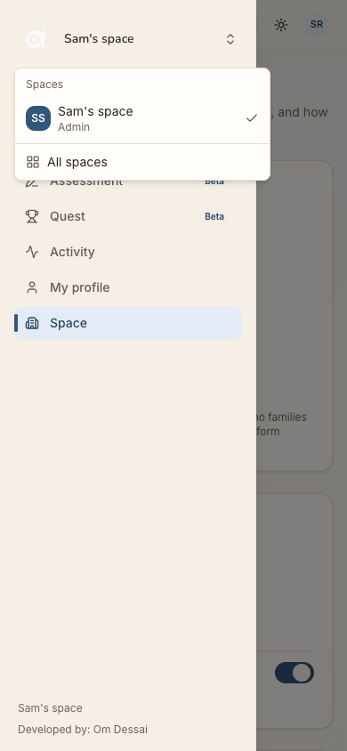 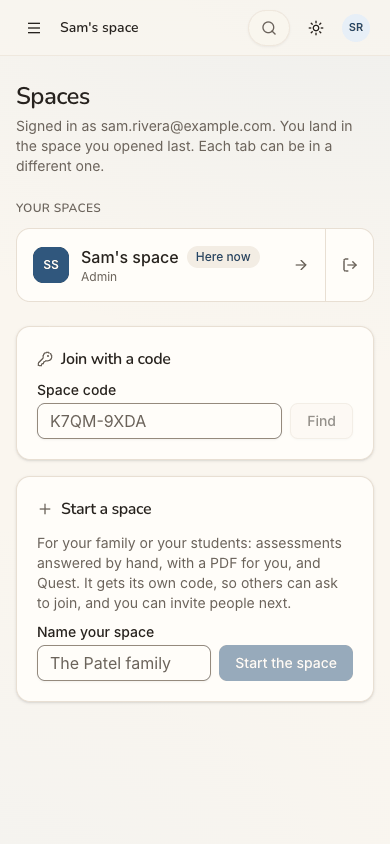
  Repro: sign up and be approved under Post-approved, then sign in. On the home, open the menu, then Space (no start).
  Back in the menu, open the switcher, choose All spaces and scroll to "Start a space".
- **Recommended Fix:** Make "Start a space" reachable in one tap from wherever a new adult lands:
  - a "Start a space for your class or family" card on the personal space's home while the person has no other space;
  - a "Start a space" item in the switcher, under the list and beside "All spaces";
  - a "Start another space" link on the Space page, near the locked name.
  Consider letting the owner of a personal space rename it, or turn it into the club ("Make this a space for others"),
  instead of making a second one.

### [sev3] The approval wait is silent, and the return shows nothing

- **Issue Description:** After Continue (step 7) the sheet shows a clock, "Waiting for approval" and "Thanks, Sam.
  Your access is waiting for approval. You can sign in once it's approved."
  - It does not say who approves, how long it usually takes, or whether Sam will be told.
  - The sheet's heading still reads "Almost there" above "Waiting for approval", two messages at once.
  - Its one action, "Contact us", opens a mail to a personal Gmail address, which looks unofficial to a stranger.

  A day later (step 8) the guest page is exactly as it was. It shows nothing about the account or the approval, so Sam
  tries "Sign in" on a hunch.
- **Framework Violation:** cuj-contract, step 7 (expected: told what happens next; observed: told only that it
  waits) and step 8 (expected: some sign the account is ready; observed: none). Nielsen #1 Visibility of system
  status.
- **Severity:** 3. Classify: workaround needed. Sam must remember, unprompted, to come back and try signing in, with
  no idea when that would work. A teacher setting things up for a club works to a timetable, such as the next club
  day, and an unbounded wait with no promise makes it hard to plan. It is not a 4: coming back and signing in does
  work (step 10).
- **Evidence:**  
  Repro: Sign-up access Post-approved. Signed out at `/`, tap Sign in, then Continue with Google with a new account.
  Give the birth month and year, tick the terms box and tap Continue. After the console approves, open `/` in a new
  tab.
- **Recommended Fix:** Give the wait three lines:
  - "We check new accounts by hand, usually within a day."
  - "We'll email you at sam.rivera@example.com when you're in." Make that true with one plain message sent on
    approval.
  - who "we" are.

  Then:
  - add a "Keep exploring" button that closes the sheet;
  - drop the "Almost there" heading once the state is "waiting";
  - point "Contact us" at a product address;
  - on the next visit, show "Your account is ready: Sign in" on the guest page.

### [sev2] "Sign in" opens a sheet titled "Sign up free", even for an approved account

- **Issue Description:** The pill at the top right says "Sign in". Tapping it opens a sheet titled "Sign up free",
  with the line "Keep your scores, unlock every quest and play with your family" (steps 3 and 9). On the first visit
  Sam was new, so the mismatch only puzzled. On the return (step 9) Sam already has an approved account, and a sheet
  that says "Sign up" makes Sam wonder whether continuing will make a second account. It did not: one Google tap
  signed Sam in (step 10).
- **Framework Violation:** cuj-contract, step 9. Expected: a sign-in sheet. Observed: a sign-up sheet that signs in.
  Nielsen #4 Consistency and standards; Nielsen #2 Match between system and the real world.
- **Severity:** 2. Classify: an observable mismatch and real hesitation at the one moment Sam must act on trust. It
  does not block anything.
- **Evidence:**  
  Repro: signed out at `/`, tap "Sign in".
- **Recommended Fix:** Title the sheet after the button that opened it: "Sign in" with "New here? The same button
  makes a free account." Keep "Sign up free" for the sign-up offer and the hero button.

### [sev2] The app never learns Sam is a teacher, so every home is a child's practice board

- **Issue Description:** No screen in this journey learns that Sam is a teacher, and no home is built for one:
  - **The front page** (steps 1-2) speaks to players and families. It has grade circles, "Play today's 5", a "Create a
    free family space" button and "Questions from grown-ups" about "my child". Nothing is addressed to a teacher, a
    club or a class.
  - **The sign-up sheets** (steps 3-4) offer "scores, quests and your family" and ask only for a birth date and the
    terms. Nothing asks what Sam wants to do.
  - **The personal space's home** (step 10) is a player board for whoever lands, with a Grade 1 Daily and "0 of 3
    days played this week".
  - **Rivera Math Club's own home** (behind the dialog at step 16) is the same player board. Sam is its admin and has
    just invited a parent, and its home still leads with Today's 5 and the Daily. "Running the space" exists only as
    an option under "Make this my home". Nothing on it said who has not yet accepted or what is waiting for review.
- **Framework Violation:** cuj-contract, steps 1-4 (expected: something that says the product fits a teacher and a
  club; observed: only players and families) and steps 10 and 16 (expected: a home that leads with running the space
  for its admin; observed: a player's board). Nielsen #2 Match between system and the real world.
- **Severity:** 2. Classify: real friction for conversion and stickiness. A teacher cannot tell before signing up that
  the product serves a club. Afterwards, the home gives no reason to come back, such as "Ana hasn't joined yet" or
  "Leo's assessment is waiting". It does not block the journey.
- **Evidence:**  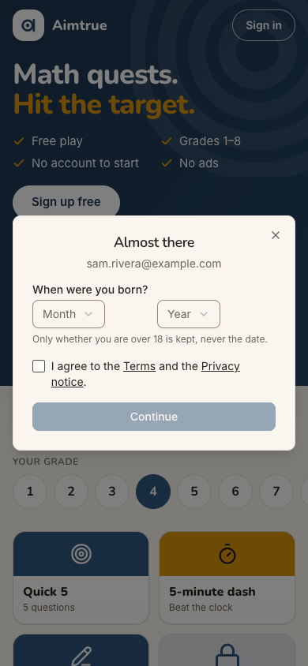
   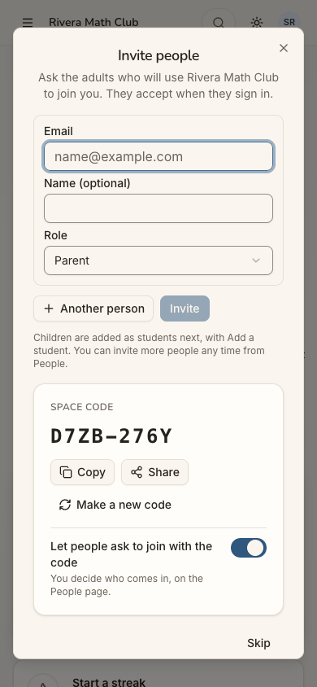
  Repro: open `/` signed out and read the page and the sign-up sheets. Sign in after approval and start a space from
  All spaces; the new space's home is visible behind "Invite people".
- **Recommended Fix:**
  - Add one line and one door for teachers to the guest page: "Run a class or club? Start a free space for your
    students and their parents."
  - Ask one question at sign-up, "What brings you here? Play / My child / My class or club". Store one word, as
    `arrived_via` already is. A "My class or club" answer leads with "Start a space" on the first home.
  - In a space whose admin started it, lead the home with the office hat: invitations not yet accepted, assessments to
    review, the space code. Keep the Quest board below.

### [sev2] A space without Tutoring still speaks of billing, tutors and plans

- **Issue Description:** Rivera Math Club may use Assessment and Quest only, and Sam is its only adult. The screens
  still speak of tutoring:
  - **Add a student** (step 21): "The family first, then the student, their assessment, their plan and a tutor", and
    "Every student needs a parent or guardian on file, who is billed and kept informed".
  - **The New student form** (steps 22-23): an "Available for virtual tutoring" checkbox. The button says "Add user"
    although the step said "Add the student".
  - **The Assessment page** (step 25): "When it is submitted, their tutors get a PDF".
  - **The question page** (step 27): "Nothing is marked until your tutor reviews it".
  - **The Space page** of the personal space (step 12): "Lessons are recorded on Eastern time" and "who families pay".

  Separately, the Invite dialog sends Sam to "People" ("You can invite more people any time from People"), and the
  menu calls that page "Users".
- **Framework Violation:** cuj-contract, steps 21-25 and 27 (expected: words that fit a club without Tutoring;
  observed: billing, tutors, plans and virtual tutoring). Nielsen #2 Match between system and the real world;
  Nielsen #4 Consistency and standards. The project's rule (CLAUDE.md, Phase 50) is that a space without Tutoring has
  "no tutor role and no tutoring fields".
- **Severity:** 2. Classify: an observable mismatch. For a teacher about to invite parents, "billed" suggests a
  charge Sam cannot explain to them. "Your tutor" on the question page misnames Sam to the child. No step is blocked.
- **Evidence:**  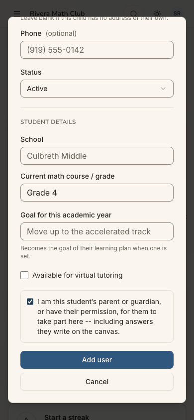
  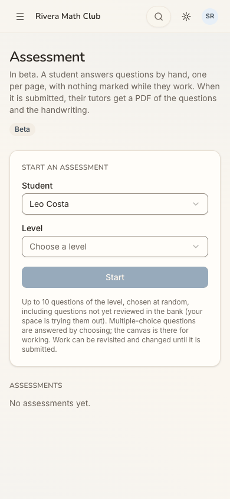 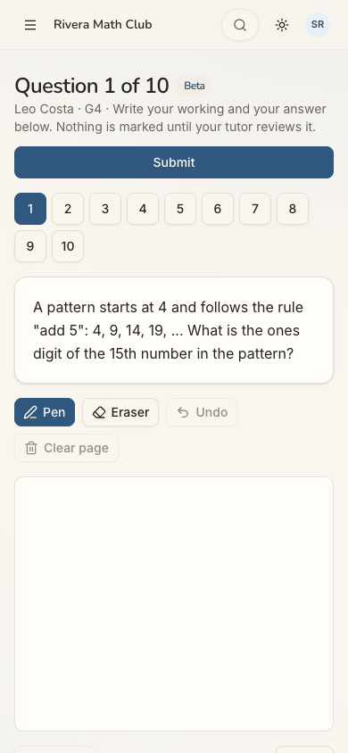
  Repro: start a space from All spaces. Invite a parent, then Continue, Add a student, choose the parent and add the
  student. Then Start an assessment.
- **Recommended Fix:** Word these screens from the space's sets. Where Tutoring is off:
  - "kept informed" with no "billed";
  - "the student, then an assessment" with no plan or tutor;
  - hide "Available for virtual tutoring";
  - "your teacher" or "the space's admins get a PDF";
  - "Nothing is marked until it is reviewed".

  Name the people page one way in both places, "People" or "Users".

### [sev2] The welcome wizard offers the tour in a space without Tutoring

- **Issue Description:** After "Continue" on Invite people (step 20), a dialog opens: "Welcome to Rivera Math Club,
  Sam — A quick tour of the portal, and guided setup for a new student". It has a "Take the tour" card ("The dashboard
  and the menu, one part at a time"). Rivera Math Club has no Tutoring. The project's rule, recorded in CLAUDE.md
  (owner, 2026-11-04), is that the wizard's tour, its first-visit offer and "Getting started" appear only where
  Tutoring is on, and that a just-started space's "Invite people" step still opens. The invite step opened as it
  should. The welcome screen after it still offers the tour.
- **Framework Violation:** cuj-contract, step 20 (expected under the owner's rule: Invite people, then the space's
  home or "Add a student", with no tour; observed: the tour offered). Nielsen #8 Aesthetic and minimalist design
  (an offer for a part of the product this space does not have).
- **Severity:** 2. Classify: an observable mismatch with a decision the owner made that same day. For Sam it costs a
  moment of reading and a tour that, by the owner's reasoning, describes a dashboard this space does not have. Sam
  did not take the tour, so what it shows here was not inspected.
- **Evidence:** 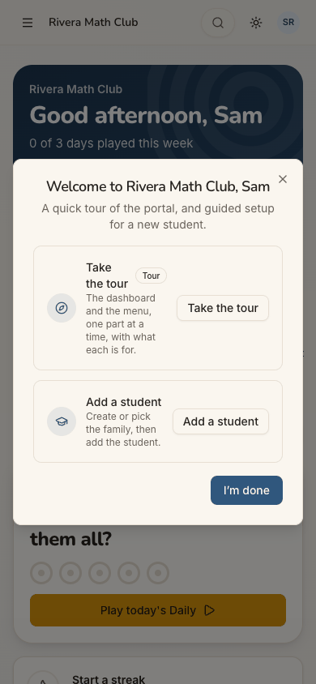
  Repro: start a space from All spaces, invite one person, then tap Continue at the foot of Invite people.
- **Recommended Fix:** Apply the same rule to the wizard's welcome screen. Where Tutoring is off, drop the "Take the
  tour" card, or skip the welcome screen and go from Invite people straight to "Add a student" or the home. A test
  that a space with Quest and Assessment only never shows "Take the tour" would hold it.

### [sev2] On a phone the invited row shows "a.." instead of the email

- **Issue Description:** After Invite (step 18), the INVITED list shows one row: a tick, "a..", and the buttons "Copy
  invitation" and "Share". At 390px the buttons take the row, and Ana's email is cut to its first letter. Sam cannot
  see whose invitation the buttons copy. With a club's worth of parents, every row would read "a..", "m..", "j..",
  and the wrong text could easily go to the wrong family, since each invitation names its address.
- **Framework Violation:** cuj-contract, step 18 (expected: the invited person's name or email beside their buttons;
  observed: "a.."). Nielsen #1 Visibility of system status; Nielsen #5 Error prevention.
- **Severity:** 2. Classify: real friction that invites a mistake whenever there is more than one row. It does not
  block a single invitation.
- **Evidence:** 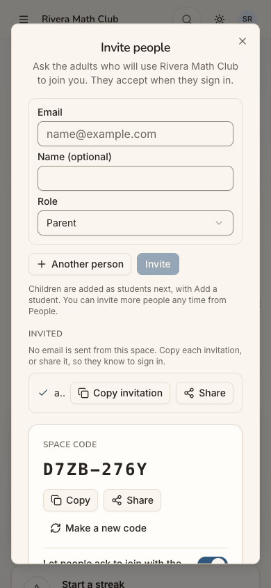 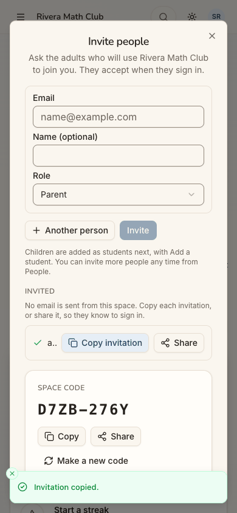
  Repro: at 390×844, start a space, invite ana.costa@example.com as Parent and look at the INVITED row.
- **Recommended Fix:** On narrow screens, stack the row: the name (or email) and role on one line, with the buttons
  below. Show the name Sam typed ("Ana Costa · Parent") rather than the address alone.

### [sev2] The copied invitation does not say how to sign in or what the club is

- **Issue Description:** "Copy invitation" (step 19) copies: "Sam Rivera invited you to Rivera Math Club on Aimtrue.
  Sign in at http://localhost:8797 with ana.costa@example.com." It is short and clear about who and where. But:
  - it does not say that signing in is with Google, the only button the web offers (steps 3, 9). A parent whose
    address is not a Google account has no way in, and is not told so;
  - it does not give the space's code (D7ZB-276Y), shown on the same dialog;
  - it says nothing about what the club or Aimtrue is for.

  The dialog does say plainly that no email is sent, which is good.
- **Framework Violation:** cuj-contract, step 19 (expected: a message a parent can act on alone; observed: a link
  and an address, with no sign-in method). Nielsen #10 Help and documentation (the message is the invitee's only
  instructions).
- **Severity:** 2. Classify: real friction for the next person's conversion. The invitation is the whole of Ana's
  onboarding, and J09 plays it out. It does not block Sam.
- **Evidence:** 
  Repro: in Invite people, invite an email, then tap "Copy invitation" and paste.
- **Recommended Fix:** Make the text something a parent can act on alone: "Sam Rivera invited you to Rivera Math
  Club on Aimtrue, for maths practice and assessments. Open <address>, tap Sign in and continue with Google as
  ana.costa@example.com. (Space code D7ZB-276Y.)" If other providers are later offered on the web, name the one that
  matches the address.

### [sev1] The family card in Add a student runs off the dialog on a phone

- **Issue Description:** In "Add a student", the first step, "First, the family" (step 21), puts the "Choose a
  parent" dropdown and "Use this family" side by side. At 390px the card is wider than the dialog. "Use this family"
  touches the dialog's right edge, and the card's right border is cut off.
- **Framework Violation:** cuj-contract, step 21 (expected: the step's card inside the dialog). Nielsen #8 Aesthetic
  and minimalist design. The project's own rule is that rows of controls must stack on phones, not overflow.
- **Severity:** 1. Classify: cosmetic. Everything stays tappable.
- **Evidence:** 
  Repro: at 390×844, start a space, Continue past Invite people, then Add a student.
- **Recommended Fix:** Let the dropdown and its button wrap (`flex-wrap`, or a column below `sm`), and add this dialog
  to the zero-overflow check in `responsive.spec.ts`.

### [sev1] The level picker reads in codes and does not use the grade just typed

- **Issue Description:** At step 26 the Level list reads "K", "G1" ... "G8", "Math 1", "BA1" ... "BA5", "AoPS
  Prealgebra". Every row repeats "· 10 questions · includes unreviewed". Sam had just typed "Grade 4" as Leo's course
  (step 23), but nothing is preselected. "G4" and "BA4" sit in the same list with no word of what either is.
- **Framework Violation:** cuj-contract, step 26 (expected: a level in words, ideally Leo's). Nielsen #2 Match
  between system and the real world; Nielsen #7 Flexibility and efficiency of use.
- **Severity:** 1. Classify: cosmetic friction. A maths teacher can decode "G4", and the choice took one tap.
- **Evidence:** 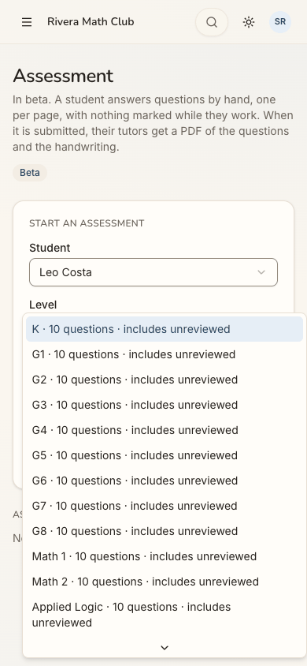
  Repro: on Assessment with a student chosen, open Level.
- **Recommended Fix:**
  - Name the levels as the member home does: "Grade 4", "Kindergarten", "Beast Academy 4".
  - Group them by curriculum.
  - Say "includes unreviewed questions" once under the picker, not on every row.
  - Preselect the level that matches the student's course or Quest level when there is one.

### [sev1] The birth-year list opens at 2026, 48 rows from 1979

- **Issue Description:** The sign-up sheet's birth year (step 5) is a custom dropdown of 100 years. It opens at
  2026, the current year, and lists down to 1927, about 13 rows at a time. Sam's 1979 is row 48, about four screens
  of scrolling. Nothing suggests that typing digits would jump to it.
- **Framework Violation:** cuj-contract, step 5 (expected: a quick way to give 1979). Nielsen #7 Flexibility and
  efficiency of use.
- **Severity:** 1. Classify: cosmetic friction. It costs a few seconds, and the form is otherwise short and calm.
- **Evidence:** 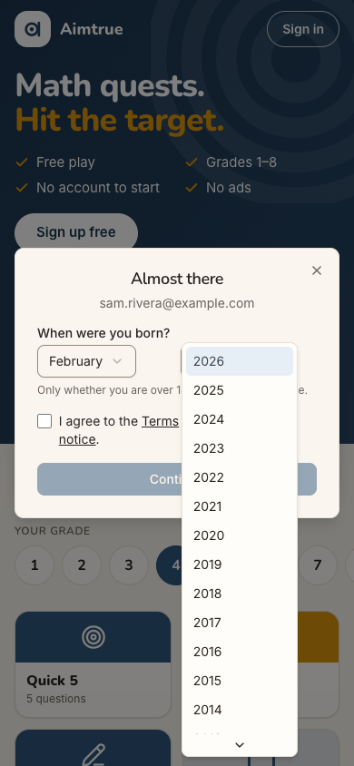
  Repro: in the "Almost there" sheet, open the Birth year dropdown.
- **Recommended Fix:** Start the list at the youngest age that may sign up (2013), or open it scrolled to a typical
  adult year. Alternatively, use a plain numeric year field with the same check.

## Walkthrough

### Step 1 — Open http://localhost:8797/ signed out (landing)

> Expected: a front page that says what the product is, with a way in for an adult who wants their own space.
> Observed: the guest page "Math quests. Hit the target." with Sign up free, today's 5 (Grade 4), a grade row and
> tiles (some locked, "Free account"). A "Sign in" pill sits at the top right; on desktop it is a small outlined pill
> at the same place. Dark mode renders legibly.

**What Sam notices:** everything above the fold is a children's game. Nothing says teachers, clubs or classes. The
"Sign in" pill is the obvious door for an adult.

### Step 2 — Scroll down the guest page looking for a way in for a teacher

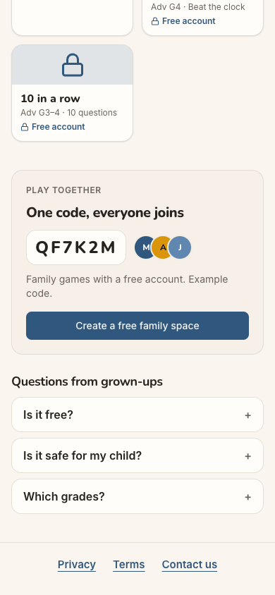

> Expected: something for teachers or clubs. Observed: "Play together — One code, everyone joins" with "Create a free
> family space"; "Questions from grown-ups" (Is it free? / Is it safe for my child? / Which grades?); Privacy, Terms,
> Contact us.

**What Sam notices:** the only "space" offered is a family space, and the questions are a parent's. Sam goes back up
to "Sign in".

### Step 3 — Tap "Sign in"

> Expected: a sign-in screen, perhaps with "New here?". Observed: a sheet titled "Sign up free", "Keep your scores,
> unlock every quest and play with your family", one button "Continue with Google".

**What Sam notices:** the link said "Sign in" and the sheet says "Sign up free". It is fine for a newcomer, but the
pitch is still scores and family.

### Step 4 — Tap "Continue with Google"

> Expected: Google, then a welcome or a short form. Observed: at once, "Almost there" with sam.rivera@example.com,
> "When were you born?" (Month and Year), "Only whether you are over 18 is kept, never the date.", a terms checkbox,
> and Continue (disabled).

**What Sam notices:** a short, calm form, and the note about the date reassures. Nothing asks what Sam wants to do
here.

### Step 5 — Choose February, then open the Birth year list

> Expected: a quick way to give 1979. Observed: a 100-year list opening at 2026; 1979 is row 48. (Before this step
> Sam tapped "Terms", which opened in a new tab and left the form filled; the driver does not follow new tabs.)

**What Sam notices:** the list starts with years no one signing up could be born in, and Sam has the longest scroll.

### Step 6 — Pick 1979 and tick "I agree to the Terms and the Privacy notice."

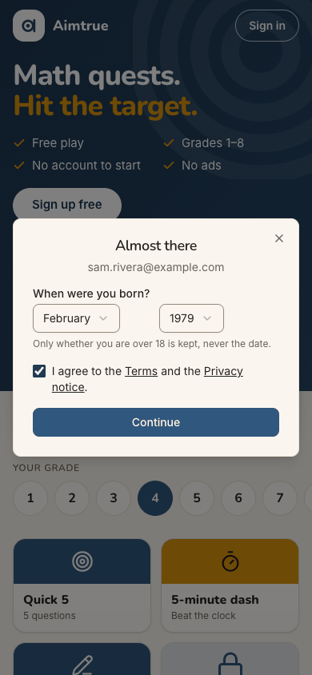

> Expected: Continue enabled. Observed: February / 1979, ticked; Continue turns brand blue.

**What Sam notices:** nothing more is asked. Clear enough.

### Step 7 — Tap Continue: "Waiting for approval" (landing)

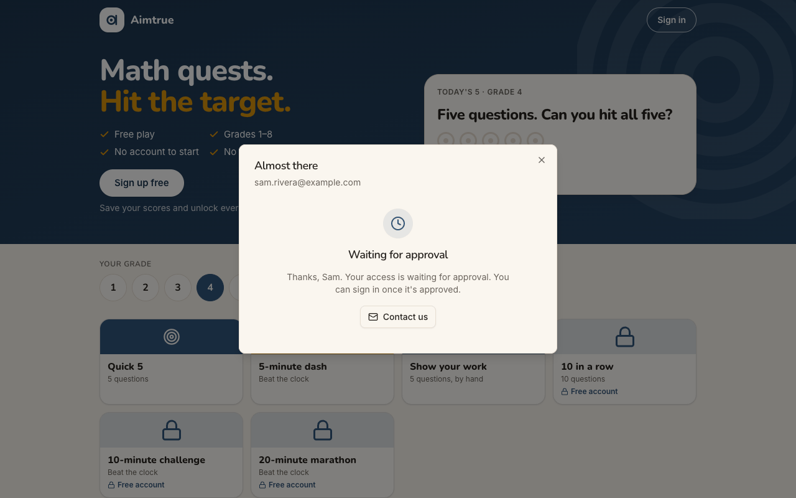
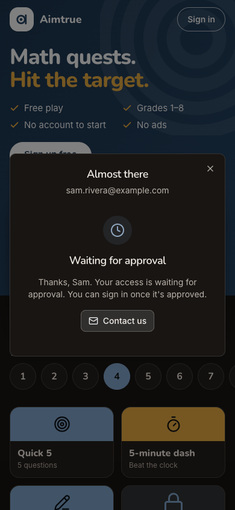

> Expected (Post-approved): a waiting screen that says what happens next. Observed: under the heading "Almost
> there", a clock, "Waiting for approval", "Thanks, Sam. Your access is waiting for approval. You can sign in once
> it's approved.", and "Contact us" (a mail to a personal Gmail address). On desktop the heading is left-aligned over
> a centred body. The sign-up answers 403 `access_pending`, which is the designed path.

**What Sam notices:** no word on who approves, how long it takes, or how Sam will hear. Sam has no cue to come back.

### Step 8 — A day later: a new tab on the guest page

> Expected: some sign of the account or the approval. Observed: the same guest page as yesterday, unchanged.

**What Sam notices:** nothing says the account is ready. Sam tries "Sign in" again on a hunch.

### Step 9 — Tap "Sign in"

> Expected: a sign-in sheet. Observed: "Sign up free" again, with "Continue with Google".

**What Sam notices:** Sam has an account now, and the sheet says "Sign up". Will this make a second one?

### Step 10 — Tap "Continue with Google": home in "Sam's space" (landing)

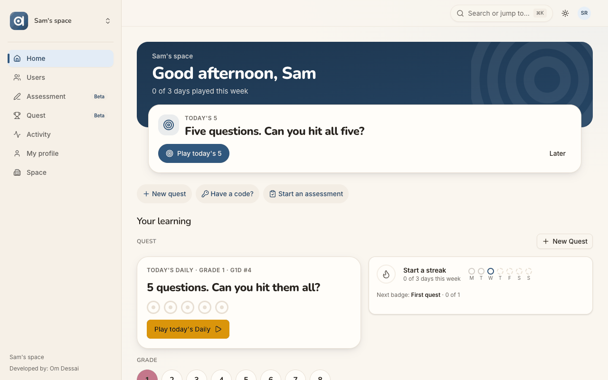
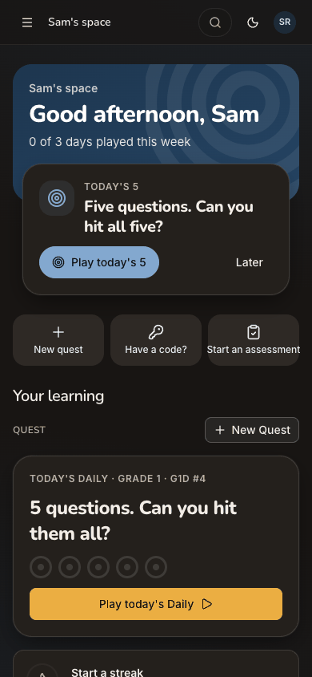

> Expected: approved and signed in, landing somewhere that helps start a space. Observed: straight in, no question
> asked again. Tab title "Sam's space"; "Good afternoon, Sam / 0 of 3 days played this week". Next up shows "Today's
> 5", above New quest / Have a code? / Start an assessment and "Your learning" with a Grade 1 Daily, a streak and
> tiles. Further down are a code box, Start an assessment (no students) and "Make this my home". The desktop menu has
> Home, Users, Assessment, Quest, Activity, My profile and Space.

**What Sam notices:** the app made Sam a personal space and filled it with a child's practice. There is no "Start a
space" anywhere on the page.

### Step 11 — Open the menu

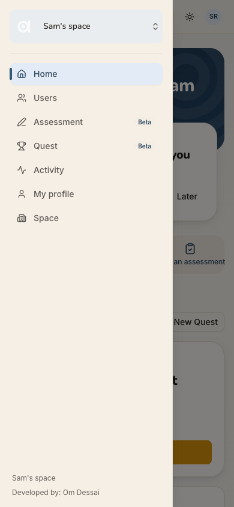

> Expected: an item for making or managing spaces. Observed: the "Sam's space" switcher, then Home, Users, Assessment
> Beta, Quest Beta, Activity, My profile, Space.

**What Sam notices:** "Space" sounds like the place to make one.

### Step 12 — Tap "Space" (dead end)

> Expected: a way to make or name a space. Observed: the personal space's settings. "Set by the platform" lists Name,
> Palette, "Lessons are recorded on", and "This space may use", then "To change the name ... ask the platform
> administrator". Below are the space code VVS5-HSJ4 (join with the code on), curricula, the Assessment and Quest
> switches, Leave and Delete.

**What Sam notices:** Sam cannot even rename this to "Rivera Math Club", and nothing here starts a new space. Sam
backs out.

### Step 13 — Open the menu again and tap the space switcher

> Expected: a list of spaces with "New space". Observed: "Spaces: Sam's space (Admin) ✓" and "All spaces", with no
> start item.

**What Sam notices:** a short menu with one way on, "All spaces".

### Step 14 — Tap "All spaces"

> Expected: somewhere to start a space. Observed: "Spaces", then Your spaces (Sam's space, Here now), Join with a
> code, and at the bottom "Start a space — For your family or your students: assessments answered by hand, with a PDF
> for you, and Quest ... you can invite people next". It has "Name your space" (placeholder "The Patel family") and
> Start the space.

**What Sam notices:** at last "your students" and "invite people". This is the third place Sam looked.

### Step 15 — Type "Rivera Math Club"

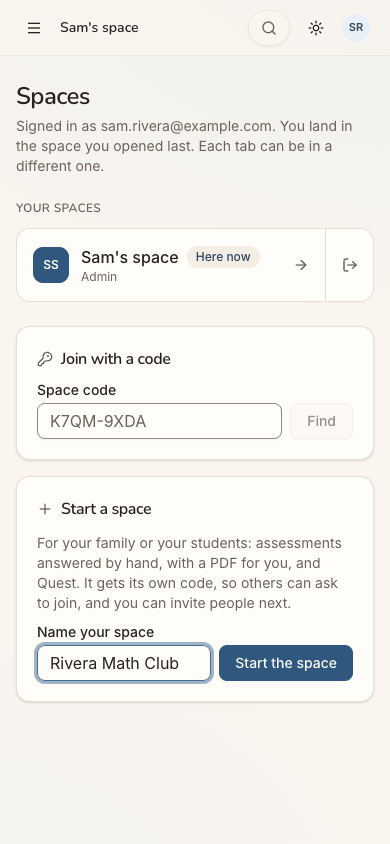

> Expected: the button enables. Observed: "Start the space" turns blue.

**What Sam notices:** one field and one button. Simple.

### Step 16 — Tap "Start the space": "Invite people" (landing)

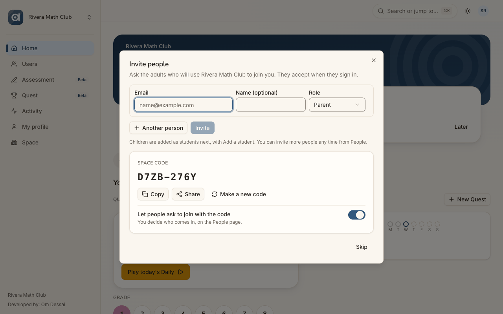
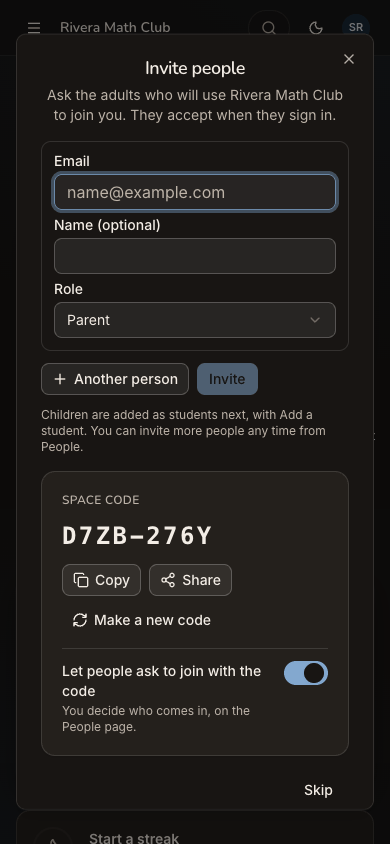

> Expected: the new space, ready to invite. Observed: at once, the tab is "Rivera Math Club" and "Invite people" opens.
> "Ask the adults who will use Rivera Math Club to join you. They accept when they sign in." It has Email, Name
> (optional), Role (Parent), "+ Another person" and Invite. Under them: "Children are added as students next, with Add
> a student. You can invite more people any time from People." The space code D7ZB-276Y has Copy and Share, and Skip
> closes the dialog. Behind it, the new space's home is the same player board as Sam's space.

**What Sam notices:** the right next step, clearly worded. Students come next, which matches how Sam thinks about a
club.

### Step 17 — Type Ana's email and name, open Role

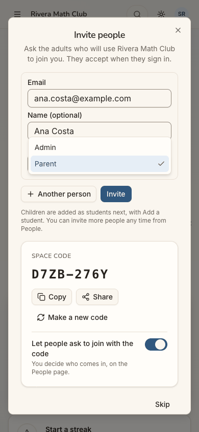

> Expected: Parent among the roles. Observed: Admin and Parent; Parent is the default.

**What Sam notices:** Parent is there. No teacher or helper role, but Sam does not need one yet.

### Step 18 — Choose Parent, tap Invite

> Expected: Ana listed as invited, with a way to tell her. Observed: the toast "Invitation made." and an INVITED
> section: "No email is sent from this space. Copy each invitation, or share it, so they know to sign in." Its row
> reads "✓ a.." with Copy invitation and Share. The form clears for the next person.

**What Sam notices:** honest that no email goes out, which is good. But who is "a.."?

### Step 19 — Tap "Copy invitation"

> Expected: a message ready to paste. Observed: the toast "Invitation copied."; the clipboard holds "Sam Rivera
> invited you to Rivera Math Club on Aimtrue. Sign in at http://localhost:8797 with ana.costa@example.com."

**What Sam notices:** short and personal. It does not say "with Google" or give the club's code.

### Step 20 — Tap "Continue"

> Expected (owner's rule for a space without Tutoring): on to the home or to adding a student, with no tour.
> Observed: "Welcome to Rivera Math Club, Sam — A quick tour of the portal, and guided setup for a new student" with
> "Take the tour", "Add a student" and "I'm done".

**What Sam notices:** "Add a student" is what Sam needs before any assessment. The tour is skipped.

### Step 21 — Tap "Add a student"

> Expected: a short way to add a child to the club. Observed: "The family first, then the student, their assessment,
> their plan and a tutor." Then "First, the family: Every student needs a parent or guardian on file, who is billed
> and kept informed." The step has "An existing parent" with Use this family, "This is my child" and "Create a family
> account". The card runs past the dialog's right edge.

**What Sam notices:** "billed" and "a tutor" in a free club. Sam pauses before going on.

### Step 22 — Choose Ana Costa, "Use this family", then "Add the student"

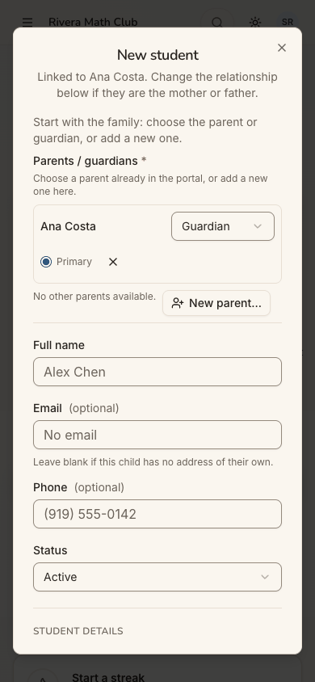

> Expected: the parent just invited, offered as the family. Observed: Ana Costa is in "An existing parent" before she
> has accepted. "Now the student" ("A child with no email of their own needs none") leads to Add the student, which
> opens "New student", linked to Ana Costa (Guardian, Primary). It asks for Full name, Email (optional), Phone
> (optional) and Status.

**What Sam notices:** Ana is already there to choose. The family link is done for Sam.

### Step 23 — Type "Leo Costa" and "Grade 4", tick the consent box

> Expected: name, grade and consent. Observed: Student details (School, Current math course / grade, Goal for this
> academic year), an "Available for virtual tutoring" checkbox, and the consent checkbox "I am this student's parent
> or guardian, or have their permission ... including answers they write on the canvas." The buttons are Add user and
> Cancel.

**What Sam notices:** the consent box is right for a club. "Available for virtual tutoring" and "Add user" do not
fit.

### Step 24 — Tap "Add user"

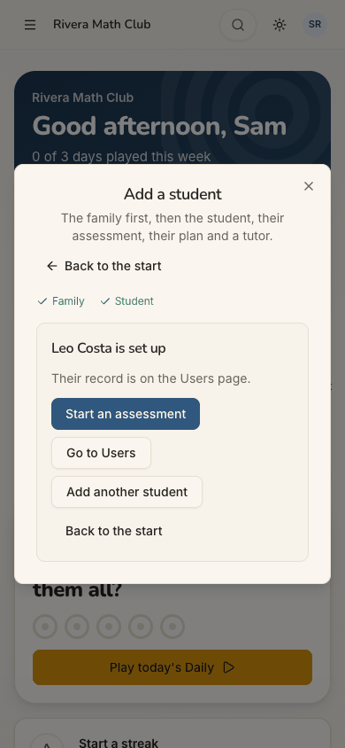

> Expected: the student made, and a way on to the assessment. Observed: the toast "Leo Costa added.", and "Leo Costa
> is set up — Their record is on the Users page", with Start an assessment, Go to Users, Add another student and Back
> to the start. Family ✓, Student ✓.

**What Sam notices:** "Start an assessment" is the first button, exactly what Sam came for.

### Step 25 — Tap "Start an assessment" (landing)

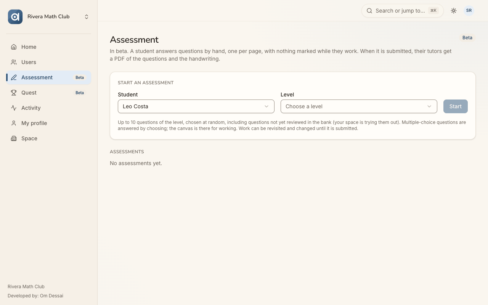
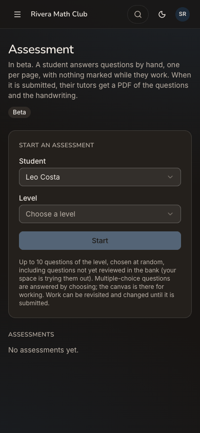

> Expected: the assessment form with Leo chosen. Observed: "Assessment — In beta. A student answers questions by
> hand ... their tutors get a PDF". Start an assessment has Student "Leo Costa", preselected, and Level "Choose a
> level"; Start is disabled. Below: "No assessments yet."

**What Sam notices:** Leo is already chosen, so only the level is left. "Their tutors" again.

### Step 26 — Open Level

> Expected: Grade 4, ideally preselected. Observed: K, G1 ... G8, Math 1, Math 2, Applied Logic, ..., BA1-BA5 and
> AoPS. Every row reads "· 10 questions · includes unreviewed". Nothing is preselected.

**What Sam notices:** codes, but readable to a maths teacher. G4 it is.

### Step 27 — Choose G4 and tap Start: question 1 (landing)

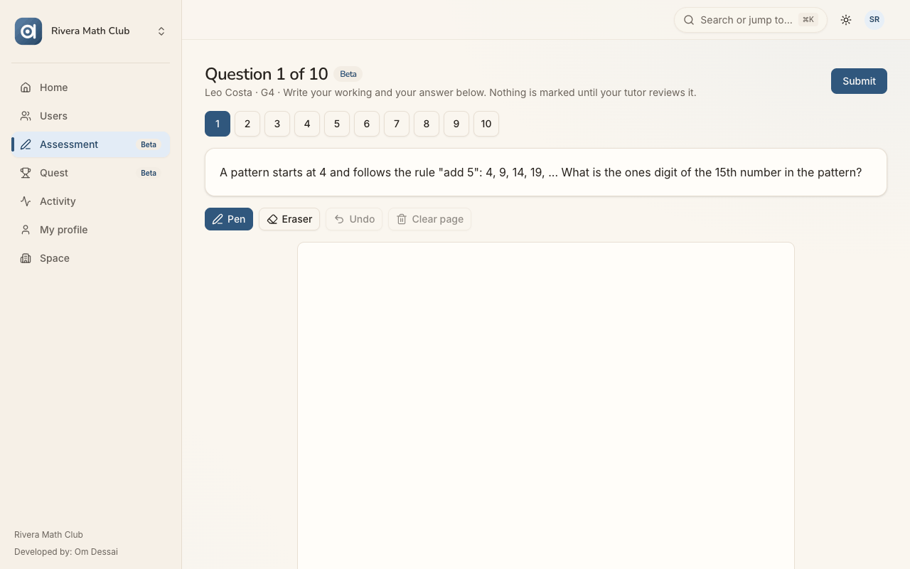
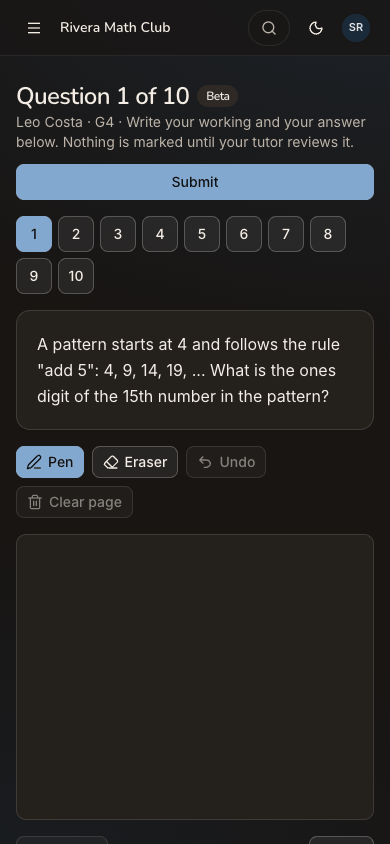

> Expected: the assessment's first question. Observed: "Question 1 of 10 Beta — Leo Costa · G4 · Write your working
> and your answer below. Nothing is marked until your tutor reviews it." The page has Submit, question pills 1-10, the
> question ("A pattern starts at 4 and follows the rule "add 5" ... ones digit of the 15th number?"), Pen, Eraser,
> Undo, Clear page, a canvas, and Previous and Next. After a reload: the same question 1 of 10, same assessment.

**What Sam notices:** it works, and the canvas is inviting. But Leo has no account of his own, so this opens on
Sam's screen. Sam wonders how Leo will take it, and "your tutor" is not Sam's title.

## Appendix

- **Mode:** live. The web app at `http://localhost:8797` is a frozen copy of commit `2d6e7d3` with sign-in on. It was
  driven in headless Chrome at 390×844 (phone), plus 1280×800 and dark mode at the landing steps (1, 7, 10, 16, 25,
  27). There were two stages in one browser profile: steps 1-7, then the platform admin's approval, then steps 8-27
  in a new tab.
- **Frameworks applied:**
  - cuj-contract: every step against its expected result.
  - task-completion: the journey ran to its defined end, an assessment started in the new space with question 1 on
    screen.
  - success-criteria: the end state was checked again after a reload at step 27; the same assessment and question
    1 of 10 came back.
- **CUJ manifest:** J06, 27 steps, all 27 verified.
- **Coverage / not inspected:**
  - The Terms and Privacy pages' content. Their links open a new tab, which the driver does not follow (between steps
    4 and 5).
  - Whether Sam was told of the approval outside the page (an email). No mailbox was available. The screens at steps
    7 and 8 say nothing about one.
  - The approval itself: the platform admin approved Sam in the console, a separate agent's step outside this journey.
  - "Contact us" was read from its link, not sent.
  - Paths not taken:
    - the tour ("Take the tour", step 20);
    - "Share" (the system share sheet) and the space code's Copy/Share;
    - "+ Another person";
    - "This is my child" and "Create a family account";
    - "Make this my home" and "Running the space";
    - the new space's home after the wizard (seen only behind dialogs, at steps 16-24);
    - the People/Users page, the Activity page and the account menu.
  - Ana's side of the invitation, which is J09.
  - Answering, submitting and reviewing the assessment, and its PDF. The journey ends at question 1. How Leo, who has
    no sign-in, would take the assessment on his own device was not explored.
  - Keyboard-only and screen-reader use. The accessibility tree was read only to find controls.
  - The iOS app, which is covered by separate journeys (J06A).
  - Other sign-in providers (the production web offers Google only).
- **Access:** through the app's real sign-in and sign-up screens; the Google provider step is simulated (a stand-in for
  Google's button hands the app a local test token for the persona).
- **Preconditions made outside the UI:** none by this journey. The run's platform settings were set through the console
  API before the journeys, as `docs/userjourney/README.md` "The run" records: web sign-in Google only with sign-up
  open, sign-up access Post-approved, guest play and the Daily on. Between the two stages the platform admin approved
  sam.rivera@example.com in the console.
- **Left in the local database by this journey** (for the agents that follow): the space "Rivera Math Club" (code
  D7ZB-276Y, joining by code on) with Sam as admin; Ana Costa (ana.costa@example.com) invited as Parent, not yet
  accepted; Leo Costa, a student with no email, Ana as his primary guardian; and Leo's G4 assessment, started and not
  submitted.
