# CUJ Audit — J06A: teacher signs up in the app from Sign in, starts a space, invites, starts an assessment

## Executive summary

**Who:** Pat Quinn, 51 (born October 1975). Pat is a maths teacher who wants a space for an evening class: its
students and their parents. Pat will own a space, which is cohort **C1** in `docs/member-home-plan.md` ("What needs me
today?"). Pat also gives assessments, which is cohort **C7** ("give one, see results"; Start an assessment in at most
two taps). Pat opens the iPhone app as a signed-out guest. Pat does not want to play, so Pat ignores the sign-up offer
and uses **Sign in**, with an address the app has never seen. The plan is a space called "Quinn Learning Lab", an
invitation to one parent, Jo Baker, and an assessment. This is the app replay of the web journey J06
(`J06-start-a-space.md`).

**Outcome: 1/1 journeys passed, 0 skipped, 42 of 42 steps verified.**
- **Day 1, signing up (steps 1-11).** Sign in with the unknown address offered "Sign up as pat.quinn@example.com".
  The About-you screen took the name, October 1975 and the terms. It ended on a full-screen "Waiting for approval".
- **Day 2, signing in (steps 12-14).** The platform admin approved Pat in the web console. A day later the app
  reopened on the same guest home. Sign in took Pat into "Pat's space", a personal space Pat never asked for, whose
  home is a practice board.
- **Finding "Start a space" (steps 15-21).** It took the fifth place Pat looked. The home (two screens of scrolling),
  the big yellow (+) and More > Space were dead ends. The account sheet's "All spaces" finally showed the card, this
  time without scrolling.
- **Inviting (steps 22-28).** The path is good from here. The new space opened on "Invite people", and Parent is
  offered (Admin and Parent only). Jo's row shows her full address and the whole invitation text. There is no "Copy
  invitation" button, only Share. The iOS share sheet's Copy put the text on the clipboard, with no confirmation.
- **The assessment (steps 29-37).** The welcome wizard (which still offers the tour) led through a four-step "Add a
  student" for Ella Baker, with Jo, who has not accepted yet, as the family. Then "Ella Baker's first assessment"
  offered Start with Ella chosen. Question 1 of 10 (G4) was on screen at step 37. Its fourth choice was hidden below
  the card.
- **End-state check (steps 38-42).** The app was closed and reopened. It landed in Quinn Learning Lab, where the
  assessment was found several screens down the home ("Recent assessments", Continue). It resumed on the same
  question 1. The same part of the home also lists "1 invitation not yet accepted".

**Conversion figures** (from the entry point, the app's first screen). The address (twice) and the name are typed
into the developer sign-in, which stands in for the provider step; see the Appendix.

| Stretch | Screens | Taps | Inputs | Waits | Dead ends |
| --- | --- | --- | --- | --- | --- |
| Day 1: guest home to "Waiting for approval" (steps 1-11) | 4 (+ the sign-in error state) | 12 (+3 scrolls, +1 scroll inside the month list) | 3 typed (address, name, year search), 2 pickers, 1 checkbox | 1 (the approval, open-ended) | 0 |
| Day 2: relaunch to the first home (steps 12-14) | 3 | 3 (+1 scroll) | 1 typed (address) | 0 | 0 |
| Home to "Start a space" (steps 15-21) | 6 new (home scrolled, Create, More, Space, account sheet, Spaces) | 7 (+7 scrolls) | 0 | 0 | 3 (home, Create, Space page) |
| Start the space, invite, copy (steps 22-28) | 3 new (Invite people, share sheet, Welcome) | 9 (+1 scroll) | 3 typed (space name, email, name) | 0 | 0 |
| Add a student, start the assessment (steps 29-37) | 7 new (intro, steps 1-4, Assessment, question) | 13 | 2 typed (name, course), 1 checkbox | 0 | 0 |
| **Whole journey (steps 1-37)** | **20 distinct** | **44** | **9 typed (3 only for the developer sign-in), 4 other (2 pickers, 2 checkboxes)** | **1: the approval, unbounded and unannounced** | **3** |

The web journey took 33 taps, 5 typed fields and 1 dead end.
- **Taps.** The app costs more because finding "Start a space" has two more dead ends: the yellow (+), and the home,
  which is longer.
- **Inputs.** The developer sign-in adds three typed fields.
- **The student.** The four-step student flow is longer than the web's one form.

From the first home to question 1 it was 29 taps. For C7, the assessment came 14 taps after the invitation was copied,
not two, because a student had to be made first. The guided flow kept those taps easy.

For **conversion**, the work is quick once Pat is on the Spaces page. Every screen hands on to the next: Invite people,
Add a student, then "Ella Baker's first assessment". Like the web, the cost is in the gaps:
- an approval wait that promises nothing;
- a first home that does not know Pat is a teacher;
- "Start a space" kept behind the account sheet, while the most prominent "create" button, the yellow (+), offers
  everything but a space.

For **stickiness**, the app does better than the web saw. After a relaunch, the new space's home does carry what Pat
runs:
- Ella's assessment, "In progress", with Continue;
- "Needs you: 1 invitation not yet accepted";
- "Running the space" under "Make this my home".

All of it sits several screens below Today's 5, a Grade 1 Daily and a streak (steps 39-41).

**The 3 screens Pat would notice most:**

- **Step 11, "Waiting for approval".** Pat has said nothing about being a teacher, and the screen says nothing about
  what happens next. It does not say who approves, how long it takes, or whether Pat will be told. The biggest button
  is "Contact us". For a teacher planning around next week's class, an open-ended wait is where the plan can quietly
  stop.
  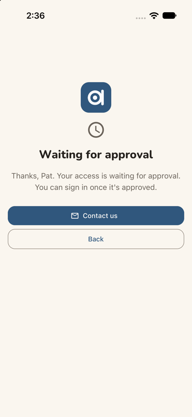
- **Step 17, the yellow (+).** This is the most prominent button in the app, and it reads as "make something". It
  offers "Start an assessment", "Add a student" and "Add someone else", but not a space. It is the second of three
  dead ends before Pat finds "All spaces" in the account sheet.
  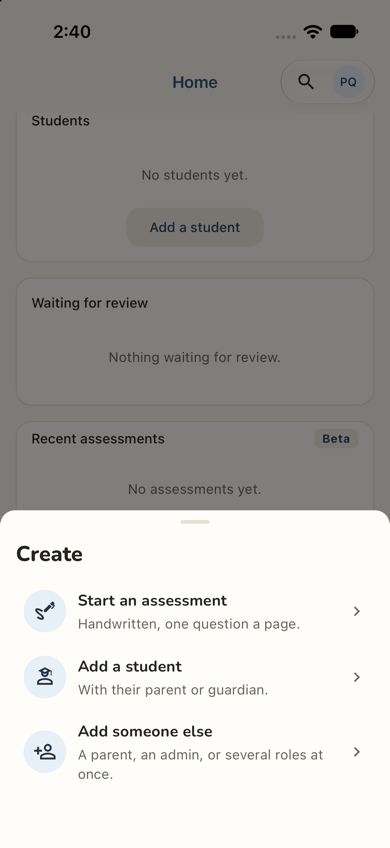
- **Step 37, the first question.** Pat is about to hand the phone to Ella. The card shows A liter, B milliliter and C
  centimeter. The fourth choice, D kilogram, is hidden below the card's edge, with nothing to say the card scrolls (step
  38). The header also says "Nothing is marked until your tutor reviews it", and Pat is not a tutor.
  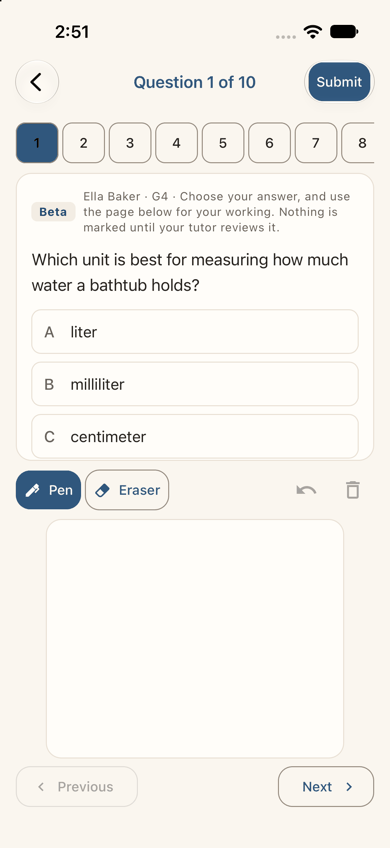

**Contact sheet** (all 42 phone steps):

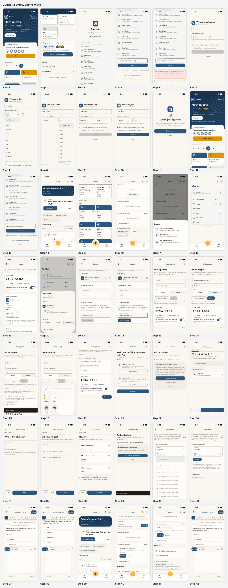

**Web and app.** Compared with the web journey J06 (`J06-start-a-space.md`, Sam Rivera), the app differs in nine ways:

- **Getting in.** "Sign in" opens a sign-in screen. In this build that is the developer sign-in, not the web's "Sign up
  free" sheet, so the web's sev2 on that title does not apply as seen here. An unknown address gets a red error with
  "Sign up as …". Production's provider screen was not seen. The About-you form is a full screen (not a sheet) with
  the same words, "Only whether you are over 18 is kept". The year list has a search box ("Type a year"), where the
  web has a 100-row select. The month list has a search box too, and October sits below its visible edge.
- **The wait.** "Waiting for approval" fills the screen. It does not have the web's leftover "Almost there" heading,
  and it has a "Back" button beside "Contact us". The wording is the same, and so is the silence.
- **Where spaces live.** The app has no menu drawer or space switcher.
  - More has "Space", the same dead end as the web.
  - The yellow (+) is an extra dead end that the web does not have.
  - "All spaces" sits in the account sheet behind the initials.
  - On the Spaces page, "Start a space" is visible without scrolling. The web had it at the bottom.
  - The page still says "Each tab can be in a different one."
- **The invited row.** The row shows "jo.baker@example.com · Parent" and the whole invitation text, which fixes the web
  phone's "a..". It has one button, "Share", and no "Copy invitation". The space code has Share and "Make a new code"
  but no Copy. The text itself is the web's, word for word.
- **Add a student.** It is a guided four-step flow with a review, where the web has one dialog and then the "Add user"
  form.
  - The intro drops the web's "billed", "plan" and "a tutor". Step 1 brings "billed" back.
  - There is no "Available for virtual tutoring" checkbox, and the button says "Add student", not "Add user".
- **Handing over the device.** After the student is added, "Ella Baker's first assessment: … choose the level, then
  hand them the phone or tablet." This answers the web report's open question, how a child without a sign-in takes
  it.
- **The level picker.** It opens by itself with Ella preselected. It has the same codes (K, G1 … G8) and the same "·
  10 questions · includes unreviewed" on every row. G4 is still not preselected from "Grade 4".
- **The first question.** On the web, question 1 was free-text with a canvas. Here it was multiple choice, with the
  fourth choice hidden inside a scrolling card. The questions are drawn at random, so the type differing is not itself
  a parity issue. The hidden choice is.
- **Coming back.** The web checked a reload of the question page. The app was closed and reopened: it landed in the
  space opened last, and the assessment was found from the home's "Recent assessments", several screens down. The web
  never saw the new space's home outside its dialogs.

| Severity | Count |
| --- | --- |
| sev4 (catastrophe) | 0 |
| sev3 (major) | 2 |
| sev2 (minor) | 6 |
| sev1 (cosmetic) | 4 |
| **Total** | **12** |

## Prioritized fixes

1. [sev3] [Starting a space is behind three dead ends, including the big plus button](#sev3-starting-a-space-is-behind-three-dead-ends-including-the-big-plus-button): put "Start a space" in the (+) sheet, on a new adult's first home and on the Space page (steps 14-21).
2. [sev3] [The approval wait is silent, and the relaunch shows nothing](#sev3-the-approval-wait-is-silent-and-the-relaunch-shows-nothing): say who approves, how long it takes and how Pat will hear; greet the approved account on the next launch (steps 11-12).
3. [sev2] [The home leads with a child's practice board, and what Pat runs is at the bottom](#sev2-the-home-leads-with-a-childs-practice-board-and-what-pat-runs-is-at-the-bottom): ask one question at sign-up; lead a space its admin started with "Needs you" and the open assessments (steps 1-2, 6, 14, 39-41).
4. [sev2] [The fourth answer choice is hidden below the question card](#sev2-the-fourth-answer-choice-is-hidden-below-the-question-card): let the question card grow, or show a scroll cue (steps 37, 38, 42).
5. [sev2] [The parent rows in Add a student have no accessible name](#sev2-the-parent-rows-in-add-a-student-have-no-accessible-name): give each row the person's name and a radio role (steps 30-31).
6. [sev2] [A space without Tutoring still speaks of billing, tutors and plans](#sev2-a-space-without-tutoring-still-speaks-of-billing-tutors-and-plans): word the student and assessment screens from the space's sets (steps 19, 30, 32, 35, 37).
7. [sev2] [The welcome wizard offers the tour in a space without Tutoring](#sev2-the-welcome-wizard-offers-the-tour-in-a-space-without-tutoring): apply the owner's tour rule to the wizard's welcome screen (step 28).
8. [sev2] [The invitation does not say how to sign in or what the space is](#sev2-the-invitation-does-not-say-how-to-sign-in-or-what-the-space-is): name the sign-in, the space's code and its purpose (steps 25-27).
9. [sev1] [Copy invitation is promised, but only Share is offered](#sev1-copy-invitation-is-promised-but-only-share-is-offered): add a Copy button with a toast, as on the web (steps 25-27).
10. [sev1] [October is hidden in the month list, and the year list starts at 2026](#sev1-october-is-hidden-in-the-month-list-and-the-year-list-starts-at-2026): show all twelve months, and open the year list near adult years (steps 7-9).
11. [sev1] [Levels read in codes, and web words remain](#sev1-levels-read-in-codes-and-web-words-remain): name levels in words, preselect the student's, drop "tab" and "portal" (steps 21, 28, 35).
12. [sev1] [The plus button covers the Needs you row while scrolling](#sev1-the-plus-button-covers-the-needs-you-row-while-scrolling): pad the home's end so no row stops under the (+) (step 40).

## Findings

### [sev3] Starting a space is behind three dead ends, including the big plus button

- **Issue Description:** Pat came to start a space. After approval, the app puts Pat in "Pat's space", a personal space
  it made by itself (step 14). Its home is a player board: Today's 5, quick actions, a streak, tiles. Pat looked in four
  places before the fifth:
  - **The home** (steps 15-16). Seven scrolls past Beast Academy and Math 1 tiles reach a Students card, assessments and
    "Make this my home". There is no "Start a space".
  - **The yellow (+)** (step 17). The tab bar's biggest, brightest button opens "Create" with "Start an assessment",
    "Add a student" and "Add someone else". It has no space.
  - **More > Space** (steps 18-19). This is the personal space's settings: its code, and "Set by the platform" with Name
    "Pat's space". The page says "To change the name … ask the platform administrator". Pat can neither rename it to
    "Quinn Learning Lab" nor start one there. This is the web's dead end too.
  - **The initials** (step 20) open an account sheet. Under "Spaces" it has "All spaces: Invitations, codes, starting
    or leaving a space". This is the first time anything says "starting".
  - **"All spaces"** (step 21) shows the "Start a space" card ("For your family or your students … you can invite
    people next"), visible without scrolling.

  It took 7 taps and 7 scrolls from the first home, with 3 wrong turns. The card itself is clear, and everything after
  it is well guided.
- **Framework Violation:** cuj-contract, steps 14-21. Expected: from the first screen after approval, a visible way to
  start the space Pat came for. Observed: none on the home, in Create or on the Space page. It is found only behind
  the initials. Nielsen #6 Recognition rather than recall; Nielsen #4 Consistency and standards (the app's own "Create"
  does not create the thing this cohort came to create).
- **Severity:** 3. Classify: workaround needed. Starting a space is this cohort's whole reason to sign up, and the app
  answers with a space Pat did not ask for. A teacher who never thinks to tap their initials stays on a child's
  practice board, and may decide the product is not for classes. It is not a 4: the path exists, and Pat found it.
- **Evidence:** 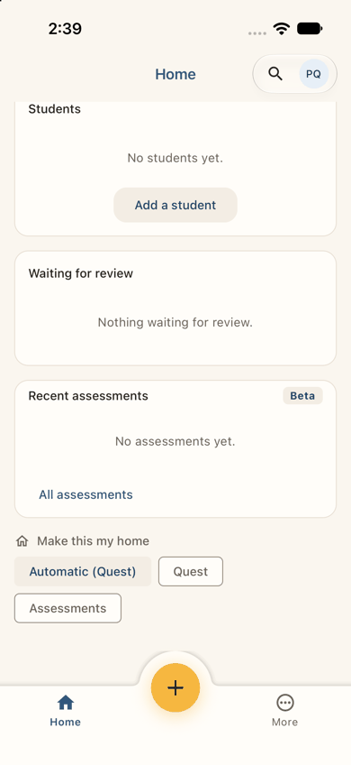 
  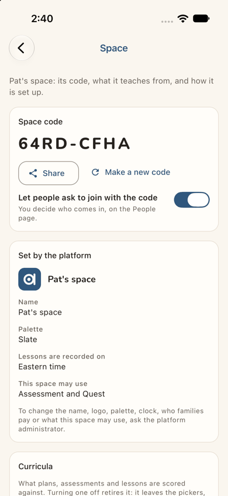 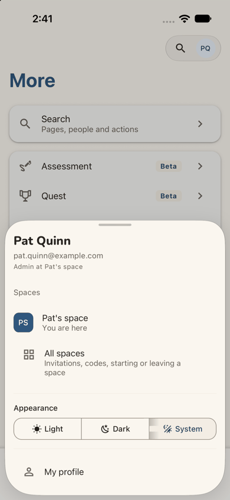
  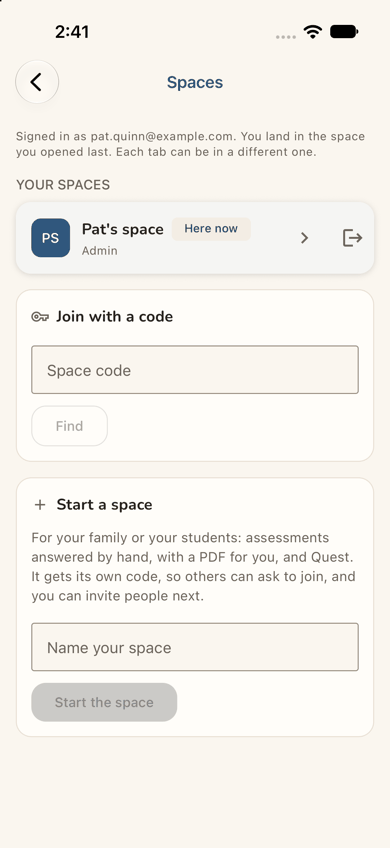
  Repro: sign up and be approved under Post-approved, then sign in. Scroll the home, tap (+), then More > Space. Back,
  tap the initials, then All spaces.
- **Recommended Fix:** Make "Start a space" one tap from wherever a new adult lands:
  - a "Start a space" row in the (+) Create sheet, for adults;
  - a "Start a space for your class or family" card on the personal space's home, while the person has no other space;
  - a "Start another space" link on the Space page, beside the locked name.

  Consider letting the owner of a personal space rename it, or turn it into the class's space.

### [sev3] The approval wait is silent, and the relaunch shows nothing

- **Issue Description:** After Continue (step 11) the app fills the screen with the logo, a clock, "Waiting for
  approval" and "Thanks, Pat. Your access is waiting for approval. You can sign in once it's approved."
  - It does not say who approves, how long it usually takes, or whether Pat will be told.
  - The filled, most prominent button is "Contact us". "Back" is secondary.

  A day later (step 12) the app reopens on exactly the same guest home. Nothing says the account is ready, so Pat
  tries "Sign in" on a hunch.
- **Framework Violation:** cuj-contract, step 11 (expected: told what happens next; observed: told only that it waits)
  and step 12 (expected: a sign the account is ready; observed: none). Nielsen #1 Visibility of system status.
- **Severity:** 3. Classify: workaround needed. Pat must remember, unprompted, to come back and try again, with no
  idea when that would work. A teacher setting up for a class works to a timetable, and an open-ended wait with no
  promise is where the plan can stop. It is not a 4: signing in after the approval works (step 14). It is the same
  rating as the web J06, for the same cohort.
- **Evidence:**  
  Repro: Sign-up access Post-approved. Fresh app, Sign in with an unknown address, then "Sign up as …". Give the name,
  month, year and terms, and tap Continue. After the console approves, relaunch the app without clearing it.
- **Recommended Fix:** Give the wait three lines:
  - "We check new accounts by hand, usually within a day."
  - "We'll email you at pat.quinn@example.com when you're in." Make that true with one plain message on approval.
  - who "we" are.

  Make "Keep exploring" (back to the guest home) the main button and "Contact us" the secondary one. On the next
  launch, show "Your account is ready: Sign in" on the guest home.

### [sev2] The home leads with a child's practice board, and what Pat runs is at the bottom

- **Issue Description:** No screen learns that Pat is a teacher, and no home leads with running a class:
  - **The guest home** (steps 1-2) speaks to players and families: grade circles, "Play today's 5", "Create a free
    family space", and questions about "my child".
  - **The About-you screen** (step 6) asks only for a name, a birth date and the terms.
  - **Pat's space** (step 14) opens on "Good afternoon, Pat / Start a streak", Today's 5 and "0 of 3 days this week".
  - **Quinn Learning Lab after a relaunch** (step 39) shows the same board.

  What Pat runs is there, but at the bottom (steps 40-41), several screens down, under Grade 1 and Beast Academy
  tiles:
  - "Students: Ella Baker, In progress, Continue";
  - "Recent assessments: Ella Baker G4 In progress, Continue / Discard";
  - "Needs you: 1 invitation not yet accepted, 0 asking to join".

  "Make this my home" offers "Running the space", but the home stays on "Automatic (Quest)" for the person who just
  started the space.
- **Framework Violation:** cuj-contract, steps 1-2 and 6 (expected: something that says the product fits a teacher;
  observed: only players and families) and steps 14 and 39 (expected: a home that leads with running the space for
  its admin; observed: a player's board). Nielsen #2 Match between system and the real world; Nielsen #8 Aesthetic and
  minimalist design (what matters to this reader is the last thing on the page).
- **Severity:** 2. Classify: real friction for conversion and stickiness. A teacher cannot tell before signing up that
  the product serves a class. Afterwards the reason to come back ("Jo hasn't accepted", "Ella's assessment is open")
  sits below a child's board. It does not block the journey: the content exists and Continue works (step 42).
- **Evidence:** 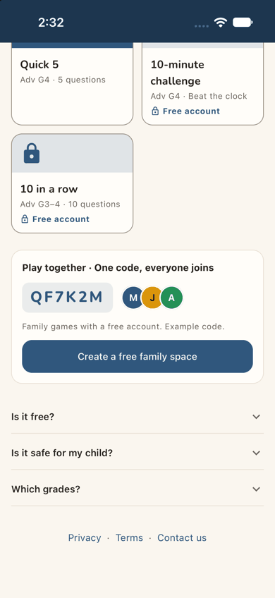 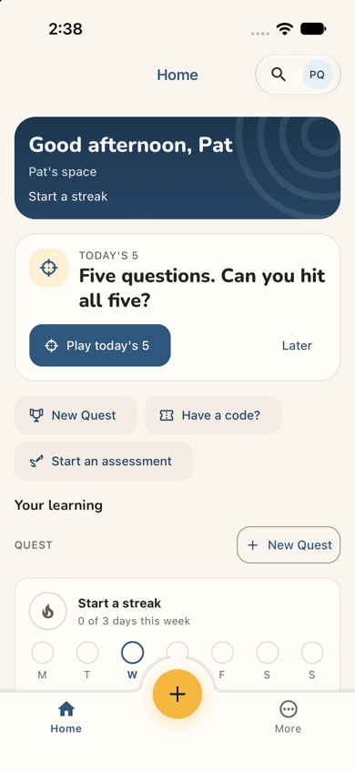
  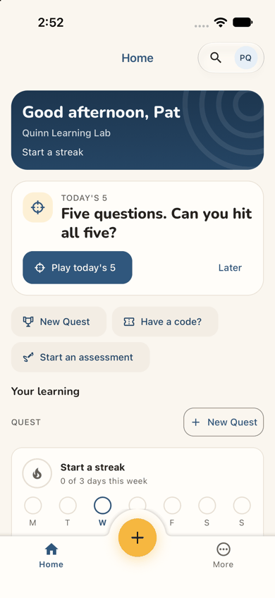 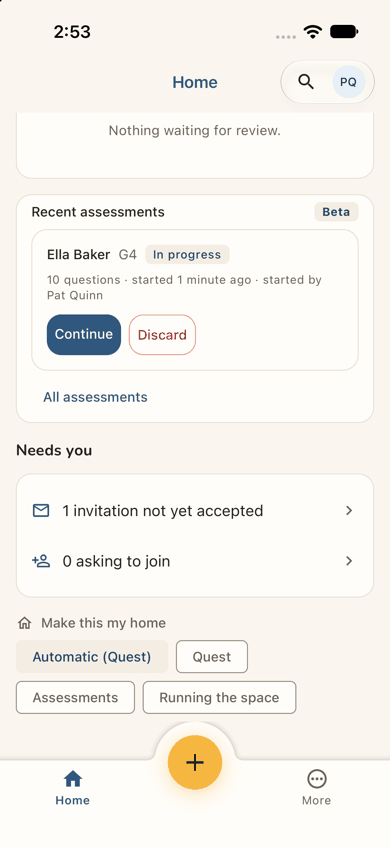
  Repro: start a space, add a student and start an assessment, then close and reopen the app. Scroll the home to
  "Recent assessments" and "Needs you".
- **Recommended Fix:**
  - Add one line and one door for teachers to the guest home: "Run a class or club? Start a free space for your
    students and their parents."
  - Ask one question at sign-up, "What brings you here? Play / My child / My class", and store one word, as
    `arrived_via` already is.
  - In a space its admin started, lead the home with the office hat: Needs you, the open assessments and the space
    code. Keep the Quest board below them.

### [sev2] A space without Tutoring still speaks of billing, tutors and plans

- **Issue Description:** Quinn Learning Lab may use Assessment and Quest only, and Pat is its only adult. The app's
  guided flow is better worded than the web's dialog, but tutoring words remain:
  - **Add a student, step 1** (step 30): "Who is their family? The parent or guardian who is billed and kept informed."
    The intro one screen before (step 29) said only "kept informed".
  - **School and goal** (step 32): "Becomes the goal of their learning plan when one is set."
  - **The Assessment page** (step 35): "When it is submitted, their tutors get a PDF".
  - **The question page** (step 37): "Nothing is marked until your tutor reviews it".
  - **The Space page** of the personal space (step 19): "Lessons are recorded on Eastern time" and "who families
    pay".

  Separately, Invite people sends Pat to "People" ("You can invite more people any time from People"), and More calls
  that page "Users" (steps 18, 23).
- **Framework Violation:** cuj-contract, steps 30, 32, 35 and 37 (expected: words that fit a class without Tutoring;
  observed: billing, plans and tutors). Nielsen #2 Match between system and the real world; Nielsen #4 Consistency and
  standards. The project's rule (CLAUDE.md, Phase 50) is that a space without Tutoring has "no tutor role and no
  tutoring fields".
- **Severity:** 2. Classify: an observable mismatch. For a teacher about to invite parents, "billed" suggests a
  charge Pat cannot explain. "Your tutor" misnames Pat to the child holding the phone. No step is blocked.
- **Evidence:** 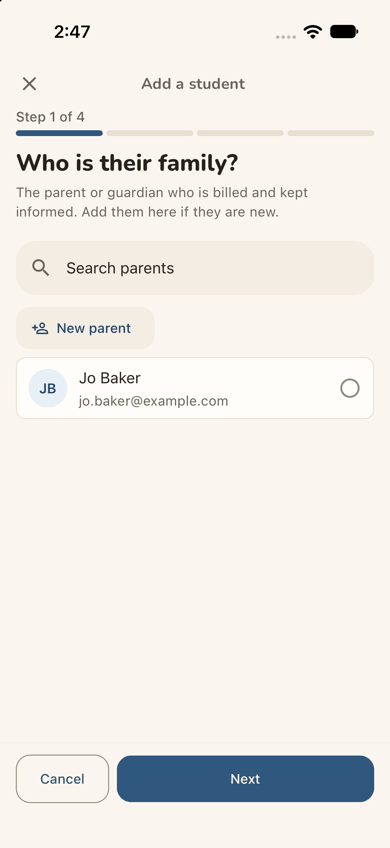 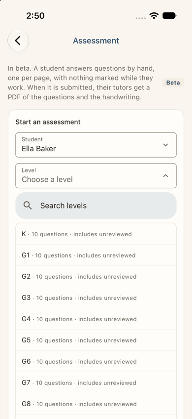
  
  Repro: start a space, then Continue > Add a student > Add the student, and read step 1. Finish the student, then
  Start an assessment and Start.
- **Recommended Fix:** Word these screens from the space's sets. Where Tutoring is off:
  - "The parent or guardian who is kept informed", with no "billed";
  - "your teacher" or "the space's admins get a PDF";
  - "Nothing is marked until it is reviewed";
  - no "learning plan" hint.

  Name the people page one way everywhere, "People" or "Users".

### [sev2] The welcome wizard offers the tour in a space without Tutoring

- **Issue Description:** After Continue on Invite people (step 28), "Welcome to Quinn Learning Lab, Pat — A quick tour
  of the portal, and guided setup for a new student" offers "Take the tour" ("The dashboard and the menu, one part at
  a time"). Quinn Learning Lab has no Tutoring. The owner's rule (CLAUDE.md, 2026-11-04) is that the wizard's tour,
  its first-visit offer and "Getting started" appear only where Tutoring is on, and that a just-started space's
  "Invite people" step still opens. Invite people opened as it should. The welcome screen after it still offers the
  tour, and says "portal". This is the same as on the web (J06 step 20).
- **Framework Violation:** cuj-contract, step 28 (expected under the owner's rule: Invite people, then "Add a student"
  or the home, with no tour; observed: the tour offered). Nielsen #8 Aesthetic and minimalist design.
- **Severity:** 2. Classify: an observable mismatch with a decision the owner made that day, on both clients. It
  costs Pat a moment of reading. Pat did not take the tour, so what it shows here was not inspected.
- **Evidence:** 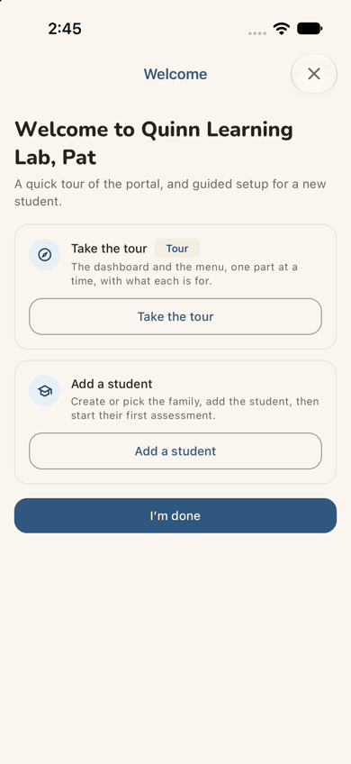
  Repro: start a space from All spaces, invite one person, then tap Continue at the foot of Invite people.
- **Recommended Fix:** Apply the same rule to the wizard's welcome screen in the app and on the web. Where Tutoring is
  off, drop "Take the tour" and go from Invite people straight to "Add a student". A Maestro flow asserting that a
  Quest-and-Assessment space never shows `onboarding-choice-tour` would hold it.

### [sev2] The fourth answer choice is hidden below the question card

- **Issue Description:** Question 1 (step 37) shows the header, the question "Which unit is best for measuring how
  much water a bathtub holds?", and choices A liter, B milliliter and C centimeter. Choice D exists in the
  accessibility tree, but it sits below the card's bottom edge. The card scrolls inside itself, and nothing on screen
  says so: no partial row, no fade, no scroll bar at rest. Swiping inside the card (step 38) reveals "D kilogram".
  After Continue (step 42) the card opens in the same clipped state. The canvas below takes the space the card could
  have used.
- **Framework Violation:** cuj-contract, step 37 (expected: the whole question and all its choices visible before
  answering; observed: three of four). Nielsen #1 Visibility of system status; Nielsen #5 Error prevention.
- **Severity:** 2. Classify: real friction that can produce a wrong answer. A child handed the phone may answer from
  A-C without knowing there is a D, and the answer is marked by code. Here the right answer (A) was visible, so no
  harm was done in this run.
- **Evidence:**  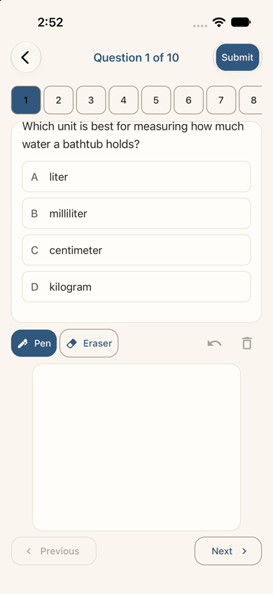
  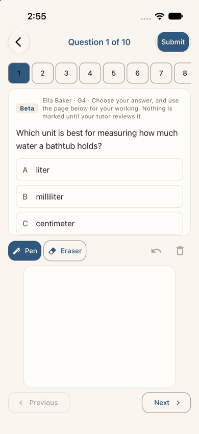
  Repro: on an iPhone 17, start a G4 assessment and open a multiple-choice question with four choices.
- **Recommended Fix:** Let the question card size to its content and scroll the page, or the canvas, instead. Failing
  that, show a fade and a "More choices" cue at the card's lower edge whenever it overflows. Add a Maestro assertion
  that every `assessment-choice-*` is visible on a four-choice question.

### [sev2] The invitation does not say how to sign in or what the space is

- **Issue Description:** The text on Jo's row, and on the clipboard after Copy (step 27), is the web's: "Pat Quinn
  invited you to Quinn Learning Lab on Aimtrue. Sign in at http://localhost:8787 with jo.baker@example.com." It is
  short and clear about who and where. But:
  - it does not say how to sign in. The app offers Google, Microsoft and Facebook in production, so a parent whose
    address belongs to none of them has no way in, and is not told so;
  - it does not give the space's code (TE9A-6ASX), shown on the same screen;
  - it says nothing about what the class or Aimtrue is for;
  - it gives a web address, but no word about the app.

  The screen does say plainly that no email is sent, which is good.
- **Framework Violation:** cuj-contract, steps 25-27 (expected: a message a parent can act on alone; observed: an
  address, with no sign-in method). Nielsen #10 Help and documentation (the message is the invitee's only
  instructions).
- **Severity:** 2. Classify: real friction for the next person's conversion. The invitation is the whole of Jo's
  onboarding. It does not block Pat.
- **Evidence:** 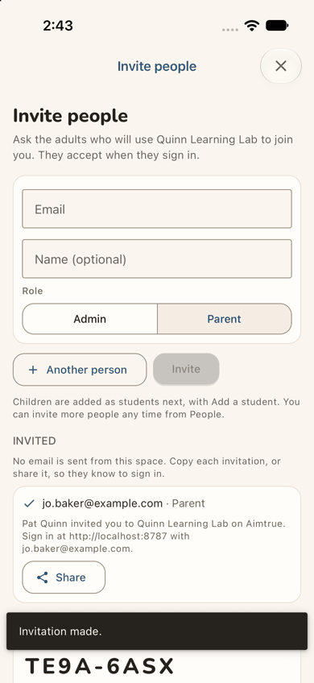 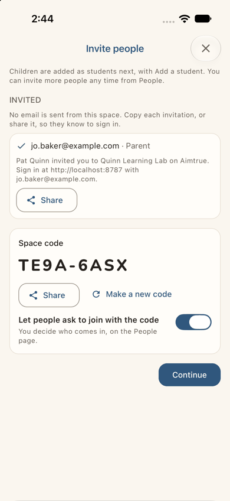
  Repro: in Invite people, invite an email as Parent, then Share > Copy and paste.
- **Recommended Fix:** "Pat Quinn invited you to Quinn Learning Lab on Aimtrue, for maths practice and assessments.
  Open <address> or the Aimtrue app, tap Sign in and continue with the account for jo.baker@example.com (Google,
  Microsoft or Facebook). Space code TE9A-6ASX." Keep it one paragraph so it fits a text message.

### [sev2] The parent rows in Add a student have no accessible name

- **Issue Description:** In "Who is their family?" (step 30), Jo Baker's row is drawn as a card with initials, name,
  address and a round radio. In the app's accessibility tree it is a single element whose only text is "checkbox,
  unchecked". The name and address are not exposed, so the flow could not find the row by "Jo Baker" (step 31). It
  also announces itself as a checkbox while it looks like a radio.
- **Framework Violation:** cuj-contract, step 31 (expected: the family can be chosen by name). WCAG 2.2 SC 4.1.2 Name,
  Role, Value; SC 1.3.1 Info and Relationships.
- **Severity:** 2. Classify: a probable blocker for VoiceOver users at this step: they would hear "checkbox,
  unchecked" with no name, once per parent. Sighted users are unaffected. VoiceOver itself was not run; this rests on
  the accessibility tree the iOS driver reads.
- **Evidence:** 
  Repro: at step 1 of Add a student, run `maestro hierarchy`. The row `add-student-parents-row-<id>` has the text
  "checkbox, unchecked" and no children with the name.
- **Recommended Fix:** Give the row an `accessibilityLabel` of "Jo Baker, jo.baker@example.com" and the radio role and
  state (`accessibilityRole="radio"`, `accessibilityState={{ checked }}`), or let the inner texts through. Check the
  other people-picker rows in the app for the same pattern.

### [sev1] Copy invitation is promised, but only Share is offered

- **Issue Description:** After Invite (step 25), the INVITED section says "No email is sent from this space. Copy each
  invitation, or share it, so they know to sign in." Jo's row has only "Share", and the space code card has "Share"
  and "Make a new code". The web has "Copy invitation" and Copy for the code. Copying goes through the system share
  sheet (steps 26-27). On the simulator that sheet offered Reminders, More, Copy and Save to Files. Its Copy worked:
  the clipboard held the text. But the app says nothing afterwards, where the web toasts "Invitation copied."
- **Framework Violation:** cuj-contract, steps 25-27 (expected: the "Copy" the hint names; observed: Share only, then a
  silent copy). Nielsen #4 Consistency and standards; Nielsen #1 Visibility of system status.
- **Severity:** 1. Classify: cosmetic friction. Share leads to Copy in one more tap, and on a real phone Messages or
  Mail may be what Pat wants anyway.
- **Evidence:**  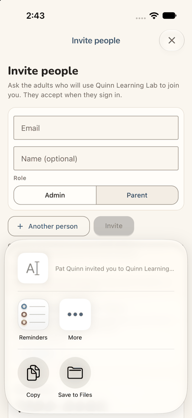
  
  Repro: invite an email in Invite people. Look for Copy on the row, then Share > Copy.
- **Recommended Fix:** Add "Copy" beside "Share" on each invited row and on the space code, with a toast ("Invitation
  copied."), or change the hint to "Share each invitation".

### [sev1] October is hidden in the month list, and the year list starts at 2026

- **Issue Description:** The About-you screen's Month opens a small list box (step 7) with a search box and January to
  September. October, November and December are below the box's visible edge, and only a scroll inside the box
  reaches them (step 8). The first tap at October's half-hidden row did not land. During that first try, Year opened
  beside the still-open Month list, with both dropdowns open at once. That state was not kept as a screenshot. The
  Year list then opens at 2026 ("Showing 8 of 100. Type to narrow it down."). Its search box made 1975 quick (step 9),
  which is better than the web's 100-row select.
- **Framework Violation:** cuj-contract, steps 7-9 (expected: a quick month and year for an adult). Nielsen #7
  Flexibility and efficiency of use.
- **Severity:** 1. Classify: cosmetic friction. It costs a scroll and a few seconds, and the form is otherwise short
  and calm.
- **Evidence:** 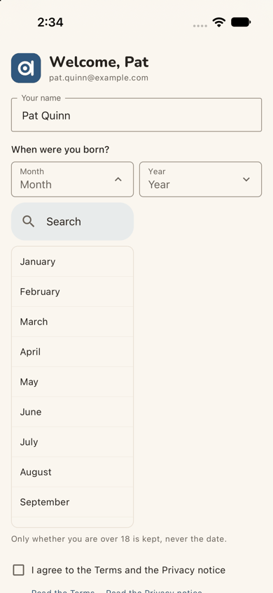 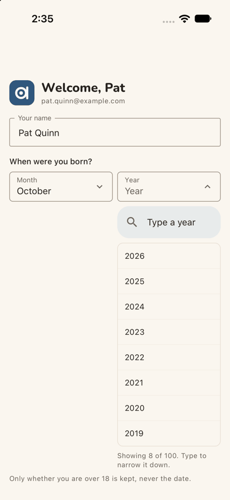
  Repro: on an iPhone 17, open the About-you screen, then tap Month.
- **Recommended Fix:** Show all twelve months without an inner scroll, as a 3×4 grid or the iOS wheel, and drop the
  search box for twelve items. Close one dropdown when the other opens. Open the year list at the youngest age that
  may sign up, or near a typical adult year.

### [sev1] Levels read in codes, and web words remain

- **Issue Description:**
  - **Codes.** On the Assessment page (step 35) the Level list reads "K", "G1" … "G8", each with "· 10 questions ·
    includes unreviewed". Pat had typed "Grade 4" as Ella's course (step 33), but nothing is preselected.
  - **Web words.** The Spaces page says "Each tab can be in a different one." (step 21), and the welcome screen offers
    "A quick tour of the portal" (step 28). An app has no tabs, and a teacher does not think of it as a portal.
- **Framework Violation:** cuj-contract, steps 21, 28 and 35. Nielsen #2 Match between system and the real world;
  Nielsen #7 Flexibility and efficiency of use.
- **Severity:** 1. Classify: cosmetic friction. A maths teacher can decode "G4", and the choice took one tap.
- **Evidence:**  
  Repro: on Assessment with a student chosen, read the Level list. Open the account sheet, then All spaces.
- **Recommended Fix:** Name levels in words ("Grade 4", "Kindergarten") and group them by curriculum. Say "includes
  unreviewed questions" once under the picker, and preselect the level that matches the student's course. In the app,
  replace "tab" with "device" and drop "portal".

### [sev1] The plus button covers the Needs you row while scrolling

- **Issue Description:** While the home is scrolled to "Recent assessments" (step 40), the row "1 invitation not yet
  accepted" passes under the yellow (+). It reads "1 invitation no… pted", with the middle of the text hidden. At the
  end of the scroll (step 41) the row clears the button.
- **Framework Violation:** cuj-contract, step 40. Nielsen #8 Aesthetic and minimalist design.
- **Severity:** 1. Classify: cosmetic. The row is readable once scrolled.
- **Evidence:** 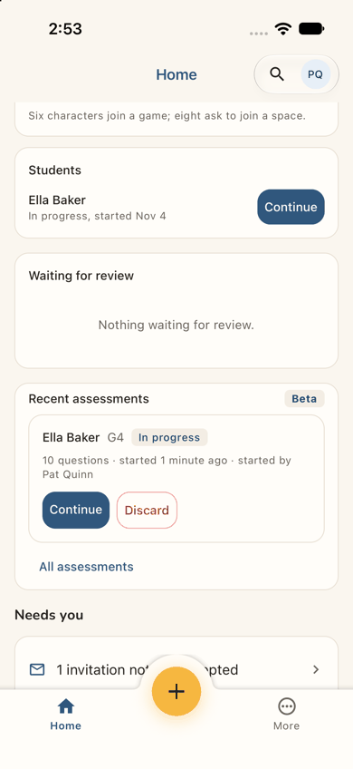 
  Repro: in a space with one pending invitation, scroll the home so "Needs you" sits at the bottom of the screen.
- **Recommended Fix:** Give the home's scroll content a bottom inset equal to the (+) button's height, so no row
  comes to rest under it.

## Walkthrough

### Step 1 — Launch the app fresh (landing)
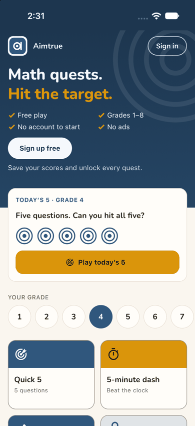
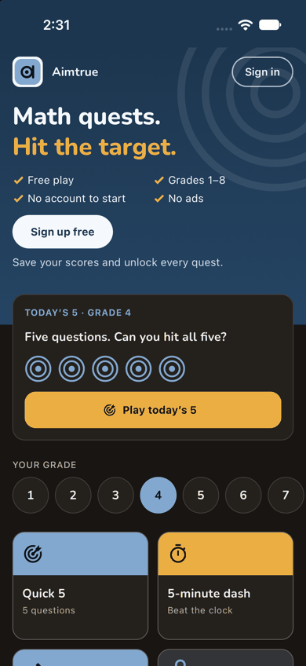
> Expected: a front page that says what the product is, with a way in for an adult who wants a space. Observed: the
> guest home "Math quests. Hit the target.", with Free play, Grades 1–8, No account to start and No ads. "Sign up
> free" is a white pill, with "Save your scores and unlock every quest." under it. "Sign in" is an outlined pill at
> the top right. Below are "Today's 5 · Grade 4", a grade row with 4 selected, and tiles. Dark mode is readable.

**What Pat notices:** a children's maths game. Nothing about classes or teachers. "Sign in" is the adult's door.

### Step 2 — Scroll the guest home looking for something for a teacher

> Expected: something for teachers or classes. Observed: Adv G4 tiles (some locked, "Free account"), then "Play
> together · One code, everyone joins" with an example code and "Create a free family space". Then "Is it free? / Is
> it safe for my child? / Which grades?" and Privacy · Terms · Contact us. Same as the web.

**What Pat notices:** the only space on offer is a family's, and the questions are a parent's. Pat goes back up.

### Step 3 — Scroll back up and tap "Sign in"
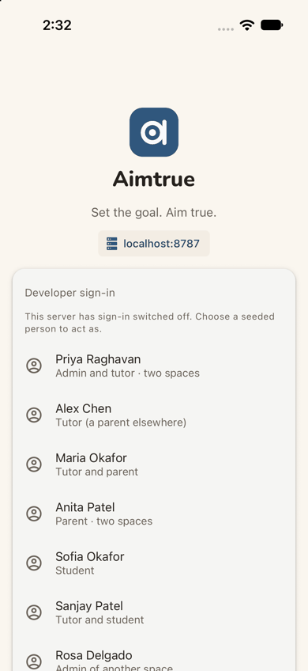
> Expected: a sign-in screen. Observed: a full-screen sign-in with the logo, "Aimtrue" and "Set the goal. Aim true.".
> Below is the developer sign-in: "This server has sign-in switched off. Choose a seeded person to act as.", with the
> seeded people. Production shows provider buttons here instead (see the Appendix).

**What Pat notices:** (developer screen, not judged) a list of strangers. Pat looks for a place to type an address.

### Step 4 — Type pat.quinn@example.com in "Another email"

> Expected: the address typed. Observed: the field holds it, with Sign in, the legal line, "Play without an account"
> and "Phase 69" below.

**What Pat notices:** the developer path; in production this is one provider tap.

### Step 5 — Tap "Sign in" with the unknown address
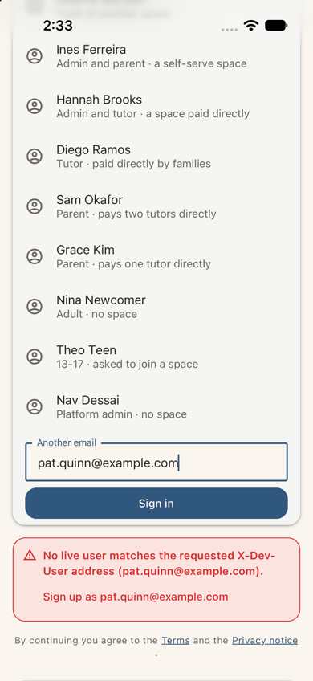
> Expected: the app sees a new person and offers to make the account. Observed: a red box, "No live user matches the
> requested X-Dev-User address (pat.quinn@example.com).", with the link "Sign up as pat.quinn@example.com". The
> wording is the developer path's.

**What Pat notices:** no account yet, and a way to make one. Pat follows it.

### Step 6 — Tap "Sign up as pat.quinn@example.com"
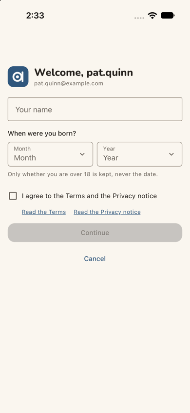
> Expected: a short About-you. Observed: a full screen with "Welcome, pat.quinn" (the address's first part) and the
> address. It has "Your name" (developer only), "When were you born?" with Month and Year, and "Only whether you are
> over 18 is kept, never the date.". Then the terms checkbox with "Read the Terms" and "Read the Privacy notice",
> Continue (disabled) and Cancel.

**What Pat notices:** short and calm, and the date note reassures. Nothing asks what Pat wants to do here.

### Step 7 — Type the name and open Month

> Expected: twelve months to pick from. Observed: "Welcome, Pat". The Month list opens under the field, with a
> "Search" box and January to September. October is below the list's visible edge, with nothing to say so.

**What Pat notices:** a search box for twelve months, and October is not there until Pat scrolls inside the box.

### Step 8 — Scroll the month list, pick October, open Year

> Expected: October set and the year list open. Observed: on the first try the tap on the half-hidden October missed,
> and tapping Year opened its list beside the still-open Month list. That screenshot was replaced. The same step then
> closed Year, scrolled inside the month list and tapped October. Month reads "October". Year opens at 2026, with
> "Type a year" and "Showing 8 of 100. Type to narrow it down.".

**What Pat notices:** 1975 is fifty-one rows down, but there is a search box.

### Step 9 — Type 1975 in the year search and pick it
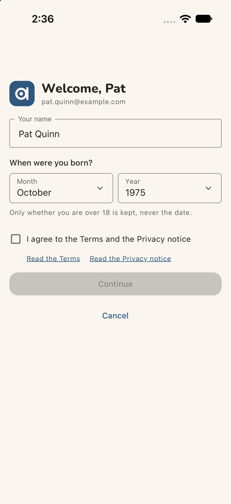
> Expected: October 1975 set. Observed: Month October, Year 1975, the list closed. Continue is still grey.

**What Pat notices:** typing the year was quick.

### Step 10 — Tick "I agree to the Terms and the Privacy notice"
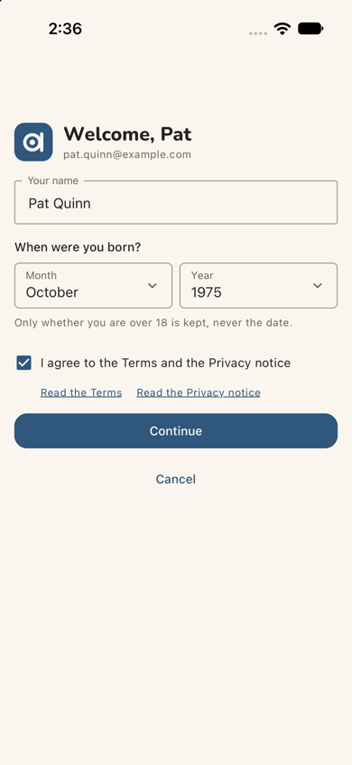
> Expected: Continue enabled. Observed: the box is ticked and Continue turns brand blue.

**What Pat notices:** nothing more is asked. Clear enough.

### Step 11 — Tap Continue: "Waiting for approval" (landing)

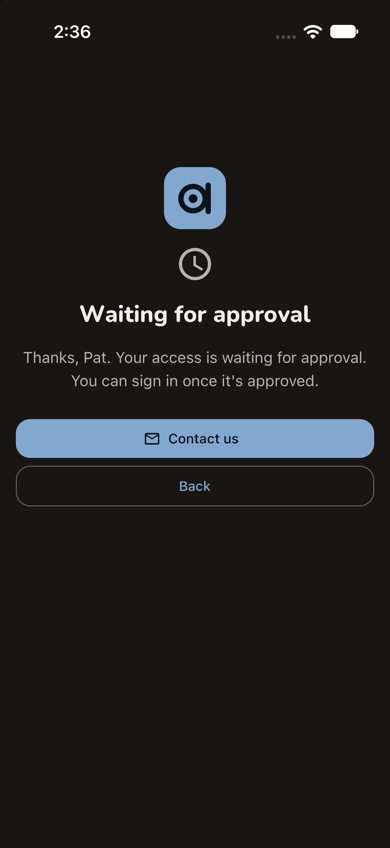
> Expected (Post-approved): a waiting screen that says what happens next. Observed: a full screen with the logo, a
> clock, "Waiting for approval" and "Thanks, Pat. Your access is waiting for approval. You can sign in once it's
> approved.", then "Contact us" (filled) and "Back". There is no leftover "Almost there" heading. Dark mode is
> readable. That is the end of day 1.

**What Pat notices:** no word on who approves, how long it takes, or how Pat will hear. The big button asks Pat to
write an email.

### Step 12 — A day later: relaunch the app (landing)

> Expected: some sign that the account is ready. Observed: the same guest home as step 1, unchanged. (Between the
> stages the platform admin approved Pat in the web console; nothing reached the device.)

**What Pat notices:** nothing says the account is approved. Pat tries "Sign in" on a hunch.

### Step 13 — Tap "Sign in" and type the address again
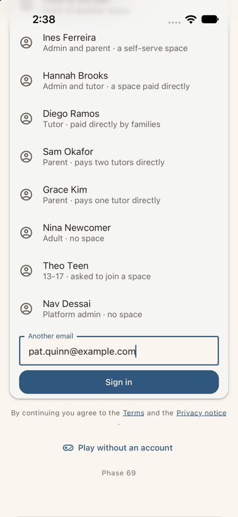
> Expected: the sign-in screen. Observed: the developer sign-in, scrolled to "Another email", with the address typed.

**What Pat notices:** (developer screen, not judged) the same screen as yesterday.

### Step 14 — Tap "Sign in": home in "Pat's space" (landing)

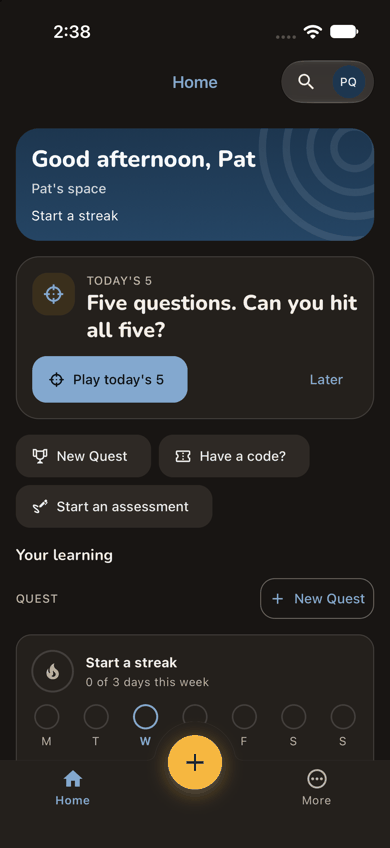
> Expected: approved and signed in, somewhere that helps start a space. Observed: within a second or two, "Home". The
> band reads "Good afternoon, Pat / Pat's space / Start a streak". Next up is "TODAY'S 5: Five questions. Can you hit
> all five?" with Play today's 5 and Later. The quick actions are New Quest, Have a code? and Start an assessment.
> Then "Your learning" > QUEST with "+ New Quest", and "Start a streak · 0 of 3 days this week". The tab bar has Home,
> a yellow (+) and More. Dark mode is readable.

**What Pat notices:** a space Pat never asked for, set up for a child's practice. No "Start a space", and no word that
the approval went through.

### Step 15 — Scroll the home looking for "Start a space"
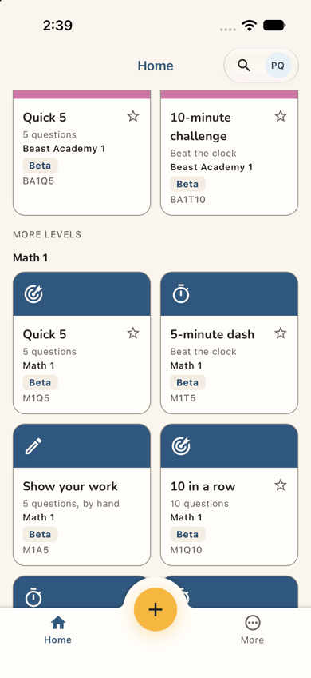
> Expected: somewhere to start a space. Observed: two scrolls reach Beast Academy 1 tiles (pink), then "MORE LEVELS" >
> Math 1 (Quick 5, 5-minute dash, Show your work, 10 in a row), each with Beta, a code and a star.

**What Pat notices:** more games, at levels Pat does not teach.

### Step 16 — Scroll to the end of the home

> Expected: a way to start a space. Observed: five more scrolls. "Students: No students yet. Add a student", "Waiting
> for review: Nothing waiting for review.", "Recent assessments (Beta): No assessments yet. All assessments", then
> "Make this my home": Automatic (Quest), Quest, Assessments. No "Start a space". That is the first dead end.

**What Pat notices:** "Add a student" is here, but a student of what? Pat wants the class's own space first.

### Step 17 — Tap the yellow (+)

> Expected: "Create" offers a space. Observed: a "Create" sheet with Start an assessment ("Handwritten, one question a
> page."), Add a student ("With their parent or guardian.") and Add someone else ("A parent, an admin, or several roles
> at once."). No space. That is the second dead end.

**What Pat notices:** the biggest button in the app creates everything except the one thing Pat came for.

### Step 18 — Close the sheet and open More
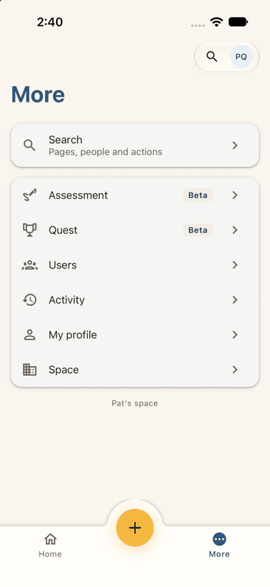
> Expected: an item for spaces. Observed: "More" with Search, then Assessment (Beta), Quest (Beta), Users, Activity, My
> profile and Space, and the footer "Pat's space".

**What Pat notices:** "Space" sounds like the place to make one.

### Step 19 — Tap "Space" (dead end)

> Expected: a way to make or name a space. Observed: the personal space's settings. "Pat's space: its code, what it
> teaches from, and how it is set up." It has the space code 64RD-CFHA with Share and Make a new code, and the switch
> "Let people ask to join with the code". "Set by the platform" lists the Name (Pat's space), the Palette (Slate),
> "Lessons are recorded on Eastern time" and "This space may use Assessment and Quest", then "To change the name … ask
> the platform administrator". Curricula follow. That is the third dead end, as on the web.

**What Pat notices:** Pat cannot rename this to "Quinn Learning Lab", and nothing here starts a new space. Who is "the
platform administrator"?

### Step 20 — Back, then tap the initials (account button)

> Expected: account settings. Observed: a sheet with "Pat Quinn", the address and "Admin at Pat's space". Under Spaces
> it lists "Pat's space (You are here)" and "All spaces: Invitations, codes, starting or leaving a space". Then
> Appearance (Light, Dark, System) and My profile.

**What Pat notices:** "starting … a space", at last, under the initials.

### Step 21 — Tap "All spaces"

> Expected: somewhere to start a space. Observed: "Spaces", with "Signed in as pat.quinn@example.com. You land in the
> space you opened last. Each tab can be in a different one." Your spaces lists Pat's space (Here now, Admin, with a
> leave icon). Then "Join with a code", and "Start a space": "For your family or your students: assessments answered
> by hand, with a PDF for you, and Quest. It gets its own code, so others can ask to join, and you can invite people
> next." It has "Name your space" and "Start the space" (disabled), all visible without scrolling.

**What Pat notices:** "your students" and "invite people next", which is exactly the plan. It was the fifth place Pat
looked.

### Step 22 — Type "Quinn Learning Lab"
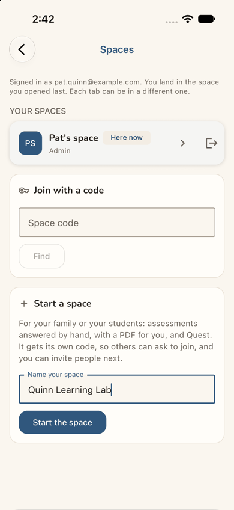
> Expected: the button enables. Observed: "Name your space" holds "Quinn Learning Lab", and "Start the space" turns
> blue.

**What Pat notices:** one field and one button. Simple.

### Step 23 — Tap "Start the space": "Invite people" (landing)
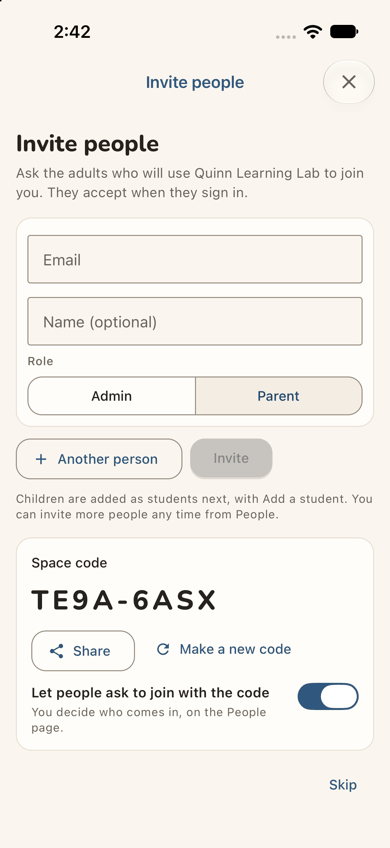
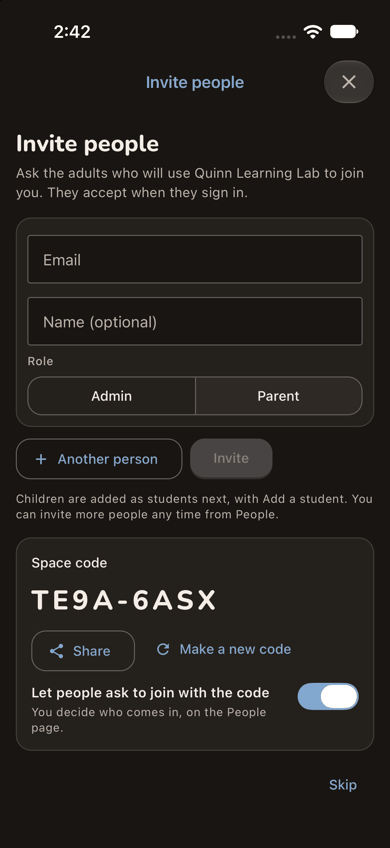
> Expected: the new space, ready to invite. Observed: a full-screen "Invite people" with a close button. "Ask the
> adults who will use Quinn Learning Lab to join you. They accept when they sign in." The form has Email, Name
> (optional), Role (Admin | Parent, with Parent selected), "+ Another person" and Invite (disabled). Under it: "Children
> are added as students next, with Add a student. You can invite more people any time from People." The Space code
> TE9A-6ASX has Share and Make a new code, and the join switch is on. Skip is at the bottom. No "ready" toast was
> captured. Dark mode is readable.

**What Pat notices:** the right next step, clearly worded, and students come next. That matches how Pat thinks about a
class.

### Step 24 — Type Jo Baker's address and name, keep Parent
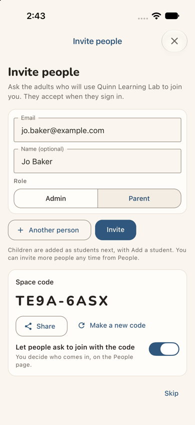
> Expected: Parent among the roles. Observed: Admin and Parent only, with Parent selected. Email "jo.baker@example.com"
> and Name "Jo Baker" are filled in, and Invite turns blue.

**What Pat notices:** Parent is offered. There is no teacher or helper role, but Pat does not need one yet.

### Step 25 — Tap Invite

> Expected: Jo listed as invited, with a way to tell her. Observed: the toast "Invitation made." and a cleared form. A
> new section, INVITED, says "No email is sent from this space. Copy each invitation, or share it, so they know to sign
> in." Its row reads "✓ jo.baker@example.com · Parent", then the full text "Pat Quinn invited you to Quinn Learning Lab
> on Aimtrue. Sign in at http://localhost:8787 with jo.baker@example.com.", and one button, "Share".

**What Pat notices:** honest that no email goes out, and the whole message is right there. The hint says "Copy", but
there is no Copy button. The name Pat typed, "Jo Baker", is not on the row.

### Step 26 — Tap Share on Jo's row

> Expected: a way to send or copy the text. Observed: the iOS share sheet. It previews "Pat Quinn invited you to Quinn
> Learning…" and offers Reminders, More, Copy and Save to Files. The simulator has no Messages or Mail accounts.
> Nothing was sent.

**What Pat notices:** Copy is here, one level down.

### Step 27 — Tap Copy in the share sheet

> Expected: the text copied, and a confirmation. Observed: the sheet closes, and the clipboard holds the invitation
> word for word (read back from the simulator). The app shows no confirmation. The page has scrolled to the INVITED row
> and the space code, and the button at the foot is now "Continue" instead of "Skip".

**What Pat notices:** did it copy? Nothing says so.

### Step 28 — Tap Continue

> Expected (owner's rule for a space without Tutoring): on to adding a student or the home, with no tour. Observed:
> "Welcome to Quinn Learning Lab, Pat — A quick tour of the portal, and guided setup for a new student". It offers "Take
> the tour" ("The dashboard and the menu, one part at a time, with what each is for."), "Add a student" ("Create or pick
> the family, add the student, then start their first assessment.") and "I'm done".

**What Pat notices:** "Add a student … then start their first assessment" is exactly what Pat needs. Pat skips the
tour.

### Step 29 — Tap "Add a student"
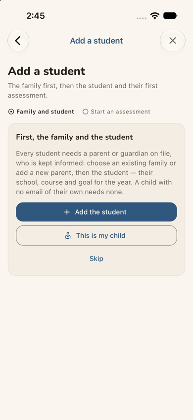
> Expected: a short way to add a child. Observed: "Add a student: The family first, then the student and their first
> assessment.", with two steps, Family and student, then Start an assessment. The card says "Every student needs a
> parent or guardian on file, who is kept informed … A child with no email of their own needs none." It offers "Add the
> student", "This is my child" and Skip.

**What Pat notices:** plain and short, and no "billed" or "tutor", unlike the web.

### Step 30 — Tap "Add the student"

> Expected: the family step, with Jo offered. Observed: "Step 1 of 4: Who is their family? The parent or guardian who
> is billed and kept informed. Add them here if they are new." It has Search parents, "+ New parent", and one row: JB
> Jo Baker, jo.baker@example.com. Cancel and Next follow.

**What Pat notices:** Jo is there before she has accepted. But "billed" is back, one screen after the intro left it
out.

### Step 31 — Choose Jo Baker, tap Next
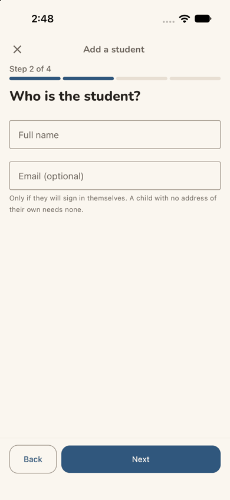
> Expected: Jo chosen, on to the student. Observed: "Step 2 of 4: Who is the student?", with Full name and Email
> (optional): "Only if they will sign in themselves. A child with no address of their own needs none." (Jo's row is
> exposed to the accessibility tree only as "checkbox, unchecked".)

**What Pat notices:** the family link is done for Pat.

### Step 32 — Type "Ella Baker", tap Next
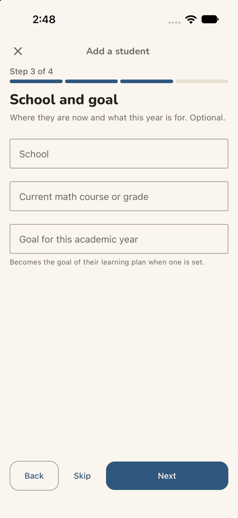
> Expected: optional details. Observed: "Step 3 of 4: School and goal. Where they are now and what this year is for.
> Optional." It has School, "Current math course or grade" and "Goal for this academic year" ("Becomes the goal of
> their learning plan when one is set."), then Back, Skip and Next.

**What Pat notices:** all optional, which is good. "Learning plan" is a tutoring idea.

### Step 33 — Type "Grade 4", tap Next
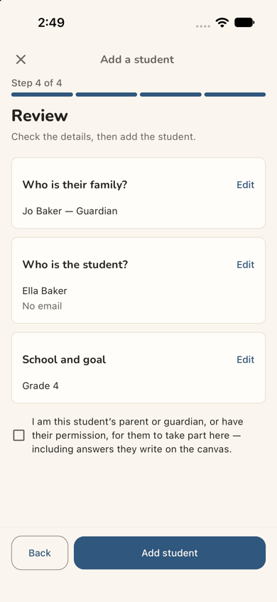
> Expected: a review. Observed: "Step 4 of 4: Review". The family is "Jo Baker — Guardian", the student "Ella Baker, No
> email", and School and goal "Grade 4", each with Edit. Then the checkbox "I am this student's parent or guardian, or
> have their permission, for them to take part here — including answers they write on the canvas.", Back and Add
> student.

**What Pat notices:** a clear summary. The permission box fits a class whose parents have agreed.

### Step 34 — Tick the permission box, tap "Add student"
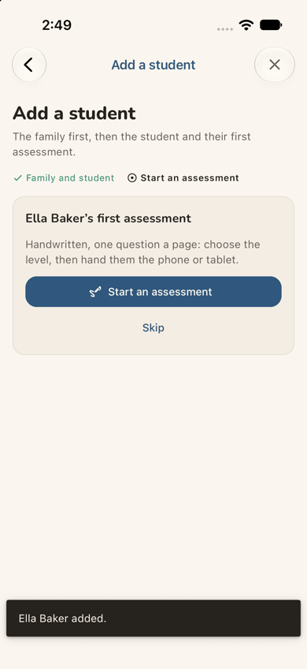
> Expected: the student made, and a way on to the assessment. Observed: the toast "Ella Baker added.". Family and
> student is ticked in green, and a card reads "Ella Baker's first assessment: Handwritten, one question a page: choose
> the level, then hand them the phone or tablet." with Start an assessment and Skip.

**What Pat notices:** it says how Ella will take it: on Pat's phone. Start is the first button.

### Step 35 — Tap "Start an assessment" (landing)

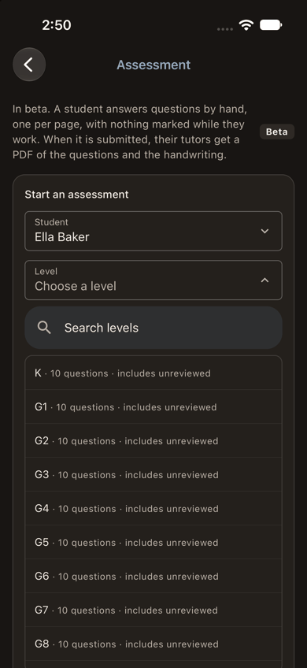
> Expected: the assessment form with Ella chosen. Observed: "Assessment", with "In beta … When it is submitted, their
> tutors get a PDF of the questions and the handwriting." Student is "Ella Baker", already chosen. The Level list is
> already open, with Search levels and "K · 10 questions · includes unreviewed", G1 … G8, and so on. Nothing is
> preselected. Dark mode is readable.

**What Pat notices:** only the level is left. But "their tutors", and no Grade 4 picked for Pat.

### Step 36 — Choose G4
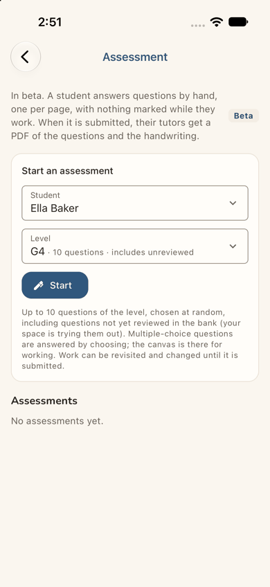
> Expected: Start enabled. Observed: Level reads "G4 · 10 questions · includes unreviewed", and Start (with a pen icon)
> is enabled. The note reads "Up to 10 questions of the level, chosen at random, including questions not yet reviewed
> in the bank (your space is trying them out). Multiple-choice questions are answered by choosing …". The Assessments
> list says "No assessments yet."

**What Pat notices:** a clear note. G4 is readable to a maths teacher.

### Step 37 — Tap Start: question 1 (landing)

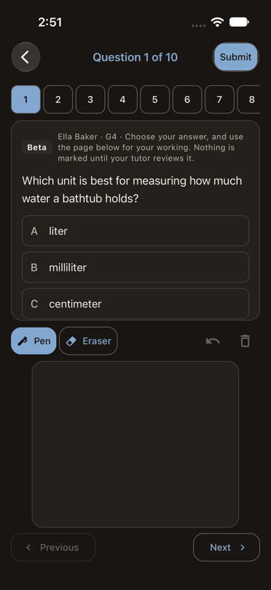
> Expected: the assessment's first question. Observed: "Question 1 of 10", with Submit at the top right and question
> pills 1-8 (9 and 10 scroll off to the right). The card reads "Beta · Ella Baker · G4 · Choose your answer, and use the
> page below for your working. Nothing is marked until your tutor reviews it." The question is "Which unit is best for
> measuring how much water a bathtub holds?", with A liter, B milliliter and C centimeter. Then Pen, Eraser, Undo,
> Clear page, a canvas, and Previous and Next. Dark mode is readable. The journey ends here.

**What Pat notices:** it works, and the canvas is inviting. Are there only three choices? And "your tutor" is not
Pat's title.

### Step 38 — End-state check: scroll inside the question card

> Expected: all the choices visible. Observed: the card scrolls inside itself. The header goes, and A liter, B
> milliliter, C centimeter and D kilogram are all shown. At step 37 nothing showed there was a fourth.

**What Pat notices:** Ella could easily have missed D.

### Step 39 — End-state check: close and reopen the app

> Expected (success criteria): still signed in, with the new space and the open assessment within reach. Observed: the
> home of "Quinn Learning Lab", the space opened last, still signed in. It is the same board as Pat's space: "Good
> afternoon, Pat / Quinn Learning Lab / Start a streak", Today's 5, the quick actions and the streak. Nothing at the
> top about Ella or Jo.

**What Pat notices:** the right space, but where is Ella's assessment?

### Step 40 — End-state check: scroll the home to Ella's assessment

> Expected: the open assessment listed. Observed: several screens down, "Students: Ella Baker, In progress, started Nov
> 4, Continue" and "Recent assessments: Ella Baker G4 In progress, 10 questions · started 1 minute ago · started by Pat
> Quinn", with Continue and Discard. Below that, "Needs you" starts, and its first row passes under the yellow (+).

**What Pat notices:** it is all there, but far below the games.

### Step 41 — End-state check: scroll on to "Needs you"

> Expected: what needs Pat. Observed: "Needs you" lists "1 invitation not yet accepted" and "0 asking to join". "Make
> this my home" offers Automatic (Quest), which is selected, Quest, Assessments and "Running the space".

**What Pat notices:** "Running the space" is what Pat wants as the home. Pat would have to find it at the bottom.

### Step 42 — End-state check: tap Continue on Ella's assessment

> Expected: the same assessment, where it was left. Observed: "Question 1 of 10", Ella Baker · G4, and the same
> bathtub question. D is hidden below the card's edge again. The end state holds.

**What Pat notices:** nothing was lost, and the assessment is waiting for Ella.

## Appendix

- **Mode:** live. The iOS app (development build `com.aimtrue.app.dev`) ran on the iPhone 17 simulator (iOS 27.0),
  loading its bundle from Metro, against the local Worker at `http://localhost:8787` (the run's data and settings,
  with sign-in off).
  - **Driving.** Maestro ran one small flow per step (`apps/mobile/.maestro/journeys/j06a-*.yaml`). Each screen was
    captured with `simctl` and resampled to 390 px wide. Dark mode was captured at the landing steps (1, 11, 12, 14,
    23, 35, 37).
  - **Stages.** There were two stages on one device, with no state cleared between them: steps 1-11, then the platform
    admin's approval, then steps 12-42 after a relaunch.
  - **Mis-taps by the harness.** Five times the flow tapped the wrong place and was run again, and each screenshot is
    of the corrected run. None of these is the app's fault, and none changed what a person would see:
    - step 8: October's half-hidden row;
    - step 27: tapping "Copy" by text, which closed the share sheet;
    - steps 30 and 35: a card's id rather than its button's;
    - step 42: a "Continue" scrolled above the screen.
- **Frameworks applied:**
  - cuj-contract: every step against its expected result.
  - task-completion: the journey ran to its defined end. A space was started, a parent invited, the invitation copied,
    and an assessment's question 1 put on screen in the new space (step 37).
  - success-criteria: the end state was checked again after closing and reopening the app. It landed in Quinn Learning
    Lab, Ella's assessment was in progress on the home, and it resumed on the same question 1 (steps 39-42). Step 38
    checked the hidden fourth choice.
- **CUJ manifest:** J06A, 42 steps, all verified.
  - Steps 1-37 are the journey, and 38-42 are the end-state check.
  - Steps 16, 17 and 19 are the dead ends Pat met on the way to "Start a space".
  - Observed and not matching expectation: steps 11-12 (the silent wait), 14 (no "Start a space"), 28 (the tour
    offered), 30, 35 and 37 (tutoring words), and 37 (the hidden choice).
- **Coverage / not inspected:**
  - **The production sign-in and sign-up screens** (the Google, Microsoft and Facebook buttons). The local server ran
    with sign-in off, so the app showed its developer forms (steps 3-6, 13). Their wording ("No live user matches the
    requested X-Dev-User address", the seeded list, "Your name", "Phase 69") is not what a stranger sees, and was not
    judged.
  - The Terms and the Privacy notice were not opened, and "Contact us" on the waiting screen was not tapped.
  - Whether Pat was told of the approval outside the app (an email). No mailbox was available.
  - The streak card, the Daily and the grade row that the two scrolls passed between steps 14 and 15. The Space page
    below "Curricula" (step 19), including any leave or delete controls.
  - The "<name> is ready." toast after Start the space (step 23), if it showed; it was not captured.
  - The selected state of Jo's row (inside step 31's flow).
  - **Paths not taken:**
    - "+ Another person" and the Admin role;
    - the space code's Share and "Make a new code";
    - "Take the tour", "This is my child" and "New parent";
    - the Skip buttons and Edit on the review;
    - "Discard" and "All assessments";
    - the "Needs you" rows and the "Make this my home" options;
    - Search, Activity, Users and My profile.
  - The share sheet on a real phone (Messages, Mail, WhatsApp). The simulator has no such accounts, so only
    Reminders, More, Copy and Save to Files were offered.
  - Jo's side of the invitation; on the web that is J09.
  - Answering, the other nine questions, Submit, the PDF and the review. The journey ends at question 1.
  - VoiceOver (the accessibility tree was read only to find controls, which is how the unnamed parent row was seen),
    Dynamic Type, the on-screen keyboard (the simulator's hardware keyboard was on), and Android.
- **Access:** the app's developer sign-in (the local server ran with sign-in off, because the native Google step cannot
  be driven on the simulator); the development build; the approval and any space decision were made in the web console
  and are not part of the journey.
- **Preconditions made outside the app:** none by this journey. The run's platform settings were set before the
  journeys, as `docs/userjourney/README.md` "The run" records: sign-up access Post-approved, guest play and the Daily on,
  the default tiles. Between the two stages the platform admin approved Pat in the web console on `:8787` (Settings >
  Sign-up access, Waiting for approval, Approve; the toast was "Pat Quinn approved.").
- **Left in the local database by this journey** (for the agents that follow):
  - Pat Quinn (pat.quinn@example.com), approved, with the personal space "Pat's space" (code 64RD-CFHA);
  - the space "Quinn Learning Lab" (code TE9A-6ASX, joining by code on), with Pat as its admin;
  - Jo Baker (jo.baker@example.com), invited as Parent, not yet accepted;
  - Ella Baker, a student with no email, with Jo as her guardian and the consent given;
  - Ella's G4 assessment, started and not submitted.
