# CUJ Audit — J07: adult given a space code is approved, asks to join, is let in, tries Assessment

## Executive summary

**Who:** Lena Fischer, 38 (born August 1987), a parent. Her child's tutor, Ines Ferreira, runs a self-serve space,
"Ferreira Family Practice", and told her: "sign up on Aimtrue and join my space with the code FMXY2345". Lena belongs
to cohort **C7, the Assessment cohort**, on the giver's side ("give one, see results") in `docs/member-home-plan.md`.
Ines's space offers Assessment only (Quest is off there). Lena wants to get into Ines's space and give her child the
assessment Ines mentioned.

**Outcome: 0/1 journeys passed, 0 skipped, 24 of 35 steps verified.** The path into the space works, slowly. Lena
signed up from the guest page and waited for the platform's approval (step 10). A day later she signed in, found
"Have a code?" on her new home, and asked to join with FMXY2345 (step 16). Ines let her in as a Parent (J11). Nothing
told Lena: she found Ferreira Family Practice only by opening the space switcher (step 23). Inside, the home leads with
"Start an assessment" (step 24), but **the journey broke at step 26**. The Student picker opens empty, because no child
is linked to Lena in Ines's space. Start stays grey, and no message says why. The only way forward the app shows her,
"Add user", lets her fill in her child's whole record, then refuses: "Only an administrator can make this change."
(step 34). No assessment started. After a reload (step 35) the home still offers the assessment she cannot start.
Steps not verified: step 3 (the code box that is a picture of one) and steps 26-35 (the dead end).

**Conversion figures** (counted from the entry point, the signed-out guest page; taps include picker choices and
checkboxes):

| Stretch | Screens | Taps | Typed fields | Waits | Dead ends |
| --- | --- | --- | --- | --- | --- |
| Entry to "Waiting for approval" (steps 1-10) | 5 | 12 | 0 | 0 loading; then the platform's approval (unannounced) | 1 (the example code box) |
| Return to the request to join, shown as waiting (steps 11-20) | 6 | 7 | 1 (FMXY2345) | 0 loading; then Ines's decision (unannounced) | 0 |
| Back after being let in, to the Assessment form inside Ines's space (steps 21-24) | 4 | 3 | 0 | 0 | 0 |
| **Entry to the feature's start screen (step 24)** | **15** | **22** | **1** | **2 waits for a person** | **1** |
| Trying to start an assessment (steps 25-35) | 5 | 14 | 2 | 0 | 2 (empty student picker; Add user refused) |
| **Whole journey (steps 1-35)** | **20** | **36** | **3** | **2 waits for a person** | **3** |

Every screen answered at once: there was no loading wait anywhere. The cost is elsewhere. Two waits for a person
(the platform's approval, then Ines's), and neither is announced when it ends. The code reaches Ines's space only
after the first wait and a second sign-in. And at the end the space's one feature cannot be used by the parent it
was meant for. For stickiness, Lena leaves with no reason inside the app to come back. Her next step is a text to
Ines, outside the app.

**The 3 screens Lena would notice most:**

- **Step 10, "Waiting for approval".** Lena came with a code from her child's tutor and has had nowhere to type it.
  The sheet says "Almost there" over "Waiting for approval". It does not say who approves (Aimtrue? Ines?), how long
  it takes, or that the code comes later. Its one button writes to a personal Gmail address. A parent sent by a tutor
  may think she signed up for the wrong thing, a children's game.
  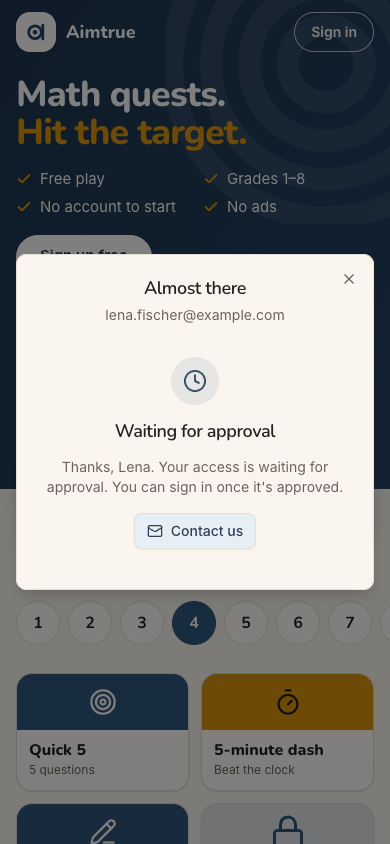
- **Step 23, the space switcher.** "Ferreira Family Practice · Parent" has quietly appeared above her own space. It
  is the only sign that Ines let her in. Lena found it because she went looking in the same menu as the day before.
  Her home, the band, Next up and the switcher's closed state all looked exactly as before (steps 21-22).
  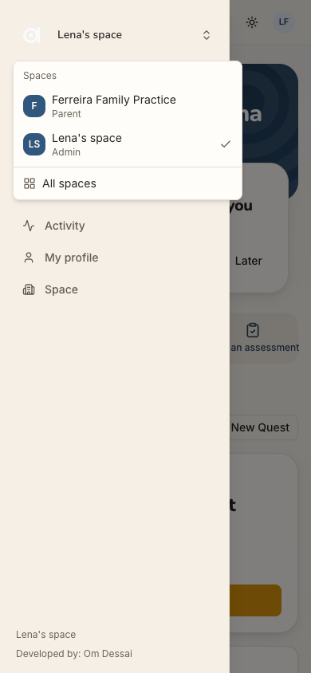
- **Step 34, "Only an administrator can make this change."** Lena is a parent inside her tutor's space, with
  "Start an assessment" as the home's first card. She cannot pick a student, so she adds her child through the
  "Add user" button the app showed her: parent, name, grade and a consent box. Only then is she told that she was
  never allowed to. She is not told who the administrator is, or how to ask them.
  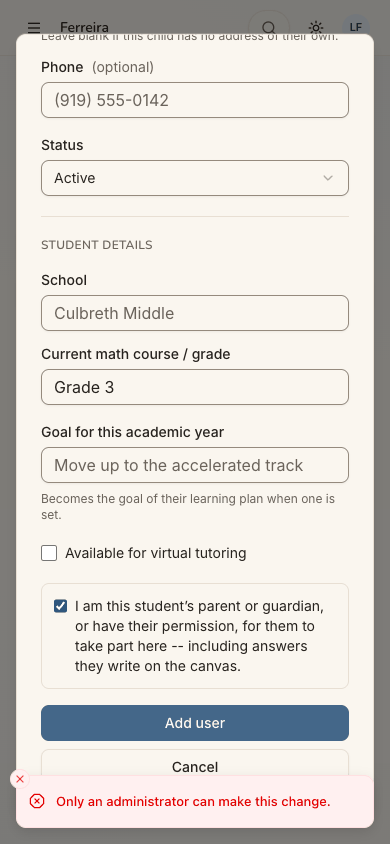

**Contact sheet** (all 35 phone steps):

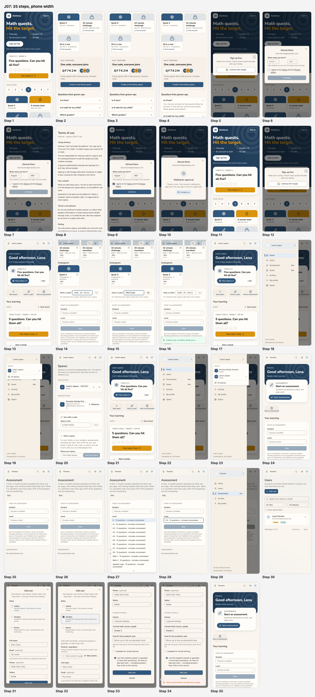

| Severity | Count |
| --- | --- |
| sev4 (catastrophe) | 1 |
| sev3 (major) | 3 |
| sev2 (minor) | 3 |
| sev1 (cosmetic) | 1 |
| **Total** | **8** |

## Prioritized fixes

1. [sev4] [Let in as a parent with no child, Lena cannot start an assessment, and nothing says why](#sev4-let-in-as-a-parent-with-no-child-lena-cannot-start-an-assessment-and-nothing-says-why): when the reader has no student here, say so and offer "Ask Ines to add my child"; Next up must not offer what cannot start (steps 24-28, 35).
2. [sev3] [Being let in is silent: the only sign is a new row in the space switcher](#sev3-being-let-in-is-silent-the-only-sign-is-a-new-row-in-the-space-switcher): keep the request on the home while it waits; announce "You're in Ferreira Family Practice" and land there once (steps 16-17, 20-23).
3. [sev3] [Add user is offered to a parent and refused only after the whole form](#sev3-add-user-is-offered-to-a-parent-and-refused-only-after-the-whole-form): show admin actions to admins only; name the space's admins (steps 30-34).
4. [sev3] [The approval wait says nothing of who, when, or the code she holds](#sev3-the-approval-wait-says-nothing-of-who-when-or-the-code-she-holds): say who approves, how long, how she will hear, and that the code comes next (steps 10-11).
5. [sev2] [The code has no place until after approval, and the example code looks like a field](#sev2-the-code-has-no-place-until-after-approval-and-the-example-code-looks-like-a-field): take a space code on the guest page and at sign-up; keep the code box near the top of the home (steps 1-6, 14).
6. [sev2] [She lands in a space of her own she never asked for, as its admin and its learner](#sev2-she-lands-in-a-space-of-her-own-she-never-asked-for-as-its-admin-and-its-learner): explain the personal space in one line; lead with her pending request (step 13).
7. [sev2] ["Sign in" opens a sheet titled "Sign up free"](#sev2-sign-in-opens-a-sheet-titled-sign-up-free): title the sheet by the button that opened it (step 12).
8. [sev1] [Staff words and cut-off names where a parent reads](#sev1-staff-words-and-cut-off-names-where-a-parent-reads): use the space's full name, "Your child's assessments", and plain words for "unreviewed" (steps 20, 24, 25, 27).

## Findings

### [sev4] Let in as a parent with no child, Lena cannot start an assessment, and nothing says why

- **Issue Description:** Ines let Lena in as a Parent. Her let-in dialog never asked which child is Lena's (J11,
  finding 4), so no child is linked to Lena in the space. Inside, everything points Lena at Assessment:
  - The band says "Ready when you are."
  - Next up says "ASSESSMENTS — Start an assessment. [Open Assessments]", and a quick action repeats it (step 24).
  - The form sits right below. Open Assessments leads to the same form (step 25).

  Tapping "Choose a student" opens a list with no options (step 26). It is placed below the bottom of the phone
  screen, so nothing visibly happens: no "No students yet", no hint. A level can be chosen (steps 27-28), but Start
  stays grey, and no message says what is missing. The one route the app then shows her, Add user, is refused (next
  finding). After a reload (step 35) she is still in the space, and Next up still offers "Start an assessment".
- **Framework Violation:** cuj-contract, step 26 (expected: her child to choose, or a note that the child is not here
  yet; observed: an empty list, off-screen, and no message). Also steps 28 and 35. task-completion: the journey's end
  (an assessment started) cannot be reached from Lena's side. success-criteria: after the reload the end state is
  unchanged and wrong. Nielsen #1 Visibility of system status; Nielsen #9 Help users recognize, diagnose and recover
  from errors.
- **Severity:** 4. Classify: blocked. Nothing in the app lets Lena start an assessment, and nothing tells her what is
  missing or who can fix it. The only way out is outside the app: she texts Ines, and Ines has to work out, unprompted,
  that she must add Lena's child. C7's giver wants "give one, see results", with Start an assessment in 2 taps or
  fewer. Here it is impossible, on the home of a space whose only feature is Assessment.
- **Evidence:**  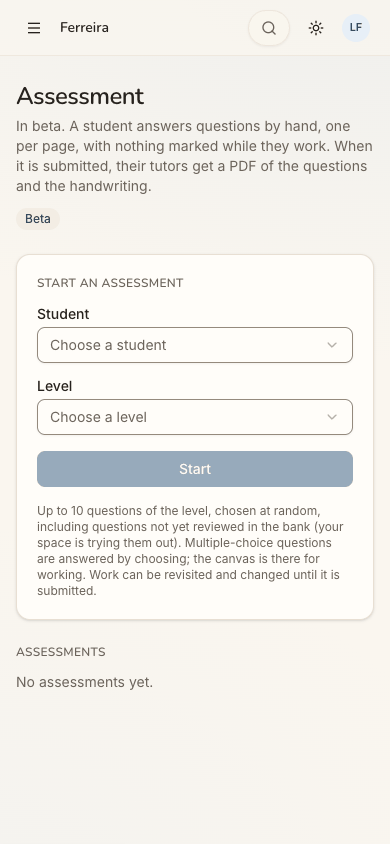
  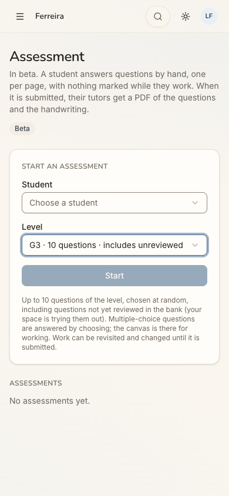 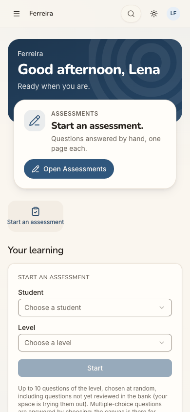
  Repro: in a self-serve space with Assessment on, an admin lets a join request in as Parent without linking a child.
  As that parent, open the space, tap Open Assessments, then tap "Choose a student". The list opens empty, below the
  viewport (role=listbox, no options, y = 844 at 390x844). Choose a level: Start stays disabled.
- **Recommended Fix:**
  - When the reader has no student they may start an assessment for, replace the form with one card: "To give an
    assessment, your child needs to be in Ferreira Family Practice. Ines Ferreira adds children here." Give it a
    button "Ask Ines to add my child". It could file a request the admin sees in Next up, or copy a ready message
    (a self-serve space sends no email).
  - Next up must not offer "Start an assessment" to someone who cannot start one. For a parent with no child, Next up
    is "Your child isn't here yet", with the same button.
  - Show an empty list as a disabled row ("No students yet"), and keep the list on screen.
  - Say why Start is grey ("Choose a student first").
  - On the admin's side, the let-in dialog for a Parent should ask "Which child?", with "Add a child" inline (J11
    finding 4). Letting parents add their own children here would change a rule (today only admins add people): that
    is the owner's decision, not part of this fix.

### [sev3] Being let in is silent: the only sign is a new row in the space switcher

- **Issue Description:** Asking to join works in two taps once the code box is found (steps 15-16). Its toast, "Asked
  to join. Its admins will let you in.", does not name the space, and it fades away. The home then looks exactly as
  before (step 17). The request is visible only on /spaces, under "Requests sent" (step 20), three taps away through
  menu → switcher → All spaces. Nothing on the home points there.

  When Ines lets her in, nothing tells Lena either. She opens a new tab (step 21) and lands in her own space, her last
  opened. The home, the band, Next up and the closed switcher are all as before. No banner, no Next up item, no count
  appears (steps 21-22). Only the open switcher shows "Ferreira Family Practice · Parent" (step 23). No email reached
  her: self-serve spaces send none, and this local stack sends none.
- **Framework Violation:** cuj-contract, step 16 (expected: a confirmation that names Ines's space; observed: "its
  admins"), step 17 (expected: a waiting state on the home; observed: none) and step 21 (expected: a sign she was let
  in; observed: none). Nielsen #1 Visibility of system status; Nielsen #6 Recognition rather than recall (she must
  remember where the request lives).
- **Severity:** 3. Classify: a workaround is needed. Lena must remember, unprompted, to dig through the menu and the
  switcher to learn whether Ines has decided. A parent who does not remember the switcher would believe she is still
  waiting, or that it failed, and stop coming back. For a parent sent by her tutor, this hand-over decides whether
  she ever reaches the feature. It is not a 4: the switcher does show the space, and opening it works (step 24).
- **Evidence:** 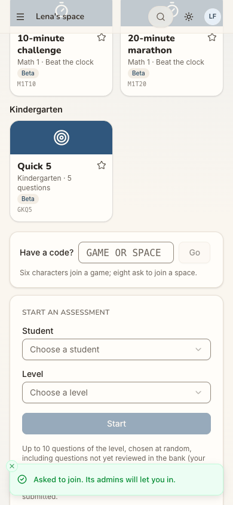 
  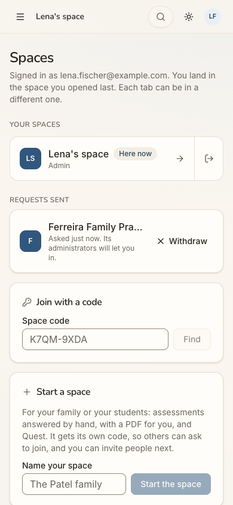 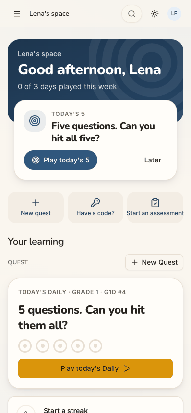
  
  Repro: as an approved member in a personal space, enter a space code under "Have a code?" and tap Go. Scroll up:
  the home shows no request. Have the space's admin let you in, then open `/` in a new tab: the home is unchanged,
  and the space is listed only in the switcher's menu.
- **Recommended Fix:**
  - Name the space in the toast ("Asked to join Ferreira Family Practice. Ines will let you in.").
  - Keep a waiting card on the home while a request is pending, as an invitation already gets a banner and a count
    on the switcher. Make it Next up: "Waiting for Ferreira Family Practice to let you in — asked today", with
    Withdraw.
  - When the request is accepted, the next arrival should land in the new space once, with a one-line welcome
    ("You're in Ferreira Family Practice. Ines Ferreira let you in today."). Until it is opened, show a count on the
    switcher.

### [sev3] Add user is offered to a parent and refused only after the whole form

- **Issue Description:** Looking for her child, Lena opens Users (step 30). It says "Everyone at Ferreira Family
  Practice" and lists one person, herself (Parent, Active). It does not list Ines, so she cannot see who runs the
  space. A blue "Add user" button is shown to her. It opens the admin's full dialog (step 31), which offers her the
  Admin role. The Admin card itself says "Only admins can add people." The Student and Parent cards talk of tutoring
  and costs, which this space does not have. She ticks Student, picks herself as the parent, types a name and a
  grade, and ticks the consent box (steps 32-33). Then she taps Add user. The answer is a red toast, "Only an
  administrator can make this change." (POST /api/users answered 403; step 34). The dialog stays open with her typing
  in it. The toast does not say who the administrator is, or how to ask them.
- **Framework Violation:** cuj-contract, step 34 (expected: her child added, or told before the form that only Ines
  can do it; observed: refused after the whole form). Nielsen #5 Error prevention; Nielsen #9 Help users recognize,
  diagnose and recover from errors; Nielsen #4 Consistency and standards ("Only admins can add people" inside a
  dialog offered to a non-admin).
- **Severity:** 3. Classify: the end state is wrong and a workaround is needed. The data is safe: the API refuses, as
  it should. But the app sends a parent into a dead end it built itself: a full form, a consent statement, then a
  refusal with no next step. For a newcomer it costs trust ("am I even supposed to be here?"), at the moment she most
  needs to know whom to ask.
- **Evidence:** 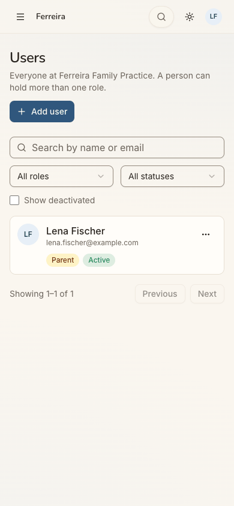 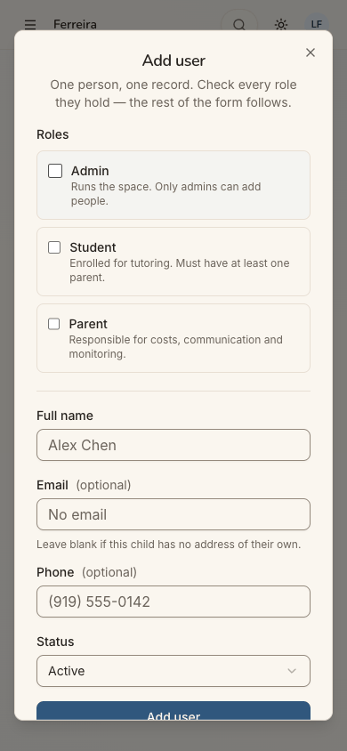
  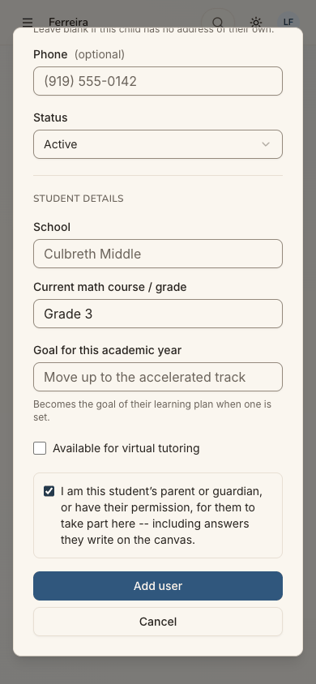 
  Repro: as a Parent of a self-serve space (not an admin), open Users and tap Add user. Tick Student, choose yourself
  as the parent, enter a name, tick the consent box and tap Add user: a toast reads "Only an administrator can make
  this change." and the browser's network log shows 403 on POST /api/users.
- **Recommended Fix:**
  - Render "Add user" (and the dialog's admin-only roles) for the space's admins only.
  - For anyone else, the Users page should read "Your family at Ferreira Family Practice" and name the admins ("Run
    by Ines Ferreira"), with the same "Ask Ines to add my child" action as the sev4 fix.
  - Wherever a 403 can still reach a form, word the toast so it leads somewhere: "Only Ines Ferreira, the space's
    admin, can add people here. Ask her to add your child."

### [sev3] The approval wait says nothing of who, when, or the code she holds

- **Issue Description:** After Continue, the sign-up sheet becomes "Almost there", with "Waiting for approval" under
  it: "Thanks, Lena. Your access is waiting for approval. You can sign in once it's approved." The only button is
  "Contact us", a mailto to a personal Gmail address (step 10). It does not say who approves: Aimtrue, or Ines, whose
  code Lena has not been able to enter anywhere. It does not say how long approval takes, or whether she will be
  told. It does not say that her code will be asked for after approval. The next day the guest page is unchanged
  (step 11), with no "You're approved". She tries Sign in on a hunch. The same wait is reported in J01 (its sev3);
  here it also strands the code.
- **Framework Violation:** cuj-contract, step 10 (expected: what happens next, including the code; observed: only
  that access waits) and step 11 (expected: some sign the account is ready; observed: none). Nielsen #1 Visibility
  of system status; Nielsen #2 Match between system and the real world (two approvals, platform and space, look like
  one to her).
- **Severity:** 3. Classify: a workaround is needed. Lena must come back on her own, on no schedule, and guess that
  she can now sign in. A parent sent by a tutor reasonably believes the tutor approves her. She may wait for Ines,
  and Ines may wait for a request that cannot arrive until Lena returns. It is not a 4: signing in later works
  (step 13).
- **Evidence:**  
  Repro: under Post-approved sign-up access, sign up from the guest page and answer the age question. Tick the terms
  and tap Continue: "Waiting for approval" (POST /api/auth/signup answers 403, access pending). After the console
  approves, open `/` in a new tab: the guest page is unchanged.
- **Recommended Fix:**
  - Give the wait the facts: "Aimtrue checks new accounts by hand, usually within a day. We'll email you when you're
    in. Have a code from a tutor or school? You'll enter it right after."
  - Drop "Almost there" once the state is "waiting".
  - Point "Contact us" at a product address.
  - Make the email true on approval, or have the guest page recognise the approved device on the next visit ("Your
    account is ready: Sign in").

### [sev2] The code has no place until after approval, and the example code looks like a field

- **Issue Description:** Ines's instruction comes with a code, and the guest page (step 1) has nowhere to type it.
  Its only code is an example, "QF7K2M", in a white, field-like box under "One code, everyone joins" (step 2), with
  "Create a free family space" below it. Tapping the box does nothing: it is static text (step 3, a dead end). The
  FAQ has nothing on codes or tutors (step 4). The sign-up sheet and the About-you form do not ask for a code either
  (steps 5-6). After approval, "Have a code?" is a quick action above the fold on the new home (step 13). That part
  is good. But it jumps about 1,900 px down, past the Daily and some fifteen tiles, to a small box. Its placeholder
  is cut off at phone width ("GAME OR SPACE") (step 14). Its hint, "Six characters join a game; eight ask to join a
  space.", is what told her the 8-character code was right.
- **Framework Violation:** cuj-contract, steps 2-3 (expected: a place for her code; observed: a picture of a code
  field) and steps 5-6 (expected: the code asked for at sign-up; observed: not mentioned). Nielsen #4 Consistency and
  standards (an example styled as an input); Nielsen #7 Flexibility and efficiency of use.
- **Severity:** 2. Classify: real friction and one dead end. Lena got there because Ines told her to "sign up" first,
  and the home's quick action found the box. But a code holder is the warmest kind of newcomer, and the product makes
  her carry the code through sign-up, a wait for approval and a second sign-in before it is asked for.
- **Evidence:** 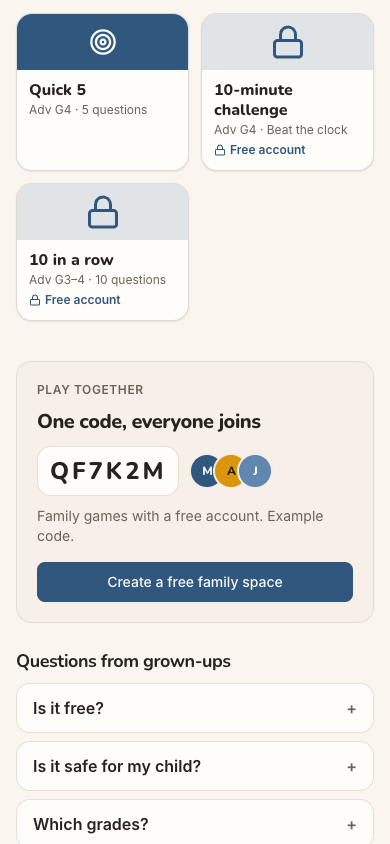 
  
  Repro: signed out at `/`, scroll to "Play together", tap the code QF7K2M: nothing happens. After signing in, tap the
  quick action "Have a code?": the page scrolls to a box below every tile.
- **Recommended Fix:**
  - Put a real "Have a code from a tutor or school?" field on the guest page, near the top.
  - Accept a space code there and keep it on the device through sign-up. File the join request as soon as the
    account is approved, and say so on the waiting screen ("We'll ask Ferreira Family Practice to let you in").
  - Style the example code as an illustration (no field border, "for example" inside it).
  - Open "Have a code?" as a sheet where the button is, instead of scrolling to the bottom of the page.

### [sev2] She lands in a space of her own she never asked for, as its admin and its learner

- **Issue Description:** Her first screen after sign-in (step 13) is "Lena's space", a personal space made for her at
  sign-up. Nothing explains it. She is its Admin (the switcher says so, step 19). Her menu has Users, Activity and
  Space. The home addresses her as the learner:
  - "0 of 3 days played this week";
  - "Your learning", "Start a streak";
  - a Grade 1 Daily, under a Next up "Today's 5" that offers the same kind of challenge.

  For a 38-year-old parent who came to join her tutor's space, it reads as a child's practice page with her name on
  it, and as a space she did not ask for. While her request waits, the home leads with play, not with the request
  (step 17).
- **Framework Violation:** cuj-contract, step 13 (expected: a screen about joining Ines's space; observed: her own
  space, framed as a player's). Nielsen #2 Match between system and the real world; Nielsen #8 Aesthetic and
  minimalist design (two daily challenges stacked).
- **Severity:** 2. Classify: an observable mismatch and real friction. It does not block: the code box is one tap
  away. But it blurs what Lena signed up for, and it makes "which space am I in?" a live question for the rest of
  the journey. At step 21 she lands back here after being let in.
- **Evidence:**  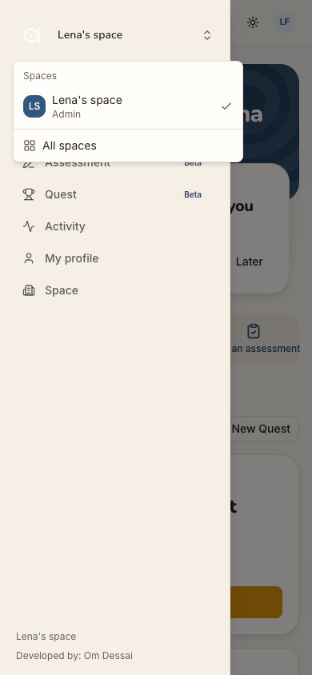
  Repro: as a newly approved adult, sign in from the guest page and look at the first screen and the switcher.
- **Recommended Fix:**
  - On first arrival, one line on the band: "This is your own space for practice. Ines's space will appear here once
    she lets you in."
  - While a join request is pending, make it Next up (see the sev3 finding above).
  - For an adult whose sign-up did not come from guest play, lead with the code box rather than a Grade 1 Daily.

### [sev2] "Sign in" opens a sheet titled "Sign up free"

- **Issue Description:** Back a day later, with an account, Lena taps "Sign in" in the header (step 12). The sheet
  that opens is titled "Sign up free", "Keep your scores, unlock every quest and play with your family.", with one
  Google button. The words "sign in" appear nowhere. She wonders whether this makes a second account. The same
  mismatch is reported in J01 and J05.
- **Framework Violation:** cuj-contract, step 12 (expected: a sign-in step; observed: a sign-up sheet). Nielsen #4
  Consistency and standards.
- **Severity:** 2. Classify: an observable mismatch at the moment she returns on a hunch. The Google step is the same
  either way, so it does not block.
- **Evidence:** 
  Repro: signed out at `/`, tap "Sign in" in the header.
- **Recommended Fix:** Title the sheet by the button that opened it. From Sign in: "Welcome back. Sign in with the
  account you used before." Keep "Sign up free" for the hero and the nudges.

### [sev1] Staff words and cut-off names where a parent reads

- **Issue Description:** Small wording problems along the way:
  - Inside the space, the top bar and the band say only "Ferreira" (the short name), not "Ferreira Family Practice",
    the name Ines gave her (step 24).
  - The assessment form sits under "Your learning", though the learning is her child's (step 24).
  - The form's note says "including questions not yet reviewed in the bank (your space is trying them out)", and
    every level reads "· includes unreviewed" (steps 25, 27). That is the space staff's language, and slightly
    worrying to a parent.
  - On /spaces the request reads "Ferreira Family Pra…" at phone width. The example space code there is "K7QM-9XDA",
    with a dash Ines's code does not have. The page opens with "You land in the space you opened last. Each tab can
    be in a different one." (step 20).
- **Framework Violation:** cuj-contract, steps 20, 24, 25 and 27 (observable wording mismatches). Nielsen #2 Match
  between system and the real world.
- **Severity:** 1. Classify: cosmetic. Each one makes Lena pause briefly, and none of them stops her.
- **Evidence:**  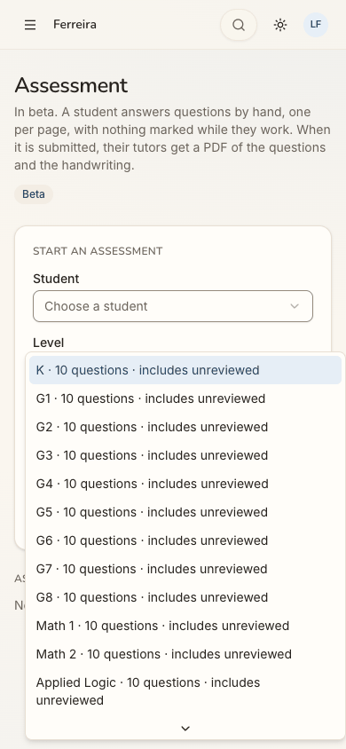
  Repro: as a member of Ferreira Family Practice on a phone, open the home, the Assessment page, the Level picker and
  /spaces.
- **Recommended Fix:**
  - Show the space's full name in the band (the short name can stay in the top bar).
  - Title a parent's section "Your child's assessments".
  - Word the beta note for families ("Some questions are new and still being checked").
  - Let the space name wrap on /spaces, and show example codes in the shape real codes have.

## Walkthrough

### Step 1 — Open http://localhost:8797/ signed out

> Expected: a page that shows how to sign up, or where to type a space code. Observed: the guest Play home, "Math
> quests. Hit the target.", with Sign in, "Sign up free", Today's 5, a grade row and tiles. No code field, and no
> mention of a tutor's or teacher's space above the fold, on phone or desktop.

**What Lena notices:** a children's maths game ("Grades 1–8", "Play today's 5"). Nothing says "have a code from your
tutor?", so she starts looking for one.

### Step 2 — Scroll down looking for a code box

> Expected: a "Have a code?" or "Join a space" field. Observed: "PLAY TOGETHER — One code, everyone joins", with the
> code QF7K2M in a white, field-like box, "Example code." in small grey, and "Create a free family space"; then
> "Questions from grown-ups" and the footer.

**What Lena notices:** "One code, everyone joins" sounds like her code, and the box looks like a field. She does not
want to create a space; she wants to join Ines's.

### Step 3 — Tap the code box QF7K2M to type her own code

> Expected: a field that takes her code. Observed: nothing. The box is static text and focus stays on the page. Dead
> end.

**What Lena notices:** what looked like a code field is a picture of one.

### Step 4 — Open the FAQ "Is it free?"

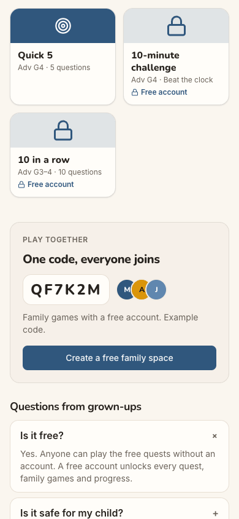

> Expected: maybe a line on joining a tutor's space. Observed: "Yes. Anyone can play the free quests without an
> account. A free account unlocks every quest, family games and progress." No FAQ is about codes, tutors or spaces.

**What Lena notices:** the page talks to a parent whose child plays alone or with family. She falls back on Ines's
"sign up".

### Step 5 — Tap "Sign up free"

> Expected: a sign-up form, maybe with a place for her code. Observed: a sheet, "Sign up free — Keep your scores,
> unlock every quest and play with your family.", with one button, "Continue with Google". No code.

**What Lena notices:** the pitch is about a child's scores. She goes on because Ines told her to sign up.

### Step 6 — Tap "Continue with Google"

> Expected: Google, then an account form. Observed: at once, "Almost there", with her email, "When were you born?"
> (Month, Year), "Only whether you are over 18 is kept, never the date.", a terms checkbox and a disabled Continue.
> Still no code field.

**What Lena notices:** a short form, and a reassuring note about her birth date.

### Step 7 — Choose August, then 1987

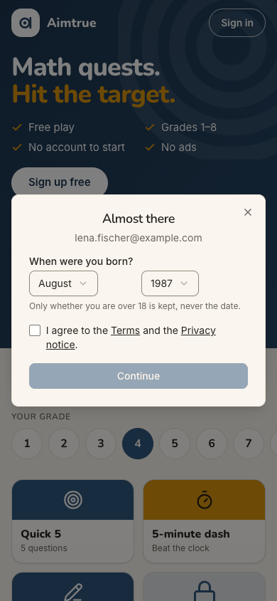

> Expected: two quick pickers. Observed: two custom dropdowns. The year list runs from 2026 down, so 1987 is about 40
> rows in. Both set without trouble.

**What Lena notices:** nothing odd; the year list is long but ordinary.

### Step 8 — Glance at the Terms

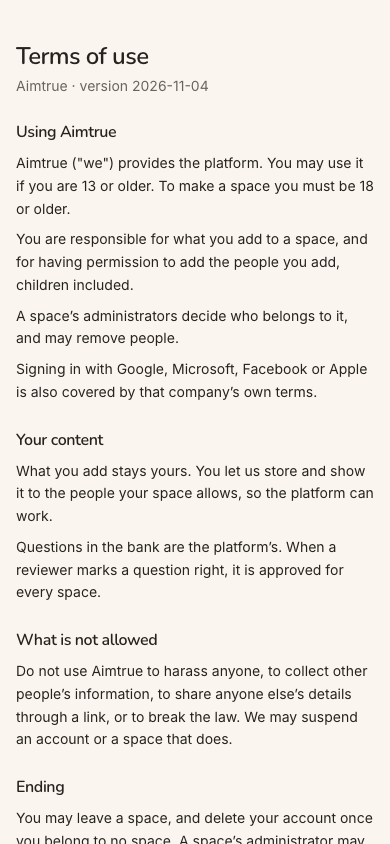

> Expected: the terms, without losing the form. Observed: /terms opens in a new tab, and the form keeps its state.
> The terms are short and plain ("A space's administrators decide who belongs to it"). The page has no header or way
> back. (The new tab was viewed in a separate browser at the same public URL.)

**What Lena notices:** the first explanation of a "space", and that its admins decide who joins. That matches "join
my space".

### Step 9 — Tick "I agree to the Terms and the Privacy notice."

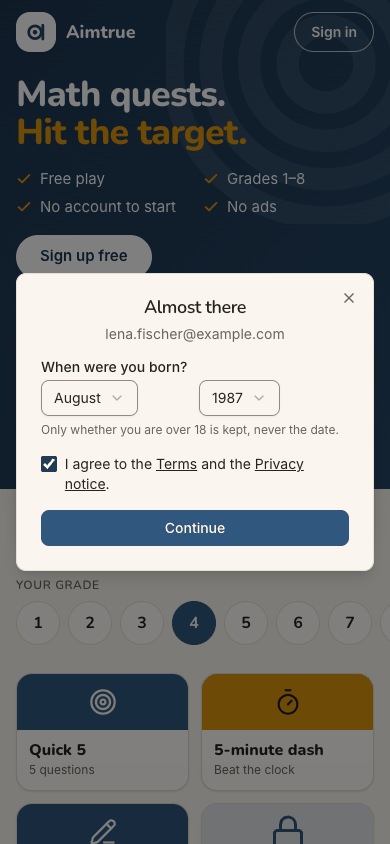

> Expected: Continue enabled. Observed: the box ticks and Continue turns blue.

**What Lena notices:** done, ready to go.

### Step 10 — Tap "Continue"

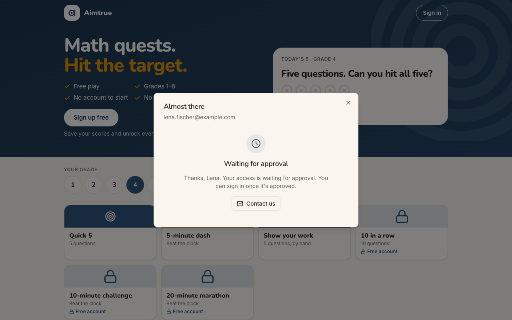
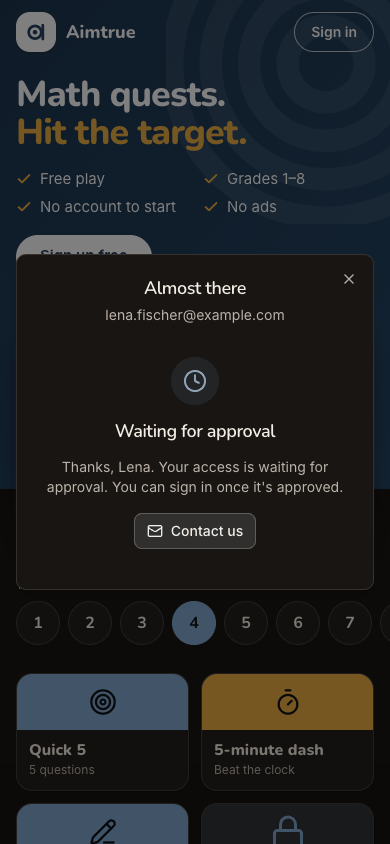

> Expected (Post-approved): "Waiting for approval". Observed: in the same sheet, still titled "Almost there": a clock,
> "Waiting for approval — Thanks, Lena. Your access is waiting for approval. You can sign in once it's approved." and
> "Contact us" (a mailto to a personal Gmail address). POST /api/auth/signup answered 403, the designed "pending"
> answer.

**What Lena notices:** two headings that disagree, and no word on who approves, how long it takes, or whether she
will be told. She has still had nowhere to put FMXY2345.

### Step 11 — A day later, after the platform approved her: open the app in a new tab

> Expected: some sign that her account is approved. Observed: the very same guest page as step 1. Nothing about her
> account.

**What Lena notices:** she has to guess she is approved now. She has an account, so she goes for "Sign in".

### Step 12 — Tap "Sign in"

> Expected: a sign-in sheet. Observed: the sign-up sheet, titled "Sign up free", with one Google button. The words
> "sign in" appear nowhere.

**What Lena notices:** "Did I press the wrong thing? Will this make a second account?" There is only one button, so
she taps it.

### Step 13 — Tap "Continue with Google"

> Expected: "still waiting", or a screen that asks for her tutor's code. Observed: signed in at once, on the home of
> "Lena's space", a personal space made for her. "Good afternoon, Lena · 0 of 3 days played this week", Next up
> "Today's 5", and quick actions "New quest", "Have a code?", "Start an assessment". Then "Your learning" with a
> Grade 1 Daily, a streak and tiles. On desktop the sidebar has Users, Activity and Space: she is its admin.

**What Lena notices:** "Have a code?", at last. But the page treats her as the learner, in a space she never asked
for, and nothing says she was approved.

### Step 14 — Tap "Have a code?"

> Expected: a box for her code. Observed: the page jumps about 1,900 px down, past the tiles, to "Have a code? [GAME OR
> SPACE] [Go]", with "Six characters join a game; eight ask to join a space." The field has focus, and its
> placeholder is cut off.

**What Lena notices:** her code has eight characters, so "eight ask to join a space" tells her this is right. The jump
is disorienting.

### Step 15 — Type FMXY2345

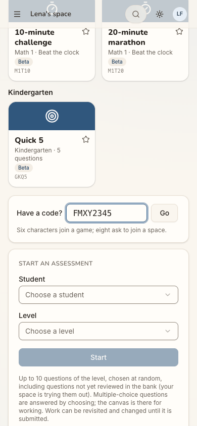

> Expected: the code accepted. Observed: it fits (monospace, upper case), and Go becomes active.

**What Lena notices:** straightforward.

### Step 16 — Tap "Go"

> Expected: a confirmation that names Ines's space. Observed: at once, a green toast, "Asked to join. Its admins will
> let you in." The field empties. The page does not change.

**What Lena notices:** it worked, and someone will let her in. But "its"? It does not name Ferreira Family Practice,
and the toast fades.

### Step 17 — Scroll back to the top of the home

> Expected: a "Waiting for Ferreira Family Practice" line. Observed: the home exactly as before. No trace of the
> request.

**What Lena notices:** the only proof of her request was a toast, and it is gone.

### Step 18 — Open the menu to look for Ines's space

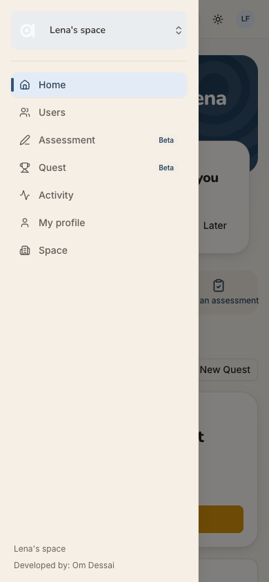

> Expected: Ines's space, perhaps as "requested". Observed: the switcher "Lena's space", then Home, Users, Assessment,
> Quest, Activity, My profile and Space. No Ferreira.

**What Lena notices:** only her own space. The switcher at the top is the next place to try.

### Step 19 — Tap the switcher "Lena's space"

> Expected: a list of spaces, Ines's pending. Observed: "Spaces: Lena's space · Admin ✓ — All spaces".

**What Lena notices:** "Admin" of a space she did not set up. "All spaces" is the last thing to try.

### Step 20 — Tap "All spaces"

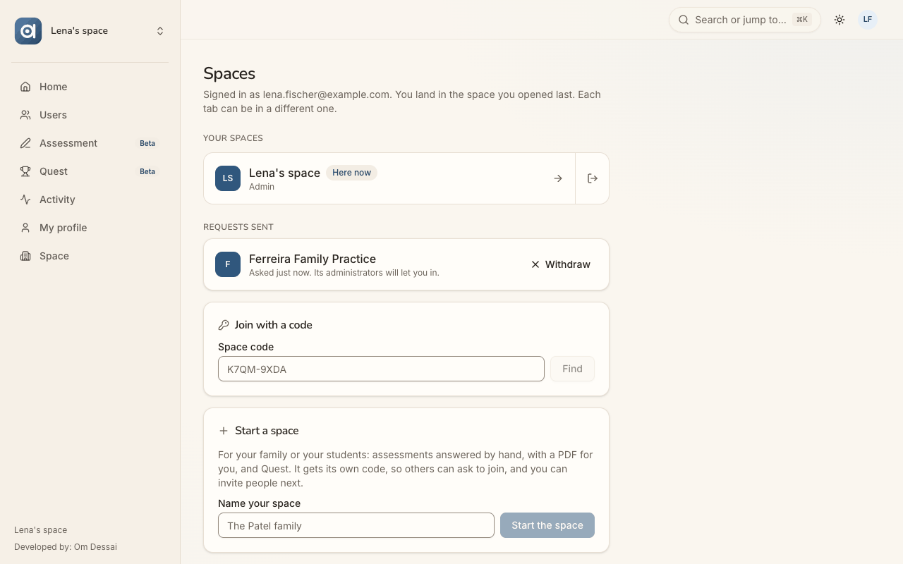
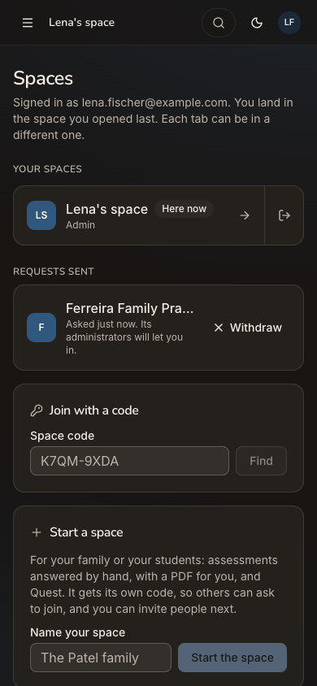

> Expected: her request. Observed: /spaces. "Your spaces: Lena's space · Here now · Admin". "Requests sent: Ferreira
> Family Pra… — Asked just now. Its administrators will let you in. × Withdraw". Then "Join with a code" (example
> "K7QM-9XDA") and "Start a space".

**What Lena notices:** relief: Ines's space by name, and a way to withdraw. It took three taps to find, and nothing
says how she will hear when she is in.

### Step 21 — After Ines let her in: open the app in a new tab

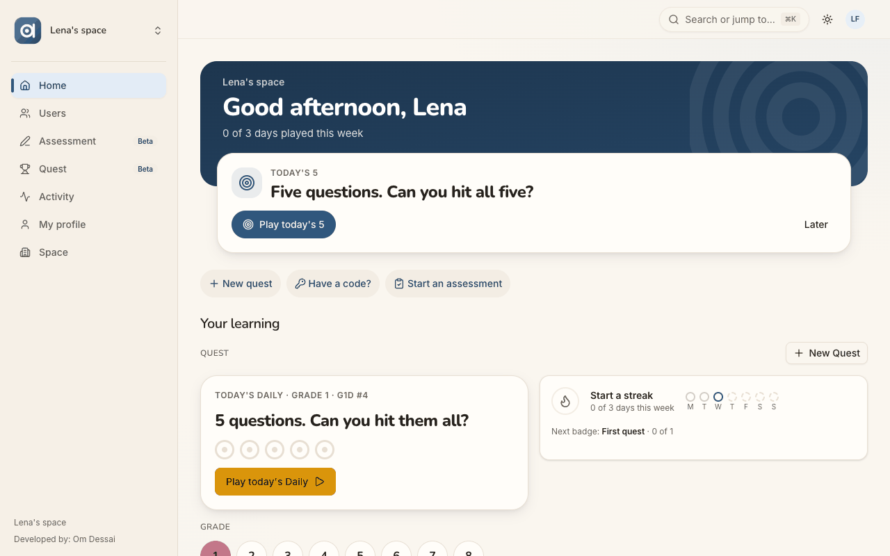
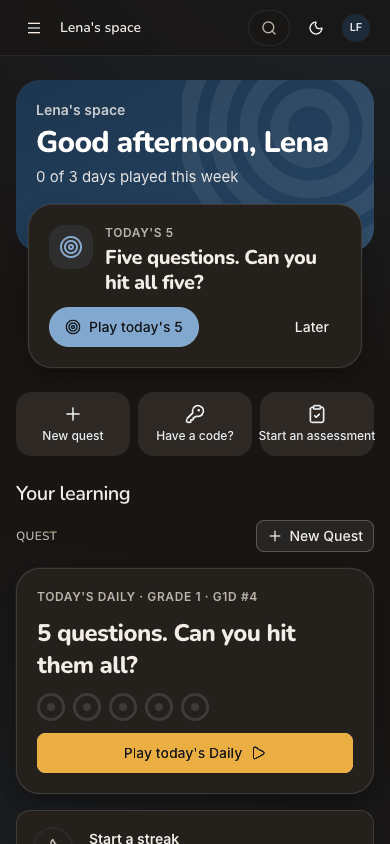

> Expected: a sign that Ines let her in (a banner, a Next up item), or landing in Ines's space. Observed: still signed
> in, and on "Lena's space", her last opened. The home is the same as step 13: "0 of 3 days played this week", Next up
> "Today's 5", the same quick actions. No banner, no item, no count. On desktop, the sidebar switcher reads "Lena's
> space".

**What Lena notices:** nothing has changed since yesterday. She cannot tell whether Ines has decided.

### Step 22 — Open the menu, where she found her request yesterday

> Expected: Ines's space, or a dot on the switcher. Observed: the same drawer as step 18. No dot, count or new item.

**What Lena notices:** still nothing new. She remembers that the switcher led to her request.

### Step 23 — Tap the switcher "Lena's space"

> Expected: Ines's space, or the request still pending. Observed: "Spaces: F Ferreira Family Practice · Parent",
> above "LS Lena's space · Admin ✓", and "All spaces".

**What Lena notices:** she is in, as a Parent, which is right. She found out only because she went looking. Nothing
announced it.

### Step 24 — Tap "Ferreira Family Practice · Parent"

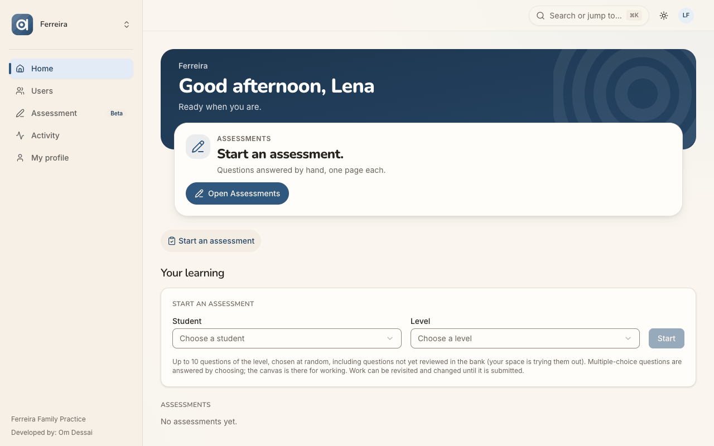
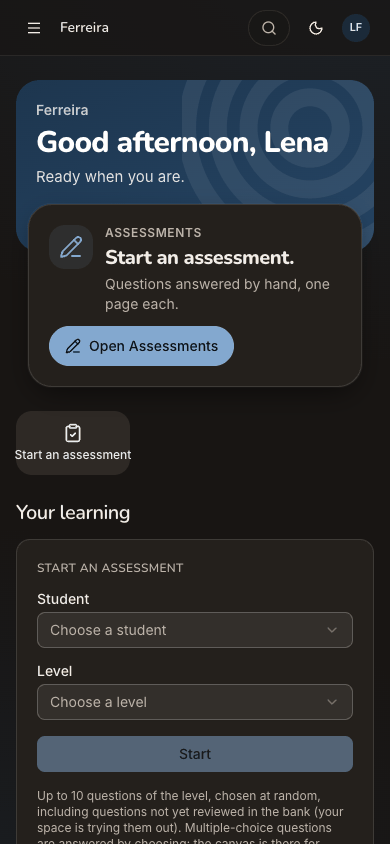

> Expected: a welcome to Ines's space, what it offers, her child. Observed: at once, the space's home. The band says
> "Ferreira · Good afternoon, Lena · Ready when you are." Next up is "ASSESSMENTS — Start an assessment. Questions
> answered by hand, one page each. [Open Assessments]", with one quick action, "Start an assessment". Below,
> "Your learning" has the form (Student, Level, Start greyed) and "No assessments yet.". The desktop sidebar shows
> Home, Users, Assessment, Activity and My profile: no Quest, which is off in this space. There is no welcome, and
> no mention of Ines or a child.

**What Lena notices:** one obvious thing to do, "Start an assessment", which is what Ines meant. But "Ferreira" is
only half the name she was given, and "Your learning" is over a form that asks for a student. She does not look for
Quest: Ines spoke of assessments, not games.

### Step 25 — Tap "Open Assessments"

> Expected: the start of an assessment, or an explanation. Observed: /assessments. "In beta. A student answers
> questions by hand, one per page, with nothing marked while they work. When it is submitted, their tutors get a PDF
> of the questions and the handwriting." Then the same form as on the home.

**What Lena notices:** the intro reassures her that Ines gets the work. The tap brought her to the same form she
already had.

### Step 26 — Tap "Choose a student"

> Expected: her child's name, or a note that her child is not here yet. Observed: the dropdown opens, but its list is
> empty, and it is placed below the bottom of the screen: nothing visibly happens. There is no message. Dead end.

**What Lena notices:** she tapped and nothing opened. No child is linked to her here, and the form does not say so.

### Step 27 — Tap "Choose a level"

> Expected: a list of levels. Observed: K, G1 … G8, Math 1, Math 2, Applied Logic, Stats & Data Science, Math
> Modeling. Each one reads "· 10 questions · includes unreviewed".

**What Lena notices:** the grades are clear enough. "includes unreviewed" on every line is staff language, and a
little worrying.

### Step 28 — Choose "G3 · 10 questions · includes unreviewed"

> Expected: Start lights up. Observed: the level is set, and Start stays grey because no student is chosen. No
> message says why. (She taps "Choose a student" once more: the same empty list.)

**What Lena notices:** she has done all she can, and it will not start.

### Step 29 — Open the menu to look for her child

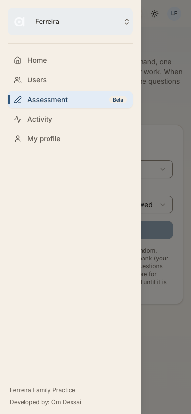

> Expected: "My children" or "Add a child". Observed: the switcher "Ferreira", then Home, Users, Assessment (current),
> Activity, My profile. No Quest, no My children.

**What Lena notices:** "Users" is the only place a child could be listed.

### Step 30 — Tap "Users"

> Expected: her family, or the space's people. Observed: "Users — Everyone at Ferreira Family Practice." with a blue
> "Add user", filters, and one card: "Lena Fischer · Parent · Active". "Showing 1–1 of 1."

**What Lena notices:** "everyone" is only her, not even Ines. Add user is the only way forward she can see.

### Step 31 — Tap "Add user"

> Expected: a way to add her child, or "only Ines can do this". Observed: the full "Add user" dialog. Its roles are
> Admin ("Runs the space. Only admins can add people."), Student ("Enrolled for tutoring…") and Parent ("Responsible
> for costs…"), followed by name, email, phone and status.

**What Lena notices:** the dialog is offered to her, and says "Only admins can add people" in the same breath. Unsure,
she tries anyway.

### Step 32 — Tick "Student" (her child)

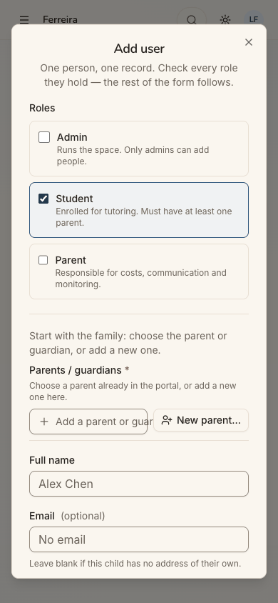

> Expected: fields for a child. Observed: "Start with the family: choose the parent or guardian, or add a new one."
> Parents / guardians (required), then the child's details and a consent box: "I am this student's parent or
> guardian, or have their permission…".

**What Lena notices:** this looks like the right form, and the consent box speaks to a parent.

### Step 33 — Fill in her child: parent, name, grade, consent

> Expected: a complete form. Observed: the parent picker offers one person, "Lena Fischer". She picks herself, types
> "Noah Fischer" (an invented child's name; the persona brief names none) and "Grade 3", and ticks the consent box.
> All accepted.

**What Lena notices:** nearly there, she thinks.

### Step 34 — Tap "Add user" to submit

> Expected: her child added. Observed: a red toast, "Only an administrator can make this change." (POST /api/users
> answered 403). The dialog stays open with her entries. Dead end.

**What Lena notices:** she was never allowed, by a button the app showed her. She is not told who the administrator
is, or how to ask.

### Step 35 — Cancel, back to the space's home, reload

> Expected: still in Ines's space, with something telling her what to do about her child. Observed: after the reload
> she is still in "Ferreira". The home is exactly as at step 24, with Next up "Start an assessment" and an empty
> student picker. The journey ends here, in a dead end.

**What Lena notices:** the page cheerfully invites her to do what she has just learned she cannot. She texts Ines,
outside the app.

## Appendix

- **Mode:** live, against the audited build (commit `2d6e7d3`, sign-in on) at http://localhost:8797, in a headless
  Chrome driven one action at a time. Phone width 390x844 throughout; desktop (1280x800) and dark mode at the landing
  steps 1, 10, 11, 13, 20, 21 and 24.
- **Frameworks applied:**
  - cuj-contract (each step's expected against observed);
  - task-completion (the journey's end, an assessment started, was not reached);
  - success-criteria (the end state checked again after a reload at step 35).
- **Coverage / not inspected:**
  - The two approvals themselves happened outside Lena's view. The platform admin approved her in the console
    (between steps 10 and 11). Ines let her in as a Parent (J11, between steps 20 and 21). Whether any email would
    be sent was not checked: this local stack sends none, and self-serve spaces send none by design.
  - Step 8: the Terms open in a new tab, which the driver does not follow. The same public /terms page was viewed in
    a separate browser. The Privacy notice was not opened.
  - Not opened: the FAQ entries "Is it safe for my child?" and "Which grades?"; "Create a free family space"; closing
    or reloading the waiting sheet while pending.
  - Not played: "Play today's 5", the Daily and the tiles (out of scope). The accessibility tree shows the Next up
    "Play today's 5" linking to Grade 3 (`/quest/daily/NC26.3`) while the Daily card says Grade 1. This was not
    opened, so it is not a finding.
  - Not tried: Withdraw, Find and Start a space on /spaces; the leave icon; "Later"; "Make this my home"; the
    Activity, My profile and Space pages; the account menu; the ⌘K search; a wrong or 6-character code.
  - Quest: off in Ferreira Family Practice (absent from its menu and home). Lena did not look for it.
  - After the 403 at step 34, Users was not re-checked to confirm no child was added. The refusal toast and the
    403 response were observed.
  - The iOS app is covered by separate journeys (JxxA).
- Access: through the app's real sign-in and sign-up screens; the Google provider step is simulated (a stand-in for
  Google's button hands the app a local test token for the persona).
- **Preconditions made outside the UI:** none specific to J07. The run's shared setup applies (README, "The run"):
  the platform settings (web sign-in Google only, sign-up open, sign-up access Post-approved, guest play on), and
  Quest kept off in `assess` (Ferreira Family Practice). The approvals were made through the console UI (platform
  admin) and the space's Users page (Ines, J11), not by Lena.
