# CUJ Audit — J07A: adult given a space code signs up in the app, asks to join, is let in, tries Assessment

## Executive summary

**Who:** Elena Ruiz, 40 (born June 1986), a parent. Her child's tutor, Ines Ferreira, runs a self-serve space,
"Ferreira Family Practice", and told her: "install Aimtrue and join my space with the code FMXY2345". Elena belongs to
cohort **C7, the Assessment cohort**, on the giver's side ("give one, see results") in `docs/member-home-plan.md`.
Ines's space offers Assessment only (Quest is off there). Elena wants to get into Ines's space and give her child the
assessment Ines mentioned. This is the app replay of the web journey J07 (`J07-space-code-let-in.md`).

**Outcome: 0/1 journeys passed, 0 skipped, 23 of 34 steps verified.**
- **Day 1, signing up (steps 1-10).** The guest home has no place for a code. Its only code, the example "QF7K2M", does
  nothing when tapped (step 3). "Sign up free" led through the About-you form to a full-screen "Waiting for approval".
- **Day 2, asking to join (steps 11-23).** The platform admin approved Elena in the web console. The app reopened on
  the same guest home, and Sign in took her into "Elena's space", a personal space she never asked for. Its quick
  action **"Have a code?" crashed the app**: a red "Render Error" in this development build, then a blank white
  screen with nothing to tap (steps 14-15). It did the same on a second try (step 17). After closing and reopening the
  app she found a second "Have a code?" box at the bottom of the home (step 18). FMXY2345 there gave the toast "Asked
  to join. Its admins will let you in." (step 20). The request shows only on the Spaces page, behind her initials
  (step 23).
- **After Ines let her in (steps 24-27).** Nothing told Elena. The app reopened on her own space, unchanged. A new row,
  "Ferreira Family Practice · Parent", had appeared in the account sheet (step 25). Inside, the home leads with "Start
  an assessment" (step 26).
- **The dead end (steps 28-34).** The Student picker says "No students to choose from." (step 28), and Start stays
  grey. Nowhere in the app can she add her child, or learn who can:
  - Users lists only Elena, with no Add user (step 31);
  - her own record names Ines only in its activity (step 32);
  - Search finds nothing for "child" (step 33).

  After a relaunch the home still offers the assessment she cannot start (step 34). No assessment started.

Steps not verified: step 3 (the example code), steps 14, 15 and 17 (the crash), and steps 28-34 (the dead end).

**Conversion figures** (from the entry point, the app's first screen). The address (twice) and the name are typed into
the developer sign-in, which stands in for the provider step; see the Appendix.

| Stretch | Screens | Taps | Typed fields | Waits | Dead ends |
| --- | --- | --- | --- | --- | --- |
| Day 1: guest home to "Waiting for approval" (steps 1-10) | 4 (guest home, sign-up sheet, About you, waiting) | 12 (+2 scrolls) | 3 (address and name for the developer sign-up, the year search), 2 pickers, 1 checkbox | then the platform's approval (unannounced) | 1 (the example code) |
| Day 2: relaunch to the request shown as waiting (steps 11-23) | 7 (guest home, developer sign-in, home, red error, blank screen, account sheet, Spaces) | 11 (+2 forced relaunches, ~8 scrolls) | 2 (address, developer only; the code) | then Ines's decision (unannounced) | 1 (the "Have a code?" quick action, which crashed the app twice) |
| Back after being let in, to the Assessment form (steps 24-27) | 4 (home, account sheet, Ferreira home, Assessment) | 3 | 0 | 0 | 0 |
| **Entry to the feature's start screen (step 27)** | **12 distinct** | **26** | **5 (3 only for the developer sign-in)** | **2 waits for a person** | **2** |
| Trying to start an assessment (steps 28-34) | 4 new (Users, More, her record, Search) | 11 | 1 | 0 | 3 (student picker, her record, Search) |
| **Whole journey (steps 1-34)** | **16 distinct** | **37** | **6 (3 only for the developer sign-in)** | **2 waits for a person** | **5** |

The web journey reached the Assessment form in 22 taps and 1 typed field. The app took 26 taps and 2 relaunches:
- **The crash.** The first-choice route to the code broke the app twice. Recovering cost 4 taps, 2 relaunches and a
  long scroll to a second box.
- **The developer sign-in.** It adds the typed address and name. Production's provider buttons were not seen.
- **Spaces.** Finding the request (2 taps) and being let in (1 tap) are each one tap shorter than on the web. The app
  puts the list of spaces in the account sheet, where the web uses a menu and then a switcher.

Every screen answered at once: there was no loading wait anywhere. As on the web, the cost is elsewhere:
- **Conversion.** Two waits for a person, neither announced when it ends. A code that has no place until after
  approval, and whose obvious button crashes. A space whose one feature the parent it was meant for cannot use.
- **Stickiness.** Elena leaves with no reason inside the app to come back. Her next step is a text to Ines, outside
  the app.

**The 3 screens Elena would notice most:**

- **Step 14, "Have a code?".** Elena has signed up, waited a day and signed in, and finally sees a button for her
  code, in the middle of her first home. Tapping it breaks the app: in this build a red "Render Error: useToast must
  be used inside <ToastProvider>.", then, once dismissed, a white screen with nothing on it (step 15). She has to close
  the app and open it again. It happened a second time (step 17). A parent following a tutor's instructions could
  easily stop here and decide the app is broken.
  
- **Step 25, the account sheet.** "Ferreira Family Practice · Parent" has quietly appeared under her own space. It is
  the only sign that Ines let her in. She found it because she went looking in the same place as the day before. The
  home she opened on was exactly as before (step 24).
  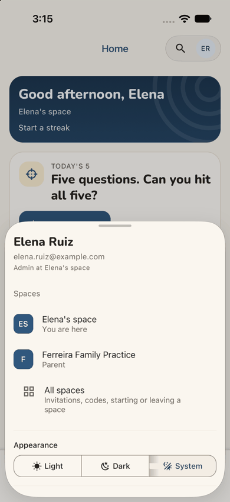
- **Step 28, "No students to choose from."** Elena is inside her tutor's space, whose home leads with "Start an
  assessment". The app says, plainly, that there is no student. It does not say why, that Ines must add her child, or
  how to ask her. Every other place she then tries (Users, her own record, Search) is a dead end.
  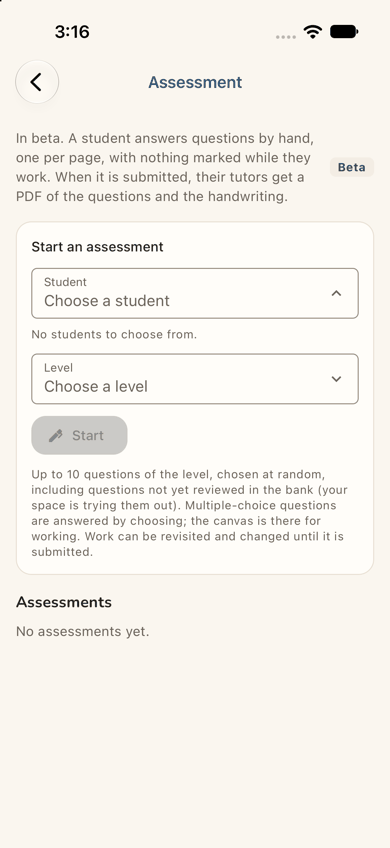

**Contact sheet** (all 34 phone steps):

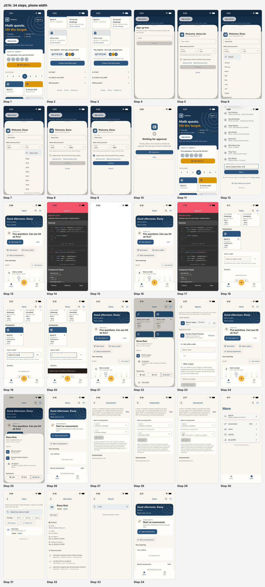

**Web and app.** Compared with the web journey J07 (`J07-space-code-let-in.md`, Lena Fischer), the app differs in nine
ways:

- **The guest home.** The content is the same, including the static example code and the "Create a free family space"
  button. Here the example code sits in a tinted chip, a little less like a field than the web's white box. Tapping it
  does nothing either way.
- **Getting in.** "Sign up free" opens a sheet. In this build that sheet is the developer variant (an Email field),
  with About-you inside it and a search box on the year list. The words are the web's. "Sign in" opens a sign-in screen,
  not the web's "Sign up free" sheet, so the web's sev2 on that title does not apply as seen here. The waiting screen
  fills the phone, without the web's leftover "Almost there" heading, and adds a "Back" button. The wording is the
  same, and so is the silence.
- **The code (app only).** On the web, "Have a code?" scrolls the home down to the code box. In the app it opens the
  box in a dialog, and the dialog crashes the app (steps 14-17). The box at the bottom of the home works, with the same
  hint ("Six characters join a game; eight ask to join a space.") and the same toast.
- **The waiting request.** The Spaces page shows "Ferreira Family Practice" in full (the web's phone layout cut it to
  "Ferreira Family Pra…"). It is reached through the account sheet in 2 taps; the web takes 3. The page still says
  "Each tab can be in a different one." in an app that has no tabs.
- **Being let in.** It is silent on both. The app's only sign is a row in the account sheet, one tap away. The web's
  is a row in the space switcher, two taps away.
- **The space's home.** The app's home has a "Your children — No students yet." card, an honest hint the web's home
  did not give. The tab bar there has no yellow (+).
- **The student picker.** It says "No students to choose from." The web opened an empty list below the bottom of the
  screen, with no message. Neither says why, or who can add a child.
- **Users.** The app shows a parent no "Add user". So the web's sev3, a whole form and then a 403, does not happen
  here. Users lists only Elena on both, not Ines.
- **Her own record.** Its "Recent activity" says "Let Elena Ruiz in as parent — Ines Ferreira · Let in". That is the
  only place in the app that names who let her in. The web's record was not opened.

The end is the same dead end on both platforms. The app's version is clearer and sets no trap, but it is no closer to
an assessment.

| Severity | Count |
| --- | --- |
| sev4 (catastrophe) | 1 |
| sev3 (major) | 3 |
| sev2 (minor) | 3 |
| sev1 (cosmetic) | 1 |
| **Total** | **8** |

## Prioritized fixes

1. [sev4] [Let in as a parent with no child, Elena cannot start an assessment, and nothing says who can fix it](#sev4-let-in-as-a-parent-with-no-child-elena-cannot-start-an-assessment-and-nothing-says-who-can-fix-it): when the reader has no student here, say so and offer "Ask Ines to add my child"; Next up must not offer what cannot start (steps 26-34).
2. [sev3] [The "Have a code?" quick action crashes the app to a blank screen](#sev3-the-have-a-code-quick-action-crashes-the-app-to-a-blank-screen): render the dialog inside the toast provider, and give the app an error screen with a way back (steps 14-18). The cheapest fix in this report, and the most urgent.
3. [sev3] [Being let in is silent: the only sign is a new row in the account sheet](#sev3-being-let-in-is-silent-the-only-sign-is-a-new-row-in-the-account-sheet): keep the request on the home while it waits; announce "You're in Ferreira Family Practice" and open it once (steps 20-25).
4. [sev3] [The approval wait says nothing of who, when, or the code she holds](#sev3-the-approval-wait-says-nothing-of-who-when-or-the-code-she-holds): say who approves, how long, how she will hear, and that the code comes next (steps 10-11).
5. [sev2] [The code has no place until after approval, and the working box is at the bottom of the home](#sev2-the-code-has-no-place-until-after-approval-and-the-working-box-is-at-the-bottom-of-the-home): take a space code on the guest home and at sign-up; keep a working code box near the top (steps 2-5, 18).
6. [sev2] [She lands in a space of her own she never asked for, as its admin and its learner](#sev2-she-lands-in-a-space-of-her-own-she-never-asked-for-as-its-admin-and-its-learner): explain the personal space in one line; lead with her pending request (steps 13, 22).
7. [sev2] ["Everyone" at Ferreira Family Practice is only Elena: the admin is named nowhere a parent looks](#sev2-everyone-at-ferreira-family-practice-is-only-elena-the-admin-is-named-nowhere-a-parent-looks): name the space's admins on Users and on the home (steps 31-32).
8. [sev1] [Staff and web words where a parent reads](#sev1-staff-and-web-words-where-a-parent-reads): the space's full name, "Your child's assessments", plain words for "unreviewed", no "tabs" or "portal" (steps 23, 26, 27, 29, 32).

## Findings

### [sev4] Let in as a parent with no child, Elena cannot start an assessment, and nothing says who can fix it

- **Issue Description:** Ines let Elena in as a Parent. Her let-in form never asks which child is the parent's (J11,
  finding 4), so no child is linked to Elena in the space. Inside, everything points Elena at Assessment:
  - the band says "Ready when you are";
  - Next up says "ASSESSMENTS — Start an assessment. Questions answered by hand, one page each. [Open Assessments]";
  - a quick action repeats it (step 26).

  The home's "Your children" card says "No students yet." (step 26). Tapping "Choose a student" on the Assessment
  page shows "No students to choose from." (step 28). A level can be chosen, but Start stays grey, with no message
  (step 29). Then she looks for a way to add her child, or someone to ask:
  - More has Assessment, Users, Activity and My profile, and nothing about children (step 30);
  - Users lists only Elena and offers no action (step 31);
  - her own record has contact details and activity, and no children section (step 32);
  - Search finds "Nothing matches "child"." (step 33).

  After a relaunch she lands in the same space, and Next up still offers "Start an assessment" (step 34).
- **Framework Violation:** cuj-contract, step 28 (expected: her child to choose, or a note that her child is not here
  yet and who can add them; observed: "No students to choose from." and nothing else). Also steps 29-34.
  task-completion: the journey's end, an assessment started, cannot be reached from Elena's side. success-criteria:
  after the relaunch the end state is unchanged and wrong. Nielsen #1 Visibility of system status; Nielsen #9 Help
  users recognize, diagnose and recover from errors.
- **Severity:** 4. Classify: blocked. The app tells Elena what is missing, more clearly than the web does, but not why,
  not who can fix it, and not how to ask. The only way out is outside the app: she texts Ines, and Ines has to work
  out, unprompted, that she must add Elena's child. C7's giver wants "give one, see results", with Start an
  assessment in 2 taps or fewer. Here it is impossible, on the home of a space whose only feature is Assessment.
- **Evidence:**  
  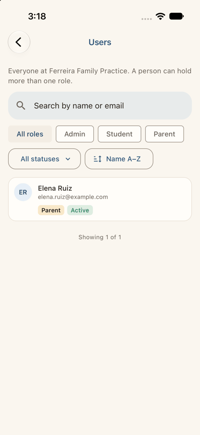 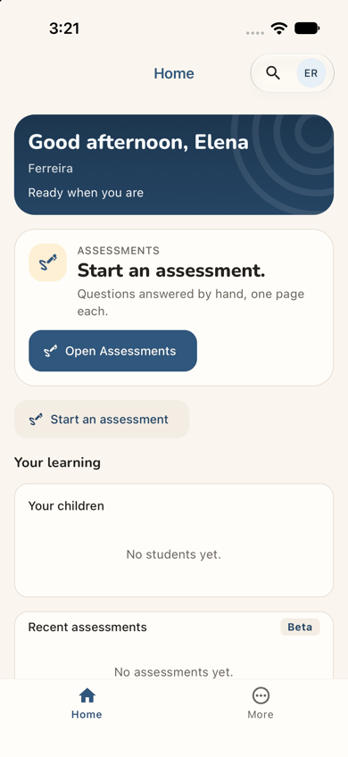
  Repro:
  1. In a self-serve space with Assessment on, an admin lets a join request in as Parent without linking a child.
  2. In the app, as that parent, open the space and tap Open Assessments.
  3. Tap Student: "No students to choose from."
  4. Choose a level: Start stays disabled.
  5. Users, the parent's own record and Search offer no way to add or ask for a child.
- **Recommended Fix:**
  - When the reader has no student they may start an assessment for, replace the form with one card: "To give an
    assessment, your child needs to be in Ferreira Family Practice. Ines Ferreira adds children here." Give it a
    button "Ask Ines to add my child". It could file a request the admin sees in Next up, or open the share sheet
    with a ready message (a self-serve space sends no email).
  - Next up must not offer "Start an assessment" to someone who cannot start one. For a parent with no child, Next up
    is "Your child isn't here yet", with the same button. Put the same line in the home's "Your children" card.
  - Say why Start is grey ("Choose a student first").
  - On the admin's side, the let-in form for a Parent should ask "Which child?", with "Add a child" inline (J11
    finding 4). Letting parents add their own children here would change a rule (today only admins add people): that
    is the owner's decision, not part of this fix.

### [sev3] The "Have a code?" quick action crashes the app to a blank screen

- **Issue Description:** On Elena's first home, the quick action "Have a code?" sits above the fold beside New Quest
  and Start an assessment (step 13). It is the first place the app offers for her code. Tapping it brings up, in this
  development build, a red "Render Error":
  - the message: "useToast must be used inside <ToastProvider>.";
  - the sources: `toast.tsx (102:32)` and `play-home.tsx (368:8)`, `export function HaveACode()`;
  - the component stack: `<HaveACode />` inside `<View />` inside `<DialogContent />` (step 14).

  Dismiss leaves a blank white screen: no header, no tabs, nothing to tap (step 15). Closing and reopening the app
  brings her home back, still signed in (step 16). The second tap fails the same way (step 17). She recovered only by
  closing the app again and scrolling the home four long swipes down. There, below every tile, a second "Have a code?"
  box works (steps 18-20).
- **Framework Violation:** cuj-contract, step 14 (expected: a box for her code; observed: the app crashed) and step 15
  (expected: a way back; observed: a blank screen). Nielsen #9 Help users recognize, diagnose and recover from errors
  (no error screen, no way back); Nielsen #5 Error prevention.
- **Severity:** 3. Classify: a workaround is needed, and the app crashed twice on the main path. The error is thrown by
  the app's own code (`useToast` refuses outside its provider), not by a development-only check. So a release build
  cannot show that dialog either; what it shows instead was not observed. A newcomer who meets a white screen after
  her first tap inside the app may well not come back. It is not a 4 only because a second box, several screens down
  the same home, works (step 18). The same quick action is on the first home of every new personal space in the other
  app journeys (J01A, J04A, J06A), where it was not tapped. The web's "Have a code?" works (J07, step 14), so this is
  also a parity gap.
- **Evidence:**  
  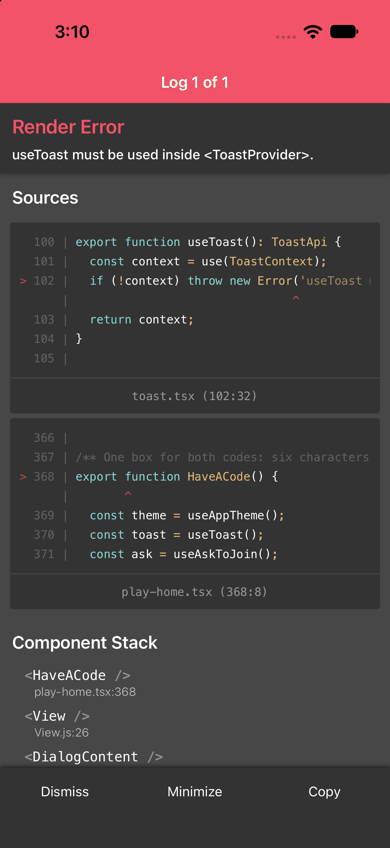 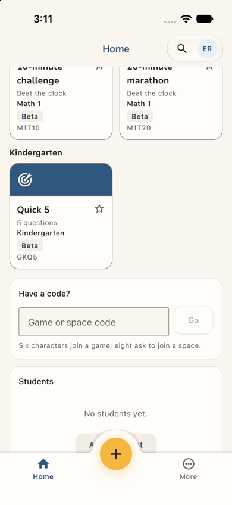
  Repro: in the iOS development build, as any member whose home shows the quick action "Have a code?", tap it. The
  red "Render Error: useToast must be used inside <ToastProvider>." appears every time. Dismiss leaves a white screen
  until the app is closed and reopened.
- **Recommended Fix:**
  - Render the quick action's dialog inside the toast provider, or mount the provider above the portal the dialogs
    use. Give the flow that taps this quick action and asks to join a space the `smoke` tag, so it is covered on both
    platforms.
  - Give the app a root error screen ("Something went wrong — Back to Home") so that no error leaves a white screen.
  - Until it is fixed, make the quick action scroll to the home's own box, as the web does.

### [sev3] Being let in is silent: the only sign is a new row in the account sheet

- **Issue Description:** Asking to join takes two taps once the working box is found (steps 19-20). Its toast, "Asked
  to join. Its admins will let you in.", does not name the space, and it fades. The top of the home then looks exactly
  as before (step 21). The request is visible only on the Spaces page, under "Requests sent" (step 23), behind her
  initials and "All spaces". Nothing on the home points there.

  When Ines lets her in, nothing tells Elena either. She reopens the app and lands in her own space, her last opened
  (step 24). The home, the band and Next up are all as before. There is no banner, no Next up item, and no dot on her
  initials. Only the account sheet shows "Ferreira Family Practice · Parent" (step 25). No email reached her:
  self-serve spaces send none, and this local stack sends none.
- **Framework Violation:** cuj-contract, step 20 (expected: a confirmation that names Ines's space; observed: "Its
  admins"), step 21 (expected: a waiting state on the home; observed: none) and step 24 (expected: a sign she was let
  in; observed: none). Nielsen #1 Visibility of system status; Nielsen #6 Recognition rather than recall (she must
  remember where the request lives).
- **Severity:** 3. Classify: a workaround is needed. Elena must remember, unprompted, to open her initials to learn
  whether Ines has decided. A parent who does not would believe she is still waiting, or that it failed, and stop
  coming back. It is not a 4: the account sheet does list the space, and opening it works (step 26).
- **Evidence:** 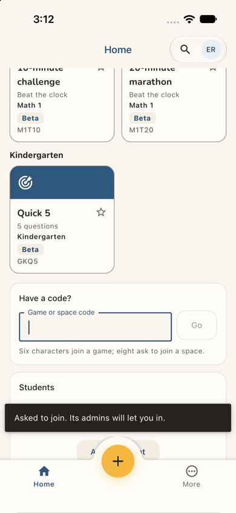 
  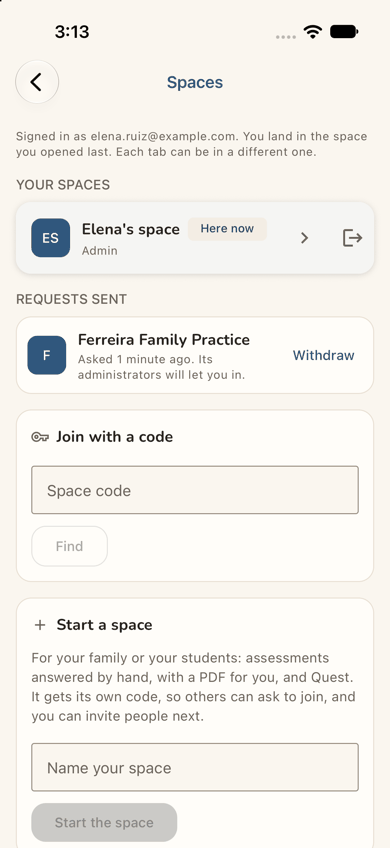 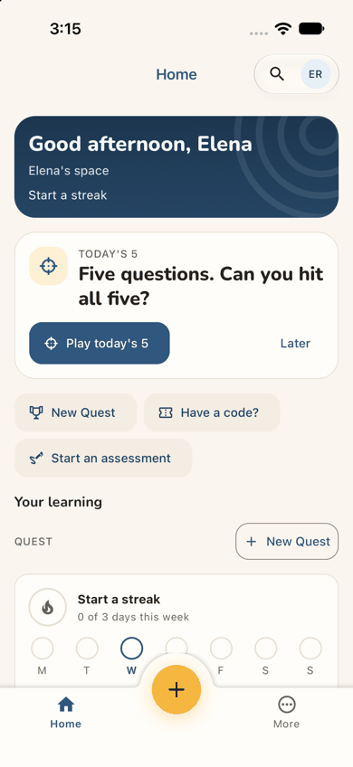
  
  Repro:
  1. As an approved member in a personal space, enter a space code in the home's "Have a code?" box and tap Go.
  2. Scroll up: the home shows no request.
  3. Have the space's admin let you in, then close and reopen the app: the home is unchanged.
  4. The space appears only in the account sheet's Spaces list.
- **Recommended Fix:**
  - Name the space in the toast ("Asked to join Ferreira Family Practice. Ines will let you in.").
  - Keep a waiting card on the home while a request is pending, as an invitation already gets a banner. Make it Next
    up: "Waiting for Ferreira Family Practice to let you in — asked today", with Withdraw.
  - When the request is accepted, open the new space once on the next launch, with a one-line welcome ("You're in
    Ferreira Family Practice. Ines Ferreira let you in today."). Until then, show a dot on the account button.
  - A push notification on acceptance belongs to `docs/roadmap/push-notifications.md`, which is not scheduled.

### [sev3] The approval wait says nothing of who, when, or the code she holds

- **Issue Description:** After Continue, the app shows a full-screen "Waiting for approval": "Thanks, Elena. Your
  access is waiting for approval. You can sign in once it's approved." The buttons are "Contact us" (filled) and "Back"
  (step 10). The screen leaves four things out:
  - who approves: Aimtrue, or Ines, whose code Elena has not been able to enter anywhere;
  - how long approval takes;
  - whether she will be told;
  - that her code will be asked for after approval.

  The next day the app opens on the same guest home, with no "You're approved" (step 11). She tries Sign in on a
  hunch. The same wait is reported in J01A and J06A, and on the web in J07; here it also strands the code.
- **Framework Violation:** cuj-contract, step 10 (expected: what happens next, including the code; observed: only
  that access waits) and step 11 (expected: some sign the account is ready; observed: none). Nielsen #1 Visibility of
  system status; Nielsen #2 Match between system and the real world (two approvals, the platform's and the space's,
  look like one to her).
- **Severity:** 3. Classify: a workaround is needed. Elena must come back on her own, on no schedule, and guess that
  she can now sign in. A parent sent by a tutor reasonably believes the tutor approves her. She may wait for Ines,
  while Ines waits for a request that cannot arrive until Elena returns. It is not a 4: signing in later works
  (step 13).
- **Evidence:** 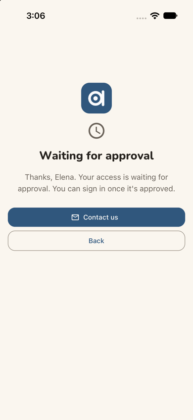 
  Repro: under Post-approved sign-up access, sign up from the guest home's "Sign up free". Answer the age question,
  tick the terms and tap Continue: "Waiting for approval". After the console approves, close and reopen the app: the
  guest home is unchanged.
- **Recommended Fix:**
  - Give the wait the facts: "Aimtrue checks new accounts by hand, usually within a day. We'll let you know when
    you're in. Have a code from a tutor or school? You'll enter it right after."
  - Point "Contact us" at a product address.
  - On the next launch, recognise the device that is waiting ("Your account is ready: Sign in") instead of showing the
    guest home.

### [sev2] The code has no place until after approval, and the working box is at the bottom of the home

- **Issue Description:** Ines's instruction comes with a code, and the guest home (step 1) has nowhere to type it.
  Its only code is an example, "QF7K2M", in a tinted chip under "Play together · One code, everyone joins", with
  "Family games with a free account. Example code." and "Create a free family space" (step 2). Tapping the chip does
  nothing: it is static, and it is a game code, not a space code (step 3, a dead end). The sign-up sheet and the
  About-you form do not ask for a code either (steps 4-5).

  After approval, the quick action "Have a code?" crashes (previous finding). The box that works is at the very
  bottom of the home, four long swipes down, past the streak, the Daily, the grade row and some fifteen tiles
  (step 18). Its hint, "Six characters join a game; eight ask to join a space.", is what told her that her 8-character
  code was right. The Spaces page has a third box, "Join with a code" (step 23), which she saw only after asking.
- **Framework Violation:** cuj-contract, steps 2-3 (expected: a place for her code; observed: an example code that
  does nothing) and steps 4-5 (expected: the code asked for at sign-up; observed: not mentioned). Nielsen #7
  Flexibility and efficiency of use; Nielsen #4 Consistency and standards (three code boxes, one broken, none where
  she starts).
- **Severity:** 2. Classify: real friction and one dead end. A code holder is the warmest kind of newcomer, and the
  app makes her carry the code through sign-up, a wait for approval and a second sign-in before it is asked for. Then
  the obvious box is broken, and the working one is the last thing on the page.
- **Evidence:**  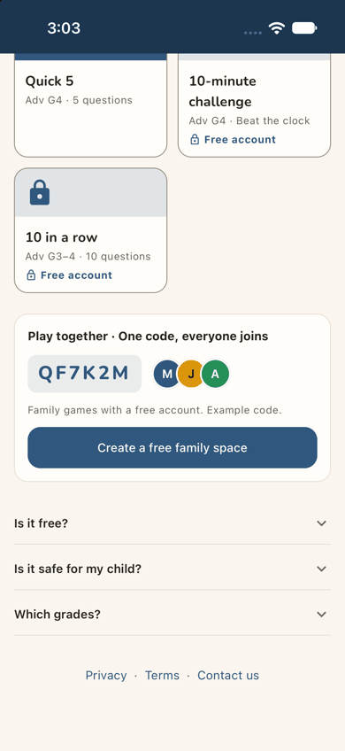
  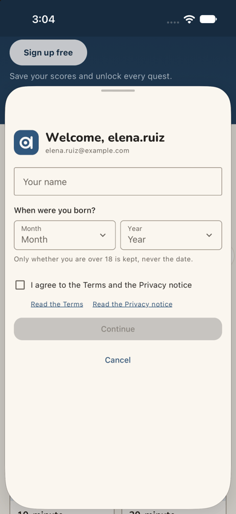 
  Repro: signed out, scroll the guest home to "Play together" and tap QF7K2M: nothing happens. After signing in,
  scroll the home to its end: the working "Have a code?" box is below every tile.
- **Recommended Fix:**
  - Put a real "Have a code from a tutor or school?" field on the guest home, near the top.
  - Accept a space code there and keep it on the device through sign-up. File the join request as soon as the account
    is approved, and say so on the waiting screen ("We'll ask Ferreira Family Practice to let you in").
  - Label the example chip as an illustration ("for example"), as the web report also asks.
  - Keep one code box, near the top of the home, for a member who has not played yet.

### [sev2] She lands in a space of her own she never asked for, as its admin and its learner

- **Issue Description:** Her first screen after sign-in (step 13) is the home of "Elena's space", a personal space made
  for her at sign-up. Nothing explains it. The home addresses her as the learner:
  - Next up "Today's 5: Five questions. Can you hit all five?";
  - "Start a streak, 0 of 3 days this week";
  - "Your learning > Quest", with New Quest.

  The account sheet calls her "Admin at Elena's space" (step 22). For a 40-year-old parent who came to join her
  tutor's space, it reads as a child's practice page with her name on it, in a space she did not ask for. While her
  request waits, the home leads with play, not with the request (step 21).
- **Framework Violation:** cuj-contract, step 13 (expected: a screen about joining Ines's space; observed: her own
  space, framed as a player's). Nielsen #2 Match between system and the real world.
- **Severity:** 2. Classify: an observable mismatch and real friction. It does not block: a code box exists. But it
  blurs what Elena signed up for, and it makes "which space am I in?" a live question for the rest of the journey. At
  step 24 she lands back here after being let in.
- **Evidence:** 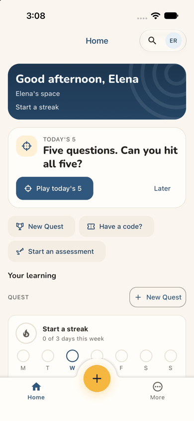 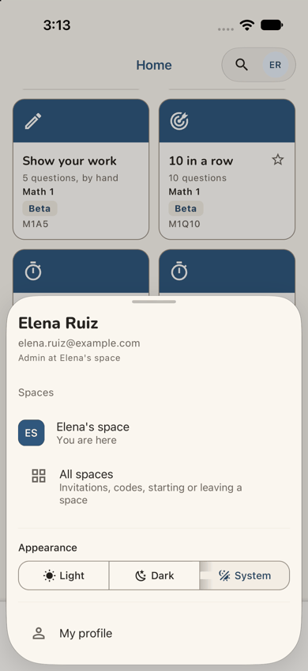
  Repro: as a newly approved adult, sign in and look at the first home and the account sheet.
- **Recommended Fix:**
  - On first arrival, one line on the band: "This is your own space for practice. Ines's space will appear here once
    she lets you in."
  - While a join request is pending, make it Next up (see the let-in finding above).
  - For an adult whose sign-up did not come from guest play, lead with the code box rather than Today's 5.

### [sev2] "Everyone" at Ferreira Family Practice is only Elena: the admin is named nowhere a parent looks

- **Issue Description:** Looking for her child, Elena opens More > Users (steps 30-31). It says "Everyone at Ferreira
  Family Practice. A person can hold more than one role." and lists one person, herself (Parent, Active, "Showing 1 of
  1"). Ines, who runs the space, is not listed, and nothing else in the space names her: not the home, not More, not
  the Assessment page. The only place in the app that says who let Elena in is the bottom of her own record:
  "Let Elena Ruiz in as parent — Ines Ferreira · Let in · 5 minutes ago" (step 32). So Elena cannot see, inside the
  app, whom to ask about her child.
- **Framework Violation:** cuj-contract, step 31 (expected: the space's people, or at least its admin; observed: only
  herself, under "Everyone"). Nielsen #2 Match between system and the real world ("Everyone" is one person); Nielsen
  #10 Help and documentation (no one to ask).
- **Severity:** 2. Classify: an observable mismatch that deepens the dead end. Keeping the space's other families
  private is right. Hiding the one person a newcomer needs to reach is not.
- **Evidence:**  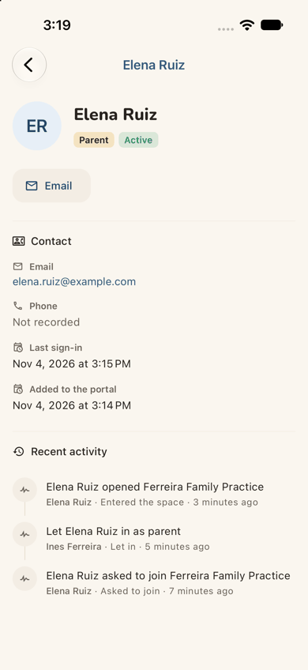
  Repro: as a Parent of a self-serve space (not an admin), open More > Users, then tap your own card.
- **Recommended Fix:**
  - For a non-admin, title Users "Your family at Ferreira Family Practice" and add one line, "Run by Ines Ferreira",
    with the same "Ask Ines" action as the sev4 fix.
  - Put the same line on the space's home band for a newcomer's first visits.

### [sev1] Staff and web words where a parent reads

- **Issue Description:** Small wording problems along the way:
  - Inside the space, the band says only "Ferreira" (the short name), not "Ferreira Family Practice", the name Ines
    gave her (step 26).
  - "Your children" sits under "Your learning", though the learning is her child's (step 26).
  - The Assessment page says "their tutors get a PDF", and the form's note says "including questions not yet reviewed
    in the bank (your space is trying them out)". The chosen level reads "G3 · 10 questions · includes unreviewed"
    (steps 27, 29). That is staff language, and slightly worrying to a parent.
  - The Spaces page says "Each tab can be in a different one." in an app that has no tabs (step 23).
  - Her record says "Added to the portal" (step 32).
- **Framework Violation:** cuj-contract, steps 23, 26, 27, 29 and 32 (observable wording mismatches). Nielsen #2 Match
  between system and the real world.
- **Severity:** 1. Classify: cosmetic. Each one makes Elena pause briefly, and none of them stops her.
- **Evidence:**  
  Repro: as a member of Ferreira Family Practice in the app, open the home, the Assessment page (choose a level), the
  Spaces page and your own record.
- **Recommended Fix:**
  - Show the space's full name in the band.
  - Title a parent's section "Your child's assessments".
  - Word the beta note for families ("Some questions are new and still being checked").
  - In the app, drop the sentence about tabs; say "space", not "portal".

## Walkthrough

### Step 1 — Launch the app fresh (landing)

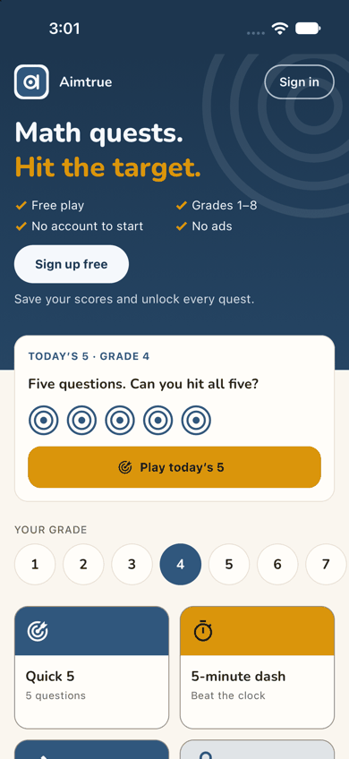

> Expected: a front page with a place for a tutor's code, or a way to sign up and join a space. Observed: the guest
> home "Math quests. Hit the target.", with Free play, Grades 1–8, No account to start and No ads. "Sign up free" is a
> white pill, with "Save your scores and unlock every quest." under it. "Sign in" is an outlined pill at the top
> right. Below are "Today's 5 · Grade 4", a grade row with 4 selected, and tiles. There is no code field and no
> mention of a tutor's space above the fold. Dark mode is readable.

**What Elena notices:** a children's maths game. Ines said "join my space with the code", so she looks for where the
code goes.

### Step 2 — Scroll down looking for a code box

> Expected: a "Have a code?" or "Join a space" field. Observed: more tiles (Adv G4, two locked "Free account"), then
> "Play together · One code, everyone joins". It has the code QF7K2M in a tinted chip, three avatars, "Family games
> with a free account. Example code." and "Create a free family space". Then the questions "Is it free?", "Is it safe
> for my child?" and "Which grades?", and Privacy · Terms · Contact us.

**What Elena notices:** "One code, everyone joins" sounds like her code. She does not want to create a space; she
wants to join Ines's.

### Step 3 — Tap the code QF7K2M to type her own

> Expected: a field that takes her code. Observed: nothing. The chip is static (its accessible name is "Example game
> code Q F 7 K 2 M"), with no keyboard, focus or sheet. Dead end.

**What Elena notices:** it is a picture of a code, and a game code at that. There is nowhere for hers.

### Step 4 — Scroll back up and tap "Sign up free"

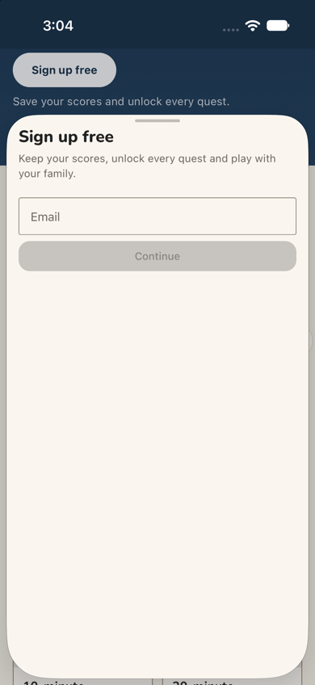

> Expected: a sign-up step, maybe with a place for her code. Observed: a sheet, "Sign up free — Keep your scores,
> unlock every quest and play with your family.", with an Email field and a disabled Continue (the developer variant;
> production has the provider buttons here). There is no code field.

**What Elena notices:** the pitch is about a child's scores. She goes on because Ines said to install the app and join.

### Step 5 — Type her address and tap Continue

> Expected: an account form. Observed: the sheet turns into About you. It shows the logo, "Welcome, elena.ruiz" and her
> address, then "Your name" (developer sign-up only), "When were you born?" (Month, Year), "Only whether you are over
> 18 is kept, never the date.", a terms checkbox with links, a disabled Continue and Cancel. Still no code field.

**What Elena notices:** a short form, and a reassuring note about her birth date.

### Step 6 — Type her name and open Month

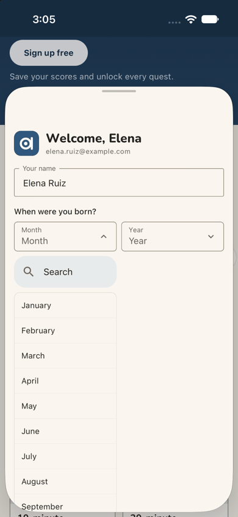

> Expected: the name taken, a month list. Observed: "Welcome, Elena". The month list opens under Month with a Search
> box. January to August are visible, so June is in reach.

**What Elena notices:** nothing odd.

### Step 7 — Pick June and open Year

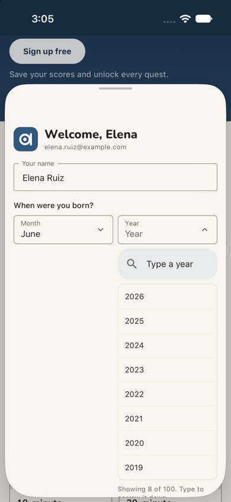

> Expected: a year list. Observed: Month reads "June". The year list runs from 2026 down (2026 … 2019), with "Type a
> year" at the top and "Showing 8 of 100. Type to narrow it down." cut by the sheet's lower edge.

**What Elena notices:** 1986 is 40 rows away, but the search box helps.

### Step 8 — Type 1986 in the year search and pick it

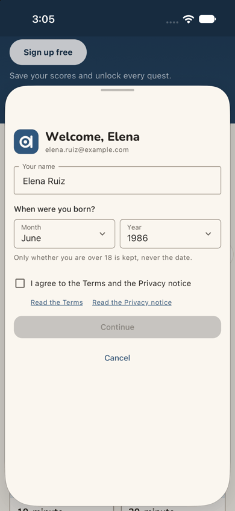

> Expected: the year set. Observed: June and 1986. The list closes, and Continue stays grey until the terms are
> ticked.

**What Elena notices:** done, apart from the terms.

### Step 9 — Tick "I agree to the Terms and the Privacy notice"

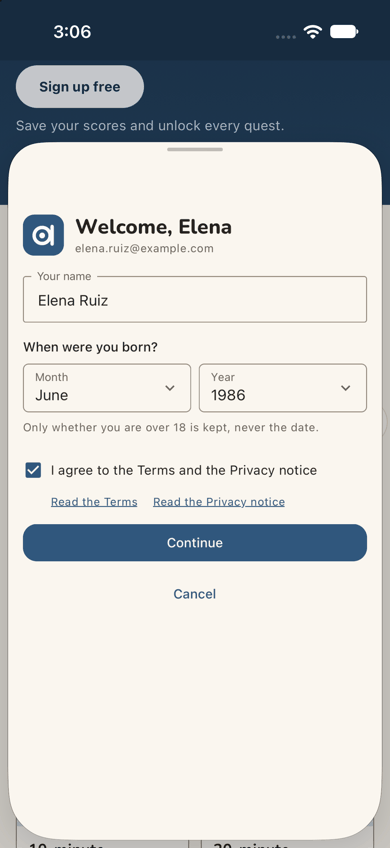

> Expected: Continue enabled. Observed: the box ticks and Continue turns blue.

**What Elena notices:** ready to go.

### Step 10 — Tap Continue: "Waiting for approval" (landing)

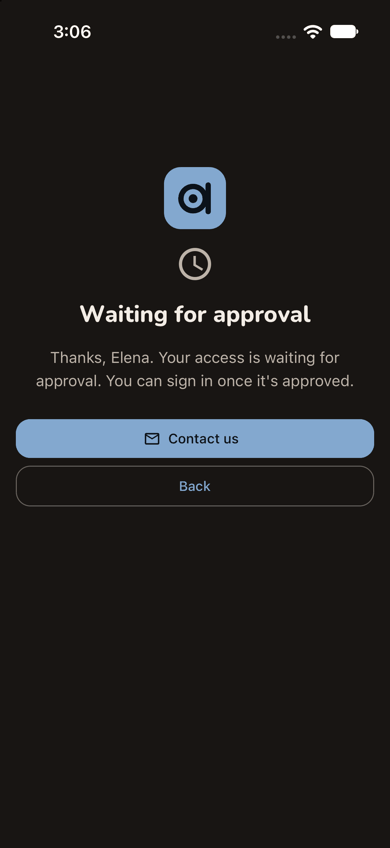

> Expected (Post-approved): a waiting screen that says what happens next. Observed: a full screen with the logo, a
> clock, "Waiting for approval" and "Thanks, Elena. Your access is waiting for approval. You can sign in once it's
> approved.", then "Contact us" (filled) and "Back". Dark mode is readable. That is the end of day 1.

**What Elena notices:** no word on who approves, how long it takes, or whether she will be told. She has still had
nowhere to put FMXY2345, and wonders whether Ines is the one approving.

### Step 11 — A day later, after the platform approved her: open the app again (landing)

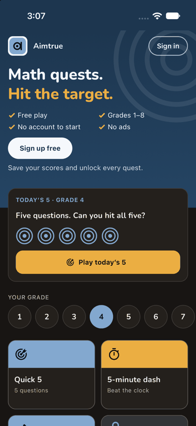

> Expected: some sign that her account is approved. Observed: the very same guest home as step 1, with nothing about
> her account.

**What Elena notices:** she has to guess that she is approved now. She has an account, so she goes for "Sign in".

### Step 12 — Tap "Sign in" and type her address

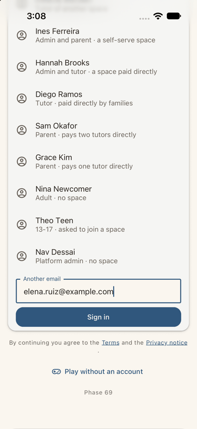

> Expected: a sign-in step. Observed: the developer sign-in (this build only): a list of seeded people, then "Another
> email" with her address typed, Sign in, the terms line, "Play without an account" and "Phase 69". In production
> this is a provider button; this screen was not judged.

**What Elena notices:** (developer screen) she types the address she signed up with.

### Step 13 — Tap Sign in (landing)

> Expected: "still waiting", or a screen that asks for her tutor's code. Observed: signed in at once, on the home of
> "Elena's space":
> - the band "Good afternoon, Elena / Elena's space / Start a streak";
> - Next up "Today's 5: Five questions. Can you hit all five?", with Play today's 5 and Later;
> - quick actions New Quest, Have a code? and Start an assessment;
> - "Your learning > Quest" and "Start a streak, 0 of 3 days this week".
>
> The tab bar has Home, a yellow (+) and More. Dark mode is readable.

**What Elena notices:** "Have a code?", at last, above the fold. But the page treats her as the learner, in a space
she never asked for, and nothing says she was approved.

### Step 14 — Tap "Have a code?"

> Expected: a box for her code. Observed: the development build's red "Render Error: useToast must be used inside
> <ToastProvider>.". The sources are `toast.tsx (102:32)` and `play-home.tsx (368:8)`, `export function HaveACode()`.
> The component stack is `<HaveACode />`, `<View />`, `<DialogContent />`. The buttons are Dismiss, Minimize and Copy.
> The quick action's dialog failed to render.

**What Elena notices:** the one button for her code broke the app. (A release build shows no red screen; what it shows
instead was not observed.)

### Step 15 — Tap Dismiss

> Expected: back to the home, or an error with a way back. Observed: a blank white screen with only the status bar:
> no header, no tabs, nothing to tap. Dead end.

**What Elena notices:** the app is broken. The only thing left is to close it and open it again.

### Step 16 — Close the app and open it again

> Expected: the app back. Observed: the home of Elena's space, still signed in, exactly as at step 13. Nothing mentions
> what happened.

**What Elena notices:** relief, and the same "Have a code?" button.

### Step 17 — Tap "Have a code?" once more

> Expected: maybe it works this time. Observed: the same red "Render Error: useToast must be used inside
> <ToastProvider>.". It is reproducible.

**What Elena notices:** it is not a fluke; that button does not work.

### Step 18 — Dismiss, reopen the app, and scroll down the home instead

> Expected: another place for the code. Observed: after Dismiss (a blank screen again, not captured) and a relaunch,
> four long swipes passed the streak, the Daily, the grade row and the tiles (down to Math 1 and Kindergarten, each
> with "Beta" and a code such as GKQ5). At the bottom is a card "Have a code?" with a "Game or space code" field, a
> grey Go and "Six characters join a game; eight ask to join a space." Below it is "Students — No students yet."

**What Elena notices:** her code has eight characters, so "eight ask to join a space" tells her this is the place.
It was the last thing on a long page.

### Step 19 — Type FMXY2345

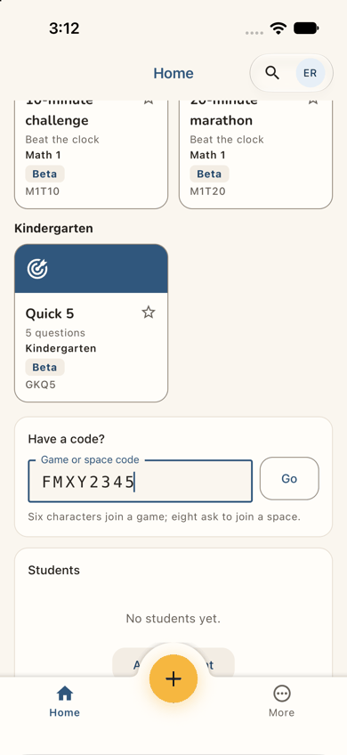

> Expected: the code accepted. Observed: the label floats, the code shows in spaced capitals, and Go is enabled.

**What Elena notices:** straightforward.

### Step 20 — Tap Go

> Expected: a confirmation that names Ines's space. Observed: at once, a dark toast at the bottom, "Asked to join. Its
> admins will let you in." The field empties and Go greys. The page does not change. The words are the web's.

**What Elena notices:** it worked, and someone will let her in. But "its"? It does not name Ferreira Family Practice,
and the toast fades.

### Step 21 — Scroll back to the top of the home

> Expected: a "Waiting for Ferreira Family Practice" line. Observed: the home exactly as at step 13, with no trace of
> the request.

**What Elena notices:** the only proof of her request was a toast, and it is gone.

### Step 22 — Tap her initials (the account button)

> Expected: Ines's space, perhaps as "requested". Observed: a sheet with "Elena Ruiz", her address and "Admin at
> Elena's space". Under Spaces it lists "Elena's space · You are here", then "All spaces — Invitations, codes,
> starting or leaving a space". Below are Appearance and My profile. There is no Ferreira. (Behind the sheet the home
> had moved to the Math 1 tiles.)

**What Elena notices:** "Admin" of a space she did not set up. "Codes" under All spaces is the next place to try.

### Step 23 — Tap "All spaces" (landing)

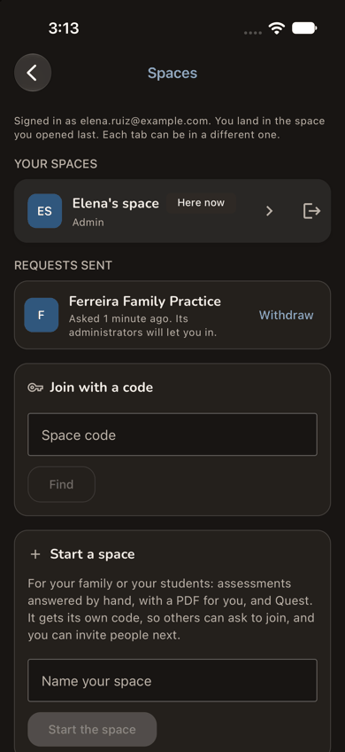

> Expected: her request. Observed: the Spaces page:
> - "Signed in as elena.ruiz@example.com. You land in the space you opened last. Each tab can be in a different one.";
> - YOUR SPACES: "Elena's space · Here now · Admin", with a leave icon;
> - REQUESTS SENT: "Ferreira Family Practice — Asked 1 minute ago. Its administrators will let you in.", with
>   Withdraw;
> - "Join with a code" (Space code, Find) and "Start a space".
>
> Dark mode is readable.

**What Elena notices:** relief: Ines's space by its full name, and a way to withdraw. Nothing says how she will hear
when she is in. A code box sits right here too, which she did not know about.

### Step 24 — Later, after Ines let her in: open the app again (landing)

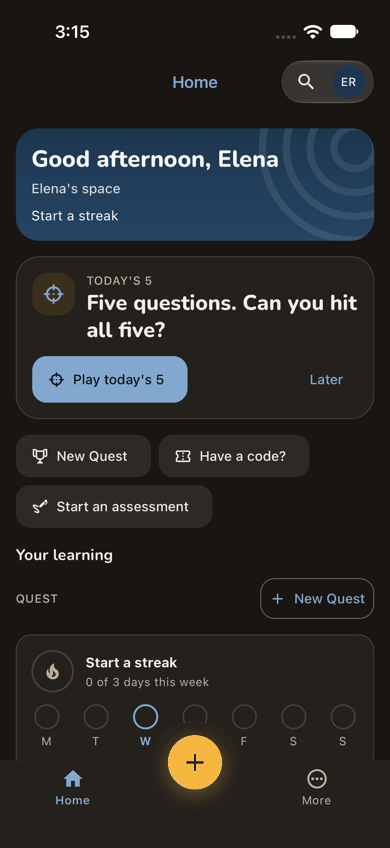

> Expected: a sign that Ines let her in (a banner, a Next up item), or landing in Ines's space. Observed: the home of
> Elena's space, her last opened, the same as step 13. There is no banner, no item and no dot on her initials.

**What Elena notices:** nothing has changed. She cannot tell whether Ines has decided.

### Step 25 — Tap her initials, where she found her request

> Expected: Ines's space, or the request still pending. Observed: Spaces lists "Elena's space · You are here", then a
> new row "F Ferreira Family Practice · Parent", then All spaces.

**What Elena notices:** she is in, as a Parent, which is right. She found out only because she went looking.

### Step 26 — Tap "Ferreira Family Practice" (landing)

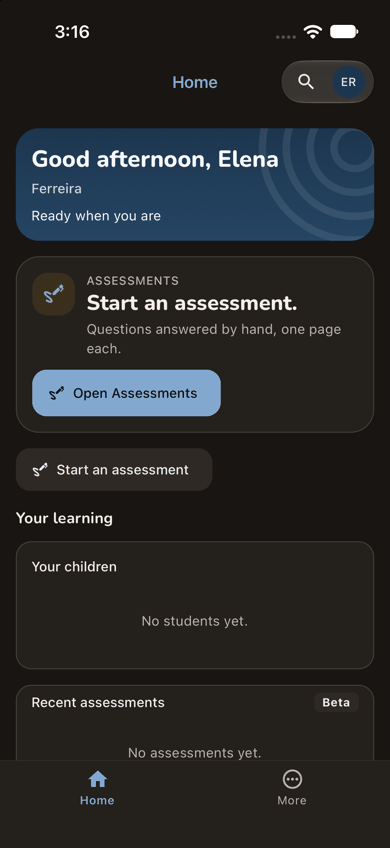

> Expected: a welcome to Ines's space, what it offers, her child. Observed: at once, the space's home:
> - the band "Good afternoon, Elena / Ferreira / Ready when you are";
> - Next up "ASSESSMENTS — Start an assessment. Questions answered by hand, one page each.", with Open Assessments;
> - one quick action, "Start an assessment";
> - "Your learning", with "Your children — No students yet." and "Recent assessments (Beta) — No assessments yet.".
>
> The tab bar has only Home and More. Quest, which is off here, is absent. There is no welcome, and no mention of
> Ines. Dark mode is readable.

**What Elena notices:** one obvious thing to do, "Start an assessment", which is what Ines meant. "No students yet"
under "Your children" puzzles her: her child is Ines's student.

### Step 27 — Tap "Open Assessments" (landing)

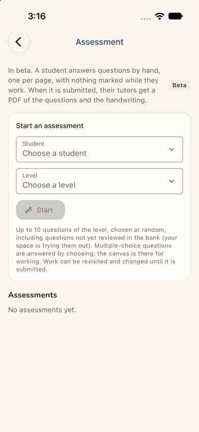
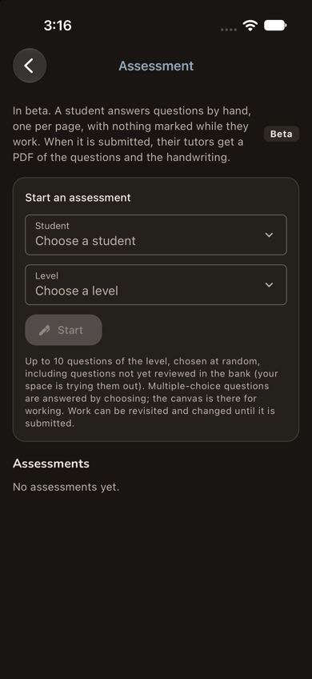

> Expected: the start of an assessment. Observed: the Assessment page:
> - "In beta. A student answers questions by hand, one per page, with nothing marked while they work. When it is
>   submitted, their tutors get a PDF of the questions and the handwriting.";
> - "Start an assessment", with Student "Choose a student", Level "Choose a level" and a grey Start;
> - the note about up to 10 questions "including questions not yet reviewed in the bank";
> - "Assessments — No assessments yet.".
>
> Dark mode is readable.

**What Elena notices:** Ines gets the work as a PDF, which reassures her. Now to pick her child.

### Step 28 — Tap "Choose a student"

> Expected: her child's name, or a note that her child is not here yet and who can add them. Observed: the field opens
> (chevron up), and under it, in small grey type: "No students to choose from." There is no list, no hint and no
> button. Dead end.

**What Elena notices:** her child is not here. She does not know whose job it is to add them.

### Step 29 — Choose a level anyway: G3

> Expected: Start lights up, or a reason why not. Observed: Level reads "G3 · 10 questions · includes unreviewed", and
> Start stays grey. "No students to choose from." is still there. No message says why Start is grey.

**What Elena notices:** she has done all she can, and it will not start. "includes unreviewed" sounds unfinished.

### Step 30 — Go back and open More

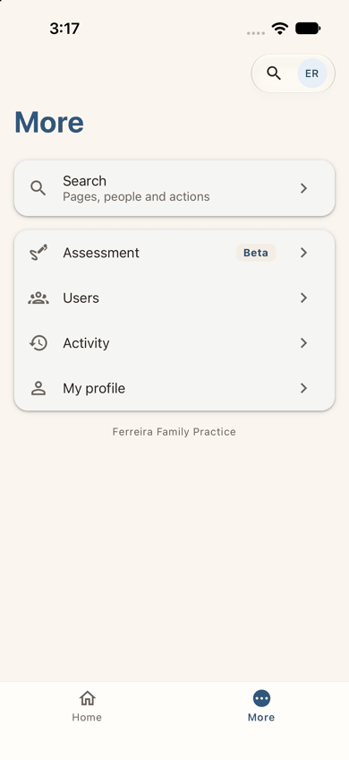

> Expected: "My children" or "Add a child". Observed: "More", with Search (Pages, people and actions), then
> Assessment (Beta), Users, Activity and My profile. The footer says "Ferreira Family Practice".

**What Elena notices:** "Users" is the only place a child could be listed.

### Step 31 — Tap Users

> Expected: her family, or the space's people. Observed: "Everyone at Ferreira Family Practice. A person can hold more
> than one role.", a search box, role and status filters, and one card: "Elena Ruiz · Parent · Active". "Showing 1 of
> 1." There is no Add user.

**What Elena notices:** "everyone" is only her, not even Ines. There is nothing to tap that adds a child.

### Step 32 — Tap her own card

> Expected: her profile, perhaps with her children and "Add a child". Observed: her record, with Parent, Active and an
> Email button. Contact gives her email, Phone "Not recorded", her last sign-in and "Added to the portal". Recent
> activity lists "Elena Ruiz opened Ferreira Family Practice", "Let Elena Ruiz in as parent — Ines Ferreira · Let in ·
> 5 minutes ago" and "Elena Ruiz asked to join Ferreira Family Practice". It is one page, with no children section.
> Dead end.

**What Elena notices:** Ines let her in five minutes ago, the only place the app says so. There is nothing here for
her child.

### Step 33 — Go back to More, open Search and type "child"

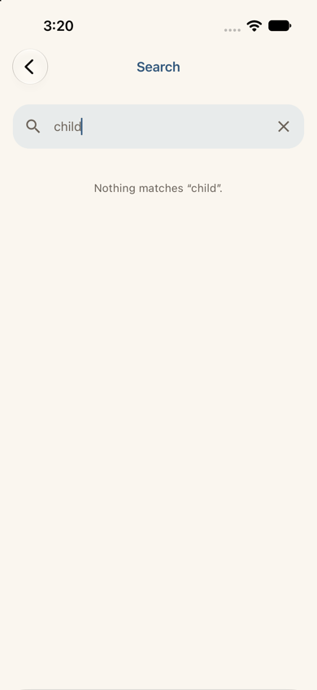

> Expected: an action such as "Add a child", or "My children". Observed: "Nothing matches "child"." Dead end.

**What Elena notices:** there is nothing more she can do in the app. She will text Ines.

### Step 34 — Close the app and open it again (end-state check, landing)

> Expected: still in Ines's space, with something telling her what to do about her child. Observed: the home of
> Ferreira, the space opened last, the same as step 26: Next up "Start an assessment", the quick action, "Your
> children — No students yet." and "No assessments yet.". The journey ends here, in a dead end.

**What Elena notices:** the app cheerfully invites her to do what she has just learned she cannot.

## Appendix

- **Mode:** live. The iOS app (development build `com.aimtrue.app.dev`) ran on the iPhone 17 simulator, loading its
  bundle from Metro, against the local Worker at `http://localhost:8787` (the run's data and settings, with sign-in
  off).
  - **Driving.** Maestro ran one small flow per step (`apps/mobile/.maestro/journeys/j07a-*.yaml`). Each screen was
    captured with `simctl` and resampled to 390 px wide. Dark mode was captured at the landing steps (1, 10, 11, 13,
    23, 24, 26, 27, 34).
  - **Stages.** There were three stages on one device, with no state cleared between them:
    - steps 1-10, then the platform admin's approval;
    - steps 11-23, then Ines's decision;
    - steps 24-34.

    Steps 16 and 18 also closed and reopened the app, because the crash left nothing else to do.
  - **Mis-taps by the harness.** Three flows were run again, and each screenshot is of the corrected run. None changed
    what a person would see:
    - step 3: a tap on the text "QF7K2M", which the chip's accessible name hides;
    - step 32: a tap on the bare name, which the card's accessible name hides;
    - step 33: a search button looked for on the record page, which has none.
- **Frameworks applied:**
  - cuj-contract: every step against its expected result.
  - task-completion: the journey's end, an assessment started, was not reached. It stopped at a dead end (steps 28-33).
  - success-criteria: the end state was checked again after closing and reopening the app (step 34). It landed in
    Ferreira, still offering an assessment Elena cannot start.
- **CUJ manifest:** J07A, 34 steps, 23 verified.
  - Not verified: step 3 (the example code), steps 14, 15 and 17 (the crash) and steps 28-34 (the dead end).
  - Observed and not matching expectation, though the step worked:
    - steps 10-11 (the silent wait);
    - step 13 (a personal space);
    - steps 20-21 and 24 (the silent request and let-in);
    - step 26 (no welcome).
- **Coverage / not inspected:**
  - **The production sign-in and sign-up screens** (the provider buttons). The local server ran with sign-in off, so
    the app showed its developer forms. The sheet's Email field and "Your name" (steps 4-5) and the seeded list and
    "Phase 69" (step 12) are not what a stranger sees, and were not judged.
  - **What a release build shows when "Have a code?" fails.** Only the development build was run: its red overlay
    (steps 14, 17) and the blank screen after Dismiss (step 15). The blank screen after the second Dismiss (inside
    step 18) was not captured.
  - The home between its top and the code box, passed by the swipes in step 18, apart from the last screen.
  - The level list itself (step 29 opened and closed it in one flow).
  - The Terms and the Privacy notice were not opened, and "Contact us" on the waiting screen was not tapped. Also not
    opened: the guest home's three questions and "Create a free family space".
  - **Paths not taken:**
    - Withdraw, "Join with a code" and "Start a space" on the Spaces page;
    - Play today's 5, Later, New Quest and the tiles in Elena's space;
    - the yellow (+) there;
    - Activity, My profile, the Email button on her record, and the Ferreira home below "Recent assessments".
  - Quest: off in Ferreira Family Practice, and absent from its menu and home. Elena did not look for it.
  - Whether Elena was told outside the app (an email). Self-serve spaces send none, and no mailbox was available.
  - VoiceOver (the accessibility tree was read only to find controls), Dynamic Type, the on-screen keyboard (the
    simulator's hardware keyboard was on), and Android.
- **Access:** the app's developer sign-in (the local server ran with sign-in off, because the native Google step cannot
  be driven on the simulator); the development build; the approval and any space decision were made in the web console
  and are not part of the journey.
- **Preconditions made outside the app:** none by this journey. The run's platform settings were set before the
  journeys, as `docs/userjourney/README.md` "The run" records: sign-up access Post-approved, guest play on, Quest kept
  off in `assess` (Ferreira Family Practice), whose code is FMXY2345. Two decisions were made in the web on `:8787`:
  - **The approval, between steps 10 and 11.** The platform admin approved Elena in the console (Settings > Sign-up
    access, Waiting for approval, Approve). The toast was "Elena Ruiz approved.".
  - **The let-in, between steps 23 and 24.** As Ines Ferreira, the space's admin: Home, Next up "Open people", Users,
    "Requests to join 1", Let in on Elena's card, tick Parent, Add user. The toast was "Elena Ruiz added.". The form
    did not ask for a child, and none was linked.
- **Left in the local database by this journey** (for the agents that follow):
  - Elena Ruiz (elena.ruiz@example.com), approved, with the personal space "Elena's space";
  - Elena as a Parent, Active, in Ferreira Family Practice (`assess`), with no child linked; her join request is
    accepted.
