# CUJ Audit — J08: friend sent a game code and a tile link; does the code still work after the wait

## Executive summary

**Persona.** Kai Turner is 29 and was born in October 1996. He is cohort **C6** of `docs/member-home-plan.md`, the Quest player, whose question is "Let me play." and whose first Next up is "Game invite → Join". A friend texted him: "Join my maths game! Code TVFEJK", with a link to a quest, `/play/G4Q10`. Kai wanted to get into his friend's game. The game is real: Sanjay Patel of Riverside Tutoring opened it, with teams and joining open, and left it in the lobby. Kai is not a member of Riverside. The platform runs **Post-approved**, so Kai's sign-up waited for a platform admin, standing for a day, and the admin approved it.

**Outcome: 1/1 journeys passed, 0 skipped, 19 of 19 steps verified.** The journey reached its defined end: a quest started (step 17) and still held after a reload (step 19). The answer to the journey's question is **no: the code never worked**.
- Signed out, there was nowhere to type it (steps 1-2).
- After the approval, Kai typed it into both code boxes the app offers, the home's (step 12) and the Quest page's (step 15).
- Both answered "No game or team has that code.", although the game exists. Nothing said why, or what to do.
- Kai fell back on the friend's tile, Grade 4 "10 in a row", and played it **alone**.

The journey passes; Kai's own goal, playing with his friend, does not.

**Conversion figures**, counted from the friend's link (step 1) to the started quest (step 17):

| Measure | Count |
| --- | --- |
| Screens | 8 distinct (11 screen views) |
| Taps | 20 (plus 2 Google account choosers a real visitor would see) |
| Typed fields | 2 (the code, twice); 3 more fields filled by picker or checkbox |
| Waits | 1 open-ended (the platform's approval, "a day"), plus the game's 3-second countdown |
| Dead ends | 3 |

- The 8 distinct screens were:
  - the guest home, the "Sign up free" sheet, the "Almost there" form and "Waiting for approval";
  - Kai's home, the menu drawer, the Quest page and the game.
- The 3 dead ends were:
  - the guest page's example code "QF7K2M", which looks like a field and is not one (step 2);
  - the home's code box, which refused TVFEJK (step 12);
  - the detour through the menu to the Quest page's code box, which refused it again (steps 13-15).
- **The friend's game was never reached.** The friend's tile was reached only by finding Grade 4 by hand (step 16).

**The 3 screens Kai would notice most**

- **Step 12: "No game or team has that code."** This is the moment the invitation dies. The message says the game does not exist. Kai will think his friend made a typo or the game is over, when it is waiting in another space. For C6, whose whole reason to come is "a friend asked me to play", this ends the visit. Nothing tells either friend how to get together.
  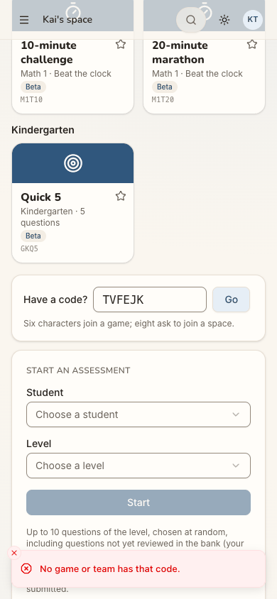
- **Step 6: "Waiting for approval".** Kai's friend is in a lobby **now**, and Kai is told to wait, with no idea for how long, no promise of an email and no word about the game. Nothing offers to let him keep playing as a guest meanwhile. Coming back a day later (step 7), the app does not recognise him either.
  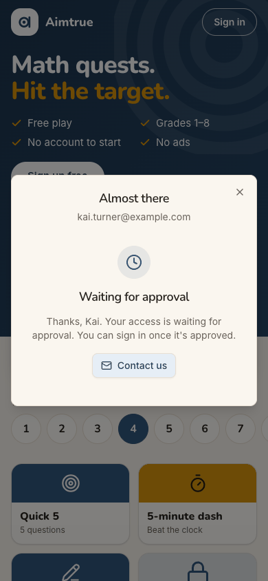
- **Step 2: a code that looks like a field.** The only code on the signed-out page is an example, "QF7K2M", in a white box that looks like an input. Tapping it does nothing. Its button is "Create a free family space", which is not what an adult holding a friend's code came to do.
  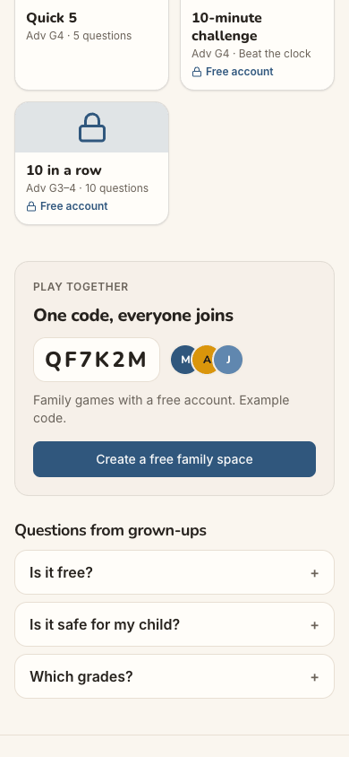

**Contact sheet** (all 19 phone steps):

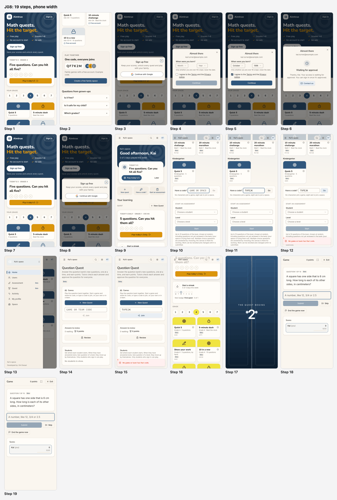

| Severity | Count |
| --- | --- |
| sev4 (blocked) | 0 |
| sev3 (major) | 4 |
| sev2 (minor) | 3 |
| sev1 (cosmetic) | 1 |
| **Total** | **8** |

## Prioritized fixes

1. [sev3] [The friend's game code is refused as if the game did not exist](#sev3-the-friends-game-code-is-refused-as-if-the-game-did-not-exist): say that the code is for a game in another space, and offer what to do (ask to be invited, or start your own game and share its code); decide whether a game code may admit a non-member to that one game.
2. [sev3] [The wait for approval is open-ended and the return is not recognised](#sev3-the-wait-for-approval-is-open-ended-and-the-return-is-not-recognised): give a timeline and an email on approval, keep guest play open meanwhile, and greet a returning pending or approved person on the device.
3. [sev3] [Signed out there is nowhere to type a game code](#sev3-signed-out-there-is-nowhere-to-type-a-game-code): put a real "Have a code?" box on the guest page and carry the code through sign-up.
4. [sev3] [The friend's tile link is dropped before and after sign-in](#sev3-the-friends-tile-link-is-dropped-before-and-after-sign-in): make `/play/<tile>` open that tile, named, and carry it, and its grade, into the new space.
5. [sev2] [Two code boxes and neither is where a player looks](#sev2-two-code-boxes-and-neither-is-where-a-player-looks): open "Have a code?" in place as a sheet, and drop the tutor tools from the Quest page in a personal space.
6. [sev2] [Sign in opens a sheet titled Sign up free](#sev2-sign-in-opens-a-sheet-titled-sign-up-free): title the sheet by the button pressed, and title the waiting state "Waiting for approval" alone.
7. [sev2] [Contact us goes to a personal Gmail address](#sev2-contact-us-goes-to-a-personal-gmail-address): use a product support address or form.
8. [sev1] [The birth year is a 100-item list](#sev1-the-birth-year-is-a-100-item-list): use a native select or a typed year.

## Findings

### [sev3] The friend's game code is refused as if the game did not exist
- **Issue Description:** After the approval, signed in and inside his own space, Kai typed TVFEJK into both code boxes the app offers. Both answered with the same red toast, "No game or team has that code.":
  - the home's "Have a code?" box (step 12), whose hint promises "Six characters join a game";
  - the Quest page's "GAME OR TEAM CODE" box (step 15).

  The game exists. It is Sanjay's lobby in Riverside Tutoring, still open for joining. Game codes are looked up only inside the space the reader is in, and Kai's only space is the personal one his sign-up made. The message is therefore false from Kai's side.
  - Nothing tells him the code belongs to another space.
  - Nothing suggests asking his friend to invite him, or sending him the space's 8-character code.
  - Nothing offers "Start a game and share your code" as the way to play together.

  His friend gets no signal either. The member home's Next up item for C6, "Game invite → Join", cannot fire, because the invite and the player are in different spaces. Whether a friend could join a game Kai starts was not checked (see Coverage).
- **Framework Violation:** cuj-contract, steps 12 and 15 (expected: join the friend's game, or a clear reason and a way forward; observed: "No game or team has that code."). It also breaks:
  - Nielsen #9 Help users recognize, diagnose, and recover from errors: the message misdiagnoses the cause and offers no recovery;
  - Nielsen #1 Visibility of system status: the game's existence and where it lives are hidden.
- **Severity:** 3. The journey's defined end (a quest started) was reached, but only by giving up Kai's own goal. The workaround needs his friend to invite him into Riverside, and nothing tells either of them to do that. For C6, a friend's invitation is the strongest reason to arrive and to come back. A dead "no such game" turns a social invitation into a solo trial.
- **Evidence:**  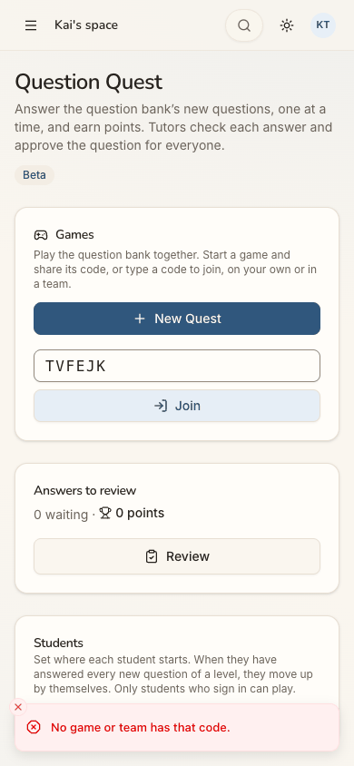 Network: `404 POST /api/quest/games/lookup` at step 12. Repro:
  1. As a member of space A, open a game with joining open, and note its code.
  2. Sign up a new person, who gets only their personal space B.
  3. In B, type the code in "Have a code?" on Home, or in "GAME OR TEAM CODE" on Quest.
  4. Tap Go or Join: "No game or team has that code."
- **Recommended Fix:**
  - When a code matches a game in a space the reader is not in, answer differently from "no such code". For example: "This game is in a space you're not in yet. Ask whoever sent the code to invite you to their space." Pair it with actions: "Join a space with a code" and "Start your own game and share its code". The owner decides how much to reveal (the space's name or not) against code guessing; rate limiting is already in place for sign-in-style routes.
  - Decide, as owner, whether a game code should admit a non-member to that **one game**, as a guest player of the game with no other access to the space. That is the behaviour a "join my game" text assumes.
  - On the host's side, where the share or code is shown, say that only members of this space can join, next to "Invite people".

### [sev3] The wait for approval is open-ended and the return is not recognised
- **Issue Description:** Kai finished the sign-up form (steps 4-5) and was stopped at "Waiting for approval" (step 6): "Thanks, Kai. Your access is waiting for approval. You can sign in once it's approved." The only action is "Contact us".
  - It does not say who approves, how long it takes, or whether he will be told (by email).
  - It does not say what happens to the game he came for, or that he can keep playing as a guest meanwhile.

  A day later, the friend's link (step 7) opened the same signed-out guest page as on day one, with "Sign up free" in the hero.
  - Nothing on it knows this device already signed up, or that Kai is now approved.
  - "Sign in" still opened "Sign up free" (step 8).

  Kai only found out he was in by trying Google again (step 9). No "you're approved" or welcome message greeted him in his space.
- **Framework Violation:** cuj-contract, steps 6-9 (expected: a known wait and a way back in; observed: an open-ended wait, then an unchanged guest page). It also breaks:
  - Nielsen #1 Visibility of system status: nothing says how long, how he'll hear, or that the approval has happened;
  - Nielsen #6 Recognition rather than recall: the returning person must remember to try signing in again.
- **Severity:** 3. The end state was reached only because the persona came back on his own and tried again. For C6, invited to a game happening now, an indefinite wait with no follow-up is where most would drop off. This is the conversion step that matters most for a friend's invitation.
- **Evidence:**   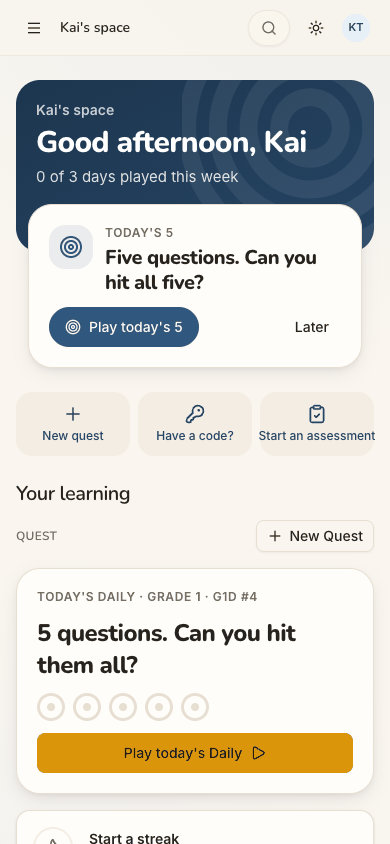 Repro: with Sign-up access set to Post-approved, sign up from the guest page and read the waiting screen. Approve the account in the console, then open the guest page again on the same device.
- **Recommended Fix:**
  - On the waiting screen, say: "Approvals usually take less than a day. We'll email you at kai.turner@example.com when you're in." Send that email on approval (production pair only).
  - Add "Keep playing as a guest" as the main button, which closes the sheet onto guest play with the grade kept.
  - If he arrived with a code, add: "We'll keep your code TVFEJK and take you to it when you're in."
  - Remember on the device that this browser has a pending account. On return, show "Welcome back, Kai: you're approved, continue with Google", or "still waiting", instead of the first-visit page.
  - Title the sheet "Waiting for approval" (see the sev2 finding on titles).

### [sev3] Signed out there is nowhere to type a game code
- **Issue Description:** Kai arrived holding a 6-character code and searched the signed-out page for a place to type it (step 2).
  - The aria tree has no text box anywhere on the page.
  - The only code shown is in the "Play together — One code, everyone joins" card. It is an example, "QF7K2M", in a white rounded box with large monospace letters, next to three avatars. It looks like a filled-in field, but it is static text, and tapping it does nothing.
  - The card's small print says "Family games with a free account. Example code.", and its only button is "Create a free family space".
  - "Sign in" (step 3) leads to "Sign up free" and Google, with no code box either.

  The code has nowhere to go until Kai has an account, an approval and a space, and even then it fails (finding 1).
- **Framework Violation:** cuj-contract, steps 1-3 (expected: "Join a game / Enter code"; observed: an example code that is not an input). It also breaks:
  - Nielsen #2 Match between system and the real world: a field-shaped example invites a tap;
  - Nielsen #7 Flexibility and efficiency of use: the most direct path (code in hand) is not offered.
- **Severity:** 3. The persona needs a workaround (sign up first, then find the code box inside) that nothing explains, with one dead end on the way. For C6 arriving from a friend's text, the code is the one thing they hold, and the "family space" framing does not fit an adult joining a friend.
- **Evidence:**  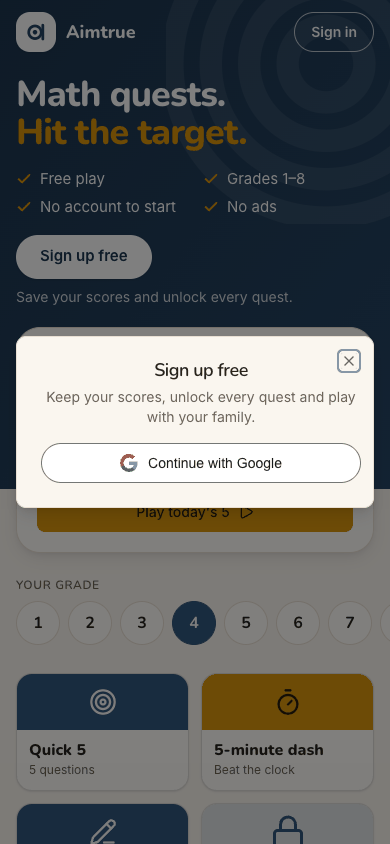 Repro: open `/` signed out, scroll to "Play together", and tap the "QF7K2M" box: nothing happens. Read the aria tree: no textbox.
- **Recommended Fix:**
  - Put a real "Have a code?" input on the guest page: in the hero, or replacing the example in the "Play together" card.
  - Signed out, take the code and explain the next step ("Sign up free to join this game"). Keep the code on the device, and after sign-up or sign-in open it straight away.
  - If the example stays, make it obviously an illustration (greyed, dashed outline, the word "Example" inside it), and add "Join with a code" beside "Create a free family space".
  - Reword the card for adults too: "Play with friends or family".

### [sev3] The friend's tile link is dropped before and after sign-in
- **Issue Description:** Signed out, the friend's link `/play/G4Q10` is rewritten to `/` and opens the generic guest home (steps 1 and 7). The only trace of the link is that grade 4 is pre-selected.
  - Nothing names the quest the friend sent ("10 in a row", Grade 4, 10 questions).
  - That tile is fourth in the grid, below the fold on a phone, and locked ("Free account").

  After sign-in (step 9), the link is forgotten entirely.
  - The member board leads with Grade 1 ("Today's Daily · Grade 1").
  - The grade row sits on 1.
  - Next up's "Play today's 5" links to grade 3 (`/quest/daily/NC26.3`, from the aria tree; the card names no grade).

  Kai had to pick Grade 4 by hand and find the tile himself (step 16). Neither the grade nor the tile was carried into his space.
- **Framework Violation:** cuj-contract, steps 1, 7, 9 and 16 (expected: the linked quest in front, then ready in the space; observed: a generic page, then Grade 1). It also breaks:
  - Nielsen #1 Visibility of system status: Kai can't tell the link worked;
  - Nielsen #4 Consistency and standards: the same home shows grade 1 on the board and grade 3 behind Next up.
- **Severity:** 3. The end state (the linked quest started) needed a workaround: finding grade 4 and the tile by hand. For C6, a shared tile link is the second thing the friend sent. Losing it twice, at arrival and after sign-up, breaks the guest-to-member continuity that Phase 67 promises.
- **Evidence:**   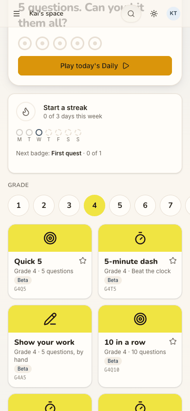 Repro:
  1. Open `/play/G4Q10` signed out: the URL becomes `/`, and only grade 4 is pre-selected.
  2. Sign in as a new approved adult: the board leads with Grade 1.
- **Recommended Fix:**
  - Make `/play/<tile>` a real route. Signed out, put the tile first: "You were sent: 10 in a row · Grade 4". Show "Play" if free, or "Sign up free to play this" if locked.
  - Keep the tile and its grade on the device, as `guestLeadLevel` keeps a guest's grade. After sign-up or sign-in, open the space on that tile ready to start, or start it.
  - Make Next up's Today's 5 and the board's Daily agree on one grade.

### [sev2] Two code boxes and neither is where a player looks
- **Issue Description:** Inside his space, Kai had two separate code boxes, with different placeholders, buttons and hints.
  - **Home.** The "Have a code?" quick action does not open anything (step 10). It scrolls the page about 1,900 px down, past the whole tile board, to an inline card: "Have a code? [GAME OR SPACE] Go — Six characters join a game; eight ask to join a space." The wording is clear, but the box is otherwise the last thing on the board.
  - **Quest page.** Its "GAME OR TEAM CODE" box with "Join" (step 14) sits under a page written for tutors: "Tutors check each answer and approve the question for everyone", "Answers to review — 0 waiting", and "Students — Set where each student starts… No students to show". In Kai's personal space, where he is the only person, these are noise.

  When the first box failed, Kai took a three-tap detour (menu, Quest, Join) to try the second, which answered the same.
- **Framework Violation:** cuj-contract, steps 10 and 13-15 (expected: one obvious place to enter a code; observed: two, one at the bottom of the board and one among tutor tools). It also breaks:
  - Nielsen #4 Consistency and standards: two boxes with different labels for one job;
  - Nielsen #8 Aesthetic and minimalist design: tutor tools in a player's personal space.
- **Severity:** 2. Real friction and a dead end, but Kai could find a box. For C6 ("Let me play"), a code is the main way into a game with others.
- **Evidence:** 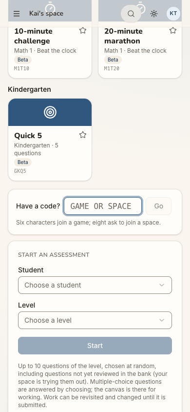 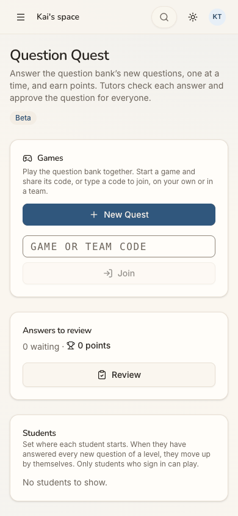 Repro: in a new personal space, tap "Have a code?" on Home (the page scrolls far down), then open ☰ → Quest.
- **Recommended Fix:**
  - Make "Have a code?" open a sheet in place, with the field focused, and use the same component and wording on the Quest page.
  - In a personal space, hide "Answers to review" and "Students" on `/quest`, or title the page "Games" for players.
  - Keep the inline card on the board as a secondary entry.

### [sev2] Sign in opens a sheet titled Sign up free
- **Issue Description:** Kai tapped "Sign in", top right, on both days (steps 3 and 8). Both times the sheet that opened was titled "Sign up free", with "Keep your scores, unlock every quest and play with your family."
  - On day 2 he had an approved account, and the screen still asked him to sign up.
  - After the form, the sheet kept the title "Almost there" above "Waiting for approval" (step 6), although he was stopped, not nearly done.
- **Framework Violation:** cuj-contract, steps 3, 6 and 8. It also breaks Nielsen #4 Consistency and standards (the button's word and the sheet's title disagree) and Nielsen #1 Visibility of system status.
- **Severity:** 2. An observable mismatch that adds doubt at the two moments a returning or new adult decides whether to continue. It does not block.
- **Evidence:**   Repro: tap "Sign in" on the guest page.
- **Recommended Fix:**
  - Title the sheet by the action: "Sign in", with "New here? Signing up is free" underneath. Keep "Sign up free" for the hero's button.
  - Once the account is waiting, replace "Almost there" with "Waiting for approval".

### [sev2] Contact us goes to a personal Gmail address
- **Issue Description:** The only help on the waiting screen, "Contact us" (step 6), is a `mailto:` to a personal Gmail address. The menu's footer, "Developed by: Om Dessai" (step 13), is a mailto to the same address. For a stranger deciding whether to trust a maths site with an account, a personal address reads as unofficial.
- **Framework Violation:** cuj-contract, steps 6 and 13. It also breaks Nielsen #10 Help and documentation (help should be the product's own) and weakens trust at the conversion step.
- **Severity:** 2. An observable trust problem at the one moment Kai might ask for help (the open-ended wait). It does not block.
- **Evidence:**  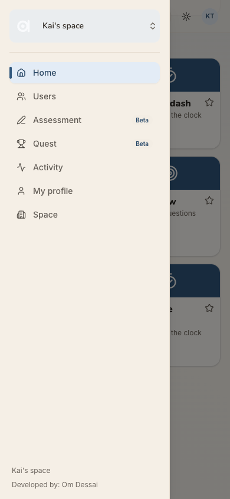 Repro: on "Waiting for approval", inspect "Contact us"; open ☰ inside a space and read the footer.
- **Recommended Fix:**
  - Point "Contact us" at a product address (for example a support@ mailbox on the product's domain) or a short contact form.
  - Move the developer credit to an About page, without a mailto.

### [sev1] The birth year is a 100-item list
- **Issue Description:** "When were you born?" uses custom dropdowns, not native selects (step 5). The year list runs from 2026 down to 1927, 100 entries. 1996 is the 31st, so Kai scrolls the list to reach it: two taps plus a scroll, where a phone's native wheel or a typed year is quicker.
- **Framework Violation:** cuj-contract, step 5. It also breaks Nielsen #7 Flexibility and efficiency of use.
- **Severity:** 1. Cosmetic friction. It works, and the reassurance "Only whether you are over 18 is kept, never the date." is good.
- **Evidence:** 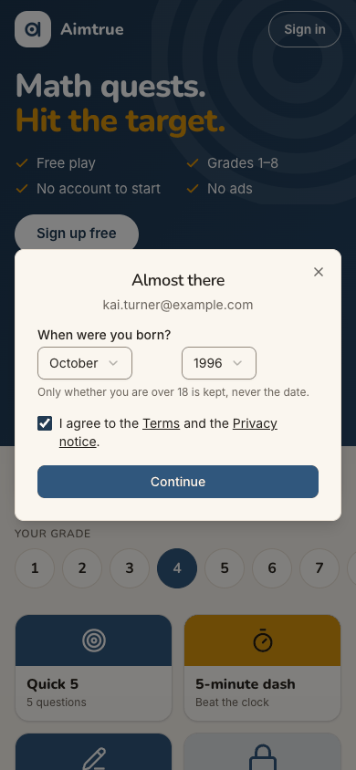 Repro: on "Almost there", open Year and look for 1996.
- **Recommended Fix:** Use a native `<select>`, which phones show as a wheel, or a numeric year field (`inputmode="numeric"`, 4 digits). Or open the list scrolled to about 18 years ago.

## Walkthrough

### Step 1 — Open the friend's link /play/G4Q10, signed out

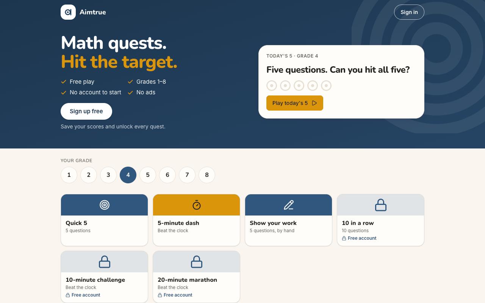

> Expected: the friend's quest or game in front ("10 in a row · Grade 4"), with a way to join with the code. Observed: the URL is rewritten to `/`, and the generic guest home opens: "Math quests. Hit the target.", "Free play · No account to start". Grade 4 is pre-selected and the card reads "Today's 5 · Grade 4". The linked tile is fourth in the grid, below the fold, locked ("Free account"). Desktop shows the same page with the card on the right. Dark mode renders properly.

**What Kai notices:** a bright, friendly maths page, but nothing about his friend, a game or a code. He can't tell whether the link worked.

### Step 2 — Scroll down looking for a code box; tap the code in "Play together"

> Expected: a "Join a game / Enter code" field. Observed: "Play together — One code, everyone joins" shows "QF7K2M" in a white field-like box beside three avatars. The small print reads "Family games with a free account. Example code.", and the button is "Create a free family space". Tapping the code does nothing; the page has no text box at all. Dead end 1.

**What Kai notices:** the box looks like where his code goes, and it isn't. The only button is about a "family space", which he doesn't have.

### Step 3 — Tap "Sign in"

> Expected: a sign-in page, perhaps with "Have a code?". Observed: a sheet titled "Sign up free", with "Keep your scores, unlock every quest and play with your family." and one button, "Continue with Google". There is no code box.

**What Kai notices:** he pressed "Sign in" and is told "Sign up". "Your family" again.

### Step 4 — Tap "Continue with Google"
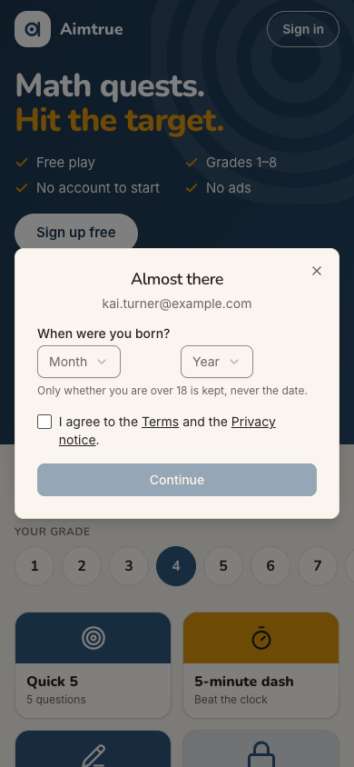
> Expected: Google, then into the app. Observed: the sheet becomes "Almost there", with kai.turner@example.com and "About you — When were you born?" (Month and Year). It says "Only whether you are over 18 is kept, never the date." There is a terms checkbox, and Continue is disabled until the form is filled.

**What Kai notices:** a short, clear form, and the line about the date is reassuring. Still no word about the game.

### Step 5 — Choose October 1996 and tick the terms

> Expected: quick pickers. Observed: custom dropdowns, two taps each. The year list has 100 entries from 2026 down; 1996 is the 31st and needs a scroll. With the box ticked, Continue turns on.

**What Kai notices:** a long scroll for his birth year, a small annoyance.

### Step 6 — Tap "Continue": Waiting for approval

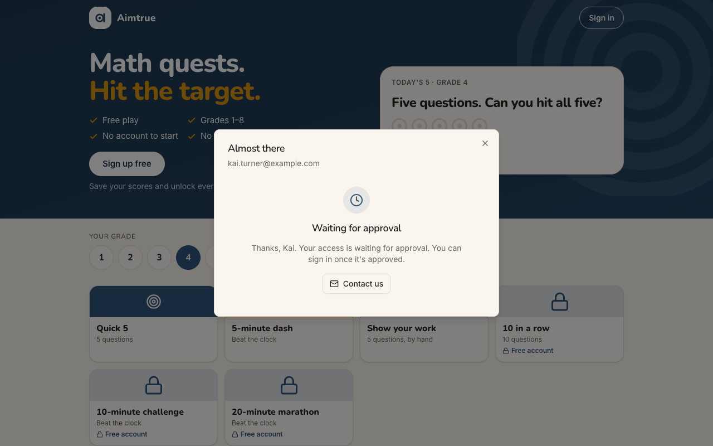
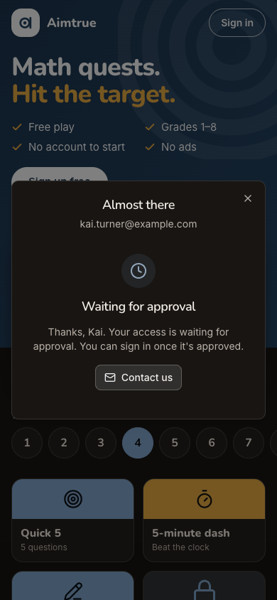
> Expected: "Waiting for approval", since the platform is Post-approved. Observed: the sheet keeps the title "Almost there", then shows a clock and "Waiting for approval — Thanks, Kai. Your access is waiting for approval. You can sign in once it's approved." The only action is "Contact us", a mailto to a personal Gmail address. It gives no timeline, no email promise, no word about the game and no guest-play option. `POST /api/auth/signup` answered 403 (pending, by design). Desktop and dark render the same sheet properly.

**What Kai notices:** his friend's game is happening now, and he has to wait, he doesn't know how long, and nobody says they'll tell him.

### Step 7 — A day later: a new tab, the friend's link again

> Expected: the linked quest, or "Welcome back: you're approved, sign in". Observed: the same signed-out guest home as step 1: `/play/G4Q10` becomes `/`, grade 4 is pre-selected, and "10 in a row" is still locked. Nothing knows he signed up or was approved. Desktop shows the tile grid with "10 in a row" locked, and dark renders properly.

**What Kai notices:** it looks as if yesterday never happened. He has to guess that "Sign in" is the way back.

### Step 8 — Tap "Sign in"

> Expected: "Sign in". Observed: "Sign up free" again, with "Continue with Google".

**What Kai notices:** "Sign up free" again, though he already signed up yesterday. He presses Google anyway.

### Step 9 — Tap "Continue with Google": into Kai's space

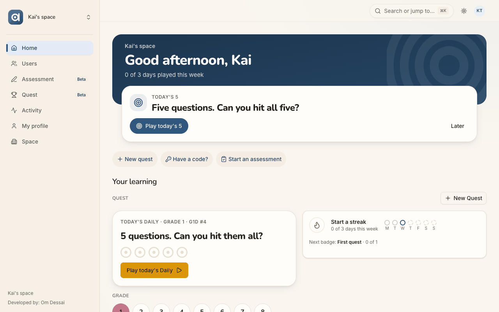
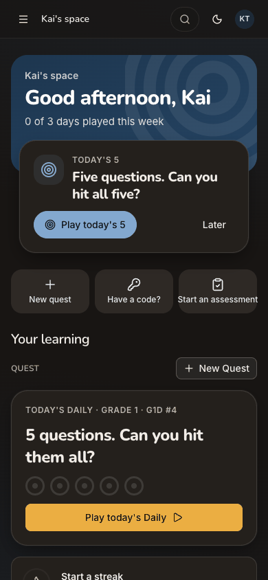
> Expected: signed in, and the friend's quest or game in front. Observed: straight into "Kai's space", his personal space, with no "you're approved" note and no wizard.
> - The band: "Good afternoon, Kai · 0 of 3 days played this week".
> - Next up: "Today's 5 — Five questions. Can you hit all five?", with "Play today's 5" (links to grade 3) and "Later".
> - Quick actions: "New quest", "Have a code?" and "Start an assessment".
> - The board: "Today's Daily · Grade 1", with the grade row on 1. The friend's grade 4 is gone.
> - Desktop: a sidebar with Home, Users, Assessment, Quest, Activity, My profile and Space. Dark renders properly.

**What Kai notices:** he's in, and "Have a code?" is right there at the top. That is exactly what he wants.

### Step 10 — Tap "Have a code?"

> Expected: a box to type the code. Observed: no sheet. The page scrolls about 1,900 px down, past the whole tile board, to a card: "Have a code? [GAME OR SPACE] Go — Six characters join a game; eight ask to join a space." The field has focus.

**What Kai notices:** the jump is disorienting, but the hint is clear: six characters, a game. His code has six.

### Step 11 — Type TVFEJK
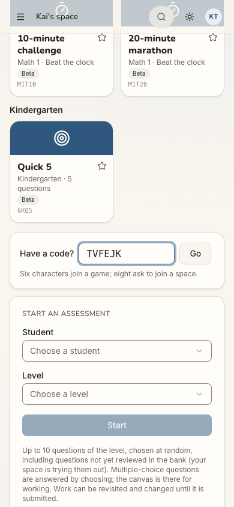
> Expected: Go enables. Observed: match.

**What Kai notices:** nothing odd; he's about to join.

### Step 12 — Tap "Go"

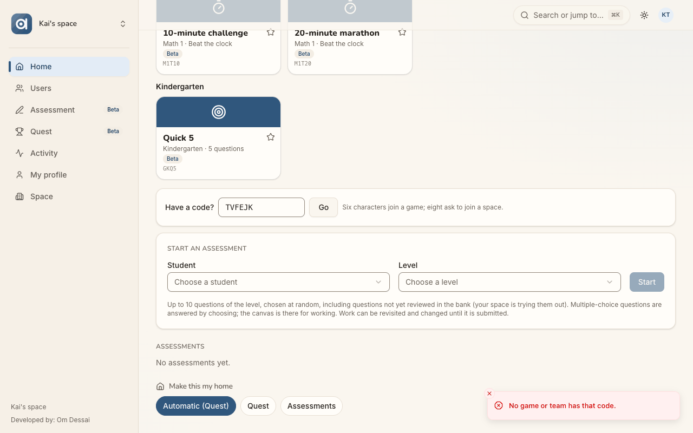
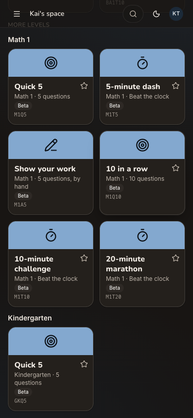
> Expected: the friend's lobby, or a reason he can't join and what to do. Observed: a red toast, "No game or team has that code." (`404 POST /api/quest/games/lookup`). The field keeps TVFEJK, and there is no other help. The game exists, in Riverside Tutoring, where Kai is not a member. Dead end 2. Desktop shows the same toast bottom right. The dark capture re-rendered higher up the page (the Math 1 tiles), so the toast is not in it.

**What Kai notices:** "No game has that code": his friend must have typed it wrong, or the game is over. He has waited a day for this.

### Step 13 — Open the menu, looking for another place to join

> Expected: something like "Join a game". Observed: Home, Users, Assessment (Beta), Quest (Beta), Activity, My profile and Space. The footer reads "Kai's space · Developed by: Om Dessai", a mailto to a personal address. Kai picks Quest.

**What Kai notices:** "Users" and "Space" in a space that is only him. "Quest" is the only thing that sounds like games.

### Step 14 — Open Quest

> Expected: games and a join box. Observed: "Question Quest — … Tutors check each answer and approve the question for everyone." A "Games" card has "New Quest", a second code box ("GAME OR TEAM CODE") and "Join". Below it: "Answers to review — 0 waiting · 0 points — Review" and "Students — … No students to show."

**What Kai notices:** a second code box (maybe this one works), surrounded by tutor wording that is not for him.

### Step 15 — Type TVFEJK and tap "Join"

> Expected: the friend's lobby. Observed: the same toast, "No game or team has that code." Dead end 3.

**What Kai notices:** the same answer in a second place, so the code really "doesn't exist". He gives up on his friend's game.

### Step 16 — Back to Home, pick Grade 4

> Expected: the friend's quest findable. Observed: after Back, Kai taps "4" in the Grade row, which turns yellow, grade 4's hue. The Daily becomes "Grade 4", and the Grade 4 tiles appear: Quick 5, 5-minute dash, Show your work, then **10 in a row (Grade 4 · 10 questions, G4Q10)**, now unlocked.

**What Kai notices:** at least the quest his friend linked is here and open. He had to find it himself.

### Step 17 — Tap "10 in a row": the quest begins
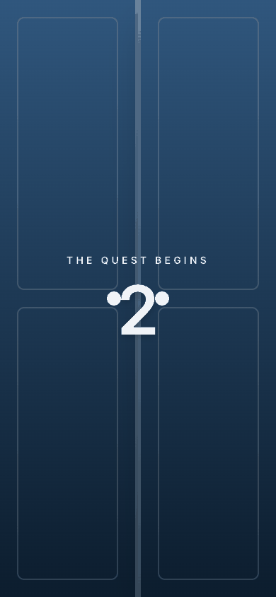
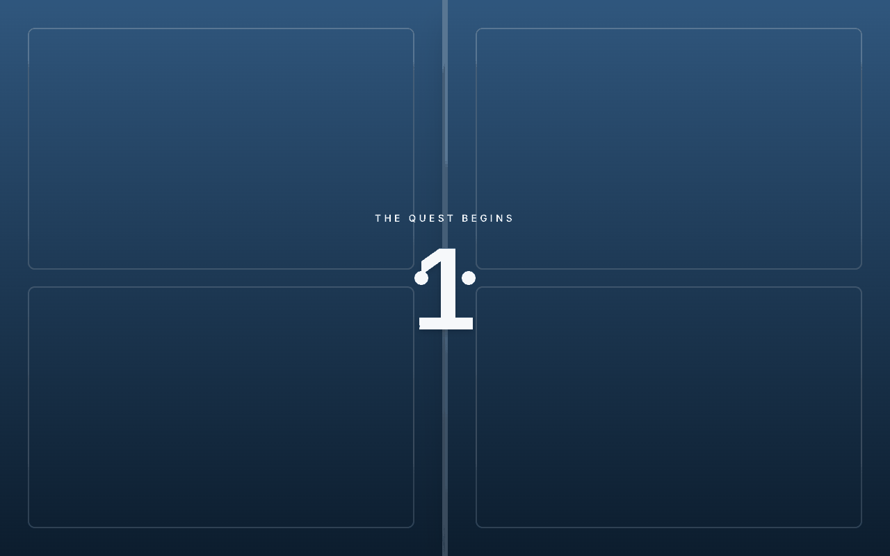
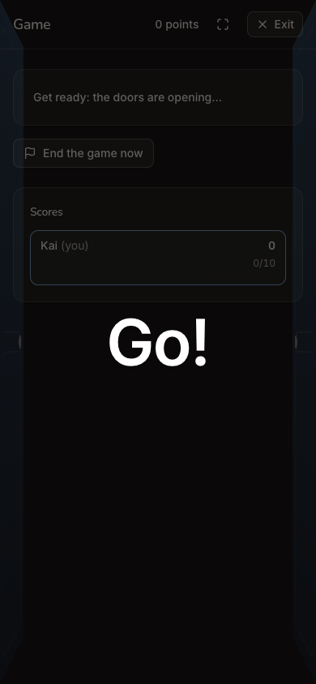
> Expected: the quest starts. Observed: one tap opens `/quest/games/<id>`, a single-player game. A door animation and countdown run: "The quest begins 2" on the phone, "1" on desktop, then "Go!" over the game in dark mode. **The journey's end: a quest started.**

**What Kai notices:** a satisfying start, but he's playing alone, not with his friend.

### Step 18 — The first question
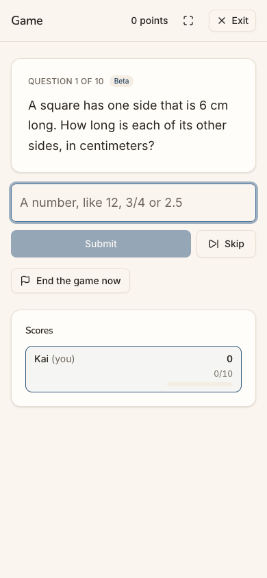
> Expected: question 1. Observed: "Game · 0 points · Exit". "QUESTION 1 OF 10 Beta — A square has one side that is 6 cm long. How long is each of its other sides, in centimeters?" The answer field reads "A number, like 12, 3/4 or 2.5", with Submit, Skip and "End the game now". Scores: "Kai (you) 0 · 0/10". Nothing offers to invite a friend.

**What Kai notices:** clean and readable, and the "Beta" tag. A scoreboard with one name on it.

### Step 19 — Reload the game (end state check)

> Expected: the started game survives a reload. Observed: match. It shows the same game, Question 1 of 10, at 0/10.

**What Kai notices:** nothing lost. The game is his.

## Appendix

- **Mode:** live. A real headless Chrome drove the app at http://localhost:8797, a frozen copy of commit `2d6e7d3` with sign-in on and its own local database. Phone width is 390×844. Desktop (1280×800) and dark mode were captured at the landing screens: steps 1, 6, 7, 9, 12 and 17. The run had two stages: steps 1-6 on day 1, then steps 7-19 in a new tab of the same browser profile after the approval.
- **Frameworks applied:**
  - cuj-contract: each step's expected against observed;
  - task-completion: the friend's code tried after the wait, and a quest started;
  - success-criteria: the started game re-checked after a reload, in step 19.
- **Coverage / not inspected:**
  - Whether a member of Riverside could join a game Kai starts in his personal space (the reverse direction).
  - Any email to Kai on approval. The local stack sends no mail, and a self-serve or personal space sends none.
  - "Switch space" and All spaces (`/spaces`), and joining Riverside with a space code. Kai had no 8-character space code.
  - Guest play itself, which is out of scope for this audit. The locked tile, "Create a free family space", the hero's "Sign up free" and "Play today's 5" were not tapped signed out.
  - The Terms and Privacy pages, and the "Questions from grown-ups" answers.
  - On the member home: "Later", "New quest", "Start an assessment", ⌘K search and the favorites star.
  - Answering the quest's questions, and the game's end and results.
  - The friend's side: Sanjay's lobby was not watched during the run.
  - The real Google account chooser, replaced by the stand-in.
  - Desktop and dark mode outside the landing screens.
  - The iOS app, which is covered by separate journeys.
- Access: through the app's real sign-in and sign-up screens; the Google provider step is simulated (a stand-in for Google's button hands the app a local test token for the persona).
- **Preconditions made outside the UI:**
  - The friend's game: Sanjay Patel (Riverside Tutoring) opened a game of teams, Grade 4, 10 questions, joining open, code **TVFEJK**, and left it in the lobby. This was made before the journey, as the README's "The run" names.
  - The approval of Kai's account was made in the platform console by the platform-admin agent (not audited), standing for "the next day".
  - The run's shared settings apply: Post-approved sign-up access, guest play on, and the Daily on.
- **Harness notes:**
  - The three step 17 captures are successive moments of the 3-second countdown.
  - The step 12 dark capture shows a different scroll position from the phone capture.
  - One driver selector for the menu button missed at step 13 and was retried. It is not counted in the figures.
- **State left:**
  - kai.turner@example.com is approved, with his personal space "Kai's space".
  - A single-player game, Grade 4 "10 in a row", is open on question 1.
