# CUJ Audit — J09: parent invited by a new self-serve space accepts and lands

## Executive summary

**Persona.** Ana Costa, 35, is the parent of Leo, a Grade 4 pupil in Sam Rivera's maths club. An hour earlier, in J06, Sam started "Rivera Math Club" (a self-serve space with Assessment and Quest and no Tutoring). He then:
- invited Ana as a Parent;
- added Leo as a student with no email, with Ana as his guardian;
- started a G4 assessment for Leo.

Sam texted Ana the copied invitation: "Sam Rivera invited you to Rivera Math Club on Aimtrue. Sign in at http://localhost:8797 with ana.costa@example.com." Her Google account had never been used on Aimtrue.

Ana belongs to cohort **C4** of `docs/member-home-plan.md`, the practice parent, whose question is "Is my child practising, and getting it?" and whose primary action is **Play with <child>**. Leo's first activity in the club is an assessment, so she is also a giver in **C7**, the assessment cohort ("give one, see results"). She wanted to do what the text said, get into Sam's club, and see what she can do there for Leo.

**Outcome: 1/1 journeys passed, 0 skipped, 19 of 19 steps verified.** Ana reached the end the journey defines:
- She opened the link, signed in with Google and accepted the invitation. She landed in Rivera Math Club (step 4), and a fresh tab later took her straight back there (step 14).
- **The space vouched for her.** She was never asked to sign up: no birth month or year, and no terms or privacy notice to accept. She never waited for a platform approval, although sign-up access is Post-approved. The invitation was waiting on the first screen after Google (step 3).
- This is by design, since an invited person has no platform account. It also means a parent joins a children's space without ever being shown the privacy notice. Whether that is acceptable is the owner's decision, so this report does not count it as a finding.

Getting in was fast. What she can do for Leo once inside is where it breaks down:
- The home leads with a game for Ana herself, and Leo's card is the last section of a long page (finding 1).
- Leo's started assessment is listed, but nobody but Sam can open it, and Leo cannot sign in (finding 2).
- "Play with Leo" opens a game that Leo cannot join (finding 3).
- Cancelling that empty game congratulates her on winning and gives her two badges (finding 4).
- The only way to write to Sam in the app is refused with "Tutoring is not part of this space." (finding 7).

**Conversion figures:**

| Measure | Entry to landed in the club (steps 1-4) | Whole journey (steps 1-19) |
| --- | --- | --- |
| Screens | 4 | 11 distinct (about 22 screen views, menus included) |
| Taps | 3 | 27 |
| Typed fields | 0 | 1 (a comment to Sam, refused) |
| Waits | 0 (no approval) | 0 |
| Dead ends | 0 | 7 |

- **The 4 screens to land** were the guest Play page, the "Sign up free" sheet, "Choose a space" and the club's home. **The 3 taps** were Sign in, Continue with Google and Accept.
- **To Leo:** one long scroll. His card sits 2,928 px down a 3,262 px page, on the fourth phone screen.
- **To the first feature for her child** (the "Play with Leo" lobby, step 11): 16 taps as walked, 9 distinct screens, 0 typed fields and 2 dead ends. The shortest path is 4 taps (Sign in, Google, Accept, Play with Leo) and a scroll.
- **The 7 dead ends:**
  1. Leo's assessment row on the home;
  2. the same row on the Assessment page;
  3. the "Play with Leo" lobby without Leo;
  4. Exit, which went to Question Quest instead of Home;
  5. "Continue With Leo", which made a second empty lobby;
  6. Exit to Question Quest again;
  7. the comment to Sam, refused.

**The 3 screens Ana would notice most**

- **Step 3: the invitation is waiting, with no form.** One tap on Google and "Rivera … Invited as Parent" sits there with a blue Accept. For an invited parent this is the best moment in the journey: no birth date, no terms, no approval. It is spoiled only slightly by the club's name cut to "Rivera …" and a line telling a 35-year-old she must be 18 to start a space.
  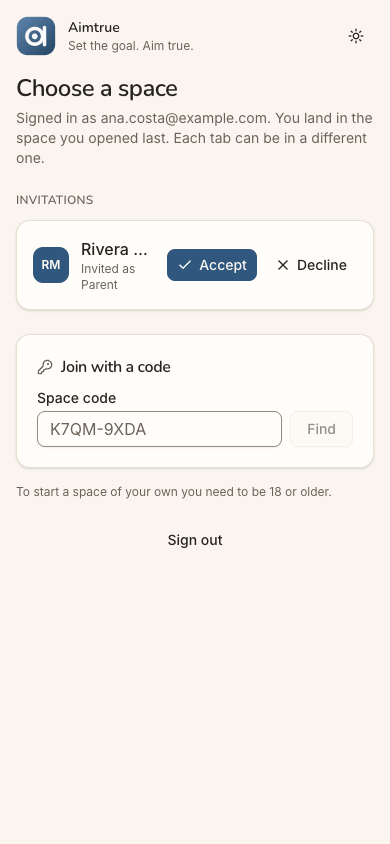
- **Step 4: the club's first screen is a game for her.** It reads "Good afternoon, Ana. 0 of 3 days played this week", then "Play today's 5", a Grade 1 Daily and "Start a streak". Ana came for Leo, and nothing on the first screen mentions him. For C4, whose question is "is my child practising?", the home answers a question she did not ask. The parent home exists, but only behind a "Make this my home" pin at the very bottom.
  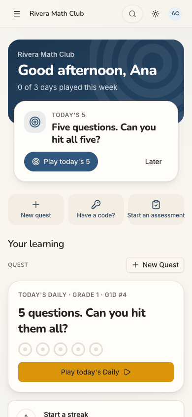
- **Step 11: "Play with Leo" is a game with only Ana in it.** The lobby shows a six-letter code, a QR code, "1 of 2 places" and "Ana (you)". It is set at G3, although Leo is in Grade 4. Leo has no email and has never signed in, and nothing tells Ana how he would join. The feature the home offers C4 as its primary action cannot include the child it is named after.
  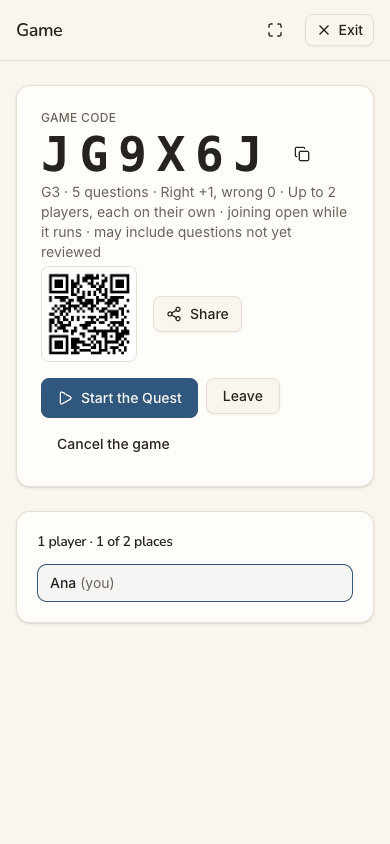

**Contact sheet** (all 19 phone steps):

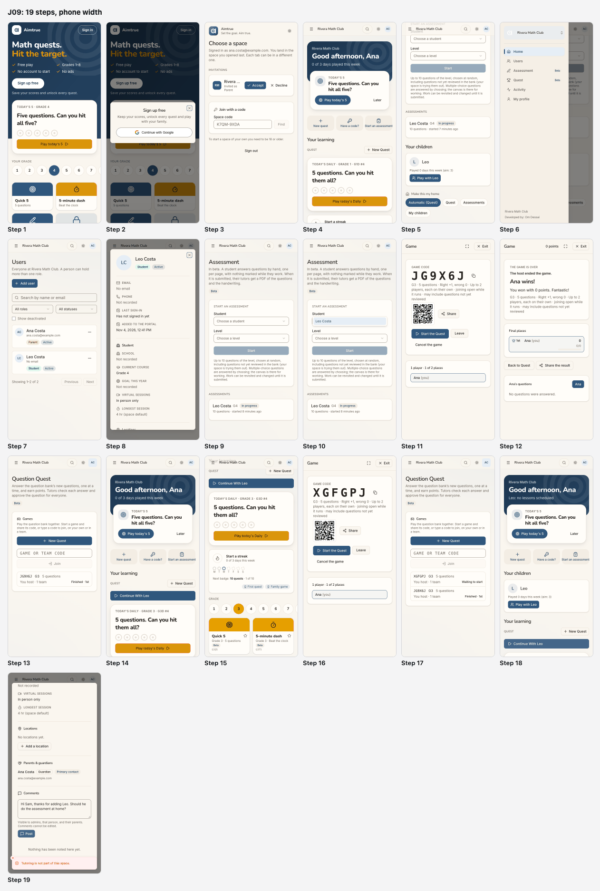

| Severity | Count |
| --- | --- |
| sev4 (blocked) | 0 |
| sev3 (major) | 3 |
| sev2 (minor) | 5 |
| sev1 (cosmetic) | 0 |
| **Total** | **8** |

## Prioritized fixes

1. [sev3] [The home leads with Ana's own game and puts Leo on the fourth screen](#sev3-the-home-leads-with-anas-own-game-and-puts-leo-on-the-fourth-screen): lead with the parent hat for someone invited as a Parent (steps 4, 5, 18).
2. [sev3] [Leo's started assessment shows on her screens but no one but Sam can open it](#sev3-leos-started-assessment-shows-on-her-screens-but-no-one-but-sam-can-open-it): let his guardian open it on her device, or say who can (steps 5, 9, 10).
3. [sev3] [Play with Leo opens a game Leo cannot join](#sev3-play-with-leo-opens-a-game-leo-cannot-join): let the child play on the parent's device, at his level, and show him in the lobby (steps 11, 16).
4. [sev2] [Cancelling an empty game declares a win and awards two badges](#sev2-cancelling-an-empty-game-declares-a-win-and-awards-two-badges): a cancelled game is not a result and earns nothing (steps 12, 13, 15).
5. [sev2] [The invitation link opens a children's game page and Sign in says Sign up free](#sev2-the-invitation-link-opens-a-childrens-game-page-and-sign-in-says-sign-up-free): make the link an invitation link that names the club (steps 1, 2).
6. [sev2] [The invitation card cuts the club's name and tells an adult she must be 18](#sev2-the-invitation-card-cuts-the-clubs-name-and-tells-an-adult-she-must-be-18): wrap the name, say who invited her and for which child, and drop the age line (step 3).
7. [sev2] [Leo's record offers Tutoring the club does not have, and a comment to Sam is refused](#sev2-leos-record-offers-tutoring-the-club-does-not-have-and-a-comment-to-sam-is-refused): hide Tutoring's fields and sections where Tutoring is off (steps 8, 18, 19).
8. [sev2] [The parent's menu and exits are the office's](#sev2-the-parents-menu-and-exits-are-the-offices): give a parent "My children", not Users, and send Exit back where she came from (steps 6, 7, 13, 17).

## Findings

### [sev3] The home leads with Ana's own game and puts Leo on the fourth screen

- **Issue Description:** After Accept, the club's home is a Quest board for Ana herself:
  - The band says "Good afternoon, Ana / 0 of 3 days played this week".
  - Next up offers "Today's 5" for her, and the quick actions are New quest, Have a code? and Start an assessment.
  - Then come "Your learning", a Grade 1 Daily, "Start a streak", the grade row and its tiles, Advanced, More levels and a code box.
  - Next come the Start an assessment form and the Assessments list.
  - Only then, as the last section, "Your children": Leo, "Played 0 days this week (aim: 3)", Play with Leo.

  "Your children" starts at 2,928 px of a 3,262 px page, the fourth phone screen. The "Make this my home" pin is under it: Automatic (Quest), Quest, Assessments, My children. Choosing My children (step 18) moves Leo's card up under the quick actions. Even then, Next up stays "Today's 5" for Ana, and the band changes to "Leo: no lessons scheduled", in a club that has no lessons. The grades also disagree:
  - at step 4, Next up's "Play today's 5" linked to Grade 3 (`/quest/daily/NC26.3`) while the board's Daily said Grade 1;
  - Leo's record and assessment say Grade 4.
- **Framework Violation:** cuj-contract, step 4 (expected: she lands where Leo is; observed: a game for her, and Leo on the fourth screen); also steps 5 and 18. Nielsen #2 Match between system and the real world (the home speaks to a player, but she arrived as a parent). Nielsen #6 Recognition rather than recall (the fix is a pin she has to find at the bottom).
- **Severity:** 3. Classify: end state wrong, workaround needed. Ana was invited **as a Parent**, and her only child here is Leo. The home's own pin reads "Automatic (Quest)", so her learner hat leads, though she has played nothing. For C4 the home's job is to answer "is my child practising?". Here it answers a question she did not ask, and the workaround (scroll to the bottom and pin My children) is one a newcomer is unlikely to find. A parent who sees a children's game addressed to her may decide the club is not for her.
- **Evidence:**  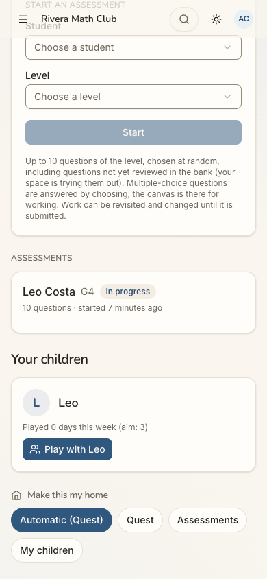 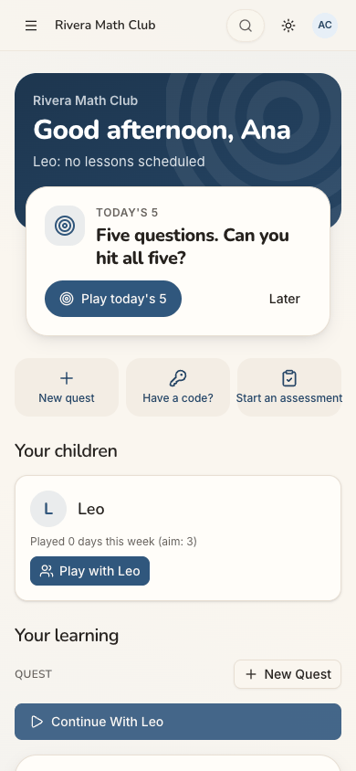 Repro: accept a Parent invitation to a self-serve space (Assessment and Quest on, no Tutoring) whose admin has added a child with you as guardian. The home opens on "Your learning". Measured with the page's own layout: "Your children" is at y = 2,928 px of 3,262 on a 390×844 viewport.
- **Recommended Fix:** In `deriveHomeFocus`, when there is no pin and no activity, rank an invitation's role before the generic hats: a person who accepted as a Parent and has a live child here gets "My children". Put the child card (with the assessment status and Play with Leo) in the first screen, and make Next up the child's item, e.g. "Leo has an assessment in progress" or "Play with Leo". Never show "no lessons scheduled" where Tutoring is off. Make Next up, the Daily and the grade row default to the child's level (Leo's Grade 4) for a parent with no play of her own.

### [sev3] Leo's started assessment shows on her screens but no one but Sam can open it

- **Issue Description:** "Leo Costa G4 In progress — 10 questions · started 7 minutes ago" is listed on the home (step 5) and on the Assessment page (step 9). In both places the row is plain text, a list item with no link, and tapping it does nothing. Leo has no email and "Has not signed in yet" (step 8), so he cannot open it either. Nothing on any screen tells Ana:
  - who started it;
  - that Leo is meant to answer it on a device;
  - whose device that is;
  - whether she should start another.

  The Start an assessment form offers Leo as the only student (step 10), so she could start a second, parallel one for the same child.
- **Framework Violation:** cuj-contract, steps 5 and 9 (expected: open Leo's assessment so he can carry on; observed: an unclickable row, twice). Nielsen #1 Visibility of system status (an "In progress" item with no owner or next step). Nielsen #3 User control and freedom.
- **Severity:** 3. Classify: end state wrong, workaround needed (ask Sam in person). For C7, as a giver, the primary action is "Continue / see reviewed". The one piece of work the club has set for her child is visible and out of reach. The workaround, starting a second assessment, splits Leo's work in two.
- **Evidence:**  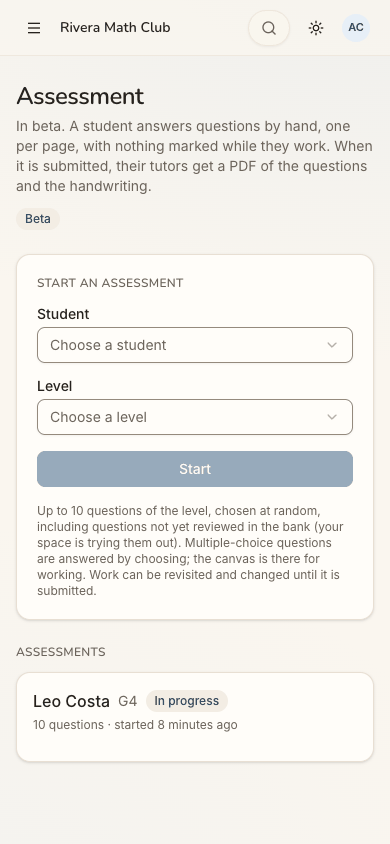 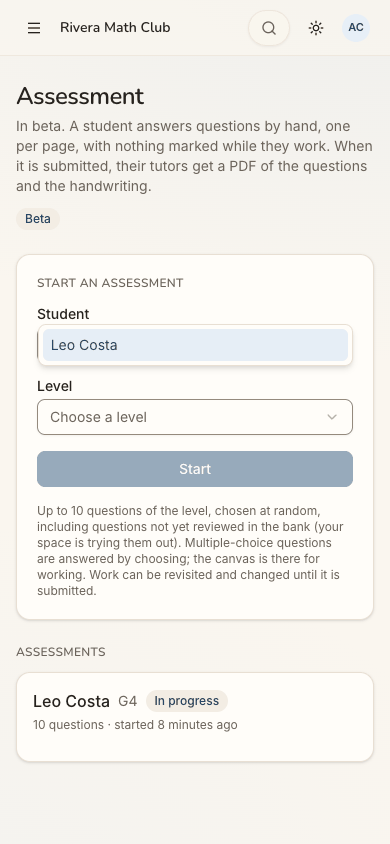 Repro: as Ana, open Home or Assessment and tap the "Leo Costa G4 In progress" row. The URL stays the same. The accessibility tree shows `listitem: text: Leo Costa G4 In progress` with no link.
- **Recommended Fix:** Let a guardian open a child's in-progress assessment on her own device ("Hand the device to Leo"), as the person who started it can. Where that is not allowed, say so on the row ("Started by Sam Rivera — Leo answers it with Sam"). Add a line to the Start form when the child already has one in progress: "Leo has an assessment in progress (G4). Start another?"

### [sev3] Play with Leo opens a game Leo cannot join

- **Issue Description:** "Play with Leo", the only action on Leo's card, opens a lobby (step 11) showing:
  - GAME CODE JG9X6J, a QR code and Share;
  - "G3 · 5 questions · … Up to 2 players";
  - "1 player · 1 of 2 places" and "Ana (you)".

  Leo does not appear, not even as invited. His record says Grade 4, but the game is G3. He has no email and has never signed in, so a code and a QR code give him no way in, and nothing on screen tells Ana how he joins. Back on the home, a new primary button "Continue With Leo" (step 14) opens a **second** empty lobby with a new code (XGFGPJ, step 16). Exit then leaves it "Waiting to start" in the Games list (step 17). J15 recorded the same lobby, at G3 and without the child, for a tutoring parent (status log, J15 step 15).
- **Framework Violation:** cuj-contract, steps 11 and 16 (expected: a game with Leo, at his level; observed: a game of one, at G3, and then another). Nielsen #2 Match between system and the real world (the button names Leo; the game has no Leo). Nielsen #1 Visibility of system status.
- **Severity:** 3. Classify: end state wrong. "Play with <child>" is C4's primary action in the member-home plan. Here it cannot include a child the space added without an email, which is the normal case for a club's pupils. The workaround is to start the game as Ana and let Leo answer on her screen, which plays at the wrong level and records nothing for Leo ("Played 0 days" stayed at 0, step 15).
- **Evidence:**  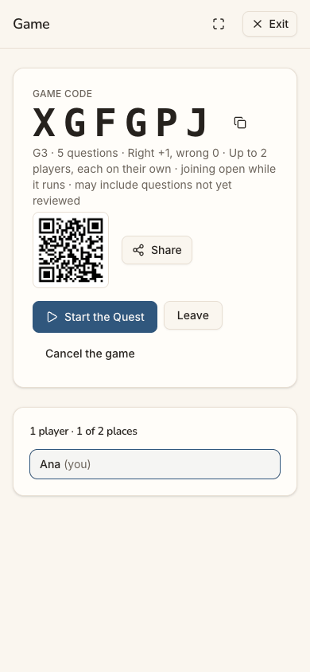 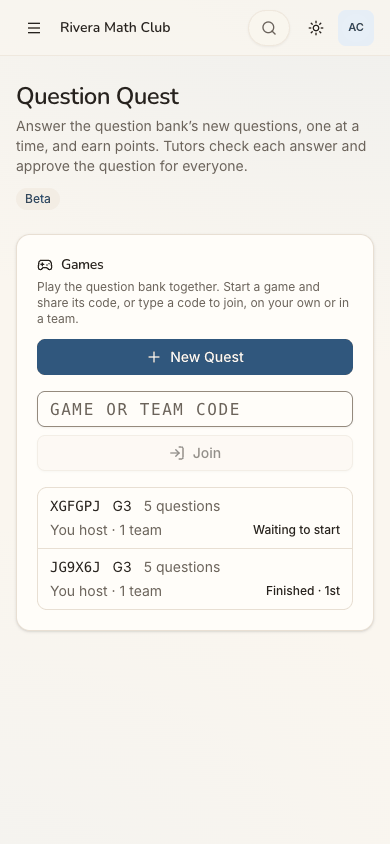 Repro: as a parent whose child has no email, tap Play with <child> on the home, then Exit, then "Continue With <child>".
- **Recommended Fix:**
  - For a child without a sign-in, make "Play with Leo" a game of two on **this** device: pass the device back and forth, and credit both players.
  - For a child who can sign in, show "Leo — invited" in the lobby.
  - Default the level to the child's grade.
  - Make "Continue" reopen the open lobby rather than create a new one, and label it for what it does ("Play with Leo again").

### [sev2] Cancelling an empty game declares a win and awards two badges

- **Issue Description:** In the lobby nobody had played, Ana tapped "Cancel the game". There was no confirm. The game-over screen then said "THE GAME IS OVER — The host ended the game. Ana wins! You won with 0 points. Fantastic!" with "1st Ana (you) 0", [Share the result] and "No questions were answered." (step 12). The Games list records it as "Finished · 1st" (step 13). On the home, the streak card now shows earned chips "First quest" and "Family game" and "Next badge: 10 quests · 1 of 10" (step 15). Leo's card still says "Played 0 days".
- **Framework Violation:** cuj-contract, step 12 (expected: the lobby closes, "Game cancelled"; observed: a win, a share offer and two badges). Nielsen #2 Match between system and the real world. Nielsen #5 Error prevention (no confirm before ending a game).
- **Severity:** 2. Classify: observable mismatch. For a parent judging whether the club is serious enough for her son, a "Fantastic!" win for nothing, and badges for a game nobody played, undercut what every badge and streak says later. The habit layer only works if its counts are believed.
- **Evidence:** 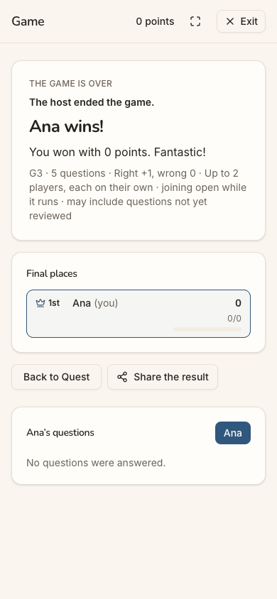 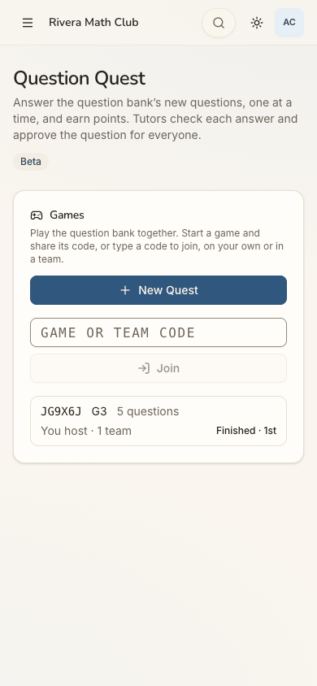 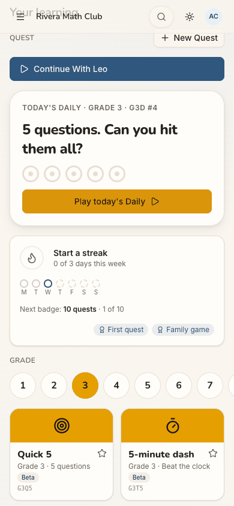 Repro: Play with <child>, then Cancel the game before starting, then Exit, then Home.
- **Recommended Fix:** A game cancelled before it starts (or with no answers) ends as "Game cancelled", with no places, no Share and no win line. It is listed as "Cancelled", and it counts towards no badge (`earnedBadges` should count only games with at least one answer, and "Family game" only when the child played). Ask "Cancel this game?" before ending one.

### [sev2] The invitation link opens a children's game page and Sign in says Sign up free

- **Issue Description:** The invitation's link is the bare address. It opens the guest Play page (step 1): "Math quests. Hit the target.", "Free play · Grades 1–8 · No account to start · No ads", a white "Sign up free" and a Grade 4 game card. Nothing mentions Rivera Math Club, Sam or an invitation. The text told Ana to "Sign in". The small "Sign in" at the top right opens a sheet titled **"Sign up free"**: "Keep your scores, unlock every quest and play with your family." (step 2).
- **Framework Violation:** cuj-contract, steps 1-2 (expected: a page that recognises an invited person, or at least a sign-in; observed: a guest game page and a sign-up sheet). Nielsen #4 Consistency and standards (Sign in opens "Sign up"). Nielsen #2 Match between system and the real world.
- **Severity:** 2. Classify: real friction for conversion. It cost no extra taps (2 to the Google button), but an invited parent who expects her son's club finds a children's game and a "sign up" she was not asked to do. She may doubt that she is in the right place, or close the tab, before she ever reaches the invitation.
- **Evidence:**   Repro: open http://localhost:8797/ signed out, then tap "Sign in".
- **Recommended Fix:** Give "Copy invitation" a link with the space in it (e.g. `/join/<space code>` or `/?invite=<slug>`). That link opens a signed-out page saying "Sam Rivera invited you to Rivera Math Club. Continue with Google to accept." Title the sheet by the button that opened it: "Sign in" opens "Sign in", with the sign-up line beneath it for newcomers.

### [sev2] The invitation card cuts the club's name and tells an adult she must be 18

- **Issue Description:** On "Choose a space" (step 3) at 390 px, the invitation card reads "RM Rivera … Invited as Parent [Accept] [x Decline]". The club's name is cut to "Rivera …" because the two buttons take the row; desktop shows "Rivera Math Club". The card does not say who invited her or mention Leo. The heading text ("You land in the space you opened last. Each tab can be in a different one.") speaks to someone who already has spaces. The page ends with "To start a space of your own you need to be 18 or older." Ana is 35 and was never asked her age, so the line reads as if the app thinks she is a child. A "Join with a code" card with a code-like placeholder ("K7QM-9XDA") sits between her and the rest of the page.
- **Framework Violation:** cuj-contract, step 3 (expected: the invitation, recognisably Sam's club; observed: a truncated name and an age line aimed at a minor). Nielsen #2 Match between system and the real world. Nielsen #8 Aesthetic and minimalist design (the code card is noise for an invited person).
- **Severity:** 2. Classify: observable mismatch. Accepting is one tap, and the "RM" initials helped. But C4 parents arriving from a text need to see the name they were told, and who sent it, before they tap Accept. With two invitations, "Rivera …" and "Rivera …" would be indistinguishable.
- **Evidence:**  Repro: sign in as an invited person who holds no space, at 390 px wide.
- **Recommended Fix:** Wrap the name onto two lines, or put the buttons under it on phones. Add "from Sam Rivera" and, for a Parent invitation, "for Leo". When the only thing pending is an invitation, lead with it ("You're invited") and fold away the code card. Show the age line only to someone the app knows is under 18. Never show it to a person whose age it does not know.

### [sev2] Leo's record offers Tutoring the club does not have, and a comment to Sam is refused

- **Issue Description:** Leo's "User details" (step 8) shows Tutoring's fields and sections in a club without Tutoring:
  - VIRTUAL SESSIONS "In person only" and LONGEST SESSION "4 hr (space default)";
  - Locations: "No locations yet." with [Add a location];
  - Comments, with a Post button and "Visible to admins, that person, and their parents".

  Opening the dialog fires `GET /api/locations` and `GET /api/comments`, and both answer 403. The empty states hide that. When Ana typed a note to Sam ("Hi Sam, thanks for adding Leo. Should he do the assessment at home?") and tapped Post, a red toast said **"Tutoring is not part of this space."** (403 on `POST /api/comments`, step 19). It also says "ADDED TO THE PORTAL", and the home's band says "Leo: no lessons scheduled" once she pins My children (step 18).
- **Framework Violation:** cuj-contract, steps 8 and 19 (expected: Leo's record without lesson settings, and a note that posts; observed: lesson settings, and a refusal about a feature she never asked for). Nielsen #9 Help users recognise, diagnose and recover from errors. Nielsen #2 Match between system and the real world.
- **Severity:** 2. Classify: real friction. The comment box is the only visible way in the app for a parent to reach the club's admin, and it fails after she has typed. The error names "Tutoring", which means nothing to her. She can text Sam instead, and the journey's end (landing in the club) is unaffected.
- **Evidence:** 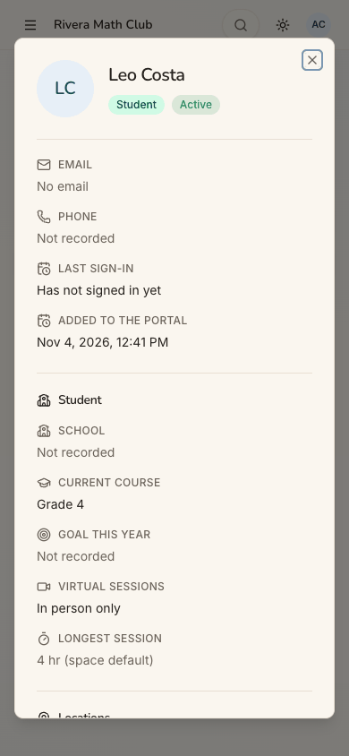 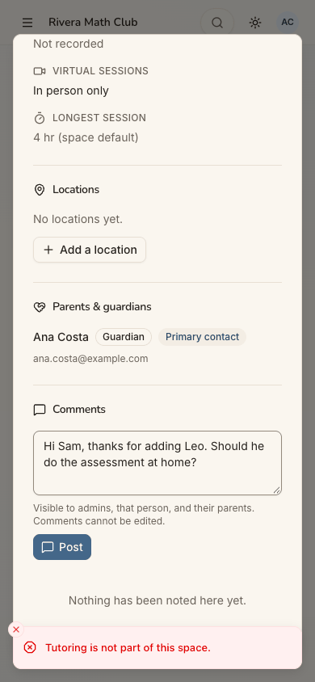 Repro: as Ana, open Users, then Leo Costa, scroll to Comments, type a note and tap Post. The browser's network log shows 403s for locations and comments on open and on Post.
- **Recommended Fix:** Where Tutoring is off, leave its blocks out of User details (session settings, Locations, Comments on people), as CLAUDE.md's R23 does for edits. Do not render an empty state over a 403. If a parent-to-admin note is wanted in Assessment- and Quest-only spaces, give it its own route outside Tutoring's set. Replace "portal" with "space".

### [sev2] The parent's menu and exits are the office's

- **Issue Description:** The parent's menu is Home, Users, Assessment (Beta), Quest (Beta), Activity, My profile, with no "My children" (step 6). "Users" (step 7) says "Everyone at Rivera Math Club. A person can hold more than one role." Its tools are an office's: Add user, role and status filters, and Show deactivated. Yet it lists only Ana and Leo, not Sam, who runs the club. From a game, Exit (top right) goes to "Question Quest — … Tutors check each answer and approve the question for everyone." (steps 13 and 17), not back to the home Ana came from. She has to open the menu to get Home.
- **Framework Violation:** cuj-contract, steps 6, 7, 13 and 17 (expected: a place for her child, and Exit back to where she was; observed: an admin list and a page about tutors approving questions). Nielsen #3 User control and freedom. Nielsen #4 Consistency and standards.
- **Severity:** 2. Classify: real friction, and two of the journey's seven dead ends. A parent who looks for her child in the menu finds "Users". Its "Everyone" line is contradicted by its own list, and Exit drops her on a page written for tutors.
- **Evidence:** 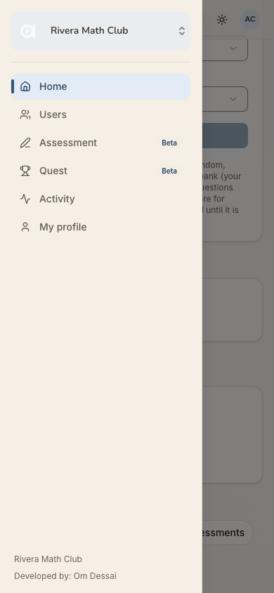 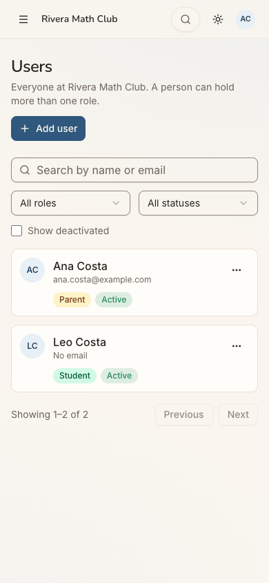  Repro: as Ana, open the menu, then Users; separately, open any game and tap Exit.
- **Recommended Fix:** For a parent who is not an admin, show "My children" (each child's card, assessments and play) in place of Users, or rename the page "Your family" and drop "Everyone at" and the office tools. Show the space's admin as a contact ("Sam Rivera runs this space"). Send Exit back to the page the game was opened from (home, in this journey), and keep Question Quest's tutor wording off the parent's path.

## Walkthrough

### Step 1 — Open the link in Sam's text, signed out

> Expected: a page that recognises an invited person, or at least a way to "Sign in" as the text says. Observed: the guest Play page: "Math quests. Hit the target.", "Free play · Grades 1–8 · No account to start · No ads", a white "Sign up free", a small outlined "Sign in" at the top right, "Today's 5 · Grade 4", the grade row and tiles. There is no word of Rivera Math Club, Sam or an invitation, in light, dark or desktop.

**What Ana notices:** a children's maths game, not her son's club. The text said "Sign in", and there is one at the top right, but the big button says "Sign up free".

### Step 2 — Tap "Sign in"

> Expected: a sign-in sheet. Observed: a sheet titled "Sign up free": "Keep your scores, unlock every quest and play with your family." It has one button, "Continue with Google", and a close X.

**What Ana notices:** she tapped Sign in and is told to sign up. The Google button matches her account, so she goes on.

### Step 3 — Tap "Continue with Google"

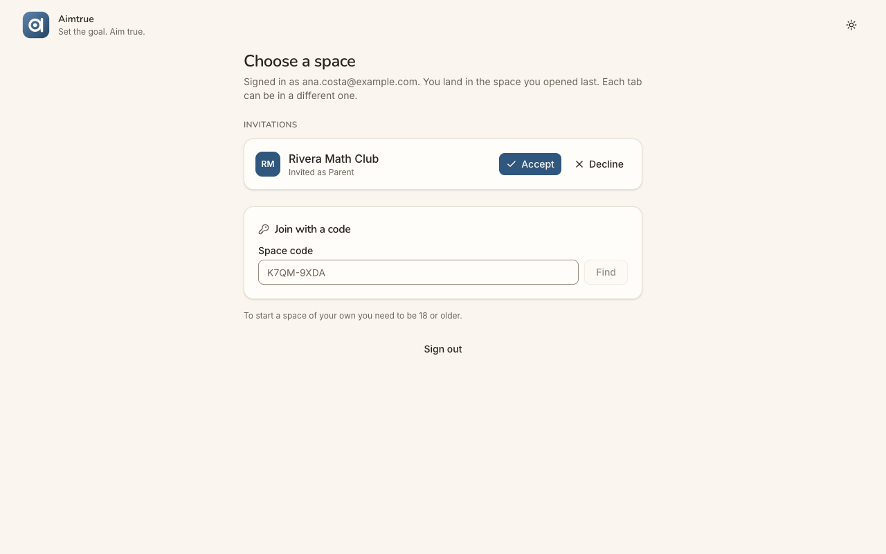
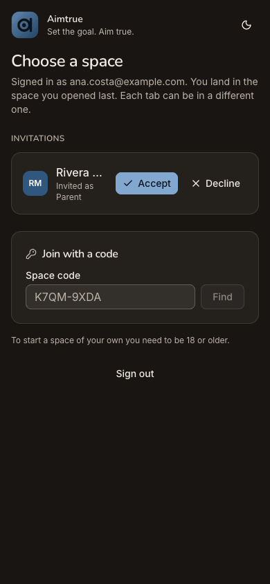

> Expected: either the sign-up form (birth month and year, terms) and "Waiting for approval", or, since Sam vouched for her, the invitation. Observed: the invitation, at once. There was no sign-up form (no birth date, no terms) and no platform approval wait. "/spaces — Choose a space" shows "Signed in as ana.costa@example.com…", then INVITATIONS: "RM Rivera … Invited as Parent [Accept] [x Decline]" (the full "Rivera Math Club" on desktop). Below it are a "Join with a code" card and "To start a space of your own you need to be 18 or older.", then Sign out.

**What Ana notices:** relief: the invitation is there, one tap away. But the name is cut to "Rivera …", nothing says Sam sent it, and the page tells her, at 35, that she must be 18.

### Step 4 — Tap "Accept"

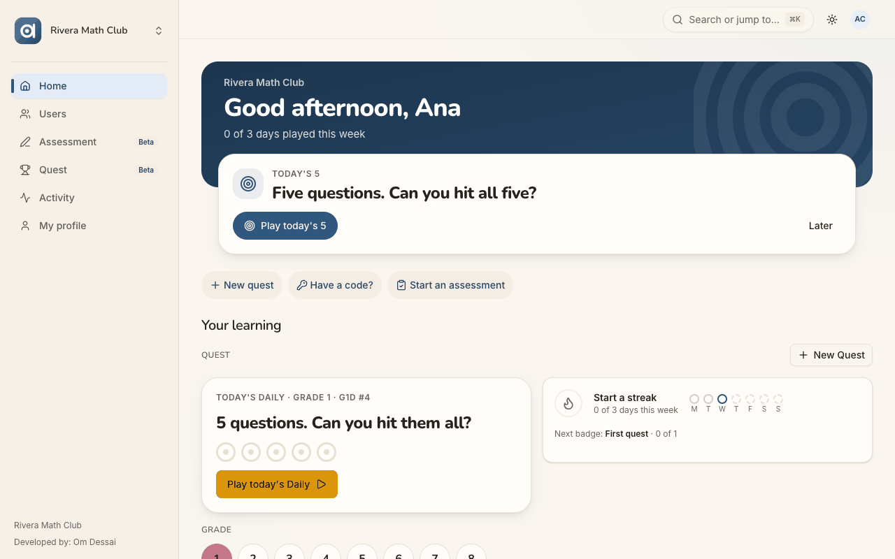
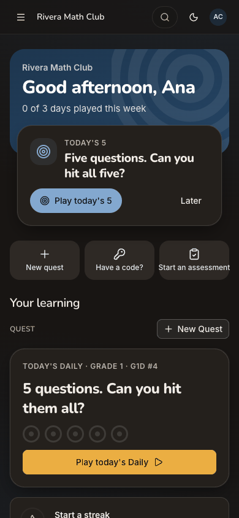

> Expected: she joins Rivera Math Club and lands where Leo is. Observed: she is in the club (the tab is titled "Rivera Math Club"):
> - The band reads "Good afternoon, Ana / 0 of 3 days played this week".
> - Next up is "Today's 5" [Play today's 5] [Later], and the quick actions are New quest, Have a code? and Start an assessment.
> - Then "Your learning" with a Grade 1 Daily and "Start a streak".
>
> Nothing on the first screen mentions Leo. On desktop the sidebar shows Home, Users, Assessment, Quest, Activity and My profile.

**What Ana notices:** the club's name and her own: she is in. Then a game for her, "0 of 3 days played", where she expected her son.

### Step 5 — Scroll down to find Leo, then tap his assessment row

> Expected: Leo near the top, and his assessment opens. Observed: three and a half screens down, past the grade tiles and the Start an assessment form, she finds:
> - ASSESSMENTS: "Leo Costa G4 In progress — 10 questions · started 7 minutes ago";
> - "Your children": Leo, "Played 0 days this week (aim: 3)" [Play with Leo];
> - "Make this my home": Automatic (Quest), Quest, Assessments, My children.
>
> Tapping the assessment row does nothing (plain text). Dead end 1.

**What Ana notices:** there he is, at the bottom. His assessment is "In progress", but she cannot open it or tell who started it. "Aim: 3" is a goal nobody told her about.

### Step 6 — Open the menu

> Expected: a place for her child ("My children" or "Leo"). Observed: Home, Users, Assessment (Beta), Quest (Beta), Activity and My profile, with "Developed by: Om Dessai" at the foot. There is no My children.

**What Ana notices:** "Users" sounds like the club's admin list. Nothing says children. She tries Users, hoping Leo is there.

### Step 7 — Tap "Users"

> Expected: Leo, or the club's people. Observed: "Users — Everyone at Rivera Math Club. A person can hold more than one role." The page has [+ Add user], search, role and status filters and Show deactivated. It lists Ana Costa (Parent, Active) and Leo Costa (No email, Student, Active), "Showing 1–2 of 2". Sam is not listed.

**What Ana notices:** Leo is here, as a "Student". The page says everyone, yet Sam, who runs the club, is missing. These are an office's tools, not a parent's.

### Step 8 — Tap "Leo Costa"

> Expected: Leo's page, with his assessment and how he plays. Observed: "User details — Everything on file for this person.":
> - No email; Not recorded; "Has not signed in yet"; "Added to the portal Nov 4, 2026";
> - School and Goal not recorded; Current course Grade 4;
> - Virtual sessions "In person only"; Longest session "4 hr (space default)";
> - Locations "No locations yet." [Add a location]; Parents & guardians: Ana Costa, Guardian, Primary contact; Comments.
>
> In the background, the locations and comments reads answered 403.

**What Ana notices:** "Not recorded" everywhere, and lesson settings for a club with no lessons. "Has not signed in yet": how would he? He has no email. Seeing herself as his guardian reassures her.

### Step 9 — Close the dialog, then menu, then "Assessment", then tap Leo's row

> Expected: open Leo's in-progress assessment so he can carry on. Observed: "Assessment — In beta. … When it is submitted, their tutors get a PDF…", then the Start an assessment form and ASSESSMENTS: "Leo Costa G4 In progress". The row is plain text, and tapping it does nothing. Dead end 2.

**What Ana notices:** the same row, still closed. "Their tutors": Leo has no tutor here.

### Step 10 — Open the Student list under "Start an assessment"

> Expected: Leo listed. Observed: one option, "Leo Costa". Nothing was started: Escape closed the list.

**What Ana notices:** she could start a new one for Leo, but Sam's is already in progress. Nothing says whether to wait or start another.

### Step 11 — Menu, then Home, scroll to Leo's card, tap "Play with Leo"

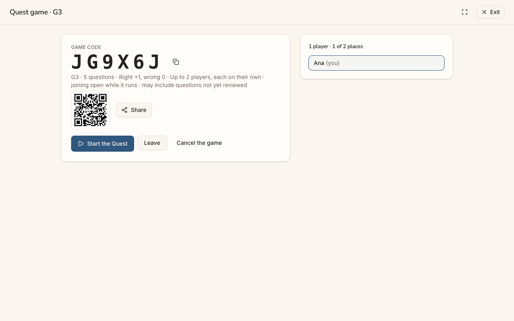
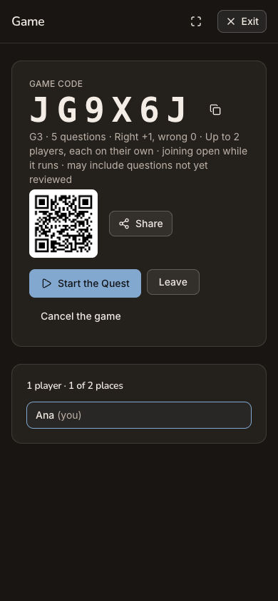

> Expected: a game with Leo in it, at his level. Observed: the lobby "Game" (on desktop "Quest game · G3"):
> - GAME CODE JG9X6J, a QR code and Share;
> - "G3 · 5 questions · Right +1, wrong 0 · Up to 2 players, each on their own · joining open while it runs · may include questions not yet reviewed";
> - [Start the Quest], [Leave] and "Cancel the game";
> - "1 player · 1 of 2 places: Ana (you)".
>
> Leo does not appear.

**What Ana notices:** "Play with Leo" has only her in it, at Grade 3, with a code to share with a nine-year-old who has no login.

### Step 12 — Tap "Cancel the game" (Leo cannot join)

> Expected: a confirm, then "Game cancelled". Observed: no confirm. "THE GAME IS OVER — The host ended the game. Ana wins! You won with 0 points. Fantastic!", then "Final places 1st Ana (you) 0 0/0", [Back to Quest] [Share the result] and "No questions were answered." Dead end 3: the lobby could not include Leo, so she backed out of it.

**What Ana notices:** she is congratulated on winning a game she cancelled. It feels silly, and less serious than a club for her son should.

### Step 13 — Tap "Exit"

> Expected: back to the home. Observed: "/quest — Question Quest — Answer the question bank's new questions… Tutors check each answer and approve the question for everyone." The Games card has New Quest, a code box and the cancelled game "JG9X6J G3 … Finished · 1st". Dead end 4: she needs the menu to get Home.

**What Ana notices:** a page about a question bank and tutors, not her world. The game she cancelled is recorded as a first place.

### Step 14 — Open a fresh tab at the club's address (end state re-checked)

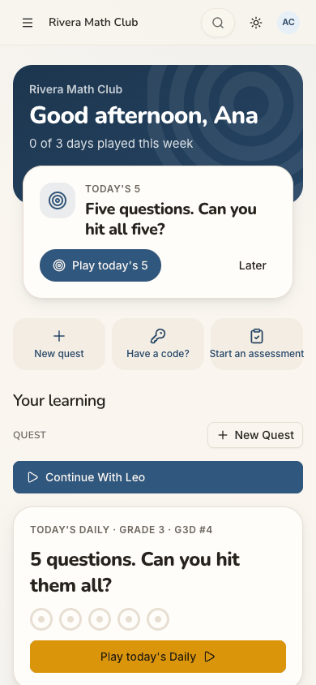

> Expected: she lands straight in Rivera Math Club, without the selector. Observed: she does: "Rivera Math Club — Good afternoon, Ana", the same Next up. The end state holds. New on the home: a full-width primary "Continue With Leo" under Quest, and the Daily is now "Grade 3 · G3D #4" (it was Grade 1 at step 4).

**What Ana notices:** back in the club with no taps. "Continue With Leo" sounds as if Leo is waiting for her.

### Step 15 — Scroll to the streak card

> Expected: nothing earned yet (nothing was played). Observed: "Start a streak — 0 of 3 days this week", "Next badge: 10 quests · 1 of 10", and two earned chips, "First quest" and "Family game", from the cancelled game. The grade row now selects 3. Leo's card further down still says "Played 0 days this week".

**What Ana notices:** badges for something she did not do. She will not trust what the card says Leo has done.

### Step 16 — Tap "Continue With Leo"

> Expected: back to something with Leo. Observed: a **new** lobby with a new code, XGFGPJ: "G3 · 5 questions", "1 player · 1 of 2 places", "Ana (you)". Nothing continues, and Leo is absent again. Dead end 5.

**What Ana notices:** "Continue" made another empty game. She is going round in a circle.

### Step 17 — Tap "Exit" again

> Expected: back to the home. Observed: Question Quest again, now listing "XGFGPJ … Waiting to start" and "JG9X6J … Finished · 1st". There was no confirm on leaving a lobby she hosts. Dead end 6.

**What Ana notices:** two games she never meant to make, one of them "waiting" for a Leo who cannot come.

### Step 18 — Menu, then Home, then "Make this my home: My children"

> Expected: a home led by Leo. Observed: "Your children" (Leo, Play with Leo) moves up under the quick actions, above "Your learning". The band's line becomes "Leo: no lessons scheduled". Next up is still "Today's 5" for Ana.

**What Ana notices:** better, Leo is near the top now. But "no lessons scheduled" makes her wonder whether she was meant to book lessons. Sam runs a club.

### Step 19 — Menu, then Users, then Leo Costa: write a comment to Sam and tap "Post"

> Expected: the note posts ("Visible to admins, that person, and their parents"). Observed: Ana typed "Hi Sam, thanks for adding Leo. Should he do the assessment at home?" and tapped Post. A red toast said "Tutoring is not part of this space." (403). The text stays in the box above "Nothing has been noted here yet.", and "Add a location" is still offered above it. Dead end 7.

**What Ana notices:** the only way to write to Sam fails, with a message about "Tutoring" she never asked for. She will text him instead.

## Appendix

- **Mode:** live. A real headless Chrome drove the app at http://localhost:8797, a frozen copy of commit `2d6e7d3` with sign-in on and its own local database. Phone width is 390×844. Desktop (1280×800) and dark mode were captured at the landing screens: step 1 (the entry), step 3 (the invitation), step 4 (the first screen inside the space) and step 11 (where the feature for her child starts).
- **Frameworks applied:**
  - cuj-contract: each step's expected against observed;
  - task-completion: invitation accepted, Ana a member of Rivera Math Club;
  - success-criteria: the end state re-checked in a fresh tab (step 14), which landed in the club with no selector.
- **Coverage / not inspected:**
  - Decline on the invitation, the "Join with a code" card and Sign out on "Choose a space".
  - Whether a toast confirmed Accept. The click's result recorded no alert, and a short-lived toast may have been missed.
  - Next up's "Later", "Play today's 5", the Daily, the tiles, the New quest and Have a code? quick actions, and the "Start an assessment" quick action.
  - Starting a new assessment for Leo: the Student list was opened and closed (step 10), and nothing was started.
  - "Start the Quest", Share and Leave in either lobby. The second lobby (XGFGPJ) was left waiting to start, as Ana left it.
  - "Add user", the row menus ("…") and "Add a location" on Users, and whether they work for a parent.
  - The Activity and My profile pages, the account menu, the space switcher and the search ("Go anywhere").
  - How Leo himself could ever sign in or answer his assessment. No path was found on screen, and the code was not read.
  - What Sam sees after Ana accepted (J06's browser was not touched). A self-serve space sends no email, and none was checked.
  - Desktop and dark mode outside the landing screens.
  - The iOS app, which is covered by separate journeys.
- Access: through the app's real sign-in and sign-up screens; the Google provider step is simulated (a stand-in for Google's button hands the app a local test token for the persona).
- **Preconditions made outside the UI:** none for J09. Sam Rivera made the space, Ana's invitation, Leo Costa (Ana as primary guardian, consent ticked) and Leo's G4 assessment through the UI in J06, and the invitation text is J06's "Copy invitation", verbatim. The run's shared setup applies (README, "The run"): sign-up access Post-approved, guest play on, the Daily on, visit recording on.
