# CUJ Audit — J10: adult given a space code is approved, asks to join, is declined by the space

## Executive summary

**Who:** Marcus Webb, 52, born January 1974. A friend gave him the code **FMXY2345** for "Ferreira Family Practice"
and told him to sign up on Aimtrue and join with it. Ferreira Family Practice is an Assessment space (Quest is off
there), so Marcus is heading for cohort **C7, the Assessment cohort** of `docs/member-home-plan.md` ("finish it" /
"give one, see results"). He arrives from outside, as a stranger to the product, holding only a code. The platform runs
**Post-approved** sign-up access: the platform admin approved his account. Then the space's admin, Ines (J11),
**declined** his request to join.

**Outcome: 1/1 journeys passed, 0 skipped, 28 of 28 steps verified.** The journey expects a decline. Marcus did find
it, on the Spaces page at step 24, and what is left to him was recorded (steps 25-28).

- **Stage 1 (steps 1-10).** The guest page had nowhere to put a code. The "One code, everyone joins" card shows an
  example code in a box that looks like a field but is not one (dead end, step 3). Marcus signed up with Google, gave his
  birth month and year, agreed to the terms, and got "Waiting for approval" (step 10).
- **Stage 2 (steps 11-19), after approval.** Nothing told him he had been approved. He tapped Sign in and got a sheet
  titled "Sign up free" (step 12), then landed in "Marcus's space", a personal space made for him at sign-up (step 13).
  The home's "Have a code?" quick action took him to a focused box (step 14), and FMXY2345 sent the request (step 16).
  The toast faded in seconds, so he found a lasting confirmation only on the Spaces page (step 19).
- **Stage 3 (steps 20-28), after the decline.** Nothing on the home, the menu, the space switcher or Activity says
  anything (steps 20-23). The answer is one grey sentence on the Spaces page: "Ferreira Family Practice didn't accept
  your request to join." (step 24). The same code then let him ask again at once, with no word about the decline
  (steps 25-26). Withdrawing that second request erased the decline from his page as well (steps 27-28).

**Conversion figures** (counted from the entry point, the signed-out guest page):

| Stretch | Screens | Taps | Typed fields | Waits | Dead ends |
| --- | --- | --- | --- | --- | --- |
| Entry to "Waiting for approval" (steps 1-10) | 5 | 9 | 0 (two dropdowns; one stray key press into the example code) | 1 (the platform's approval, open-ended) | 1 |
| Return visit to the request sent (steps 11-16) | 3 | 4 | 1 (the code) | 1 (the space's admins, open-ended) | 0 |
| ...finding a lasting confirmation (steps 17-19) | 3 | 3 | 0 | 0 | 0 |
| Return visit to the decline seen (steps 20-24) | 5 | 5 | 0 | 0 | 1 |
| **Entry to the decline seen (steps 1-24)** | **16** | **21** | **1** | **2, both silent** | **2** |
| After the decline: ask again, withdraw, reload (steps 25-28) | 1 | 3 (+1 reload) | 1 | 0 | 0 |

For a code holder the feature is the request to join. It took **8 screens, 13 taps and 1 typed field** from the
guest page (step 16), and the code was asked for only at step 14, after sign-up, approval and a second sign-in. The
journey's own end, the decline seen, took **16 screens, 21 taps, 1 typed field, 2 waits and 2 dead ends**.

For **conversion**, the code path inside the app is short and clear. "Have a code?" is a top-row quick action, and the
hint "Six characters join a game; eight ask to join a space." told Marcus exactly what his code would do. Getting
there is the slow part: nothing before sign-up accepts or even mentions a space code, and both waits are silent.
Marcus learns of each decision only by coming back and looking.

For **stickiness**, the decline leaves Marcus with no reason to return. His one reason for coming was Ferreira
Family Practice. What remains is a personal space he never asked for, with a Grade 1 Daily and "Choose a student".
Nothing links the two or suggests what to do now.

**The 3 screens Marcus would notice most:**

- **Step 13, landing in "Marcus's space".** After the approval and a second sign-in he arrives in a space named
  after him, as its Admin, greeted by "0 of 3 days played this week" and a Grade 1 Daily. Nothing mentions Ferreira
  Family Practice or the code he came with. The saving grace is the "Have a code?" button in the top row. For an
  adult sent to a practice, this is where he decides whether the product is for him.
  
- **Step 20, the home after the decline.** It is the same page as the day before: no banner, no Next up item, no
  badge. The one thing that happened to him, a "no" from the people he came for, is not on the screen he lands on.
  He has to remember the Spaces page exists, three taps away, and his first guess (Activity) is a dead end.
  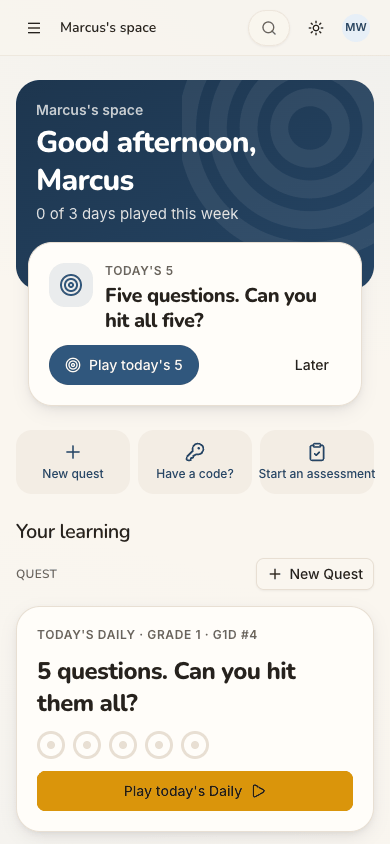
- **Step 24, the decline.** One beige line, "Ferreira Family Practice didn't accept your request to join.", with no
  date, no reason, no dismiss and no next step. Below it, the same code box will send the same request again without a
  word of caution (steps 25-26). After he withdraws that second request, the decline is gone too (step 27).
  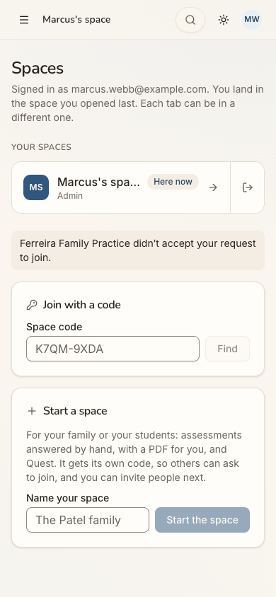

**Contact sheet** (all 28 phone steps):

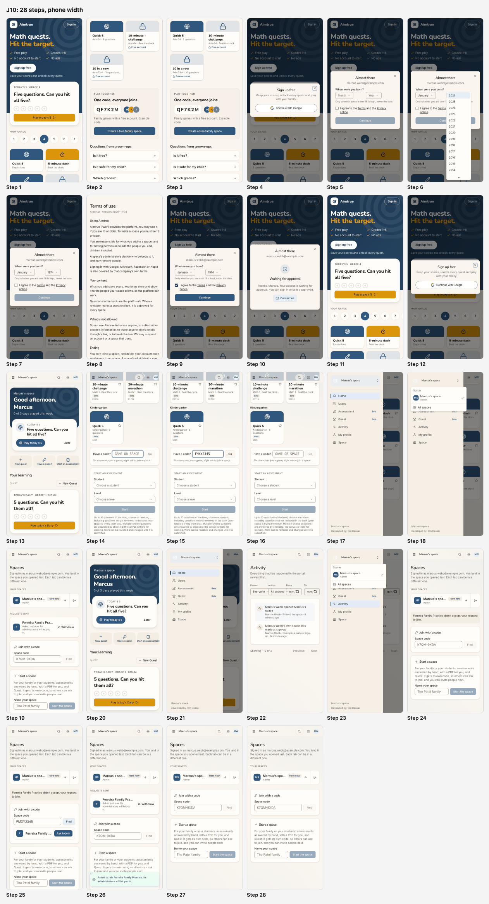

| Severity | Count |
| --- | --- |
| sev4 (catastrophe) | 0 |
| sev3 (major) | 1 |
| sev2 (minor) | 7 |
| sev1 (cosmetic) | 4 |
| **Total** | **12** |

## Prioritized fixes

1. [sev3] [Marcus is never told the space said no, and the answer waits behind All spaces](#sev3-marcus-is-never-told-the-space-said-no-and-the-answer-waits-behind-all-spaces): put the decision on the home's Next up and the switcher, and tell him where to look (steps 16, 20-24).
2. [sev2] [The decline is one grey sentence with no reason, date or next step](#sev2-the-decline-is-one-grey-sentence-with-no-reason-date-or-next-step): add a date, the next steps (ask the person who gave you the code, ask again, your own space) and a dismiss (step 24).
3. [sev2] [Asking again after a decline is instant and unguided, and withdrawing erases the decline](#sev2-asking-again-after-a-decline-is-instant-and-unguided-and-withdrawing-erases-the-decline): say the space declined before, offer a note to the admins, and keep the history line (steps 25-27).
4. [sev2] [The code has nowhere to go until after sign-up, approval and a second sign-in](#sev2-the-code-has-nowhere-to-go-until-after-sign-up-approval-and-a-second-sign-in): add "Have a code?" to the guest page and the sign-up sheet, and carry it through approval (steps 1-5, 14).
5. [sev2] [The platform's approval is silent, before and after](#sev2-the-platforms-approval-is-silent-before-and-after): say who approves, how long, how he will hear; greet him once approved (steps 10, 11, 13).
6. [sev2] ["Sign in" opens a sheet titled "Sign up free"](#sev2-sign-in-opens-a-sheet-titled-sign-up-free): title the sheet by the button that opened it (step 12).
7. [sev2] [The join toast on the home does not name the space and leaves no trace](#sev2-the-join-toast-on-the-home-does-not-name-the-space-and-leaves-no-trace): name the space, as the Spaces page's toast does, and show the pending request on the home (steps 16-19).
8. [sev2] [He lands in a personal space he never asked for, and after the decline it is all he has](#sev2-he-lands-in-a-personal-space-he-never-asked-for-and-after-the-decline-it-is-all-he-has): lead with the code he came for and, after a decline, say what this space is for (steps 13, 20, 24).
9. [sev1] [The Activity filter row overlaps at phone width](#sev1-the-activity-filter-row-overlaps-at-phone-width): stack the filters below `sm` (step 22).
10. [sev1] [The Spaces page cuts names on a phone and mixes code formats](#sev1-the-spaces-page-cuts-names-on-a-phone-and-mixes-code-formats): wrap names, label Leave, use one code example (steps 19, 24, 26).
11. [sev1] [The birth-year list starts at the current year](#sev1-the-birth-year-list-starts-at-the-current-year): start the list near a typical adult year or let the year be typed (steps 6-7).
12. [sev1] ["Almost there" stays above "Waiting for approval", and Contact us is a personal Gmail](#sev1-almost-there-stays-above-waiting-for-approval-and-contact-us-is-a-personal-gmail): retitle the sheet and use a platform address (step 10).

## Findings

### [sev3] Marcus is never told the space said no, and the answer waits behind All spaces

- **Issue Description:** After Marcus asked to join (step 16), nothing tells him when Ferreira Family Practice decides,
  or what it decided.
  - **No notice where he lands.** Opening the site again lands him on his own space's home (step 20). The whole page
    was read: no banner, no Next up item, no alert. Next up is still "Today's 5".
  - **No notice where he looks.** The menu has no badge (step 21). Activity shows only his own space's two lines (step
    22). The space switcher lists only "Marcus's space", with no count (step 23).
  - **One place has it.** The answer is on the Spaces page (step 24), reached by menu, space name, "All spaces". No
    screen before it tells him that is where to look. The join toast on the home said only "Its admins will let you
    in." (step 16).
  - **No message outside the app.** Nothing on screen promises an email, and none was observable here.
  - **Someone who does not hunt never knows.** Marcus would wait indefinitely for a "let in" that is never coming.
- **Framework Violation:** cuj-contract, steps 20-24 (expected: the decision shown where he lands, or a notice;
  observed: found on the fifth screen of a search, after a dead end); Nielsen #1 Visibility of system status; Nielsen #6
  Recognition rather than recall (he must remember the Spaces page exists).
- **Severity:** 3. Classify: workaround needed. Marcus reached the decline only by searching the menus. For this
  cohort, the request is the only reason he signed up. A decision that is not shown leaves him waiting on a dead
  request and costs the practice's goodwill as well as the platform's. It is not a 4: the decline is on the Spaces
  page, and it was found.
- **Evidence:**  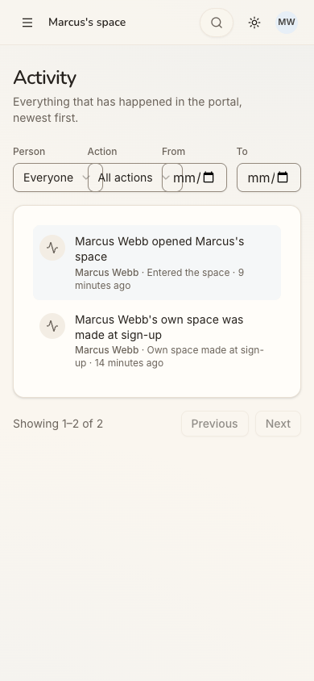
  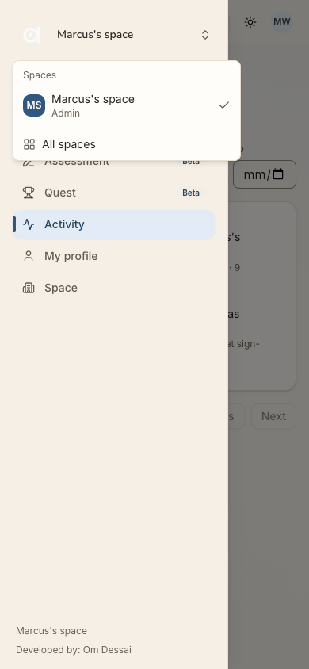 
  Repro: as an approved adult, sign in, enter a space code on the home's "Have a code?" box and tap Go. Have the
  space's admin decline the request on Users. Open `/` in a new tab: the home shows nothing. Check the menu, Activity
  and the switcher: nothing. Menu, space name, "All spaces": "<Space> didn't accept your request to join."
- **Recommended Fix:**
  - Make the outcome a Next up item on the home, once: "Ferreira Family Practice didn't let you in", with the next
    steps below (see the next finding). Do the same, positively, for "let in".
  - While a request is pending or newly answered, show a count on the switcher's "All spaces", like the count the
    product's design already gives invitations.
  - Make the join toast say where to look: "Asked to join Ferreira Family Practice. You'll see their answer under All
    spaces."
  - Where a space may send email, send one short message on the decision (no reason text), as the platform's other
    notices do.

### [sev2] The decline is one grey sentence with no reason, date or next step

- **Issue Description:** The decline is a plain paragraph in a beige box: "Ferreira Family Practice didn't accept your
  request to join." (step 24).
  - **No date.** He cannot tell when it happened or whether it is old news.
  - **No reason, not even a category.** "Didn't accept" could read as a glitch as much as a "no".
  - **No next step.** Nothing suggests checking with the person who gave him the code, asking again, or using his own
    space.
  - **No way to dismiss it.** In the accessibility tree it is not a status message, so a screen reader passes it as
    ordinary text.
  - **"Join with a code" sits right below it.** The page invites him to repeat the request without comment.
- **Framework Violation:** cuj-contract, step 24 (expected: the decision, and what he can do now; observed: the
  decision only); Nielsen #9 Help users recognise, diagnose and recover from errors; Nielsen #1 Visibility of system
  status.
- **Severity:** 2. Classify: real friction. The journey's end was reached, but Marcus is left to guess. For an adult
  sent by a friend, the useful next step is usually outside the app ("ask your friend to tell Ines who you are"). The
  page could say so in one line, and doesn't.
- **Evidence:**  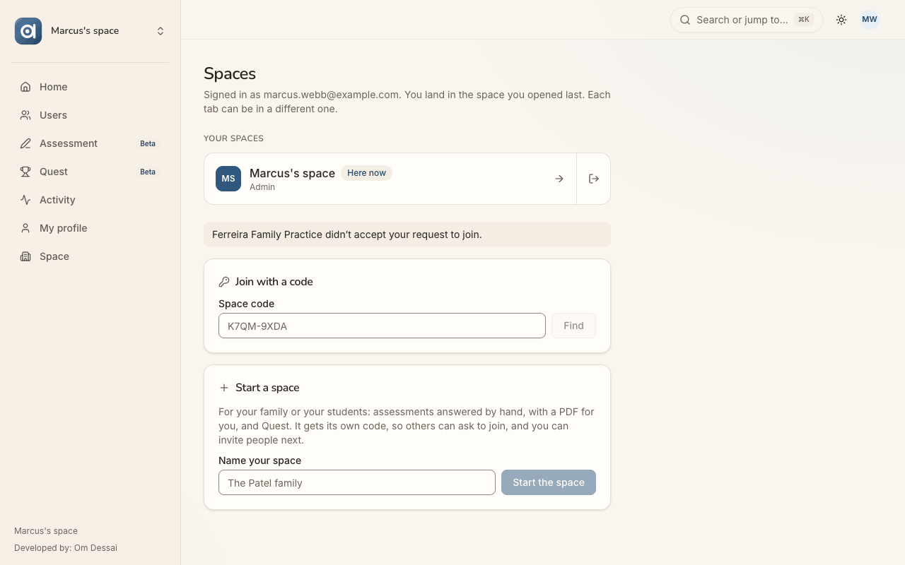
  Repro: as above; the Spaces page after a decline. The line has no date, link or button.
- **Recommended Fix:**
  - Rewrite as a small card: "Ferreira Family Practice didn't let you in (today). If you know someone there, ask them
    to let the admins know who you are, then ask again." Add an "Ask again" button and a "Dismiss" control.
  - Add "Meanwhile, your own space has Quest and assessments" with a link, so the decline ends on a way forward.
  - Give it `role="status"` so it is announced.
  - Optionally let admins pick a short reason from a fixed list when declining, shown here. Keep it a list rather than
    free text, as with notifications.

### [sev2] Asking again after a decline is instant and unguided, and withdrawing erases the decline

- **Issue Description:** The same code finds Ferreira Family Practice again with "Ask to join", and nothing mentions
  the decline (step 25). One tap sends a fresh request (step 26). The decline line disappears and "Requests sent /
  Asked just now" takes its place. There is no warning, no note to the admins and no limit shown. Withdrawing that
  request (step 27) asks no confirmation, and the decline line does not come back. After a reload, nothing on his
  page shows he ever dealt with Ferreira Family Practice (step 28).
- **Framework Violation:** cuj-contract, steps 25-28 (expected: told the space declined before, and a way to explain
  himself; observed: an identical request and then no record); Nielsen #5 Error prevention; Nielsen #1 Visibility of
  system status.
- **Severity:** 2. Classify: observable mismatch. Asking again is a reasonable recovery path, which is good for
  conversion. Done blind, though, it lands on the admin who just said no, with nothing new for her to decide on.
  J11 found her request card shows only a name and an email. For Marcus, losing the record means he cannot tell later
  what happened.
- **Evidence:** 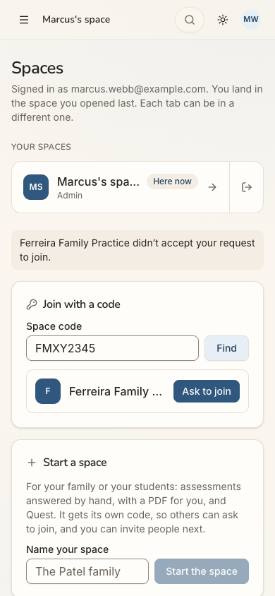 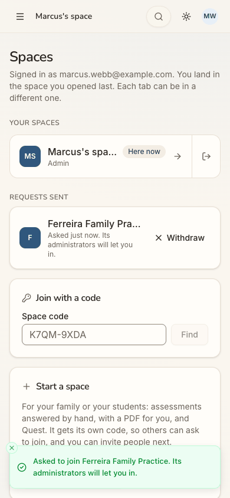
  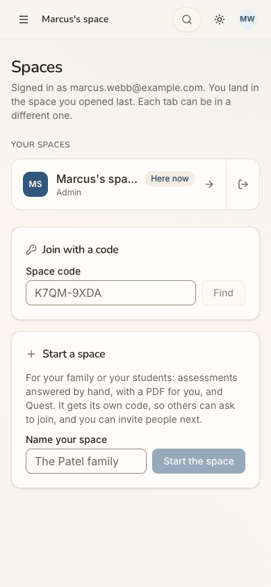 
  Repro: after a decline, on Spaces type the same code, Find, Ask to join: accepted at once ("Asked to join Ferreira
  Family Practice. Its administrators will let you in."). Withdraw: "Request to Ferreira Family Practice withdrawn.";
  reload: no decline line.
- **Recommended Fix:**
  - When the code belongs to a space that declined him, say so at Find: "Ferreira Family Practice declined your
    request on <date>. Ask again only if they expect you." Offer an optional short note ("I'm Dana's friend") that the
    admin sees on the request card.
  - Keep the decline as a history line ("Declined on <date>") after a new request or a withdrawal, until dismissed.
  - Confirm Withdraw in one line, or give the toast an Undo.

### [sev2] The code has nowhere to go until after sign-up, approval and a second sign-in

- **Issue Description:** Marcus came with a code, and the product asks for it only at step 14.
  - **The guest page** has no "Have a code?" box (step 1). Its "Play together / One code, everyone joins" card shows
    `QF7K2M` in a large white box that looks like a field. Only a small grey "Example code." says otherwise. Tapping it
    and typing did nothing (step 3, dead end).
  - **The sign-up sheet and the About-you form** never mention a code (steps 4-5).
  - **The waiting screen** does not say he can use it once approved (step 10).
  - **The guest page speaks to children and parents** ("Grade 4", "Questions from grown-ups", "play with your
    family"). Nothing is addressed to an adult sent to a practice.
  - **The examples disagree.** The guest page shows a 6-character example (`QF7K2M`), the home box says "GAME OR
    SPACE", the Spaces page shows `K7QM-9XDA` with a hyphen, and his code is `FMXY2345`.
- **Framework Violation:** cuj-contract, steps 1-5 and 14 (expected: somewhere to say "I have a code" at the start;
  observed: the first code field is inside the app, after approval); Nielsen #2 Match between system and the real world;
  Nielsen #4 Consistency and standards (four code formats).
- **Severity:** 2. Classify: real friction, one dead end. Marcus got through by following the generic sign-up. But
  every code holder makes the same wrong turn. Nothing on the way in tells him he is on the right road to Ferreira
  Family Practice.
- **Evidence:**  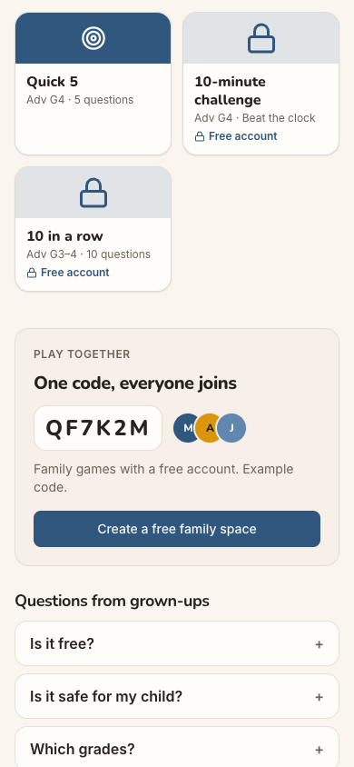
  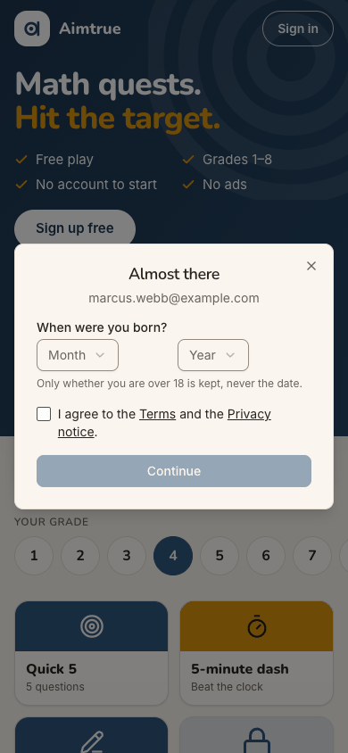 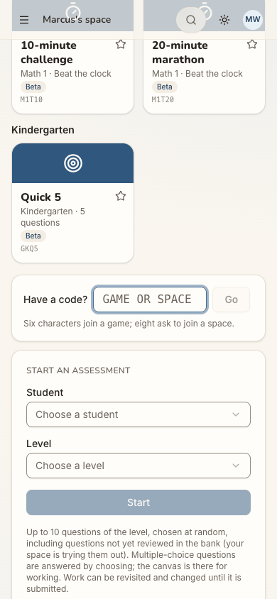
  Repro: signed out at `/`, look for a code field (none in the accessibility tree); tap the example code and type
  (no effect); "Sign up free" and "Continue with Google" (no code field). The first code field is the home's "Have a
  code?" box after approval.
- **Recommended Fix:**
  - Add a real "Have a code?" box on the guest page, above the fold. A 6-character code plays as a guest; an
    8-character code shows the space's name and "Sign up to ask to join".
  - Keep that code on the device through sign-up and approval. On the first signed-in visit, show "Ask to join
    Ferreira Family Practice?" instead of making him find the box.
  - Make the example code look like text, not an input, or make it an input.
  - Use one example format everywhere, with the right length for what is asked.

### [sev2] The platform's approval is silent, before and after

- **Issue Description:** The waiting sheet says "Your access is waiting for approval. You can sign in once it's
  approved." (step 10). It does not say who approves (Aimtrue, the practice, his friend?), how long it takes, or how he
  will hear. Once approved, nothing reaches him: the guest page on his return is identical (step 11). After signing in
  there is no "You're approved" moment, just the home (step 13). Like J02's refusal, the "yes" is found only by trying.
- **Framework Violation:** cuj-contract, steps 10, 11 and 13 (expected: who decides, when, and a notice; observed: an
  open-ended wait with no signal); Nielsen #1 Visibility of system status.
- **Severity:** 2. Classify: real friction. Marcus was approved and got in, but only because he came back on his own.
  For a code holder this is the first of two silent waits in a row (see the sev3 finding). J02 rates the same screen
  higher for a refused person; here the outcome was good, so it is a 2.
- **Evidence:** 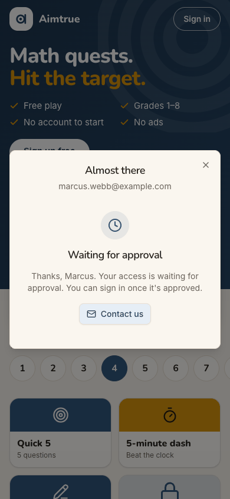 
  
  Repro: Post-approved access; sign up; the waiting sheet. Approve in the console. Open `/` in a new tab: the same
  guest page. Sign in: straight to the home, with no message.
- **Recommended Fix:**
  - On the waiting sheet: "A person at Aimtrue checks new accounts, usually within a day. Come back and sign in. Your
    code will work once you're in."
  - After approval, greet once: "You're in. Have a code? Enter it here", or go straight to the code he brought (see the
    previous finding).
  - Email the decision where the platform can send mail.

### [sev2] "Sign in" opens a sheet titled "Sign up free"

- **Issue Description:** Coming back approved, Marcus tapped "Sign in" at the top right. The sheet that opened was
  titled "Sign up free", with "Keep your scores, unlock every quest and play with your family." and "Continue with
  Google" (step 12). It is the sign-up sheet word for word.
- **Framework Violation:** cuj-contract, step 12 (expected: a sign-in screen; observed: the sign-up sheet); Nielsen #4
  Consistency and standards; Nielsen #1 Visibility of system status.
- **Severity:** 2. Classify: observable mismatch. Marcus wondered whether he was about to make a second account. The
  only button was the right one, so he went on, but a cautious 52-year-old could close it there. J02 found the same.
- **Evidence:** 
  Repro: signed out at `/`, tap "Sign in": a sheet titled "Sign up free".
- **Recommended Fix:** Title the sheet by the button that opened it: "Sign in / Welcome back", with "New here? The same
  button makes a free account." underneath.

### [sev2] The join toast on the home does not name the space and leaves no trace

- **Issue Description:** "Go" on the home's code box showed a toast, "Asked to join. Its admins will let you in." (step
  16). It is short-lived, sits at the foot of a long page, and does not name the space. Then the box clears and the
  page looks as before: Next up is still "Today's 5", with no "Request sent" anywhere. The lasting confirmation is on
  the Spaces page, three taps away (steps 17-19). The Spaces page's own toast names the space ("Asked to join Ferreira
  Family Practice. Its administrators will let you in.", step 26). The two toasts for the same action differ.
- **Framework Violation:** cuj-contract, steps 16-19 (expected: a confirmation naming Ferreira Family Practice, still
  visible after the toast; observed: an anonymous toast, then nothing); Nielsen #1 Visibility of system status; Nielsen
  #4 Consistency and standards.
- **Severity:** 2. Classify: real friction. Marcus could not tell he had reached the right space. He spent three more
  taps finding out whether it worked.
- **Evidence:** 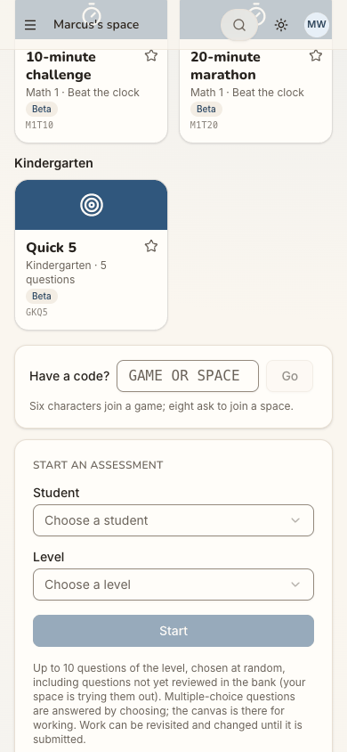 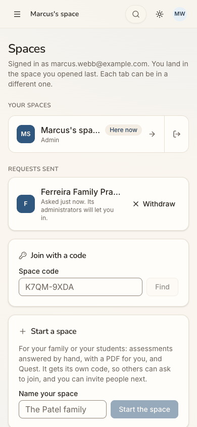
  
  Repro: on the home, "Have a code?", type an 8-character space code, Go. The toast (read live; it had faded before
  the screenshot) has no space name; the home shows no request afterwards.
- **Recommended Fix:**
  - Use the Spaces page's wording on the home.
  - Before sending, show the space found ("Ferreira Family Practice: Ask to join"), as the Spaces page does, so he
    confirms the right one.
  - Keep a "Waiting for Ferreira Family Practice" line in the home's band or Next up until it is answered.

### [sev2] He lands in a personal space he never asked for, and after the decline it is all he has

- **Issue Description:** After approval, Marcus landed in "Marcus's space", made for him at sign-up (step 13). He is
  its Admin; the menu offers Users and Space; the home shows "0 of 3 days played this week", a Grade 1 Daily, and
  "Start an assessment" with "Choose a student" when he has none. Nothing mentions the space he was sent to. After
  the decline, this space is all he has, and the home still says nothing about the decline (step 20). The Spaces page
  offers "Start a space" ("For your family or your students...") although he already admins one (step 24).
- **Framework Violation:** cuj-contract, steps 13, 20 and 24 (expected: the app helps him toward the space he came for,
  and after a "no" offers a reason to stay; observed: a generic practice home, unchanged by the decline); Nielsen #2
  Match between system and the real world.
- **Severity:** 2. Classify: real friction, and the stickiness gap of this journey. For C7, someone sent to an
  Assessment practice, a Grade 1 streak is not why he came. After the decline nothing ties his own space to what he
  wanted, and nothing gives him a reason to return.
- **Evidence:**  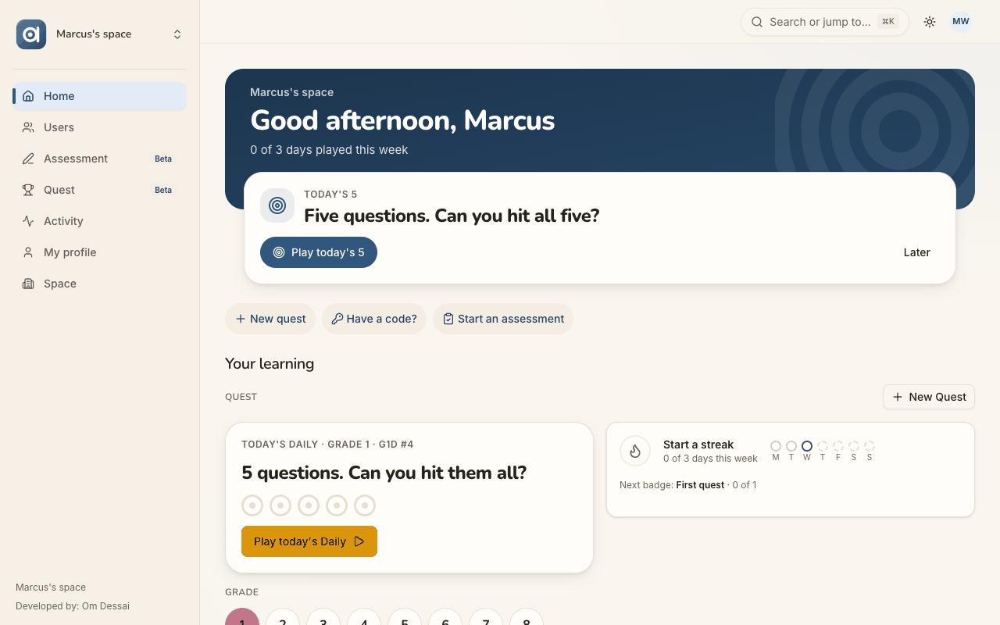
   
  Repro: sign up under Post-approved, be approved, sign in: "Marcus's space". After a decline, `/` is unchanged.
- **Recommended Fix:**
  - When the person has a pending or answered request, lead the home with it (see the sev3 finding), not the Daily.
  - Introduce the personal space once in words an adult reads: "This is your own space: practise yourself, or give an
    assessment to someone you add."
  - Pick the Daily's grade from something he chose rather than Grade 1.
  - On the Spaces page, hide or reword "Start a space" for someone who already admins a personal space.

### [sev1] The Activity filter row overlaps at phone width

- **Issue Description:** On Activity at 390 px, the Person, Action, From and To controls overlap. "Everyone" runs into
  "All actions", which runs into the first date box (step 22). The header also says "Everything that has happened in
  the portal", an older word for the product. J11 saw the same overlap on Ines's Activity.
- **Framework Violation:** cuj-contract, step 22 (expected: readable filters; observed: overlapping controls); Nielsen
  #8 Aesthetic and minimalist design.
- **Severity:** 1. Classify: cosmetic. The controls still work, and Marcus did not need them.
- **Evidence:** 
  Repro: at 390×844, menu, Activity.
- **Recommended Fix:** Stack the filter row on phones (two per row, or one), as the repository's rule for filter rows
  asks, and replace "portal" with "space".

### [sev1] The Spaces page cuts names on a phone and mixes code formats

- **Issue Description:** At 390 px the Spaces page truncates "Marcus's spa..." and "Ferreira Family Pra..." (steps 19,
  24, 26). The control beside his space is an exit icon with no visible label (its accessible name is "Leave Marcus's
  space"). The code box's example is hyphenated (`K7QM-9XDA`) while real codes are not.
- **Framework Violation:** cuj-contract, steps 19 and 24 (expected: the full space name he is confirming; observed: a
  cut-off name); Nielsen #6 Recognition rather than recall; Nielsen #4 Consistency and standards.
- **Severity:** 1. Classify: cosmetic. The full names appear on desktop, and Marcus could still tell which row was
  which.
- **Evidence:**  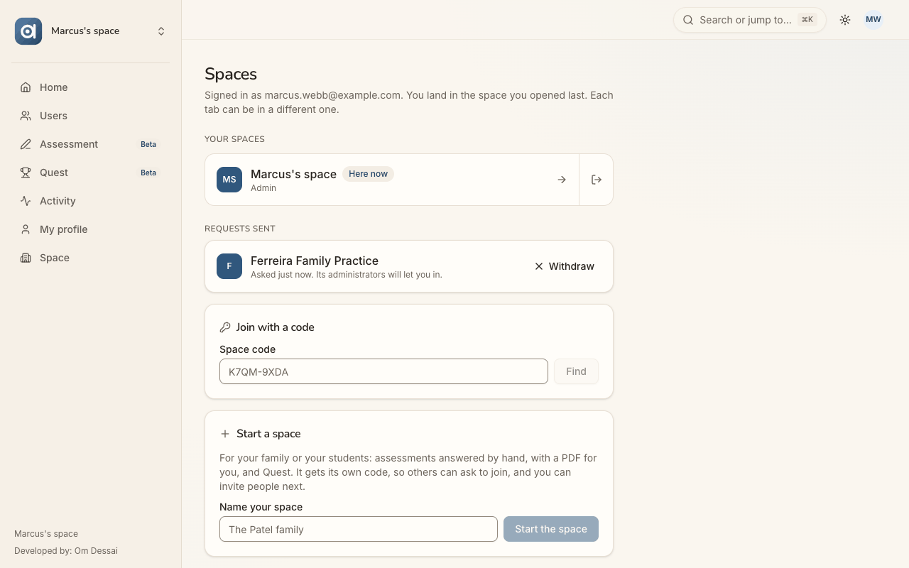
  Repro: Spaces at 390×844 with a request sent.
- **Recommended Fix:** Let names wrap to two lines on phones, give the Leave icon a visible "Leave" label, and use the
  real code shape in the example (`FMXY2345`-like, no hyphen).

### [sev1] The birth-year list starts at the current year

- **Issue Description:** "When were you born?" has a Year dropdown that opens at 2026 and runs down one year at a time
  (step 6). For Marcus, 1974 is 52 rows down (step 7).
- **Framework Violation:** cuj-contract, steps 6-7 (expected: a quick pick; observed: a long scroll); Nielsen #7
  Flexibility and efficiency of use.
- **Severity:** 1. Classify: cosmetic friction. One long scroll for every adult. Most people signing up are adults or
  parents.
- **Evidence:** 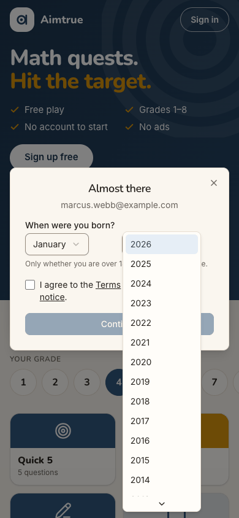 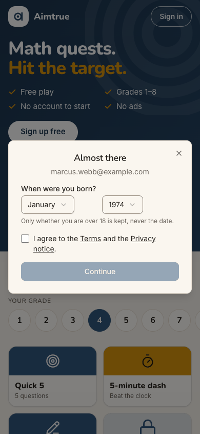
  Repro: sign up; open Year.
- **Recommended Fix:** Open the list scrolled to about 1990, or accept a typed four-digit year, keeping the same
  validation.

### [sev1] "Almost there" stays above "Waiting for approval", and Contact us is a personal Gmail

- **Issue Description:** After Continue, the sheet keeps its title "Almost there" above the new "Waiting for approval"
  (step 10), so two headings disagree. Its "Contact us" is a mailto link to a personal Gmail address. To a newcomer
  checking whether this is a real company, that looks odd.
- **Framework Violation:** cuj-contract, step 10 (expected: one clear state; observed: two headings); Nielsen #4
  Consistency and standards.
- **Severity:** 1. Classify: cosmetic. It does not stop anything, but it weakens trust at the moment Marcus is asked
  to wait.
- **Evidence:**  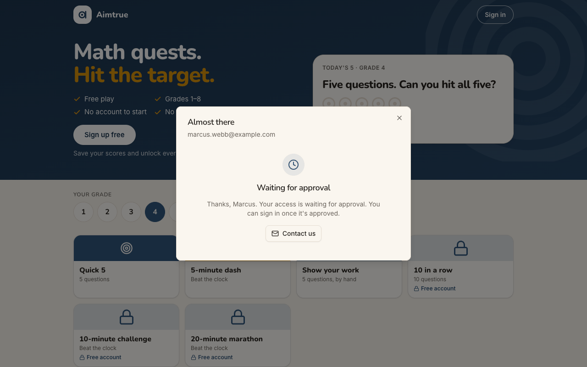
  Repro: Post-approved; sign up to the end.
- **Recommended Fix:** Retitle the sheet "Waiting for approval" when its state changes, and use a platform address
  (e.g. support@ on the product's domain) for Contact us.

## Walkthrough

### Step 1 — Open http://localhost:8797/ signed out (landing)

> Expected: a front page that says where a code goes, or how to sign up. Observed: the guest Play page: "Math quests.
> Hit the target.", ticks (Free play, Grades 1-8, No account to start, No ads), "Sign up free", a "Sign in" pill,
> "Today's 5 · Grade 4", the grade row, tiles, "Play together", "Questions from grown-ups" and the footer. No textbox
> anywhere in the accessibility tree. Desktop shows two columns; dark mode is readable.

**What Marcus notices:** a bright children's maths game. Nothing says "Have a code?", and nothing mentions a practice
or joining someone's space.

### Step 2 — Scroll to "One code, everyone joins"

> Expected (Marcus): the code section is where his code goes. Observed: a "Play together" card with `QF7K2M` in a
> large white box, three avatar circles, "Family games with a free account. Example code." and "Create a free family
> space".

**What Marcus notices:** the box looks like a field. The small grey "Example code." is easy to miss, and the example
has 6 characters while his code has 8.

### Step 3 — Tap the example code box and type "F" (dead end)

> Expected (Marcus): the box takes his code. Observed: nothing. It is static text; focus stays on the page and the key
> press does nothing.

**What Marcus notices:** "So where do I put it?" He gives up on the box and signs up, as his friend said.

### Step 4 — Tap "Sign up free"

> Expected: a sign-up form, maybe with a place for a code. Observed: a sheet "Sign up free / Keep your scores, unlock
> every quest and play with your family." with one button, "Continue with Google".

**What Marcus notices:** still nothing about a code, and "your family" again. He has a Google account, so he goes on.

### Step 5 — Tap "Continue with Google" (landing)

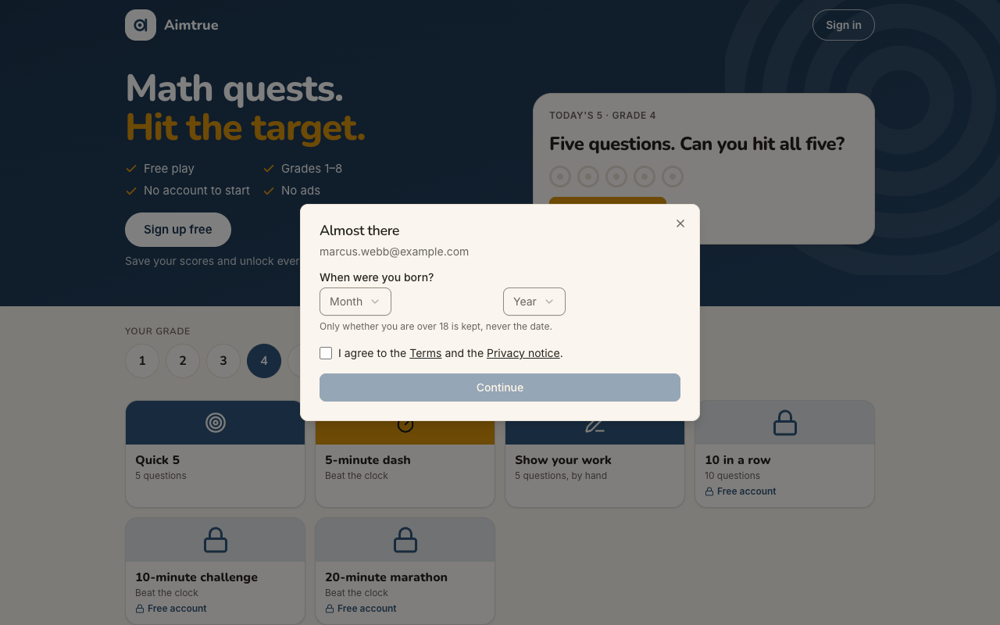
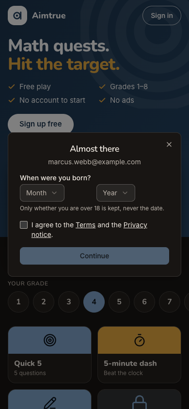

> Expected: Google, then the app. Observed: the stand-in signed him in at once and the sheet became "Almost there",
> with his email, "When were you born?" (Month, Year), "Only whether you are over 18 is kept, never the date.", a terms
> checkbox and a disabled Continue.

**What Marcus notices:** short and reassuring about the date. Still no code field.

### Step 6 — Pick January, then open the Year list

> Expected: a quick choice. Observed: Month shows January; the Year list opens at 2026 and runs down year by year.

**What Marcus notices:** 1974 is a long way down on a phone.

### Step 7 — Pick 1974

> Expected: the year set. Observed: match. "January" and "1974" are shown; Continue waits for the checkbox.

**What Marcus notices:** nearly done, once the terms box is ticked.

### Step 8 — Open the Terms (new tab)

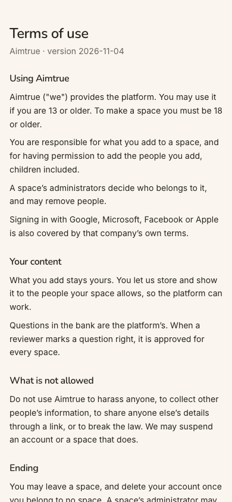

> Expected: readable terms. Observed: "Terms of use / Aimtrue · version 2026-11-04": 13 or older to use, 18 to make a
> space, and "A space's administrators decide who belongs to it, and may remove people." The link opens a new tab, so
> the half-filled sheet survives. This page was captured in a separate signed-out browser of this journey, because the
> driver does not follow new tabs.

**What Marcus notices:** plain and short. "Administrators decide who belongs" is the first hint anywhere that the
practice has a say.

### Step 9 — Tick "I agree to the Terms and the Privacy notice."

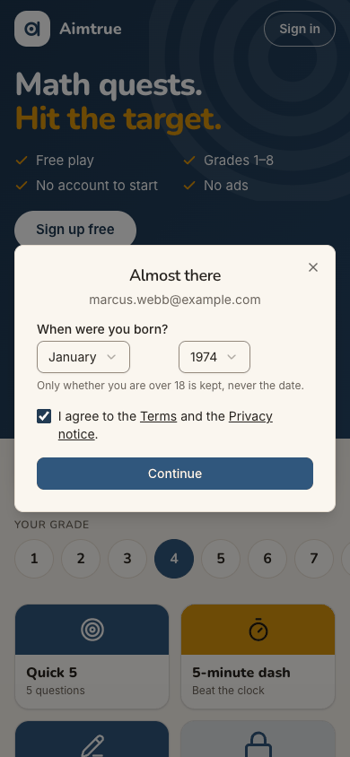

> Expected: Continue enabled. Observed: match; Continue turns dark blue.

**What Marcus notices:** ready to go.

### Step 10 — Tap "Continue" (landing: waiting)

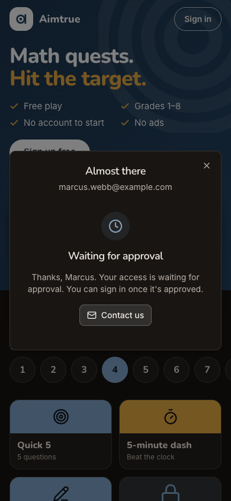

> Expected: under Post-approved, the waiting screen. Observed: still titled "Almost there", now with a clock icon,
> "Waiting for approval", "Thanks, Marcus. Your access is waiting for approval. You can sign in once it's approved." and
> "Contact us" (a mailto to a personal Gmail). `POST /api/auth/signup` answered 403 in the browser's log, by design.

**What Marcus notices:** approval by whom, and how will he know? His code still has not been asked for.

### Step 11 — Open / in a new tab after approval (landing)

> Expected (Marcus): the site recognises him, or offers Sign in. Observed: the same signed-out guest page as day one,
> with no word about his account.

**What Marcus notices:** nothing has changed, so he does not know if he is approved. He tries "Sign in".

### Step 12 — Tap "Sign in"

> Expected: a sign-in screen. Observed: a sheet titled "Sign up free", word for word the sign-up sheet, with "Continue
> with Google".

**What Marcus notices:** "I pressed Sign in and it says Sign up. Am I making a second account?"

### Step 13 — Tap "Continue with Google" (landing: first screen inside a space)

> Expected: the waiting sheet again, or the app. Observed: straight into "Marcus's space", a personal space made at
> sign-up. It shows "Good afternoon, Marcus / 0 of 3 days played this week", Next up "Today's 5", the quick actions New
> quest · Have a code? · Start an assessment, then a Grade 1 Daily, tiles, Start an assessment ("Choose a student"),
> and "Make this my home". On desktop the sidebar shows him as the space's admin (Users, Space). There is no "you're
> approved", tour or welcome.

**What Marcus notices:** "Have a code?" is right there among three big buttons. The rest is about his streak and Grade
1, not Ferreira Family Practice.

### Step 14 — Tap "Have a code?"

> Expected: a code box. Observed: the page jumps about 1,900 px down to a focused box ("GAME OR SPACE", Go) with "Six
> characters join a game; eight ask to join a space."

**What Marcus notices:** clear. Eight characters means he will ASK to join, and this is the first time anything says
so. The jump down the page is a little disorienting.

### Step 15 — Type FMXY2345

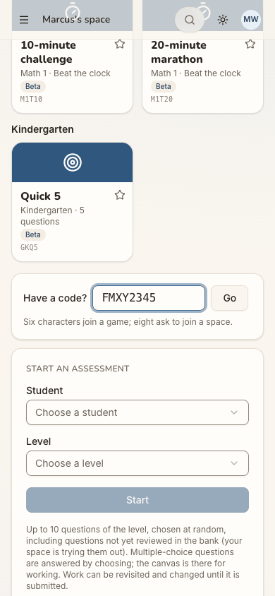

> Expected: the code accepted. Observed: match; it shows in caps and Go turns active.

**What Marcus notices:** finally a place for the code.

### Step 16 — Tap "Go" (landing: the request)

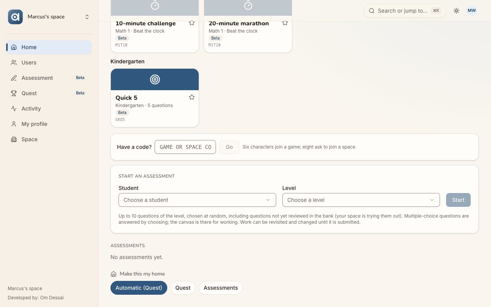
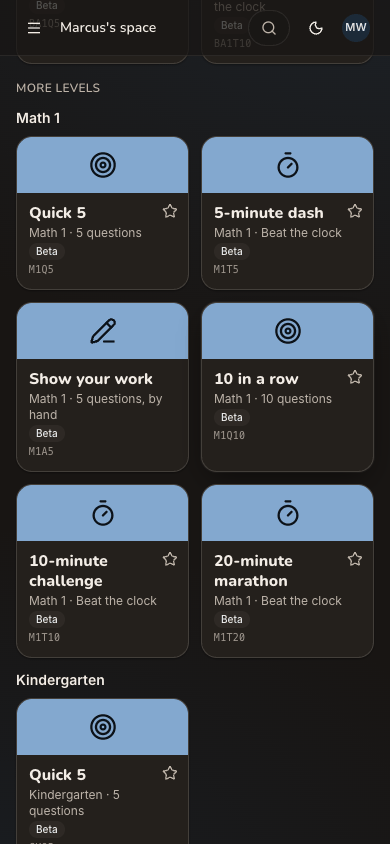

> Expected: a confirmation naming the space. Observed: the toast "Asked to join. Its admins will let you in." (read
> live; gone before the screenshot). The box empties and the page is otherwise unchanged. The screenshots show the
> page after the toast. The feature (the request) is reached here.

**What Marcus notices:** the toast does not say Ferreira Family Practice, and after it fades nothing shows he asked.
"Did that work?"

### Step 17 — Open the menu to look for Ferreira

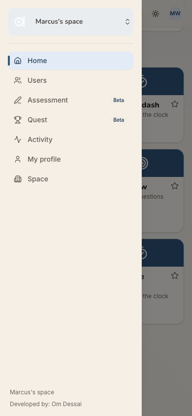

> Expected (Marcus): the request or the space somewhere. Observed: "Marcus's space" with chevrons, Home, Users,
> Assessment, Quest, Activity, My profile, Space. No Ferreira.

**What Marcus notices:** the space name with chevrons looks like a picker; he tries it.

### Step 18 — Tap the space name

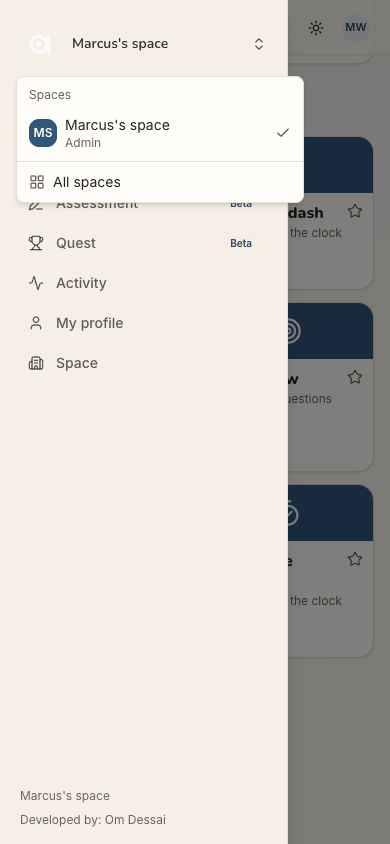

> Expected (Marcus): Ferreira listed, pending. Observed: "Spaces / Marcus's space · Admin ✓ / All spaces".

**What Marcus notices:** "Admin? Of what?" He tries All spaces.

### Step 19 — Tap "All spaces" (landing: the waiting screen)

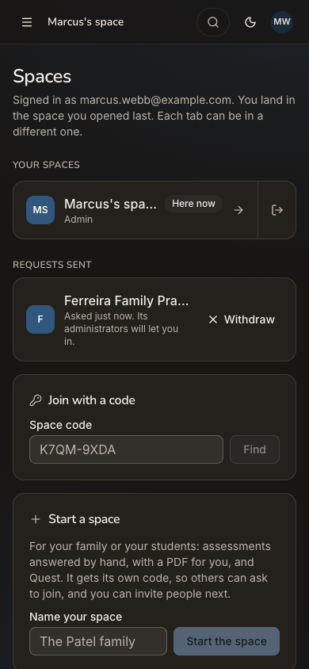

> Expected: the request. Observed: "Spaces", YOUR SPACES (Marcus's space · Here now · Admin), REQUESTS SENT "Ferreira
> Family Practice / Asked just now. Its administrators will let you in. / Withdraw", then Join with a code and Start a
> space. On a phone the names are cut off.

**What Marcus notices:** relief: the practice's name and "Asked just now". Still nothing on how long, or how he will
hear.

### Step 20 — Open / in a new tab after the decline (landing)

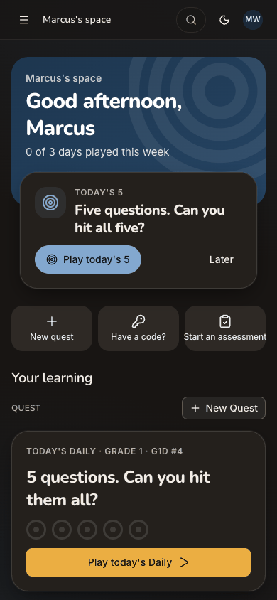

> Expected (Marcus): the practice's answer near the top, or a sign that something changed. Observed: still signed in,
> straight to Marcus's space home, the same as before: Next up "Today's 5", the quick actions, Your learning. The whole
> page's text was read: nothing about Ferreira, the request or a decision. No alert or toast. Desktop and dark mode
> are the same.

**What Marcus notices:** "Did they answer? Am I in?" Nothing on this page says.

### Step 21 — Open the menu

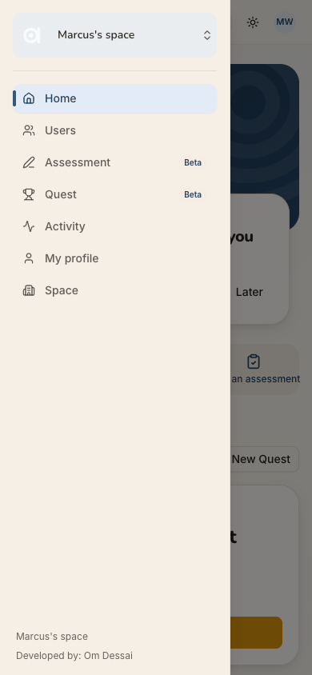

> Expected (Marcus): a badge or a new entry. Observed: the same menu as yesterday; no badge or count.

**What Marcus notices:** nothing new. "Activity" sounds like where news would be.

### Step 22 — Tap "Activity" (dead end)

> Expected (Marcus): his request and its answer. Observed: "Activity / Everything that has happened in the portal,
> newest first." Two lines, both from his own space: "Marcus Webb opened Marcus's space" and "Marcus Webb's own space
> was made at sign-up". On a phone the filter controls overlap.

**What Marcus notices:** "everything that has happened" leaves out the one thing that happened to him. He backs out.

### Step 23 — Menu again, tap the space name

> Expected (Marcus): Ferreira, if he was let in. Observed: "Spaces / Marcus's space · Admin ✓ / All spaces", no count.

**What Marcus notices:** not in the list, so not let in, or not yet. He goes to All spaces, where he saw the request
last time.

### Step 24 — Tap "All spaces" (landing: the decline)

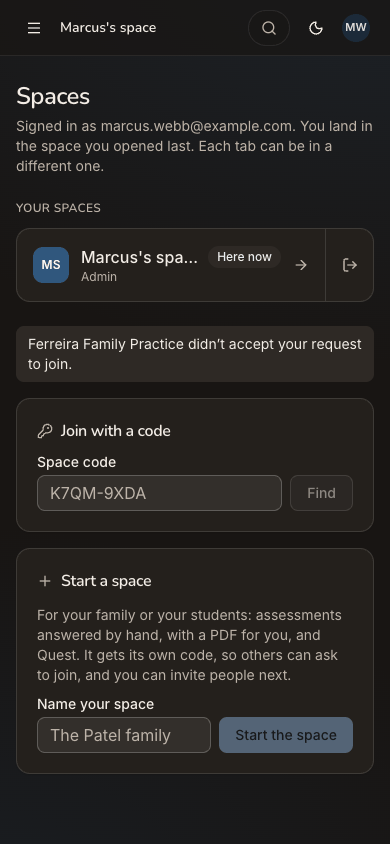

> Expected: the decision, and what to do now. Observed: REQUESTS SENT is gone. In its place is a beige box: "Ferreira
> Family Practice didn't accept your request to join." It has no date, reason, link or dismiss, and in the
> accessibility tree it is a plain paragraph. Below it are Join with a code and Start a space. The journey's end, the
> decline seen, is reached here.

**What Marcus notices:** so that's it. Was it him, or a glitch? Nothing tells him to check with his friend, whether
asking again is welcome, or what his own space is for.

### Step 25 — Type FMXY2345 in "Space code" and tap Find

> Expected: told that this space declined him, if he can ask again at all. Observed: a row "Ferreira Family ... / Ask
> to join", with no mention of the decline (the line above is unchanged).

**What Marcus notices:** "So I can just ask again?" Nothing says whether it would help.

### Step 26 — Tap "Ask to join"

> Expected: a caution or a note to the admins. Observed: sent at once, with the toast "Asked to join Ferreira Family
> Practice. Its administrators will let you in." (this one names the space). The decline line is gone, and REQUESTS
> SENT shows "Asked just now" with Withdraw.

**What Marcus notices:** a second request went straight to the people who just said no, with no chance to explain who
he is.

### Step 27 — Tap "Withdraw"

> Expected: a confirmation, and the earlier decline still on record. Observed: withdrawn at once with the toast
> "Request to Ferreira Family Practice withdrawn." (gone before the screenshot). The decline line does not come back;
> only his space, Join with a code and Start a space remain. This also left Ferreira's queue as Ines had left it.

**What Marcus notices:** he would rather ask his friend first, and now nothing on the page shows he ever dealt with
Ferreira Family Practice.

### Step 28 — Reload the Spaces page (end state)

> Expected: the end state holds. Observed: as step 27: Marcus's space only, no request, no decline. No console errors.

**What Marcus notices:** a clean page that has forgotten the decline. What is left to him: ask again with the code,
another code, or his own space.

## Appendix

- **Mode:** live. The web app at `http://localhost:8797` is a frozen copy of commit `2d6e7d3` with sign-in on. It was
  driven in headless Chrome at 390×844 (phone), plus 1280×800 and dark mode at the landing steps (1, 5, 10, 11, 13,
  16, 19, 20, 24).
- **Frameworks applied:**
  - cuj-contract: every step against its expected result.
  - task-completion: the journey ran to its defined end. The decline was seen at step 24, and what is left to do was
    recorded (steps 25-28).
  - success-criteria: the end state was checked again after a reload at step 28. Marcus was signed in, a member of his
    personal space only, with no pending request and no decline shown.
- **CUJ manifest:** J10, 28 steps over three stages. Stage 1 is steps 1-10 (to "Waiting for approval"), stage 2 is
  steps 11-19 (after the platform's approval, to the request on the Spaces page), and stage 3 is steps 20-28 (after the
  space's decline). All 28 were observed.
- **Coverage / not inspected:**
  - **"A day later" was simulated.** Each stage started in a new tab of the same browser profile minutes after the
    last one.
  - **The two decisions themselves.** The platform admin's approval (console) and Ines's decline (J11) happened between
    the stages in other journeys and were not seen here.
  - **Whether any email or notice reached Marcus** about either decision. None is promised on screen, and the audit
    has no mailbox to check. "Contact us" was not followed.
  - **The toast at step 16** is not in a screenshot; it faded before the shot, and its text is from the driver's live
    read. The toasts at steps 26 and 27 were read the same way (step 26's is also in its screenshot).
  - **The Privacy notice page**, the guest page's FAQ entries and "Create a free family space" were not opened.
  - **Step 8** was captured in a separate signed-out browser of this journey, as the Terms link opens a new tab.
  - **Whether a declined person can ask repeatedly**, or is limited, was not tested beyond one second request. How
    the second request (withdrawn within seconds) looked to Ines was not checked from her side.
  - **"Start a space", the Leave icon, the account menu (MW), the search palette, "Make this my home" and "Later"**
    were not tried. Marcus's personal space's Users and Space pages were not opened.
  - **Next up's "Play today's 5"** links to `/quest/daily/NC26.3` (from the accessibility tree) while the Daily card
    below says Grade 1. It was not opened, so whether two different grades are offered as "today's" was not verified
    on screen.
  - **Keyboard-only and screen-reader use.** The accessibility tree was read only to find controls and to check the
    decline line's role.
  - **The iOS app.** It is covered by separate journeys; J10 has no app counterpart.
  - **Other sign-in providers.** Only Google is offered on the web.
  - **The server's records.** By the audit's rules there were no API or database reads.
- **Access:** through the app's real sign-in and sign-up screens; the Google provider step is simulated (a stand-in for Google's button hands the app a local test token for the persona).
- **Preconditions made outside the UI:**
  - The run's platform settings, set through the console API before the journeys as `docs/userjourney/README.md` "The
    run" records: web sign-in Google only with sign-up open, sign-up access Post-approved, guest play on.
  - The seeded `assess` space, "Ferreira Family Practice", with joining by code on and the code FMXY2345, and its
    admin Ines.
  - The platform admin's approval of Marcus's account (between stages 1 and 2) and Ines's decline of his request
    (between stages 2 and 3), both made through the UI by the run's other agents.
  - This journey's own writes: one request to join `assess` at step 16 (declined by Ines), and a second at step 26,
    withdrawn at step 27, so the space's queue ends as Ines left it.
