# CUJ Audit — J11: space admin lets one newcomer in and declines another

## Executive summary

**Persona.** Ines Ferreira is the admin of "Ferreira Family Practice" (`assess`), a self-serve space she runs for her tutoring families. Assessment is on there and Quest is off; it has no Tutoring (its menu has no lessons, pairings or billing). She is cohort **C1** of `docs/member-home-plan.md`, the owner or admin of a space, whose question is "What needs me today?". Two newcomers asked to join with her space's code (FMXY2345), in journeys J07 and J10:
- Lena Fischer (lena.fischer@example.com), a parent Ines expects;
- Marcus Webb (marcus.webb@example.com), whom she does not.

Ines wants to let Lena in as a parent and decline Marcus.

**Outcome: 1/1 journeys passed, 0 skipped, 12 of 12 steps verified.** Ines reached the journey's end:
- Lena Fischer is a member of Ferreira Family Practice, a Parent with status Active.
- Marcus Webb's request is declined. He is not a member and appears nowhere on Users, even with "Show deactivated" ticked.
- Step 11 re-checked both after a full reload. Step 12 found both decisions on the Activity page.

The path is short and the waiting count is hard to miss. The trouble is in the decision itself:
- Ines decides on a name and an email alone (finding 1).
- Decline is one tap with no way back (finding 2).
- "Let in" is the generic Add user form, which asks her to choose a role she was never told (finding 3).
- After the decision, nothing links Lena to a child or suggests what comes next (finding 4).

**Conversion figures**, counted from the signed-out entry page to both requests decided (steps 1-9):

| Measure | Count |
| --- | --- |
| Screens | 5 distinct (9 screen views) |
| Taps | 8 (7 needed) |
| Typed fields | 0 |
| Waits | 0 |
| Dead ends | 1 |

- The 5 distinct screens were:
  - the guest page and the "Sign up free" sign-in sheet;
  - the space's home;
  - Users, with its "Requests to join" cards;
  - the "Let Lena Fischer in" dialog.
- The 8 taps were Sign in, Continue with Google, Open people, Lena's name (no effect), Let in, Parent, Add user and Decline.
- **How Ines learns someone is waiting:** at once, with 0 taps after signing in. The home says "2 asking to join" three times above the fold: in the band, in the Next up card ("Needs you") and in a "Needs you" section. Each opens Users.
- **Taps from landing to the requests:** 1 (Open people). On a desktop, the sidebar's Users item carries no count (step 3, desktop).
- **What Ines can tell before deciding:** each request's name, email and "asked 3 minutes ago". On a phone the email is cut off and the time is hidden. Nothing says what role the person wants, which child they belong to, or why they are asking.
- The dead end was tapping Lena's name to learn more about her. It is plain text, and nothing opens.

**The 3 screens Ines would notice most**

- **Step 3: "2 asking to join", three times, on the first screen.** Signing in drops her straight into her space. The answer to "What needs me today?" is the first thing she reads, with one obvious button, "Open people". For C1 this is the habit the home should build: open the app, see who needs her, act.
  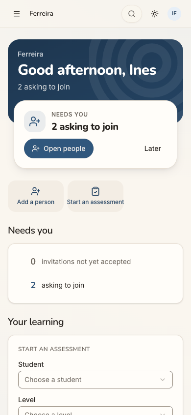
- **Step 4: two people, two names, two identical buttons.** Marcus and Lena look the same: a name, an email cut off at "example.co…", Let in and Decline. On a phone, the "asked 3 minutes ago" is off the edge. Ines runs a space for children's families, and the one decision the app asks of her here is who gets in. She has nothing but a name to go on.
  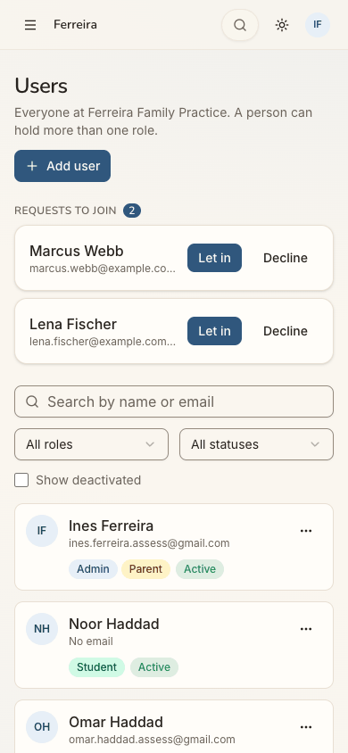
- **Step 6: "Let in" opens a form, not a yes.** The title says "Let Lena Fischer in", but it is the Add user form. No role is ticked, and the roles speak of tutoring and costs that her space does not have. The email reads "(optional)", with a hint about "this child". She has to guess that Lena wants to be a parent, and the save button says "Add user".
  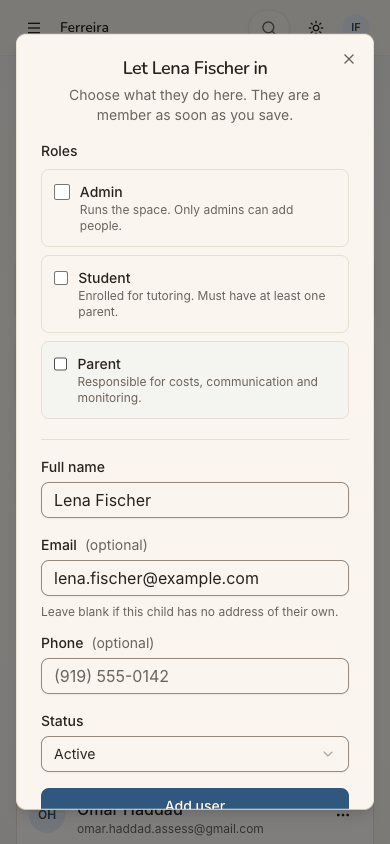

**Contact sheet** (all 12 phone steps):

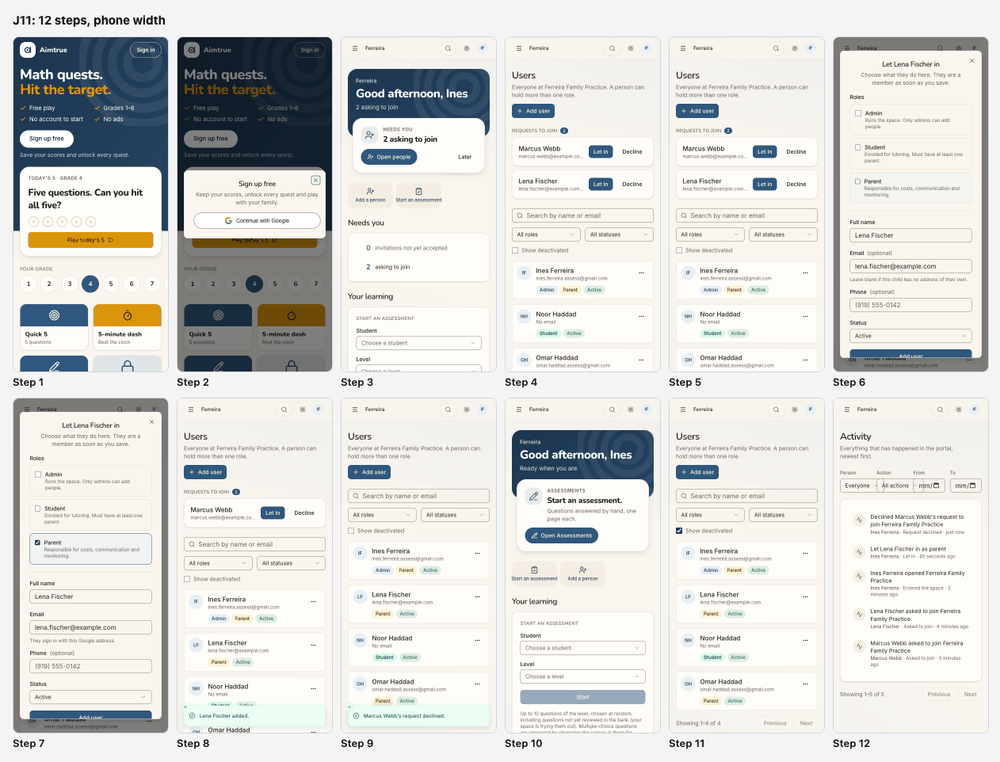

| Severity | Count |
| --- | --- |
| sev4 (blocked) | 0 |
| sev3 (major) | 0 |
| sev2 (minor) | 5 |
| sev1 (cosmetic) | 1 |
| **Total** | **6** |

## Prioritized fixes

1. [sev2] [A request shows only a name and an email, and on a phone not even when they asked](#sev2-a-request-shows-only-a-name-and-an-email-and-on-a-phone-not-even-when-they-asked): show the role asked for, a short note from the newcomer, and the full email and time on every width.
2. [sev2] [Decline takes one tap, with no confirmation and no undo](#sev2-decline-takes-one-tap-with-no-confirmation-and-no-undo): offer Undo in the toast, or a confirmation, and keep declined requests findable for a while.
3. [sev2] [Let in opens the generic Add user form, with no role chosen and tutoring wording](#sev2-let-in-opens-the-generic-add-user-form-with-no-role-chosen-and-tutoring-wording): preselect the role the newcomer asked for, word the roles for the space's sets, and name the button "Let in".
4. [sev2] [A parent let in is linked to no child, and nothing suggests what comes next](#sev2-a-parent-let-in-is-linked-to-no-child-and-nothing-suggests-what-comes-next): ask which child is theirs when Parent is chosen, and follow up with a Next up item.
5. [sev2] [Sign in opens a dialog titled Sign up free](#sev2-sign-in-opens-a-dialog-titled-sign-up-free): title the dialog by the button pressed ("Sign in").
6. [sev1] [The Activity filters overlap on a phone](#sev1-the-activity-filters-overlap-on-a-phone): stack the four filters in two rows below `sm`.

## Findings

### [sev2] A request shows only a name and an email, and on a phone not even when they asked
- **Issue Description:** Each card under "Requests to join" holds three facts: the name, the email and how long ago they asked.
  - On a phone the second line is cut off: "marcus.webb@example.co…". The "· asked 3 minutes ago" part is not shown at all, although it is in the page.
  - The name is plain text. Tapping it (step 5) opens nothing: there is no detail, no profile, no history.
  - The card does not say what the person wants to be here (parent, student, helper), which child they belong to, or why they are asking. The join flow asks the newcomer nothing that could tell her.
  - Marcus and Lena are therefore indistinguishable except by name. The only way Ines tells a family she knows from a stranger who found the code is by recognising a name or an address.
- **Framework Violation:** cuj-contract, steps 4-5. It also breaks:
  - Nielsen #1 Visibility of system status: the information the decision rests on is hidden;
  - Nielsen #6 Recognition rather than recall: Ines must remember who she gave the code to.
- **Severity:** 2. Ines could decide, so it is not a block, but she decides blind. For C1, a space of children's families, letting in the wrong adult is the costly mistake, and the card gives her nothing to prevent it. The friction also falls on the honest newcomer: an admin unsure of a name is more likely to decline, or to leave the request waiting.
- **Evidence:**   Repro:
  1. Have two people ask to join a space with its code;
  2. sign in as its admin and tap Open people;
  3. at 390 px wide, read the cards: the email is truncated and the time is hidden;
  4. tap a name: nothing happens.
- **Recommended Fix:**
  - Let the newcomer choose what they are joining as (parent, student, other) and add an optional short note ("Mother of Noor"), and show both on the card.
  - Wrap the second line instead of truncating it, so the full email and "asked … ago" show on a phone.
  - Make the name open a small sheet with what is known: the email, when they asked, the role and note, and whether the email already belongs to someone in the space.

### [sev2] Decline takes one tap, with no confirmation and no undo
- **Issue Description:** Tapping "Decline" on Marcus's card declined him at once.
  - There was no confirmation and no reason to give.
  - The toast, "Marcus Webb's request declined.", has no Undo.
  - The whole "Requests to join" section vanished with it (step 9).
  - After a reload Marcus appears nowhere on Users, even with "Show deactivated" ticked (step 11). The only trace is a line in Activity (step 12), which offers no way to reconsider.
  - "Decline" sits beside "Let in" on a small card. Let in needs a form and three more taps; Decline needs one. The irreversible action is the cheap one.
- **Framework Violation:** cuj-contract, steps 9 and 11-12. It also breaks:
  - Nielsen #3 User control and freedom: no undo;
  - Nielsen #5 Error prevention: no confirmation on a destructive action next to its opposite.
- **Severity:** 2. Ines meant to decline Marcus, so the journey's end state is right. A mis-tap on the wrong card, though, turns away a family she expected, with no way back short of asking them to request again. That depends on the newcomer understanding what happened, which was not checked (J10's view).
- **Evidence:** 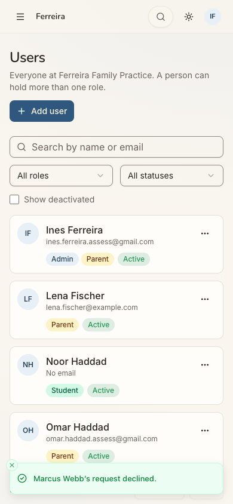 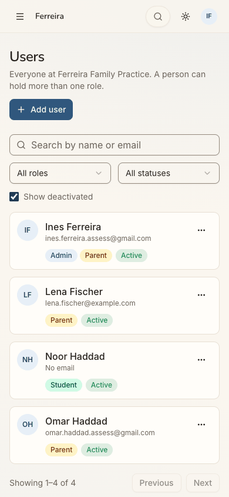 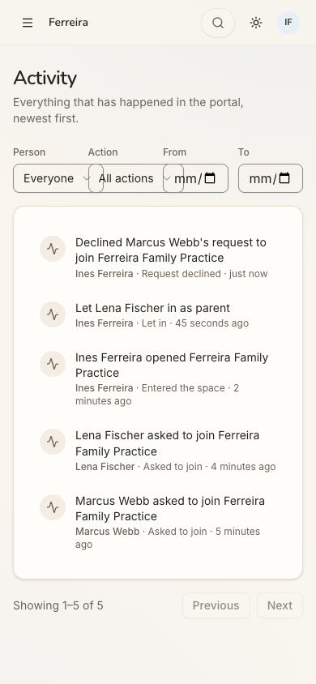 Repro:
  1. Users → Requests to join → Decline on any card;
  2. the request is gone, with no dialog and no Undo in the toast;
  3. reload with "Show deactivated" ticked: the person is not listed.
- **Recommended Fix:**
  - Put "Undo" in the toast for its lifetime, and delay the decline until it closes.
  - Or confirm with the person's name: "Decline Marcus Webb? They can ask again with the code."
  - Keep declined requests under a collapsed "Declined (1)" for a week, with "Let in" still offered.

### [sev2] Let in opens the generic Add user form, with no role chosen and tutoring wording
- **Issue Description:** "Let in" opens a dialog titled "Let Lena Fischer in — Choose what they do here. They are a member as soon as you save." It is the Add user form:
  - **No role is preselected.** Ines must pick between Admin, Student and Parent, with nothing telling her what Lena asked for.
  - **The roles are described for a tutoring space.** "Student — Enrolled for tutoring. Must have at least one parent." and "Parent — Responsible for costs, communication and monitoring." Ferreira Family Practice has no Tutoring and no costs.
  - **Before a role is ticked, the email is "Email (optional)"** with the hint "Leave blank if this child has no address of their own." That is said about an adult who signed in with that address to ask. Ticking Parent then makes it required ("They sign in with this Google address", step 7).
  - **Ticking Student by mistake grows the form.** It gains "Start with the family", a required parent, school, grade, goal, "Available for virtual tutoring" and a consent box. The driver's selector ticked it once, by accident, and it was unticked; this was not a persona action.
  - **The save button says "Add user", not "Let in",** and the toast says "Lena Fischer added." On a phone the button sits half below the dialog's edge (step 7).
- **Framework Violation:** cuj-contract, steps 6-8. It also breaks:
  - Nielsen #2 Match between system and the real world: tutoring and costs in a space without them, "this child" for an adult;
  - Nielsen #4 Consistency and standards: Let in → "Add user" → "added".
- **Severity:** 2. Ines finished with 3 taps (Let in, Parent, Add user), but she had to infer the role. She also read copy that describes a different kind of space. For C1 running a small family space, the form suggests she is doing something heavier than saying yes. A wrong guess (Student) leads into a long form that demands a parent and consent.
- **Evidence:**  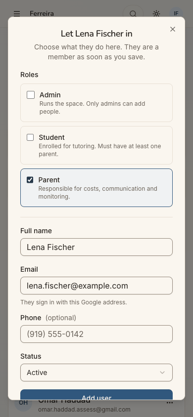 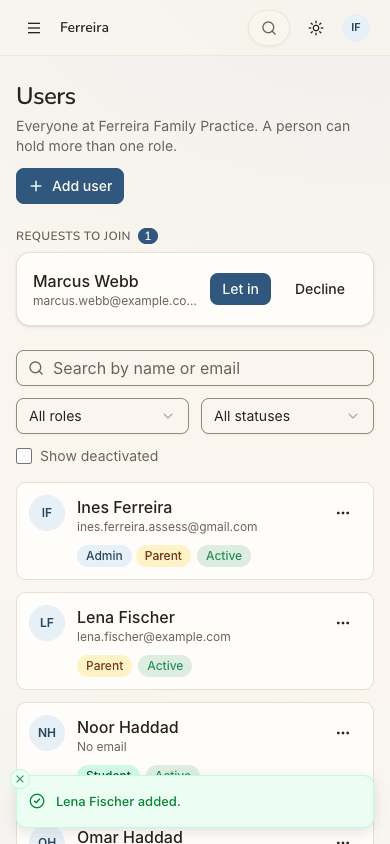 Repro:
  1. In an Assessment-only space, Users → Requests to join → Let in;
  2. read the role descriptions and the email hint with no role ticked;
  3. tick Parent and tap Add user.
- **Recommended Fix:**
  - Preselect the role the newcomer asked for (see finding 1), or default to Parent for an adult who signed up as an adult.
  - Describe the roles by the space's sets: where Tutoring is off, "Student — takes assessments here" and "Parent — follows their child's work".
  - Show the email as fixed for a request: it is the address that asked, and an editable field invites a change that no longer matches the request.
  - Name the button "Let in" and the toast "Lena Fischer is in."
  - Keep the save button above the fold on a phone (a sticky footer).

### [sev2] A parent let in is linked to no child, and nothing suggests what comes next
- **Issue Description:** Ines let Lena in as a Parent, and the form never asked which child is hers.
  - The space has one student, Noor Haddad. Lena is now a parent of nobody here.
  - After saving, the home (step 10) moved on to "Start an assessment."
  - Nothing suggests linking Lena to a child, adding her child, or telling Lena she is in. Nothing on screen says whether Lena is notified (by the project's rules a self-serve space sends no email; not checked).
  - The Users row says only "Parent · Active".
- **Framework Violation:** cuj-contract, steps 8 and 10; task-completion: the decision is complete, the newcomer's onboarding is not. Nielsen #1 Visibility of system status: Lena's state as a parent with no child is invisible.
- **Severity:** 2. Real friction for conversion. The point of letting a parent in is that they follow their child's work. For C1, a parent who arrives to an empty space is a parent who does not come back. The admin is not prompted to finish the job.
- **Evidence:**  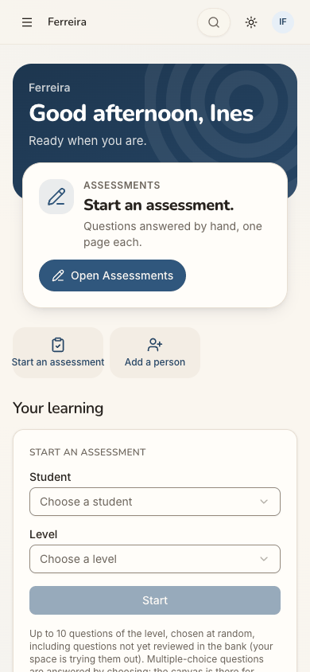 Repro:
  1. Let a requester in as Parent;
  2. the toast says "added" and the row shows Parent · Active;
  3. go Home: Next up offers "Start an assessment", and nothing mentions the new parent or a child.
- **Recommended Fix:**
  - When Parent is ticked in a Let in, show "Which child?": the space's students, or "Add their child".
  - Afterwards, put a Next up item on the admin's home: "Lena Fischer has no child here yet — link one".
  - Give the admin a "Copy a note for Lena" (as Invite people does), since self-serve spaces send no email.

### [sev2] Sign in opens a dialog titled Sign up free
- **Issue Description:** Ines has had a space here for a while. On the signed-out page she taps "Sign in" (top right).
  - The dialog that opens is titled "Sign up free", with "Keep your scores, unlock every quest and play with your family." and one button, Continue with Google.
  - Nothing on the guest page speaks to someone who runs a space: it is a children's maths game with grade tiles.
- **Framework Violation:** cuj-contract, steps 1-2. It also breaks:
  - Nielsen #4 Consistency and standards: the button and the dialog name different actions;
  - Nielsen #2 Match between system and the real world: a returning admin is told to sign up.
- **Severity:** 2. It is an observable mismatch on the way in, not a block: Continue with Google signed her straight into her space. For C1, the first screen of every visit tells her she is in the wrong place, until she learns to ignore it.
- **Evidence:**   Repro: open `/` signed out and tap Sign in.
- **Recommended Fix:**
  - Title the dialog by the button pressed: "Sign in" with "Welcome back", and keep "Sign up free" for the Sign up free button.
  - Add a quiet line for those who run a space ("Run a space? Sign in to see who is waiting").

### [sev1] The Activity filters overlap on a phone
- **Issue Description:** On Activity at 390 px the four filters (Person, Action, From, To) sit in one row.
  - Each select's chevron overlaps the next control.
  - The date inputs show only "mm/".
  - The list below is fine and clearly records "Let Lena Fischer in as parent" and "Declined Marcus Webb's request…".
- **Framework Violation:** cuj-contract, step 12. It also breaks Nielsen #8 Aesthetic and minimalist design, and the project's own rule that filter rows stack on phones rather than shrink.
- **Severity:** 1. Cosmetic. It is off the main path; Ines only went there to check her decisions.
- **Evidence:**  Repro: open the menu → Activity at 390×844.
- **Recommended Fix:** Below `sm`, put the filters in two rows (Person and Action, then From and To) with full-width controls.

## Walkthrough

### Step 1 — Open the app signed out

> Expected: a signed-out entry page with a way to sign in. Observed: the Aimtrue guest Play page ("Math quests. Hit the target."), with Sign up free, today's 5, a grade row and quest tiles. "Sign in" is the small outlined button at top right.

**What Ines notices:** a children's maths game. Nothing here is about her space or the families waiting on her, so she looks for Sign in.

### Step 2 — Tap Sign in

> Expected: a sign-in screen. Observed: a dialog titled "Sign up free", "Keep your scores, unlock every quest and play with your family.", with one button, Continue with Google.

**What Ines notices:** she asked to sign in and is offered sign-up, with talk of scores and quests. She hesitates, then trusts the Google button.

### Step 3 — Continue with Google

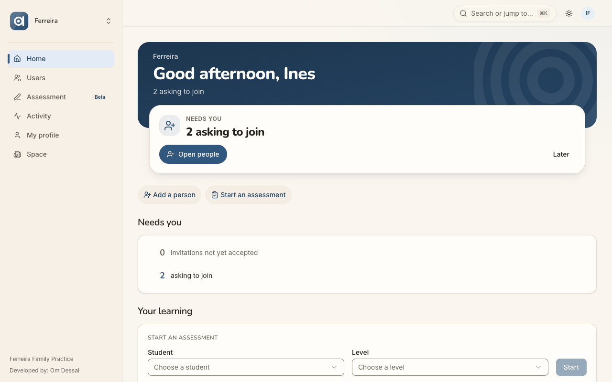
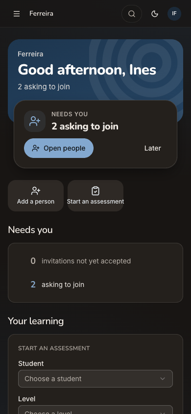
> Expected: she lands in her space and sees that someone is waiting. Observed: she lands straight in Ferreira Family Practice, with no space chooser. The home shows:
> - the band, "Good afternoon, Ines / 2 asking to join";
> - Next up, "NEEDS YOU — 2 asking to join", with Open people and Later;
> - quick actions, Add a person and Start an assessment;
> - a "Needs you" section, "0 invitations not yet accepted" and "2 asking to join".
>
> Below them are "Your learning" (the Start an assessment form), "Your children" (Noor) and "Make this my home". The desktop sidebar (Home, Users, Assessment Beta, Activity, My profile, Space) has no count on Users.

**What Ines notices:** the count, at once; it is the loudest thing on the page and the button is obvious. "Your learning" is an odd heading for her; it holds her students' assessments.

### Step 4 — Tap Open people

> Expected: the people waiting, with what she needs to decide. Observed: Users, with "REQUESTS TO JOIN 2" above the member list. Marcus Webb and Lena Fischer each have a name, an email cut off at "…example.co…" and Let in / Decline. The "asked 3 minutes ago" is in the page but cut off at this width.

**What Ines notices:** one tap got her here. The two cards look identical, and she wonders what more she can learn about them.

### Step 5 — Tap Lena's name to learn more

> Expected: a detail or profile. Observed: nothing happens; the name is plain text.

**What Ines notices:** there is no more to know. She will decide from the name she recognises. (Counted as the journey's dead end.)

### Step 6 — Tap Let in on Lena's card

> Expected: a quick confirmation, perhaps "let in as parent". Observed: the dialog "Let Lena Fischer in — Choose what they do here. They are a member as soon as you save.", with:
> - roles Admin, Student and Parent, none ticked;
> - Full name prefilled;
> - "Email (optional)", prefilled, with "Leave blank if this child has no address of their own.";
> - Phone (optional) and Status: Active;
> - Cancel and "Add user", half cut off at the bottom.

**What Ines notices:** a whole form. She was never told what Lena asked to be. "Enrolled for tutoring" and "Responsible for costs" do not describe her space.

### Step 7 — Tick Parent

> Expected: the form accepts Lena as a parent. Observed: the Parent card is highlighted. Email becomes required, "They sign in with this Google address." No field asks which child is Lena's.

**What Ines notices:** reassured that the email is now Lena's sign-in. She would expect to be asked about Lena's child, and is not.

### Step 8 — Tap Add user

> Expected: Lena becomes a member and her request leaves the list. Observed: the dialog closes with the toast "Lena Fischer added.". "REQUESTS TO JOIN 1" shows Marcus only, and Lena is listed as Parent · Active.

**What Ines notices:** done, and the count went down. "Added" rather than "let in" is fine to her. She does not know whether Lena has been told.

### Step 9 — Tap Decline on Marcus's card

> Expected: possibly a confirmation, a reason, or an undo. Observed: declined at once, with the toast "Marcus Webb's request declined." and no Undo. The Requests to join section disappears. Both requests are now decided: the journey's end.

**What Ines notices:** that was instant. Had she tapped the wrong card, there would be no way back on this screen.

### Step 10 — Go back to Home

> Expected: the waiting count gone; perhaps a nudge about the person just let in. Observed: the band says "Ready when you are." Next up is "ASSESSMENTS — Start an assessment." with Open Assessments, and the "Needs you" section is gone. Nothing mentions Lena or a child for her.

**What Ines notices:** a clean home, which is satisfying. Nothing reminds her that Lena has no child here yet.

### Step 11 — Users after a full reload, with Show deactivated ticked

> Expected: Lena a Parent, Active; no requests; Marcus not a member. Observed: as expected. Four people are listed: Ines, Lena Fischer (Parent · Active), Noor Haddad and Omar Haddad. There is no Requests to join section, and Marcus is not listed even with Show deactivated.

**What Ines notices:** the result held. Marcus has left no trace here.

### Step 12 — Menu → Activity

> Expected: a record of what she did. Observed: "Declined Marcus Webb's request to join Ferreira Family Practice", "Let Lena Fischer in as parent", and both "asked to join" lines, newest first. The filter row above is squeezed and its controls overlap.

**What Ines notices:** reassuring: both decisions are written down with her name. The filters look broken on her phone.

## Appendix

- **Mode:** live. A real headless Chrome drove the app at http://localhost:8797, a frozen copy of commit `2d6e7d3` with sign-in on and its own local database. Phone width is 390×844. Desktop (1280×800) and dark mode were captured at the landing screens: step 1 (the entry) and step 3 (the first screen inside the space).
- **Frameworks applied:**
  - cuj-contract: each step's expected against observed;
  - task-completion: Lena let in, Marcus declined;
  - success-criteria: the end state re-checked after a full reload (step 11) and in Activity (step 12).
- **Coverage / not inspected:**
  - Step 4, where the feature starts, was captured at phone width only. The two requests were decided before desktop and dark images of it were taken, and the state cannot be recreated without new requests. Whether the desktop card shows the full email and time was therefore not seen; the page's text holds both.
  - What Lena and Marcus see after the decisions, and whether either is told. Those are J07's and J10's own browsers, not touched. A self-serve space sends no email, and none was checked.
  - Whether a declined person can ask again with the same code.
  - The phone menu while the requests were pending: whether its Users item carries a count. The drawer was opened only at step 12, after both were decided.
  - The Next up card's "Later" button, the "Add a person" quick action, the "0 invitations not yet accepted" link and the Status choices in the Let in form (left on Active).
  - The Student path of the Let in form, seen only through the driver's mis-selection (ticked, then unticked); it was not a persona action and was not saved.
  - What a Parent with no child sees in this space.
  - Desktop and dark mode outside the landing screens.
  - The iOS app, which is covered by separate journeys.
- Access: through the app's real sign-in and sign-up screens; the Google provider step is simulated (a stand-in for Google's button hands the app a local test token for the persona).
- **Preconditions made outside the UI:** none specific to J11. The two requests were made through the UI by J07 (Lena Fischer) and J10 (Marcus Webb) with the space's code FMXY2345, after the platform admin approved their accounts in the console. Ines, Noor Haddad and Omar Haddad come from the local seed. The run's shared setup applies (README, "The run"): the platform settings, and `assess` keeps Quest off.
