# CUJ Audit — J12: under Pre-approved, a person on the list signs up and plays

## Executive summary

**Who:** Grace Liu, 33 (born April 1993), a teacher whose school is in the pilot. Her email, grace.liu@example.com, is
on the platform's sign-up list. Before she brings Aimtrue to her class, she wants to try the quests herself, so here
she plays: cohort **C6, the Quest player** ("Let me play.") in `docs/member-home-plan.md`. She arrives signed out on
the guest page, on a phone. Sign-up access is **Pre-approved**: only people on the list may sign up.

**Outcome: 1/1 journeys passed, 0 skipped, 11 of 11 steps verified.** The list did what it should, invisibly. Grace
tapped "Sign up free" and Continue with Google. She gave her birth month and year and ticked the terms. One more tap
put her straight into the home of "Grace's space" (step 6), with no waiting screen, in about a second. She picked
grade 5 (the grade she teaches, a persona detail for this run) and tapped Quick 5. After a short countdown, question 1
of 5 was on screen (step 10), and it was still there after a reload (step 11).

**Conversion figures** (counted from the entry point, the signed-out guest page):

| Stretch | Screens | Taps | Inputs | Waits | Dead ends |
| --- | --- | --- | --- | --- | --- |
| Entry to inside her space (steps 1-6) | 4 | 4 | 0 typed, 2 dropdowns, 1 checkbox (counted in taps) | 0 (each step under about a second) | 0 |
| Home to question 1 (steps 6-10) | 2 more | 2 (+1 scroll) | 0 | 1 (the countdown, under 4 s) | 0 |
| **Whole journey** | **6** | **6 (+1 scroll)** | **0 typed, 2 dropdowns** | **one countdown** | **0** |

This is the shortest sign-up of the audit's journeys: six taps and no typing from a stranger's first screen to a
question in her own space. Taking the home's "Play today's 5" would have saved the scroll and a tap, but that card does
not say which grade it plays. Grace wanted grade 5, and the board had opened on grade 1.

For conversion, Pre-approved works for the person on the list. Compare J01, where the same sign-up under Post-approved
ends on "Waiting for approval". For stickiness, the gap is what comes after. Nothing says she was recognised from the
list, and nothing speaks to a teacher. The home calls itself "Your learning", in a space of one. The first number she
reads is a zero, and the board opens on a grade with a single quest.

**The 3 screens Grace would notice most:**

- **Step 6, the first screen inside the space.** She is in at once, and the greeting is personal: the relief this
  cohort needs. But she is alone in "Grace's space", under "Your learning". The page has no word about the pilot, her
  school or her pupils, and "0 of 3 days played this week" is its first fact. "Today's 5" and "Today's Daily" look like
  two challenges.
  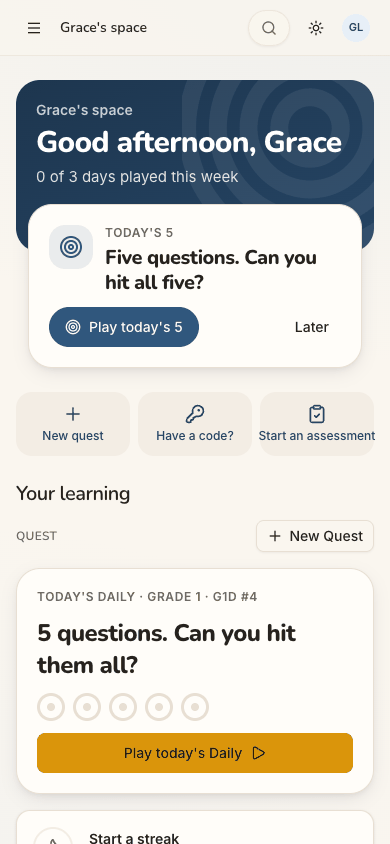
- **Step 7, the board.** The page chose grade 1 for her, while the guest page a minute earlier had shown grade 4. Grade 1
  has one quest on this data, where grade 5 has six. A teacher sizing the product up for her class could read it as
  thin.
  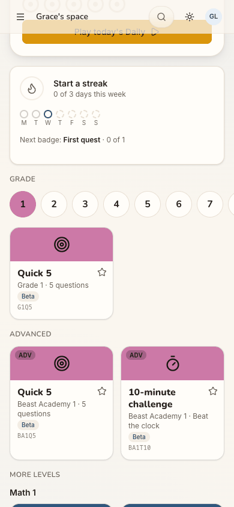
- **Step 10, question 1.** A proper grade-5 question (3,947 ÷ 6, with a remainder) with a sensible set of choices: the
  thing she came for. Still, the header says only "Game", never "Quick 5", and the question carries an unexplained
  "Beta".
  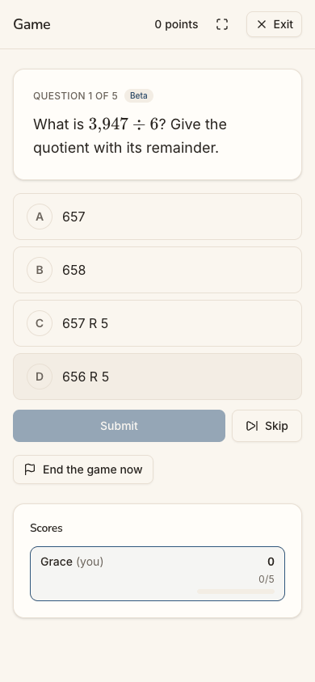

**Contact sheet** (all 11 phone steps):

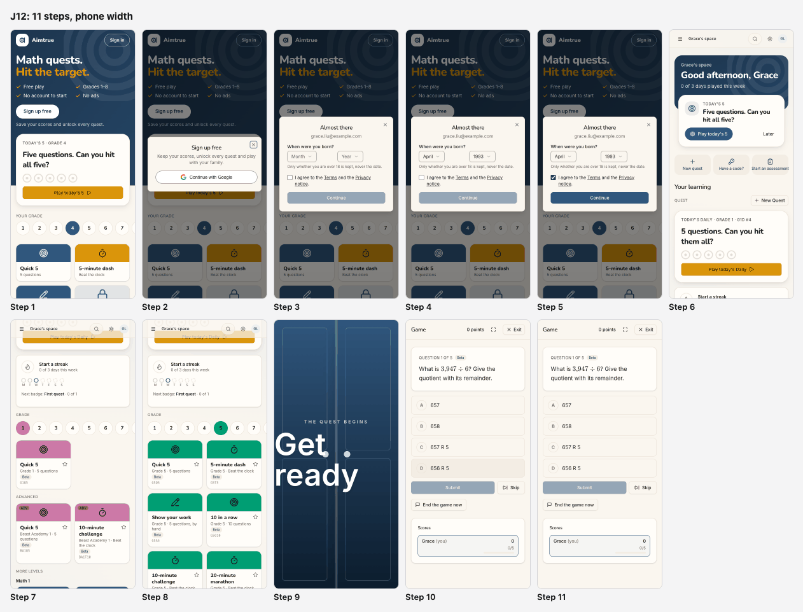

| Severity | Count |
| --- | --- |
| sev4 (catastrophe) | 0 |
| sev3 (major) | 0 |
| sev2 (minor) | 3 |
| sev1 (cosmetic) | 2 |
| **Total** | **5** |

## Prioritized fixes

1. [sev2] [In at once, but nothing says she is in, or what a pilot teacher does next](#sev2-in-at-once-but-nothing-says-she-is-in-or-what-a-pilot-teacher-does-next): greet a listed newcomer and give a teacher a next step towards her class (step 6).
2. [sev2] [The board opens on Grade 1, with one quest, after the guest page showed Grade 4](#sev2-the-board-opens-on-grade-1-with-one-quest-after-the-guest-page-showed-grade-4): ask or carry the grade, and name it on Next up (steps 1, 6, 7).
3. [sev2] [The first screen offers the same daily twice, under two names, and leads with a zero](#sev2-the-first-screen-offers-the-same-daily-twice-under-two-names-and-leads-with-a-zero): one name, one card, a first-day line (step 6).
4. [sev1] [Codes and Beta labels where a teacher looks for names](#sev1-codes-and-beta-labels-where-a-teacher-looks-for-names): name tiles and the game in words; explain "Beta" (steps 7, 8, 10).
5. [sev1] [On a phone the countdown heading runs to the left edge of the screen](#sev1-on-a-phone-the-countdown-heading-runs-to-the-left-edge-of-the-screen): keep the heading inside the page's gutter (step 9).

## Findings

### [sev2] In at once, but nothing says she is in, or what a pilot teacher does next

- **Issue Description:** Under Pre-approved, the list check is silent from start to finish. The "Sign up free" sheet
  (step 2) and the "Almost there" step (step 3) look the same as for anyone. After Continue (step 6), Grace lands
  straight on the home of a personal space, "Grace's space", with no "You're in", no welcome and no tour (the tour is
  Tutoring's by design). Nothing names the pilot or her school, or says why she was let straight in. The home frames her
  as a learner: "Your learning", "Start a streak", "Next badge: First quest". Its quick actions are New quest, Have a
  code? and Start an assessment. The code box's hint, "Six characters join a game; eight ask to join a space.", is the
  only mention of other spaces, and Grace has no code. The desktop menu lists Users and Space, but the home does not
  point a teacher there, and on the phone the menu sits behind ☰.
- **Framework Violation:** cuj-contract, step 6 (expected: straight in, and oriented; observed: straight in, with no
  sign that the list let her in and no next step for her role); Nielsen #1 Visibility of system status; Nielsen #2
  Match between system and the real world (a teacher shown a learner's page).
- **Severity:** 2. Classify: real friction, not a block. The journey's end was reached with no workaround. But a pilot
  teacher's reason to come back is her class. The first screen gives her nothing that leads towards her pupils or her
  school's space, so the pilot's sign-up converts into one person playing alone. That is weaker stickiness than the
  list's effort deserves.
- **Evidence:**  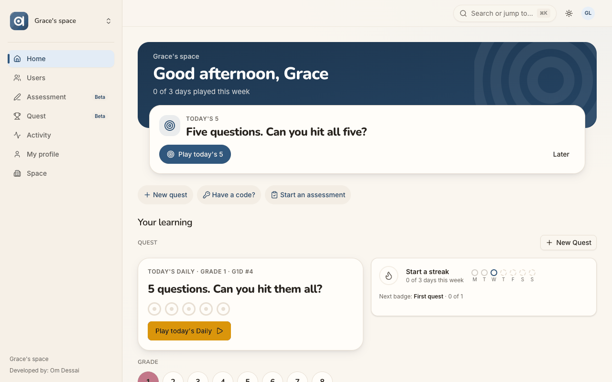
  Repro: set sign-up access to Pre-approved, with the persona's email on the list. Signed out at `/`, tap "Sign up
  free", then Continue with Google. Pick a birth month and year, tick the terms box, tap Continue: the home appears
  with no welcome.
- **Recommended Fix:** Show a one-time line on the first home after a pre-approved sign-up: "You're in. Your email
  was on the pilot list." Let the platform admin attach a short note, or a space to join, to a list entry, so a
  school's teachers land with "Join <school>'s space" or "Bring your class: Invite people" as their Next up.
  Whether a list entry may carry a space is the owner's decision. Until then, offer adults in a personal space a
  first-week checklist (the member-home plan's "What can I do here?" row): play a quest, invite someone, join with a
  code.

### [sev2] The board opens on Grade 1, with one quest, after the guest page showed Grade 4

- **Issue Description:** The guest page preselects grade 4 (step 1). Inside the space, a minute later, the board and
  the Daily default to grade 1: "TODAY'S DAILY · GRADE 1 · G1D #4" (step 6), and the Grade row has 1 selected (step 7).
  On this run's data grade 1 offers a single tile, Quick 5 (G1Q5); grade 5 offers six (step 8). The Next up card,
  "Today's 5", names no grade, so Grace cannot tell what its primary button would play. To reach her class's grade she
  scrolled past the Daily and the streak card and changed grade: one scroll and one tap.
- **Framework Violation:** cuj-contract, steps 6-7 (expected: quests for a grade she recognises; observed: grade 1,
  with one quest); Nielsen #4 Consistency and standards (grade 4 outside, grade 1 inside); Nielsen #1 Visibility of
  system status (Next up does not say its grade).
- **Severity:** 2. Classify: an observable mismatch and real friction on the first screen. A newcomer who did not play
  as a guest gets no grade carried over, so every Pre-approved arrival who signs up first sees this. For a teacher
  sizing the product up, a board with one quest reads as thin.
- **Evidence:**  
  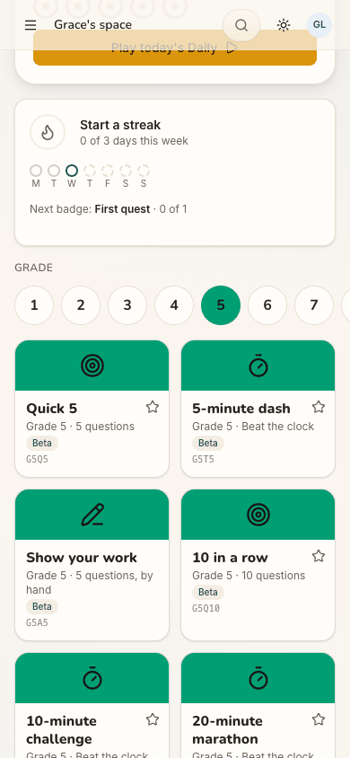
  Repro: sign up as a newcomer without playing a guest tile. On the home, scroll to "Grade": 1 is selected, with one
  tile. The number of tiles depends on the bank's playable counts per level (this run's local data).
- **Recommended Fix:** Default the member board to the same grade the guest page uses, or ask once ("Which grade are
  you playing, or teaching?") and remember it. Name the grade on Next up ("Today's 5 · Grade 4"), with the grade chips
  beside it. A sparse level should not be the default: pick the nearest grade with a full set of tiles.

### [sev2] The first screen offers the same daily twice, under two names, and leads with a zero

- **Issue Description:** As in J01, the home's Next up card reads "TODAY'S 5 / Five questions. Can you hit all
  five?" with "Play today's 5". The card below it reads "TODAY'S DAILY · GRADE 1 · G1D #4 / 5 questions. Can you hit
  them all?" with "Play today's Daily". "New quest" (quick action) and "+ New Quest" (beside QUEST) sit a few
  centimetres apart. The band's first fact is "0 of 3 days played this week", repeated by the streak card, seconds
  after Grace joined.
- **Framework Violation:** cuj-contract, step 6 (expected: one clear first move; observed: two names for one
  challenge, and a zero as the welcome); Nielsen #4 Consistency and standards; Nielsen #8 Aesthetic and minimalist
  design.
- **Severity:** 2. Classify: an observable mismatch on the screen that most decides whether a newcomer comes back.
  "Let me play" deserves one obvious button. A zero is the wrong first number for a person who has not had a day to
  play yet.
- **Evidence:**  Repro: as above, the home right after sign-up. The same
  finding is in J01 (step 13), so it does not depend on the approval mode.
- **Recommended Fix:** Use one name, "Today's 5" or "the Daily", everywhere. When Next up is the Daily, do not repeat
  its card under QUEST: show only the rings and the streak there. Keep one "New quest". On a member's first day,
  replace "0 of 3 days played this week" with "Play 3 days a week to start a streak".

### [sev1] Codes and Beta labels where a teacher looks for names

- **Issue Description:** Every tile shows its internal code (G1Q5, BA1T10, G5Q5, G5T5...) and a "Beta" pill (steps 7,
  8). The game Grace started from "Quick 5" is headed "Game" on the phone and "Quest game · G5" on desktop (step 10).
  The tile's name never appears. Question 1 carries "Beta" too, with nothing to say whether the question, the game or
  the site is in beta.
- **Framework Violation:** cuj-contract, steps 7, 8 and 10 (expected: things named as she chose them; observed:
  codes); Nielsen #2 Match between system and the real world; Nielsen #10 Help and documentation ("Beta" unexplained).
- **Severity:** 1. Classify: cosmetic; every label can be worked out. For a teacher deciding whether to put these
  questions in front of pupils, an unexplained "Beta" on every one raises a doubt about their quality.
- **Evidence:**  
  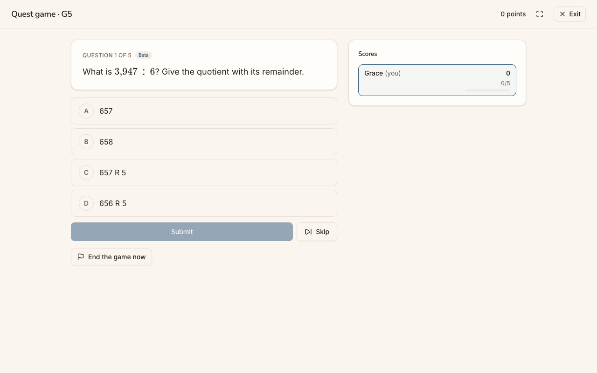
  Repro: on the home pick grade 5, read the tiles, tap Quick 5 and read the game header.
- **Recommended Fix:** Head the game with the tile's name and grade ("Quick 5 · Grade 5") at every width. Move tile
  codes to a tooltip or the share sheet. Make "Beta" tappable: "A new question, checked by our software; tell us if
  something looks wrong".

### [sev1] On a phone the countdown heading runs to the left edge of the screen

- **Issue Description:** In the full-screen countdown after tapping Quick 5 (step 9), the large "Get ready" starts at
  the screen's left edge, with no margin, and its last letter sits under the doors' handle dots. J19 noted the same
  at phone width.
- **Framework Violation:** cuj-contract, step 9 (expected: a countdown inside the page's layout; observed: text at the
  edge); Nielsen #8 Aesthetic and minimalist design.
- **Severity:** 1. Classify: cosmetic, a moment on screen. It is the first frame of the feature, the "this is a game"
  moment, so a ragged edge is noticed.
- **Evidence:** 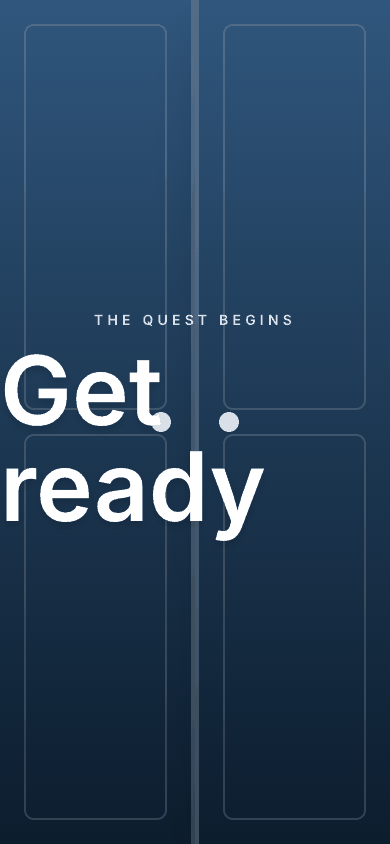 Repro: at 390×844, start any quest tile and capture the
  countdown.
- **Recommended Fix:** Give the countdown heading the page's 16 px gutter and scale its size with the viewport
  (`clamp()`), so "Get ready" fits between the margins on a 360-390 px phone. Keep the handle dots clear of the text.

## Walkthrough

### Step 1 — Open http://localhost:8797/ signed out (landing)

> Expected: the guest page, with a way to sign up. Observed: match. "Math quests. Hit the target." with ticks for Free
> play, Grades 1–8, No account to start and No ads; "Sign up free" above "Save your scores and unlock every quest.";
> "Today's 5 · Grade 4"; the grade row with 4 preselected (8 off the right edge on the phone); grade-4 tiles, three
> open and three marked "Free account". "Sign in" top right. Desktop puts Today's 5 beside the hero; dark mode is
> readable.

**What Grace notices:** a bright practice page for children, and play is one tap away. Nothing mentions schools or the
pilot, but she was told to sign up, and "Sign up free" is the obvious door.

### Step 2 — Tap "Sign up free"

> Expected: a way to sign up. Observed: match. A centred dialog: "Sign up free / Keep your scores, unlock every quest
> and play with your family." and one button, Continue with Google.

**What Grace notices:** family wording, no school wording. Nothing says that sign-up is by list just now, which does
not matter to her, since she is on it.

### Step 3 — Tap "Continue with Google" (landing)

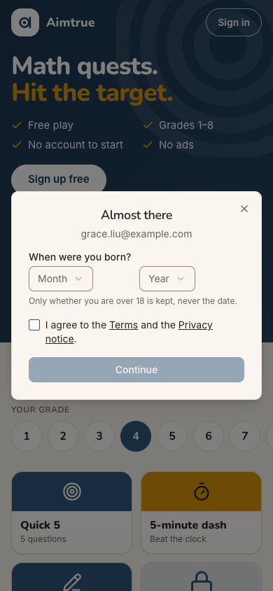
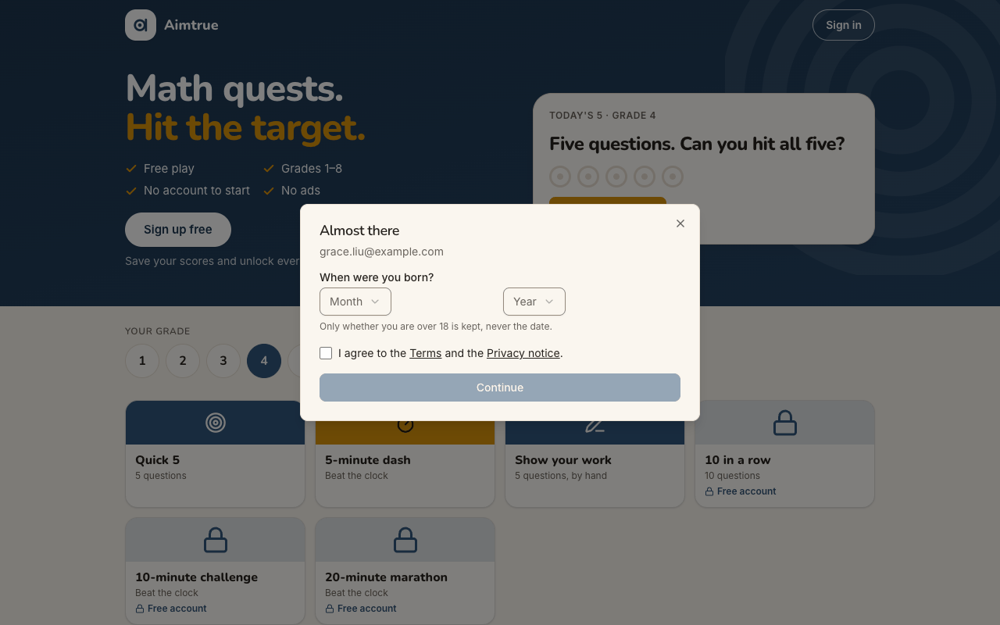
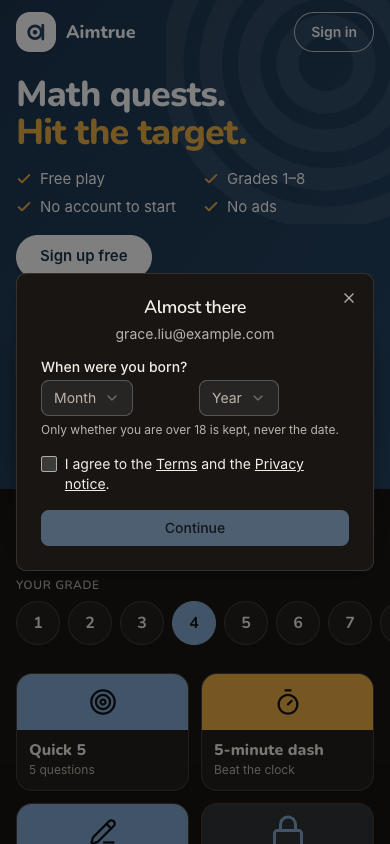

> Expected (on the list): past the list check to the "about you" step. Observed: match, at once. "Almost there" with
> grace.liu@example.com, "When were you born?" (Month, Year), "Only whether you are over 18 is kept, never the date.",
> the terms box and a disabled Continue.

**What Grace notices:** the right email, so the right account. A birth date is an odd ask of a teacher, but the line
about keeping only "over 18" reassures her.

### Step 4 — Choose April and 1993

> Expected: the date accepted. Observed: match. April / 1993 shown; Continue stays disabled until the box is ticked.

**What Grace notices:** two quick dropdowns. 1993 is a scroll down the year list on a phone.

### Step 5 — Tick "I agree to the Terms and the Privacy notice."

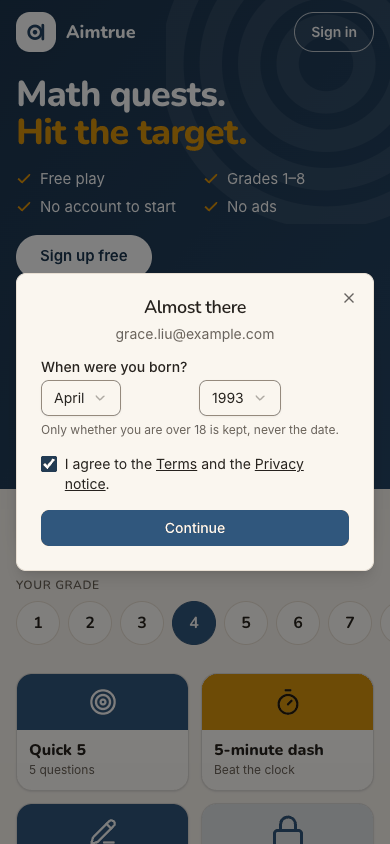

> Expected: Continue enabled. Observed: match. It turns dark blue.

**What Grace notices:** clear cause and effect.

### Step 6 — Tap Continue: straight into "Grace's space" (landing)

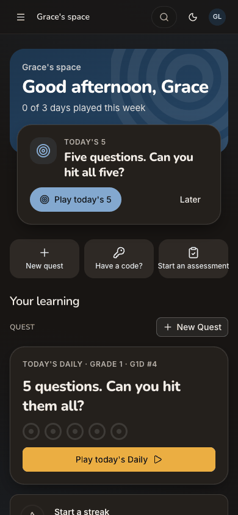

> Expected (Pre-approved, on the list): straight in, with no waiting. Observed: match, in about a second. The home of
> "Grace's space": "Good afternoon, Grace", "0 of 3 days played this week". Next up shows "TODAY'S 5" (Play today's 5,
> Later), then the quick actions New quest, Have a code? and Start an assessment (its label fills the card edge to
> edge). Below sit "Your learning", QUEST with "+ New Quest", and "TODAY'S DAILY · GRADE 1 · G1D #4" with "Play
> today's Daily". Further down (read from the page): the streak card, the Grade row, Advanced and More levels, a "Have
> a code?" box, Start an assessment, "No assessments yet." and "Make this my home". Desktop adds the menu (Home,
> Users, Assessment Beta, Quest Beta, Activity, My profile, Space). There is no welcome and no tour; the only console
> error is the signed-out 401 at the first page load.

**What Grace notices:** relief at no waiting. Then: "Your learning", in a space of one, with nothing about her school or
her pupils. The first fact is a zero, and Today's 5 and Today's Daily look like two things.

### Step 7 — Scroll down to the Grade row

> Expected: quests for a grade she recognises. Observed: the streak card ("Start a streak · 0 of 3 days this week",
> the day dots, "Next badge: First quest · 0 of 1"), then the Grade row with 1 selected in pink. Grade 1 has one tile,
> "Quick 5 · Grade 1 · 5 questions · Beta · G1Q5". Advanced has two Beast Academy 1 tiles; More levels begins with
> Math 1.

**What Grace notices:** the page chose grade 1 for her, while the guest page had shown grade 4. One quest at grade 1
makes the product look thin, until she tries her own grade.

### Step 8 — Tap grade 5

> Expected: grade-5 quests. Observed: match. 5 selected (green); six tiles: Quick 5 (G5Q5), 5-minute dash, Show your
> work, 10 in a row, 10-minute challenge and 20-minute marathon, each with a star and "Beta". The Daily card above
> followed the choice ("TODAY'S DAILY · GRADE 5 · G5D #4", read from the page text).

**What Grace notices:** now it looks like her class's menu, and the colour changes with the grade. The codes and "Beta"
on every tile are noise to her.

### Step 9 — Tap "Quick 5" (Grade 5)

> Expected: the quest starts. Observed: one tap made the game (`/quest/games/<id>`) and opened a full-screen
> countdown: two doors, "THE QUEST BEGINS / Get ready". On the phone "Get ready" starts at the screen's left edge,
> under the doors' handles.

**What Grace notices:** a bit of theatre her pupils would enjoy. The big heading looks cut off at the edge.

### Step 10 — The countdown ends: question 1 (landing)

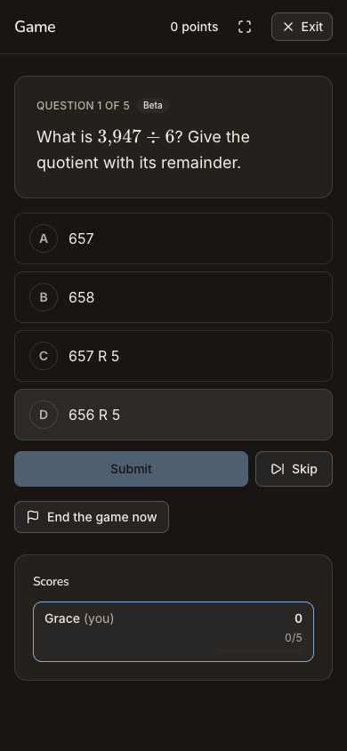

> Expected: the quest's first question. Observed: match, under 4 s after the tap. Header "Game" (phone) or "Quest
> game · G5" (desktop), "0 points", full screen and Exit. "QUESTION 1 OF 5 · Beta: What is 3,947 ÷ 6? Give the
> quotient with its remainder.", with the choices 657, 658, 657 R 5 and 656 R 5. Submit (disabled until a choice),
> Skip, End the game now, and Scores "Grace (you) 0, 0/5". The shading on choice D in the phone capture is the
> pointer resting where the tile was tapped, not a selection; it is gone after the reload (step 11).

**What Grace notices:** a real grade-5 division question with believable wrong answers: the thing she came to judge.
"Game" does not say which quest this is, and "Beta" again.

### Step 11 — Reload the game (end-state check)

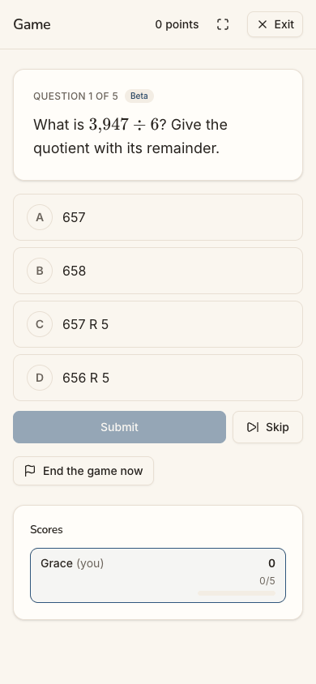

> Expected: the started quest survives a refresh. Observed: match. The same game URL, "QUESTION 1 OF 5", the same
> question and choices, 0/5, and no console errors.

**What Grace notices:** nothing lost; a phone that reloads mid-quest puts her back on the same question.

## Appendix

- **Mode:** live. The web app at `http://localhost:8797` is a frozen copy of commit `2d6e7d3` with sign-in on, driven
  in headless Chrome at 390×844 (phone), plus 1280×800 and dark mode at the landing steps (1, 3, 6, 10). One stage, one
  browser profile.
- **Frameworks applied:** cuj-contract (every step against its expected result); task-completion (the journey ran to
  its defined end, a quest's first question in Grace's own space); success-criteria (the end state checked again after
  a reload at step 11).
- **CUJ manifest:** J12, 11 steps, all verified. Two driver misses (a scroll by text that did not move the page, and
  a grade tapped as a button where it is a radio) were retried at once and are not counted as the persona's.
- **Coverage / not inspected:**
  - The list entry itself, and the console where it was made: the admin agent added Grace's email (outside this
    journey). Whether it was an exact email or a pattern was not seen.
  - The Terms and Privacy pages' content (not opened).
  - Answering question 1 and the rest of the quest; "Play today's 5" on Next up (which grade it plays was not
    checked); the Daily; favorites' stars; "Make this my home".
  - "Start an assessment" on the home (its Student list was not opened), the "Have a code?" box, the desktop menu's
    pages (Users, Space, Activity, My profile), the phone's ☰ menu and the account menu: whether a teacher can invite
    pupils from her personal space was not tried.
  - Any email to Grace (none is expected under Pre-approved; no mailbox was available).
  - Keyboard-only and screen-reader use; the accessibility tree was read only to find controls.
  - The iOS app; it is covered by separate journeys.
  - Other sign-in providers (the production web offers Google only), and a person not on the list (J13).
- **Access:** through the app's real sign-in and sign-up screens; the Google provider step is simulated (a stand-in for
  Google's button hands the app a local test token for the persona).
- **Preconditions made outside the UI:** none by this journey. Just before it, the platform admin agent switched
  sign-up access to Pre-approved and put grace.liu@example.com on the list, through the console (status log,
  18:11 UTC). The run's other settings (web sign-in Google only with sign-up open, guest play and the Daily on) are as
  `docs/userjourney/README.md` "The run" records.
