# CUJ Audit — J13: under Pre-approved, a person not on the list is refused

## Executive summary

**Who:** Ben Carter, 39 (born September 1987), a parent who heard about Aimtrue by word of mouth. He arrives
signed out on the guest page as cohort **C6, the Quest player** ("Let me play.") in `docs/member-home-plan.md`. Once
inside, as a parent he would be C4, the practice parent. He wants what the page promises: a free account so his
family's scores are kept and they can play together. The platform is in **Pre-approved** mode, and
`ben.carter@example.com` is not on the list. He does not know there is a list.

**Outcome: 1/1 journeys passed, 0 skipped, 20 of 20 steps verified.** The refusal works as this journey expects,
and it comes early. Right after Continue with Google (step 3), before any birth-date form ("Almost there" never
appears), Ben reads "Sign-up is by invitation … Ask us to add you." The server refused four times, each a 403 from
`POST /api/auth/google` (steps 3, 6, 15 and 19). The page showed the same refusal four more times from memory,
without asking the server (steps 9, 10, 17 and 20). Two things are left to him:
- **Contact us:** a bare `mailto:` to a personal Gmail mailbox, with no subject and no body. In this browser it did
  nothing visible (step 4).
- **Guest play:** it works. Quick 5 opens (step 12), and it resumes at question 2 after he goes home and back
  (step 19).

The end state was checked again after a reload (step 17): signed out (401), no cookie, and only the guest keys in
the tab's storage.

**Conversion figures** (counted from the entry point):

| Stretch | Screens | Taps | Typed fields | Waits | Dead ends |
| --- | --- | --- | --- | --- | --- |
| Entry to the refusal (steps 1-3) | 3 | 2 | 0 | 0 | 0 |
| Refusal to Contact us (step 4) | 0 new (same dialog) | 1 | 0 | 0 | 0 (but nothing visible happened) |
| Refusal to guest play, shortest path (X, Quick 5) | 1 | 2 | 0 | 0 | 0 |
| Whole run, 20 steps | 5 distinct | 24 | 1 (one answer) | 0 | 4 (steps 6, 9, 10, 15), plus 2 unasked reopenings (17, 20) |

**Conversion:** none, and the product leaves Ben no real way to convert by himself. Under Pre-approved, his one way
to an account is to write an email from scratch to an address the page never shows.

**Stickiness:** Today's 5 and the free tiles give him a reason to come back as a guest. Nothing tells him whether or
when he will be let in. He has no account and gave no address, so the product cannot tell him either. He would have
to remember to try again.

**The 3 screens Ben would notice most:**

- **Step 3, the refusal.** It comes fast and costs him nothing: no birthday asked, nothing typed. But it repeats its
  title, does not say which Google account it checked, does not say he can keep playing, and "Ask us to add you"
  leaves "us" and "add" unexplained. A parent who was just told "Sign up free" reads it as a closed door with no sign.
  
- **Step 4, Contact us.** This is the only way forward, and clicking it here changed nothing on screen. With no mail
  app set up, as on many computers used with webmail, no draft opens and the address is never shown. On a phone it
  would open an empty draft to a personal Gmail address. That looks unofficial to a parent judging whether to trust
  a children's product.
  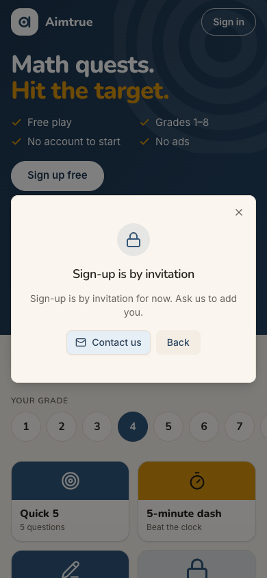
- **Step 9, "Create a free family space".** This is the button written for him, a parent, under "Play together". It
  answers at once with the same "Sign-up is by invitation". The FAQ just above (step 8) had told him "A free account
  unlocks every quest, family games and progress." The page's promise and its answer disagree twice in a row.
  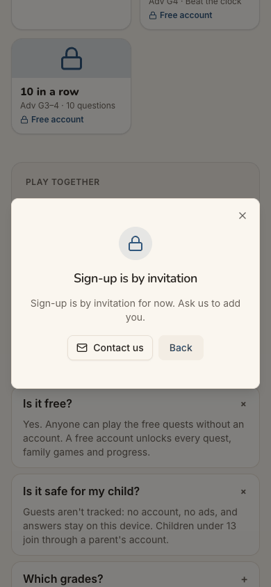

**Contact sheet** (all 20 phone steps):

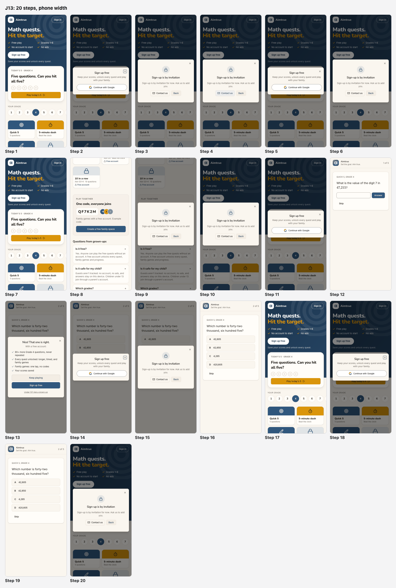

| Severity | Count |
| --- | --- |
| sev4 (catastrophe) | 0 |
| sev3 (major) | 1 |
| sev2 (minor) | 3 |
| sev1 (cosmetic) | 0 |
| **Total** | **4** |

## Prioritized fixes

1. [sev3] [Contact us is the only way forward, and it is a blank email to a personal Gmail address](#sev3-contact-us-is-the-only-way-forward-and-it-is-a-blank-email-to-a-personal-gmail-address): replace it with an "Ask for an invitation" action that carries his email, with the address shown and copyable as a fallback (step 4).
2. [sev2] [Every door still says free and leads back to the same refusal: four dead ends](#sev2-every-door-still-says-free-and-leads-back-to-the-same-refusal-four-dead-ends): under Pre-approved, say "invitation only" before Google, and stop pitching sign-up in a tab that was refused (steps 1, 2, 8, 9, 13).
3. [sev2] [The refusal does not say which account was checked or what is still open to him](#sev2-the-refusal-does-not-say-which-account-was-checked-or-what-is-still-open-to-him): name the account and offer Keep playing and Use another Google account (steps 3, 5).
4. [sev2] [The refusal sticks to the page: it reopens unasked and answers Sign in from memory](#sev2-the-refusal-sticks-to-the-page-it-reopens-unasked-and-answers-sign-in-from-memory): clear it on close and on navigation, as for J05's reopening form (steps 10, 17, 20).

## Findings

### [sev3] Contact us is the only way forward, and it is a blank email to a personal Gmail address

- **Issue Description:** The refusal has one forward action, "Contact us". It is a `mailto:` link to a personal
  `@gmail.com` mailbox, the same one as the footer's Contact us. It has no subject and no body. Nothing in it says
  who Ben is, which address should be added, or what he is asking for. In this run's browser, which has no mail app,
  clicking it changed nothing: no window, no message, no address shown, and the dialog stayed as it was (step 4). The
  same happens on any computer without a mail app set up, which is common for people who use webmail. On a phone
  with a mail app it would open an empty draft. The address itself appears nowhere on the page as text. Whatever
  Ben writes arrives as an email that someone has to turn into a list entry by hand. As far as the screen shows,
  nothing reaches the console's list.
- **Framework Violation:** cuj-contract, step 4 (expected: a way to ask to be added; observed: a bare `mailto:` that
  gave no visible result); Nielsen #1 Visibility of system status (no feedback after the click); Nielsen #9 Help users
  recognize, diagnose, and recover from errors (the way out is left for Ben to work out).
- **Severity:** 3. Classify: a workaround is needed. Ben must find the address (by hovering or long-pressing), open
  his own mail and decide what to write. For this cohort it is the only route to an account under Pre-approved, so
  this is where the conversion is lost. A personal Gmail address as the platform's contact also weakens trust for a
  parent about to hand over a child's practice data. It is not a 4: the journey expects a refusal, and guest play
  still works.
- **Evidence:**  
  Repro: on a Pre-approved platform, signed out at `/`, tap Sign up free, then Continue with Google as an account
  that is not on the list. The dialog's accessibility tree shows `link "Contact us": /url: mailto:<personal gmail>`,
  with no `subject=` and no `body=`. Clicking it in headless Chrome changes nothing on screen.
- **Recommended Fix:** Give the refusal an **Ask for an invitation** button that sends a request into the console's
  Sign-up access page, beside `access_list`, with the verified email it already holds and an optional one-line note.
  It should confirm on screen: "Asked. We'll email ben.carter@example.com when you're added." That stores an email
  for someone who was refused, so it is the owner's call against the privacy notice. Until then, the minimum fix:
  - a role address on the platform's own domain instead of a personal mailbox;
  - `subject=Aimtrue: please add me` and a body with the refused email;
  - the address shown as text with a Copy button;
  - after the click, the line "Your mail app should open. If it doesn't, write to <address>."

### [sev2] Every door still says free and leads back to the same refusal: four dead ends

- **Issue Description:** Under Pre-approved, nothing before Google says sign-up is by invitation:
  - the hero: "Sign up free / Save your scores and unlock every quest" (step 1);
  - the sheet: "Sign up free" (step 2);
  - the grown-ups' FAQ: "A free account unlocks every quest, family games and progress" (step 8);
  - "Create a free family space" and "Family games with a free account" (step 9);
  - every padlocked tile: "Free account".

  Ben gives the page his Google identity before he learns he cannot sign up. After the refusal, none of these
  changes. He met the same refusal from four doors (steps 6, 9, 10 and 15), and each time it led nowhere new. Inside
  the guest quest, the offer after question 1 still makes **Sign up free** the main button, with "Keep playing"
  second (step 13). That button took him straight to a fourth refusal (steps 14-15).
- **Framework Violation:** cuj-contract, steps 1, 2, 8, 9 and 13 (expected under Pre-approved: the offer says
  "invitation only", or stops once this tab was refused; observed: "free" everywhere); Nielsen #5 Error prevention (the
  refusal could be foreseen before Google); Nielsen #4 Consistency and standards (the page's promise and the server's
  answer disagree).
- **Severity:** 2. Classify: an observable mismatch and real friction. That is four dead ends and about ten wasted
  taps, and the "free" promise breaks three seconds after Google. For a parent deciding whether to trust the product,
  that costs credibility. It is not a 3: closing the dialog and playing as a guest works.
- **Evidence:** 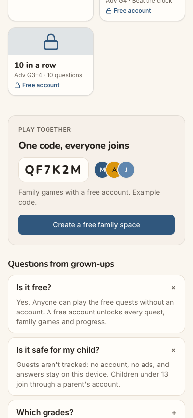 
  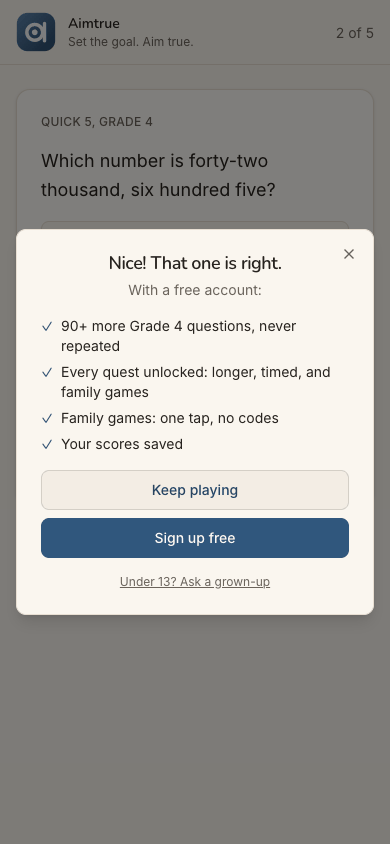 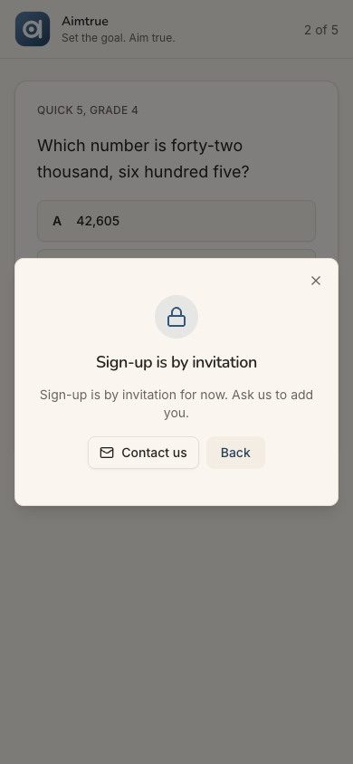
  Repro: as above, up to the first refusal. Close it, then tap "Create a free family space", the header's Sign in,
  or a quest's after-question-1 offer, then Sign up free and Continue with Google. Each one ends at "Sign-up is by
  invitation".
- **Recommended Fix:** Tell the signed-out page that sign-up is Pre-approved. `/api/auth/config` already tells it
  whether sign-up is open, so this can be one more field. Then, under Pre-approved:
  - the hero's button reads "Sign up (by invitation)" or "Have an invitation? Sign in";
  - the sheet's subtitle says "Sign-up is by invitation for now. If your email is on the list, you'll go straight
    in.";
  - the FAQ gets "How do I get an account?";
  - padlocks say "With an account" instead of "Free account".

  After a refusal in this tab, keep a tab flag. The after-question-1 offer then leads with Keep playing only, and the
  "Sign up free" buttons open the refusal's explanation, with Ask for an invitation, instead of Google.

### [sev2] The refusal does not say which account was checked or what is still open to him

- **Issue Description:** The dialog reads "Sign-up is by invitation" and then "Sign-up is by invitation for now. Ask
  us to add you." The body repeats the title and adds four words. Several things are missing:
  - **Which account it checked.** It does not name `ben.carter@example.com`, so a parent with both a work and a
    personal Google account cannot tell whether the other might be on the list. There is no "Use another Google
    account".
  - **That he can keep playing.** Guest play is the one thing open to him, and it works (steps 12 and 19).
  - **What "add you" means:** to what, who decides, and how long it takes.

  Its **Back** button does not go back to the page. It reopens the "Sign up free" sheet (steps 5 and 11), the door
  that was just refused. The dialog also has no accessible name: the accessibility tree shows an unnamed `dialog`
  wrapping an `alert`.
- **Framework Violation:** cuj-contract, steps 3 and 5 (expected: a refusal that says what happened and what he can
  do now; observed: a repeated title, and Back to the refused door); Nielsen #9 Help users recognize, diagnose, and
  recover from errors; Nielsen #3 User control and freedom (Back does not mean back).
- **Severity:** 2. Classify: real friction. He has to work out alone that he can still play, and he cannot tell
  whether another account would get in. It is not a 3: the X closes the dialog and the page still works.
- **Evidence:**  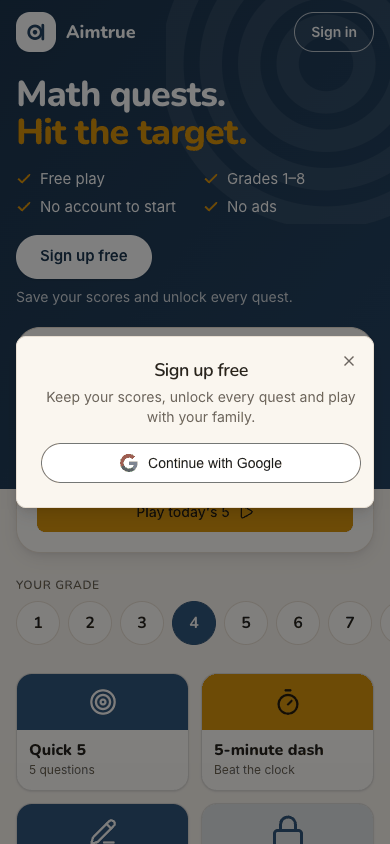
  Repro: as above, up to the refusal, then tap Back. The "Sign up free" sheet with Continue with Google comes back.
- **Recommended Fix:**
  - **Title:** "Aimtrue is invite-only for now".
  - **Body:** "ben.carter@example.com isn't on the invitation list yet. You can keep playing as a guest. Nothing is
    saved until you have an account."
  - **Buttons:** a primary **Keep playing** (it closes the dialog and scrolls to the tiles), **Ask for an
    invitation** (see the sev3 finding), and a small link **Use another Google account**, which starts Google's
    account chooser.
  - **Back:** drop it or make it close the dialog.
  - **Accessibility:** point the dialog's `aria-labelledby` at its heading.

### [sev2] The refusal sticks to the page: it reopens unasked and answers Sign in from memory

- **Issue Description:** After the first refusal, the page holds it until a reload. "Create a free family space"
  (step 9) and the header's **Sign in** (step 10) showed the refusal at once, without contacting Google (no new
  request). So Sign in cannot be used to try a different Google account; only Back, then Continue with Google, can.
  Worse, going home from a guest quest with the Aimtrue logo opened the refusal by itself, on the guest page,
  without any tap on a sign-up control. This was seen at step 17. It was reproduced at step 20 after a fresh refusal,
  again with no new request. Each time it went away only when he closed it or the page was reloaded. After the
  reload the page was clean: signed out, with only the guest keys kept (step 17). This is the same class of problem
  as J05's "sign-up form reopens by itself".
- **Framework Violation:** cuj-contract, steps 10, 17 and 20 (expected: the sign-in sheet, and the plain guest page;
  observed: the refusal); Nielsen #3 User control and freedom (a dialog he closed comes back); Nielsen #1 Visibility
  of system status (it looks like a new refusal for something he did not do).
- **Severity:** 2. Classify: friction. He must close it each time. To a parent it reads as being refused again for
  nothing, and the stale answer blocks trying another account through Sign in. It is not a 3: after a reload the end
  state is right, and nothing about him is shown.
- **Evidence:**  
  Repro: refuse a Pre-approved sign-up and close the dialog. Tap the Quick 5 tile, then the Aimtrue logo in the
  quest's header. `/` opens with "Sign-up is by invitation" already showing. The network log shows no new
  `POST /api/auth/google`.
- **Recommended Fix:**
  - Clear the held sign-in result when the refusal is closed (X or Back) and on every route change.
  - Have Sign in always start the provider's flow.
  - Add a web e2e check: refuse a Pre-approved sign-up, close the dialog, open a tile, tap the logo, and assert that
    no dialog is open.
  - Fix it together with J05's reopening sign-up form, which likely shares the same pending state.

## Walkthrough

### Step 1 — Open http://localhost:8797/ signed out (landing)

> Expected: the guest page, with a way to sign up. Observed: match. The page reads "Math quests. Hit the target.",
> with ticks for Free play, Grades 1–8, No account to start and No ads. A white **Sign up free** sits over "Save your
> scores and unlock every quest." Below are Today's 5 (Grade 4), the grade row and tiles, three of them locked with
> "Free account". It is the same page as under Post-approved: nothing hints that sign-up is by invitation. Desktop
> and dark render cleanly.

**What Ben notices:** a bright page aimed at children, which says "free" twice above the fold. He has come for an
account, so he goes for the big white button.

### Step 2 — Tap "Sign up free"

> Expected: the sign-up sheet. Observed: match. "Sign up free / Keep your scores, unlock every quest and play with
> your family.", one **Continue with Google** button and an X. Nothing mentions an invitation or a list.

**What Ben notices:** "play with your family" is exactly why he came. One button, no form.

### Step 3 — Tap "Continue with Google": the refusal (landing)

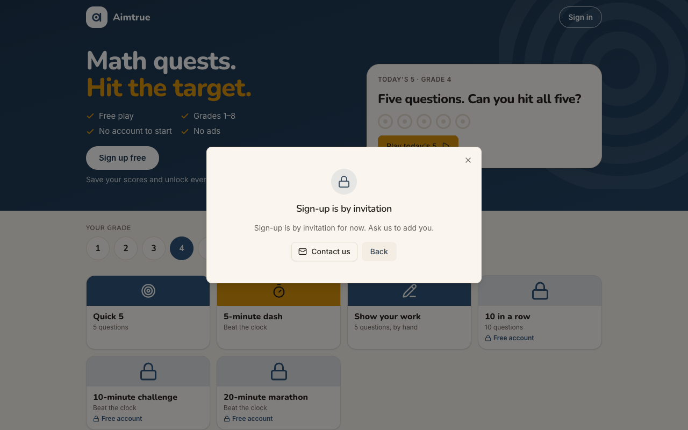
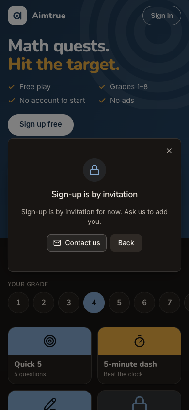

> Expected: "Sign-up is by invitation". Observed: match, and early. He is refused straight after Google, **before**
> the birth-date form: "Almost there" never appears, and the network log shows `403 POST /api/auth/google`. A padlock
> sits over "Sign-up is by invitation", then "Sign-up is by invitation for now. Ask us to add you." The buttons are
> **Contact us** (outlined, with a mail icon), **Back** and an X. His email is not shown, and nothing mentions guest
> play. The page behind still says "Sign up free".

**What Ben notices:** a polite no, and quickly, before he typed anything, which he appreciates. But "us" is no one
in particular, and he wonders whether his other Google account would have worked.

### Step 4 — Tap "Contact us"

> Expected: a way to ask to be added. Observed: the link is `mailto:` a personal `@gmail.com` address, with no
> subject and no body (read from the page; nothing was sent). In this headless browser there is no mail app, so the
> click changed nothing: the dialog stays, with Contact us highlighted. The mail app's draft could not be observed.

**What Ben notices:** nothing happens. On his phone it would open a blank email to a personal Gmail address, and he
would have to guess what to write.

### Step 5 — Tap "Back"

> Expected: back to the guest page. Observed: the "Sign up free" sheet comes back, with Continue with Google: the door
> that just refused him.

**What Ben notices:** it looks like the app wants him to try again, so perhaps the first try was a glitch.

### Step 6 — Tap "Continue with Google" again

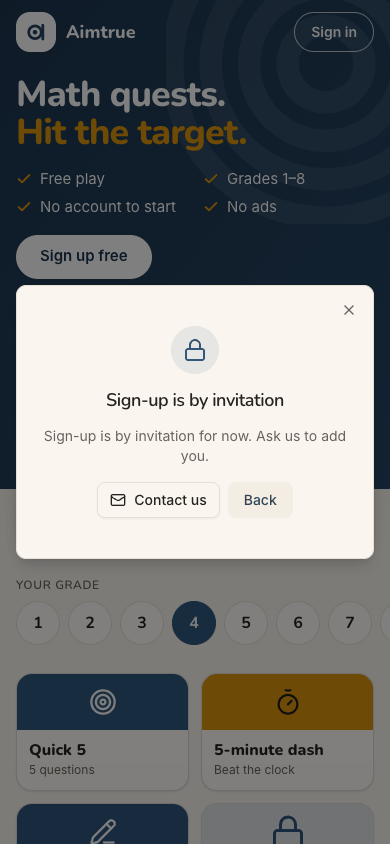

> Expected: the same refusal, since nothing has changed. Observed: match. The same dialog, word for word, and a
> second `403`. Dead end 1.

**What Ben notices:** the same answer. Back was not a way out, only a way round.

### Step 7 — Close the refusal with the X

> Expected: the guest page, ideally saying that sign-up is by invitation. Observed: the guest page, unchanged:
> **Sign up free** is still the main button, and nothing remembers the refusal.

**What Ben notices:** the page goes on offering what he was just refused.

### Step 8 — Scroll to "Questions from grown-ups", open "Is it free?" and "Is it safe for my child?"

> Expected: something on how to get an account. Observed: "Yes. Anyone can play the free quests without an account.
> A free account unlocks every quest, family games and progress." and "Guests aren't tracked: … Children under 13
> join through a parent's account." There is no word of invitation. Above them, under "Play together / One code,
> everyone joins", is "Family games with a free account. Example code." and a dark **Create a free family space**.
> The footer has Privacy, Terms and Contact us (the same `mailto:`).

**What Ben notices:** "Children under 13 join through a parent's account", and he is the parent. The family-space
button looks like his door.

### Step 9 — Tap "Create a free family space"

> Expected: the parent's way in (the sheet, or wording for families). Observed: the same "Sign-up is by invitation"
> at once, with no sheet and no new request. The page reused the refusal it holds. Dead end 2.

**What Ben notices:** the button made for parents says no without even asking who he is. It is the third refusal in
under two minutes.

### Step 10 — Close it, scroll up, tap the header's "Sign in"

> Expected: a sign-in sheet, where he could try his other Google account. Observed: the refusal again, at once, with
> no request. After one refusal, every door opens the same dialog from memory. Dead end 3.

**What Ben notices:** even "Sign in" says sign-up is by invitation. He cannot tell how to try another account.

### Step 11 — Tap "Back" (from the Sign-in refusal)

> Expected: the guest page, or a sign-in sheet. Observed: a sheet titled **Sign up free**, though he came from Sign
> in (J05 found the same title on Sign in). This is the only path left to try a different Google account.

**What Ben notices:** "Sign up free" again. He gives up on an account.

### Step 12 — Close the sheet and tap the "Quick 5" tile, Grade 4 (landing: what is left)

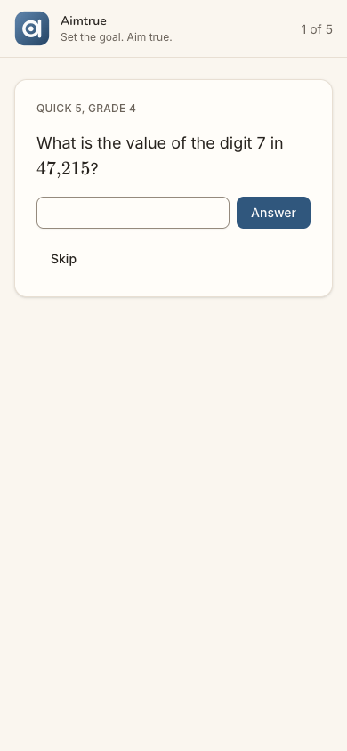
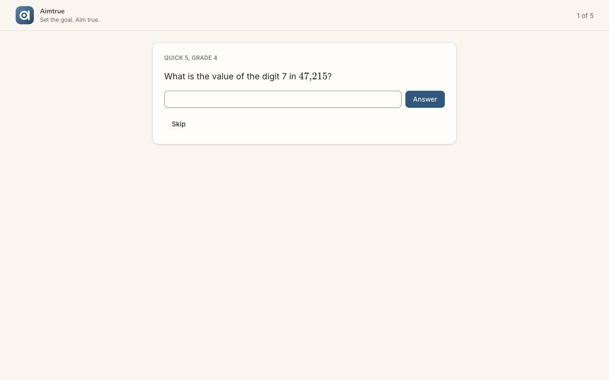
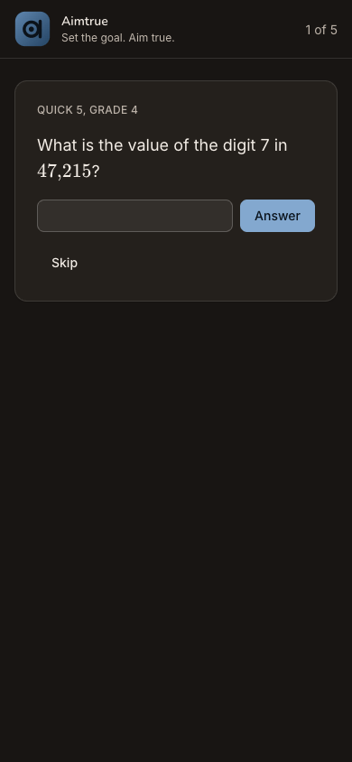

> Expected: a guest quest. Observed: match. `/play/G4Q5`, "QUICK 5, GRADE 4", "What is the value of the digit 7 in
> 47,215?", an answer box, Answer, Skip, "1 of 5". Clean on desktop and in dark mode.

**What Ben notices:** this part just works. It is something he can show his child tonight.

### Step 13 — Type 7000 and tap "Answer"

> Expected: the next question (the run's settings show a sign-up offer after question 1). Observed: "Nice! That one
> is right. With a free account:", with four ticks (90+ more Grade 4 questions, every quest unlocked, family games,
> scores saved). Below are **Keep playing** (secondary), **Sign up free** (primary) and "Under 13? Ask a grown-up".
> Question 2 of 5 waits behind it.

**What Ben notices:** the quest still sells him the account three refusals later, and the blue button is the one he
cannot have.

### Step 14 — Tap "Sign up free" on the offer

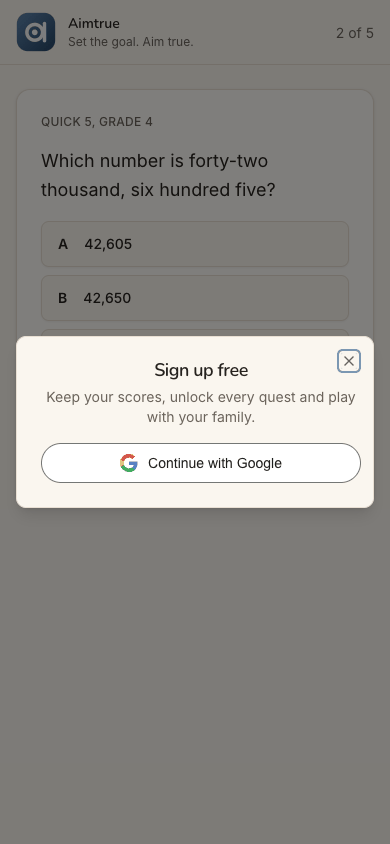

> Expected: after earlier refusals, something saying sign-up is by invitation. Observed: the full "Sign up free" sheet
> with Continue with Google, over question 2 (now multiple choice).

**What Ben notices:** maybe from inside a quest it is different.

### Step 15 — Tap "Continue with Google"

> Expected: the same refusal. Observed: match. "Sign-up is by invitation" over the quest, from a real request (the
> third `403`). Dead end 4.

**What Ben notices:** it is not different.

### Step 16 — Close the refusal

> Expected: back in the quest where he was. Observed: match. "2 of 5", "Which number is forty-two thousand, six
> hundred five?", choices A-D and Skip. Nothing was lost.

**What Ben notices:** at least the game kept his place.

### Step 17 — Tap the Aimtrue logo to go home, then reload

> Expected: the guest page. Observed: the logo tap opened `/` with "Sign-up is by invitation" **already showing**,
> although he had tapped nothing sign-up related (this moment was not screenshotted; it was reproduced at step 20).
> The screenshot is after a reload, the end-state check: a clean guest page, signed out (`401` on
> `/api/auth/session`), no cookies, and only `aimtrue.guest` (localStorage) and `aimtrue.guest-quest`
> (sessionStorage) kept. The page shows no Continue for his unfinished guest quest.

**What Ben notices:** being refused again just for going home. After the reload, the page looks as if he had never
been there.

### Step 18 — Tap the header's "Sign in" (after the reload)

> Expected: a sign-in sheet. Observed: the sheet titled **Sign up free** with Continue with Google. The reload cleared
> the held refusal, so the normal sheet is back (and with it the chance to choose another account).

**What Ben notices:** so Sign in and Sign up are the same thing here.

### Step 19 — Continue with Google (refused again), close, tap "Quick 5"

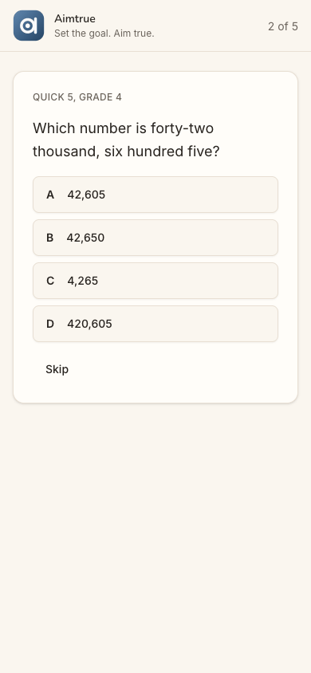

> Expected: a refusal, then the guest quest. Observed: match. The fourth `403` and the same dialog. Closed, the tile
> opens `/play/G4Q5` cleanly and **resumes at 2 of 5**: the guest quest was kept for the tab.

**What Ben notices:** the quest remembers him even though the account cannot. That is the one thread pulling him
back.

### Step 20 — Tap the Aimtrue logo (from the quest to home)

> Expected: the guest page. Observed: the guest page with "Sign-up is by invitation" **open by itself**, with no new
> request. This reproduces step 17's observation. The journey ends here: the refusal, Contact us and guest play are
> recorded.

**What Ben notices:** the same no, the eighth time he has seen it, and this time unasked. He closes the tab.

## Appendix

- **Mode:** live. The web app at `http://localhost:8797` is a frozen copy of commit `2d6e7d3` with sign-in on,
  driven in headless Chrome at 390×844 (phone), plus 1280×800 and dark mode at the landing steps (1, 3 and 12).
- **Frameworks applied:**
  - cuj-contract: every step against its expected result.
  - task-completion: the journey ran to its defined end, the refusal and what is left to Ben.
  - success-criteria: the end state was checked again after a reload at step 17: signed out (401), no cookie, only
    the guest keys kept, and no refusal remembered (step 18 shows the normal sheet).
- **CUJ manifest:** J13, 20 steps, all verified. Step 4's destination was read from the link, and its click observed.
  The mail app it would open cannot exist in headless Chrome. Steps 5, 9, 10, 13, 17 and 20 were observed and
  did not match the expectations above (findings).
- **Coverage / not inspected:**
  - **The mail app's draft behind Contact us** (headless Chrome has none). Whether a phone or desktop mail app
    would fill anything in was not seen; the link carries no subject or body.
  - **The server's side.** By the audit's rules there were no database or API reads. Whether the refused email is
    logged or stored anywhere, and whether the console shows anything for Ben, was not checked. The run's admin agent
    is not part of this journey.
  - **The Terms and Privacy pages**, and the FAQ's "Which grades?" (not opened).
  - **Back on the family-space refusal (step 9).** Back was tried only from the first refusal (step 5) and from the
    Sign-in refusal (step 11).
  - **Guest play beyond question 1** (out of scope), Show your work, the Daily and family game codes.
  - **Keyboard-only and screen-reader use.** The accessibility tree was read only to find controls; it showed the
    refusal dialog without an accessible name.
  - **Other sign-in providers** (not offered on the production web).
  - **The iOS app.** It is covered by separate journeys; J13 has no app replay.
- **Access:** through the app's real sign-in and sign-up screens; the Google provider step is simulated (a stand-in for Google's button hands the app a local test token for the persona).
- **Preconditions made outside the UI:** none by J13 itself. The run's platform-admin agent switched sign-up access to
  **Pre-approved** and put J12's email on the list before this journey (status log, 18:11 UTC). Ben's email was not
  added. The other platform settings are as `docs/userjourney/README.md` "The run" records: web sign-in Google only
  with sign-up open, and guest play, the guest assessment's offer after question 1, and the Daily on.
