# CUJ Audit — J14: tutoring office admin adds a new family

## Executive summary

**Persona.** Priya Raghavan is the office admin at Chapel Hill Math Institute (`chmi`), a tutoring space. She also tutors there and at Riverside Tutoring. She is cohort **C1** of `docs/member-home-plan.md`, the owner or admin of a tutoring space, whose question is "What needs me today?". A new family has phoned: Nadia Hassan (nadia.hassan@example.com, 919-555-0142) and her son Yusuf (grade 4, no email). Priya wants to:
- add both of them, with Nadia able to sign in;
- pair Yusuf with the tutor Alex Chen;
- set up a weekly lesson.

**Outcome: 1/1 journeys passed, 0 skipped, 32 of 32 steps verified.** Priya reached the journey's end:
- Nadia is a Parent with status Active.
- Yusuf is a Student, linked to Nadia as his mother and primary contact.
- Yusuf is paired with Alex Chen.
- Yusuf has a standing lesson, Thursdays 4:00–5:00 PM at "Institute, room 2", starting 2026-11-04. The first lesson is tomorrow, Thursday 2026-11-05.

The end state is not clean. Yusuf was saved **with no price**: the field showed a grey "95.00" that was never a value (finding 1). Steps 28-30 re-checked the end state after a reload. Steps 31-32 looked at the wizard that would have guided her.

**Conversion figures**, counted from the signed-out entry page to the saved weekly lesson (steps 1-27):

| Measure | Count |
| --- | --- |
| Screens | 12 distinct (18 screen views) |
| Taps | 39 |
| Typed fields | 6 |
| Waits | 0 |
| Dead ends | 1 |

- The 12 distinct screens were:
  - guest page, sign-in dialog and Choose a space;
  - home;
  - Users, the Add user dialog and User details;
  - the menu drawer;
  - Pairings and the pairing dialog;
  - Schedule and the schedule dialog.
- The 6 typed fields were:
  - Nadia's name, email and phone;
  - Yusuf's name and grade;
  - one search.
- The dead end was Yusuf's "View details", which has no tutor or lesson section and no way to add either.
- There was also one avoidable round trip. The form that adds a student can create the parent in the same request ("New parent…"), but Priya added Nadia on her own first because nothing pointed her there.
- **Ways to add a family on offer: five.** In the order Priya met them:
  1. the home's **Add a person** quick action, which she found first and used; it opens the Users list;
  2. **Getting started**, the welcome wizard, whose "Add a student" is the guided family path;
  3. **Users** in the menu;
  4. the **"New parent…"** button inside the Student form;
  5. ⌘K search, which finds people but cannot add them.

**The 3 screens Priya would notice most**

- **Step 30: the price that is not there.** Yusuf's Edit form shows "95.00" under "In-person price / hr", but the field is empty. The grey placeholder looks exactly like a saved rate, here and when she added him (step 13). The app's own hint says "A session cannot be recorded without it." For an office that bills families, this is a billing problem waiting for the first lesson, and no screen flags it.
  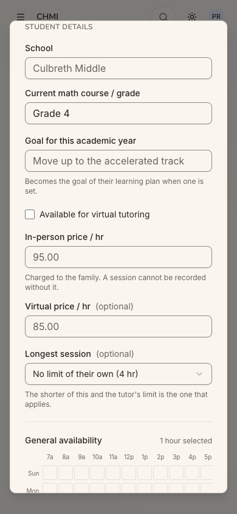
- **Step 5: "Add a person" opens a list called Users.** The quick action goes to an 88-person list with a second button, "Add user". That form adds one person at a time. The guided "family first, then student, then tutor" setup is a different door (step 31). C1 adds families every week, so the first door they meet sets the habit.
  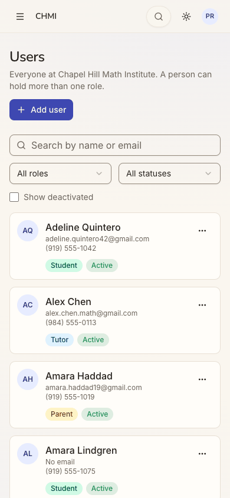
- **Step 17: "Everything on file for this person", but not his tutor or his lesson.** Priya opened Yusuf's details looking for a way to pair him. The panel has no tutor, no lessons, no price and no action. She backed out and found Pairings and Schedule in the menu. The office's main object, a student with a tutor and a slot, is spread over three pages.
  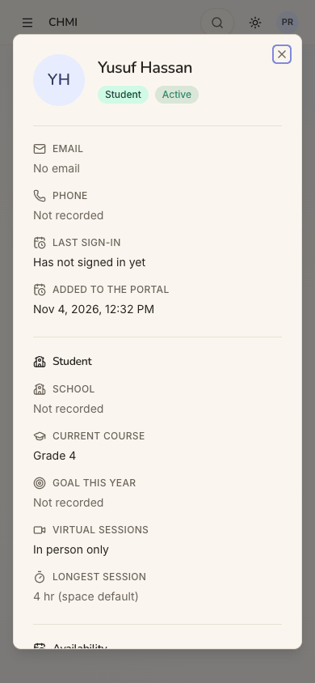

**Contact sheet** (all 32 phone steps):

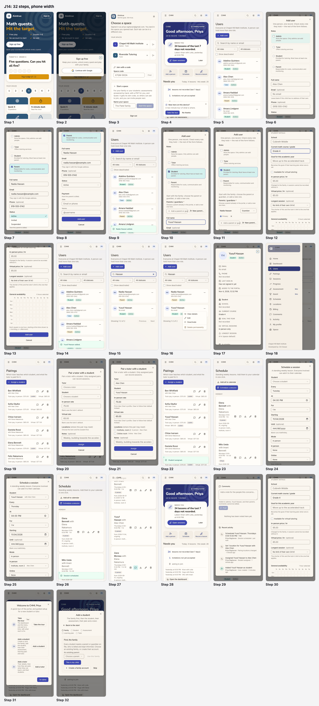

| Severity | Count |
| --- | --- |
| sev4 (blocked) | 0 |
| sev3 (major) | 1 |
| sev2 (minor) | 7 |
| sev1 (cosmetic) | 1 |
| **Total** | **9** |

## Prioritized fixes

1. [sev3] [A new student is saved with no price behind a grey 95.00 placeholder](#sev3-a-new-student-is-saved-with-no-price-behind-a-grey-9500-placeholder): require the price, or prefill a real value, and show "No price set" wherever the student is read.
2. [sev2] [The guided family setup is hidden behind a small pill](#sev2-the-guided-family-setup-is-hidden-behind-a-small-pill): make "Add a person" open a chooser that leads with "A new family" and starts the wizard's family flow.
3. [sev2] [Every save ends in a toast and the next step must be hunted for](#sev2-every-save-ends-in-a-toast-and-the-next-step-must-be-hunted-for): chain parent → child → tutor → weekly lesson with "Next" actions, and give the student's details a Tutor and lessons section.
4. [sev2] [The parent's status choice does not say who can sign in](#sev2-the-parents-status-choice-does-not-say-who-can-sign-in): explain Active, Invited and Suspended in the form, and after saving give the office a way to tell the parent how to sign in.
5. [sev2] [Sign in opens a dialog titled Sign up free](#sev2-sign-in-opens-a-dialog-titled-sign-up-free): title the dialog by the button pressed ("Sign in").
6. [sev2] [Schedule cards are squeezed on a phone and the new lesson is not shown](#sev2-schedule-cards-are-squeezed-on-a-phone-and-the-new-lesson-is-not-shown): stack the actions under the text below `sm`, and scroll to and highlight a new lesson after saving.
7. [sev2] [The wizard's loudest button for an office is This is my child](#sev2-the-wizards-loudest-button-for-an-office-is-this-is-my-child): make "Create a family account" the primary action for admins.
8. [sev2] [A pairing that keeps the tutor's own rates is marked custom](#sev2-a-pairing-that-keeps-the-tutors-own-rates-is-marked-custom): leave the rate fields empty with the default as a placeholder, so an untouched pairing follows the tutor's default.
9. [sev1] [Small polish on the people and schedule forms](#sev1-small-polish-on-the-people-and-schedule-forms): fix the initial-focus highlight, the pluralisation, phone formatting, the truncated picker text, the clipped availability grid and the see-through top bar.

## Findings

### [sev3] A new student is saved with no price behind a grey 95.00 placeholder
- **Issue Description:** In the Student details, "In-person price / hr" shows "95.00" in grey, and "Virtual price / hr (optional)" shows "85.00". Both are placeholders.
  - The in-person field is not marked required, although its hint reads "Charged to the family. A session cannot be recorded without it."
  - The form accepted Yusuf with the field empty, showed "Yusuf Hassan added." and gave no warning.
  - The student's details panel has no price row, so the gap is invisible there.
  - The Edit form shows the same grey "95.00" over the empty field, so checking again (step 30) confirms the wrong belief. The field's value is empty.
  - The pairing dialog repeats the pattern ("75.00" / "65.00" placeholders before a tutor is chosen, step 20).
- **Framework Violation:** cuj-contract, steps 12-14 and 30; success-criteria (end state re-checked after a reload is wrong). It also breaks:
  - Nielsen #5 Error prevention: a required value can be left out silently;
  - Nielsen #1 Visibility of system status: the saved state is shown as if it held 95.00.
- **Severity:** 3. The end state is wrong, and the workaround (edit the student and type the price) needs Priya to know the price is missing, which nothing tells her. For C1, a price is what makes a lesson billable. By the app's own hint, the first lesson Alex tries to record for Yusuf fails, in front of the student.
- **Evidence:** 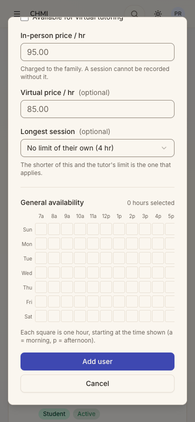  Repro:
  1. Users → Add user → tick Student and pick a parent;
  2. type a name and leave "In-person price / hr" as shown;
  3. tap Add user: it saves;
  4. "…" → Edit: the field still shows grey "95.00", and its value is empty.
- **Recommended Fix:**
  - Mark the in-person price required for a student where Tutoring is on, and refuse to save without it, or prefill the space's usual rate as a real value.
  - Never use a number-shaped placeholder in a money field; use "e.g. 95.00", or nothing.
  - Show "Price: not set" with a Fix link in the student's details and on the pairing card.
  - Make the home's office section count students with no price.

### [sev2] The guided family setup is hidden behind a small pill
- **Issue Description:** The home offers "Add a person" as its first quick action. It goes to /users, an 88-person list called "Users", where "Add user" opens a one-person form ("One person, one record").
  - The family path ("Start with the family… or add a new one", with "New parent…") only appears once the Student role is ticked. Priya, reading "Student — Must have at least one parent", sensibly added the parent first, as a separate record.
  - The guided setup ("Add a student: create or pick the family, add the student, then their assessment, learning plan and tutor") lives in the wizard behind the hero's small "Getting started" pill.
  - The first-visit popup that would have introduced the wizard offers only "A two-minute tour", so "No thanks" dismissed the way in.
- **Framework Violation:** cuj-contract, steps 4-6, 9-10 and 31. It also breaks:
  - Nielsen #7 Flexibility and efficiency of use: the same goal has five doors with different depth;
  - Nielsen #4 Consistency and standards: "Add a person", "Users" and "Add user" name one thing three ways.
- **Severity:** 2. Real friction, not a block. Priya finished, but with an extra screen, an avoidable second form for the child and no guidance on order. C1 does this weekly, and the door she meets first becomes the habit.
- **Evidence:** 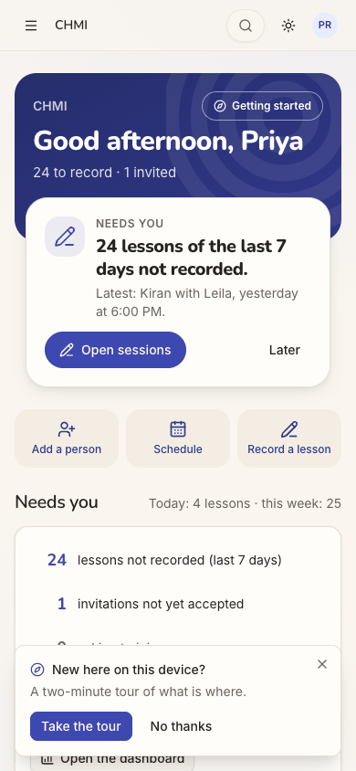  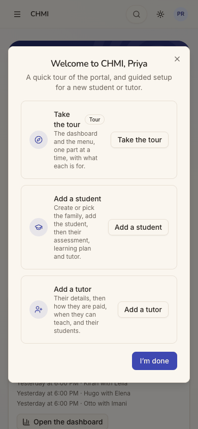 Repro:
  1. Sign in as an admin of a tutoring space;
  2. on the home, tap Add a person: the Users list opens, not a form;
  3. compare with Getting started → Add a student.
- **Recommended Fix:**
  - Make "Add a person" open a small chooser: "A new family (parent and child)", "A tutor", "Someone else".
  - Send "A new family" to the wizard's Family → Student → Tutor flow.
  - Use one word, "people", on the menu, the page title and the button.
  - Have the first-visit popup offer "Add your first family" beside the tour.

### [sev2] Every save ends in a toast and the next step must be hunted for
- **Issue Description:** After saving Nadia, then Yusuf, then the pairing, each screen shows only a toast ("Nadia Hassan added.", "Yusuf Hassan added.", "Student assigned.").
  - Nothing offers "Add her child", "Pair with a tutor" or "Set up a weekly lesson".
  - Looking for the pairing, Priya opened Yusuf's "…" menu (View details, Edit, Deactivate, Delete permanently) and then "View details". That panel calls itself "Everything on file for this person" but has no tutor, no lessons and no action. It was a dead end.
  - Pairings and Schedule are separate menu pages, reached through the ☰ drawer on a phone. Each re-picks Yusuf from a long list with no search: about 50 students, then about 55 pairings.
- **Framework Violation:** cuj-contract, steps 9, 14, 16-18, 22 and 26. It also breaks:
  - Nielsen #6 Recognition rather than recall: the order "pairing, then location, then schedule" must be known;
  - Nielsen #1 Visibility of system status: the student's record does not show his tutor or slot.
- **Severity:** 2. One dead end and three page changes for one family. It is completable, but a newcomer admin must already know the model.
- **Evidence:** 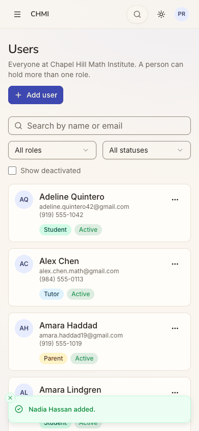 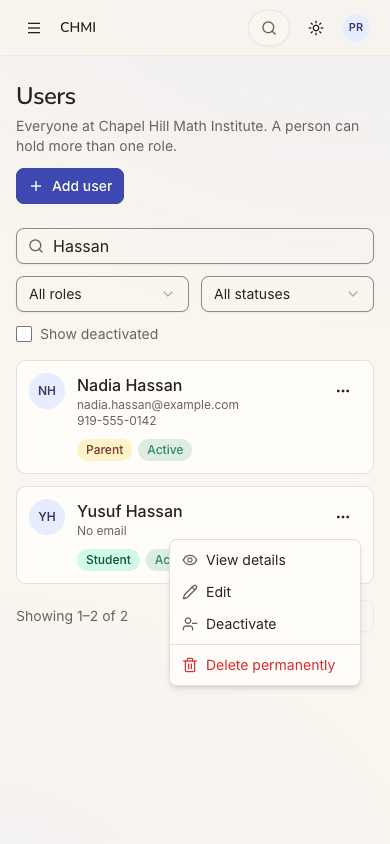  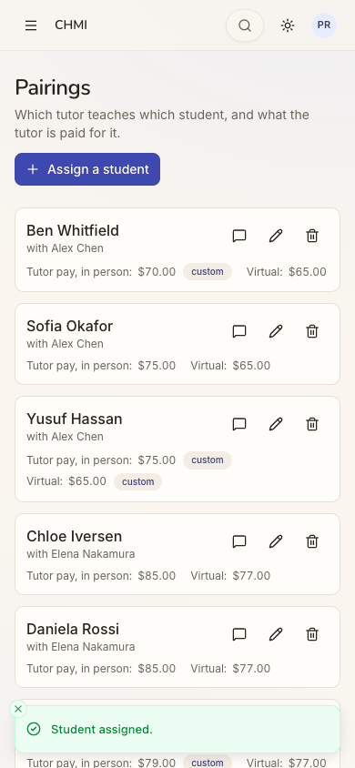 Repro:
  1. Add a student;
  2. try to pair him from his record: no route;
  3. Menu → Pairings → Assign a student;
  4. Menu → Schedule → Schedule a session.
- **Recommended Fix:**
  - After each save, put the next step in the toast or the dialog: "Add a child for Nadia", "Pair Yusuf with a tutor", "Set up Yusuf's weekly lesson". Each should open the next dialog prefilled.
  - Give the student's details a "Tutor and lessons" block with Pair and Schedule buttons.
  - Add "Pair with a tutor" and "Schedule" to a student's "…" menu.

### [sev2] The parent's status choice does not say who can sign in
- **Issue Description:** For a parent, Email turns required with "They sign in with this Google address." Nadia's address is @example.com, not Gmail, and the form does not say whether a non-Gmail Google account works.
  - Status offers Active (default), Invited and Suspended with no explanation. It does not say which one lets her sign in, whether either sends an email, or what "Invited" asks of her.
  - After saving, nothing says whether Nadia was told or how. There is no "Copy sign-in instructions" or invitation text, which a tutoring office would pass on during the same phone call.
- **Framework Violation:** cuj-contract, steps 7-9. It also breaks:
  - Nielsen #10 Help and documentation: no inline explanation of a consequential choice;
  - Nielsen #1 Visibility of system status: no word on whether the parent was notified.
- **Severity:** 2. Priya kept the default, which is the right answer here, without knowing why. A parent who never hears how to get in is a family that never opens the portal, which is J15's journey.
- **Evidence:** 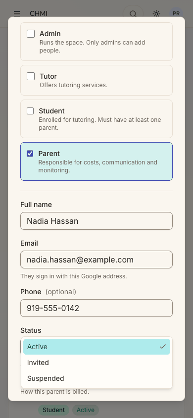 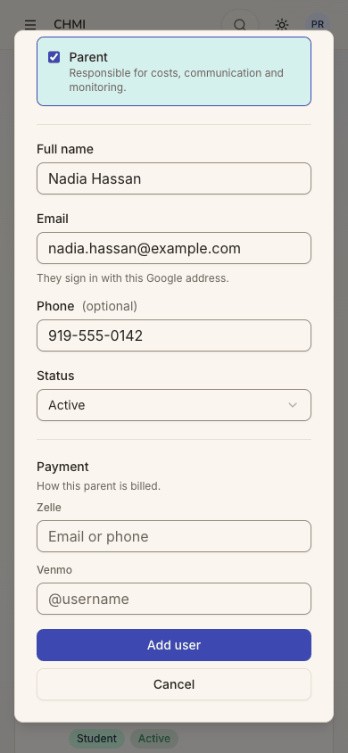 Repro: Users → Add user → tick Parent → open Status.
- **Recommended Fix:**
  - Add one line under each status option, for example:
    - "Active: can sign in now with this Google account";
    - "Invited: must accept first";
    - "Suspended: cannot sign in".
  - Say "any Google account with this address" rather than implying Gmail.
  - After saving a parent, offer "Copy sign-in instructions" (the address, the link and "Continue with Google"), and say whether an email was sent.

### [sev2] Sign in opens a dialog titled Sign up free
- **Issue Description:** On the signed-out page, the "Sign in" pill opens a dialog headed "Sign up free" ("Keep your scores, unlock every quest and play with your family."). Its only button is "Continue with Google". Nothing in it says "Sign in" or tells a returning member that this is their way in.
- **Framework Violation:** cuj-contract, step 2; Nielsen #2 Match between system and the real world, and #4 Consistency and standards.
- **Severity:** 2. An observable mismatch at the front door for every returning staff member. C1 signs in daily and is offered a family sign-up, and a cautious admin hesitates because it might create a second account.
- **Evidence:**  Repro: open `/` signed out → tap Sign in.
- **Recommended Fix:**
  - Title the dialog by its trigger: "Sign in", with "Use the Google account your space knows" as the line under it. Keep "Sign up free" for the Sign up button.
  - Add a one-line link between the two.

### [sev2] Schedule cards are squeezed on a phone and the new lesson is not shown
- **Issue Description:** At 390 px each Schedule card puts its text in a narrow left column beside a row of five icon buttons:
  - names break over three or four lines ("Elena / Bennett with / Elena / Nakamura");
  - dates wrap mid-value ("from 2026-09- / 01");
  - the place is cut to "In person: Instit…".

  After "Schedule", the toast says "Session scheduled." but the page stays at Monday. Yusuf's new Thursday card is far below, not scrolled to or highlighted.
- **Framework Violation:** cuj-contract, steps 23, 26 and 27; Nielsen #8 Aesthetic and minimalist design and #1 Visibility of system status.
- **Severity:** 2. Real friction on the page C1 checks to answer "who is where, when". The truncated place and the hidden new lesson make the result hard to confirm on a phone.
- **Evidence:** 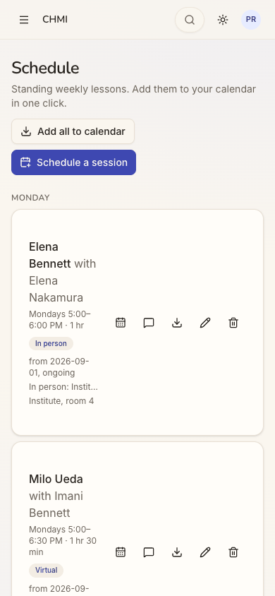 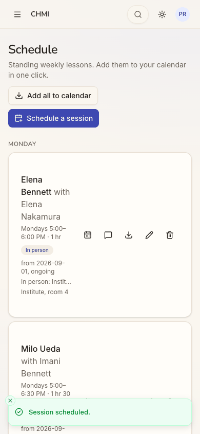 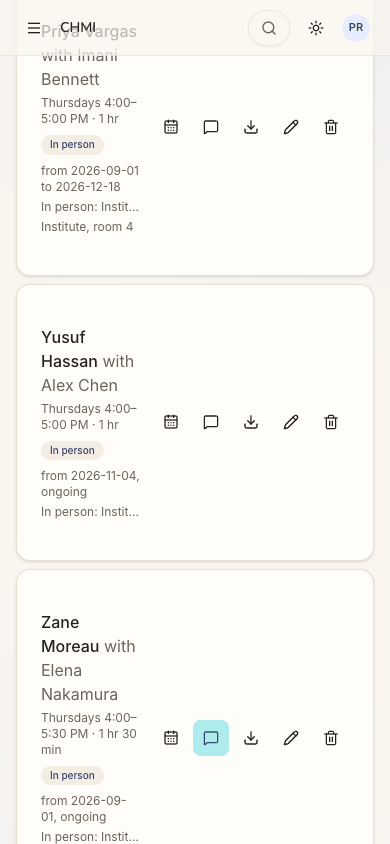 Repro: at phone width open Schedule → Schedule a session → save, and look for the new lesson.
- **Recommended Fix:**
  - Below `sm`, stack the icon row under the text (or fold it into one "…" menu), so names and places use the card's full width.
  - After saving, scroll to the new card and highlight it briefly.

### [sev2] The wizard's loudest button for an office is This is my child
- **Issue Description:** In Getting started → Add a student → "First, the family", the filled primary button is "This is my child". "Create a family account" is secondary and "Use this family" is disabled until a parent is picked.
  - For an office admin adding a new family, the most prominent action would make the admin the child's parent.
  - The inner card also runs to the dialog's right edge on a phone.
- **Framework Violation:** cuj-contract, step 32 (peeked, not used); Nielsen #5 Error prevention, since the default emphasis points to the wrong choice for this role.
- **Severity:** 2. An observable mismatch for C1. It was not tapped, so the wrong end state it would create was not observed. A hurried office admin taking the visual default would attach a family's child to herself.
- **Evidence:** 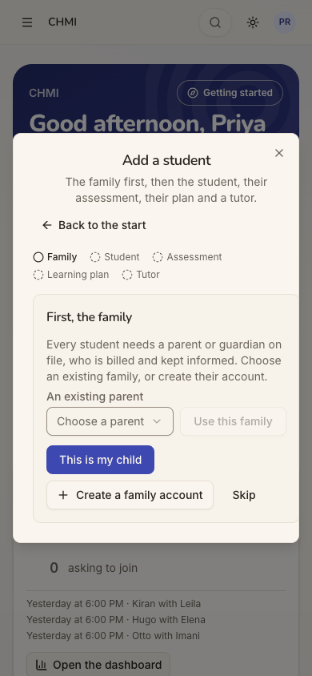 Repro: as a space admin, Home → Getting started → Add a student.
- **Recommended Fix:**
  - For an admin, make "Create a family account" the primary action and "This is my child" a quiet link.
  - Show "This is my child" first only where the person holds no admin role.

### [sev2] A pairing that keeps the tutor's own rates is marked custom
- **Issue Description:** After choosing Alex Chen, the pairing's rates fill with 75.00 and 65.00, "From Alex Chen's profile. Clear to follow their default instead."
  - Priya left them as shown. The saved pairing reads "Tutor pay, in person: $75.00 custom · Virtual: $65.00 custom".
  - Sofia Okafor's pairing with Alex, at the same rates, has no badge.
  - Accepting the prefilled default freezes it as an override. By the hint's own wording, it will not follow Alex's default if that changes.
  - The label "In-person rate" also does not say whether it is the tutor's pay or the family's price.
- **Framework Violation:** cuj-contract, steps 21-22; Nielsen #4 Consistency and standards: the same values are shown two ways.
- **Severity:** 2. An observable mismatch with a money consequence for the office: tutor pay silently diverges from the tutor's profile later. Most admins will not read "Clear to follow their default instead" as "leaving this filled makes it custom".
- **Evidence:** 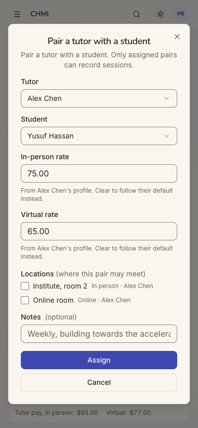  Repro: Pairings → Assign a student → choose a tutor and a student → Assign without touching the rates.
- **Recommended Fix:**
  - Leave the rate fields empty with the tutor's default as a labelled placeholder ("Alex's default, $75.00"), so an untouched pairing follows the default and only a typed value is custom.
  - Label the fields "Tutor pay, in person" to match the card.

### [sev1] Small polish on the people and schedule forms
- **Issue Description:** Several small issues on the screens Priya used:
  - The Add user dialog opens with the Admin role card tinted on a phone (initial focus), so it looks pre-selected (steps 6, 6-dark).
  - The home reads "1 invitations not yet accepted" (step 4).
  - Nadia's phone is stored and shown as typed ("919-555-0142") beside everyone else's "(919) 555-0142" (step 15).
  - The parent picker's placeholder is cut to "Add a parent or guar" (step 10).
  - The availability grid ends at 5p at phone width. Lesson hours are off-screen; whether it scrolls sideways was not checked (step 13).
  - The top bar is see-through when the Schedule page scrolls (step 27).
  - The Full name placeholder is a real tutor's name, "Alex Chen".
- **Framework Violation:** cuj-contract, steps 4, 6, 10, 13, 15 and 27; Nielsen #8 Aesthetic and minimalist design.
- **Severity:** 1. Cosmetic. None of these stopped Priya, but together they make the office's most-used forms feel less finished.
- **Evidence:** 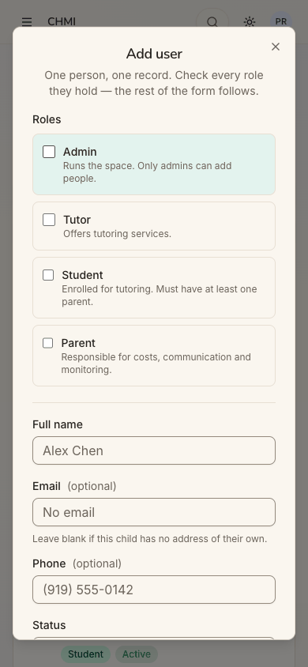 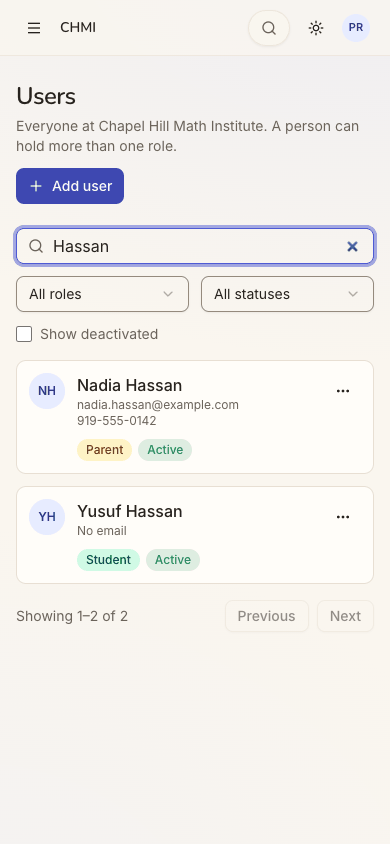 Repro: open each named screen at 390×844.
- **Recommended Fix:**
  - Move initial focus to Full name, or give the focused card a ring rather than the selected tint.
  - Pluralise the invitations count.
  - Format phones on save (or on blur) as elsewhere.
  - Shorten the picker placeholder to "Choose a parent".
  - Make the availability grid fit 390 px (fewer columns or a day-by-day list).
  - Give the sticky bar a solid background.
  - Use a neutral name placeholder ("Full name").

## Walkthrough

### Step 1 — Open the entry page signed out

> Expected: a front page with a clear way in for staff. Observed: the guest Play page ("Math quests. Hit the target.", Today's 5, the grade row, the tiles). "Sign up free" is the big button; "Sign in" is a small outlined pill at the top right.

**What Priya notices:** the page is for children playing maths, not for her institute. Her way in is the small pill in the corner.

### Step 2 — Tap "Sign in"

> Expected: a sign-in dialog. Observed: a dialog titled "Sign up free", "Keep your scores, unlock every quest and play with your family.", with one "Continue with Google" button.

**What Priya notices:** she asked to sign in and is offered a free family sign-up. She hesitates, wondering if this makes a second account.

### Step 3 — Continue with Google
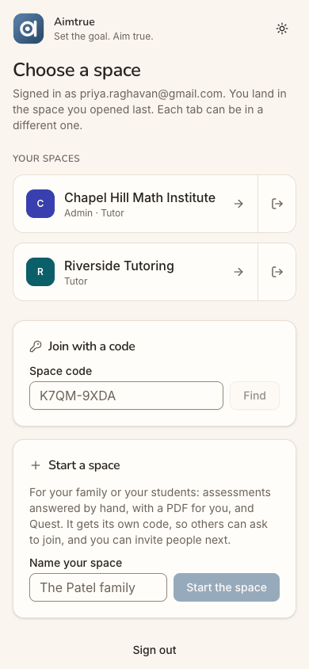
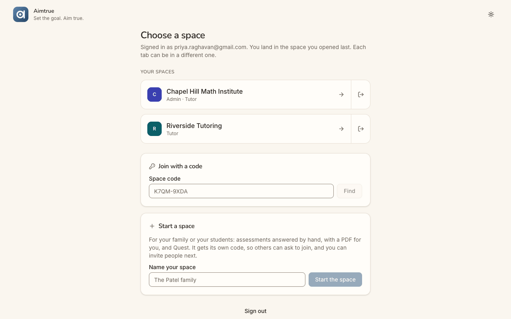
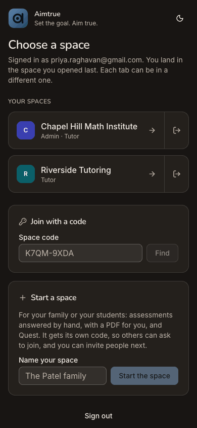
> Expected: her institute. Observed: "Choose a space":
> - "Signed in as priya.raghavan@gmail.com. You land in the space you opened last.";
> - Chapel Hill Math Institute (Admin · Tutor) and Riverside Tutoring (Tutor), each with an icon-only Leave button flush beside the Open arrow;
> - Join with a code, and Start a space.
>
> No space opened by itself on this new device.

**What Priya notices:** her two workplaces with her roles, which is reassuring. The exit-arrow Leave button sits right beside Open, and the Join and Start cards are noise for her. The Leave button was not tapped.

### Step 4 — Open Chapel Hill Math Institute

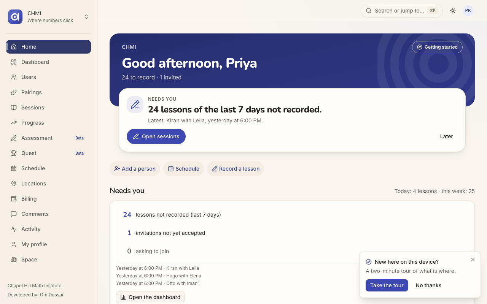
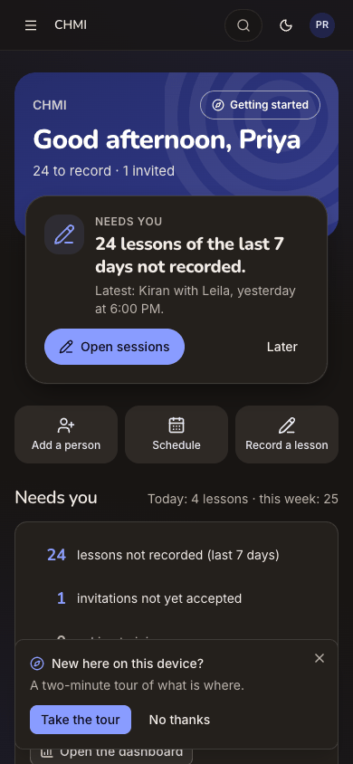
> Expected: the office's home, with a way to add people. Observed:
> - "Good afternoon, Priya · 24 to record · 1 invited";
> - Next up "NEEDS YOU · 24 lessons of the last 7 days not recorded" (Open sessions / Later);
> - quick actions Add a person, Schedule, Record a lesson;
> - a "Needs you" section;
> - a "Getting started" pill;
> - a popup "New here on this device? A two-minute tour…" over the bottom of the list.
>
> The desktop view has the full side menu, where the people page is called "Users".

**What Priya notices:** "Add a person" is right in reach. "Needs you" is written twice, "1 invitations" reads oddly, and the tour popup covers her list.

### Step 5 — Dismiss the tour offer, tap "Add a person"

> Expected: an add-a-person form. Observed: /users, titled "Users — Everyone at Chapel Hill Math Institute. A person can hold more than one role.", with "+ Add user" and a long list of cards. No form opened.

**What Priya notices:** the button said "a person", and now the page says "Users" and wants another tap.

### Step 6 — Tap "Add user"

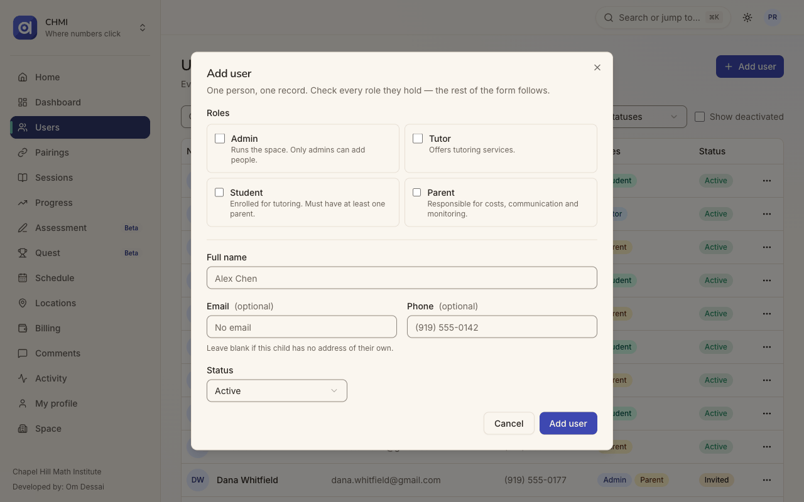
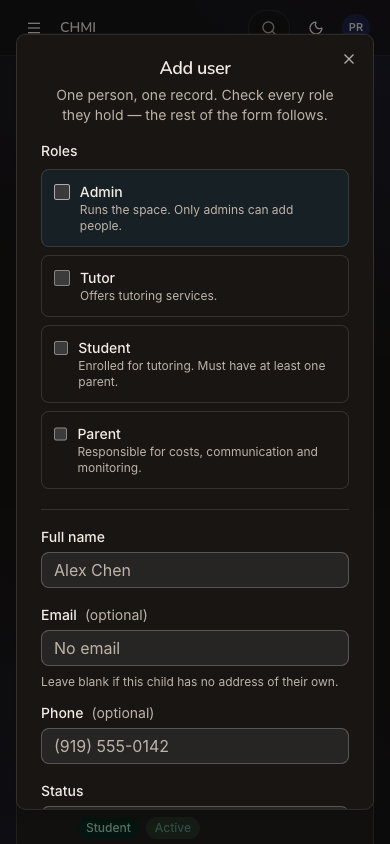
> Expected: a person form, ideally for a family. Observed: "Add user — One person, one record. Check every role they hold — the rest of the form follows.":
> - role cards Admin, Tutor, Student ("Must have at least one parent."), and Parent;
> - Full name, Email (optional; "Leave blank if this child has no address of their own."), Phone, and Status (Active).
>
> On the phone the Admin card is tinted as if selected. The desktop and dark views of this same empty form were captured at the end of the run.

**What Priya notices:** "Student: must have at least one parent" tells her to add Nadia first. The tinted Admin card makes her look twice.

### Step 7 — Tick Parent, type Nadia's details, open Status

> Expected: parent fields and a clear sign-in choice. Observed: Email becomes required ("They sign in with this Google address."). Status opens to Active (selected), Invited and Suspended, with no explanation of any of them.

**What Priya notices:** Nadia's address is not Gmail. Will it work? And which status lets her in? She keeps Active, the default.

### Step 8 — Keep Active, scroll to the end of the form

> Expected: Save. Observed: Payment, "How this parent is billed.", with Zelle and Venmo (optional), then Add user and Cancel.

**What Priya notices:** the payment handles are not hers to know yet, so she leaves them. Nothing says whether Nadia will be emailed.

### Step 9 — Tap "Add user" to save Nadia

> Expected: a confirmation and an offer to add her child. Observed: the toast "Nadia Hassan added." and the list back at "A"; Nadia is not in view. No next step.

**What Priya notices:** half a family. She must start over for Yusuf.

### Step 10 — Add user again: tick Student, type "Yusuf Hassan"
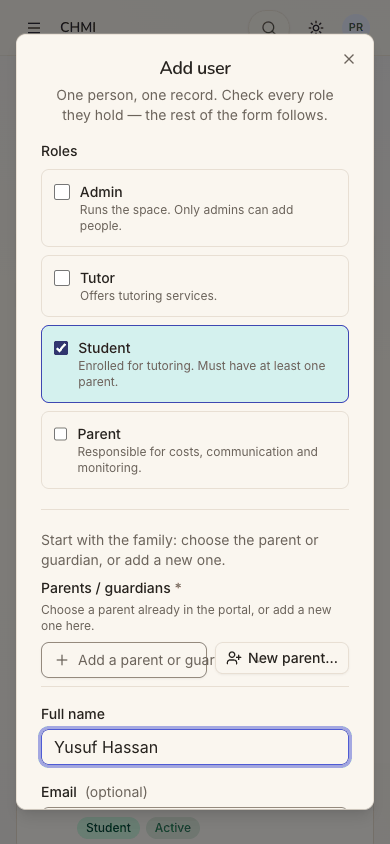
> Expected: a way to link him to Nadia. Observed:
> - "Start with the family: choose the parent or guardian, or add a new one.";
> - Parents / guardians * with a picker (placeholder cut to "Add a parent or guar") and "New parent…";
> - then the Student details.

**What Priya notices:** the family path was here all along, under Student. She could have added Nadia here in one go.

### Step 11 — Link Nadia as his mother
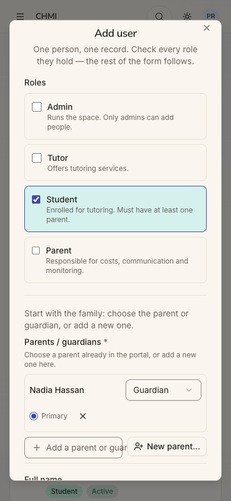
> Expected: Nadia findable and linked. Observed: the picker lists every parent with email. The row reads "Nadia Hassan · [Guardian ▾] · ◉ Primary · ✕"; Relationship defaults to Guardian and Priya sets it to Mother.

**What Priya notices:** linking is clear. A mother defaulting to "Guardian" costs a tap.

### Step 12 — Type "Grade 4"
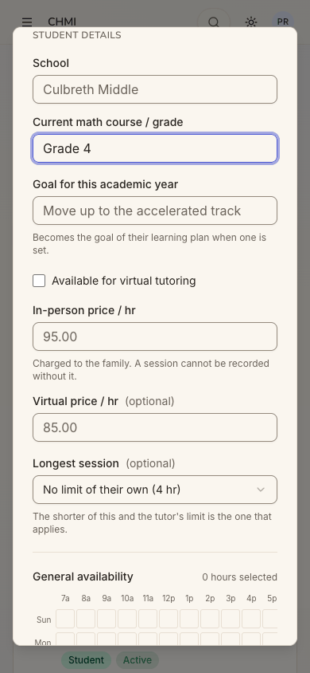
> Expected: student details. Observed:
> - School, "Current math course / grade" (free text, "Grade 4" typed) and Goal;
> - "Available for virtual tutoring";
> - "In-person price / hr" showing grey "95.00", with "Charged to the family. A session cannot be recorded without it.";
> - "Virtual price / hr (optional)" showing "85.00";
> - Longest session.

**What Priya notices:** 95.00 and 85.00 look already filled in with the institute's usual rates.

### Step 13 — Tick Thursday 4p, reach the end of the form

> Expected: availability and Save. Observed: a General availability grid, Sun-Sat by 7a-5p, with later columns off the dialog's right edge; Thursday 4p ticked. Then "Add user" and "Cancel".

**What Priya notices:** the evening hours, when lessons happen, are cut off. 4p is just visible.

### Step 14 — Tap "Add user" to save Yusuf

> Expected: saved with a price, or refused for the missing price. Observed: saved without complaint, with the toast "Yusuf Hassan added.". No next step.

**What Priya notices:** done, she thinks, and at 95.00. Now, where does she pair him with Alex?

### Step 15 — Search "Hassan"

> Expected: the family. Observed: Nadia Hassan (Parent, Active, "919-555-0142") and Yusuf Hassan (Student, Active, No email). Nadia's phone is unformatted, unlike every other row.

**What Priya notices:** both in, both Active. Nothing on the cards shows they are a family or what to do next.

### Step 16 — Open Yusuf's "…" menu

> Expected: "Pair with a tutor" or "Schedule". Observed: View details, Edit, Deactivate, Delete permanently.

**What Priya notices:** nothing for teaching. She tries the details.

### Step 17 — View details (dead end)

> Expected: his tutor and lessons, with a way to add them. Observed: "Everything on file for this person": contact, school, "Grade 4", "In person only", the 4 hr longest session, Thursday 4-5 PM availability, "No locations yet", Nadia (Mother, Primary contact), comments and activity. There is no tutor, no lessons, no price and no action.

**What Priya notices:** "everything", but not what she came for. She closes it. Dead end 1.

### Step 18 — Close, open the menu
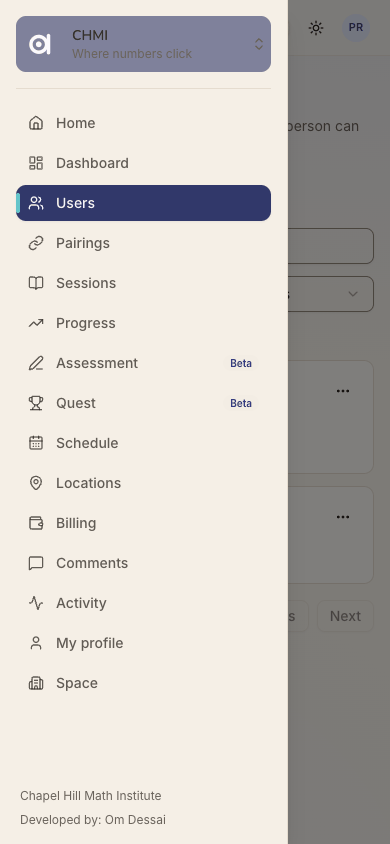
> Expected: somewhere to pair. Observed: the drawer with 15 items, among them Users, Pairings, Sessions, Schedule and Locations.

**What Priya notices:** "Pairings" must be tutor plus student.

### Step 19 — Open Pairings
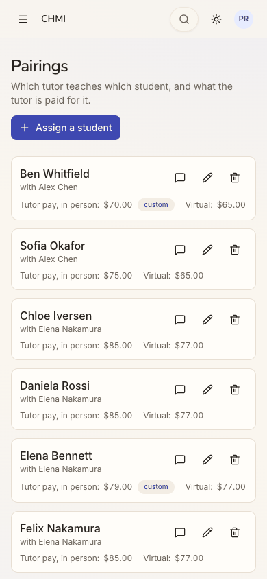
> Expected: the pairing list. Observed: "Pairings — Which tutor teaches which student, and what the tutor is paid for it." and "+ Assign a student". Cards read "<student> with <tutor>" with tutor pay.

**What Priya notices:** the right page. The page says Pairings and the button says Assign.

### Step 20 — Tap "Assign a student"
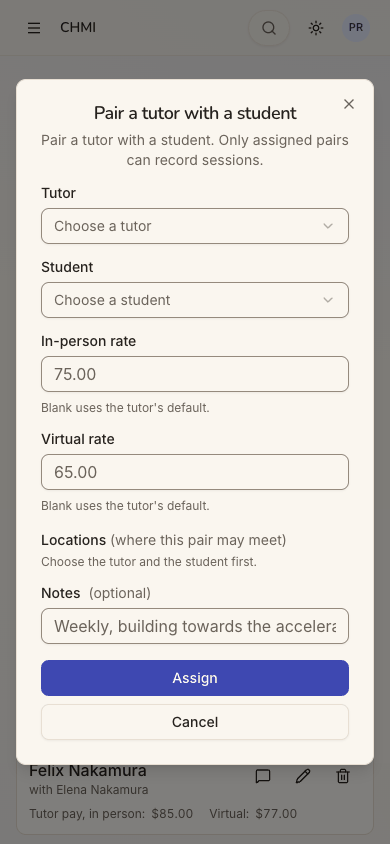
> Expected: a pairing form. Observed: "Pair a tutor with a student. Only assigned pairs can record sessions.":
> - Tutor and Student pickers;
> - In-person rate and Virtual rate showing grey 75.00 and 65.00 ("Blank uses the tutor's default.");
> - Locations ("Choose the tutor and the student first."), and Notes.

**What Priya notices:** clear. Is "rate" Alex's pay or the family's price?

### Step 21 — Choose Alex Chen and Yusuf Hassan

> Expected: the pair set. Observed: both chosen from long lists with no search. There are two Yusufs, and Yusuf Hassan is the right one. The rates fill with 75.00 and 65.00, "From Alex Chen's profile. Clear to follow their default instead.", and two locations appear unticked: "Institute, room 2" and "Online room".

**What Priya notices:** she ticks the room because the lessons are in person. Nothing says the weekly lesson will need it.

### Step 22 — Tick "Institute, room 2", tap Assign

> Expected: the pairing saved, ideally with "set up a weekly lesson?". Observed: the toast "Student assigned." and a new card "Yusuf Hassan with Alex Chen · $75.00 custom · Virtual $65.00 custom". Sofia's card at the same rates has no badge. No next step.

**What Priya notices:** "custom"? She changed nothing. She still has to find the lesson herself.

### Step 23 — Menu → Schedule

> Expected: weekly lessons and an add button. Observed: "Standing weekly lessons…", "Add all to calendar" and "Schedule a session". The day-grouped cards squeeze names over four lines beside five icons and cut the place to "Instit…".

**What Priya notices:** "Schedule a session" is what she wants. The cards are hard to read on a phone.

### Step 24 — Tap "Schedule a session"
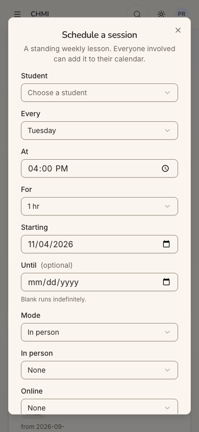
> Expected: a weekly lesson form. Observed:
> - "A standing weekly lesson. Everyone involved can add it to their calendar.";
> - Student; Every (Tuesday by default, though today is Wednesday); At 04:00 PM; For 1 hr;
> - Starting 11/04/2026; Until (optional);
> - Mode; In person (None); Online (None), with "At least one, and at most one of each."

**What Priya notices:** the title says "session", the line under it says "lesson", and there is no tutor field.

### Step 25 — Choose "Yusuf Hassan with Alex Chen", Thursday
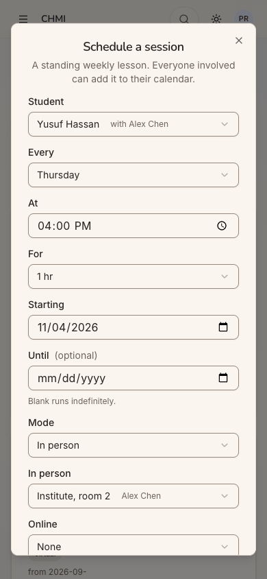
> Expected: the slot set. Observed: the student list is every pairing ("<student> with <tutor>", about 55, no search). Choosing Yusuf's fills In person: "Institute, room 2 · Alex Chen". Every is set to Thursday; 4:00 PM and 1 hr were already the defaults.

**What Priya notices:** the room carried over from the pairing. Mode plus two location pickers is three controls for one choice.

### Step 26 — Tap "Schedule"

> Expected: the lesson saved and shown. Observed: the toast "Session scheduled." The page stays at Monday and does not scroll to the new card.

**What Priya notices:** she wants to see it, so she scrolls.

### Step 27 — Scroll to Thursday

> Expected: Yusuf's lesson listed. Observed: "Yusuf Hassan with Alex Chen · Thursdays 4:00–5:00 PM · 1 hr · In person · from 2026-11-04, ongoing · In person: Instit…". The first lesson is tomorrow, 2026-11-05. The top bar is see-through over the scrolled cards. **This is the journey's end:** the family is added, paired and scheduled.

**What Priya notices:** it's there. Done, across four pages.

### Step 28 — Reload the home (end-state check)
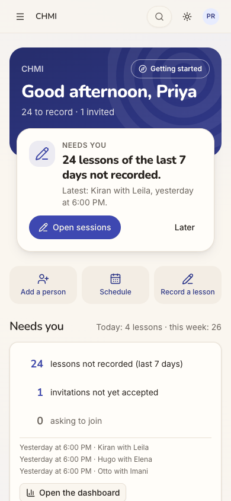
> Expected: the new lesson counted. Observed: after a reload, "Needs you · Today: 4 lessons · this week: 26" (25 before). The hero is unchanged at "24 to record · 1 invited", since Nadia is Active, not invited. Nothing names the new family.

**What Priya notices:** the week grew by one. No "new family this week" note, and nothing flags the missing price.

### Step 29 — Search "Yusuf", open his details (end-state check)
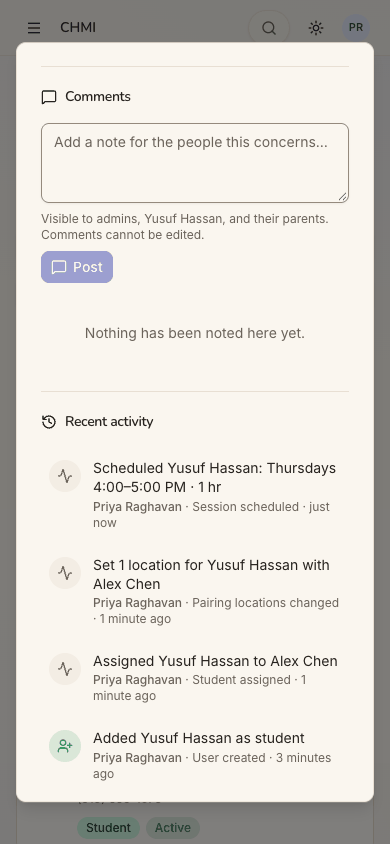
> Expected: the record now shows his tutor and lesson. Observed: the search palette ("Go anywhere") finds Yusuf Hassan and Yusuf Quintero. The details still have no tutor or lesson section. Only Recent activity lists:
> - "Scheduled Yusuf Hassan: Thursdays 4:00–5:00 PM · 1 hr";
> - "Set 1 location…";
> - "Assigned Yusuf Hassan to Alex Chen";
> - "Added Yusuf Hassan as student".

**What Priya notices:** the facts are only in the activity log, not in the record.

### Step 30 — Edit Yusuf to check the price (end-state check)

> Expected: In-person price 95.00. Observed: the field shows grey "95.00" while its value is empty. The price was never saved, and the Edit form looks identical to a saved 95.00. Cancelled with nothing changed.

**What Priya notices:** nothing. That is the problem: she would still believe Yusuf is billed at 95.00.

### Step 31 — Open "Getting started" (the other way in)

> Expected: what the wizard offers. Observed: "Welcome to CHMI, Priya — A quick tour of the portal, and guided setup for a new student or tutor." It offers Take the tour, Add a student ("Create or pick the family, add the student, then their assessment, learning plan and tutor") and Add a tutor.

**What Priya notices:** this was the guided family path, behind the small pill. The popup at step 4 only mentioned a tour.

### Step 32 — Peek at the wizard's "Add a student"

> Expected: a family-first flow. Observed: steps Family · Student · Assessment · Learning plan · Tutor, with no weekly-lesson step. "First, the family" has an existing-parent picker, "Use this family" (disabled), the filled primary button **"This is my child"**, a secondary "+ Create a family account", and Skip. Closed without adding anything.

**What Priya notices:** the loudest button would make her the child's parent. A new family would need the quieter "Create a family account".

## Appendix

- **Mode:** live. A real headless Chrome drove the app at http://localhost:8797, a frozen copy of commit `2d6e7d3` with sign-in on and its own local database. Phone width is 390×844. Desktop (1280×800) and dark mode were captured at the landing screens: steps 1, 3 and 4, and step 6, where the feature starts. Step 6's desktop and dark images were taken at the end of the run on the same empty Add user form; the phone image is the original.
- **Frameworks applied:**
  - cuj-contract: each step's expected against observed;
  - task-completion: the family added, paired and scheduled;
  - success-criteria: the end state re-checked after a reload in steps 28-30.
- **Coverage / not inspected:**
  - Whether Nadia can actually sign in and what she sees. That is J15's journey.
  - Whether any email or notice reached Nadia. Email notifications were not checked, and the local stack sends no mail.
  - The consequence of the missing price (that a lesson for Yusuf cannot be recorded). This is stated from the app's own hint and was not tested; recording lessons is J16.
  - The wizard's guided path beyond its first screen. It was peeked at, not run: its Student, Assessment, Learning plan and Tutor steps were not opened.
  - The Student form's inline "New parent…" path. It was seen, not used.
  - The home's "Schedule" and "Record a lesson" quick actions (Priya went through the menu).
  - The Leave button on Choose a space (not tapped).
  - Whether the availability grid scrolls sideways at phone width.
  - Locations, Billing and the Dashboard.
  - Desktop and dark mode outside the landing screens.
  - The iOS app, which is covered by separate journeys.
- Access: through the app's real sign-in and sign-up screens; the Google provider step is simulated (a stand-in for Google's button hands the app a local test token for the persona).
- **Preconditions made outside the UI:** none specific to J14. The run's shared setup applies (README, "The run"): the platform settings, and Assessment and Quest switched on in `chmi` by its admin with the same request `seed:scenarios --demo` makes. Priya, Alex Chen and the rest of `chmi` come from the local seed.
- **Harness note:** once, the driver's selector for the Parent card matched the Student card, whose hint mentions "parent". The tick was undone at once and is not counted in the figures. It is how the Student form's "Start with the family… / New parent…" was first seen, at step 6, before Priya reached it herself at step 10.
- **State left for later journeys:**
  - Nadia Hassan, nadia.hassan@example.com: Parent, Active, mother and primary contact of Yusuf Hassan.
  - Yusuf Hassan: Student, no email, "Grade 4", **no in-person price**.
  - The pairing: Yusuf with Alex Chen, at $75 / $65 marked custom, at Institute, room 2.
  - The weekly lesson: Thursdays 4:00–5:00 PM, in person, from 2026-11-04; the first lesson is 2026-11-05.
