# CUJ Audit — J15: new tutoring parent signs in for the first time

## Executive summary

**Persona.** Nadia Hassan is a parent. The office at Chapel Hill Math Institute (`chmi`) has just added her and her son Yusuf (grade 4, no email) in J14. She is cohort **C3** of `docs/member-home-plan.md`, the tutoring parent, whose question is "When's the next lesson, anything changed?". No email reached her; the office told her to sign in at the address with her Google account. She wanted to:
- get in;
- find Yusuf and his next lesson;
- try "Play with Yusuf", the home's way for a parent to practise with their child.

**Outcome: 1/1 journeys passed, 0 skipped, 21 of 21 steps verified.** Nadia reached the journey's end:
- One Google tap took her straight into CHMI. There was no space chooser, no sign-up form and no approval wait.
- Her home answered her question at once: "Yusuf: next lesson tomorrow at 4:00 PM", with Alex.
- She took the tour (8 stops) and confirmed her details.
- On the schedule she found the place, Institute, room 2, and the first date, Thursday, Nov 5.
- One tap on Yusuf's card ("Practise together before tomorrow's lesson") made a game, and "Start the Quest" started it.

The end state is not what the button promises. The game had **one player, Nadia**:
- Yusuf appears nowhere in the lobby.
- He has no email, so he has no way to join.
- The practice counted for her: "Nadia wins!", and after a reload Yusuf's card still says "Played 0 days this week (aim: 3)" (finding 1).

Step 21 re-checked the end state after a reload.

**Conversion figures**, counted from the signed-out entry page to the started game (steps 1-16):

| Measure | Count |
| --- | --- |
| Screens | 12 distinct |
| Taps | 20 |
| Typed fields | 0 |
| Waits | 3 (sign-in ~2 s, the tour's start ~2 s, the countdown ~3 s) |
| Dead ends | 0 before the feature; 1 after it (Exit led to Question Quest, step 20) |

- The 12 distinct screens were:
  - the guest page and the "Sign up free" dialog;
  - the home, with four onboarding overlays over it: the welcome dialog, the tour (8 stops), Confirm your details and You're all set;
  - the tour offer shown again;
  - the Schedule page and the menu drawer;
  - the game lobby and the countdown.
- Of the 20 taps:
  - 12 went to onboarding: Take the tour, Next ×7, Finish, "Yes, that's all right", "Go to my dashboard", and No thanks on the repeated offer;
  - 4 were her lesson check: See the schedule, Dates, the menu and Home;
  - 4 were the path itself: Sign in, Continue with Google, Practise together, Start the Quest.
- The shortest path on screen is 5 taps: Sign in, Continue with Google, Skip for now, Practise together, Start the Quest. "Skip for now" was not pressed in this run.
- One typed field came after the feature: one answer, 64.

**The 3 screens Nadia would notice most**

- **Step 4: her home already knows Yusuf's lesson.** Behind the welcome she sees "Good afternoon, Nadia", then "Yusuf: next lesson tomorrow at 4:00 PM" and a big "Tomorrow at 4:00 PM with Alex." card. This answers C3's question on the first screen, with nothing to set up, which is the strongest moment of the journey. The card does not say where the lesson is (finding 7).
  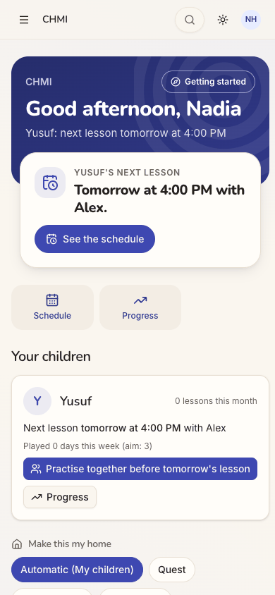
- **Step 15: "Practise together" makes a game without Yusuf in it.** One tap gives a big code "2WS848", a QR code and Share, but the lobby lists only "Nadia (you)" and "1 of 2 places". The game is "G3", though Yusuf is in grade 4. Yusuf has no login, so the code and QR code have no one to go to. For a parent this is the feature that turns a weekly lesson into practice at home, and here it quietly becomes a solo game.
  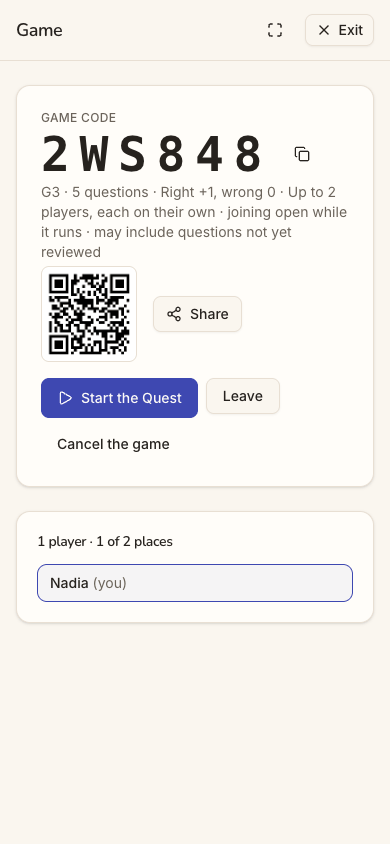
- **Step 21: after practising, Yusuf still has "Played 0 days".** She answered a question with him beside her and the game ended "Nadia wins!" (step 19). Back home, after a reload, Yusuf's card is unchanged: "Played 0 days this week (aim: 3)", with the same button offered again. The aim is the card's reason to come back, and it cannot move for a child who cannot sign in.
  

**Contact sheet** (all 21 phone steps):

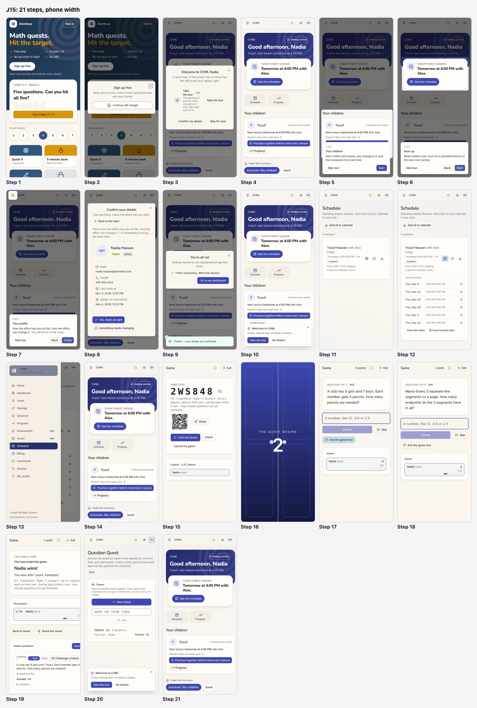

| Severity | Count |
| --- | --- |
| sev4 (blocked) | 0 |
| sev3 (major) | 1 |
| sev2 (minor) | 5 |
| sev1 (cosmetic) | 2 |
| **Total** | **8** |

## Prioritized fixes

1. [sev3] [Practise together starts a game Yusuf cannot join and credits Nadia](#sev3-practise-together-starts-a-game-yusuf-cannot-join-and-credits-nadia): for a child with no sign-in, play on this device as the child; otherwise show the child as invited in the lobby.
2. [sev2] [Sign in opens a Sign up free dialog on a page with no sign of the institute](#sev2-sign-in-opens-a-sign-up-free-dialog-on-a-page-with-no-sign-of-the-institute): title the dialog "Sign in" and tell an invited family that the Google account their centre has is the way in.
3. [sev2] [Go to my dashboard stays on the home and the tour is offered twice more](#sev2-go-to-my-dashboard-stays-on-the-home-and-the-tour-is-offered-twice-more): mark the tour seen when the wizard's tour ends, remember No thanks, and make the last button "Done".
4. [sev2] [The game is set at Grade 3 for a Grade 4 child and the lobby speaks in codes](#sev2-the-game-is-set-at-grade-3-for-a-grade-4-child-and-the-lobby-speaks-in-codes): start at the child's grade, say it in words, and let the parent change it before starting.
5. [sev2] [Exit from the game lands on Question Quest instead of the home](#sev2-exit-from-the-game-lands-on-question-quest-instead-of-the-home): return to the page that started the game.
6. [sev2] [The parent's tour and menu are the office's and never show playing together](#sev2-the-parents-tour-and-menu-are-the-offices-and-never-show-playing-together): tour the parent's home blocks, give the menu one stop, and trim the parent's menu to parent words.
7. [sev1] [The next-lesson card says when but not where](#sev1-the-next-lesson-card-says-when-but-not-where): add the place to the card, and show "Next: Thu, Nov 5" on the schedule card.
8. [sev1] [The game results run 40 px off a phone screen](#sev1-the-game-results-run-40-px-off-a-phone-screen): let the results' rows and filter pills wrap below `sm`.

## Findings

### [sev3] Practise together starts a game Yusuf cannot join and credits Nadia
- **Issue Description:** Yusuf's card on the home offers one filled button, "Practise together before tomorrow's lesson". One tap makes a game for two (step 15), and that part is fast. But:
  - the lobby shows "1 player · 1 of 2 places" and only "Nadia (you)": there is no "Yusuf invited", no "waiting for Yusuf" and no word on how he joins;
  - Yusuf has "No email" (Nadia's details, step 8), so he has no way to sign in and use the code or the QR code the lobby offers;
  - played on Nadia's phone with Yusuf beside her, the game is hers: the scores list only her (step 17), and the end says "Nadia wins! You won with 1 point. Fantastic!" (step 19);
  - after a reload, Yusuf's card still reads "Played 0 days this week (aim: 3)", and the same button is offered again as if nothing happened (step 21).
- **Framework Violation:** cuj-contract, steps 15-21; success-criteria (end state re-checked after a reload at step 21). It also breaks:
  - Nielsen #1 Visibility of system status: whether the child was invited, and how he joins, is never shown;
  - Nielsen #2 Match between system and the real world: "Practise together" yields a game of one, "each on their own".
- **Severity:** 3. The end state is wrong for this cohort, and the only workaround (Nadia plays on her own phone while Yusuf watches) credits the wrong person:
  - C3's children are mostly young students the office adds without an email, so this is the normal case, not an edge case.
  - The button exists to get the child practising before the lesson and to move his "aim: 3". It can do neither, so the card's reason to come back (stickiness) is broken from the first use.
- **Evidence:** 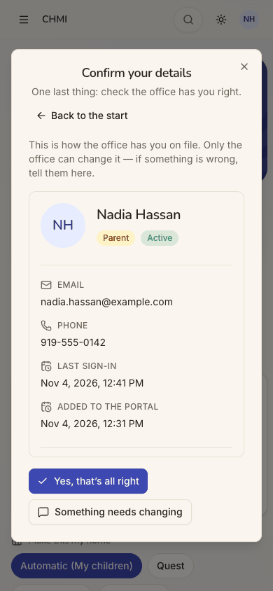  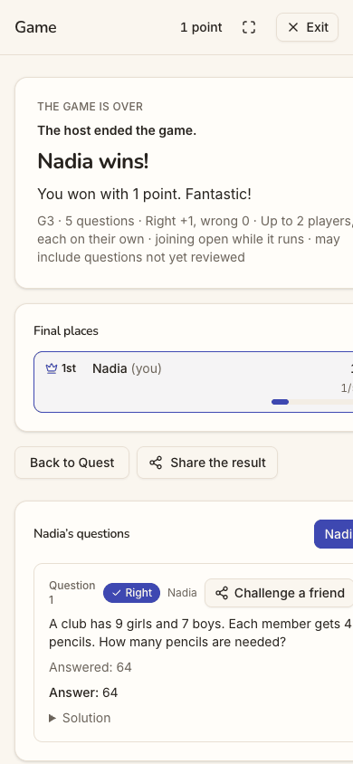  Repro:
  1. sign in as a parent whose child has no email and a lesson within the next days;
  2. on the home, tap "Practise together before tomorrow's lesson": the lobby lists only the parent;
  3. Start the Quest, answer one question, End the game now;
  4. go Home and reload: the child's "Played 0 days this week" is unchanged.
- **Recommended Fix:**
  - When the child cannot sign in, make the button start a game **on this device, as the child**: "Playing as Yusuf, with Mum". His answers then count towards his days, and Nadia is named as the helper, not the player.
  - When the child can sign in, list him in the lobby as "Yusuf — invited, not joined yet", and tell the parent where he will see the invitation.
  - Until one of these exists, do not offer "Play with" or "Practise together" for a child who cannot join. Offer "Ask the office to give Yusuf a sign-in" instead.
  - Name both players on the results ("Nadia and Yusuf: 1 of 5"), not "Nadia wins!".

### [sev2] Sign in opens a Sign up free dialog on a page with no sign of the institute
- **Issue Description:** The office told Nadia to sign in at the address. The address opens a children's maths game: "Math quests. Hit the target.", "Sign up free", "Today's 5 · Grade 4". It carries the Aimtrue name, and no Chapel Hill Math Institute, lessons or tutoring appear above the fold. The small "Sign in" pill opens a dialog titled **"Sign up free**: Keep your scores, unlock every quest and play with your family." Its one button is "Continue with Google" (step 2). J14 saw the same dialog for the office.
- **Framework Violation:** cuj-contract, steps 1-2; Nielsen #2 Match between system and the real world, and #4 Consistency and standards (the dialog does not match the button that opened it).
- **Severity:** 2. Real friction at the front door. A parent who has been added does not expect to sign up, and might wonder whether she is on the wrong site or about to make a second account. She gets through with one tap, which is why this is not higher. A less confident parent stops here and phones the office.
- **Evidence:** 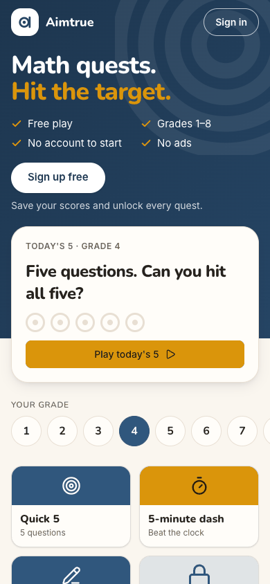  Repro: open `/` signed out → tap Sign in.
- **Recommended Fix:**
  - Title the dialog by its trigger: "Sign in". Under it, add: "Added by your tutoring centre? Use the Google account they have for you."
  - Keep "Sign up free" for the Sign up button.
  - On the guest page, add one line for families of a space, such as "Lessons with a tutoring centre? Sign in to see them", so a tutoring parent knows she has arrived at the right place.

### [sev2] Go to my dashboard stays on the home and the tour is offered twice more
- **Issue Description:** The welcome ended well, with the tour, then "Confirm your details", then "You're all set". After that the onboarding loops:
  - The last dialog says "Getting started on the dashboard brings this back", and its only button is "Go to my dashboard" (step 9). But she was on her home, not the dashboard: the tap left the URL at `/`.
  - The same tap brought up a second offer: "Welcome to CHMI — A two-minute tour of what is where. Take the tour / No thanks" (step 10). She had finished that tour two minutes earlier.
  - She answered No thanks. The same card came back on the Quest page after her game (step 20).
  - Counting the welcome dialog, she was offered the tour three times in her first ten minutes.
- **Framework Violation:** cuj-contract, steps 9, 10 and 20; Nielsen #1 Visibility of system status (her answer appears not to have been saved), and #4 Consistency and standards (a button named for one place does something else).
- **Severity:** 2. An observable mismatch on her first visit. It makes the product feel like it is not listening, and each offer costs a tap. For a parent who signs in once a week to check a lesson, a home that nags is a reason to stop opening it.
- **Evidence:** 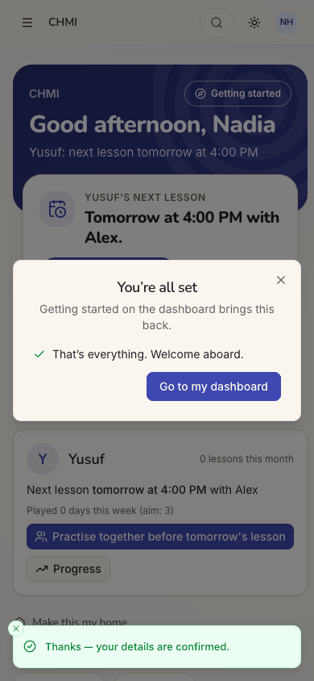 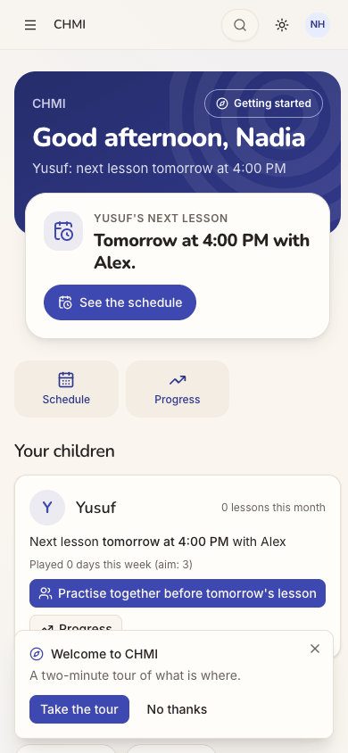 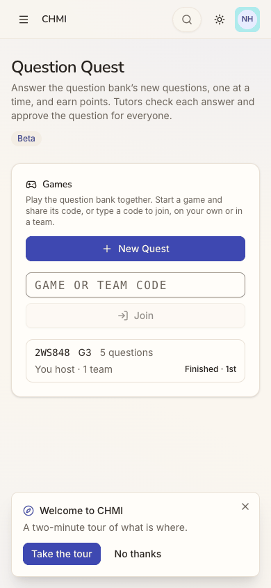 Repro:
  1. sign in as a new parent, Take the tour, Finish, then "Yes, that's all right";
  2. tap "Go to my dashboard": the URL stays `/`, and the "two-minute tour" card appears;
  3. tap No thanks, start a game from the home, end it and tap Exit: the card appears again.
- **Recommended Fix:**
  - Treat finishing the wizard's tour as having seen the tour, both for the person and on the device. Record No thanks for the person, not only for the page.
  - Rename "Go to my dashboard" to "Done", since she is already on her home.
  - Change "Getting started on the dashboard brings this back" to "Getting started, at the top of your home, brings this back".

### [sev2] The game is set at Grade 3 for a Grade 4 child and the lobby speaks in codes
- **Issue Description:** The office set Yusuf's course to "Grade 4" (J14), and the guest page Nadia saw first defaulted to Grade 4. The game her tap made is **"G3"** (step 15). The lobby's line reads: "G3 · 5 questions · Right +1, wrong 0 · Up to 2 players, each on their own · joining open while it runs · may include questions not yet reviewed".
  - Nothing let her see or change the level before the game existed.
  - "G3" is a code, not "Grade 3".
  - "each on their own" contradicts "together".
  - "may include questions not yet reviewed", and the "Beta" badge on every question (steps 17-18), tell a parent that the material may be wrong.
- **Framework Violation:** cuj-contract, step 15; Nielsen #2 Match between system and the real world, and #3 User control and freedom (no choice of level before a game is made).
- **Severity:** 2. An observable mismatch: the practice "before tomorrow's lesson" is a grade below the child. A parent judging whether this is worth her child's time reads "not yet reviewed" as a warning.
- **Evidence:**  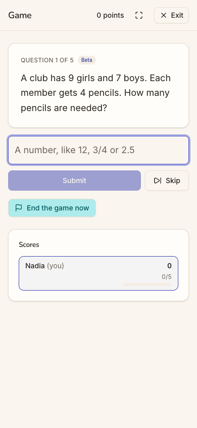 Repro: as a parent of a Grade 4 child, tap "Practise together…" on the home and read the lobby's line.
- **Recommended Fix:**
  - Start the game at the child's grade, from his Quest level or else his course, and say it in words: "Grade 4 · 5 questions".
  - Let the host change the level in the lobby before Start.
  - For family games, drop "each on their own" and "Right +1, wrong 0". Say "Some questions are new" instead of "may include questions not yet reviewed".

### [sev2] Exit from the game lands on Question Quest instead of the home
- **Issue Description:** The game was started from her home, but both ways out of the results lead to `/quest` ("Question Quest"): the top-right "Exit" and "Back to Quest". That page explains: "Answer the question bank's new questions, one at a time, and earn points. Tutors check each answer and approve the question for everyone." It lists her finished game and a "New Quest" button. Nothing on it leads back to Yusuf's card, so she needed the menu and Home to get back (step 21).
- **Framework Violation:** cuj-contract, step 20; Nielsen #3 User control and freedom (no clear way back to where she started), and #2 Match between system and the real world (copy written for students and tutors).
- **Severity:** 2. A dead end right after the feature. The parent lands on a page about a question bank and tutors approving questions, which is not hers, and has to find her way home through a 13-item menu.
- **Evidence:**  Repro: start a game from the home's Practise together → end it → tap Exit.
- **Recommended Fix:**
  - Carry where the game was started from and make Exit return there: "Back to home" when that was the home.
  - On the results, add "Back to Yusuf" for a family game.
  - Show parents a Quest page that leads with playing together, not with reviewing the question bank.

### [sev2] The parent's tour and menu are the office's and never show playing together
- **Issue Description:** The tour's first two stops are about Nadia's home, "Your children" and "Next up", and they are good. The other six all say "You will find it in the menu": Dashboard, Sessions, Schedule, Billing, Comments and Your profile.
  - On a phone, those six stops all spotlight the same hamburger icon (step 7), so the tour shows her nothing new after stop 2.
  - No stop mentions "Practise together", Quest or "Make this my home", which are the parts of her home that give her a reason to come back.
  - The menu itself (step 13) has 13 items. They include "Users", "Pairings" and "Activity", which are office words, and there is no "My children".
- **Framework Violation:** cuj-contract, steps 5-7 and 13; Nielsen #6 Recognition rather than recall (six names to remember behind one icon), and #2 Match between system and the real world (staff vocabulary for a parent).
- **Severity:** 2. Real friction in orientation. The tour costs her 9 taps and teaches the feature that matters to C3's stickiness, practising with the child, nowhere. The office-shaped menu makes the product read as the centre's admin tool, not her family's page.
- **Evidence:** 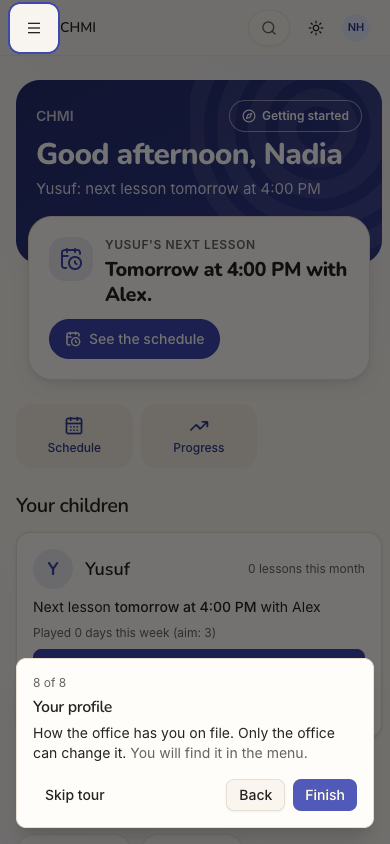 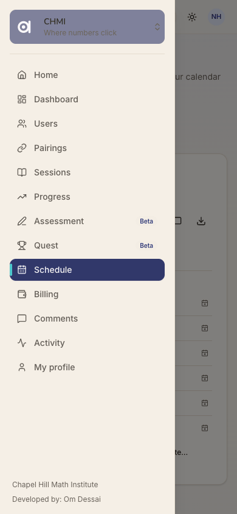 Repro: sign in as a new parent on a phone → Take the tour → Next through stops 3-8 → open the menu.
- **Recommended Fix:**
  - For a parent, tour the home's own blocks: the child card, "Practise together" (what it does, and that it counts towards the child's 3 days), "See the schedule" and "Make this my home".
  - Give the menu one stop that opens the drawer on a phone, so each item can be lit in turn.
  - Name the parent's menu items in parent words, for example "Family" for Users. Hide Pairings and Activity unless they hold something for her. What those pages show a parent was not inspected.

### [sev1] The next-lesson card says when but not where
- **Issue Description:** The home's card says "Tomorrow at 4:00 PM with Alex." It does not say where. The lesson is in person, and the place, "Institute, room 2", appears only on the Schedule page (step 11), two taps away.
  - The schedule card says "from 2026-11-04, ongoing". That is an ISO date, and it is the Wednesday the office set the series up, not a lesson.
  - The first real date, "Thu, Nov 5", appears only behind the icon-only "Dates" button (step 12).
  - The card's three icon buttons (Dates, Comment, Download calendar invite) carry no visible labels.
- **Framework Violation:** cuj-contract, steps 4, 11 and 12; Nielsen #6 Recognition rather than recall.
- **Severity:** 1. She found everything within two taps. Still, "where" is the next thing a new parent asks before the first in-person lesson.
- **Evidence:**  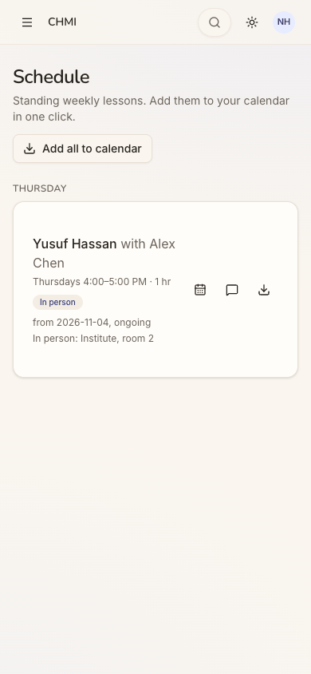 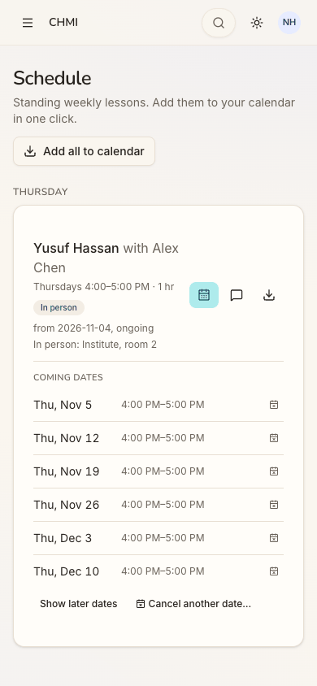 Repro: as a new parent, read the home's next-lesson card, then tap See the schedule.
- **Recommended Fix:**
  - Add the place to the home's card and the child card: "Tomorrow at 4:00 PM with Alex · in person, Institute, room 2".
  - On the schedule card, show "Next: Thu, Nov 5" and write the start date as "since Nov 4".
  - Label the three icons, or give them a text tooltip on a phone.

### [sev1] The game results run 40 px off a phone screen
- **Issue Description:** At 390 px wide, the results page measures 430 px. The final score ("1/5"), the "Nadia" filter pill and the "Challenge a friend" button are cut off at the right edge, and the page scrolls sideways.
- **Framework Violation:** cuj-contract, step 19; Nielsen #8 Aesthetic and minimalist design. It also breaks the project's own rule that no page overflows at 390 px.
- **Severity:** 1. Cosmetic: the winner and the points are readable, and nothing is blocked.
- **Evidence:**  Repro: on a phone, end a game and look at "Final places" and "Nadia's questions" (`document.documentElement.scrollWidth` is 430 at a 390 px viewport).
- **Recommended Fix:** let the final-places row, the per-player filter pills and the question header wrap below `sm`, and add the results page to `responsive.spec.ts`.

## Walkthrough

### Step 1 — Open the entry page signed out

> Expected: a way in that is recognisably her son's tutoring centre. Observed: the Aimtrue guest Play page: "Math quests. Hit the target.", "Sign up free", "Today's 5 · Grade 4", the grade row and the tiles. "Sign in" is a small outlined pill at the top right. There is no word of Chapel Hill Math Institute, lessons or tutors.

**What Nadia notices:** a game for children, under a name she was not told. The only thing that matches the office's instructions is "Sign in" in the corner.

### Step 2 — Tap "Sign in"

> Expected: a sign-in dialog. Observed: a dialog titled "Sign up free" ("Keep your scores, unlock every quest and play with your family.") with one "Continue with Google" button.

**What Nadia notices:** "Sign up"? The office already added her. She hesitates, but Google is what she was told to use, so she carries on.

### Step 3 — Continue with Google
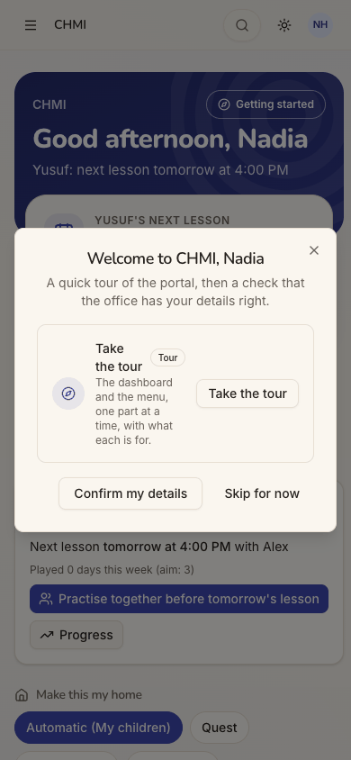
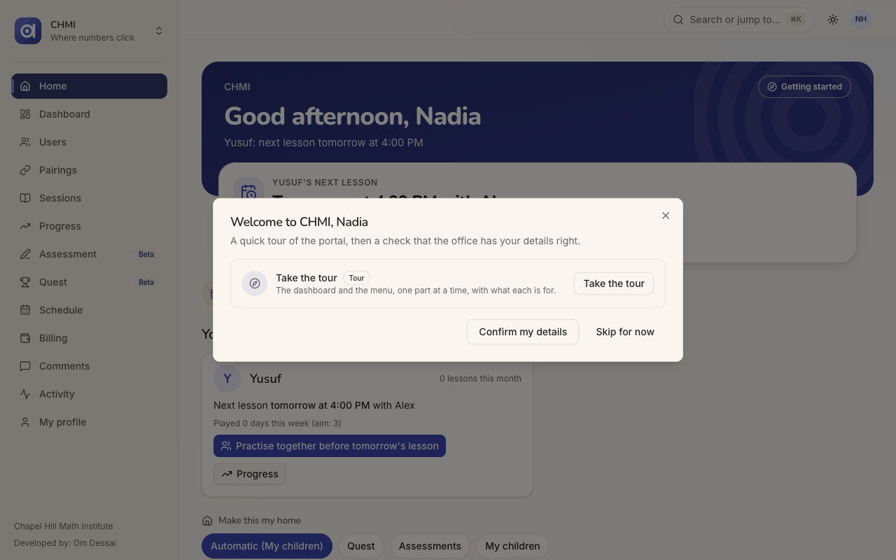
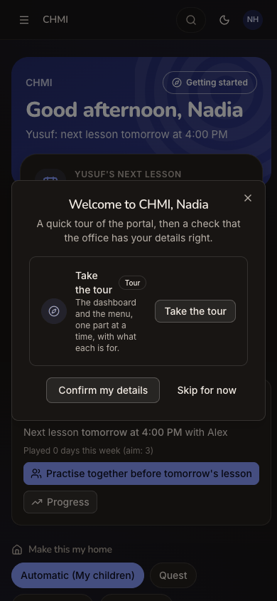
> Expected: signed in, in the institute. Observed: straight into CHMI (tab title "CHMI · Chapel Hill Math Institute"), with no chooser and no sign-up form. A dialog reads "Welcome to CHMI, Nadia — A quick tour of the portal, then a check that the office has your details right", with Take the tour, Confirm my details and Skip for now. Behind it: "Good afternoon, Nadia · Yusuf: next lesson tomorrow at 4:00 PM". On desktop, the sidebar lists 13 items, and "Chapel Hill Math Institute" appears in full only at its foot.

**What Nadia notices:** relief. It knows her name and Yusuf's lesson, and "CHMI" is the centre she knows. The dialog talks about a "portal".

### Step 4 — Take the tour

> Expected: the tour starts. Observed: the dialog closes and the plain home shows for about 2 s before the first stop:
> - the band;
> - "YUSUF'S NEXT LESSON · Tomorrow at 4:00 PM with Alex." with See the schedule;
> - quick actions Schedule and Progress;
> - Your children: Yusuf, 0 lessons this month, Played 0 days this week (aim: 3), Practise together before tomorrow's lesson, Progress;
> - the Make this my home chips.

**What Nadia notices:** the answer to her question is the biggest thing on the page. A short "did that work?" pause before the tour appears.

### Step 5 — Tour stop 1 of 8: Your children
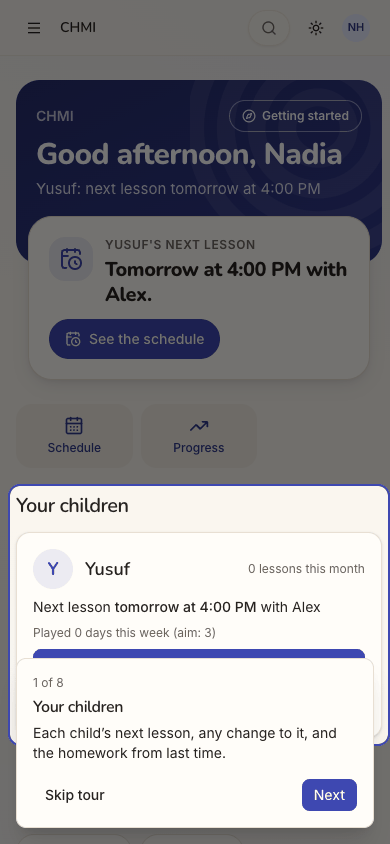
> Expected: the tour explains her home. Observed: "1 of 8 · Your children: Each child's next lesson, any change to it, and the homework from last time." The spotlight is on Yusuf's card, and the popover covers its Practise together button.

**What Nadia notices:** a clear explanation of the card she cares about. She does not yet notice the button the popover hides.

### Step 6 — Next: tour stop 2 of 8, Next up
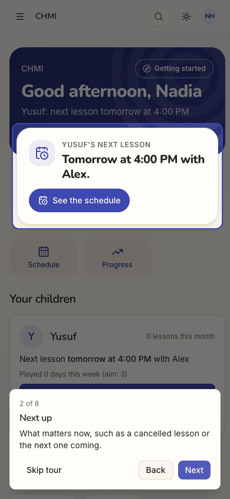
> Expected: the next part of the home. Observed: "2 of 8 · Next up: What matters now, such as a cancelled lesson or the next one coming." The spotlight is on the next-lesson card. Match. Stops 3-7 followed (Dashboard, Sessions, Schedule, Billing, Comments, each "You will find it in the menu."); they were read from the page, not photographed.

**What Nadia notices:** good. A cancelled lesson would show up right here.

### Step 7 — Next ×6: tour stop 8 of 8, Your profile

> Expected: each stop shows its part of the app. Observed: "8 of 8 · Your profile: How the office has you on file. Only the office can change it. You will find it in the menu." On the phone, stops 3-8 all spotlight the same hamburger icon at the top left. No stop covers Practise together, Quest or Make this my home.

**What Nadia notices:** six names to remember behind one icon, and the tour stopped showing her anything after the second stop.

### Step 8 — Finish: Confirm your details

> Expected: the details check the welcome promised. Observed: "Confirm your details — One last thing: check the office has you right." It shows Nadia Hassan, Parent, Active, her email, 919-555-0142, the last sign-in, "Added to the portal" and, below the fold, "Responsible for: Yusuf Hassan · Mother · Primary contact · No email". Buttons: "Yes, that's all right" and "Something needs changing".

**What Nadia notices:** reassuring. Everything she gave on the phone is right, and Yusuf is linked to her. "No email" next to Yusuf means nothing to her yet.

### Step 9 — Yes, that's all right

> Expected: done. Observed: the toast "Thanks — your details are confirmed." and a dialog "You're all set — Getting started on the dashboard brings this back. ✓ That's everything. Welcome aboard." with one button, "Go to my dashboard".

**What Nadia notices:** finished. But the page she is on is called Home, not dashboard, and the only button offers to take her somewhere else.

### Step 10 — Go to my dashboard

> Expected: the dashboard, or simply the home with nothing more to do. Observed: the URL stays `/` (the home), and a new card appears at the bottom: "Welcome to CHMI — A two-minute tour of what is where. Take the tour / No thanks".

**What Nadia notices:** "Didn't I just do this?" It feels as if what she did was not saved.

### Step 11 — No thanks, then See the schedule

> Expected: Yusuf's lesson with its details. Observed: Schedule: "Standing weekly lessons. Add them to your calendar in one click." (Add all to calendar). Under THURSDAY: "Yusuf Hassan with Alex Chen · Thursdays 4:00–5:00 PM · 1 hr · In person · from 2026-11-04, ongoing · In person: Institute, room 2", with three icon-only buttons.

**What Nadia notices:** now she knows where: Institute, room 2. The home never said. "from 2026-11-04" is the day the office set it up, written like a database date.

### Step 12 — Tap Dates

> Expected: the coming dates. Observed: COMING DATES: Thu, Nov 5; Nov 12; Nov 19; Nov 26; Dec 3; Dec 10, each 4:00–5:00 PM with a small cancel icon, then "Show later dates" and "Cancel another date…". Match.

**What Nadia notices:** confirmation that "tomorrow" is Thursday, Nov 5. She also learns she can cancel one date herself, such as Thanksgiving on Nov 26, which the tour mentioned.

### Step 13 — Open the menu

> Expected: a way back to her home. Observed: a drawer with the space switcher (CHMI · Where numbers click) and 13 items: Home, Dashboard, Users, Pairings, Sessions, Progress, Assessment (Beta), Quest (Beta), Schedule, Billing, Comments, Activity and My profile.

**What Nadia notices:** a long list in the office's words ("Users", "Pairings", "Activity"), with no "My children" and nothing about playing. She taps Home.

### Step 14 — Menu → Home
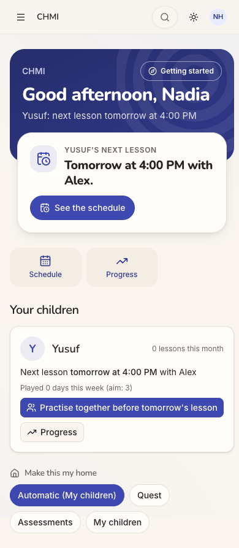
> Expected: her home. Observed: the whole home fits about one phone screen. Yusuf's card ends with the one filled button, "Practise together before tomorrow's lesson", and Progress. Below it are the Make this my home chips: Automatic (My children), Quest, Assessments and My children.

**What Nadia notices:** the button invites her to practise with Yusuf before tomorrow. "Played 0 days this week (aim: 3)" suggests Yusuf should play three days a week, but not where or how.

### Step 15 — Practise together before tomorrow's lesson

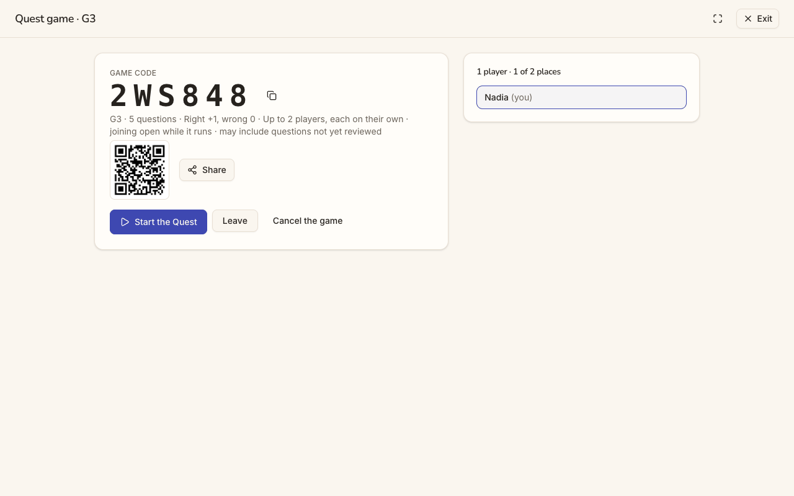
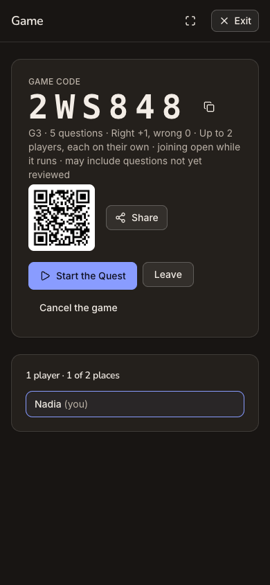
> Expected: a game for Nadia and Yusuf at his grade, with Yusuf shown as joining. Observed: a full-screen "Game" (on desktop "Quest game · G3") showing:
> - GAME CODE 2WS848 with a copy button;
> - "G3 · 5 questions · Right +1, wrong 0 · Up to 2 players, each on their own · joining open while it runs · may include questions not yet reviewed";
> - a QR code and Share;
> - Start the Quest, Leave and Cancel the game;
> - the roster: "1 player · 1 of 2 places · Nadia (you)".
>
> Yusuf is not shown. The game was made in one tap.

**What Nadia notices:** a big code and a QR code, but for whom? Yusuf is sitting beside her with no phone and no login. "G3" does not read as Grade 3 to her, and "not yet reviewed" makes her wary.

### Step 16 — Start the Quest
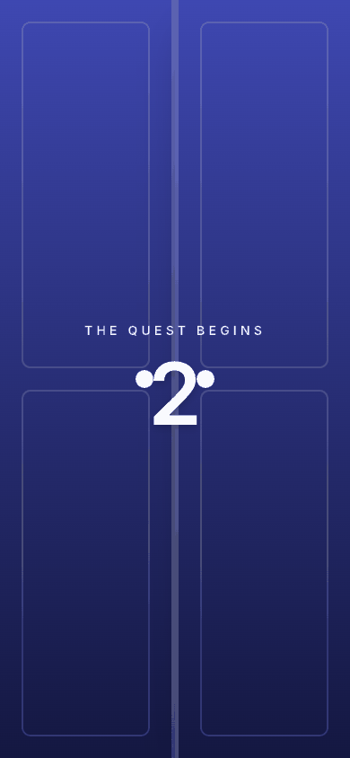
> Expected: the game starts. Observed: a full-screen doors animation, "THE QUEST BEGINS", counting down ("Get ready: the doors are opening…"). Play with has started.

**What Nadia notices:** fun, and Yusuf would like the doors.

### Step 17 — The first question

> Expected: a question for them both. Observed: "QUESTION 1 OF 5 · Beta · A club has 9 girls and 7 boys. Each member gets 4 pencils. How many pencils are needed?", with the input "A number, like 12, 3/4 or 2.5", Submit, Skip and End the game now. Scores list only "Nadia (you)".

**What Nadia notices:** they can work it out together on her phone, but the score is hers.

### Step 18 — Type 64, Submit
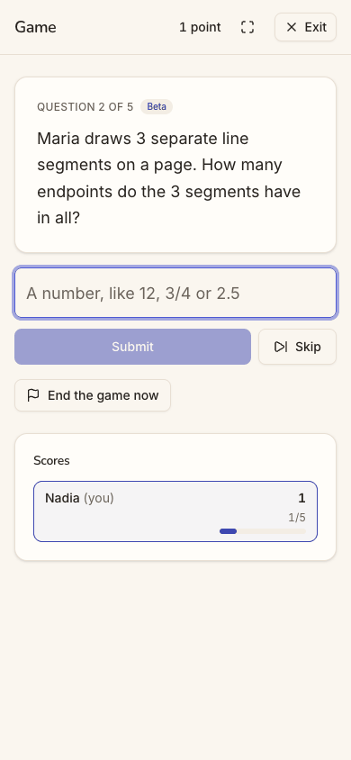
> Expected: marked. Observed: the toast "Right! +1", then question 2 of 5, with Nadia at 1 point (1/5). Match.

**What Nadia notices:** instant feedback, and Yusuf got it right. The app thinks Nadia did.

### Step 19 — End the game now

> Expected: a summary for the two of them. Observed: the game ends at once, with no confirmation: "The host ended the game. Nadia wins! You won with 1 point. Fantastic!", then Final places (1st Nadia), Back to Quest, Share the result, and Nadia's questions with the solution. The page is 430 px wide in a 390 px screen, and the right edge is cut off.

**What Nadia notices:** "Nadia wins!" in what was meant to be Yusuf's practice. The cut-off right edge makes it look broken.

### Step 20 — Exit

> Expected: back to her home. Observed: `/quest`, "Question Quest — Answer the question bank's new questions, one at a time, and earn points. Tutors check each answer and approve the question for everyone." Under Games: New Quest, a code box, Join, and her finished game ("2WS848 G3 · You host · Finished · 1st"). The "Welcome to CHMI — two-minute tour" card appears again.

**What Nadia notices:** this page is not about her or Yusuf, and the tour she declined is back. A wrong turn: she has to find Home again.

### Step 21 — No thanks, menu → Home, reload (end-state check)

> Expected: Yusuf's card reflects the practice. Observed: after a reload, the home is unchanged: "0 lessons this month", "Next lesson tomorrow at 4:00 PM with Alex", **"Played 0 days this week (aim: 3)"**, and the same "Practise together before tomorrow's lesson" button. The tour offer did not return after the reload.

**What Nadia notices:** the practice did not count for Yusuf. Nothing on his card shows they played.

## Appendix

- **Mode:** live. A real headless Chrome drove the app at http://localhost:8797, a frozen copy of commit `2d6e7d3` with sign-in on and its own local database. Phone width is 390×844. Desktop (1280×800) and dark mode were captured at the landing screens: step 1 (the entry), step 3 (the first screen inside the space) and step 15 (where the feature starts).
- **Frameworks applied:**
  - cuj-contract: each step's expected against observed;
  - task-completion: reaching Yusuf, his next lesson and a started "Play with" game;
  - success-criteria: the end state re-checked after a reload at step 21.
- **Coverage / not inspected:**
  - "Skip for now" and "Confirm my details" straight from the welcome dialog: Nadia took the tour instead.
  - Tour stops 3-7 were read from the page, not photographed. Where the tour points on desktop (the sidebar items) was not checked.
  - Anything as Yusuf. No screen was opened as him, so whether an invitation was made for him, and where it would show, was not seen. Whether the lobby lists an invited child who can sign in was not checked either.
  - The lobby's Share, QR code, Leave and Cancel the game, and the results' Share the result and Challenge a friend.
  - Questions 2-5: the game was ended after one answer. The guest page's own play was not used.
  - The Progress link, Dashboard, Sessions, Billing, Comments, Users, Pairings, Activity, Assessment, My profile and the Make this my home chips. What Users, Pairings and Activity show a parent was not inspected.
  - Cancelling one date, and the calendar downloads ("Add all to calendar", "Download calendar invite").
  - "Something needs changing" on the details check.
  - Email: the local stack sends no mail, and none was expected (J14 notes no email reached Nadia).
  - Desktop and dark mode outside the landing screens.
  - The iOS app, which is covered by separate journeys.
- Access: through the app's real sign-in and sign-up screens; the Google provider step is simulated (a stand-in for Google's button hands the app a local test token for the persona).
- **Preconditions made outside the UI:** none specific to J15. Nadia, Yusuf, his pairing with Alex Chen and the Thursday lesson were all made through the UI by the office in J14 of this run. The run's shared setup applies (README, "The run"): the platform settings, and Assessment and Quest switched on in `chmi` by its admin with the same request `seed:scenarios --demo` makes.
- **State left behind:** Nadia has signed in once, confirmed her details and seen the tour. A finished one-player game, code 2WS848 (G3, ended by the host after one answer), is in `chmi` with Nadia as host.
