# CUJ Audit — J15A: new tutoring parent signs in to the app for the first time

## Executive summary

**Persona.** Hana Mori is a parent. The office at Chapel Hill Math Institute (`chmi`) has just added her and her son
Ken (grade 3, no email). Ken is paired with the tutor Alex Chen, with a weekly lesson on Fridays at 4:00 PM in
"Institute, room 2"; the first one is in two days. She is cohort **C3** of `docs/member-home-plan.md`, the tutoring
parent, whose question is "When's the next lesson, anything changed?". The office told her to install the app and
sign in with hana.mori@example.com. She wanted to:
- get in;
- find Ken and his next lesson;
- try playing with Ken, the home's way for a parent to practise with their child.

This is the app replay of the web journey J15 (`J15-tutoring-parent-first-sign-in.md`).

**Outcome: 1/1 journeys passed, 0 skipped, 24 of 24 steps verified.** Hana reached the journey's end:
- Signing in took her straight into CHMI. There was no space chooser, no sign-up form and no approval wait (step 4).
- A full-screen welcome offered the tour. She took it (8 stops), confirmed her details and was told "You're all set"
  (steps 5-10).
- Her home answered her question on one screen: "Ken's next lesson · Fri at 4:00 PM with Alex.", and Ken's card
  under "Your children" (step 12).
- "See the schedule" and "Dates" gave the place, Institute, room 2, and the first date, Fri, Nov 6 (steps 13-14).
- One tap on Ken's card, "Practise together before Friday's lesson", made a game. "Start the Quest" started it
  (steps 16-17).

The end state is not what the button promises, exactly as on the web. The game had **one player, Hana**:
- Ken appears nowhere in the lobby, and he has no email, so he has no way to join.
- The practice counted for her: "Hana wins! You won with 1 point. Fantastic!" (step 21).
- After closing and reopening the app, Ken's card still says "Played 0 days this week (aim: 3)" (step 23, finding 1).

**Conversion figures**, counted from the app's first screen to the started game (steps 1-17). The address is typed
into the developer sign-in, which stands in for the provider step; see the Appendix.

| Measure | Count |
| --- | --- |
| Screens | 10 distinct |
| Taps | 20 (+2 scrolls and 1 swipe) |
| Typed fields | 1 (the address, developer sign-in only) |
| Waits | 2 (sign-in ~2 s, the countdown ~3 s) |
| Dead ends | 0 before the feature; 0 after it |

- The 10 distinct screens were:
  - the guest home and the developer sign-in;
  - the full-screen Welcome, Confirm your details and You're all set;
  - the home, under the tour and then with the tour offered again;
  - the Schedule (in the Sessions tab);
  - the game lobby and the countdown.
- Of the 20 taps:
  - 12 went to onboarding: Take the tour, Next ×7, Finish, "Yes, that's all right", "Go to my dashboard", and No
    thanks on the repeated offer;
  - 3 were her lesson check: See the schedule, Dates and the Home tab;
  - 3 were the developer sign-in: Sign in, the address field, Sign in (production: Sign in and one provider button);
  - 2 were the path itself: Practise together and Start the Quest.
- The shortest path on screen is 4 taps plus the provider step: Sign in, Skip for now, Practise together, Start the
  Quest. "Skip for now" was not pressed in this run.
- After the feature (steps 18-24): 6 taps (an answer, Submit, End the game now, End the game, Exit, Ken's card) and
  one relaunch. Exit led straight back to the home.

**The 3 screens Hana would notice most**

- **Step 12: her home already knows Ken's lesson.** "Good afternoon, Hana · CHMI · Ken: next Fri at 4:00 PM", then a
  "Ken's next lesson" card and Ken's own card with "Practise together before Friday's lesson". Her question is
  answered on the first plain screen, with nothing to set up. This is the strongest moment of the journey. Neither
  card says where the lesson is (finding 5).
  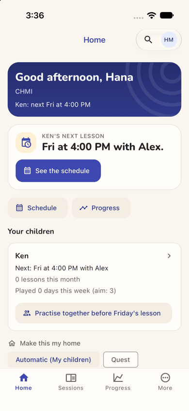
- **Step 16: "Practise together" makes a game without Ken in it.** One tap gives a big code "RF9CK6", a QR code and a
  share button, but the roster lists only "Hana (you)", "1 player · 1 of 2 places". Ken is beside her with no phone
  and no sign-in, so the code has no one to go to. The line above says "each on their own".
  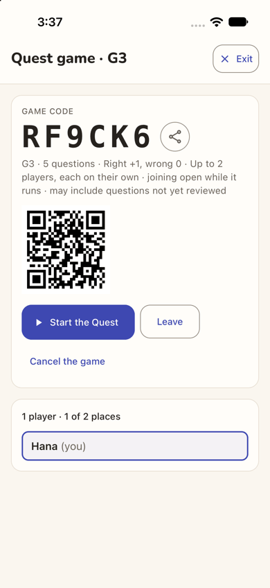
- **Step 23: after practising, Ken still has "Played 0 days".** She and Ken answered a question together, and the
  game ended "Hana wins!". After closing and reopening the app, Ken's card is unchanged and offers the same button
  again. The "aim: 3" is the card's reason to come back, and it cannot move for a child who cannot sign in.
  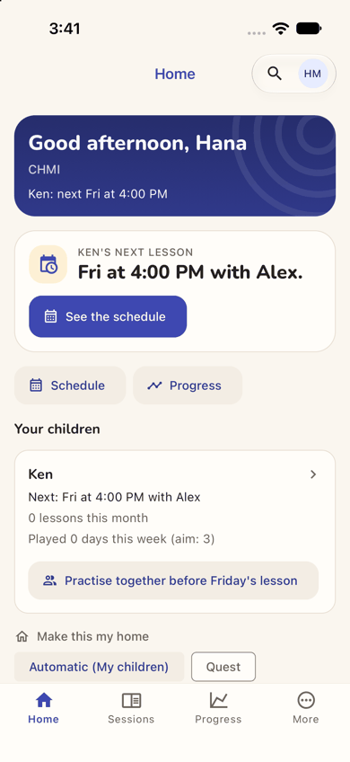

**Contact sheet** (all 24 phone steps):

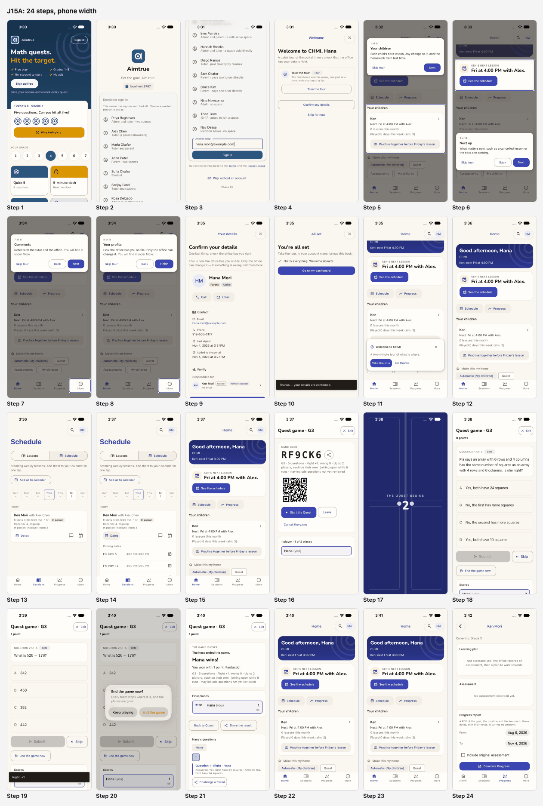

**Web and app.** Compared with the web journey J15 (`J15-tutoring-parent-first-sign-in.md`, Nadia Hassan), the app
runs the same steps with the same words, and avoids three of the web's problems:

- **Getting in.** On the web, "Sign in" opened a dialog titled "Sign up free" (a sev2 there). In the app it opens a
  sign-in screen headed by the brand. Here that screen was the developer variant, so the production buttons were not
  seen. The guest home is the same children's game, with no word of the centre (finding 4).
- **The welcome.** The app's welcome is a full screen and hides the home. On the web it was a dialog over a home that
  already showed the lesson. The words are the same: "portal", and "The dashboard and the menu".
- **The tour.** It has the same 8 stops and the same first two. On the phone web, stops 3-8 all lit one hamburger
  icon. The app lights the real tab ("You will find it under More" or "under Sessions"), but that is still only two
  tabs for six stops (finding 3). Its card sits away from the lit part; the web's covered the Practise button.
- **The repeated tour offer.** The All set screen now says where the tour lives ("in your account menu"). "Go to my
  dashboard" still lands on the home, and the same "two-minute tour" offer follows at once. In the app it came once
  more, not twice: it did not return after the game or after a relaunch (finding 2).
- **The lesson.** The home cards are the same. The Schedule sits in the Sessions tab, with a day strip and a labelled
  "Dates" button. The date is readable ("from Nov 4", where the web wrote 2026-11-04). The way back is one tap on the
  Home tab; the web needed the 13-item menu.
- **The game.** The lobby and its line are the same, word for word. The level was G3, which matches Ken's grade 3;
  the web's grade-4 child was also given G3. "End the game now" asks to confirm; the web ended at once. The results
  fit the screen; the web's ran 40 px off (a sev1 there). Exit returns to the home, which fixes the web's sev2 (Exit
  went to "Question Quest").
- **Ken's card (app only).** Tapping it opens Ken's Progress page: an empty learning plan and a report form
  (finding 7). The web's equivalent link was not opened.
- **The end state** is the same on both: the practice is Hana's, and Ken's card does not move.

| Severity | Count |
| --- | --- |
| sev4 (catastrophe) | 0 |
| sev3 (major) | 1 |
| sev2 (minor) | 2 |
| sev1 (cosmetic) | 4 |
| **Total** | **7** |

## Prioritized fixes

1. [sev3] [Practise together starts a game Ken cannot join and credits Hana](#sev3-practise-together-starts-a-game-ken-cannot-join-and-credits-hana): for a child with no sign-in, play on this device as the child; otherwise show the child as invited in the lobby (steps 16-23).
2. [sev2] [The tour Hana has just finished is offered again at once over the Practise button](#sev2-the-tour-hana-has-just-finished-is-offered-again-at-once-over-the-practise-button): count the wizard's tour as seen, and make the last button "Done" (steps 10-11).
3. [sev2] [Six of the eight tour stops point at two tabs and none at practising together](#sev2-six-of-the-eight-tour-stops-point-at-two-tabs-and-none-at-practising-together): tour a parent's home blocks, and drop "portal" and "the dashboard and the menu" from the welcome (steps 4-8).
4. [sev1] [The front door never mentions the tutoring centre](#sev1-the-front-door-never-mentions-the-tutoring-centre): add one line for families of a space on the guest home and the sign-in screen (steps 1-2).
5. [sev1] [The next-lesson card says when but not where](#sev1-the-next-lesson-card-says-when-but-not-where): add the place to the home's cards, and label the schedule's icons (steps 12-14).
6. [sev1] [The game speaks in codes and team words to a parent](#sev1-the-game-speaks-in-codes-and-team-words-to-a-parent): say "Grade 3", drop "each on their own" and "every team" for a family game, and soften "not yet reviewed" (steps 16, 18, 20, 21).
7. [sev1] [Tapping Ken opens an empty progress report, not his lessons or play](#sev1-tapping-ken-opens-an-empty-progress-report-not-his-lessons-or-play): open a child page with the lesson, the days played and Practise together (step 24).

## Findings

### [sev3] Practise together starts a game Ken cannot join and credits Hana

- **Issue Description:** Ken's card on the home offers one button, "Practise together before Friday's lesson". One tap
  makes a game for two (step 16), and that part is fast. But:
  - the lobby shows "1 player · 1 of 2 places" and only "Hana (you)". There is no "Ken invited", no "waiting for Ken",
    and no word on how he joins;
  - the line under the code says "Up to 2 players, each on their own", which contradicts "together";
  - Ken has "No email" (her details, step 9), so he cannot sign in to use the code, the QR code or the share button
    the lobby offers;
  - played on Hana's phone with Ken beside her, the game is hers. The scores list only her (steps 18-19), and the end
    says "Hana wins! You won with 1 point. Fantastic!" (step 21);
  - back on the home, and again after closing and reopening the app, Ken's card still reads "Played 0 days this week
    (aim: 3)". The same button is offered again, as if nothing had happened (steps 22-23).
- **Framework Violation:** cuj-contract, steps 16-23; success-criteria (the end state was re-checked after a relaunch
  at step 23). It also breaks:
  - Nielsen #1 Visibility of system status: whether the child was invited, and how he joins, is never shown;
  - Nielsen #2 Match between system and the real world: "Practise together" yields a game of one, "each on their
    own".
- **Severity:** 3. The end state is wrong for this cohort, and the only workaround credits the wrong person: Hana plays
  on her own phone while Ken watches.
  - C3's children are mostly young students the office adds without an email, so this is the normal case, not an edge
    case.
  - The button exists to get the child practising before the lesson and to move his "aim: 3". It can do neither, so
    the card's reason to come back (stickiness) fails from the first use.
  - The app behaves exactly like the web here (J15, finding 1): it is the same defect on both platforms.
- **Evidence:** 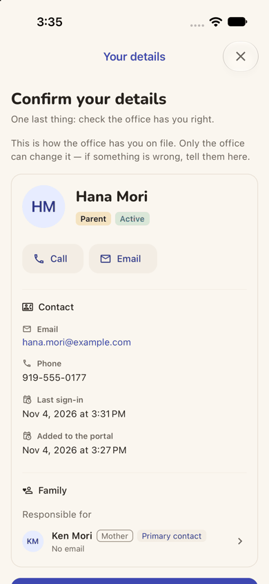 
  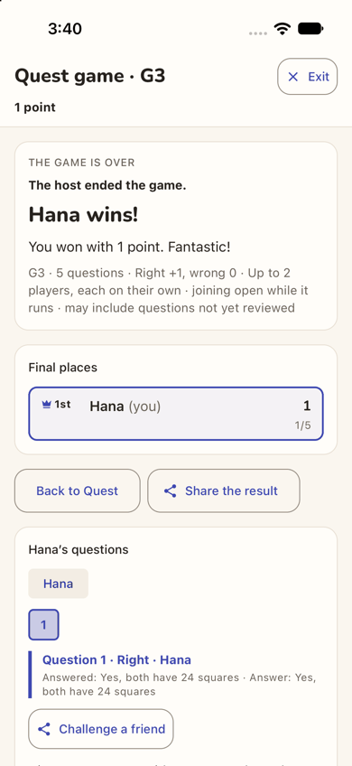  Repro:
  1. in the app, sign in as a parent whose child has no email and a lesson within the next days;
  2. on the home, tap "Practise together before <day>'s lesson": the lobby lists only the parent;
  3. tap Start the Quest, answer one question, then End the game now and End the game;
  4. tap Exit, close and reopen the app: the child's "Played 0 days this week" is unchanged.
- **Recommended Fix:**
  - When the child cannot sign in, make the button start a game **on this device, as the child**: "Playing as Ken,
    with Mum". His answers then count towards his days, and Hana is named as the helper, not the player.
  - When the child can sign in, list him in the lobby as "Ken — invited, not joined yet", and tell the parent where he
    will see the invitation.
  - Until one of these exists, do not offer "Practise together" or "Play with" for a child who cannot join. Offer "Ask
    the office to give Ken a sign-in" instead.
  - Name both players on the results ("Hana and Ken: 1 of 5"), not "Hana wins!". Fix web and app together, as the
    parity rule requires.

### [sev2] The tour Hana has just finished is offered again at once over the Practise button

- **Issue Description:** The welcome went well: the tour, then "Confirm your details", then "You're all set". After
  that:
  - the last screen's only button is "Go to my dashboard" (step 10), but it lands on her Home, not a dashboard;
  - at the same moment a card appears over the bottom of the home: "Welcome to CHMI — A two-minute tour of what is
    where. Take the tour / No thanks" (step 11). She finished that same tour about a minute earlier;
  - the card sits over Ken's "Practise together" button, the one thing on the home she has not tried yet.

  Counting the welcome, she was offered the tour twice in her first five minutes. Unlike the web, it did not come back
  after the game or after a relaunch.
- **Framework Violation:** cuj-contract, steps 10-11; Nielsen #1 Visibility of system status (her finished tour
  appears not to have been saved), and #4 Consistency and standards (a button named for one place goes to another).
- **Severity:** 2. An observable mismatch on her first visit, which costs a tap and hides the home's main button. For a
  parent who opens the app once a week to check a lesson, an app that seems not to listen is a reason to stop opening
  it.
- **Evidence:** 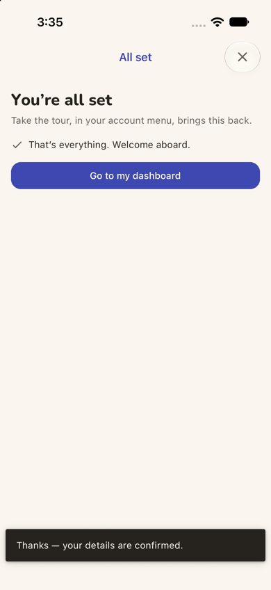 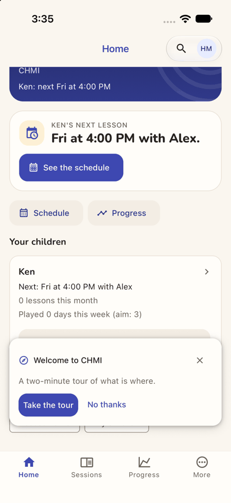 Repro:
  1. in the app, sign in for the first time as a parent the office has added;
  2. Take the tour, Next to the end, Finish, then "Yes, that's all right";
  3. tap "Go to my dashboard": the home opens with the "two-minute tour" card over the child's card.
- **Recommended Fix:**
  - Count finishing the wizard's tour as having seen the tour, both for the person and on the device.
  - Rename "Go to my dashboard" to "Done" (she is on her Home), or "Go to my home".
  - Keep the offer away from the home's main actions when it does show.

### [sev2] Six of the eight tour stops point at two tabs and none at practising together

- **Issue Description:** The welcome promises "A quick tour of the portal" and "The dashboard and the menu, one part
  at a time" (step 4). The app has a Home and a tab bar, and neither word is used anywhere else Hana looks. The tour's
  first two stops are about her home, "Your children" and "Next up", and they are good (steps 5-6). After that:
  - stops 3, 6, 7 and 8 (Dashboard, Billing, Comments, Your profile) all light the same More tab;
  - stops 4 and 5 (Sessions, Schedule) both light the Sessions tab (steps 7-8);
  - no stop covers "Practise together", "Played 0 days this week (aim: 3)", the "Make this my home" chips, Quest or the
    Progress tab, which are the parts of her home that give her a reason to come back.
- **Framework Violation:** cuj-contract, steps 4-8; Nielsen #6 Recognition rather than recall (four names to
  remember behind one tab), and #2 Match between system and the real world ("portal", "dashboard", "menu" in an app).
- **Severity:** 2. Real friction in orientation. The tour costs her 9 taps, and the feature that matters for C3's
  stickiness, practising with the child, is taught nowhere. It is better than the phone web, which lit one hamburger
  icon six times, but the gap is the same.
- **Evidence:** 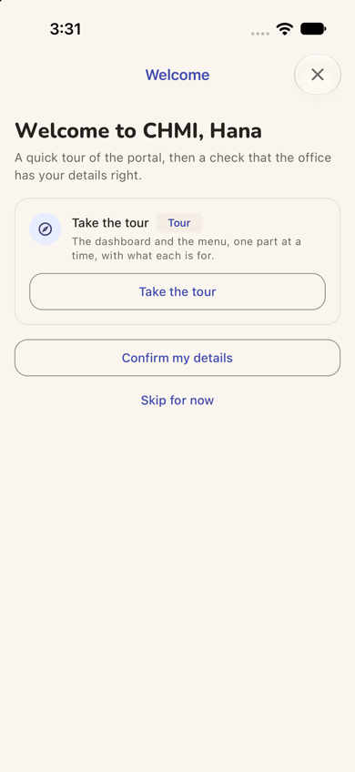 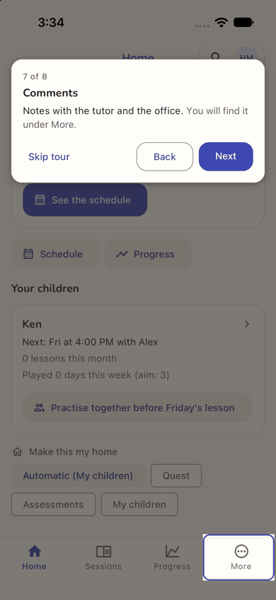
  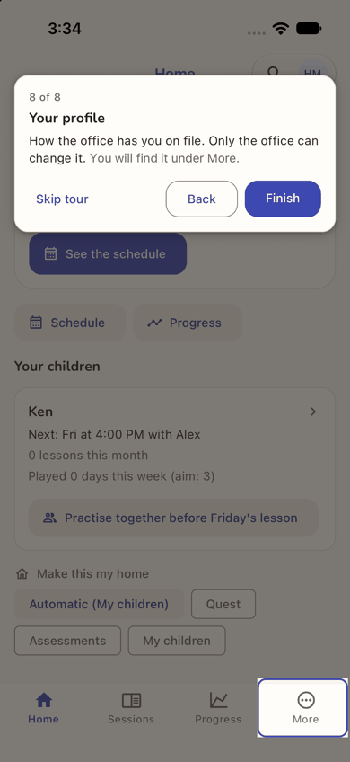 Repro: sign in to the app as a new parent, Take the tour, and Next through
  stops 3-8.
- **Recommended Fix:**
  - For a parent, tour the home's own blocks: Ken's card, "Practise together" (what it does, and that it counts
    towards the child's 3 days), "See the schedule" and "Make this my home".
  - Give More one stop that opens it, and light each item inside in turn.
  - In the welcome, say "A quick tour of the app" and "Your home and the tabs", not "portal" and "the dashboard and
    the menu".

### [sev1] The front door never mentions the tutoring centre

- **Issue Description:** The office told Hana to install the app and sign in. The app opens on a children's maths game:
  "Aimtrue", "Math quests. Hit the target.", "Sign up free", "Today's 5 · Grade 4" (step 1). There is no word of
  Chapel Hill Math Institute, lessons, tutors or families of a centre. "Sign in" is a small outlined pill at the top
  right. The sign-in screen it opens is headed "Aimtrue · Set the goal. Aim true." (step 2). CHMI appears only after
  she has signed in (step 4).
- **Framework Violation:** cuj-contract, steps 1-2; Nielsen #2 Match between system and the real world.
- **Severity:** 1. She gets through, because "Sign in" matches what she was told, and the app does not show the web's
  misleading "Sign up free" title. A less confident parent might wonder whether she has installed the right app.
- **Evidence:** 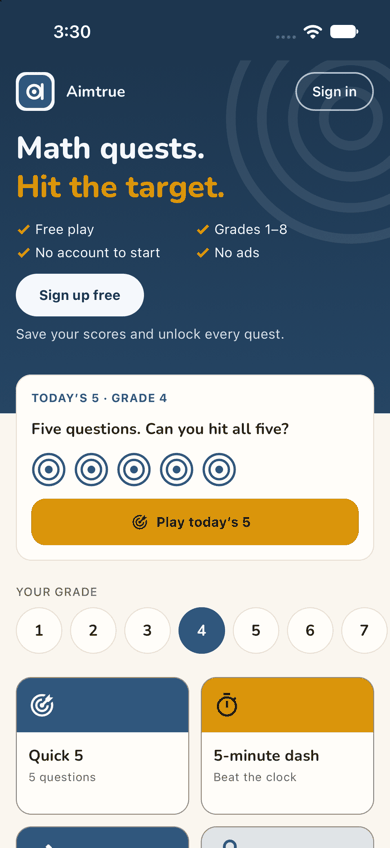 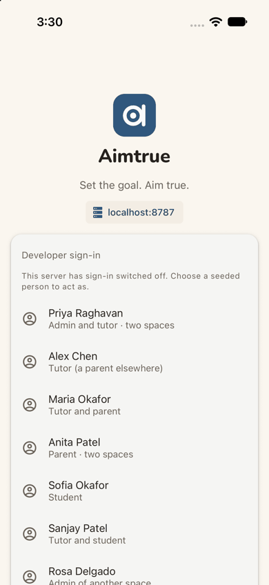 Repro: install the
  app and open it signed out.
- **Recommended Fix:**
  - On the guest home, under "Sign in" or above the fold, add one line for families of a space: "Lessons with a
    tutoring centre? Sign in to see them."
  - On the sign-in screen, add: "Added by your tutoring centre? Use the account they have for you."

### [sev1] The next-lesson card says when but not where

- **Issue Description:** The home's cards say "Fri at 4:00 PM with Alex." and "Next: Fri at 4:00 PM with Alex"
  (step 12). The lesson is in person, and the place, "Institute, room 2", appears only on the Schedule, one tap away
  (step 13). The first real date, "Fri, Nov 6", appears only behind "Dates" (step 14). On the schedule card:
  - "from Nov 4, ongoing" is the day the office set the series up, not a lesson;
  - the comment and calendar buttons are icons only, as is each coming date's cancel button.
- **Framework Violation:** cuj-contract, steps 12-14; Nielsen #6 Recognition rather than recall.
- **Severity:** 1. She found everything within two taps. Still, "where" is the next thing a new parent asks before the
  first in-person lesson.
- **Evidence:**  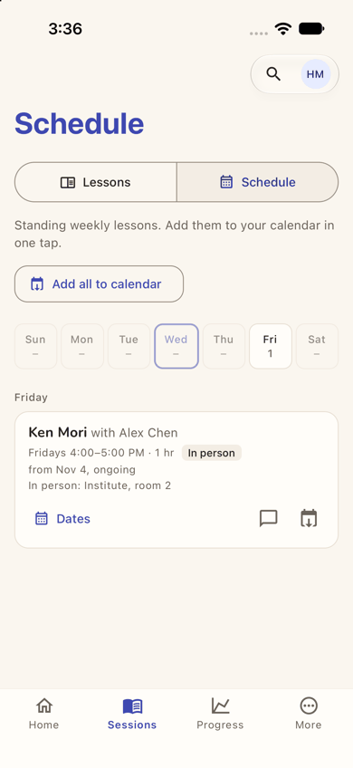
  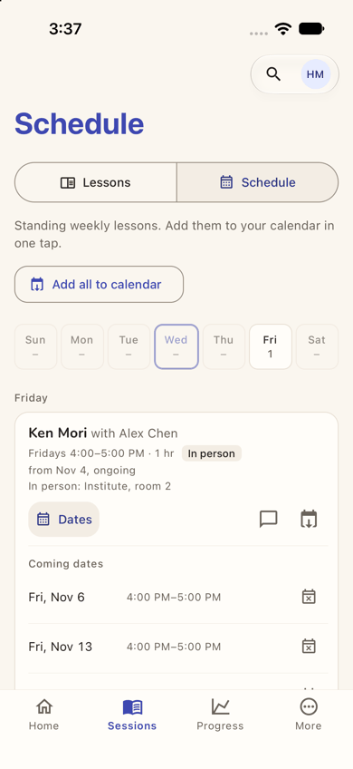 Repro: as a new parent, read the home's lesson cards, then tap See the
  schedule and Dates.
- **Recommended Fix:**
  - Add the place to both home cards: "Fri at 4:00 PM with Alex · Institute, room 2".
  - On the schedule card, show "Next: Fri, Nov 6", and write the start as "since Nov 4".
  - Give the icon buttons visible labels (Comment, Add to calendar, Cancel this date), as "Dates" already has.

### [sev1] The game speaks in codes and team words to a parent

- **Issue Description:** For a game a parent started to practise with her child, the screens use game-builder words:
  - the title and rules line say "G3", not "Grade 3" (step 16);
  - "Right +1, wrong 0 · Up to 2 players, each on their own · joining open while it runs" (steps 16, 21);
  - "may include questions not yet reviewed", and a "Beta" badge on every question (steps 16, 18), tell a parent the
    material may be wrong;
  - ending asks "End the game now? Every team stops where it is, and the places are given." for a game of one (step
    20);
  - the results give "Final places" and "1st" (step 21).

  Nothing let her see or change the level before the game existed. Here G3 matched Ken's grade 3.
- **Framework Violation:** cuj-contract, steps 16, 18, 20 and 21; Nielsen #2 Match between system and the real world.
- **Severity:** 1. Nothing is blocked, and the level suited Ken. The words cost trust: "not yet reviewed" makes a parent
  wonder whether this is worth her child's time.
- **Evidence:**  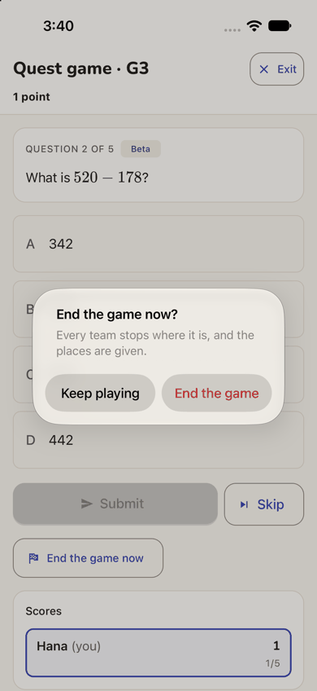 Repro: start a game
  from the home's Practise together, read the lobby, then tap End the game now.
- **Recommended Fix:**
  - Say the level in words ("Grade 3 · 5 questions"), and let the host change it before Start.
  - For a family game, drop "each on their own", "every team" and "places". Say "Some questions are new" instead of
    "may include questions not yet reviewed".

### [sev1] Tapping Ken opens an empty progress report, not his lessons or play

- **Issue Description:** Ken's card on the home has his name and a chevron, so it reads as "more about Ken". Its
  accessible name is "Ken's progress", and it opens the Progress tab's page for him (step 24): "Currently: Grade 3",
  "Learning plan: Not assessed yet. The office records an assessment, then a plan to work towards.", "Assessment: No
  assessment recorded yet.", and a "Progress report" form with From and To dates and a "Generate Progress" button. It
  shows nothing of his lessons, his days played, or practising together.
- **Framework Violation:** cuj-contract, step 24; Nielsen #2 Match between system and the real world, and #4
  Consistency and standards (the chevron's target does not match the card it sits on).
- **Severity:** 1. Not blocking: the back arrow returns her to the home. But the first thing a new parent finds behind
  her child's name is an empty record and a button to make a PDF of it.
- **Evidence:** 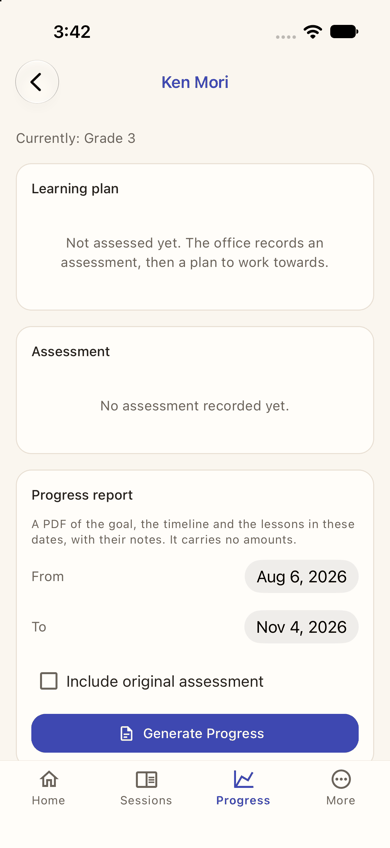 Repro: on a new parent's home, tap the child's card above
  its button.
- **Recommended Fix:**
  - Open a child page instead: the next lesson and where, the coming dates, the days played this week, and Practise
    together. Put Progress on it as one section.
  - Or, if the card must open Progress, say so on it ("Progress ›"). Before an assessment exists, show "Alex will
    assess Ken at his first lesson" rather than an empty report form.

## Walkthrough

### Step 1 — Launch the app fresh (landing)

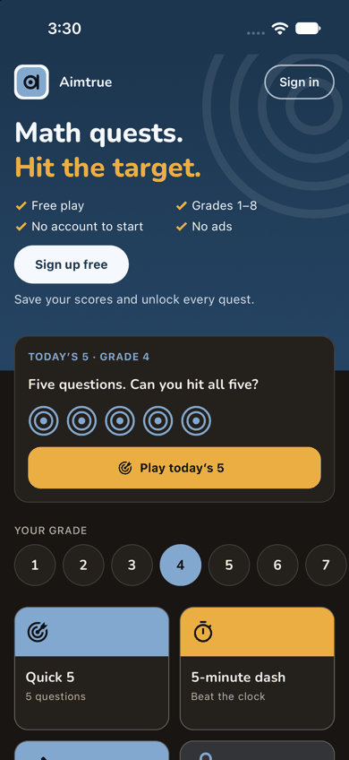

> Expected: a front page with a way in for a family the centre has added. Observed: the guest home: "Aimtrue", "Math
> quests. Hit the target.", with Free play, Grades 1–8, No account to start and No ads. "Sign up free" is a white pill,
> with "Save your scores and unlock every quest." under it. "Sign in" is an outlined pill at the top right. Below are
> "Today's 5 · Grade 4", a grade row with 4 selected, and tiles. There is no word of Chapel Hill Math Institute,
> lessons or tutors. Dark mode is readable.

**What Hana notices:** a maths game for children, under a name she was not told. The only thing that matches the
office's instructions is "Sign in" in the corner.

### Step 2 — Tap "Sign in"

> Expected: a sign-in screen. Observed: a full screen headed by the logo, "Aimtrue", "Set the goal. Aim true." and a
> server chip "localhost:8787". Below is the **developer** sign-in: "This server has sign-in switched off. Choose a
> seeded person to act as." and a list of seeded people. This screen exists only in development builds; production
> shows the provider buttons here. It is not judged.

**What Hana notices:** a sign-in screen, not a "Sign up" one, which is what she was told to use. Still no CHMI.

### Step 3 — Scroll to "Another email" and type her address

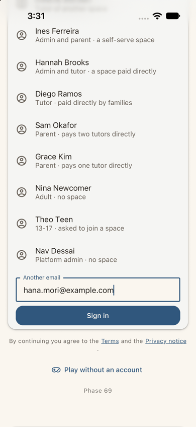

> Expected: a field for her address. Observed: the field "Another email" holds hana.mori@example.com, above a filled
> Sign in button. Below are "By continuing you agree to the Terms and the Privacy notice", "Play without an account"
> and "Phase 69". Developer screen; it stands in for the one provider tap.

**What Hana notices:** the address the office gave her, typed. (In production this is one provider tap.)

### Step 4 — Tap Sign in: Welcome to CHMI (landing)

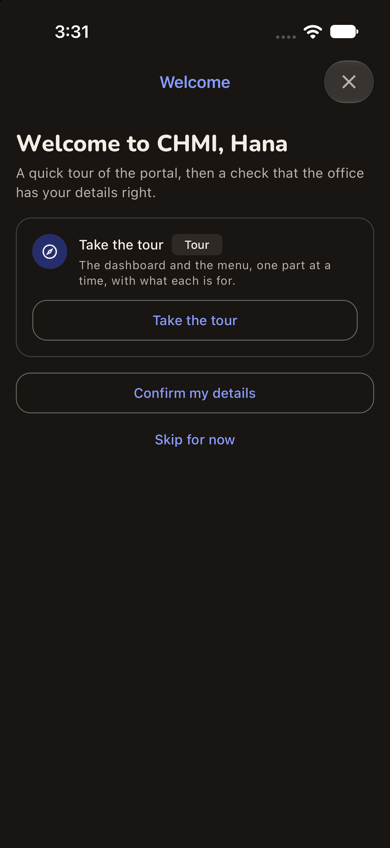

> Expected: signed in, in the institute. Observed: after about 2 s, a full-screen "Welcome" with an X: "Welcome to
> CHMI, Hana · A quick tour of the portal, then a check that the office has your details right." Then a card, "Take
> the tour [Tour] · The dashboard and the menu, one part at a time, with what each is for.", with its button "Take the
> tour", then "Confirm my details" and "Skip for now". There was no space chooser, no sign-up form and no approval
> wait. The home is hidden behind the welcome. Dark mode is readable.

**What Hana notices:** her name and "CHMI", the centre she knows, so she is in the right place. But she sees nothing
of Ken yet, and the app talks about a "portal", a "dashboard" and a "menu".

### Step 5 — Take the tour: stop 1 of 8, Your children

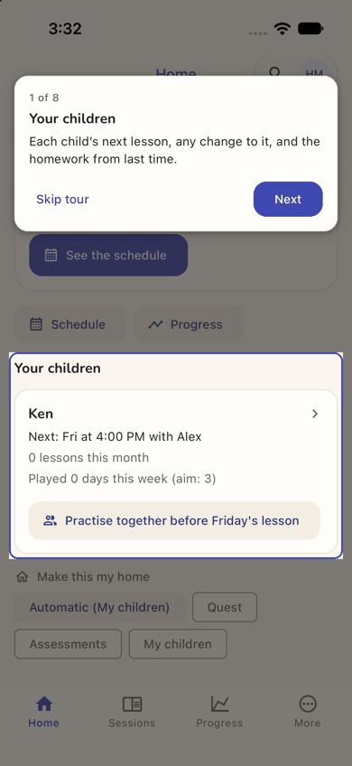

> Expected: the tour explains her home. Observed: the home, dimmed, with "Your children" lit, and a card at the top:
> "1 of 8 · Your children · Each child's next lesson, any change to it, and the homework from last time." with Skip
> tour and Next. The lit card reads "Ken › · Next: Fri at 4:00 PM with Alex · 0 lessons this month · Played 0 days
> this week (aim: 3)" and has a tinted "Practise together before Friday's lesson" button. Below are "Make this my home"
> chips, and the tab bar Home, Sessions, Progress, More. The tour card does not cover the Practise button.

**What Hana notices:** there is Ken: Friday at 4 with Alex. That is the answer she wanted.

### Step 6 — Next: stop 2 of 8, Next up

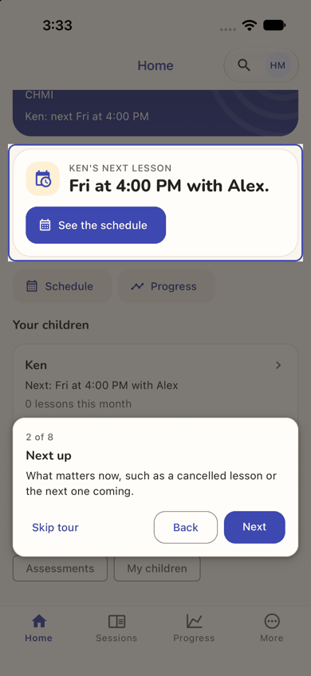

> Expected: the next part of the home. Observed: "2 of 8 · Next up · What matters now, such as a cancelled lesson or
> the next one coming." with Back and Next, now at the bottom. The lit card is "Ken's next lesson · Fri at 4:00 PM with
> Alex.", with See the schedule. Above it, the band reads "CHMI · Ken: next Fri at 4:00 PM". Match.

**What Hana notices:** good: a cancelled lesson would show up right here.

### Step 7 — Next ×5: stops 3 to 7

> Expected: each stop shows its part of the app. Observed, one stop at a time:
> - 3 Dashboard: "Reflections, progress, recent lessons and what you owe. You will find it under More." (More lit);
> - 4 Sessions: "Every lesson with its notes, homework, reflections and assessments." (Sessions lit);
> - 5 Schedule: "Weekly lessons and calendar files. Away one week? Cancel just that date. You will find it under
>   Sessions." (Sessions lit);
> - 6 Billing: "What each lesson costs, what you have paid, and what is outstanding. You will find it under More."
>   (More lit);
> - 7 Comments: "Notes with the tutor and the office. You will find it under More." (More lit; the screenshot).
>
> Stops 3-6 were looked at on screen and are not embedded. Each lights the real tab, but that is two tabs for five
> stops. Nothing on the home itself is explained after stop 2.

**What Hana notices:** names to remember behind two tabs. Practising with Ken, the button she wonders about, is not
mentioned.

### Step 8 — Next: stop 8 of 8, Your profile

> Expected: the last stop. Observed: "8 of 8 · Your profile · How the office has you on file. Only the office can
> change it. You will find it under More." with Skip tour, Back and Finish. More is lit, for the fourth time.

**What Hana notices:** most of the tour pointed at More.

### Step 9 — Finish: Confirm your details

> Expected: the details check the welcome promised. Observed: a full-screen "Your details": "Confirm your details · One
> last thing: check the office has you right. This is how the office has you on file. Only the office can change it —
> if something is wrong, tell them here." The card shows:
> - Hana Mori, Parent, Active, with Call and Email buttons;
> - Contact: hana.mori@example.com, 919-555-0177, the last sign-in (3:31 PM), and "Added to the portal" (3:27 PM);
> - Family: "Responsible for Ken Mori · Mother · Primary contact · No email".

**What Hana notices:** everything the office has is right, and Ken is linked to her. "Call" and "Email" buttons on her
own record make no sense to her. "No email" next to Ken means nothing to her yet.

### Step 10 — Scroll, "Yes, that's all right"

> Expected: done. Observed: the toast "Thanks — your details are confirmed." and a full-screen "All set": "You're all
> set · Take the tour, in your account menu, brings this back. ✓ That's everything. Welcome aboard." The only button
> is "Go to my dashboard".

**What Hana notices:** finished, and she knows where the tour lives. But her page was called Home, not dashboard.

### Step 11 — Go to my dashboard (landing)

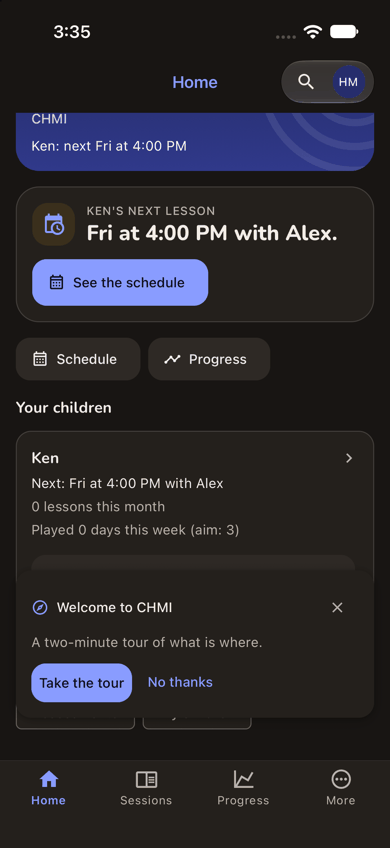

> Expected: the dashboard, or simply the home with nothing more to do. Observed: the Home, still scrolled where the
> tour left it (the greeting is hidden under the header). A new card sits over the bottom: "Welcome to CHMI · A
> two-minute tour of what is where. Take the tour / No thanks", with an X. It covers Ken's "Practise together" button.
> Dark mode is readable.

**What Hana notices:** "Didn't I just do this?" It feels as if what she did was not saved.

### Step 12 — No thanks, then scroll to the top

> Expected: her home. Observed: the whole parent story on one screen:
> - the band "Good afternoon, Hana · CHMI · Ken: next Fri at 4:00 PM";
> - Next up "Ken's next lesson · Fri at 4:00 PM with Alex." with See the schedule;
> - quick actions Schedule and Progress;
> - "Your children": Ken, "Next: Fri at 4:00 PM with Alex", "0 lessons this month", "Played 0 days this week (aim: 3)"
>   and "Practise together before Friday's lesson";
> - "Make this my home": Automatic (My children), Quest.
>
> Neither card says where the lesson is.

**What Hana notices:** the answer, and a button to practise with Ken before Friday. "aim: 3" suggests Ken should play
three days a week, but not where or how.

### Step 13 — See the schedule

> Expected: Ken's lesson with its details. Observed: the Sessions tab, "Schedule", with a Lessons / Schedule switch,
> "Standing weekly lessons. Add them to your calendar in one tap.", Add all to calendar, and a day strip (Wed outlined,
> Fri 1). Under Friday: "Ken Mori with Alex Chen · Fridays 4:00–5:00 PM · 1 hr · In person · from Nov 4, ongoing · In
> person: Institute, room 2", with "Dates" and two icon-only buttons.

**What Hana notices:** now she knows where: Institute, room 2. The home never said.

### Step 14 — Tap Dates

> Expected: the coming dates. Observed: "Coming dates": Fri, Nov 6 and Fri, Nov 13, each 4:00 PM–5:00 PM with a small
> cancel icon, and more below. Match.

**What Hana notices:** the first lesson is Friday the 6th, in two days. The icons beside each date have no words.

### Step 15 — Home tab

> Expected: back to her home. Observed: the home at the top, as in step 12, in one tap.

**What Hana notices:** easy. Ken's "Practise together" is the one thing left to try.

### Step 16 — Practise together before Friday's lesson (landing)

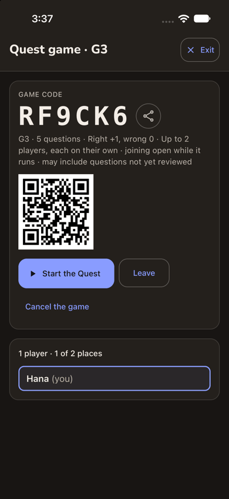

> Expected: a game for Hana and Ken, with Ken shown as joining. Observed: within a second, a full-screen "Quest game ·
> G3" with Exit, showing:
> - GAME CODE RF9CK6 with a share button;
> - "G3 · 5 questions · Right +1, wrong 0 · Up to 2 players, each on their own · joining open while it runs · may
>   include questions not yet reviewed";
> - a QR code;
> - Start the Quest, Leave and Cancel the game;
> - the roster: "1 player · 1 of 2 places · Hana (you)".
>
> Ken is not shown. The game was made in one tap, with no choice of level. Dark mode is readable.

**What Hana notices:** a big code and a QR code, but for whom? Ken is sitting beside her with no phone and no sign-in.
"G3" does not read as Grade 3 to her, and "not yet reviewed" makes her wary.

### Step 17 — Start the Quest

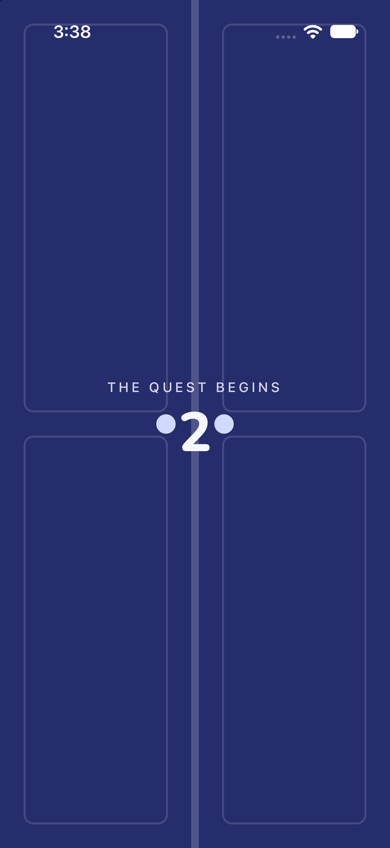

> Expected: the game starts. Observed: full-screen indigo doors, "THE QUEST BEGINS" and a countdown ("2") between two
> door knobs. Play with has started.

**What Hana notices:** fun, and Ken likes the doors.

### Step 18 — The first question

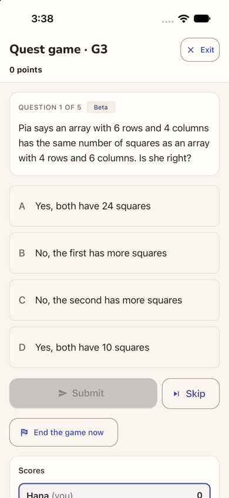

> Expected: a question for them both. Observed: after about 3 s, "Quest game · G3 · 0 points" and "QUESTION 1 OF 5 ·
> Beta · Pia says an array with 6 rows and 4 columns has the same number of squares as an array with 4 rows and 6
> columns. Is she right?", with four choices A-D, Submit (grey), Skip and End the game now. Scores list only "Hana
> (you) 0".

**What Hana notices:** a grade-3 question they can work out together on her phone. The score is hers.

### Step 19 — Choose A, Submit

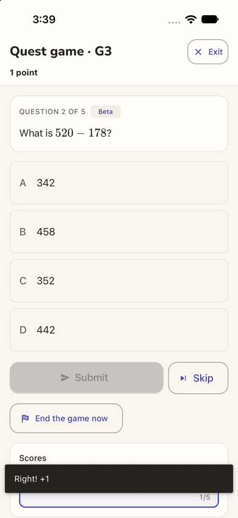

> Expected: marked. Observed: the toast "Right! +1" (over the scores), "1 point", and question 2 of 5, "What is
> 520 − 178?". Match.

**What Hana notices:** instant feedback, and Ken got it right. The app thinks Hana did.

### Step 20 — End the game now

> Expected: a way to stop. Observed: an alert, "End the game now? Every team stops where it is, and the places are
> given.", with Keep playing and End the game (red). The web ended at once; the app asks.

**What Hana notices:** "every team"? It is just her and Ken.

### Step 21 — End the game

> Expected: a summary for the two of them. Observed: "THE GAME IS OVER · The host ended the game. · Hana wins! · You
> won with 1 point. Fantastic!", the rules line again, then Final places (1st Hana (you), 1, 1/5), Back to Quest and
> Share the result, and "Hana's questions", with question 1 marked Right. It fits the screen's width.

**What Hana notices:** "Hana wins!" in what was meant to be Ken's practice.

### Step 22 — Exit

> Expected: back to her home. Observed: the home, at the top, with no tour offer. Ken's card is unchanged: "0 lessons
> this month", "Played 0 days this week (aim: 3)", and the same "Practise together before Friday's lesson". Exit worked
> as expected (on the web it led to Question Quest).

**What Hana notices:** back where she started. Nothing shows that they just played.

### Step 23 — Close and reopen the app (end-state check, landing)

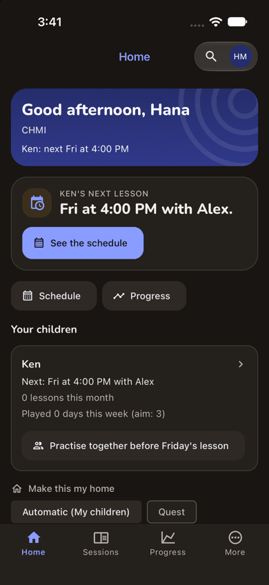

> Expected: Ken's card reflects the practice. Observed: the app reopened straight into CHMI's home, with no chooser and
> no tour offer. It is identical to step 22: **"Played 0 days this week (aim: 3)"**, and the same button. Dark mode is
> readable.

**What Hana notices:** the practice did not count for Ken. The app remembered her, but not what they did.

### Step 24 — Tap Ken's card

> Expected: more about Ken: his lessons, his play, a way to practise. Observed: "Ken Mori" with a back arrow, on the
> Progress tab: "Currently: Grade 3", "Learning plan: Not assessed yet. The office records an assessment, then a plan
> to work towards.", "Assessment: No assessment recorded yet.", and "Progress report: A PDF of the goal, the timeline
> and the lessons in these dates, with their notes. It carries no amounts." with From Aug 6, 2026, To Nov 4, 2026,
> "Include original assessment" and Generate Progress. **End of the journey.**

**What Hana notices:** a report form for a record with nothing in it. Ken's lessons and his "aim: 3" are not here.

## Appendix

- **Mode:** live. The iOS app (development build `com.aimtrue.app.dev`) ran on the iPhone 17 simulator, loading its
  bundle from Metro, against the local Worker at `http://localhost:8787` (the run's data and settings, with sign-in
  off).
  - **Driving.** Maestro ran one small flow per step (`apps/mobile/.maestro/journeys/j15a-*.yaml`). Each screen was
    captured with `simctl` and resampled to 390 px wide. Dark mode was captured at the landing steps: 1 (the first
    screen), 4 (the first screen after sign-in), 11 (the first plain screen inside the space), 16 (the feature) and 23
    (the relaunch).
  - **One sitting**, on one device, with no state cleared after step 1. Step 23 closed and reopened the app. There was
    no sign-up and no approval: the office had added Hana, so the developer sign-in let her straight in.
  - **Mis-taps by the harness.** Some flows were run again, and each screenshot is of the corrected run. None changed
    what a person would see:
    - step 5: a tap on the card's title text "Take the tour" instead of its button;
    - step 7: Maestro refused an absolute screenshot path after the first Next. The next run continued from stop 3,
      so every stop was passed exactly once;
    - step 12: the first flow did not parse, and nothing ran;
    - step 19: a tap on a choice's visible text, which its accessible name ("Choice A: …") hides;
    - step 24: a tap on the text "Ken", which the card's accessible name ("Ken's progress") hides.
- **Frameworks applied:**
  - cuj-contract: every step against its expected result.
  - task-completion: Ken, his next lesson (with place and first date) and a started "Practise together" game were all
    reached (steps 12-17).
  - success-criteria: the end state was checked again after closing and reopening the app (step 23). Ken's card was
    unchanged.
- **CUJ manifest:** J15A, 24 steps, 24 verified. Observed and not matching expectation, though the step worked:
  - step 4 (the welcome hides the home);
  - steps 7-8 (the tour's stops on two tabs);
  - steps 10-11 (the dashboard button and the repeated offer);
  - step 16 (the lobby without Ken);
  - steps 18-23 (the game credited to Hana; Ken's card unchanged);
  - step 24 (an empty progress report).
- **Coverage / not inspected:**
  - **The production sign-in screen** (the provider buttons). The local server ran with sign-in off, so the app showed
    its developer form (steps 2-3), which was not judged.
  - **"Play with Ken".** The card offered "Practise together before Friday's lesson", since the lesson was two days
    away. The plain "Play with Ken" wording, shown when no lesson is near, was not seen.
  - "Skip for now" and "Confirm my details" straight from the welcome (Hana took the tour). "Something needs changing",
    and the Call and Email buttons, on her details.
  - Tour stops 3-6 were looked at on screen but are not embedded. Back and Skip tour were not tried.
  - The rest of the home below the first row of "Make this my home" chips, the chips themselves, the quick actions
    Schedule and Progress, Search, and the account menu (where the tour now lives).
  - The More tab and what it holds for a parent (Dashboard, Billing, Comments, My profile), and the Sessions tab's
    Lessons view.
  - "Add all to calendar", the comment and calendar icons, and cancelling one date.
  - The lobby's share button, QR code, Leave and Cancel the game; questions 2-5; the results' Back to Quest, Share the
    result and Challenge a friend.
  - Anything as Ken. No screen was opened as him, so whether an invitation was made for him, and where it would show,
    was not seen.
  - Email: none was expected or checked.
  - VoiceOver (the accessibility tree was read only to find controls), Dynamic Type, the on-screen keyboard (the
    simulator's hardware keyboard was on), the release build, and Android.
- **Access:** the app's developer sign-in (the local server ran with sign-in off, because the native Google step cannot
  be driven on the simulator); the development build; the approval and any space decision were made in the web console
  and are not part of the journey. This journey needed neither: the office had added Hana.
- **Precondition made outside the app (not part of the journey).** The office added the family through the web on
  `:8787`, as its admin Priya Raghavan (the developer header; sign-in off), in Chapel Hill Math Institute, at about
  3:20-3:29 PM EST on 2026-11-04:
  - Users > Add user: Parent, Hana Mori, hana.mori@example.com, 919-555-0177, Status Active. The toast was "Hana Mori
    added.";
  - Add user: Student, Ken Mori, no email, parent Hana Mori (Mother, primary), course "Grade 3", Friday 4p available.
    No price was typed. The toast was "Ken Mori added.";
  - Pairings > Assign a student: Alex Chen and Ken Mori, the rates from Alex's profile, location "Institute, room 2".
    The toast was "Student assigned.";
  - Schedule > Schedule a session: Ken Mori with Alex Chen, every Friday at 4:00 PM, 1 hr, starting 2026-11-04, in
    person at Institute, room 2. The toast was "Session scheduled.".

  The run's shared setup applies (README, "The run"): the platform settings, and Assessment and Quest switched on in
  `chmi` by its admin.
- **Left in the local database by this journey:**
  - Hana Mori (parent, Active) and Ken Mori (student, Grade 3, no email) in `chmi`, Ken paired with Alex Chen, with a
    Friday 4:00 PM weekly lesson from 2026-11-04;
  - Hana has signed in once, confirmed her details and seen the tour;
  - a finished one-player game, code RF9CK6 (G3, ended by the host after one answer), with Hana as host.
