# CUJ Audit — J16: tutor opens the record-a-lesson form from every entry point

## Executive summary

**Who:** Alex Chen is a seeded person. He tutors three students at Chapel Hill Math Institute (CHMI) and is a parent at
Riverside Tutoring. He belongs to cohort **C2, Tutor** in `docs/member-home-plan.md`, whose question is "Who's next,
did I record the last one?". The contract for C2: when a lesson has just ended, Next up offers **Record it now**; when
a lesson is soon, it offers **Start**. Alex wants to record his lessons. This journey opens the record form from every
door the web app offers, one after another, to show where the paths repeat each other or disagree.

**Outcome: 1/1 journeys passed, 0 skipped, 33 of 33 steps verified.** Every entry point named in the journey was
tried:
- Next up;
- To record;
- the quick action;
- the Sessions page;
- a live timer, started, stopped and recorded;
- a draft, saved and reopened.

Five more places were checked, and none of them offers a record action: the command palette, the Dashboard, the
Schedule, Pairings and Users. The journey passed, but two paths broke on the way:
- **The live timer** could not be ended for one student. "End and record" failed twice with "Please correct the
  highlighted fields." and highlighted nothing (steps 16 and 27). The full form later showed the real reason: the
  student has no price (step 28). The only way out was Discard (step 29). A second timer, for another student, recorded
  normally (step 31).
- **The draft** saved fine (step 22). But the home never shows it, and Next up opened a fresh, empty form for the
  same lesson (step 25).

**Which space and which hat:** Alex lands on "Choose a space" (step 3), because he has not opened a space yet. He
picks CHMI. The tutor hat leads ("Make this my home: Automatic (Teaching)"). Next up is "LESSON FINISHED · You finished
a lesson with Sofia." with **Record it now**. That is exactly the C2 contract.

**The doors, side by side** (taps counted from the CHMI home, at phone width):

| Entry point | Taps from home | Form title | What is prefilled | Footer |
| --- | --- | --- | --- | --- |
| (1) Next up, "Record it now" | 1 | Record a session | student, date, start, end, mode, last lesson | Cancel · Save draft · Record session |
| (2) To record, "Record" on a row | 1 | Record a session | the same, for that row | the same |
| (3) Quick action "Record a lesson" | 1 | Record a session | only today and a default 4:00-5:00 PM; the student is blank | the same |
| (4) Sessions, "Record a session" | 3 (2 on desktop) | Record a session | the same as (3); on the Finance tab, also YOUR PAY | the same |
| (5) Live timer: "Start a lesson", then Start session, the student, Start now, Stop | 5 to the stop form | End the session with Yusuf Hassan? | Session notes only | Keep going · End and record |
| (5b) The rest of a timed lesson's write-up: Sessions, then the card's pencil | 3 | Edit session | everything, with no Student field | Cancel · Save changes |
| (6) Draft: Sessions, Your drafts, Edit | 3 | Finish this draft | everything saved | Cancel · Save draft · Post session |
| Command palette, Dashboard, Schedule, Pairings, Users | — | no record action | — | — |

**Conversion figures** (counted from the entry point, `/` signed out):

| Stretch | Screens | Taps | Typed fields | Waits | Dead ends |
| --- | --- | --- | --- | --- | --- |
| Entry to the first record form (steps 1-5) | 5 | 4 (5 with the tour offer dismissed) | 0 | 0 | 0 |
| Entry to a recorded live lesson (steps 1-4, 30-31) | 7 | 10 | 1 (optional notes) | 0 | 0 |
| Whole run, 33 steps | about 20 distinct (33 views) | about 77 | 8 | 1 (8.5 min, deliberate) | 9 |

The whole run counts these nine dead ends:
1. the palette (step 17);
2. the Dashboard (step 18);
3. the Schedule (step 19);
4. Pairings (no screenshot);
5. Users (no screenshot);
6. "Start a lesson" while a timer runs (step 20);
7. "End and record", first failure (step 16);
8. "End and record", second failure (step 27);
9. Next up ignoring the draft (step 25).

**Conversion and stickiness:**
- **Conversion to the feature:** fast. Four taps from the guest page to a form that already holds the lesson Alex
  owes, with no typing.
- **Usability across the doors:**
  - There are seven doors to one task. Three of them sit on one screen and open the same lesson (step 4).
  - The doors disagree on what they prefill.
  - The task goes by four form titles: Record a session, Finish this draft, End the session, Edit session.
  - It goes by nine button names: Record it now, Record, Record a lesson, Record a session, Record session, End and
    record, Post, Post session, Save changes.
  - The home says "lesson", and the forms say "session".
- **Stickiness:** "2 to record" and Next up give Alex a reason to come back. But the home never tells him about a
  saved draft or a running lesson, so it can feel as if his work went missing.

**The 3 screens Alex would notice most:**
- **Step 4, the CHMI home.** His job is the first card, "You finished a lesson with Sofia." with Record it now. The
  same lesson is also behind "Record a lesson" and the first To record row. Three buttons on one screen lead to the
  same thing, two of them differently. For C2, this is the right lead, with too many twins.
  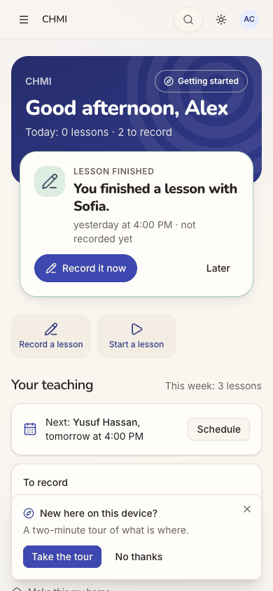
- **Step 16, "End and record" refused.** He has a student beside him and a running clock. The red toast says to
  correct highlighted fields. The dialog has one optional notes box and nothing highlighted. A C2 tutor ends every
  lesson here, and this screen gives him nothing to act on.
  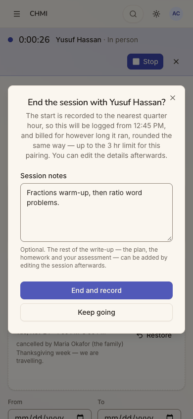
- **Step 25, his draft gone from the home.** He saved notes for Sofia's lesson as a draft. When he taps Record it now
  again, the form comes back with Session notes empty. The draft exists, but only on the Sessions page. For C2 ("did I
  record the last one?") this reads as lost work.
  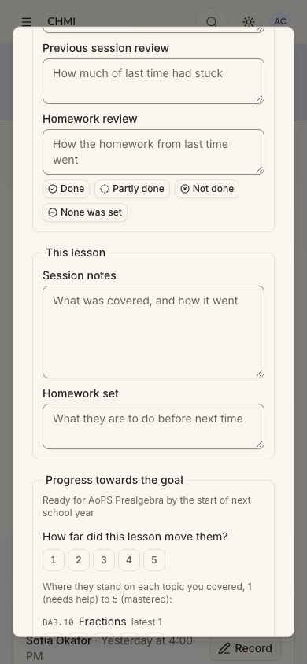

**Contact sheet** (all 33 phone steps):

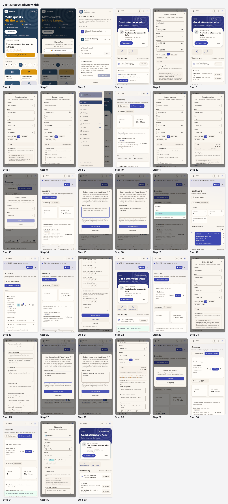

| Severity | Count |
| --- | --- |
| sev4 (blocked) | 0 |
| sev3 (major) | 2 |
| sev2 (minor) | 4 |
| sev1 (cosmetic) | 1 |
| **Total** | **7** |

## Prioritized fixes

1. [sev3] [Ending a live lesson fails with "correct the highlighted fields" and nothing highlighted](#sev3-ending-a-live-lesson-fails-with-correct-the-highlighted-fields-and-nothing-highlighted): show the server's reason in the stop dialog, warn at Start when a student cannot be recorded, and keep the typed notes (steps 15-16, 26-29).
2. [sev3] [A saved draft is invisible from the home, and Next up starts the same lesson over](#sev3-a-saved-draft-is-invisible-from-the-home-and-next-up-starts-the-same-lesson-over): have Next up, To record and the quick action reopen the writer's draft of that lesson, and mark it "Draft" on the home (steps 22-25, 33).
3. [sev2] [One task, four forms and nine button names](#sev2-one-task-four-forms-and-nine-button-names): one name ("Record a lesson"), one primary verb ("Record"), and the stop opening the same form prefilled (steps 5, 15, 24, 32).
4. [sev2] [Only the home knows which lessons are waiting to be recorded](#sev2-only-the-home-knows-which-lessons-are-waiting-to-be-recorded): prefill the quick action and the Sessions button from To record, show To record on Sessions and the Dashboard, and add a palette action (steps 8, 10-11, 17-19).
5. [sev2] ["Start a lesson" is a link, "Record a lesson" is a dialog, and the home ignores a running lesson](#sev2-start-a-lesson-is-a-link-record-a-lesson-is-a-dialog-and-the-home-ignores-a-running-lesson): open the Start dialog in place, and make Next up show the running lesson with Stop (steps 20, 30, 33).
6. [sev2] ["Sign in" opens a sheet titled "Sign up free"](#sev2-sign-in-opens-a-sheet-titled-sign-up-free): title the sheet after the button that opened it (step 2).
7. [sev1] [The tour offer covers the To record buttons on the first visit](#sev1-the-tour-offer-covers-the-to-record-buttons-on-the-first-visit): place it so it never covers Next up or To record (step 4).

## Findings

### [sev3] Ending a live lesson fails with "correct the highlighted fields" and nothing highlighted

- **Issue Description:** "Start session" let Alex start a timer for Yusuf Hassan. Nothing warned him. Stop opened
  "End the session with Yusuf Hassan?", a dialog with only a Session notes box. "End and record" then failed:
  - The red toast read "Please correct the highlighted fields." and faded after a few seconds.
  - The dialog stayed open. Nothing in it was highlighted.
  - The browser logged `422 POST /api/sessions/active/stop`.

  It failed the same way at 22 seconds (step 16) and at 8 min 44 s (step 27), so the length was not the cause. The
  reason appeared only when he tried the full form for the same student (step 28): "No in-person price is set for this
  student. Set it on the student's profile before recording the session." A tutor cannot set a student's price; the
  office does that.

  He then had three ways out:
  - "Keep going", with the clock still running;
  - the strip's ×, "Discard this session?… nothing is recorded or billed" (step 29), which loses the lesson's time;
  - leaving it running.

  "Keep going" also dropped the note he had typed: the box was empty when he pressed Stop again (step 26). Yusuf is
  also the home's "Next: tomorrow at 4:00 PM", and nothing warns that tomorrow's lesson cannot be recorded either.
- **Framework Violation:** cuj-contract, steps 15-16 and 26-29 (C2: a lesson that has ended is recorded). Nielsen #9
  Help users recognise, diagnose and recover from errors: the message names fields that are not on screen. Nielsen #5
  Error prevention: Start accepts a pairing that can never be recorded.
- **Severity:** 3. A workaround is needed and the end state is wrong. The lesson is either discarded with its time
  lost, or recorded later by hand once the office has set a price. For a tutor, the stop is the moment the lesson ends,
  often with the student and family watching. A refusal he cannot understand undermines the live timer. A second
  timer for Ben, who has a price, recorded normally (step 31), so the blocker depends on the data, not the path.
- **Evidence:** 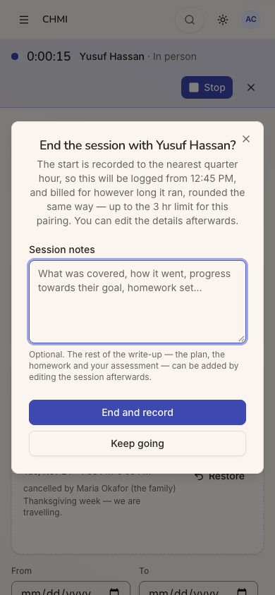  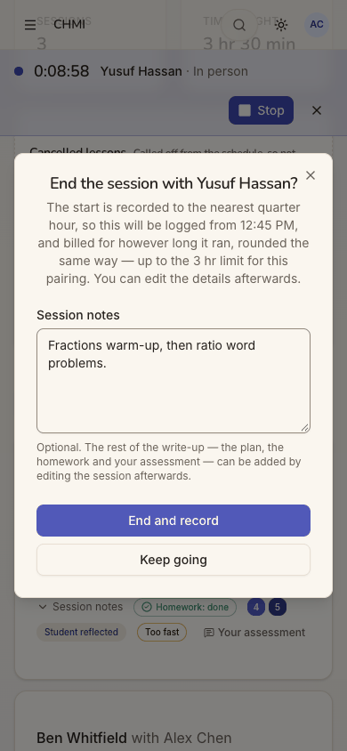 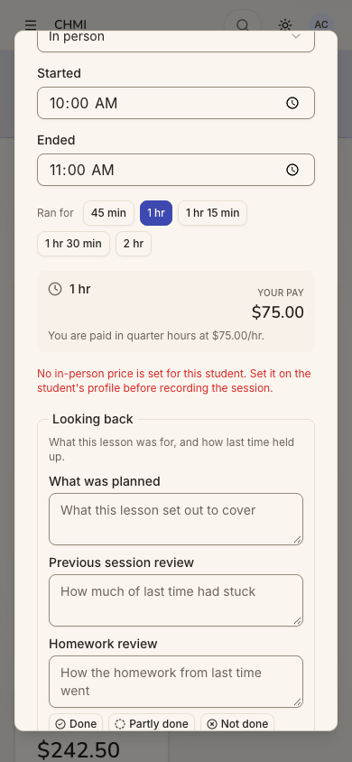 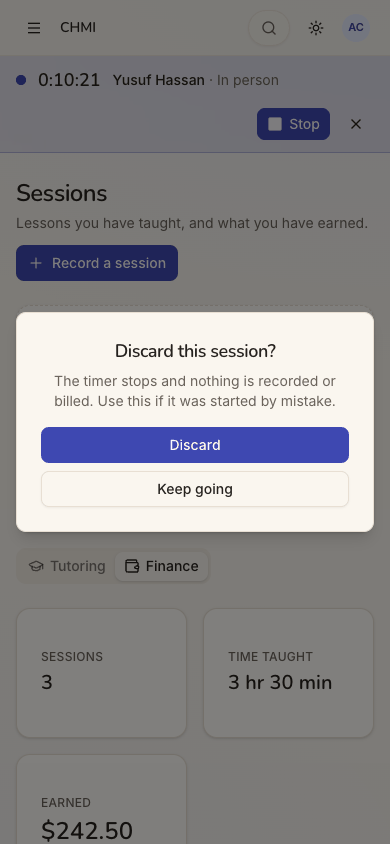
  Repro:
  1. Sign in as Alex Chen and open CHMI.
  2. Go to Sessions and tap Start session. Choose Yusuf Hassan and tap Start now.
  3. Tap Stop, type a note and tap End and record. The toast "Please correct the highlighted fields." appears, nothing
     is highlighted, and the request returns 422.
  4. Tap Keep going, then Stop: the note is gone.
  5. Use Record a session with Yusuf: under the duration, the form shows "No in-person price is set for this student…".
- **Recommended Fix:**
  - Show every error the server returns in the stop dialog itself, as text. A field-level error whose field is not in
    the dialog must still be printed there.
  - Check the pairing at Start (`POST /sessions/active`) with the same rate resolution the stop uses. Refuse, or warn,
    before the clock runs: "Yusuf has no in-person price yet. Ask the office to set one, or you will not be able to
    record this lesson."
  - Word that message for the tutor ("Ask the office to set Yusuf's price"), since he cannot set it himself.
  - Keep the notes typed in the stop dialog when Keep going is chosen, for example on the running lesson's row.
  - Flag "Next: Yusuf Hassan" on the home when the pairing cannot be recorded, so the office hears of it before the
    lesson.

### [sev3] A saved draft is invisible from the home, and Next up starts the same lesson over

- **Issue Description:** Alex opened Next up's "Record it now" for Sofia and typed his notes. The form said "✓ Draft
  autosaved 12:43 PM" (step 21), and Save draft confirmed "Saved as a draft. Only you can see it." (step 22). Then:
  - **The home did not change.** Next up still says "You finished a lesson with Sofia… not recorded yet". To record
    still lists Sofia. There is no "Draft" mark and no "Continue". The end-state check (step 33) shows it again.
  - **The draft lives only on Sessions.** It sits under "Your drafts" with Edit and Post (step 23). Edit reopens it as
    "Finish this draft", with his notes (step 24).
  - **Next up starts again from nothing.** Tapping Record it now again opens a new "Record a session" for the same
    lesson, Sofia on 11/03 at 4-5 PM, with Session notes empty (step 25). As soon as he types, autosave starts a
    second draft of the same lesson. If he records from there, the first draft stays behind as an orphan.
- **Framework Violation:** cuj-contract, steps 22 and 25 (C2: "did I record the last one?"). Nielsen #1 Visibility of
  system status: the home does not show the draft. Nielsen #3 User control and freedom: the work is not where he left
  it. Nielsen #4 Consistency: the same lesson has two unconnected forms.
- **Severity:** 3. The end state is wrong: he ends up with two copies of one lesson's write-up, or what looks like lost
  notes. The workaround (menu, then Sessions, then Edit) is one he has to discover. Autosave was meant to make writing
  in parts safe, but from the home, coming back to finish later looks like losing the notes.
- **Evidence:** 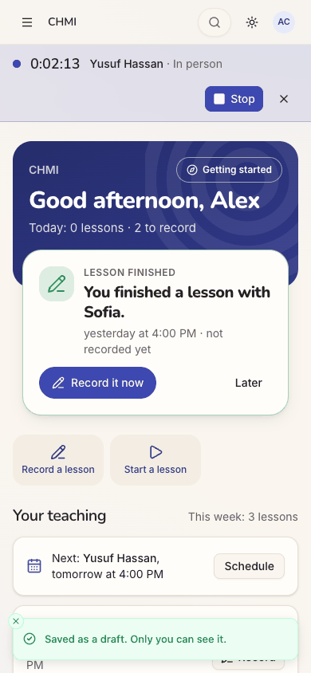 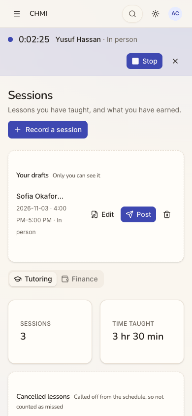 
  Repro:
  1. On the CHMI home, tap Record it now, type Session notes and tap Save draft.
  2. Tap Record it now again: the notes are empty.
  3. Go to Sessions: the draft is listed under Your drafts.
- **Recommended Fix:**
  - When the reader has a draft for the pairing and date that a Next up, To record or quick-action item stands for,
    open that draft in its place, as "Finish this draft".
  - Mark the item on the home: "Draft saved 12:43 PM · Continue".
  - Add a Next up candidate for an unposted draft ("You have a draft for Sofia's lesson"), ranked with the unrecorded
    lesson.
  - Count drafts in the band ("2 to record · 1 draft").
  - Refuse, or merge, a second autosaved draft of the same lesson by the same author.

### [sev2] One task, four forms and nine button names

- **Issue Description:** Recording a lesson goes by many names. The home says "lesson" (Record it now, Record, Record
  a lesson, Start a lesson). Sessions and every form say "session" (Record a session, Start session, Record session,
  Edit session). There are four form titles:
  - "Record a session" (steps 5, 7, 8, 11);
  - "Finish this draft", whose button is "Post session" and whose card button is "Post" (steps 23-24);
  - "End the session with Yusuf Hassan?", a different form with only notes, whose button is "End and record" (step 15);
  - "Edit session", with no Student field and "Save changes" (step 32).

  The timed path collects only notes. Its own text says "the plan, the homework and your assessment — can be added by
  editing the session afterwards". That later edit is reached through an unlabelled pencil icon on a card on the
  Sessions page, and the home never mentions it.

  The full form also shows the same date in two formats: the home says "Yesterday at 4:00 PM", while the form's
  Looking back says "Last lesson, 2026-09-15".
- **Framework Violation:** cuj-contract, steps 5, 15, 24 and 32. Nielsen #4 Consistency and standards. Nielsen #6
  Recognition rather than recall: he has to remember that a timed lesson needs a second visit through the pencil.
- **Severity:** 2. Real friction, not a blocker. A tutor learns that "Post", "End and record" and "Record session" all
  mean the same thing. But a timed lesson ends up only partly written: the plan, homework, progress and assessment are
  never asked for.
- **Evidence:** 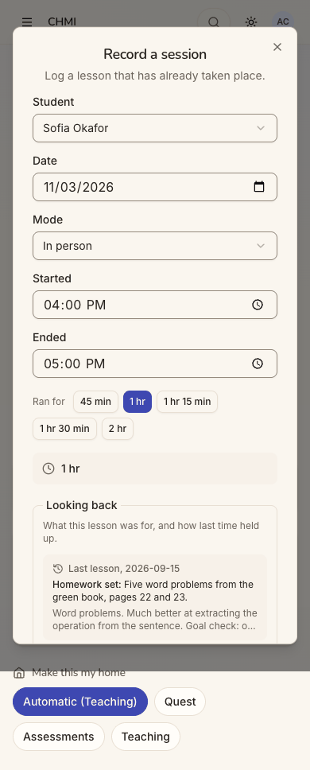  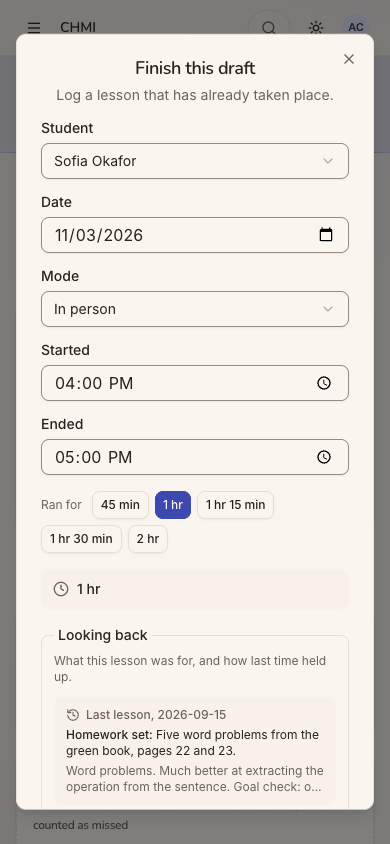 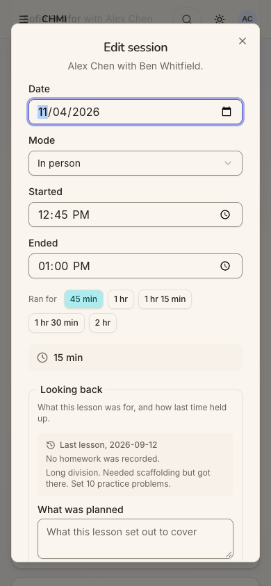
  Repro: open the form from each door in the table in the Executive summary, and compare titles and buttons.
- **Recommended Fix:**
  - Pick one noun on screen ("lesson") and one primary verb ("Record"): Record a lesson, Record lesson, Finish
    recording.
  - Rename "Post"/"Post session" to "Record", and keep "Save draft".
  - After End and record, open the same full form, prefilled with the timed lesson, rather than a notes-only dialog.
    Alternatively, end with a toast offering "Finish the write-up".
  - Label the card's pencil ("Edit") at phone width.
  - Print dates the way the home does ("Tue, Sep 15").

### [sev2] Only the home knows which lessons are waiting to be recorded

- **Issue Description:** The home knows Alex owes two lessons: "2 to record", Sofia yesterday and Ben on Sat Oct 31.
  Every other door ignores them:
  - **The home's quick action, "Record a lesson"** (step 8), and **Sessions' "Record a session"** (step 11) open the
    form with the student blank. They default to today and 4:00-5:00 PM, so recording yesterday's lesson from there
    means retyping the date and times. Missing that records it as today.
  - **Sessions** (step 10) is the page about lessons, yet it has no To record list.
  - **The Dashboard's Tutoring Sessions carousel** (step 18) jumps from Sep 15 straight to NOW, leaving out both
    unrecorded lessons. It has no record action.
  - **The Schedule's Dates** (step 19) lists coming dates only.
  - **Pairings and Users** have no record action.
  - **The command palette** ("Search pages, people and actions") answers "record" with only "Go to · Sessions" (step
    17).
- **Framework Violation:** cuj-contract, steps 8, 10-11 and 17-19 (C2: "did I record the last one?" should be
  answerable wherever he looks). Nielsen #4 Consistency. Nielsen #5 Error prevention (the wrong-date default).
- **Severity:** 2. An observable mismatch with a real error risk. A tutor who records from Sessions, as the menu
  invites, works from a blank form and may date the lesson wrongly. The home's prefilled paths avoid this, but they
  are only on the home.
- **Evidence:** 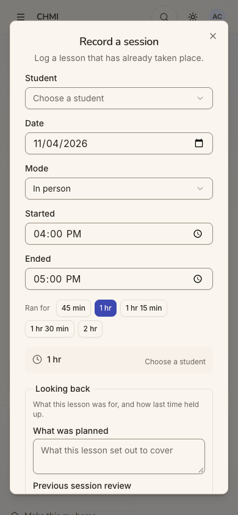 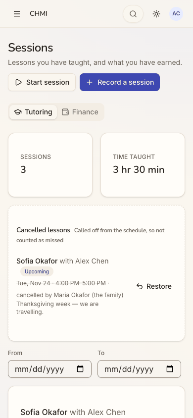 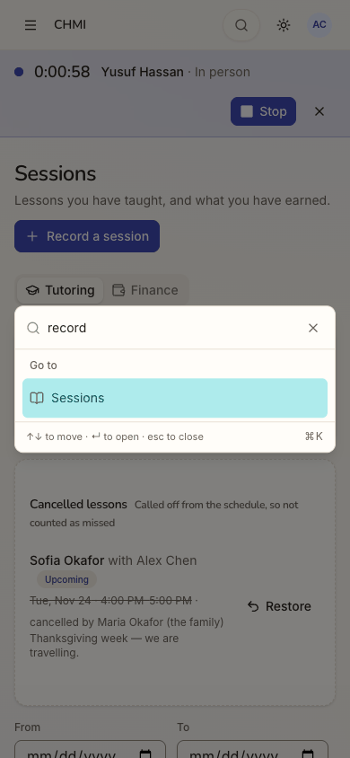 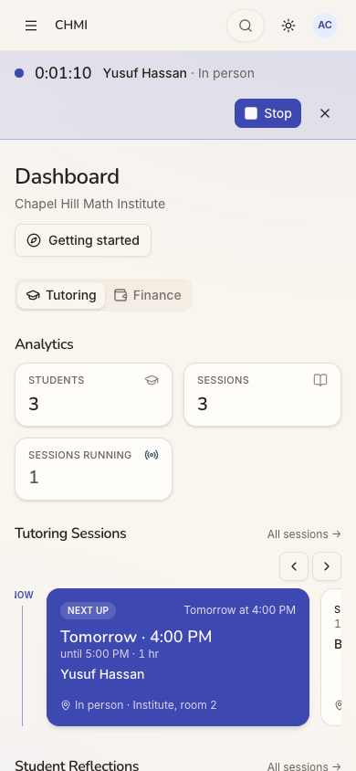 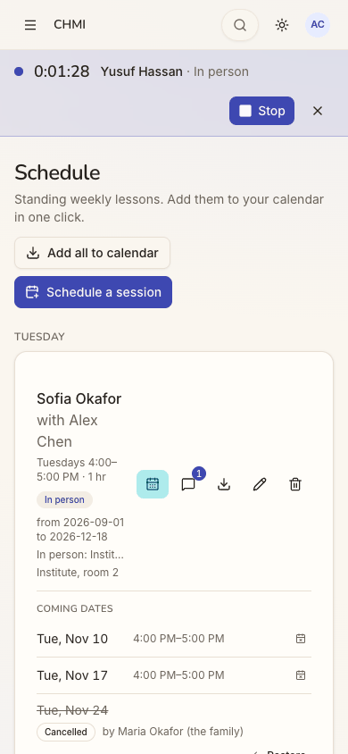
  Repro:
  1. From the CHMI home, tap Record a lesson: the student is empty and the date is today.
  2. Menu → Sessions: no To record.
  3. Menu → Dashboard: the carousel goes from Sep 15 to NOW.
  4. Search for "record": only Go to Sessions.
- **Recommended Fix:**
  - When there is exactly one lesson to record, have the quick action prefill it, as Next up does. With more than one,
    have it open a picker of the To record items above "Another lesson".
  - Put the To record list at the top of Sessions' Tutoring tab.
  - Show unrecorded past lessons in the Dashboard carousel, with a Record action, instead of skipping them.
  - Add "Record a lesson" and "Start a lesson" as palette actions.
  - Consider fewer doors overall. The home alone has three to the same lesson; one Record per lesson, plus "Another
    lesson", would do.

### [sev2] "Start a lesson" is a link, "Record a lesson" is a dialog, and the home ignores a running lesson

- **Issue Description:** The home's two quick actions look like a pair but behave differently:
  - **"Record a lesson"** opens the form on the home.
  - **"Start a lesson"** navigates to /sessions and opens nothing (steps 20 and 30). There he needs a second tap on
    Start session.
  - **With a timer running** (step 20), it lands on Sessions, where the Start session button is hidden because one
    lesson is running. Nothing on screen says why.

  The home also ignores the running lesson. It kept "Today: 0 lessons", and Next up still said "You finished a lesson
  with Sofia". The running lesson with Yusuf appeared only in the top strip. After a lesson was recorded today (Ben,
  step 31), the band still said "Today: 0 lessons" (step 33).
- **Framework Violation:** cuj-contract, steps 20, 30 and 33 (C2: "lesson soon → Start"). Nielsen #4 Consistency.
  Nielsen #1 Visibility of system status.
- **Severity:** 2. An extra screen and tap on the most time-critical path, plus a confusing landing while a lesson
  runs. Not blocking.
- **Evidence:** 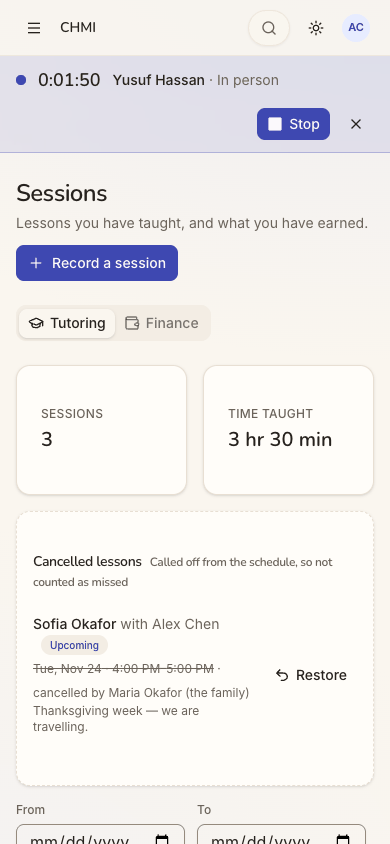 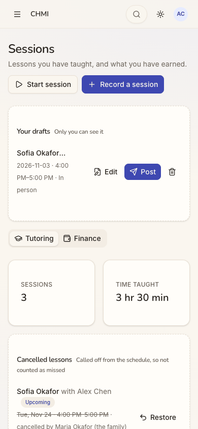 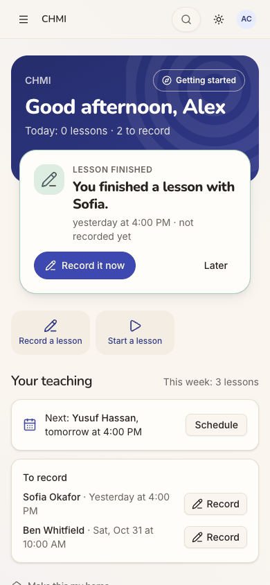
  Repro:
  1. On the CHMI home, tap Start a lesson: the page changes to Sessions and no dialog opens.
  2. Start a timer, go Home and tap Start a lesson again: Sessions, with no Start button.
- **Recommended Fix:**
  - Open "Start a session" in place from the home, prefilled with the next or current scheduled pairing.
  - While a lesson runs, replace the quick action with "Stop", and make the running lesson Next up's top item.
  - Count a recorded or running lesson in "Today: N lessons".

### [sev2] "Sign in" opens a sheet titled "Sign up free"

- **Issue Description:** On the guest page, the small "Sign in" button opens a sheet titled "Sign up free". Its text
  reads "Keep your scores, unlock every quest and play with your family." For a returning tutor, the only way in is
  labelled as an offer to sign up and to play.
- **Framework Violation:** cuj-contract, step 2. Nielsen #2 Match between system and the real world. Nielsen #4
  Consistency (the button and the sheet disagree).
- **Severity:** 2. An observable mismatch at the door every returning tutor uses. It makes him wonder whether he is
  about to create a second account. He continued, so it did not block him.
- **Evidence:** 
  Repro: open `/` signed out and tap "Sign in".
- **Recommended Fix:** Title the sheet after the button that opened it. For example: "Sign in", "Welcome back.
  Continue with the account you use for Aimtrue", with the same Google button. Keep "Sign up free" for the sign-up
  call to action.

### [sev1] The tour offer covers the To record buttons on the first visit

- **Issue Description:** On the first visit to the CHMI home, the "New here on this device? A two-minute tour…" card
  sits over the To record list. At phone width it hides both rows. On desktop it covers the first row's Record button.
- **Framework Violation:** cuj-contract, step 4. Nielsen #8 Aesthetic and minimalist design: an offer covers the
  page's own work.
- **Severity:** 1. Cosmetic. It is dismissed with one tap, and Next up above it holds the same lesson.
- **Evidence:**  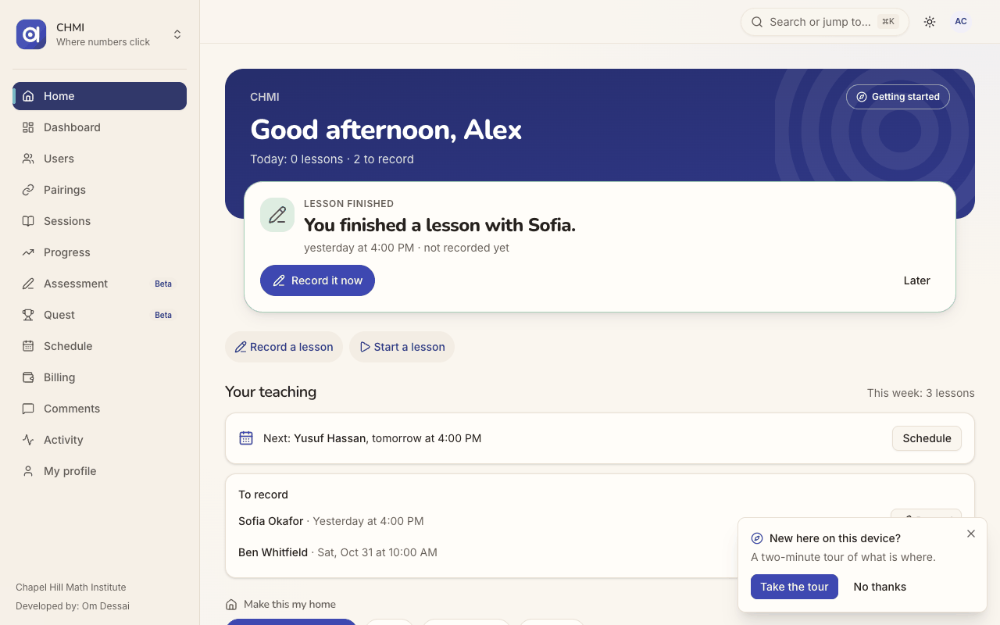
  Repro: sign in as a tutor with no tour cookie and open the CHMI home.
- **Recommended Fix:** Dock the offer where it covers no action, for example inline under the band, or beside
  "Getting started". Alternatively, show it only after Next up has been acted on or dismissed.

## Walkthrough

### Step 1 — Open http://localhost:8797/ signed out (landing)

> Expected: a way in for a returning tutor. Observed: the guest Play page: "Math quests. Hit the target.", Sign up
> free, Today's 5 for Grade 4, a grade row and tiles. A small "Sign in" outline button sits top right. Desktop and dark
> mode show the same.

**What Alex notices:** a children's maths game, not his institute's portal. "Sign in" in the corner is his only
signpost.

### Step 2 — Tap "Sign in"

> Expected: a sign-in sheet. Observed: a sheet titled "Sign up free", "Keep your scores, unlock every quest and play
> with your family.", with Continue with Google.

**What Alex notices:** he asked to sign in and is offered sign-up and play. He goes on with Google anyway, since that
is how he always signs in.

### Step 3 — Tap "Continue with Google" (landing)

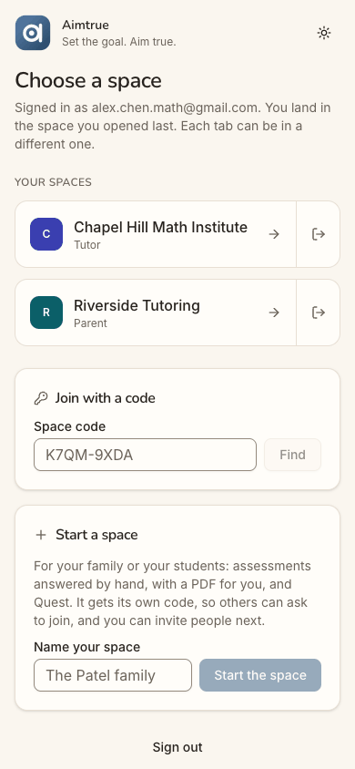
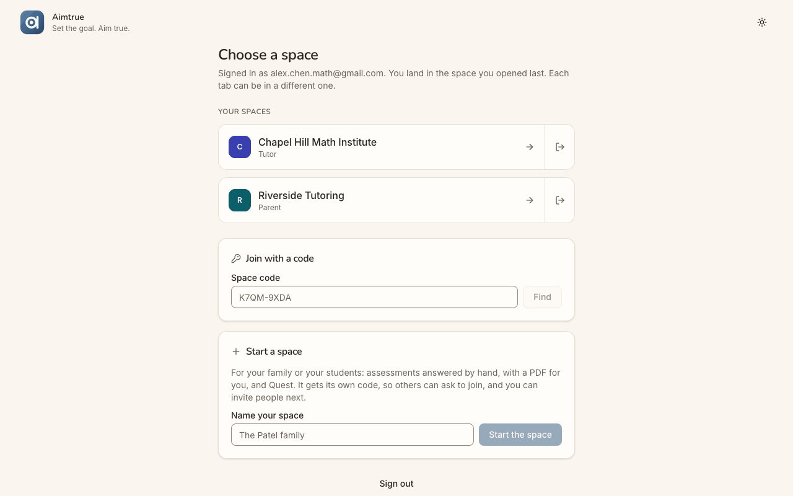
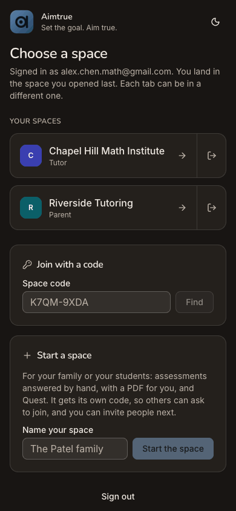

> Expected: land in the institute. Observed: "Choose a space". The page lists Chapel Hill Math Institute (Tutor) and
> Riverside Tutoring (Parent), each with Open and Leave, then "Join with a code" and "Start a space". He has not opened
> a space yet, so there is no last space to land in.

**What Alex notices:** both his spaces, each with his role, which is reassuring. Two large cards he does not need fill
the rest of the screen.

### Step 4 — Tap "Chapel Hill Math Institute" (landing: the first screen inside the space)

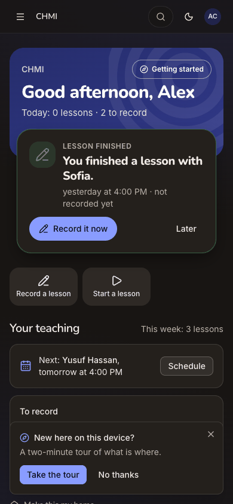

> Expected (C2): the tutor hat leads, with the lesson to record first. Observed: the band reads "Good afternoon, Alex ·
> Today: 0 lessons · 2 to record". The page shows:
> - Next up, "LESSON FINISHED · You finished a lesson with Sofia. yesterday at 4:00 PM · not recorded yet", with
>   Record it now and Later;
> - the quick actions Record a lesson and Start a lesson;
> - "Your teaching", with Next: Yusuf Hassan, tomorrow at 4:00 PM;
> - "To record", with Sofia and Ben, each with Record;
> - "Make this my home: Automatic (Teaching)".
>
> The tour offer covers the To record list.

**What Alex notices:** his job is the first thing on the page, which is good. Three buttons lead to Sofia's lesson,
and the tour card sits on top of the list.

### Step 5 — "No thanks" to the tour, then entry (1): Next up "Record it now"

> Expected: the form, prefilled for Sofia's lesson. Observed: "Record a session — Log a lesson that has already taken
> place." It is prefilled with Sofia Okafor, 11/03/2026, In person, 4:00-5:00 PM and 1 hr. Below come:
> - Looking back (last lesson, 2026-09-15, its homework and notes), with What was planned, Previous session review and
>   Homework review;
> - This lesson: Session notes, Homework set;
> - Progress towards the goal, with nine topic ratings;
> - Your assessment.
>
> The footer has Cancel, Save draft and Record session, with "Autosaves as a draft while you write". Closed with Cancel.

**What Alex notices:** everything for Sofia is ready; he only needs to write. The form says "session" where the button
said "lesson", and it is a long form for a phone.

### Step 6 — Back on the home: the "To record" list

> Expected: the lessons he owes. Observed: To record lists "Sofia Okafor · Yesterday at 4:00 PM" and "Ben Whitfield ·
> Sat, Oct 31 at 10:00 AM", each with Record. Sofia's lesson is the one Next up already offers.

**What Alex notices:** the list is clear, and the count matches "2 to record". Sofia's lesson appears twice on the
screen.

### Step 7 — Entry (2): To record, "Record" on Ben's row

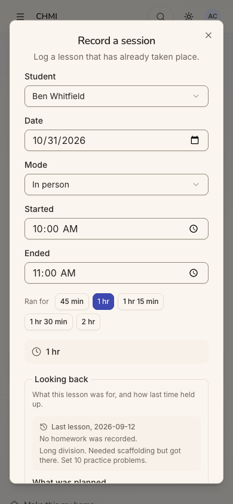

> Expected: the same form for Ben. Observed: the same "Record a session" dialog, with Ben Whitfield, 10/31/2026, In
> person, 10:00-11:00 AM, and Looking back "Last lesson, 2026-09-12 · No homework was recorded". The same form, one
> tap. Closed with Cancel.

**What Alex notices:** the same form as before, correctly prefilled for this lesson.

### Step 8 — Entry (3): the quick action "Record a lesson"

> Expected: the same form, ideally with the waiting lesson. Observed: the same dialog, but the Student is blank
> ("Choose a student"). It defaults to today, 11/04/2026, at 4:00-5:00 PM, and the duration box says "Choose a
> student". Closed with Cancel.

**What Alex notices:** this button sits right under Record it now but forgets Sofia. From here he would have to
retype yesterday's date and times.

### Step 9 — Open the menu

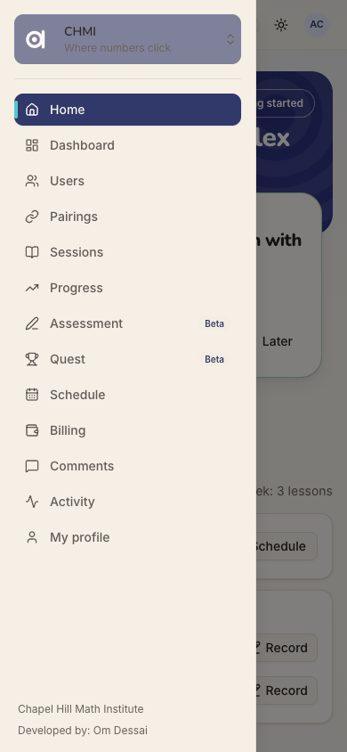

> Expected: a Sessions or Lessons item. Observed: thirteen items: Home, Dashboard, Users, Pairings, Sessions,
> Progress, Assessment (Beta), Quest (Beta), Schedule, Billing, Comments, Activity and My profile.

**What Alex notices:** "Sessions" is the obvious place to record. The menu is long for a tutor.

### Step 10 — Menu → "Sessions"

> Expected: his lessons, including the ones to record. Observed: "Sessions — Lessons you have taught, and what you have
> earned.", with Start session and Record a session. Below are the Tutoring and Finance tabs, SESSIONS 3 and TIME
> TAUGHT 3 hr 30 min, a Cancelled lessons card, date filters, and the three lessons from September. There is no To
> record list.

**What Alex notices:** the buttons are renamed ("Start session" and "Record a session", not "…a lesson"). The two
lessons the home warned him about are not on the page about lessons.

### Step 11 — Entry (4): Sessions, "Record a session" (Tutoring tab)

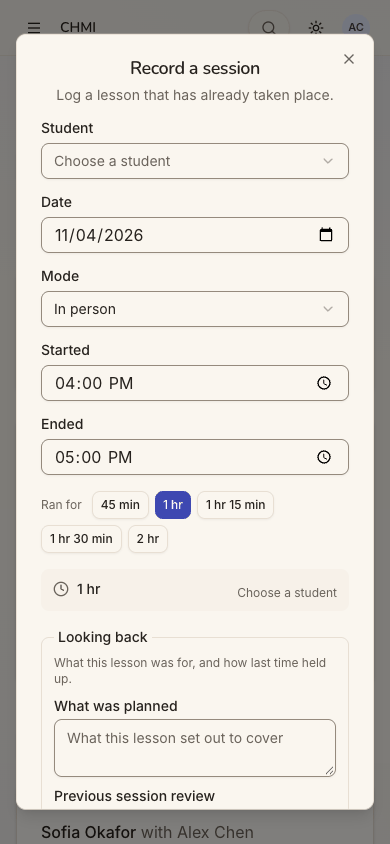

> Expected: the same form. Observed: identical to the quick action: student blank, today, 4:00-5:00 PM. It is three
> taps from the home on a phone. Closed with Cancel.

**What Alex notices:** the same blank form as step 8. Nothing ties it to the lessons he owes.

### Step 12 — Variant: the Finance tab, "Record a session", student chosen

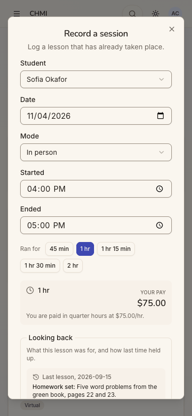

> Expected: the same form. Observed: the same form, plus a "YOUR PAY $75.00 · You are paid in quarter hours at
> $75.00/hr." box. The Tutoring tab's button leaves it out, as designed. Cancelling after choosing a student left no
> draft.

**What Alex notices:** the same button gives a slightly different form depending on the tab, which is right for
keeping pay off the screen a student can see.

### Step 13 — Entry (5): Sessions, "Start session"

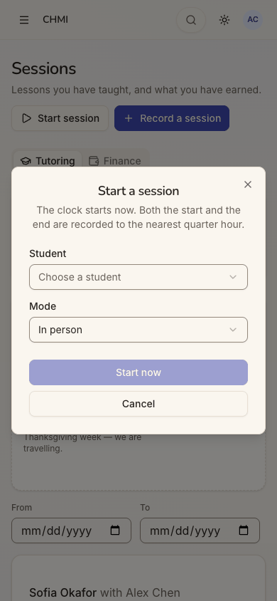

> Expected: start the clock for a lesson. Observed: "Start a session — The clock starts now. Both the start and the end
> are recorded to the nearest quarter hour." It asks for the Student ("Choose a student") and the Mode (In person),
> with Start now and Cancel. Nothing is prefilled, not even the next scheduled pairing.

**What Alex notices:** short and clear, but he has to pick the student himself even though the schedule knows who is
next.

### Step 14 — Choose Yusuf Hassan, tap "Start now"

> Expected: a running clock. Observed: the toast "Session started." and a strip across the top, "● 0:00:06 Yusuf
> Hassan · In person", with Stop and × (Discard). The Start session button is gone while a lesson runs.

**What Alex notices:** the clock is always in view, which reassures him.

### Step 15 — Tap "Stop"

> Expected: the record form, or the lesson recorded. Observed: a third form, "End the session with Yusuf Hassan?". It
> explains the quarter-hour rounding, that the lesson is "logged from 12:45 PM", "billed for however long it ran… up to
> the 3 hr limit". It has a Session notes box, and "The rest of the write-up — the plan, the homework and your
> assessment — can be added by editing the session afterwards." The buttons are End and record, and Keep going.

**What Alex notices:** this is not the form he has opened four times. Only notes, and the rest is "afterwards". The
word "billed" is on screen in front of the student.

### Step 16 — Type a note, tap "End and record" (about 22 s in)

> Expected: the lesson recorded. Observed: the toast "Please correct the highlighted fields." flashes and fades. The
> dialog stays, with nothing highlighted, and the browser logs `422 POST /api/sessions/active/stop`.

**What Alex notices:** he cannot end the lesson, and he is told to fix a field he cannot see. This is a dead end. He
taps Keep going.

### Step 17 — The command palette (search icon), typing "record"

> Expected (it promises "Search pages, people and actions"): a "Record a lesson" action. Observed: only "Go to ·
> Sessions". Typing "lesson" gives Users, Sessions and Billing.

**What Alex notices:** the search finds pages, not the action he wants. It is a dead end.

### Step 18 — Menu → "Dashboard" (Tutoring tab)

> Expected: maybe lessons to record. Observed: Analytics (Students 3, Sessions 3, Sessions running 1), then the
> Tutoring Sessions carousel: Sep 8, 12 and 15, NOW, then NEXT UP tomorrow with Yusuf. The cards link to the schedule.
> There is no record action, and the two unrecorded lessons are not in the carousel.

**What Alex notices:** the Dashboard does not know what he owes. "Sessions running 1", but the running lesson is not a
card. It is a dead end.

### Step 19 — Menu → "Schedule", then "Dates" on Sofia's Tuesday lesson

> Expected: perhaps record a past date. Observed: Add all to calendar and Schedule a session, then a card for each
> weekday, with icon buttons. Dates opens COMING DATES only (Nov 10, Nov 17, Nov 24 cancelled, and so on), each with
> Cancel. Past dates are not listed. At phone width the card is cramped: the name wraps over three lines and the
> location is cut to "In person: Instit…".

**What Alex notices:** he cannot record from here. It is a dead end.

### Step 20 — Menu → Home, quick action "Start a lesson" (timer running)

> Expected: the Start dialog, as "Record a lesson" opens its dialog. Observed: the page changes to /sessions. There is
> no dialog, and no Start button, because a lesson is running. The home he left still said "Today: 0 lessons", and Next
> up was still about Sofia.

**What Alex notices:** the button took him away from the home and did nothing. Nothing here says a lesson is already
running, except the strip.

### Step 21 — Back, entry (6): Next up "Record it now", typing Session notes

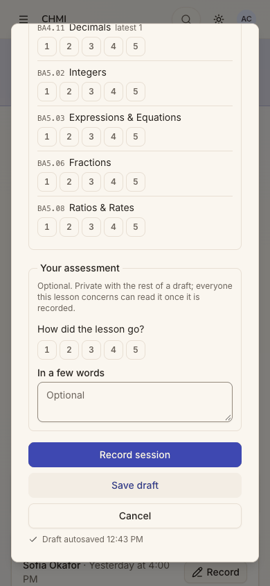

> Expected: autosave while writing. Observed: after about 3 s the footer reads "✓ Draft autosaved 12:43 PM". On the
> phone the footer order is Record session, Save draft, Cancel.

**What Alex notices:** reassuring. His notes are being kept.

### Step 22 — Tap "Save draft"

> Expected: the draft kept, and visible where he will come back. Observed: the toast "Saved as a draft. Only you can see
> it." The home is unchanged: Next up still says "not recorded yet" with Record it now, and To record still lists
> Sofia.

**What Alex notices:** nothing on the home shows the draft he just saved.

### Step 23 — Look for the draft: menu → "Sessions"

> Expected: find the draft. Observed: a "Your drafts · Only you can see it" card at the top of Sessions, showing "Sofia
> Okafor… Draft · 2026-11-03 · 4:00 PM–5:00 PM · In person" with Edit, Post and a bin. The name is cut short at phone
> width.

**What Alex notices:** found on the first guess. The button says "Post", a new word for recording.

### Step 24 — Tap "Edit" on the draft

> Expected: his draft with its notes. Observed: the same form, titled "Finish this draft", with Sofia, 11/03, 4-5 PM,
> his notes restored, and a footer button "Post session" instead of "Record session".

**What Alex notices:** his work is safe here. The same form now has a third title and a third verb.

### Step 25 — Cancel, menu → Home, Next up "Record it now" again

> Expected: the draft he saved, with his notes. Observed: a fresh "Record a session" for Sofia, 11/03, 4-5 PM, with
> Session notes empty. Typing here would autosave a second draft of the same lesson. Closed with Cancel.

**What Alex notices:** "Where did my notes go?" From the home, his draft looks lost. It is a dead end.

### Step 26 — After about 8.5 minutes, "Stop" again

> Expected: the note typed at step 16 still there, and the lesson now long enough to count. Observed: the same stop
> dialog with the notes box empty, because Keep going had dropped the note. He retyped it.

**What Alex notices:** he has to retype what he wrote at the first stop.

### Step 27 — "End and record" again (8 min 44 s in)

> Expected: the lesson recorded, now that it is longer. Observed: the same "Please correct the highlighted fields."
> toast, the same 422, nothing highlighted. The length was not the problem.

**What Alex notices:** still stuck, and still no reason given. This is the second dead end on the timer.

### Step 28 — Keep going; Finance tab, "Record a session" for Yusuf, 10:00-11:00 AM, "Record session"

> Expected: either the lesson records or a reason appears. Observed: YOUR PAY $75.00 shows. Under it, in red: "No
> in-person price is set for this student. Set it on the student's profile before recording the session." Nothing was
> posted. Cancelling left no draft for Yusuf.

**What Alex notices:** at last a reason. It asks him to set a price he has no access to; only the office can.

### Step 29 — The strip's ×, "Discard this session?"

> Expected: a way out of the stuck timer. Observed: "Discard this session? The timer stops and nothing is recorded or
> billed. Use this if it was started by mistake." Discard → "Session discarded."

**What Alex notices:** the only way out throws away ten minutes of a real lesson, under a label that says "by
mistake".

### Step 30 — Menu → Home, "Start a lesson" with no timer running

> Expected: the Start dialog. Observed: again only a move to /sessions, now with Start session and Your drafts. Opening
> the dialog takes one more tap.

**What Alex notices:** the two quick actions behave differently: one opens a form, the other changes page.

### Step 31 — Start session for Ben → Start now → Stop → a note → "End and record"

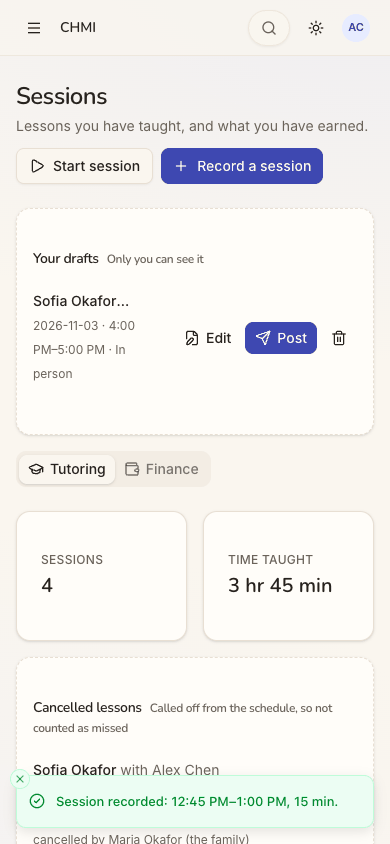

> Expected: the lesson recorded with its length. Observed: the toast "Session recorded: 12:45 PM–1:00 PM, 15 min." It
> shows the length, not the pay. The list gains "Ben Whitfield with Alex Chen · 2026-11-04 · 12:45 PM–1:00 PM · 15
> min", and SESSIONS reads 4. Started about 12:55, the lesson is logged from 12:45, because the start snaps to the
> nearest quarter and a lesson counts at least a quarter. A reload of Sessions kept the lesson and the draft.

**What Alex notices:** the timer works when the pairing has a price. The toast is clear and safe in front of a student.

### Step 32 — The card's pencil, "Edit session" (where the rest of the write-up goes)

> Expected: the full write-up form for the timed lesson. Observed: a fourth variant, "Edit session — Alex Chen with Ben
> Whitfield." It has no Student field, keeps the Date, Mode and 12:45-1:00 PM (15 min), Looking back and his note, and
> ends with Cancel and Save changes. There is no Save draft and no autosave line. Closed with Cancel.

**What Alex notices:** the rest of the write-up is here, but only through an unlabelled pencil on a card. Nothing
after the stop pointed to it.

### Step 33 — Menu → Home (end state)

> Expected: the home to reflect the session recorded today and the saved draft. Observed: unchanged. It still reads
> "Today: 0 lessons · 2 to record", Next up still says "You finished a lesson with Sofia… not recorded yet", and To
> record still lists Sofia and Ben. "Next: Yusuf Hassan, tomorrow at 4:00 PM" gives no warning that the lesson cannot
> be recorded.

**What Alex notices:** the home looks exactly as it did before his half hour of work. Nothing shows his draft, his
recorded lesson, or tomorrow's problem.

## Appendix

- **Mode:** live. The web app at `http://localhost:8797` is a frozen copy of commit `2d6e7d3` with sign-in on. It was
  driven in headless Chrome at 390×844 (phone), plus 1280×800 and dark mode at the landing steps (1, 3 and 4).
- **Frameworks applied:**
  - cuj-contract: every step was checked against its expected result and against the C2 contract ("Lesson just ended →
    Record it now; lesson soon → Start").
  - task-completion: the journey ran to its defined end, with every named entry point tried.
  - success-criteria: the end state was checked again after a reload of Sessions (the recorded lesson and the draft
    were kept) and on the home at step 33.
- **CUJ manifest:** J16, 33 steps, all observed (33 of 33 verified). Steps 2, 8, 10, 16-20, 22, 25, 27 and 33 did not
  match the expected result (see the findings above).
- **Coverage / not inspected:**
  - **Posting from the full form:** no lesson was posted from the full form. Sofia's and Ben's waiting lessons stayed
    unrecorded, and Sofia's draft was left unposted, so the journey would not change other journeys' data. So it was
    not observed whether posting from To record clears the row, or whether posting a lesson that has a draft consumes
    the draft.
  - **One posting:** the only lesson posted is the 15-minute timed lesson with Ben on 2026-11-04 (step 31). Yusuf's
    timer was discarded (step 29).
  - **Next up's "Later"** and **"Getting started"** were not tried; the tour offer was dismissed.
  - **Timer edge cases:** the 3-hour auto-stop and the cron sweep were not reached. Whether they also fail for a pairing
    with no price was not observed.
  - **Users:** the row menu "Actions for Sofia Okafor" offers Edit, Deactivate and Delete permanently to a tutor. It
    was seen but not clicked, so whether the server refuses those actions was not checked.
  - **Pairings and Users** were checked for a record action from the page's buttons, without a step screenshot.
  - **Other screens:** desktop layouts beyond the landing captures; the Riverside space (Alex's parent hat) was not
    opened; keyboard-only and screen-reader use (the accessibility tree was read only to find controls).
  - **Other clients and providers:** the iOS app, which has its own record forms, is covered by separate journeys.
    Other sign-in providers are not offered on the production web.
  - **The server's records:** by the audit's rules there were no database or API reads. Only the browser's own
    network log was read: a 401 on `/api/auth/session` while signed out, and the two 422s on
    `/api/sessions/active/stop`.
- **Access:** through the app's real sign-in and sign-up screens; the Google provider step is simulated (a stand-in for Google's button hands the app a local test token for the persona).
- **Preconditions made outside the UI:**
  - None for J16 itself. Alex Chen, his three pairings, the schedules and the two unrecorded lessons come from the seed.
  - The run's platform settings, and Assessment and Quest switched on in `chmi`, were set before the journeys, as
    `docs/userjourney/README.md` "The run" records.
