# CUJ Audit — J17: tutored student practises before the lesson

## Executive summary

**Who:** Sofia Okafor, a student at Chapel Hill Math Institute (CHMI). Her profile has her at Culbreth Middle, in
Grade 7 Mathematics. Her tutor is Alex, and she has a weekly lesson on Tuesdays at 4:00 PM. She belongs to cohort
**C5, the tutored student** ("What do I have to do?") in `docs/member-home-plan.md`. She is a seeded person. Her centre
made her account, so she arrives signed out on the shared address. Her goal is to practise before her next lesson.

**Outcome: 1/1 journeys passed, 0 skipped, 16 of 16 steps verified.** Sofia signed in and landed in CHMI with no
chooser and no wizard (step 3). The home leads with **the Daily**: the Next up card "Today's 5". One tap opened its
first question (step 5). The journey also records the other two practice routes:
- **An assessment waiting for her:** none. Her Assessment page says "No assessments yet". The home's quick action
  "Start an assessment" opens that page in one tap (step 10). Starting one needs a level (22 choices) and Start.
- **"Practise before Tue's lesson":** not offered. Her lesson is six days away, and the home offers it only within
  three days (`PRACTISE_BEFORE_DAYS`). Nothing else on the home leads to practice for the lesson. Tapping the lesson
  line does nothing (step 11).

The journey ran to its end, but the practice it started is wrong for her. The Next up Daily is **Grade 3** (step 5).
The Quest board's own Daily on the same home is **Grade 1** (step 12). Her profile says Grade 7 (step 15). She can
choose 7 on the grade row, but only the board follows. After a reload, the board is back on Grade 1 (steps 13-14).

**Conversion figures** (counted from the entry point):

| Stretch | Screens | Taps | Typed fields | Waits | Dead ends |
| --- | --- | --- | --- | --- | --- |
| Entry to the Daily's first question (steps 1-5) | 4 | 3 (+1 optional: No thanks on the tour offer) | 0 | 0 | 0 |
| Home to the assessment start page (step 10) | 1 | 1 (then level, choice and Start: 3 more to begin) | 0 | 0 | 0 |
| Home to "Practise before" | not offered | — | — | — | 1 (the lesson line, step 11) |
| Whole run, 16 steps | 10 distinct | 20 | 0 | 0 | 2 (lesson line, menu Quest) |

For conversion, Sofia is in her space and playing within three taps of the guest page, which is excellent. For
stickiness, the habit layer is in place: the streak card ("Start a streak, 0 of 3 days this week") and the next
badge. But the practice it counts is four to six grades below her. Nothing links it to Tuesday's lesson, the reason
she came.

**The 3 screens Sofia would notice most:**

- **Step 3, her home.** She is greeted by name with "Next lesson Tue at 4:00 PM", and one big "Play today's 5" button.
  This answers "What do I have to do?" in one glance, which is what C5 needs. Below it, the Quest board says
  "Grade 1", and every tile is Grade 1, Kindergarten or Math 1. None of them is her grade.
  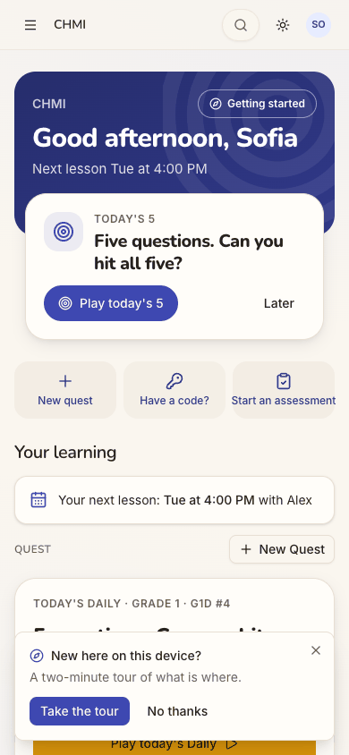
- **Step 5, the first question.** "G3D #4 · Grade 3": what the 2 means in 6 × 2 = 12. That is a third-grade question
  for a seventh-grader working towards AoPS Prealgebra. The screen also has no way out: no close, back or home
  control.
  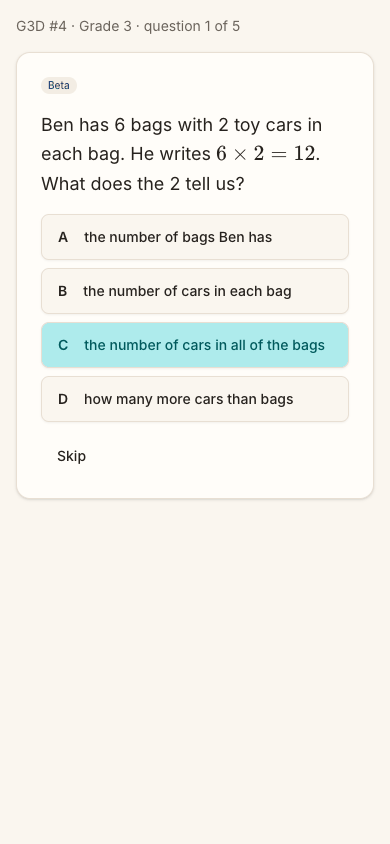
- **Step 14, after a reload.** She chose 7 on the grade row at step 13, and the board became hers. One reload later
  it is back on "Grade 1 · G1D #4". She will have to find the 7 again on every visit.
  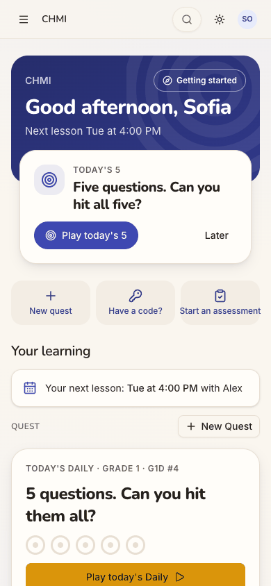

**Contact sheet** (all 16 phone steps):

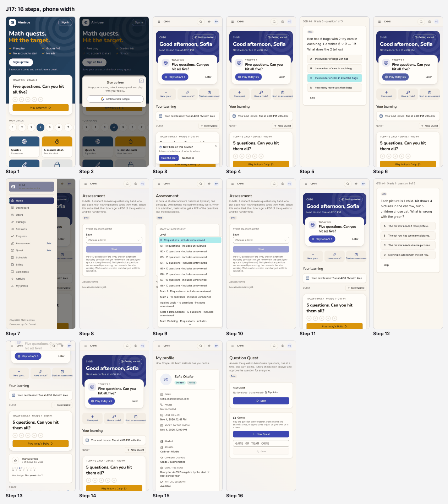

| Severity | Count |
| --- | --- |
| sev4 (catastrophe) | 0 |
| sev3 (major) | 1 |
| sev2 (minor) | 5 |
| sev1 (cosmetic) | 1 |
| **Total** | **7** |

## Prioritized fixes

1. [sev3] [Her practice starts at Grade 1 or 3, though the space has her in Grade 7](#sev3-her-practice-starts-at-grade-1-or-3-though-the-space-has-her-in-grade-7): lead the board and the Daily from her level, and remember the grade she picks (steps 3, 5, 13-15).
2. [sev2] [One home, two different Dailies under two names](#sev2-one-home-two-different-dailies-under-two-names): one Daily per reader, one name, and Next up follows the board (steps 5, 12, 13).
3. [sev2] [Six days before her lesson, nothing on the home is about it](#sev2-six-days-before-her-lesson-nothing-on-the-home-is-about-it): make the lesson line a way to the lesson and to practice for it (step 11).
4. [sev2] [The Daily has no way out but the browser's Back](#sev2-the-daily-has-no-way-out-but-the-browsers-back): add a close control that says what leaving keeps (steps 5, 6).
5. [sev2] [A student gets the staff menu, and its Quest is a different Quest](#sev2-a-student-gets-the-staff-menu-and-its-quest-is-a-different-quest): a short learner menu with one word per thing (steps 3, 7, 16).
6. [sev2] ["Sign in" opens a sheet titled "Sign up free"](#sev2-sign-in-opens-a-sheet-titled-sign-up-free): title the sheet by the button that opened it (step 2).
7. [sev1] [The Assessment page talks about a student, not to her](#sev1-the-assessment-page-talks-about-a-student-not-to-her): second-person copy, her grade preset, names instead of codes (steps 8-10).

## Findings

### [sev3] Her practice starts at Grade 1 or 3, though the space has her in Grade 7

- **Issue Description:** CHMI knows Sofia's grade. Her profile shows "CURRENT COURSE Grade 7 Mathematics" and "GOAL
  THIS YEAR Ready for AoPS Prealgebra by the start of next school year" (step 15). But every practice the home offers
  starts far below that:
  - the Next up Daily is Grade 3 (step 5);
  - the Quest board's Daily and its grade row are on Grade 1;
  - "More levels" offers Math 1 and Kindergarten, and "Advanced" offers Beast Academy 1 (steps 3-4).

  Her Question Quest page says "No level yet" (step 16): nobody has set her a Quest level. Choosing 7 on the grade
  row fixes the board: a Grade 7 Daily, five Grade 7 tiles and AoPS Algebra (step 13). But it is not kept: after a
  reload the board is back on Grade 1 (step 14). Where the Next up Daily's Grade 3 comes from is not shown on screen.
- **Framework Violation:** cuj-contract, steps 5 and 14 (expected: practice at her grade, and a grade she chose stays
  chosen; observed: Grade 3 and Grade 1, and her choice lost on reload); Nielsen #2 Match between system and the real
  world (the practice does not match the learner the space has on file); Nielsen #6 Recognition rather than recall
  (she must remember to re-pick 7 every visit).
- **Severity:** 3. Classify: the end state is wrong, and the workaround (find the 7, on every visit) fixes only half
  the home. For a tutored student practising before a lesson, the content is the point. A Grade 3 question gives her
  nothing to bring to Tuesday. A seventh-grader who meets "6 × 2 = 12" as her "Daily" is likely not to come back.
  It is not a 4, because she can reach Grade 7 practice by hand.
- **Evidence:**  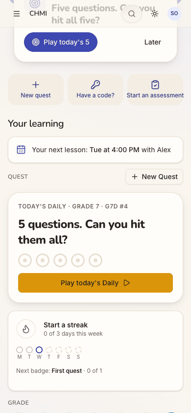
   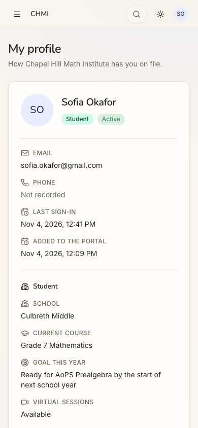
  Repro: sign in as Sofia (CHMI student, no Quest level). The board reads "Today's Daily · Grade 1", and Next up's
  "Play today's 5" opens `/quest/daily/NC26.3` ("Grade 3"). Tap 7 on the grade row: the board becomes Grade 7.
  Reload: it is Grade 1 again.
- **Recommended Fix:**
  - Lead the Quest board, its Daily and the Next up Daily from one learner level. Use her Quest level if one is set.
    Otherwise use the last grade she chose on the row, kept per member (the guest home already keeps a grade on the
    device; `guestLeadLevel`).
  - Until either exists, ask once, on the board: "Which grade are you in?". **Owner decision:** whether a tutoring
    space's "Current course" may suggest the answer, since it is free text today.
  - On the tutor's and the office's home, flag "Sofia has no Quest level". Alex can then set it in one step.
  - Add a web e2e check: a student picks grade 7, reloads, and the board and Next up are both on Grade 7.

### [sev2] One home, two different Dailies under two names

- **Issue Description:** Sofia's home offers "today's" practice twice. The Next up card calls it "Today's 5", and its
  link opens "G3D #4 · Grade 3" (step 5). The Quest board's card below calls it "Today's Daily · Grade 1 · G1D #4".
  Its button opens a different set, "G1D #4 · Grade 1" (step 12). When she picks 7 on the grade row, the board's
  Daily becomes Grade 7. Next up still links to the Grade 3 set (step 13). So the biggest button on the page is the
  one that ignores her choice. The board's card reads "5 questions. Can you hit them all?". Next up reads "Five
  questions. Can you hit all five?". The same idea, worded twice.
- **Framework Violation:** cuj-contract, steps 12-13 (expected: one Daily for her today; observed: two, at two grades,
  and Next up does not follow the grade row); Nielsen #4 Consistency and standards; Nielsen #1 Visibility of system
  status (nothing says which one counts for the streak or the rings).
- **Severity:** 2. Classify: an observable mismatch and real friction. For C5, "What do I have to do?" should have one
  answer. Two "today's" sets leave her guessing which one her streak and her tutor see. She can play either, so
  nothing is blocked.
- **Evidence:**  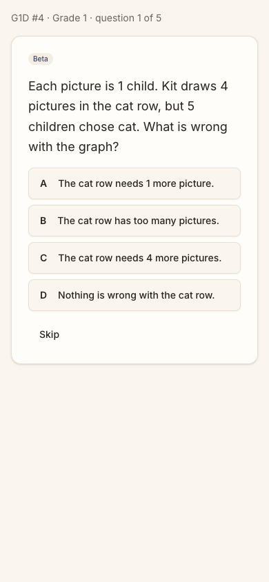
  
  Repro: on Sofia's home, open Next up's "Play today's 5": Grade 3. Back. Open the board's "Play today's Daily":
  Grade 1. Back. Pick 7 on the grade row: the board says Grade 7, and Next up's link is still `/quest/daily/NC26.3`.
- **Recommended Fix:** Give a reader one Daily per day, at the level the board shows. Next up's Daily item should take
  its level from the same source as the board, and change when the grade row changes. While Next up shows the Daily,
  the board's Daily card should repeat it, or make way for the rings. Use one name everywhere: "Today's Daily" (the
  board's), with the grade in its label, e.g. "Today's Daily · Grade 7".

### [sev2] Six days before her lesson, nothing on the home is about it

- **Issue Description:** The band says "Next lesson Tue at 4:00 PM", and "Your learning" repeats it: "Your next
  lesson: Tue at 4:00 PM with Alex" (step 3). That is all. Tapping the line does nothing, because it is plain text
  (step 11). Nothing on the home says what the lesson will cover, what homework was set, or what to practise for it.
  "Practise before Tue's lesson" is the Next up item made for this cohort. It is offered only within three days of the
  lesson (`PRACTISE_BEFORE_DAYS`), so on Wednesday it is absent, with nothing in its place. Looking further, she tries
  the menu's Quest (step 16): Question Quest, also unrelated to her lesson. Both are dead ends.
- **Framework Violation:** cuj-contract, step 11 (expected: a way from the lesson to practice for it; observed: an
  inert line); Nielsen #1 Visibility of system status; Nielsen #6 Recognition rather than recall (the lesson's
  homework lives elsewhere, if she can find it).
- **Severity:** 2. Classify: real friction for the journey's own goal. Sofia came to practise for Tuesday, and the home
  knows the lesson but does nothing with it for four days of every week. She can still practise; it just is not tied to
  the lesson. Two dead ends follow from it.
- **Evidence:**  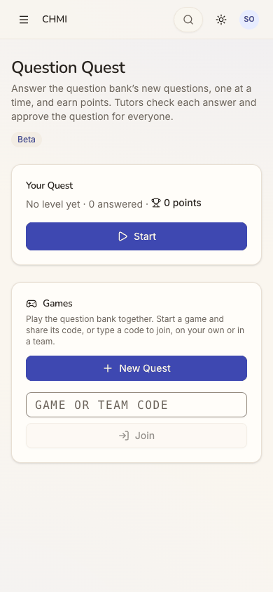
  Repro: as Sofia on a Wednesday, tap "Your next lesson: Tue at 4:00 PM with Alex". Nothing happens. Next up is
  "Today's 5"; no "Practise before" appears anywhere.
- **Recommended Fix:**
  - Make the lesson line a link to that lesson, with its time, place and tutor, and the homework set at the last lesson
    (the "homework set" part of the write-up, which already reaches the lesson's audience).
  - Give the line a quiet action every day: "Practise for Tuesday". Next up's "Practise before Tue's lesson" can keep
    its three-day window as the louder nudge.
  - When the Next up item does appear, it should open practice at her level (see the sev3 finding), so its first
    question fits her.

### [sev2] The Daily has no way out but the browser's Back

- **Issue Description:** The Daily runs full screen. Its only parts are a line ("G3D #4 · Grade 3 · question 1 of
  5"), the question, four answers and Skip (step 5). There is no close, back, home or menu control. Sofia left with the
  browser's Back (step 6). Nothing told her whether leaving would cost her today's Daily. The home afterwards still
  offered it unplayed, so in this run nothing was lost.
- **Framework Violation:** cuj-contract, step 6 (expected: an in-app way back; observed: none); Nielsen #3 User control
  and freedom; Nielsen #1 Visibility of system status (what leaving keeps is not said).
- **Severity:** 2. Classify: a workaround is needed, the browser's Back. That works in a browser tab. Opened as a
  home-screen web app on a phone, there may be no Back to use (not tested). A student unsure whether leaving "uses up"
  the one Daily a day may simply not start it.
- **Evidence:**  
  Repro: from the home, tap "Play today's 5". The accessibility tree shows a paragraph, the question, "Your answer"
  (A-D) and Skip, and no other control.
- **Recommended Fix:** Add a close (X) to the Daily's top line, beside "question 1 of 5". Tapping it asks: "Leave
  today's Daily? It will wait for you until tomorrow." Use whatever the rule really is. Keep the same control on every
  full-screen quest view (`/quest/daily`, `/quest/play`, games).

### [sev2] A student gets the staff menu, and its Quest is a different Quest

- **Issue Description:** Sofia's menu has twelve entries (step 7; the same on desktop at step 3): Home, Dashboard,
  Users, Pairings, Sessions, Progress, Assessment (Beta), Quest (Beta), Schedule, Billing, Comments, Activity and My
  profile. Most are words for running a tutoring space. None has a count or badge to say something waits for her. The
  one that sounds like her practice, "Quest", opens "Question Quest" (step 16). That page reads "Answer the question
  bank's new questions … Tutors check each answer and approve the question for everyone", with "No level yet". It is
  a different thing from the home's quest board. She meets five names for practice on two screens: "New quest", "New
  Quest", "Question Quest", "Today's 5" and "Today's Daily".
- **Framework Violation:** cuj-contract, steps 7 and 16 (expected: a learner's menu leading to her practice; observed: a
  staff menu, and a wrong turn); Nielsen #8 Aesthetic and minimalist design; Nielsen #4 Consistency and standards.
- **Severity:** 2. Classify: real friction, and the source of one of the run's two dead ends. A student's menu is where
  she looks when the home does not answer, so it should be short and in her words. The pages behind Users, Pairings and
  Billing were not opened, so this finding is about the labels only.
- **Evidence:** 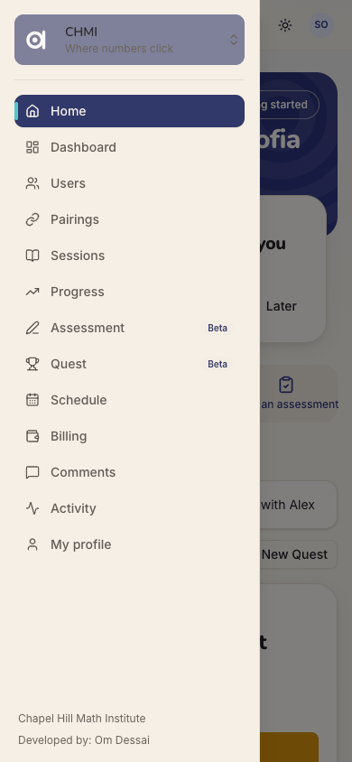 
  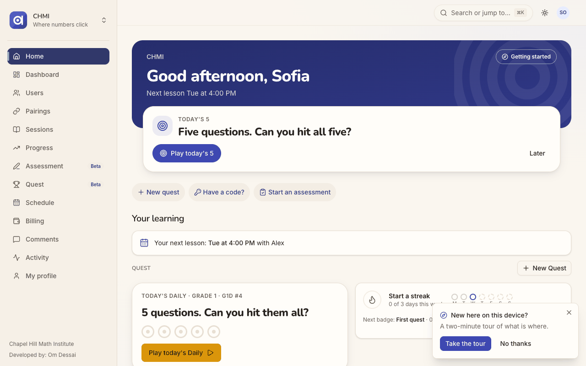
  Repro: as Sofia, open the menu; then tap Quest.
- **Recommended Fix:**
  - Give someone who holds only the student role a learner menu: Home, My lessons (sessions and schedule), Practice
    (the quest board), Assessments, My profile.
  - Keep the staff entries for staff, and narrow by role as the dashboards already do.
  - Put a count on Assessments when one waits for her.
  - Rename "Question Quest" for students (for example "Try new questions"), so "Quest" means one thing.

### [sev2] "Sign in" opens a sheet titled "Sign up free"

- **Issue Description:** Sofia already has an account; her centre made it. She taps the header's "Sign in" (step 2)
  and gets a sheet titled "Sign up free": "Keep your scores, unlock every quest and play with your family." Continue
  with Google. No sign-in wording appears. J05 found the same sheet; for a returning member it matters more.
- **Framework Violation:** cuj-contract, step 2 (expected: a sign-in step; observed: a sign-up sheet); Nielsen #4
  Consistency and standards; Nielsen #2 Match between system and the real world.
- **Severity:** 2. Classify: an observable mismatch. It did not stop her: the one button signed her in to CHMI
  (step 3). But a student told "your centre has set you up" may stop at "Sign up free", or ask a parent whether she is
  about to make a second account.
- **Evidence:** 
  Repro: signed out at `/`, tap "Sign in" in the header.
- **Recommended Fix:** Title the sheet by the button that opened it. From "Sign in": "Sign in. Welcome back. New
  here? The same button makes you a free account." Keep "Sign up free" for the hero, the tiles and the nudges. (Same
  fix as J05.)

### [sev1] The Assessment page talks about a student, not to her

- **Issue Description:** Sofia reaches the Assessment page in one tap from the home (step 10) or two from the menu
  (step 8). Its words are written for the adult who gives an assessment, not for her:
  - "A student answers questions by hand … When it is submitted, their tutors get a PDF";
  - "including questions not yet reviewed in the bank (your space is trying them out)".

  The Level picker is not preset to her grade. It lists 22 codes (K, G1-G8, Math 1, Math 2, Applied Logic, …, BA1-BA5,
  AoPS …), and every one ends "· 10 questions · includes unreviewed" (step 9). She can find G7, eighth in the list.
- **Framework Violation:** cuj-contract, steps 8-10 (expected: a start in her words, at her grade; observed: copy for
  an adult and an unpreset list of codes); Nielsen #2 Match between system and the real world.
- **Severity:** 1. Classify: wording and defaults, not a blocker. Starting is still one level and Start away. For a
  student, "includes unreviewed" on every line reads like a warning she cannot act on.
- **Evidence:**  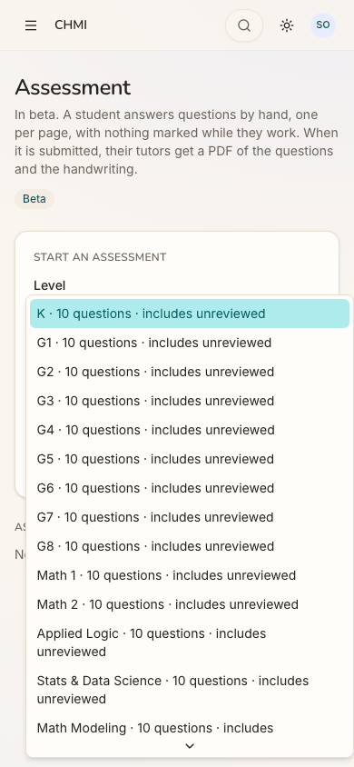
  Repro: from the home tap "Start an assessment", then open Level.
- **Recommended Fix:**
  - When the reader is the student, address her: "Answer up to 10 questions by hand. When you hand it in, Alex gets
    your work."
  - Preset Level to her grade (as in the sev3 fix).
  - Show level names ("Grade 7") rather than codes.
  - Say "includes new questions" once, under the picker, instead of on every option.

## Walkthrough

### Step 1 — Open http://localhost:8797/ signed out (landing)

> Expected: the guest page, with a way in for someone who already has an account. Observed: match. "Math quests. Hit
> the target.", a big white "Sign up free", and an outlined "Sign in" in the header. Today's 5 is on Grade 4, then the
> grade row and the tiles. Desktop and dark render cleanly.

**What Sofia notices:** a bright game page aimed at newcomers. She already has an account from her tutoring centre,
so her eye goes to the small "Sign in" at the top right.

### Step 2 — Tap "Sign in" in the header

> Expected: a sign-in step. Observed: a sheet titled "Sign up free", "Keep your scores, unlock every quest and play
> with your family.", and one button, Continue with Google.

**What Sofia notices:** "Sign up free" when she meant to sign in. She hesitates, then taps the only button.

### Step 3 — Tap "Continue with Google" (landing: the first screen inside her space)

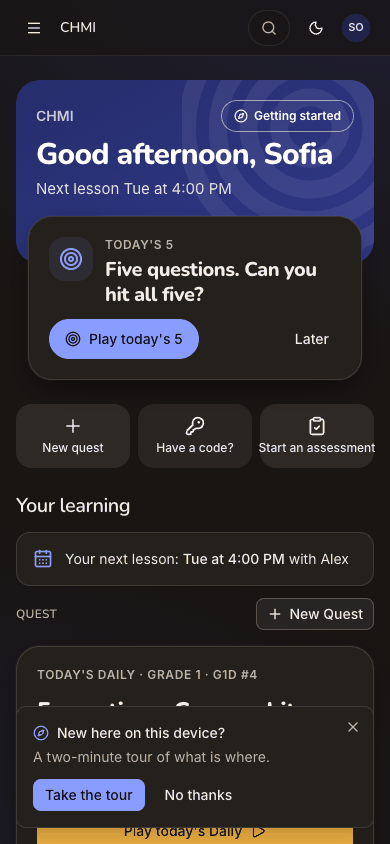

> Expected: straight into CHMI, with Next up offering practice. Observed: match on entry, with no chooser and no
> wizard. "Good afternoon, Sofia" and "Next lesson Tue at 4:00 PM". Next up: "Today's 5", with "Play today's 5" and
> "Later". Quick actions: New quest, Have a code?, Start an assessment. "Your learning" shows "Your next lesson: Tue at
> 4:00 PM with Alex". The Quest board starts with "Today's Daily · Grade 1". A tour offer, "New here on this device?",
> sits over the bottom of the board's Daily card on the phone. On desktop the sidebar lists twelve entries.

**What Sofia notices:** her name, her lesson and one big purple button. Below it, "Grade 1" catches her eye.

### Step 4 — Tap "No thanks" on the tour offer, and look over the whole home

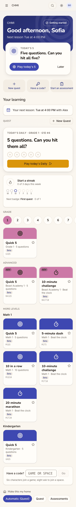

> Expected: somewhere on the home, practice for her lesson or an assessment waiting. Observed: neither. In order:
> - Next up and the quick actions;
> - the lesson line;
> - "Today's Daily · Grade 1 · G1D #4";
> - "Start a streak, 0 of 3 days this week", with the week's dots and "Next badge: First quest · 0 of 1";
> - the grade row on 1, and one Grade 1 tile;
> - Advanced: two Beast Academy 1 tiles;
> - More levels: five Math 1 tiles and one Kindergarten tile;
> - a code box, and "Make this my home: Automatic (Quest) / Quest / Assessments".
>
> There is no Assessments section, and no homework.

**What Sofia notices:** a long page of tiles, none at her grade. The Daily appears twice, once at the top and once in
the board.

### Step 5 — Tap "Play today's 5" in Next up (landing: the feature starts)

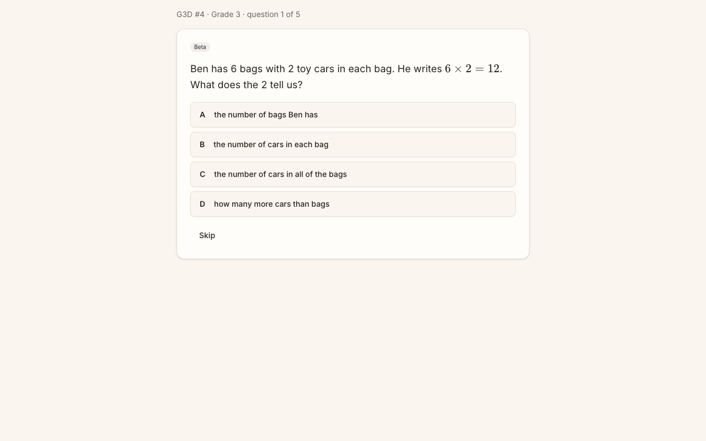
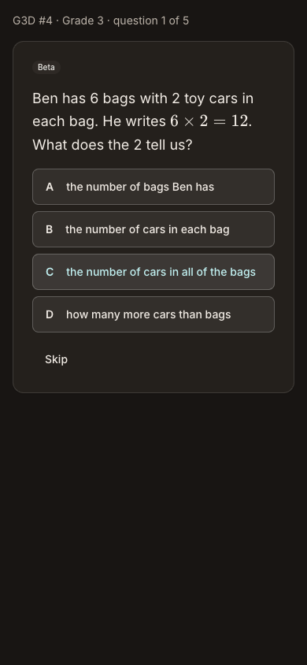

> Expected: the Daily's first question, at her grade. Observed: the first question is on screen, so the practice has
> started. "G3D #4 · Grade 3 · question 1 of 5", Beta: "Ben has 6 bags with 2 toy cars in each bag. He writes
> 6 × 2 = 12. What does the 2 tell us?", A-D and Skip. There is no close or back control. The cyan on C in the phone
> images is the pointer's hover where the link had been, not a choice.

**What Sofia notices:** this is easy, too easy for her, and labelled Grade 3. There is no obvious way back to the home.

### Step 6 — Go back with the browser's Back

> Expected: an in-app way out, and the home. Observed: only the browser's Back works. The home is unchanged, and Next
> up still offers "Play today's 5", unplayed.

**What Sofia notices:** relief that the Daily is still there. She had to know to use the browser.

### Step 7 — Open the menu, looking for an assessment

> Expected: a short student menu, with a badge if something waits. Observed: twelve entries: Home, Dashboard, Users,
> Pairings, Sessions, Progress, Assessment (Beta), Quest (Beta), Schedule, Billing, Comments, Activity and My profile.
> None has a badge.

**What Sofia notices:** a long, grown-up list. "Assessment" is the one word that matches what she is looking for.

### Step 8 — Tap "Assessment"

> Expected: an assessment waiting for her, or a way to start one. Observed: none is waiting ("No assessments yet").
> "Start an assessment" has a Level picker and a disabled Start. The page's words are about "a student" and "their
> tutors".

**What Sofia notices:** nothing is waiting for her, and the page seems to be talking to someone else.

### Step 9 — Open the Level picker

> Expected: her grade first, or already chosen. Observed: 22 codes from K to AoPS Geometry, each "· 10 questions ·
> includes unreviewed", with nothing preselected. G7 is eighth. Not started: the journey starts one practice, and that
> was the Daily. Escape closes the picker.

**What Sofia notices:** she can find G7. "Includes unreviewed" on every line means nothing to her.

### Step 10 — Back to the home, then tap the quick action "Start an assessment"

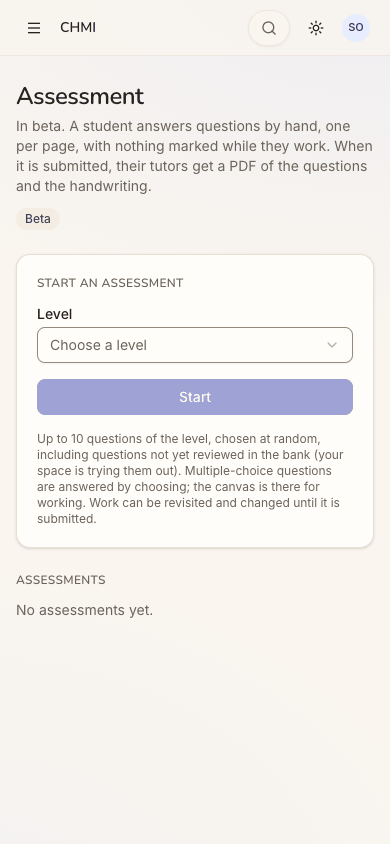

> Expected: the assessment start, ideally at her grade. Observed: the same page as step 8, one tap from the home, with
> Level still unchosen. So an assessment is one tap to the page, then a level and Start.

**What Sofia notices:** the shortcut works and lands on the same page; nothing new.

### Step 11 — Back to the home, then tap "Your next lesson: Tue at 4:00 PM with Alex"

> Expected: the lesson, or practice for it ("Practise before Tue's lesson"). Observed: nothing happens; the line is
> plain text. No "Practise before" item is anywhere on the home. The lesson is six days away, outside the three days in
> which the home offers it. This is the run's first dead end.

**What Sofia notices:** the home knows about Tuesday but gives her nothing to do about it.

### Step 12 — Tap the board's "Play today's Daily"

> Expected: the same Daily as Next up. Observed: a different set, "G1D #4 · Grade 1 · question 1 of 5", about a
> picture graph of cats.

**What Sofia notices:** this "today's" set is not the one from the top of the page, and it is even easier.

### Step 13 — Back to the home, then pick 7 on the grade row

> Expected: her grade's Daily and tiles, with Next up following. Observed: the board becomes "Today's Daily · Grade 7 ·
> G7D #4", with five Grade 7 tiles and AoPS Algebra under Advanced. Next up's "Play today's 5" still links to the
> Grade 3 Daily. When she scrolls, the translucent phone header shows the Next up card's text through it.

**What Sofia notices:** now the board is hers. But the big card at the top has not changed.

### Step 14 — Reload the home (checking the end state)

> Expected: grade 7 kept, the Daily still unplayed. Observed: the Daily is still unplayed and the streak is still 0 of
> 3. But the board is back on "Grade 1 · G1D #4": her grade choice is not kept.

**What Sofia notices:** she has to pick 7 again, and she will have to every time.

### Step 15 — Menu, "My profile", scrolled to the student block

> Expected: the space has her grade on file. Observed: "How Chapel Hill Math Institute has you on file". School:
> Culbreth Middle. Current course: Grade 7 Mathematics. Goal this year: "Ready for AoPS Prealgebra by the start of next
> school year".

**What Sofia notices:** the centre knows she is in Grade 7, so why does practice start in Grade 1?

### Step 16 — Menu, "Quest", still looking for practice for her lesson

> Expected: her practice. Observed: "Question Quest", described as answering "the question bank's new questions" that
> "tutors check". It shows "No level yet · 0 answered · 0 points" and Start, then Games with New Quest and a code box.
> Nothing here is about her lesson. This is the run's second dead end, and the end of the journey: one practice
> started (the Daily, step 5), and the other two recorded (the assessment at steps 8-10, "Practise before" at step 11).

**What Sofia notices:** another "Quest", which is not the board from her home. "No level yet" explains nothing to her.

## Appendix

- **Mode:** live. The web app at `http://localhost:8797` is a frozen copy of commit `2d6e7d3` with sign-in on, driven
  in headless Chrome at 390×844 (phone), plus 1280×800 and dark mode at the landing steps (1, 3, 5). Run on Wednesday
  2026-11-04, between 17:38 and 17:43 UTC.
- **Frameworks applied:** cuj-contract (every step against its expected result); task-completion (the journey ran to
  its defined end: one practice started, the other two recorded); success-criteria (the end state was checked again
  after a reload at step 14: still in CHMI, the Daily still unplayed, the grade choice lost).
- **CUJ manifest:** J17, 16 steps, all observed. Steps 2, 5, 6, 11, 12, 13, 14 and 16 did not match what was expected
  (findings above).
- **Coverage / not inspected:**
  - **"Practise before Tue's lesson" itself.** It was not offered on the run's date: the lesson was six days away, and
    the home offers it within three (`PRACTISE_BEFORE_DAYS` in `packages/shared/src/home.ts`). The audit changes neither
    the clock nor the schedule. So whether it appears from Saturday, how it reads, and which level it opens were not
    observed.
  - **An assessment waiting for her.** None existed: her Assessment page listed none. Next up's "continue an
    assessment" item could not be seen. Starting one herself was reached (steps 8-10), but Start was not pressed.
  - **The Daily beyond question 1** (answering, the rings, the streak, one play a day): out of scope by the audit's
    rules. Whether leaving mid-Daily keeps it was judged only from the home after Back: still offered, unplayed.
  - **The Daily without a browser Back** (a home-screen web app on a phone): not tested.
  - **Pages behind the menu.** Users, Pairings, Sessions, Schedule, Billing, Dashboard, Progress, Comments and Activity
    were not opened. The menu finding is about the labels only.
  - **Prices on her profile.** Her own lesson prices ($100.00/hr in person, $85.00/hr virtual) are listed on her
    profile below the part shown at step 15. This was observed but not judged against `docs/data-exposure.md`; the
    exposure crawl owns that.
  - Question Quest's Start (no level set), New Quest, a game code, "Make this my home", "Getting started" and the tour
    (declined at step 4) were not used.
  - Her parent's view (Maria Okafor), and whether Alex is told she has no Quest level.
  - Keyboard-only and screen-reader use; the accessibility tree was read only to find controls.
  - The iOS app; it is covered by separate journeys, and J17 has no app replay.
  - Other sign-in providers (not offered on the production web).
- **Access:** through the app's real sign-in and sign-up screens; the Google provider step is simulated (a stand-in for
  Google's button hands the app a local test token for the persona).
- **Preconditions made outside the UI:** none for J17 itself. Sofia, her pairing with Alex and her Tuesday schedule are
  seeded data (`npm run db:reset`). The run's settings were set through the console API before the journeys, as
  `docs/userjourney/README.md` "The run" records: web sign-in Google only, sign-up access Post-approved, the Play home
  and the Daily on, and Assessment and Quest switched on in `chmi` by its admin.
