# CUJ Audit — J18: parent who is also a tutor: which hat leads, the switcher, All spaces, the dashboard

## Executive summary

**Who:** Maria Okafor, a seeded person at Chapel Hill Math Institute (CHMI). She is Sofia's mother and also a tutor
there. She belongs to cohort **C8, several roles** ("What's urgent across my hats?") in `docs/member-home-plan.md`. The
contract for that cohort: the most time-bound item of any hat wins Next up, and each hat gets its own section. She
wants to sign in and see Sofia's lessons and her own teaching in one place. She also wants to know where to go for
each.

**Outcome: 1/1 journeys passed, 0 skipped, 15 of 15 steps verified.** Maria saw everything the journey asks for:
- the home (steps 3-4);
- the space switcher (step 6);
- All spaces (step 7);
- the Dashboard, in both its views (steps 8-10, 14).

She also tried "Make this my home" (step 12). After a reload (step 13) the pin was still saved, but the home had not
changed.

**Which hat leads:** the parent hat, and only the parent hat. It leads because it is the only hat with anything in it:
- The home's chip reads "Automatic (My children)".
- Next up is "Sofia's next lesson, Tue at 4:00 PM with Alex".
- "Your children" is the only section on the page.

Her tutor hat never appears on the home: there is no section, no "Teaching" choice and no empty line. The reason shows
only on the Dashboard: "No students assigned to you yet." Elsewhere the app does know she teaches. The switcher and All
spaces both label her "Tutor · Parent", and the Dashboard opens as "Tutor". So the home and the Dashboard pick opposite
hats: the home picks the hat with content, and the Dashboard opens on the empty one.

**Can she tell where to go for what?** Only partly:
- **The switcher:** one space and "All spaces". With one space there is nothing to switch to.
- **All spaces:** her role and "Here now". It also offers "Start a space … for your students", which is a tempting
  wrong door for a tutor.
- **The Dashboard:** the only place with what she acts on as a parent: $152.50 outstanding, and Sofia "Behind" on her
  plan. She gets there only by changing an unlabelled "Tutor" dropdown to "Parent", and the Dashboard forgets that
  choice on her next visit.

**Conversion figures** (counted from the entry point, `/` signed out):

| Stretch | Screens | Taps | Typed fields | Waits | Dead ends |
| --- | --- | --- | --- | --- | --- |
| Entry to the home inside CHMI (steps 1-3) | 3 | 2 | 0 | 0 | 0 |
| Entry to her real data as a parent, the Dashboard's Parent view, shortest path (steps 1-3, 8-10) | 6 | 7 | 0 | 0 | 1 |
| Whole run, 15 steps | 8 distinct (11 views) | 18 | 0 | 1 | 3 |

**Conversion and stickiness:**
- **Conversion into the space:** immediate. One Google tap lands her in CHMI with no space picker.
- **Conversion to a tutor feature:** none. Nothing on the home or the Dashboard gives a tutor without students a next
  step.
- **Stickiness as a parent:** decent. The home shows Sofia's next lesson with its homework, and "Play with Sofia". The
  week's "Played 0 days (aim: 3)" gives a reason to come back.
- **Stickiness as a tutor:** nothing pulls her back.

**The 3 screens Maria would notice most:**
- **Step 3, the home after sign-in.** Everything on it is about Sofia, and nothing says Maria teaches here. Cohort C8
  expects one section per hat, and she gets one section for two hats.
  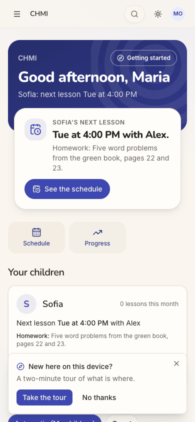
- **Step 8, the Dashboard.** It opens on "Tutor": three zero counts, "No lessons recorded or scheduled yet" and "No
  students assigned to you yet". For someone with several hats, the first page is the empty one, with only a bare
  dropdown hinting at another view.
  
- **Step 10, the Dashboard's Parent view.** This is the page she would act on: $152.50 outstanding, and Sofia "Behind"
  on her plan, at 11% with 2 of 18 planned sessions held. It is reached only through the dropdown, and at phone width
  its Recent sessions rows overlap ("wi2026-09-15").
  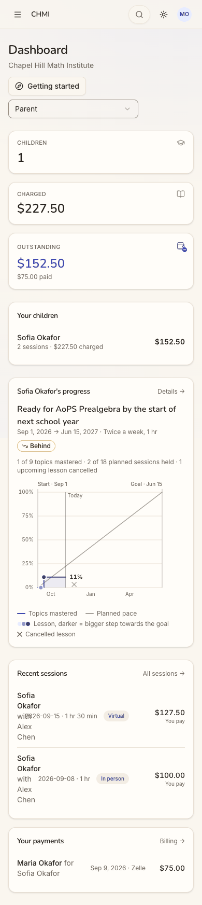

**Contact sheet** (all 15 phone steps):

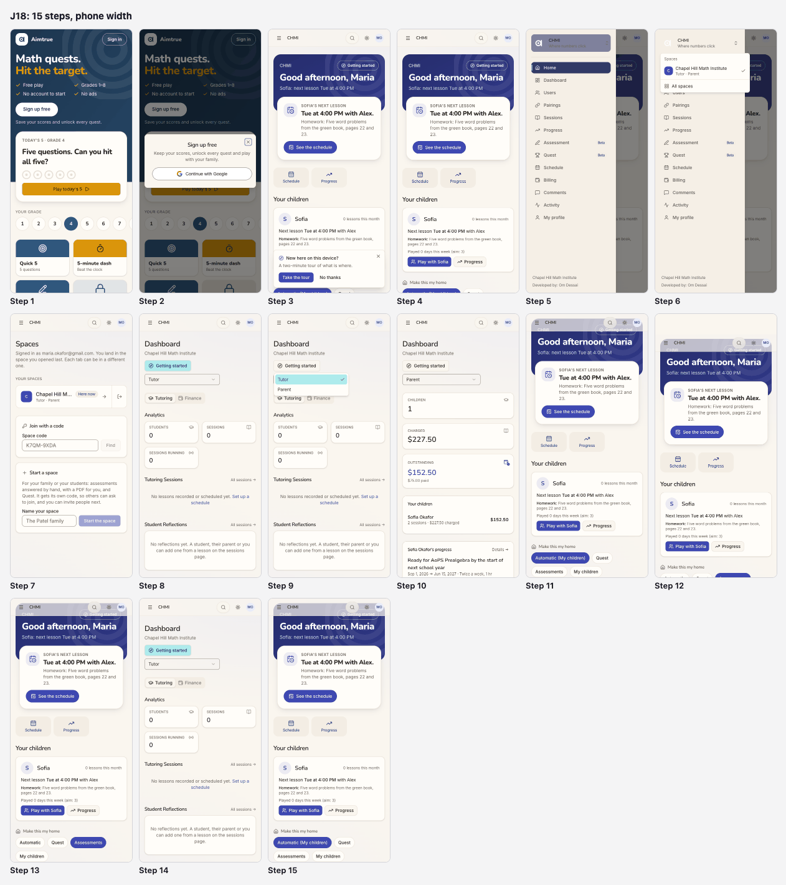

| Severity | Count |
| --- | --- |
| sev4 (blocked) | 0 |
| sev3 (major) | 1 |
| sev2 (minor) | 4 |
| sev1 (cosmetic) | 1 |
| **Total** | **6** |

## Prioritized fixes

1. [sev3] [The Dashboard opens on her empty Tutor view and forgets the Parent choice](#sev3-the-dashboard-opens-on-her-empty-tutor-view-and-forgets-the-parent-choice): open on the role with content, or the home's lead, and remember the last choice (steps 8, 10, 14).
2. [sev2] [The home ignores her tutor role: no section, no Teaching choice, no next step](#sev2-the-home-ignores-her-tutor-role-no-section-no-teaching-choice-no-next-step): show a one-line tutor section and offer Teaching in "Make this my home" (steps 3, 4, 11).
3. [sev2] ["Make this my home" changes nothing she can see and says nothing](#sev2-make-this-my-home-changes-nothing-she-can-see-and-says-nothing): confirm the pin, say what it changes, and hide choices that would change nothing (steps 12, 13, 15).
4. [sev2] ["Sign in" opens a sheet titled "Sign up free"](#sev2-sign-in-opens-a-sheet-titled-sign-up-free): title the sheet after the button that opened it (step 2).
5. [sev2] [Recent sessions rows overlap on the parent Dashboard at phone width](#sev2-recent-sessions-rows-overlap-on-the-parent-dashboard-at-phone-width): stack the row's parts below `sm` (step 10).
6. [sev1] [All spaces: the space name is truncated and Leave is an unlabelled icon beside Open](#sev1-all-spaces-the-space-name-is-truncated-and-leave-is-an-unlabelled-icon-beside-open): let the name wrap and label Leave (step 7).

## Findings

### [sev3] The Dashboard opens on her empty Tutor view and forgets the Parent choice

- **Issue Description:** Menu → Dashboard opens with the role dropdown set to "Tutor". That view shows:
  - STUDENTS 0, SESSIONS 0, SESSIONS RUNNING 0;
  - "No lessons recorded or scheduled yet";
  - "No students assigned to you yet";
  - and, as its only Recent Activity, Maria's own "opened Chapel Hill Math Institute".

  Her real data is under "Parent", the second option of an unlabelled dropdown: Sofia, $227.50 charged, $152.50
  outstanding, the progress plan "Behind", two recent sessions and a payment. Choosing Parent only puts `?role=parent`
  in the URL. The menu's Dashboard link drops it, so the next visit (step 14) opens on the empty Tutor view again. The
  home led with the parent hat. The Dashboard leads with the other one.
- **Framework Violation:** cuj-contract, steps 8 and 14 (cohort C8: what is urgent across her hats should lead).
  Nielsen #6 Recognition rather than recall, because she has to remember to switch every visit. Nielsen #4 Consistency
  and standards, because the home and the Dashboard pick opposite hats.
- **Severity:** 3. A workaround is needed on every visit. For a parent who is also a tutor, the Dashboard's first
  screen is a page of zeros. The page she acts on (what she owes, and that Sofia is behind) is one hidden choice away,
  and the home never mentions it. A C8 person who gives up at the zeros never finds it.
- **Evidence:**   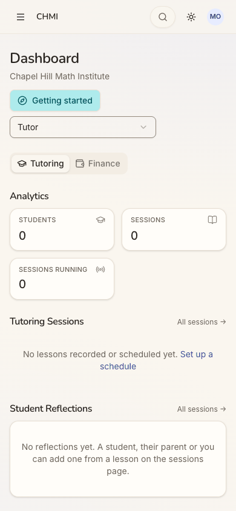
  Repro:
  1. Sign in as Maria Okafor.
  2. Open the menu and choose Dashboard: it shows "Tutor", all zeros.
  3. Change the dropdown to Parent: the URL becomes `/dashboard?role=parent` and the data appears.
  4. Open the menu and choose Dashboard again: it is back on "Tutor".
- **Recommended Fix:**
  - Choose the Dashboard's opening role the way the home chooses its lead: the hat with content (here Parent). Better
    still, follow the home's focus or pin.
  - Remember the last role chosen per person and space, as the tab's `?tab=` already does for Tutoring/Finance. Make the
    menu link carry it.
  - Give the dropdown a visible label ("View as") so a second view is discoverable.
  - Leave out the reader's own "opened the space" lines from Recent Activity. For a tutor with no students they are the
    only content.

### [sev2] The home ignores her tutor role: no section, no Teaching choice, no next step

- **Issue Description:** Maria holds the tutor role in CHMI. The switcher and All spaces say "Tutor · Parent" (steps 6
  and 7). Yet the home has:
  - no tutor section;
  - no "To record";
  - no empty line;
  - no "Teaching" chip under "Make this my home" (the chips are Automatic (My children), Quest, Assessments and My
    children).

  Nothing on the home says why. The reason, "No students assigned to you yet", appears only in the Dashboard's Tutor
  view (step 8). A tutor who has just been added and is waiting for students gets no sign that the space knows she
  teaches, and no next step.
- **Framework Violation:** cuj-contract, steps 3 and 4 (cohort C8: "one section per hat"). Nielsen #1 Visibility of
  system status: her tutor status, and the fact that she has no students yet, is invisible where she lands.
- **Severity:** 2. This is an observable mismatch and real friction, not a blocker. For this cohort the home's promise
  is one view across her hats, and half of her role is missing. The cost falls on conversion to teaching: a new tutor
  is told nothing about what happens next.
- **Evidence:** 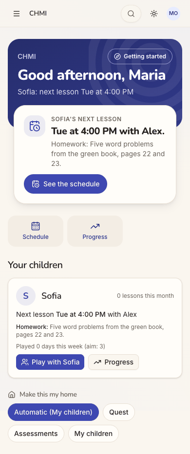 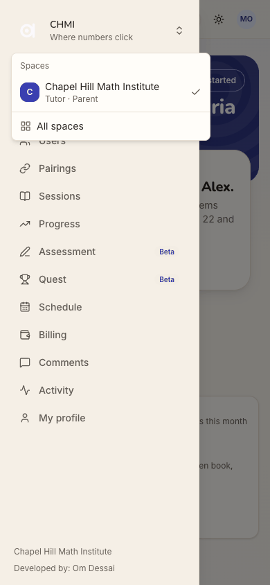 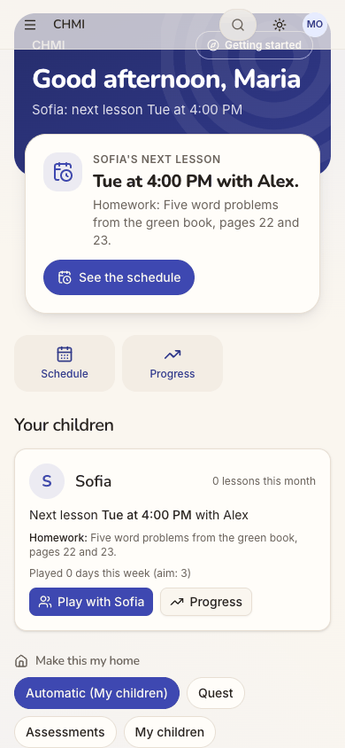
  Repro:
  1. Sign in as Maria Okafor and dismiss the tour.
  2. Scroll the home: "Your children" is the only section, and the chips have no Teaching.
  3. Open the switcher: it says "Tutor · Parent".
- **Recommended Fix:**
  - When a person holds the tutor role here but has no pairing in force, show a one-line "Teaching" section. For
    example: "No students yet. When the office pairs you with a student, their lessons appear here."
  - Offer "Teaching" in "Make this my home" whenever she holds the role.
  - Keep the hat order rule (the hat with something today first), so the parent hat still leads today.

### [sev2] "Make this my home" changes nothing she can see and says nothing

- **Issue Description:** Maria had no Teaching choice, so she pinned "Assessments", the nearest thing to a tutor's
  tool. The chip turned selected and "Automatic (My children)" became plain "Automatic". Nothing else on the page
  changed:
  - the same Next up (Sofia's next lesson);
  - the same quick actions;
  - the same single section;
  - no Assessments block;
  - no toast, and no line saying what the pin does.

  After a reload (step 13) the pin was kept, so it was saved, but the home was still identical. Setting it back to
  Automatic (step 15) was just as silent.
- **Framework Violation:** cuj-contract, steps 12 and 13. Nielsen #1 Visibility of system status, because a saved
  preference gets no acknowledgement. Nielsen #2 Match between system and the real world, because the control promises
  "make this my home" and the home does not change.
- **Severity:** 2. Real friction. She cannot tell whether the control works. For C8, whose question is "what leads my
  home?", the one control meant to answer it gives no feedback. That is a dead end (she undid it).
- **Evidence:**  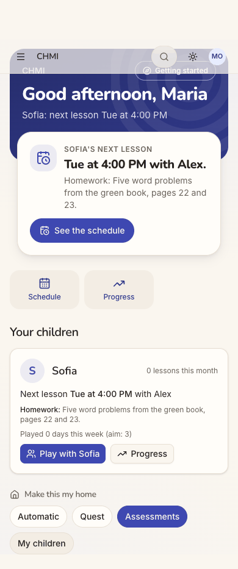 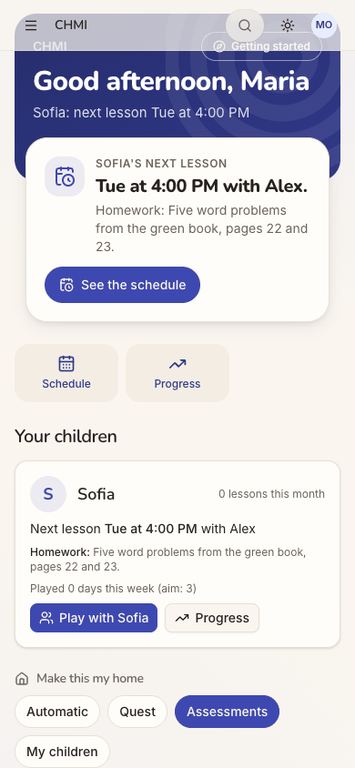
  Repro:
  1. On the home, scroll to "Make this my home" and tap "Assessments".
  2. Compare the page with before: identical.
  3. Reload: "Assessments" is still checked, and the page is still identical.
- **Recommended Fix:**
  - Acknowledge the pin, for example with a toast: "Your home now leads with Assessments".
  - Add a one-line hint under the chips saying what a choice does.
  - When the pinned focus has nothing to show, say so where its section would be ("Nothing in Assessments yet. Start
    one for a student"), so the change is visible.
  - Do not offer a focus that would put nothing on her page.

### [sev2] "Sign in" opens a sheet titled "Sign up free"

- **Issue Description:** On the signed-out page Maria taps the header's "Sign in". The sheet that opens is titled "Sign
  up free", with "Keep your scores, unlock every quest and play with your family". Its only action is "Continue with
  Google". She already has an account at the institute.
- **Framework Violation:** cuj-contract, step 2. Nielsen #4 Consistency and standards: the sheet's title does not
  match the button that opened it.
- **Severity:** 2. An observable mismatch at the door. A tutor or parent with an existing account hesitates over
  whether this will create a second one. For this cohort the copy also speaks to a child player, not to a member of a
  tutoring space.
- **Evidence:** 
  Repro:
  1. Open `/` signed out.
  2. Tap "Sign in" (top right).
- **Recommended Fix:** Title the sheet by the button that opened it: "Sign in", with a line such as "Use the Google
  account your space knows". Keep "Sign up free" for the sign-up buttons. One Google button can still serve both.

### [sev2] Recent sessions rows overlap on the parent Dashboard at phone width

- **Issue Description:** At 390 px, the Dashboard's Parent view squeezes "Sofia Okafor with Alex Chen" into a narrow
  column of Recent sessions, one word per line. The word "with" is drawn over the date, which reads "wi2026-09-15 · 1
  hr 30 min". The badge and the amount take the rest of the row.
- **Framework Violation:** cuj-contract, step 10. Nielsen #8 Aesthetic and minimalist design. Legibility: overlapping
  text on a row that carries money.
- **Severity:** 2. An observable defect on the one page that shows a parent what each lesson cost. The date of a
  billed lesson is unreadable. The page does not overflow sideways, so `responsive.spec.ts` would not catch it.
- **Evidence:** 
  Repro:
  1. Sign in as Maria Okafor on a phone-width window.
  2. Open the Dashboard and choose Parent.
  3. Scroll to Recent sessions.
- **Recommended Fix:** Below `sm`, stack the row: names on one line, then date · length · location badge, then the
  amount right-aligned, or under the names. Give the text column `min-w-0` with wrapping instead of a fixed squeeze.
  Add an overlap check (no two text boxes intersecting) to the responsive spec for this panel.

### [sev1] All spaces: the space name is truncated and Leave is an unlabelled icon beside Open

- **Issue Description:** On All spaces at phone width, her only space reads "Chapel Hill M…". The "Here now" badge,
  the open arrow and an icon-only exit button take the rest of the row. The exit button, named "Leave Chapel Hill Math
  Institute" for screen readers, has no visible label, and no tooltip appeared on hover. It sits a thumb's width from
  the open arrow.
- **Framework Violation:** cuj-contract, step 7. Nielsen #6 Recognition rather than recall: an icon-only destructive
  action.
- **Severity:** 1. Cosmetic as observed. She can still tell which space it is from the menu, and Leave was not
  pressed, so whether it asks for confirmation was not checked. For a member of one space, the unlabelled door icon
  next to Open is the only visible way out.
- **Evidence:** 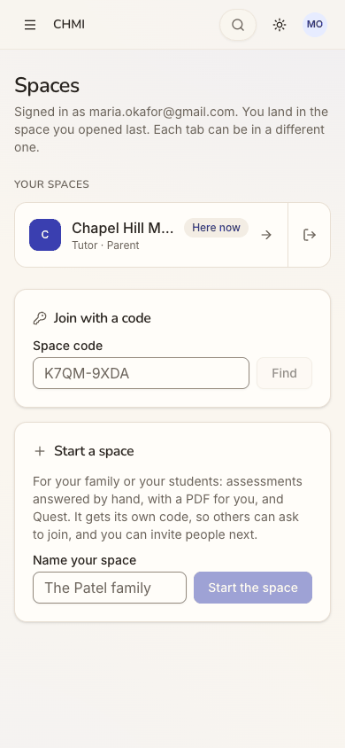
  Repro:
  1. Sign in as Maria Okafor.
  2. Open the menu, then the space card, then "All spaces", at 390 px.
- **Recommended Fix:** Let the name wrap to two lines, or move "Here now" under it, on phones. Give Leave a text label
  ("Leave") or move it into an overflow menu. Keep a confirmation step.

## Walkthrough

### Step 1 — Open http://localhost:8797/ signed out (landing)

> Expected: a way in for an existing member. Observed: the guest Play home: "Math quests. Hit the target.", Today's 5 for
> Grade 4, a grade row and tiles. A small "Sign in" outline button sits top right, and "Sign up free" is the big white
> call to action. Desktop and dark mode show the same.

**What Maria notices:** the page speaks to a child playing maths, not to a tutor or parent of an institute. "Sign in" is
small but where she expects it.

### Step 2 — Tap "Sign in"

> Expected: a "Sign in" sheet. Observed: a sheet titled "Sign up free" ("Keep your scores, unlock every quest and play
> with your family"), with one "Continue with Google" button and a close X.

**What Maria notices:** she asked to sign in and is offered sign-up. She wonders whether she is about to make a second
account.

### Step 3 — Tap "Continue with Google" (landing: the first screen inside a space)

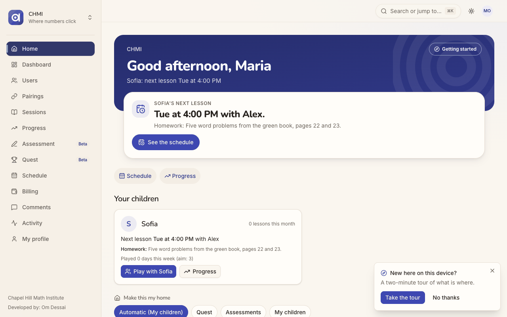
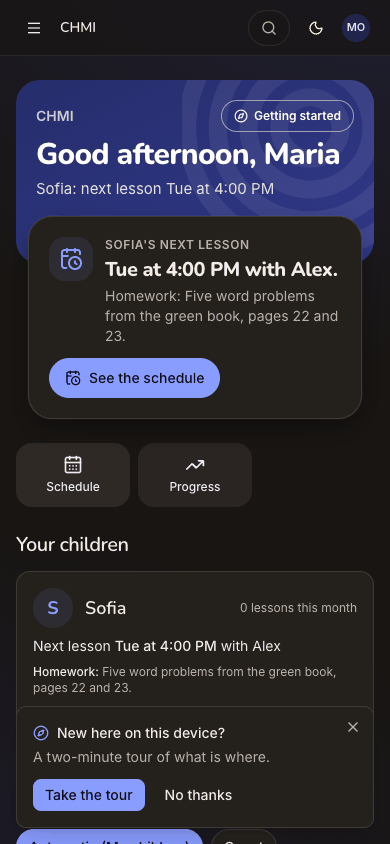

> Expected (C8): the most time-bound item of either hat in Next up, and a section per hat. Observed: she goes straight
> into CHMI with no picker. The page shows:
> - the band, "Good afternoon, Maria / Sofia: next lesson Tue at 4:00 PM";
> - Next up, "Sofia's next lesson: Tue at 4:00 PM with Alex." with the homework and "See the schedule";
> - the quick actions Schedule and Progress;
> - one section, "Your children".
>
> A "New here on this device?" tour offer covers the bottom of the phone screen. The desktop sidebar lists Home,
> Dashboard, Users, Pairings, Sessions, Progress, Assessment, Quest, Schedule, Billing, Comments, Activity and My
> profile.

**What Maria notices:** it is Sofia's page. The parent hat leads, and nothing says she teaches here, even though the
desktop menu is full of teaching words (Pairings, Sessions).

### Step 4 — "No thanks" to the tour; the whole home (full page)

> Expected: one section per hat. Observed, in order: the band, Next up, two quick actions, "Your children" (Sofia: 0
> lessons this month, the next lesson, the homework, "Played 0 days this week (aim: 3)", Play with Sofia, Progress),
> then "Make this my home" with Automatic (My children) checked, Quest, Assessments and My children. There is no tutor
> section and no Teaching choice.

**What Maria notices:** half of her role is missing from her home. The "Progress" quick action is ambiguous: Sofia's
progress, or her students'?

### Step 5 — Open the menu

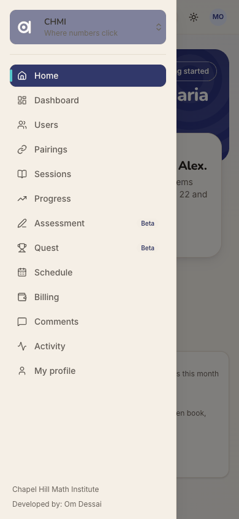

> Expected: navigation and a space switcher. Observed: a drawer. At the top is the space card "CHMI / Where numbers
> click" with an up-down chevron (named "Switch space"), shown in a muted purple with grey text on it. Below it are the
> 13 menu items, and the footer reads "Chapel Hill Math Institute / Developed by: Om Dessai".

**What Maria notices:** a long menu where parent and tutor items sit together. The space card's chevron is the only
hint that it opens.

### Step 6 — Tap the space card (the switcher)

> Expected: her spaces and a way to the others. Observed: a "Spaces" menu with one item, "Chapel Hill Math Institute,
> Tutor · Parent", checked, then "All spaces". While it is open, the space logo in the card turns white on cream and is
> nearly invisible.

**What Maria notices:** this is the first place the app says she is a "Tutor · Parent" here. With one space there is
nothing to switch to.

### Step 7 — Tap "All spaces" (landing)

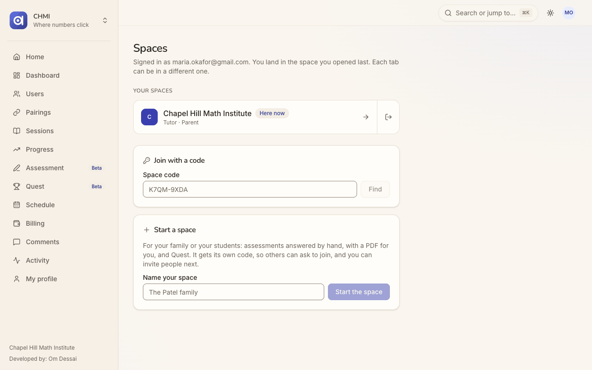
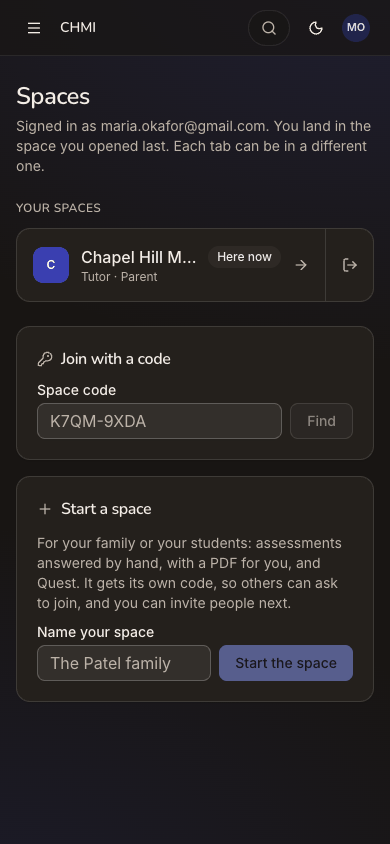

> Expected: her spaces and her role in each. Observed: "Spaces", with "Signed in as maria.okafor@gmail.com. You land in
> the space you opened last. Each tab can be in a different one." Below that:
> - YOUR SPACES: "Chapel Hill M…", Here now, Tutor · Parent, an open arrow and an icon-only Leave;
> - "Join with a code";
> - "Start a space", "For your family or your students: …".
>
> On desktop the name is shown in full.

**What Maria notices:** her roles are clear here. "Start a space … for your students" is tempting for a tutor, but it
would be a separate place from CHMI.

### Step 8 — Menu → "Dashboard" (landing)

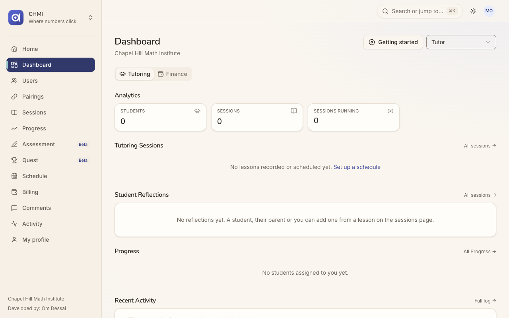
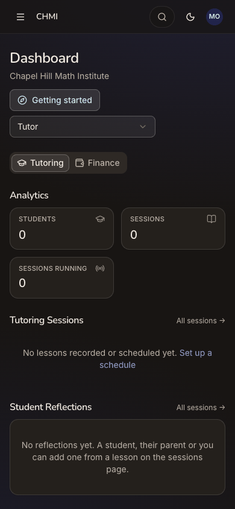

> Expected: her dashboard, with a clear choice between her roles. Observed: "Dashboard / Chapel Hill Math Institute",
> "Getting started", an unlabelled dropdown set to "Tutor", and the tabs Tutoring and Finance. Tutoring shows:
> - Students 0, Sessions 0, Sessions running 0;
> - "No lessons recorded or scheduled yet. Set up a schedule";
> - "No reflections yet";
> - "No students assigned to you yet";
> - Recent Activity: her own "opened Chapel Hill Math Institute".

**What Maria notices:** a page of zeros. The only explanation of why the home had no teaching is the line "No students
assigned to you yet".

### Step 9 — Tap the "Tutor" dropdown

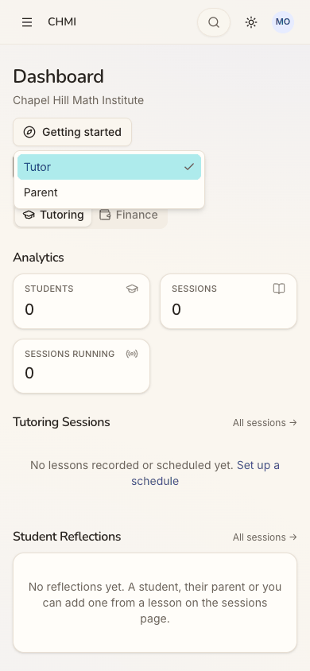

> Expected: the available views. Observed: a list with "Tutor" (checked) and "Parent".

**What Maria notices:** so there is a parent view, but the Dashboard chose the empty tutor view for her, the opposite of
the home's choice.

### Step 10 — Choose "Parent" (full page)

> Expected: Sofia's lessons, progress and money. Observed: the URL becomes `/dashboard?role=parent`, with no
> Tutoring/Finance tabs. The page shows:
> - Children 1, Charged $227.50, Outstanding $152.50 ($75.00 paid);
> - Your children;
> - Sofia's progress plan, "Behind", 1 of 9 topics mastered, 2 of 18 planned sessions held, a chart at 11%;
> - Recent sessions (2026-09-15, $127.50; 2026-09-08, $100.00, "You pay");
> - Your payments (Sep 9, Zelle, $75.00).
>
> At 390 px the Recent sessions names wrap one word per line, and "with" overlaps the date.

**What Maria notices:** this is the page she would act on, because she owes $152.50 and Sofia is behind. The home showed
neither, and she found it only through the dropdown.

### Step 11 — Menu → Home; scroll to "Make this my home"

> Expected: a way to make the home lead with what she does. Observed: the chips Automatic (My children), Quest,
> Assessments and My children, with no Teaching and no explanation. Scrolled, the translucent sticky bar sits over the
> band's "CHMI / Getting started".

**What Maria notices:** she teaches here, but she can only pick her child, Quest or Assessments.

### Step 12 — Tap "Assessments" (full page)

> Expected: the home re-orders to lead with Assessments, with some acknowledgement. Observed: "Assessments" is selected
> and "Automatic" loses "(My children)". Everything else is identical: Next up, quick actions and sections. No
> Assessments block appears, and there is no toast.

**What Maria notices:** "Did that do anything?" Only the pill moved.

### Step 13 — Reload the home (end-state check)

> Expected: the pin is kept and the home leads with it. Observed: "Assessments" is still checked, so the pin was saved,
> and the home is unchanged from step 4.

**What Maria notices:** the setting stuck, but she still cannot see what it does.

### Step 14 — Menu → Dashboard again

> Expected: the Dashboard remembers "Parent" from step 10. Observed: `/dashboard` opens on "Tutor" again, all zeros.
> "Getting started" carries the cyan focus highlight.

**What Maria notices:** every visit starts on the empty page, and she has to switch to Parent each time.

### Step 15 — Menu → Home; set "Make this my home" back to Automatic

> Expected: back to "Automatic (My children)". Observed: "Automatic (My children)" is checked and the home is as before.
> There is no acknowledgement. This also restored her preference as it was before the audit.

**What Maria notices:** undoing it is as silent as doing it. She leaves knowing her home is Sofia's and her dashboard
is a tutor's with nothing in it.

## Appendix

- **Mode:** live. The web app at `http://localhost:8797` is a frozen copy of commit `2d6e7d3` with sign-in on. It was
  driven in headless Chrome at 390×844 (phone), plus 1280×800 and dark mode at the landing steps (1, 3, 7 and 8).
- **Frameworks applied:**
  - cuj-contract: every step against its expected result, including the C8 contract of one section per hat.
  - task-completion: the journey ran to its defined end (home, switcher, All spaces, Dashboard), with "Make this my
    home" tried.
  - success-criteria: the end state was checked again after a reload at step 13 (the pin was kept and the home was
    unchanged), and on a second visit to the Dashboard at step 14 (the role choice was not kept).
- **CUJ manifest:** J18, 15 steps, all observed (15 of 15 verified). Steps 2, 3/4, 8, 10, 12/13 and 14 did not match
  the expected result (see the findings above).
- **Coverage / not inspected:**
  - **Two hats with content.** Maria has no students assigned, so her tutor hat never had anything in it. How the home
    orders a parent hat and a tutor hat that both have items (C8's "most time-bound item of any hat wins") was not
    observed. That needs a person who is a parent and has a pairing in force.
  - **"Make this my home" choices:** only "Assessments" was tried, then "Automatic" restored. "Quest" and "My children"
    were not tried.
  - **The tour and "Getting started":** the tour offer was dismissed (step 4), and neither was opened.
  - **Links from the home not opened:** "See the schedule", the Schedule and Progress quick actions, "Play with Sofia"
    and Sofia's Progress.
  - **The Dashboard:** the Finance tab of the Tutor view, and the "Set up a schedule" link, were not opened.
  - **Menu pages not opened:** Users, Pairings, Sessions, Progress, Assessment, Quest, Schedule, Billing, Comments,
    Activity and My profile. So whether a tutor with no students finds a next step there was not checked.
  - **All spaces:** Leave was not pressed (it would remove her from CHMI), so whether it asks for confirmation is
    unknown. "Join with a code" and "Start a space" were not used.
  - **Other screens:** desktop layouts beyond the landing captures; keyboard-only and screen-reader use (the
    accessibility tree was read only to find controls).
  - **Other clients and providers:** the iOS app is covered by separate journeys. Other sign-in providers are not
    offered on the production web.
  - **The server's records:** by the audit's rules there were no database or API reads. The browser console showed
    only the expected 401 on `/api/auth/session` while signed out.
- **Access:** through the app's real sign-in and sign-up screens; the Google provider step is simulated (a stand-in for Google's button hands the app a local test token for the persona).
- **Preconditions made outside the UI:**
  - None for J18 itself. Maria Okafor is a seeded person.
  - The run's platform settings, and Assessment and Quest switched on in `chmi`, were set before the journeys, as
    `docs/userjourney/README.md` "The run" records.
  - The home pin she changed at step 12 was set back to Automatic through the UI at step 15.
