# CUJ Audit — J19: returning player after ten days away

## Executive summary

**Who:** Leila Eriksen is a 7th-grader ("Grade 7 Mathematics" in her profile) and a student at Chapel Hill Math
Institute (`chmi`). Through October she played Quest three days a week, then stopped for ten days. She is cohort **C6,
the Quest player** ("Let me play."), inside a tutoring space, so she also carries **C5, the tutored student**
(`docs/member-home-plan.md`). She wants to pick up where she was: see her streak, play, and come back to a quest she
left half done.

**Outcome: 1/1 journeys passed, 0 skipped, 17 of 17 steps verified.** She signed in and landed on her home (step 3).
"Welcome back! A fresh week starts now." was there, with this week's dots, the next badge and the Daily (step 4). She
started a Grade 7 Quick 5, answered two questions, both right, and left (steps 6-10). Back home, a **"Continue G7Q5"**
bar was waiting (step 12). **It did not resume her quest.** It started a new game at Question 1 of 5 with 0 points
(steps 13-14). She got her quest back only through a detour. On the Question Quest page she picked the older of two
identical "Playing now" rows, which held Question 3 of 5 and 2 points (steps 15-16). A reload kept it (step 17). The
journey's end, "she has resumed", was reached, but by a workaround (sev3).

**Conversion figures** (counted from the entry point):

| Stretch | Screens | Taps | Typed fields | Waits | Dead ends |
| --- | --- | --- | --- | --- | --- |
| Entry to the first question (steps 1-7) | 5 (guest page, sign-in sheet, home, countdown, game) | 5 (Sign in, Continue with Google, No thanks, Grade 7, Quick 5) | 0 | 2 (sign-in, countdown) | 0 |
| Leaving and resuming (steps 9-16) | 8 views | 6 (Exit, menu, Home, Continue, Exit, the older game) | 0 | 1 (a second countdown) | 2 (Exit landing on the Question Quest page; Continue starting over) |
| Whole run, 17 steps | 7 distinct (16 views) | 13 | 2 (the two answers) | 3 | 2 |

The shortest real way back to her quest is 2 taps from inside the game: Exit, then the right row on the Question Quest
page. The way the home offers ("Continue") takes 4 taps and lands in the wrong game.

**Stickiness:** "Welcome back" works as intended. It is warm, with no loss message. The rest of the card works against
it. It says "Start a streak" beside "4 weeks in a row" and "4 of 12" towards a badge her break has already reset (step
4). After she plays, the home does not move: Next up still offers Today's 5, and the week still reads 0 of 3 (step 12).
Her two answers count for nothing on the screen she returns to.

**The 3 screens Leila would notice most:**

- **Step 4, My progress.** The blue "Welcome back! A fresh week starts now." is the first thing on the home that talks
  to her as someone who was here before. It is the right tone for a player who drifted away. But the same card is
  titled "Start a streak" and carries a "4 weeks in a row" chip, and "Next badge: 12 weeks in a row · 4 of 12". Is she
  on a streak or not? For a C6 player, the streak is the reason to come back three days a week, so it has to be
  readable at a glance.
  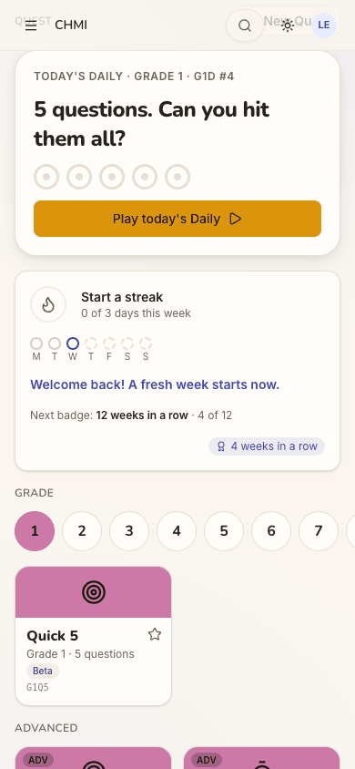
- **Step 14, "Continue" starts over.** She tapped "Continue G7Q5" expecting Question 3 and her 2 points. She got a new
  countdown, then "Question 1 of 5", "0 points" and a question she had not seen. For a player who left in the middle,
  being sent back to the start is the moment a short session turns into "never mind".
  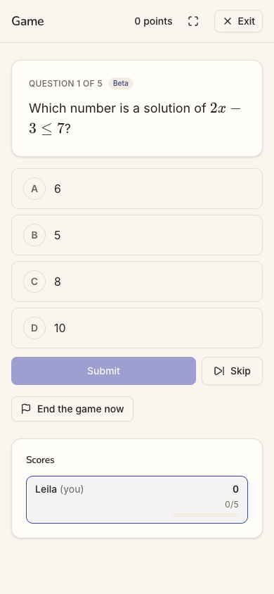
- **Step 15, two identical games.** The Question Quest page now lists "8XH2F5 G7 5 questions Single player Playing now"
  and "9945HK G7 5 questions Single player Playing now". Only the code tells them apart, and neither shows how far she
  got. She has to guess which one holds her answers.
  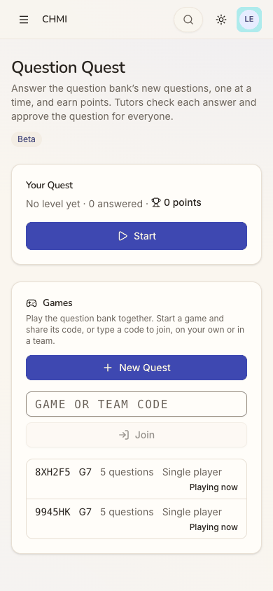

**Contact sheet** (all 17 phone steps):

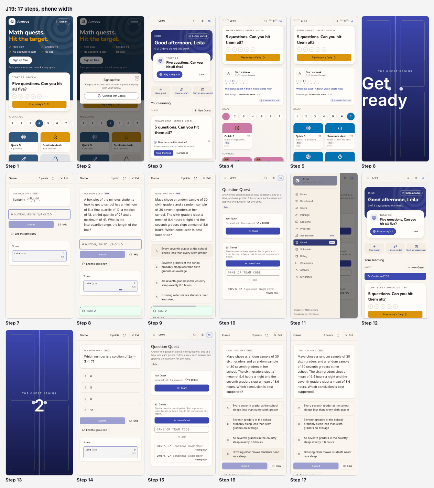

| Severity | Count |
| --- | --- |
| sev4 (catastrophe) | 0 |
| sev3 (major) | 1 |
| sev2 (minor) | 5 |
| sev1 (cosmetic) | 0 |
| **Total** | **6** |

## Prioritized fixes

1. [sev3] [Continue starts a new game instead of resuming the one she left](#sev3-continue-starts-a-new-game-instead-of-resuming-the-one-she-left): make Continue open her open game, and name it in words with its progress (steps 12-15).
2. [sev2] [After she plays, the home does not move: Next up and the week ignore her open quest](#sev2-after-she-plays-the-home-does-not-move-next-up-and-the-week-ignore-her-open-quest): put Continue in Next up, and say the day counts when she finishes (step 12).
3. [sev2] [My progress says Start a streak, 4 weeks in a row and 4 of 12 at once](#sev2-my-progress-says-start-a-streak-4-weeks-in-a-row-and-4-of-12-at-once): label the earned badge as a badge, and count streak badges from the current run (step 4).
4. [sev2] [Her home leads a 7th-grader with Grade 1](#sev2-her-home-leads-a-7th-grader-with-grade-1): ask for a grade once when nothing is known, and make Next up and the board use one level (steps 3-5).
5. [sev2] [Exit drops her on the Question Quest page, which says 0 points](#sev2-exit-drops-her-on-the-question-quest-page-which-says-0-points): return to where the game started, and say the quest is kept (step 10).
6. [sev2] [Sign in opens a sheet titled Sign up free](#sev2-sign-in-opens-a-sheet-titled-sign-up-free): title the sheet by the button that opened it (step 2).

## Findings

### [sev3] Continue starts a new game instead of resuming the one she left

- **Issue Description:** After she left a Grade 7 Quick 5 at Question 3 of 5 with 2 points, her home showed a blue
  "Continue G7Q5" bar (step 12). Tapping it ran a new "THE QUEST BEGINS" countdown (step 13). It opened a different game
  (`/quest/games/87339907…`, not the `df4ca8d1…` she left) at "Question 1 of 5", "0 points", with a new question (step
  14). Her game was still open, and so was the new one. The Question Quest page then listed two rows, "8XH2F5 G7 5
  questions Single player Playing now" and "9945HK G7 5 questions Single player Playing now". Only the code tells them
  apart, and neither shows progress (step 15). She resumed only by guessing the older row (step 16). The label adds to
  it: "G7Q5" is a code, not words she knows. "Continue" promises the game she left; the bar replays the tile's settings.
- **Framework Violation:** cuj-contract, steps 13-14 (expected: Question 3 of 5 with 2 points; observed: a new game at
  Question 1 with 0 points) and step 15 (expected: one open quest; observed: two identical rows); Nielsen #2 Match
  between system and the real world ("Continue" means resume); Nielsen #1 Visibility of system status (no progress on
  either row); Nielsen #5 Error prevention (a second open game made silently).
- **Severity:** 3. Classify: the journey's end state is reached only through a workaround, and the step that should do
  it goes to the wrong state. For C6, Continue is the second action of their Next up and the whole return loop: a
  player who leaves mid-quest and comes back is exactly who it is for. Starting over loses her answers and points, and
  every use leaves another orphaned "Playing now" game. It is not a 4: the Question Quest page still reaches the real
  game.
- **Evidence:** 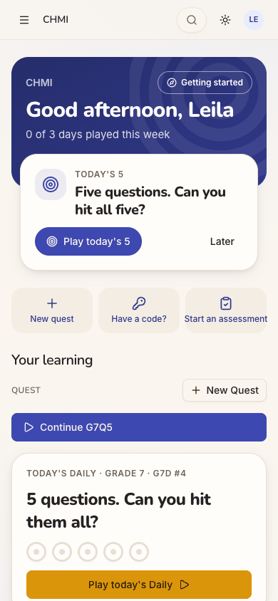 
   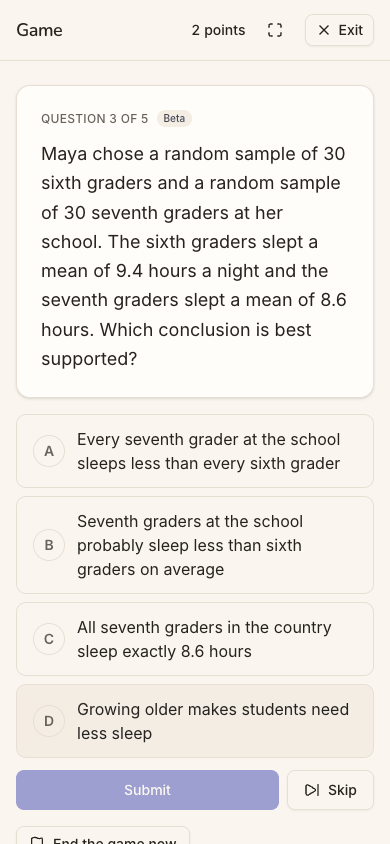
  Repro: as a `chmi` student on the home, choose Grade 7 and tap Quick 5. Answer two questions, tap Exit, then open the
  menu and Home. Tap "Continue G7Q5": a new countdown and Question 1 of 5. Exit: two "Playing now" rows. The source
  agrees with what was seen: `apps/web/src/features/play/play-home.tsx` lines 229-238 render
  `Continue {last.label}` with `onClick={() => void start(last.label, last.request)}`, which creates a game from the
  device's last tile request and never looks for an open one.
- **Recommended Fix:** Make Continue resume. When the reader has an open single-player game in this space (the
  Question Quest page's games list already returns them as "Playing now"), link the bar to `/quest/games/<id>` of the
  most recent one. Label it in words with its progress: "Continue Quick 5 · Grade 7 · question 3 of 5". Only when no
  game is open, offer "Play Quick 5 · Grade 7 again". When a tile is started while the same tile's game is open, ask
  "You have a Quick 5 in progress. Continue it or start over?" In the games list, show each row's progress
  ("2 of 5 answered") and the tile's name, and end or hide an abandoned single-player game once a newer one of the same
  tile starts. Add a web e2e check: answer two, exit, tap Continue, and assert "Question 3 of 5" and the same game id.
  Then check the app's Continue for the same behaviour.

### [sev2] After she plays, the home does not move: Next up and the week ignore her open quest

- **Issue Description:** At step 12 Leila has a half-finished quest. Next up, the card that leads her home, still offers
  "TODAY'S 5 · Five questions. Can you hit all five?", the same as before she played (step 3). Continue is a secondary
  bar further down, under "Your learning". The band still says "0 of 3 days played this week", and Wednesday's dot is
  still an empty "today" ring. She has just answered two questions correctly. Nothing on the home says the day will
  count once she finishes, so leaving looks free.
- **Framework Violation:** cuj-contract, step 12 (expected, per C6's Next up in `docs/member-home-plan.md`: "Game invite →
  Join; **Continue**; **Today's 5**", so an open quest outranks Today's 5; observed: Today's 5 leads); Nielsen #1
  Visibility of system status (her play leaves no trace on the home).
- **Severity:** 2. Classify: an observable mismatch with the cohort's design, and real friction, but Continue is on the
  same screen. For a returning C6 player the first session back decides whether the habit restarts. A home that shows
  "0 of 3" right after she played tells her the effort did not count.
- **Evidence:**  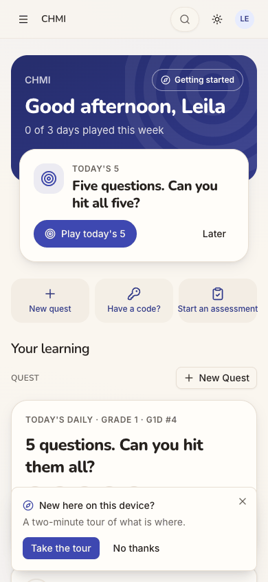
  Repro: as in the finding above, up to the home after Exit. Compare Next up and the band before (step 3) and after
  (step 12) the two answers: both are unchanged. Next up's link moved from `/quest/daily/NC26.3` to
  `/quest/daily/NC26.7` after she chose Grade 7. That is the only change.
- **Recommended Fix:** Add the open game as a Next up candidate above `daily` in `nextUpCandidates`: "Finish your
  Quick 5 · question 3 of 5" with Continue as its button (the resume link from the finding above). While a game is
  open, show today's dot half-filled with "Finish your quest to count today". The day is written at a game's end, so
  this needs no new write during play, only the client knowing a game is open.

### [sev2] My progress says Start a streak, 4 weeks in a row and 4 of 12 at once

- **Issue Description:** The habit card (step 4) has no "My progress" heading. It reads, top to bottom: "Start a streak ·
  0 of 3 days this week", the seven dots (Monday and Tuesday not played), "Welcome back! A fresh week starts now.",
  "Next badge: **12 weeks in a row** · 4 of 12", and a chip with an award icon, "4 weeks in a row". She did play 3 days a
  week for four weeks, but the week of 26 October had no play, so her run is broken. The chip is a badge she earned,
  but it looks like her current streak. "4 of 12" counts that broken run, though the 12-week badge needs a new unbroken
  run of 12. Her real progress towards it is 0.
- **Framework Violation:** cuj-contract, step 4 (expected: the streak, the dots and the next badge, consistent with a
  missed week; observed: three statements that disagree); Nielsen #1 Visibility of system status; Nielsen #2 Match
  between system and the real world (a badge chip worded like a live count).
- **Severity:** 2. Classify: an observable mismatch, with no workaround needed to play. For C6 the streak is the stated
  reason to come back. A card that says she is both starting and four weeks in blurs the goal "3 days this week". "4 of
  12" also promises progress she does not have, which will feel like a loss later.
- **Evidence:** 
  Repro: a student with three play days a week for four weeks, a missed week, then a visit (here: Leila, with the
  inserted days in the Appendix). Scroll the home to the habit card. In the source, `BADGES` names `weeks_4` "4 weeks in
  a row", and `nextBadge` counts `weeks_12` from `best_weeks` (`packages/shared/src/habit.ts`), which explains both
  numbers.
- **Recommended Fix:** Title the card "My progress". Put earned badges in their own labelled row ("Badges: 4 weeks in a
  row") rather than as a bare chip. For streak badges, count `have` from the current run (`weeklyStreak().weeks`), not
  `best_weeks`, and show the best separately: "Your best: 4 weeks in a row. Play 3 days this week to start a new run."
  Keep "Welcome back"; it is the right voice.

### [sev2] Her home leads a 7th-grader with Grade 1

- **Issue Description:** On landing (steps 3-4) the grade row had **Grade 1** selected, in Grade 1's pink, with a Grade 1
  Quick 5 and "TODAY'S DAILY · GRADE 1 · G1D #4" on the board. Next up's "Play today's 5" linked to
  `/quest/daily/NC26.3`, a Grade 3 set, though the card itself names no grade. So the first screen offered two
  different grades, and neither was hers. She had to find 7 in the row herself (step 5). After that, the board, the
  Daily and Next up all followed Grade 7.
- **Framework Violation:** cuj-contract, steps 3-5 (expected: a returning player's home leads with her level; observed:
  Grade 1 on the board, Grade 3 behind Next up); Nielsen #4 Consistency and standards (two cards on one screen pick
  different levels); Nielsen #7 Flexibility and efficiency of use.
- **Severity:** 2. Classify: real friction, with an easy workaround (one tap on 7). For a 7th-grader, Grade 1 tiles read
  as "this isn't for me". A younger player might start the Grade 1 Daily without noticing. That costs her the one Daily
  a day and teaches the app nothing.
- **Evidence:**  
  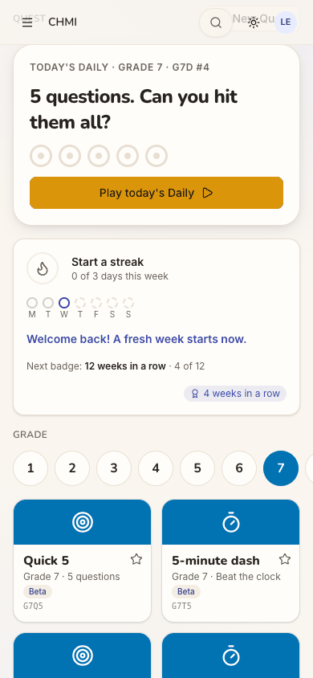
  Repro: sign in as Leila on a fresh device. The grade row leads with 1, and the accessibility tree shows Next up's
  link to `/quest/daily/NC26.3`. A caveat: her inserted October play days carry no quest level, and the seed gives her
  no Quest level, so the app had no level from play. The default it fell back to is what is reported.
- **Recommended Fix:** When neither the device, a last quest nor a Quest level gives a grade, ask once on the board: "Which
  grade are you in?", a one-tap row that is remembered for the space. Choose Next up's Daily and the board's Daily from
  the same level function, so the two cards never disagree. Show the grade on Next up's card ("Today's 5 · Grade 7").

### [sev2] Exit drops her on the Question Quest page, which says 0 points

- **Issue Description:** Mid-game, the only way out on screen is "Exit", top right (steps 7-9). It left at once, with
  no word that the game is kept, and landed on the **Question Quest** page (`/quest`), not on the home she came from
  (step 10). That page leads with "Your Quest · No level yet · 0 answered · 0 points" and a big Start button, seconds
  after the game header said "2 points". Her game is a small row at the bottom, "9945HK G7 5 questions Single player
  Playing now". To get home she needed the menu, a 13-item list (step 11), and Home.
- **Framework Violation:** cuj-contract, step 10 (expected: back to her home, with the quest kept; observed: another
  feature's page, with a points total of 0); Nielsen #1 Visibility of system status; Nielsen #3 User control and
  freedom; Nielsen #4 Consistency (two different "points" a screen apart).
- **Severity:** 2. Classify: a wrong turn (counted as a dead end) and a contradiction, with no harm to the game. For a
  C6 player, "0 points" after scoring 2 reads as "my points were lost". Question Quest's points and a game's score are
  different things, and nothing says so.
- **Evidence:** 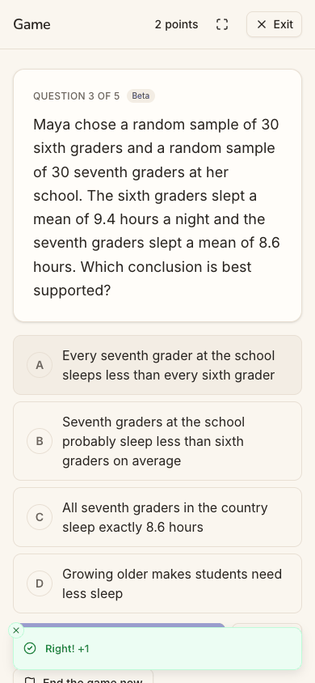 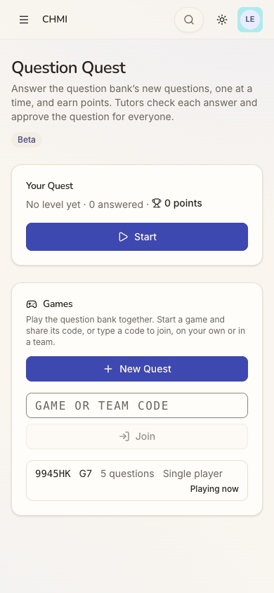
  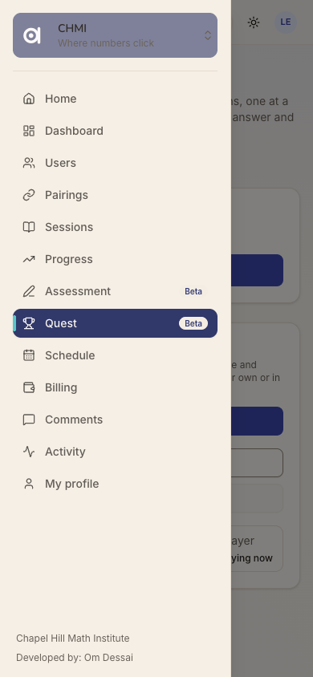
  Repro: start any tile from the home, answer one question, tap Exit.
- **Recommended Fix:** Make Exit return to where the game was started (the home, for a tile), with a toast: "Your Quick
  5 is saved. Continue from your home." On the Question Quest page, call the game score something else ("score") or add
  "Games don't add Quest points". List open games above "Your Quest" when there are any.

### [sev2] Sign in opens a sheet titled Sign up free

- **Issue Description:** Leila has an account, so she taps the header's "Sign in" (step 1). The sheet that opens is
  titled "Sign up free", with "Keep your scores, unlock every quest and play with your family" (step 2). Its one button,
  Continue with Google, does sign her in. But for a moment the screen says she is making a new account. J05 found the
  same sheet.
- **Framework Violation:** cuj-contract, step 2 (expected: a sign-in sheet; observed: a sign-up sheet); Nielsen #4
  Consistency and standards (the sheet's title contradicts the button that opened it).
- **Severity:** 2. Classify: an observable mismatch. For a returning C6 player it costs a moment of doubt ("Will this
  make a second account and lose my streak?") on the one screen every return goes through.
- **Evidence:**  
  Repro: signed out at `/`, tap "Sign in" in the header.
- **Recommended Fix:** Title the sheet by the button that opened it. From "Sign in": "Welcome back", with "Sign in to
  keep your streak and scores". From "Sign up free": as now. The same Google button serves both.

## Walkthrough

### Step 1 — Open the app signed out

> Expected: the guest page with a way to sign in. Observed: match. The page shows "Math quests. Hit the target.", a big
> "Sign up free", Today's 5 at Grade 4, and "Sign in" as an outlined button in the header.

**What Leila notices:** The page is written for newcomers. Her way in is the small "Sign in" at the top right, which she
finds because she has used it before.

### Step 2 — Tap Sign in

> Expected: a sign-in sheet. Observed: a sheet titled "Sign up free" with Continue with Google.

**What Leila notices:** "Sign up? I already have an account." She taps Google anyway, because it is the only button.

### Step 3 — Continue with Google, land on her home

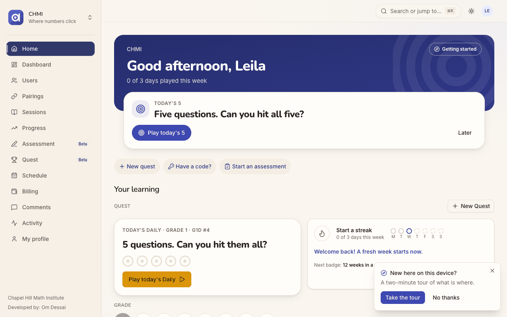
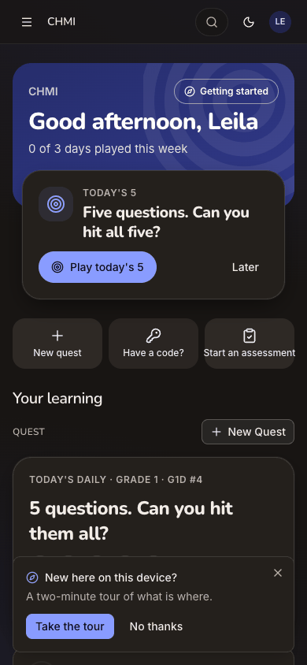
> Expected: her home in Chapel Hill Math Institute, with what a returning player needs. Observed: "Good afternoon,
> Leila", "0 of 3 days played this week". Next up offers "TODAY'S 5" (its link is a Grade 3 set). Below are three quick
> actions and the Quest board, whose Daily is Grade 1. A "New here on this device? Take the tour" toast covers the
> bottom. No Continue, which is right, since she has no quest open yet.

**What Leila notices:** Her name and a big "Play today's 5". The tour toast asks whether she is new, which she is not,
though the device is.

### Step 4 — Dismiss the tour, scroll to My progress

> Expected: "Welcome back", this week's dots, her streak and the next badge. Observed: all present. The card is titled
> "Start a streak · 0 of 3 days this week", with "Welcome back! A fresh week starts now." in blue. Below: "Next badge: 12
> weeks in a row · 4 of 12" and a "4 weeks in a row" chip. The grade row below leads with Grade 1.

**What Leila notices:** The blue "Welcome back!" is friendly and makes the break feel normal. Then "Start a streak" and
"4 weeks in a row" side by side make her wonder whether she kept it or lost it.

### Step 5 — Choose Grade 7

> Expected: her grade's tiles. Observed: match. Grade 7 turns blue, and the Daily becomes "GRADE 7 · G7D #4". Quick 5
> and 5-minute dash for Grade 7 appear.

**What Leila notices:** Now the board looks like hers. She had to fix the grade herself.

### Step 6 — Tap Quick 5 (Grade 7)
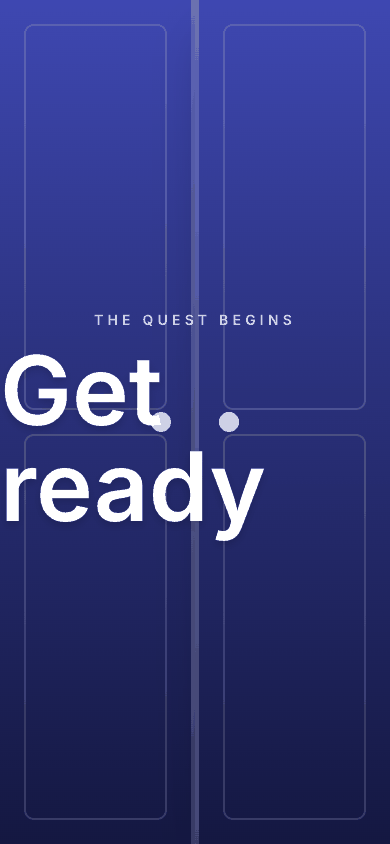
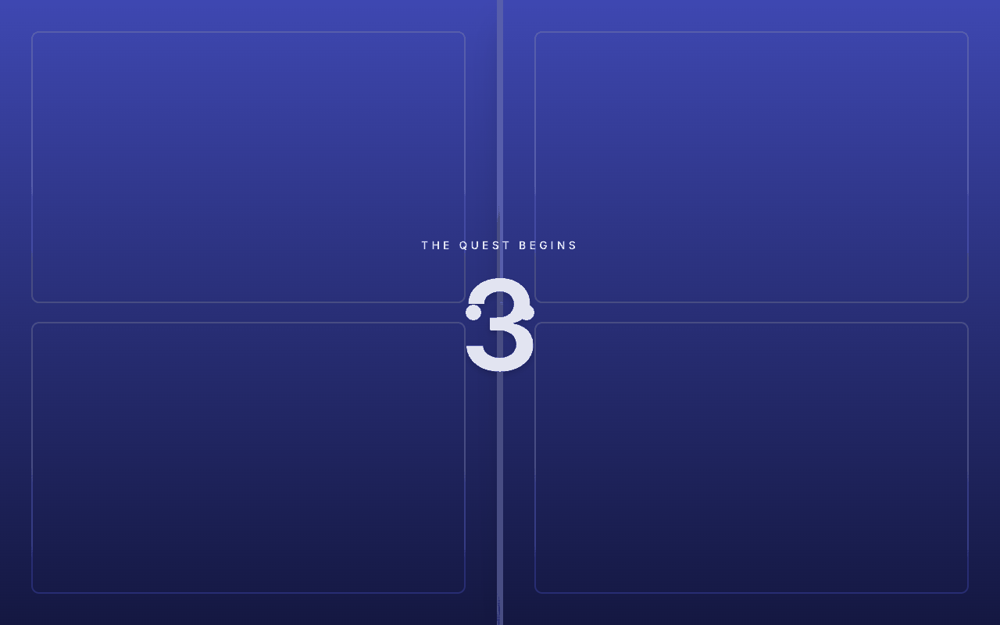
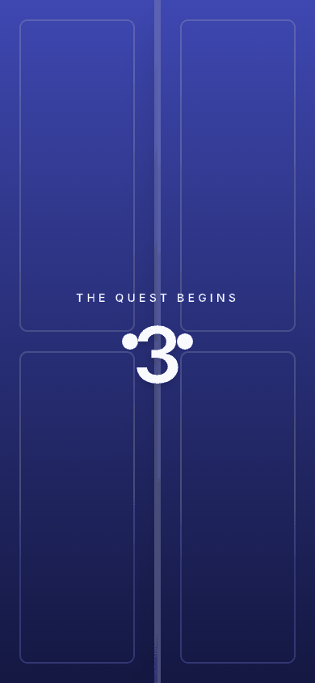
> Expected: the quest starts. Observed: a full-screen "THE QUEST BEGINS" countdown behind two doors ("Get ready", then 3,
> 2, 1). The desktop and dark captures were taken a moment later, on a number.

**What Leila notices:** A bit of theatre that says "this is a game". At phone width, the large "Get ready" runs to the
screen's left edge.

### Step 7 — The first question
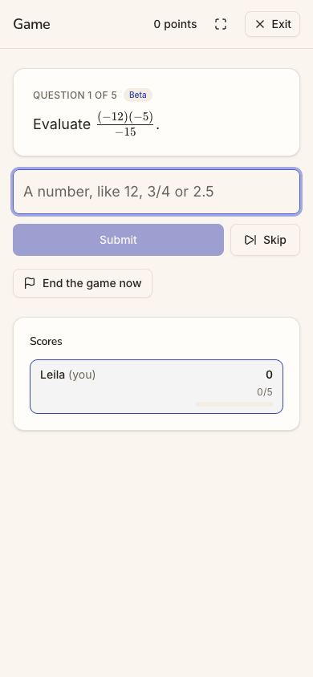
> Expected: question 1. Observed: "QUESTION 1 OF 5 · Beta · Evaluate (−12)(−5)/(−15)", a number box ("A number, like 12,
> 3/4 or 2.5"), Submit, Skip, "End the game now", and her score card (0, 0/5). Exit is at the top right.

**What Leila notices:** A clean screen at her level. The "Beta" tag means nothing to her.

### Step 8 — Answer −4 and submit
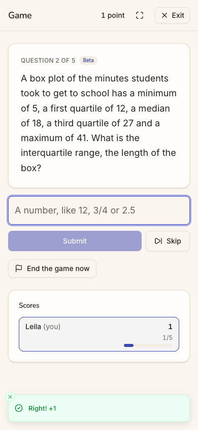
> Expected: marked, and the next question. Observed: a "Right! +1" toast, 1 point, and Question 2 of 5 (a box plot's
> interquartile range).

**What Leila notices:** Instant feedback and the point count going up.

### Step 9 — Answer 15 and submit

> Expected: marked, and the next question. Observed: "Right! +1", 2 points, and Question 3 of 5, a multiple-choice
> question about sleep samples.

**What Leila notices:** Two for two. A long word problem now, which is a natural moment to stop for later.

### Step 10 — Tap Exit, mid-game

> Expected: back to her home, with the quest kept. Observed: the Question Quest page (`/quest`): "Your Quest · No level
> yet · 0 answered · 0 points" with a Start button. Under Games: "9945HK G7 5 questions Single player Playing now". No
> confirmation on leaving.

**What Leila notices:** "0 points?" She just had 2. And this is not her home.

### Step 11 — Open the menu

> Expected: a way home. Observed: a drawer with 13 items: Home, Dashboard, Users, Pairings, Sessions, Progress,
> Assessment, Quest, Schedule, Billing, Comments, Activity and My profile.

**What Leila notices:** Home is at the top, so it is easy. Most of the rest (Users, Pairings, Billing) are not things a
student does.

### Step 12 — Tap Home

> Expected: Continue offers to resume her quest, ideally as Next up. Observed: a blue "Continue G7Q5" bar under "Your
> learning · Quest". Next up still offers Today's 5, and the band still says "0 of 3 days played this week".

**What Leila notices:** "Continue" is what she wanted, though "G7Q5" is a code. Her two right answers have not changed
anything on the page.

### Step 13 — Tap Continue G7Q5
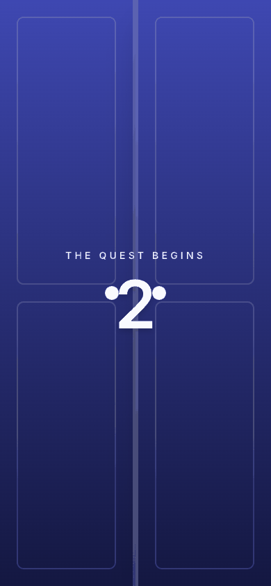
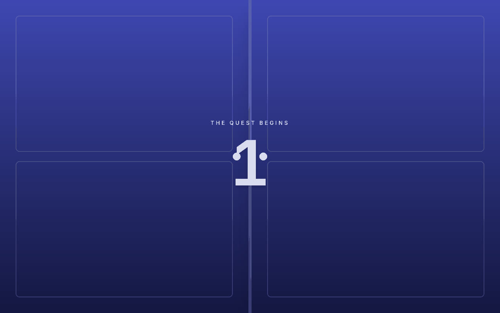
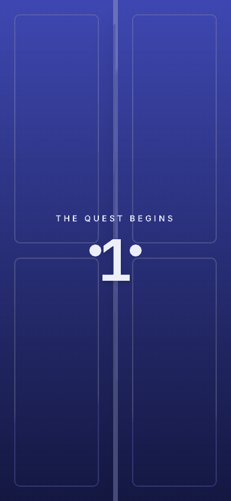
> Expected: back to Question 3 of 5. Observed: a new "THE QUEST BEGINS" countdown, at a different game address
> (`/quest/games/87339907…`; she left `df4ca8d1…`).

**What Leila notices:** A countdown again: a "game starting" screen, not a "welcome back to your game" screen.

### Step 14 — The game after Continue

> Expected: Question 3 of 5, 2 points. Observed: "QUESTION 1 OF 5", "0 points", a new multiple-choice question (which
> number solves 2x − 3 ≤ 7), and Scores 0/5.

**What Leila notices:** Her progress is gone. "Continue" started her over.

### Step 15 — Exit, look for the game she left

> Expected: one quest in progress. Observed: two rows, "8XH2F5 G7 5 questions Single player Playing now" and "9945HK G7 5
> questions Single player Playing now", with no progress on either.

**What Leila notices:** Two games that look the same. She guesses the bottom one is older and holds her answers.

### Step 16 — Tap 9945HK

> Expected: her quest resumed. Observed: match. "QUESTION 3 OF 5", the same sleep-sample question, 2 points, Scores
> 2/5. The journey's end, reached through the Question Quest page and not through Continue.

**What Leila notices:** Relief: her answers are there. She also learned that "Continue" cannot be trusted.

### Step 17 — Reload the resumed game

> Expected: the same state after a reload. Observed: match. Question 3 of 5, 2 points. The browser's error log holds only
> the expected signed-out 401 on `/api/auth/session` from step 1.

**What Leila notices:** Nothing new; the game is where she left it.

## Appendix

- **Mode:** live. The web app at `http://localhost:8797` is a frozen copy of commit `2d6e7d3` with sign-in on, driven in
  headless Chrome at 390×844 (phone), plus 1280×800 and dark mode at the landing steps (1, 3, 6, 13).
- **Frameworks applied:** cuj-contract (every step against its expected result); task-completion (the journey ran to its
  defined end, "she has resumed", reached by a workaround at step 16); success-criteria (the end state was checked again
  after a reload at step 17).
- **CUJ manifest:** J19, 17 steps, all observed. Steps that did not match what the journey expects: 2 (a sign-up sheet
  from "Sign in"), 10 (Exit to the Question Quest page), 12 (Next up unchanged), 13-14 (Continue starts a new game) and
  15 (two open games).
- **Source read:** only to explain observed behaviour for the fixes: `apps/web/src/features/play/play-home.tsx`
  (Continue) and `packages/shared/src/habit.ts` (the badge counts). No observation in this report comes from the source.
- **Coverage / not inspected:**
  - The Daily (Next up's "Play today's 5" and the board's "Play today's Daily") was not opened, so as not to spend her
    one Daily a day. Its grade is reported from the link target and the card's label only.
  - Finishing the resumed game: the results screen, whether finishing marks today's dot and the week, and any "new best".
  - What happens to the orphaned game 8XH2F5 (whether it ever ends, or counts towards anything).
  - The tour ("Take the tour"), "Getting started", "Make this my home", favorites (the star on a tile), "Have a code?" and
    "Start an assessment".
  - The student's other menu pages (Dashboard, Users, Pairings, Sessions, Billing and the rest); J17 covers the tutored
    student.
  - Continue on another device (the bar is kept on the device; a second device was not tried).
  - Keyboard-only and screen-reader use; the accessibility tree was read only to find controls and link targets.
  - The iOS app; it is covered by separate journeys, and J19 has no app replay.
  - Other sign-in providers (not offered on the production web).
- **Access:** through the app's real sign-in and sign-up screens; the Google provider step is simulated (a stand-in for
  Google's button hands the app a local test token for the persona).
- **Preconditions made outside the UI:** twelve play days for Leila Eriksen (`chmi` student), three a week from
  2026-09-29 to 2026-10-25, were inserted into the local database before the journey. The seed makes only today's play,
  so without them no one could show a streak or "Welcome back". They are days only, with no quests or levels behind
  them, which bears on the finding about Grade 1. This is not in the approved plan; it was added on the day, local only,
  as `docs/userjourney/README.md` "The run" records. The run's platform settings (web sign-in Google only, guest play
  and the Daily on, the Play home on) were set through the console API before the journeys.
