# Design Audit — consistency, colour themes and usability across the 24 journeys

## Executive summary

The 24 journeys show one design system, and it mostly holds. Every space has the same warm cream base, Nunito headings and member home (a band, one Next up card, quick actions, then sections). The grade hues pass contrast on every tile in light and dark. The system breaks in hierarchy and in words. The first screen often leads with a Grade 1 practice board, even for teens, teachers, parents and a 7th grader. The same action shows up two or three times on one screen, in competing styles. Codes (G8Q5, G8D #4, G4) and a tutoring office's words reach people who came for neither. Every self-serve and personal space wears the guest page's Slate, so a newcomer's two spaces look alike, and amber stands for five different things. The one blocker is an empty state. A parent let into an Assessment-only space finds an empty Student picker, then a form that refuses her only at Save. Nothing tells her why, or who can fix it (J07, J07A). Of the 38 items in the two earlier audits, 9 are fixed, 7 are still present and 22 were not seen in these journeys.

| Severity | Count |
| --- | --- |
| sev4 (catastrophe) | 1 |
| sev3 (major) | 5 |
| sev2 (minor) | 14 |
| sev1 (cosmetic) | 3 |
| **Total** | **23** |

## Prioritized fixes

1. [sev4] [An empty picker and late refusals stop a parent at the one feature her space offers](#sev4-an-empty-picker-and-late-refusals-stop-a-parent-at-the-one-feature-her-space-offers): give every picker an empty state that says why and who can help; check permission before a form opens; ask "Which child?" when letting a parent in.
2. [sev3] [The waiting and refusal screens stop the journey cold](#sev3-the-waiting-and-refusal-screens-stop-the-journey-cold): one heading per state, who decides and how long, "Keep playing" as the primary, a role contact address, no unasked reopening.
3. [sev3] [The Quest board leads with Grade 1, whoever is playing](#sev3-the-quest-board-leads-with-grade-1-whoever-is-playing): lead with the space's recorded grade, then the last level played (server), then the top of the row for 13+; remember a picked grade.
4. [sev3] [The first screen talks to a learner when the person came to run a space or for their child](#sev3-the-first-screen-talks-to-a-learner-when-the-person-came-to-run-a-space-or-for-their-child): seed the focus from how the person arrived (parent, space maker, tutor); never lead a non-player's band with a zero.
5. [sev3] [Example values look like saved data](#sev3-example-values-look-like-saved-data): formats as helper text, a lighter placeholder token, no seeded names; flag a missing price; draw example codes as illustrations.
6. [sev3] [Outcomes that happen elsewhere leave no trace on screen](#sev3-outcomes-that-happen-elsewhere-leave-no-trace-on-screen): give let in, declined, request sent and pinned a Next up item or band line; toasts name the object.
7. [sev2] [Nothing on screen tells one space from another](#sev2-nothing-on-screen-tells-one-space-from-another): a palette per new space, Slate only for the platform and personal spaces; a per-instance gradient id for the mark.
8. [sev2] [Amber carries five meanings, and the tile colours change meaning after sign-up](#sev2-amber-carries-five-meanings-and-the-tile-colours-change-meaning-after-sign-up): amber for one job; move Grade 3's hue or the Daily button's colour; grade hues on the guest page too.
9. [sev2] [Measured contrast failures on the Quest board and in the phone drawer](#sev2-measured-contrast-failures-on-the-quest-board-and-in-the-phone-drawer): a ring on the selected chip; ADV and codes at 12 px and full contrast; restate the sidebar accent in the warm foundation.
10. [sev2] [The home repeats one action two or three times, in competing styles](#sev2-the-home-repeats-one-action-two-or-three-times-in-competing-styles): collapse twins of the Next up item, make Next up the heaviest button, merge or rename the two dailies.
11. [sev2] [Codes where people expect names](#sev2-codes-where-people-expect-names): human names ("Quick 5 · Grade 8") on every surface; codes for the console only; one Beta line per board.
12. [sev2] [A tutoring office's words reach spaces and readers without one](#sev2-a-tutoring-offices-words-reach-spaces-and-readers-without-one): copy per kind of space and per reader; menus built from the reader's hats.
13. [sev2] [One thing goes by several names](#sev2-one-thing-goes-by-several-names): one shared glossary (person, lesson, game, quest, space); buttons name the form they open.
14. [sev2] ["Sign in" opens a sheet titled "Sign up free"](#sev2-sign-in-opens-a-sheet-titled-sign-up-free): title the sheet "Sign in or sign up"; keep "Sign up free" for the hero button.
15. [sev2] [Phone-width layouts break on a dozen screens](#sev2-phone-width-layouts-break-on-a-dozen-screens): stack rows below sm, wrap names, cue the grade row, clamp the countdown; add the pages to responsive.spec.ts.
16. [sev2] [The tour and its offers cover what they introduce](#sev2-the-tour-and-its-offers-cover-what-they-introduce): an inline offer, once per person, gated by tourOffered in the wizard too; stops that point at the page.
17. [sev2] [The habit card contradicts itself and leads with a zero](#sev2-the-habit-card-contradicts-itself-and-leads-with-a-zero): one state per habit card, the next step before any zero, count practise-together for the child.
18. [sev2] [Ways out of full-screen play are missing or lead somewhere else](#sev2-ways-out-of-full-screen-play-are-missing-or-lead-somewhere-else): one Exit, same place, back to where play started, on both clients.
19. [sev2] [The guest page speaks only to families with young children](#sev2-the-guest-page-speaks-only-to-families-with-young-children): a hero line for adults and classes, a "Have a code from a tutor or club?" door, neutral age wording.
20. [sev2] [Web and app: the same screens differ in words and controls](#sev2-web-and-app-the-same-screens-differ-in-words-and-controls): shared copy constants; fix the app's code dialog crash; Copy in the app's invitations; no "tab" copy in the app.
21. [sev1] [All-caps eyebrows and 10-11 px text remain, against the U1 spec](#sev1-all-caps-eyebrows-and-10-11-px-text-remain-against-the-u1-spec): sentence-case eyebrows at 12-13 px, a 12 px floor on the web, branding.md updated to Nunito.
22. [sev1] [Birth-year lists start at this year, and the web prints ISO dates](#sev1-birth-year-lists-start-at-this-year-and-the-web-prints-iso-dates): open the year list near an adult's year (or type it); one shared date formatter.
23. [sev1] [The glass header lets content show through behind the space's name](#sev1-the-glass-header-lets-content-show-through-behind-the-spaces-name): a more opaque or solid header once the page scrolls.

## Findings

### [sev4] An empty picker and late refusals stop a parent at the one feature her space offers

- **Issue Description:** When a person cannot complete an action, the screen still offers it and never says why. Lena was let into Ferreira Family Practice as a parent, with no child linked. Her home's first card is "Start an assessment". The Student picker opens empty, Start stays grey, and no message appears (J07 steps 24-26). The "Add user" button she tries next lets her fill in her child's whole record. Only at Save does a red toast say "Only an administrator can make this change." (step 34). The app says "No students to choose from.", but not why or who can add one (J07A step 28). Other journeys hit the same pattern:
  - Renee's own space opens the assessment with an empty Student list and no word of explanation (J03 step 16). She got through only after three wrong turns.
  - A 15-year-old fills in the whole Add user form before a toast says "Adding people to a space is for adults" (J04 steps 14-15).
  - The app's (+) offers a 16-year-old "Add a student", which opens on a billed family (J04A steps 20-21).
  - An admin who lets a parent in is never asked which child is theirs (J11 steps 8-10).
- **Framework Violation:** Nielsen #5 (error prevention), #9 (help users recognise, diagnose and recover from errors) and #1 (visibility of system status); WCAG 2.2 SC 3.3.1 (error identification: the disabled Start identifies nothing); design-critique "Can the user accomplish their goal?".
- **Severity:** 4. It blocks cohort C7, the person giving an assessment, on both the web and the app. No assessment starts, and the only way forward is a message to the tutor outside the app (J07, J07A). It costs C4 a 29-tap detour (J03), and it costs teens a whole form (J04).
- **Evidence:** 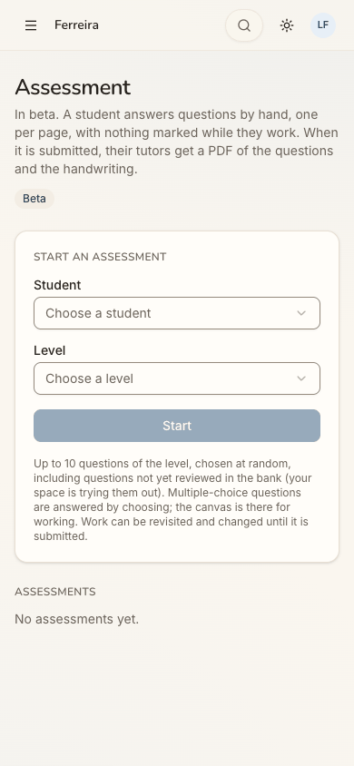 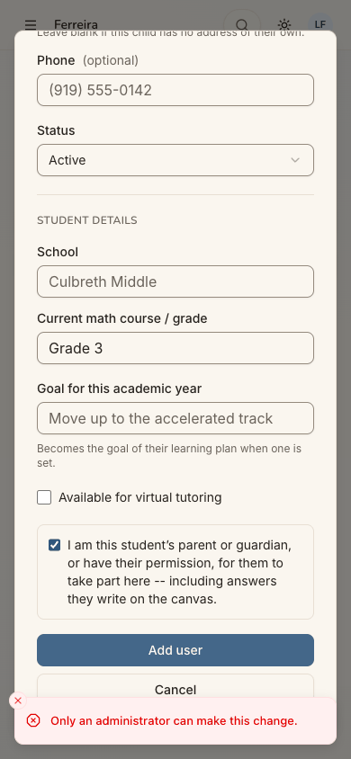 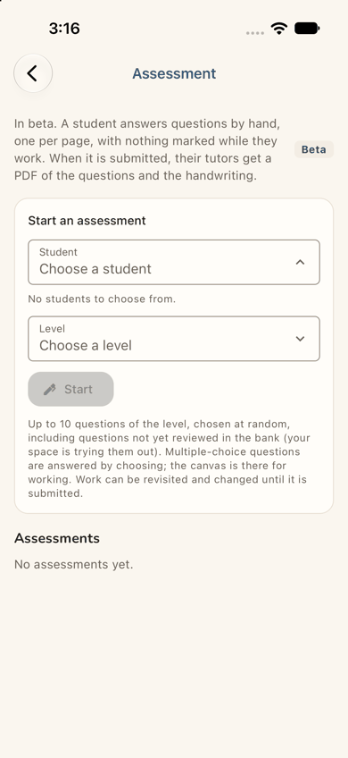 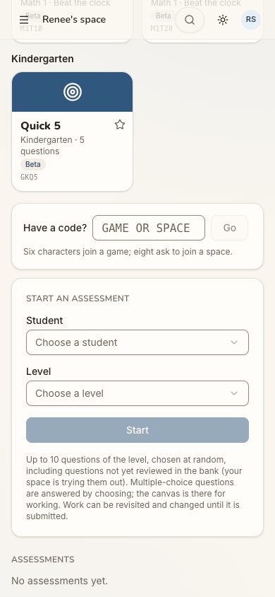 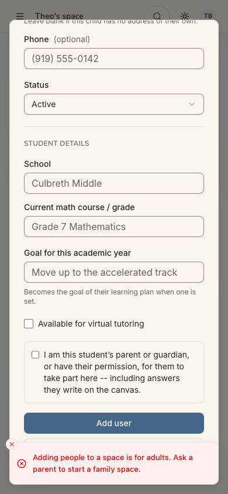 Journeys: J07 steps 24-35, J07A steps 26-34, J03 steps 16-23, J04 steps 14-15, J04A steps 20-22, J11 steps 8-10.
- **Recommended Fix:**
  - Give every picker that can be empty its own empty state. It says why in one line and names the one thing the reader can do. For example: "No children are linked to you in Ferreira Family Practice. Ines Ferreira adds them." with a button that asks her.
  - Check permission before a form opens, never at Save. Hide what the reader's role cannot complete (Add user for a parent; Add user and Add a student for a teen), or show it disabled with the reason beside it.
  - When an admin lets a parent in, ask "Which child?" in the same dialog.

### [sev3] The waiting and refusal screens stop the journey cold

- **Issue Description:** Under Post-approved access, every self sign-up ends on a sheet whose layout says almost nothing useful.
  - **The web sheet** stacks two headings, "Almost there" over "Waiting for approval". It gives no time frame, no approver and no word that the person will be told. Its one button, styled as the main action, is "Contact us", a mailto link to a personal Gmail address. It has no "Keep playing" (J01 step 10, J02 step 9, J03 step 11, J04 step 7, J06 step 7, J07 step 10, J08 step 6, J10 step 10).
  - **The app's full-screen version** drops the leftover heading. It adds a "Back" that throws away the quest in progress (J01A steps 13-14, J04A step 8, J06A step 11, J07A step 10).
  - **The refusals have the same shape.** "Access not approved" (J02 step 12) and "Sign-up is by invitation" (J13 step 3) repeat their own title and offer only Contact us and Back. Both reopen by themselves over the guest page (J02 step 19, J13 steps 10 and 20). The under-13 refusal has a single X (J05 step 6), and the sign-up form then reopens with her email filled in (J05 step 11).
- **Framework Violation:** Nielsen #1 (visibility of system status), #3 (user control and freedom: the app's Back drops the quest) and #9 (recover from errors); frontend-design: "Treat failure and emptiness as moments for direction, not mood".
- **Severity:** 3. Every self sign-up passes this screen on both platforms (J01-J10, J13). Nothing on it blocks anyone. But three reports name it as the screen where an unconverted adult is most likely to leave (J01, J06 and J07, each in its "3 screens").
- **Evidence:** 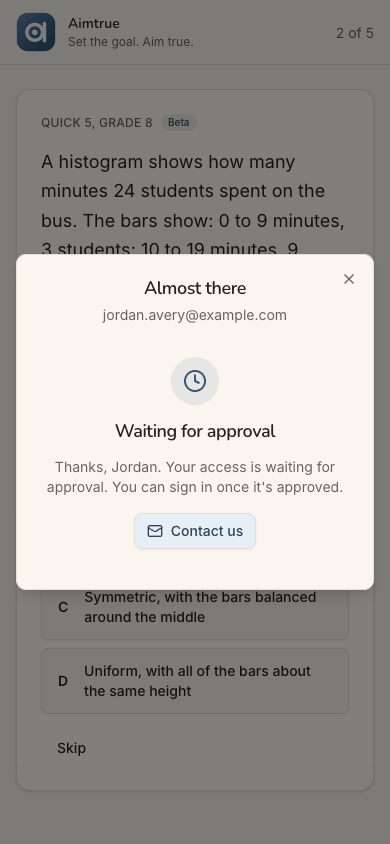 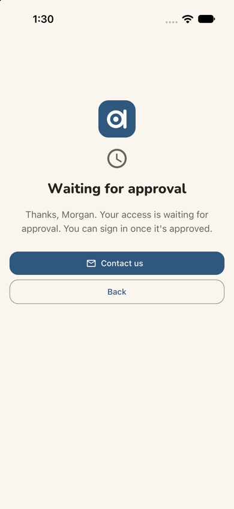 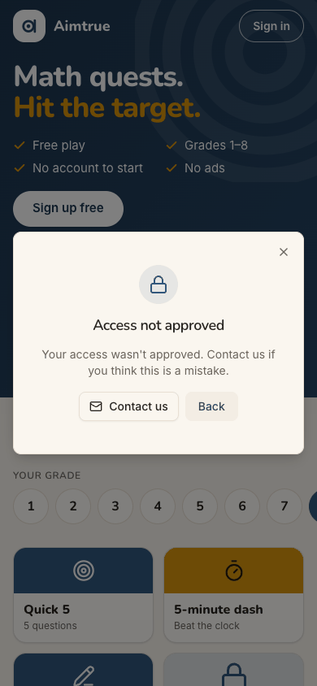 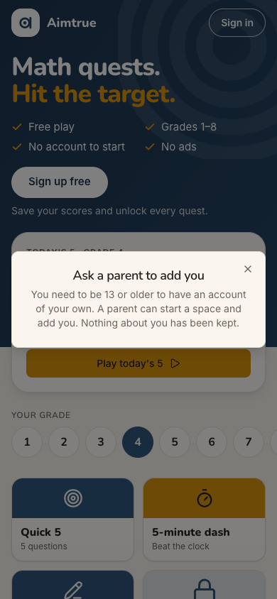 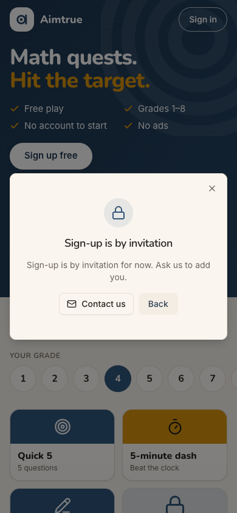 Code: the sheet keeps its "Almost there" title over the waiting state (`apps/web/src/features/guest/signup-sheet.tsx:69`); "Contact us" is a mailto link (`apps/web/src/features/auth/access-refused.tsx:36`).
- **Recommended Fix:**
  - **One heading per state.** Say who decides, how long it usually takes and how the person will hear, or that they should come back.
  - **"Keep playing" as the primary button,** returning to the question they left. Contact becomes a secondary link to a role address, shown in full.
  - **A refusal says guest play is still open.** For under-13s it also gives a route to a grown-up.
  - **A refusal never reopens unasked.**

### [sev3] The Quest board leads with Grade 1, whoever is playing

- **Issue Description:** The board picks its lead grade in this order: the last quest started on this device, then the guest's grade on this device, then the first grade that has tiles, which is Grade 1. It never reads the person's age or the grade their space records. These people all met pink Grade 1 tiles and "Today's Daily · Grade 1" first:
  - a 15-year-old and a 16-year-old (J04 step 10, J04A step 23);
  - a teacher (J06 step 10);
  - parents (J07 step 13, J09 step 4, J10 step 13);
  - a pilot teacher who had just seen Grade 4 on the guest page (J12 step 7);
  - a student her space records in Grade 7 Mathematics (J17 step 3);
  - a returning 7th grader (J19 step 4).

  A grade picked on the row is lost on reload (J17 steps 13-14). In this audit's own run, a fresh browser signed in as J01's adult opened on "Today's Daily · Grade 1 · G1D #4" and "Quick 5, Grade 1" (the page text, read before a grade was chosen). That adult had played Grade 8 in J01.
- **Framework Violation:** Nielsen #2 (match between system and the real world) and #6 (recognition rather than recall: the grade must be found again on every visit); design-critique first impression ("What draws the eye first? Is that correct?").
- **Severity:** 3. The first screen tells cohorts C5 and C6, and most newcomers, that the product is "for little kids" before they play. For teens and adults that is a stickiness loss on every visit. J17 rated it 3; J04, J04A and J12 rated it 2.
- **Evidence:**  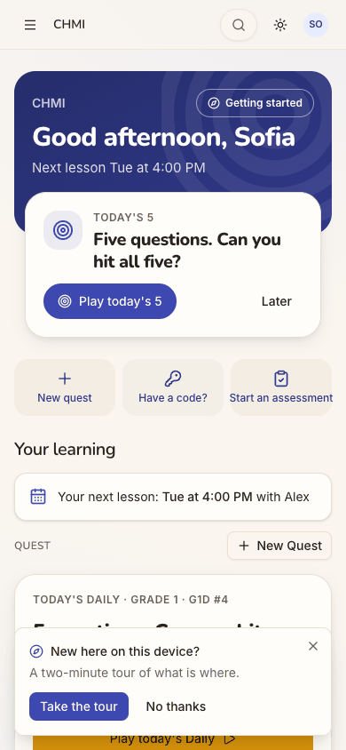 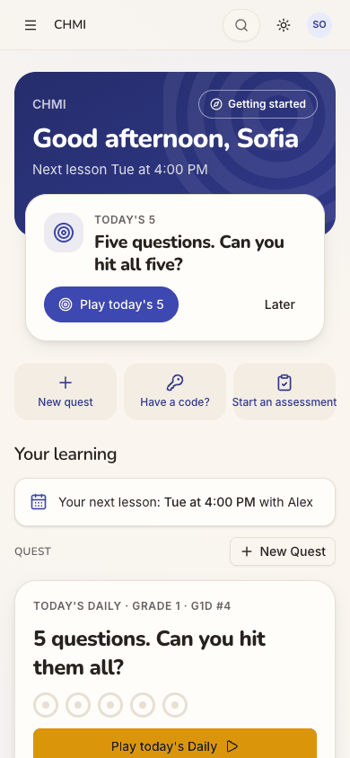 Code: the lead comes from device storage, and the chosen grade is component state (`apps/web/src/features/play/play-home.tsx:114-125`); with no lead, `boardLeadGrade` falls to the first grade (`packages/shared/src/tile-look.ts:72-77`).
- **Recommended Fix:** Lead with, in order:
  1. the grade the space records for a student;
  2. the last level the person played, read from the server, not the device;
  3. for anyone 13 or older, the top of the row or "More levels";
  4. only then Grade 1.

  Remember a grade picked on the row for that person, across reloads.

### [sev3] The first screen talks to a learner when the person came to run a space or for their child

- **Issue Description:** For people whose roles or reasons are elsewhere, the band's first fact is "0 of 3 days played this week" and the board below is a child's practice board.
  - **A teacher starting a club** gets the practice board, and nothing on the page leads to Start a space (J06 step 10, J06A step 14). The new club's own home is the same board (J06 step 20).
  - **A parent who signed up for her daughter** finds "Your children" only at the bottom (J03 steps 14 and 29).
  - **An invited parent who came for Leo** finds him on the fourth screen (J09 step 4).
  - **Others:** a pilot teacher (J12 step 6), a parent sent by a tutor (J07 step 13, J10 step 13), and a parent who also tutors, whose home shows no teaching hat (J18 step 3).

  "Running the space" and "My children" exist only as a "Make this my home" choice at the very bottom of the page (J09 step 5, J18 step 13).
- **Framework Violation:** design-critique visual hierarchy ("Are the right elements emphasized?"); Nielsen #2 (match between system and the real world); the member-home plan's own H3 and H4 (hats exist only with content; focus from how the person arrived).
- **Severity:** 3. Cohorts C1, C4 and C7 meet the wrong home on their first screen. For J06, J06A and J09 it hides the very thing they came to do.
- **Evidence:**  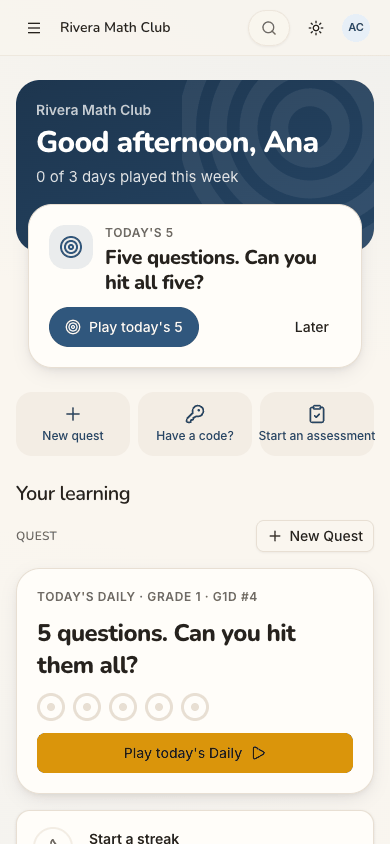 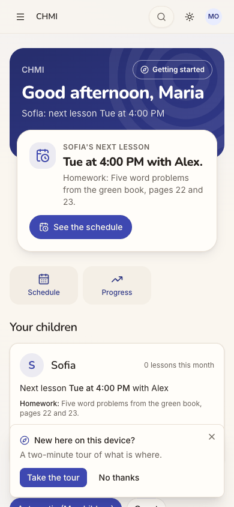 Journeys: J03, J06, J06A, J07, J09, J10, J12, J18.
- **Recommended Fix:**
  - **Seed the focus from what the person said or did.** Joined or invited as a parent puts My children first. Choosing "Start a space" puts Running the space first. A tutor role adds a Teaching section.
  - **For an adult who has not played,** lead the personal space's band with the three doors (Play · Join with a code · Start a space), never with a zero.

### [sev3] Example values look like saved data

- **Issue Description:** Placeholders across the forms are realistic data, set at nearly the same weight as real text.
  - **The price that is not there.** The office's new student shows "95.00" under "In-person price / hr" while the field is empty. Below it sits the form's own hint, "A session cannot be recorded without it" (J14 steps 13 and 30).
  - **The same form's other placeholders** read as filled values too: "Culbreth Middle", "Move up to the accelerated track", "(919) 555-0142" and "Alex Chen", which is the name of a real tutor in CHMI (J03 step 19, J07 step 31, J14 step 30).
  - **Codes that look like fields.** The guest page's example code "QF7K2M" sits in a bordered box that looks like an input and does nothing when tapped (J07 step 3, J07A step 2, J08 step 2). The Spaces page's code box shows "K7QM-9XDA" beside a grey Find, and Start a space shows "The Patel family" (J04 step 13, J10 step 24).
- **Framework Violation:** Nielsen #5 (error prevention) and #2 (match between system and the real world); WCAG 2.2 SC 3.3.2 (labels or instructions: a placeholder standing in for data); design-critique "Are interactive elements obvious?" (a false affordance).
- **Severity:** 3. The empty price is a billing error waiting for the first lesson (J14 rated it 3). The example code cost three journeys a dead end at the front door.
- **Evidence:** 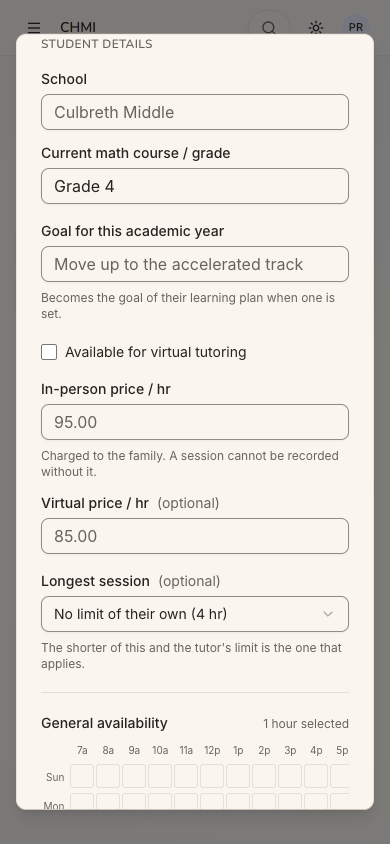 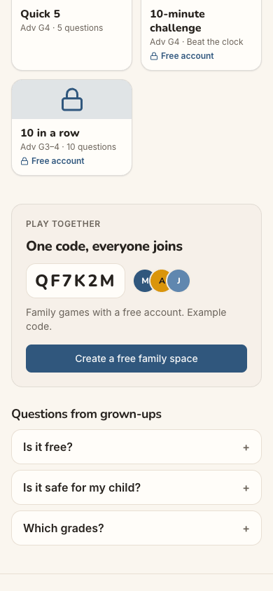 Code:
  - `apps/web/src/features/users/user-form-dialog.tsx:501` ("Alex Chen"), `:823`, `:853`, `:886` ("95.00") and `:897`;
  - placeholders use `text-muted-foreground`, the same token as hint text, measured at 5.81:1 on a card (`apps/web/src/components/ui/input.tsx:10`);
  - `apps/web/src/features/guest/guest-home.tsx:181` (QF7K2M in a bordered `kbd`);
  - `apps/web/src/features/organizations/welcome.tsx:164` and `:239`.
- **Recommended Fix:**
  - Put formats in helper text under the field ("For example 95.00"), and leave the field visibly empty, with a "$ / hr" adornment.
  - Give placeholders a lighter token of their own, and never use a seeded person's name.
  - Show a missing required price as a warning on the student's record.
  - Draw the example code as an illustration, without a field border and labelled "Example", or make it a live box that takes a code.

### [sev3] Outcomes that happen elsewhere leave no trace on screen

- **Issue Description:** When something is decided about the person, or done by them, the screen they land on looks exactly as before. The only feedback is a toast that disappears.
  - **Let in.** No banner and no Next up item. The only sign is a new row in the space switcher or the account sheet (J07 steps 21-23, J07A steps 24-25).
  - **Declined.** The home is unchanged (J10 step 20). The decline is one beige line on the Spaces page, with no date, no dismiss and no next step. It disappears if the second request is withdrawn (J10 steps 24-27).
  - **Request sent.** The join request's toast does not name the space and leaves nothing on the home (J10 step 16, J04 step 18).
  - **Choices that change nothing visible.** "Make this my home" shows no change (J18 steps 11-13). After playing, Next up and the week do not move (J19 step 12).
  - **Office saves.** Every save ends in a toast, and the next step has to be hunted for (J14 steps 9 and 22).
- **Framework Violation:** Nielsen #1 (visibility of system status); frontend-design writing rule: "The button that says 'Publish' produces a toast that says 'Published'".
- **Severity:** 3. Converting C7 and C3 depends on noticing an outcome (J07, J07A and J10 each rated this 3). Nothing is blocked, but the person has to go and look for news.
- **Evidence:** 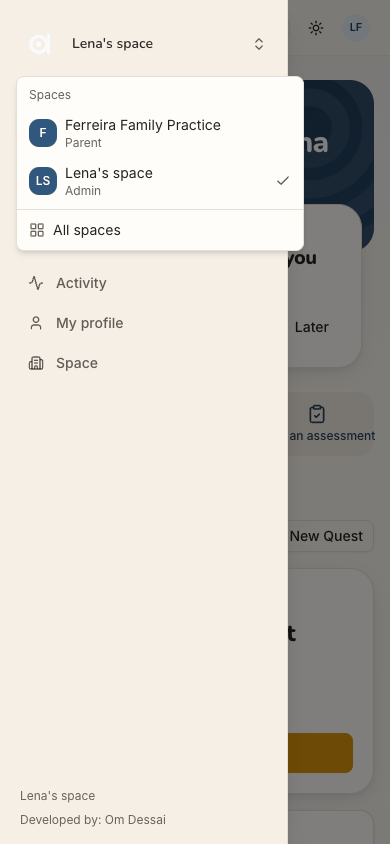 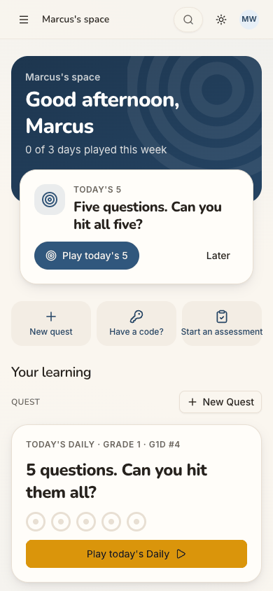 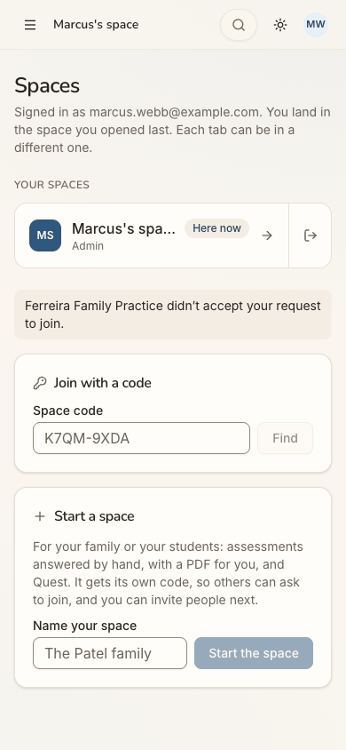 Journeys: J04, J07, J07A, J10, J14, J18, J19.
- **Recommended Fix:**
  - **Give each outcome a Next up item and a band line.** "You're in Ferreira Family Practice: Open". "Ferreira Family Practice said no: Ask again or Contact".
  - **Keep a pending row on the home until it is answered.** "Asked to join Riverside Tutoring, waiting for its admins".
  - **Toasts name the object they changed.**
  - **Pinning a focus reorders the page visibly** and says so.

### [sev2] Nothing on screen tells one space from another

- **Issue Description:** Every self-serve and personal space is created in Slate, the guest page's navy. These pairs have identical bands, buttons and avatars, and only a small name differs:
  - "Lena's space" and "Ferreira" (J07 steps 21 and 24);
  - "Sam's space" and "Rivera Math Club" (J06 steps 10 and 20);
  - the tutoring space "Brooks & Ramos" (this audit's own screenshot).

  The space switcher shows both rows as navy initials (J07 step 23). In the phone drawer, the space's mark loses its tile and renders as a white glyph on a pale ground, measured at 1.13:1 (J04 step 11, J07 step 18, J10 step 17). On desktop it keeps its tile (J01 step 13 desktop). This is part of why being let in goes unnoticed: the new space looks like the old one (J07 steps 21-23).
- **Framework Violation:** Nielsen #1 (visibility of system status: "where am I?") and #4 (consistency and standards); design-critique consistency; frontend-design (a distinct identity per client).
- **Severity:** 2. Everyone who joins or starts a space then holds two spaces that look alike (J06, J06A, J07, J07A, J10, J11). Misreading which space is open is how a person gets added, or an assessment started, in the wrong one.
- **Evidence:** 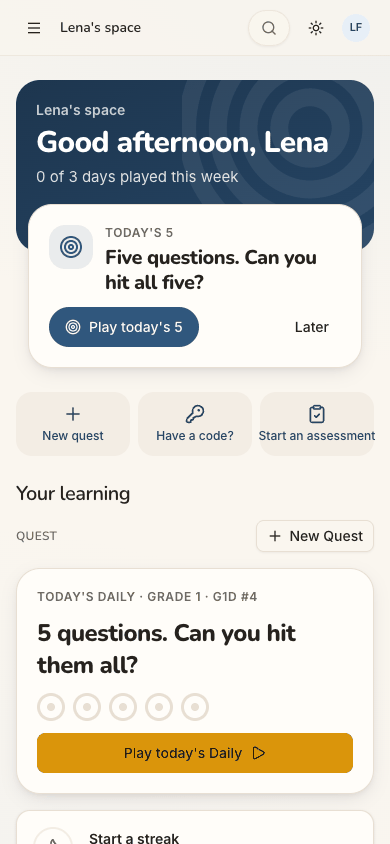 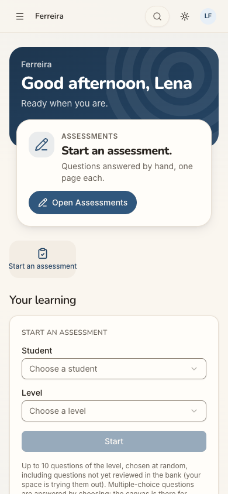 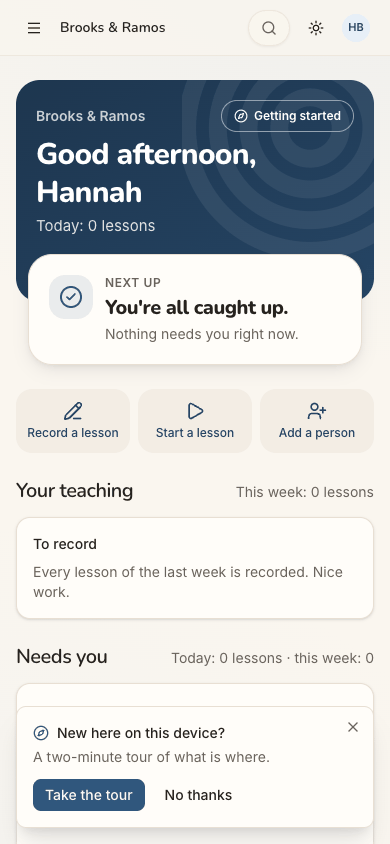  Code:
  - every self-serve space is inserted with `'platform'` (`apps/api/src/repositories/organizations.ts:1175`);
  - the mark fills its tile from a fixed gradient id, `chmi-tile` (`apps/web/src/components/brand/logo.tsx:53` and `:59`), first defined inside the desktop sidebar, which is `display: none` below `lg` (`apps/web/src/components/layout/app-shell.tsx:178`). That is the likely reason the drawer's copy paints no tile.
- **Recommended Fix:**
  - Give each new space a palette of its own: rotate through Indigo, Teal, Forest, Crimson and Amber, or let the maker choose one in Start a space.
  - Keep Slate for the platform, the guest page and personal spaces, and label the personal space "Just you" in the switcher.
  - Give the mark's gradient a per-instance id (`useId`).

### [sev2] Amber carries five meanings, and the tile colours change meaning after sign-up

- **Issue Description:** The colour code changes when a guest becomes a member.
  - **On the guest page, colour encodes the mode:** navy for a set number of questions, amber for a timed quest (J01 step 1).
  - **After sign-up, the same cards encode the grade:** wine for 8, yellow for 4, pink for 1 (J01 step 14, J03 step 15, J04 step 19).

  Meanwhile amber does five jobs:
  1. the guest's timed mode;
  2. Grade 3's hue;
  3. the "Play today's Daily" and guest "Play today's 5" buttons;
  4. a hit target ring;
  5. `--highlight`, "notice this first", which also fills the app's (+).

  Measured from the tokens, the Daily button's amber and Grade 3's hue are 1.13:1 apart, and `--highlight` and Grade 3 are 1.26:1 apart. On a Grade 3 board the call to action sits right above cards of the same colour (J09 step 15).
- **Framework Violation:** Nielsen #4 (consistency and standards); frontend-design ("Visual structure is information"). WCAG 1.4.1 is met, because every card also says its level in words.
- **Severity:** 2. The colour code learned on the guest page is wrong one screen later, and the main button blends into Grade 3 boards. Nothing is blocked.
- **Evidence:**  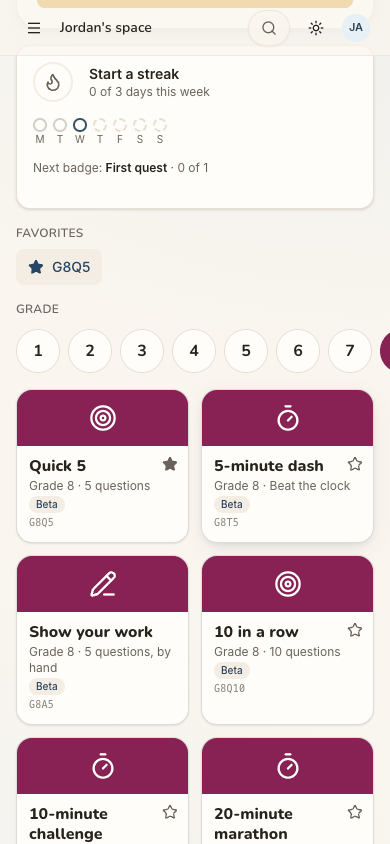 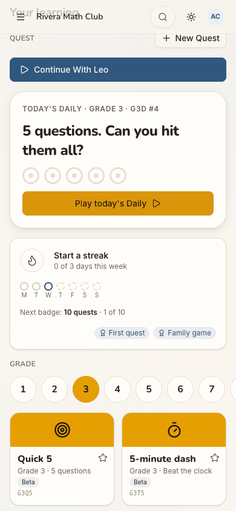 Code:
  - `apps/web/src/features/play/quest-card.tsx:32` (timed mode is `bg-warning`), `:165` (the Daily button is `bg-warning`), `:116` and `:122` (hit rings);
  - `apps/web/src/index.css:68` (`--warning`), `:77` (`--grade-3`), `:698` (`--highlight`).
- **Recommended Fix:**
  - Keep amber for one job, the call to action and "notice first".
  - Move Grade 3 to a hue clear of it, or draw the Daily and Today's 5 buttons in the space's primary.
  - Use the grade hues on the guest page too, with the mode shown by its icon alone, so one colour code holds before and after sign-up.

### [sev2] Measured contrast failures on the Quest board and in the phone drawer

- **Issue Description:** The grade-hue tiles themselves pass: every icon on its band is at least 4.68:1. Four smaller pieces do not.
  - **The selected grade chip** shows its state by fill alone. Against the card, Grade 4's yellow is 1.30:1, Grade 3 is 2.21:1 and Grade 6 is 2.26:1 (J03 step 15, J09 step 15).
  - **The "ADV" pill** is 10 px bold text: 3.97:1 on Grade 1, 3.22:1 on Grade 2 and 3.59:1 on Grade 5 (J04 step 19).
  - **Every member tile** prints its code in 10 px monospace at 3.75:1 (J01 step 14).
  - **The Indigo drawer's space switcher,** in the hover state a tap leaves behind, puts the space's name at 3.78:1 and its tagline "Where numbers click" at 1.15:1 (measured from J14 step 18; also J17 step 7). Indigo's `--sidebar-accent` was made for a dark rail, and the warm foundation later turned that rail cream.
- **Framework Violation:** WCAG 2.2 SC 1.4.3 (contrast, minimum) and SC 1.4.11 (non-text contrast).
- **Severity:** 2. It affects low-vision readers, and parents reading a phone outdoors. Nothing is blocked, because the labels repeat the grade.
- **Evidence:** 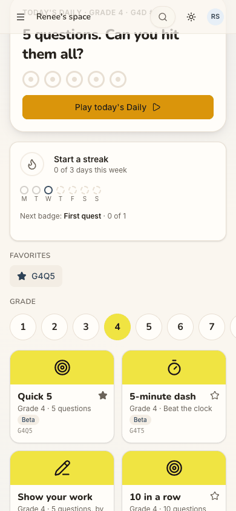 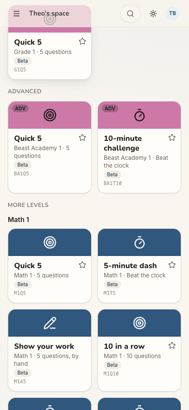 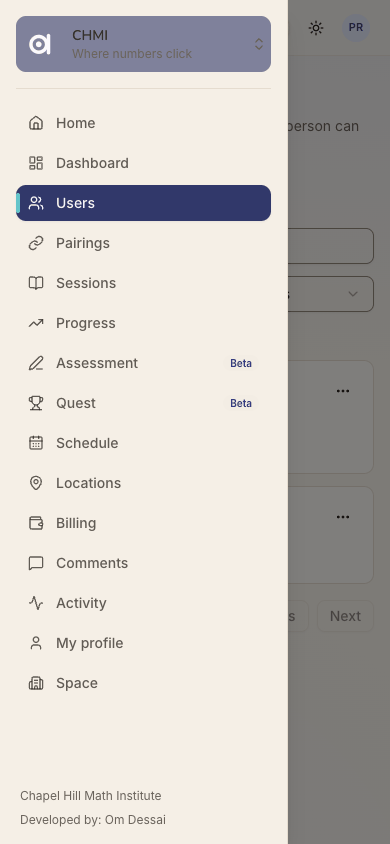 Figures: the table under "Colour and themes". Code:
  - `apps/web/src/features/play/quest-card.tsx:88` (ADV pill), `:97` (code at `text-[10px]`, `/80` opacity), `:207-213` (selected chip, fill only);
  - `apps/web/src/index.css:79` (`--grade-4`), `:191` (Indigo `--sidebar-accent`), `:693` (warm `--sidebar`).
- **Recommended Fix:**
  - Add a 2 px `--foreground` ring, or a tick, to the selected chip.
  - Set the ADV pill in white on a 45% black pill, at 12 px or more, in sentence case.
  - Print codes at full `muted-foreground`, at 12 px or more, or drop them (see the codes finding).
  - Restate `--sidebar-accent` and `--sidebar-accent-foreground` in the warm foundation for every palette.

### [sev2] The home repeats one action two or three times, in competing styles

- **Issue Description:** The member home was built around one primary action, the Next up card, but the sections below repeat it, often louder.
  - **Two daily sets on one screen.** "Today's 5" in Next up is a small pill; "Today's Daily" below it is a full-width amber button (J01 step 13, J01A step 19, J12 step 6, J17 step 3, J19 step 3). Because the lower button is heavier, the eye lands on the second item first.
  - **"New quest"** is both a quick action and a section button (J01 step 13; the app adds a third route, the (+), J01A).
  - **"Start an assessment"** appears three times: in Next up, as a quick action and as an inline form (J07 step 24, J07A step 26).
  - **"2 asking to join"** appears in the band, in Next up and under Needs you (J11 step 3). "24 lessons not recorded" repeats the same way (J14 step 4).
  - **A finished lesson** offers "Record it now", "Record a lesson" and a To record row (J16 step 4).
  - **Riverside** prints "Needs you" both as an eyebrow and as a section title (this audit's screenshot).
- **Framework Violation:** design-critique visual hierarchy ("Are the right elements emphasized?"); Nielsen #8 (aesthetic and minimalist design); the member-home plan's H1 ("ONE Next up card").
- **Severity:** 2. It costs a hesitation on every visit and ranks the actions wrongly. No task is blocked.
- **Evidence:** 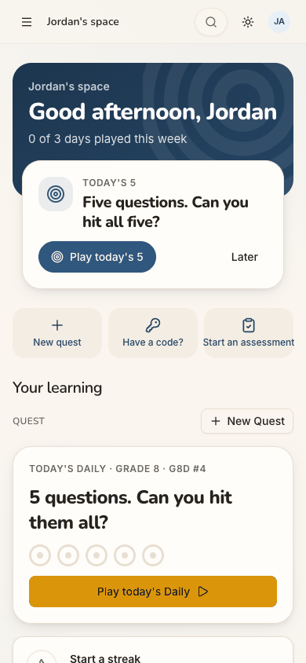  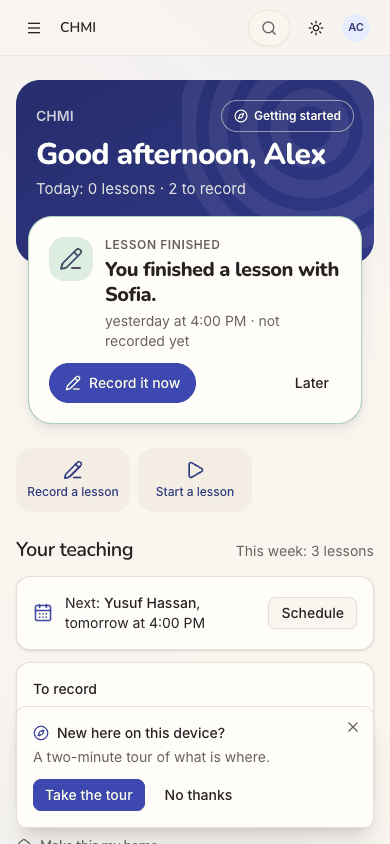 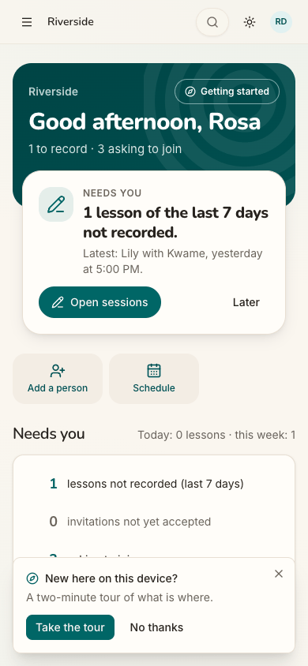 Journeys: J01, J01A, J07, J07A, J11, J12, J14, J16, J17, J19.
- **Recommended Fix:**
  - When an item is in Next up, collapse its twin below to a one-line reference or hide it.
  - Give Next up the heaviest button on the page, full width, and make section buttons secondary.
  - Merge Today's 5 and the Daily, or name them so they are clearly two things.
  - Show each count once.

### [sev2] Codes where people expect names

- **Issue Description:** Internal codes reach every cohort:
  - **favorites** as bare codes: "G8Q5" (J01 step 14), "G4Q5" (J03 step 15);
  - **the Daily's eyebrow:** "G8D #4" (J01 step 13);
  - **the game header:** "Game" on the web phone, "Quest game · G8" and "Quest game · AoPS Geom…" in the app (J12 step 10, J01A step 22, J04A step 29);
  - **the lobby line:** "G3 · 5 questions · Right +1, wrong 0 · …" (J09 step 11, J15 step 15);
  - **Question Quest's list:** "8XH2F5 G7 5 questions Single player Playing now", twice, with only the code to tell them apart (J19 step 15);
  - **the assessment's level list:** "G4 · 10 questions · includes unreviewed" on every row (J03 step 30, J06 step 26, J06A step 35);
  - **"Beta"** on every tile and question (J01 step 14, J12 step 10).

  Each tile also prints its code under its human title.
- **Framework Violation:** Nielsen #2 (match between system and the real world) and #6 (recognition rather than recall).
- **Severity:** 2. Parents, adults and teens have to decode. Favorites, the most personal row on the home, is the least readable.
- **Evidence:**  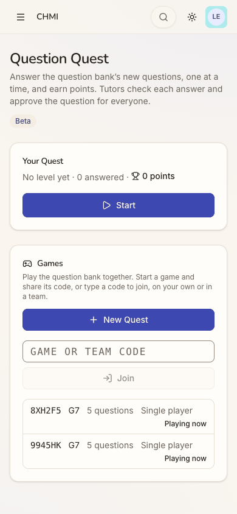 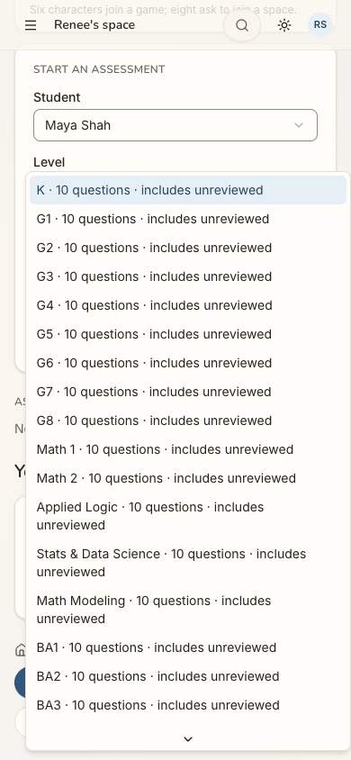 Code: `apps/web/src/features/play/quest-card.tsx:97` (the code under each title). Journeys: J01, J01A, J03, J04A, J06, J06A, J07, J07A, J09, J12, J15, J15A, J19.
- **Recommended Fix:**
  - Name every surface with the words `tileLook` already builds ("Quick 5 · Grade 8"), and keep codes for the console and support.
  - List games as "Quick 5, Grade 7 · question 3 of 5 · 2 points".
  - Replace "includes unreviewed" on every row, and "Beta" on every tile, with one line at the top of the board.

### [sev2] A tutoring office's words reach spaces and readers without one

- **Issue Description:** Spaces without Tutoring still speak of billing, tutors and plans:
  - **Add a student in a free club:** "Every student needs a parent or guardian on file, who is billed…" and "their plan and a tutor" (J06 step 21, J06A step 30);
  - **the role list:** "Enrolled for tutoring", "Responsible for costs, communication and monitoring" (J07 step 31, J11 step 6);
  - **the assessment** tells a 9-year-old "Nothing is marked until your tutor reviews it", in a space with no tutor (J03 step 32, J06 step 27);
  - **Leo's record** carries virtual-session fields, and a comment there is refused with "Tutoring is not part of this space" (J09 step 19).

  Readers get the office's menu and tour as well. A CHMI student's menu holds Users, Pairings and Billing (J17 step 7). A parent's tour speaks of "the portal" and "The dashboard and the menu" (J15 step 3, J15A step 4).
- **Framework Violation:** Nielsen #2 (match between system and the real world); frontend-design writing ("Write from the end user's perspective"); the project's own R23 (a space without Tutoring leaves Tutoring's sections out).
- **Severity:** 2. "Billed" raises a doubt in a teacher about to invite families (J06), and children read text meant for an office.
- **Evidence:** 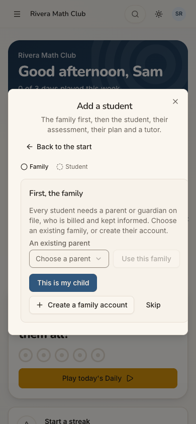 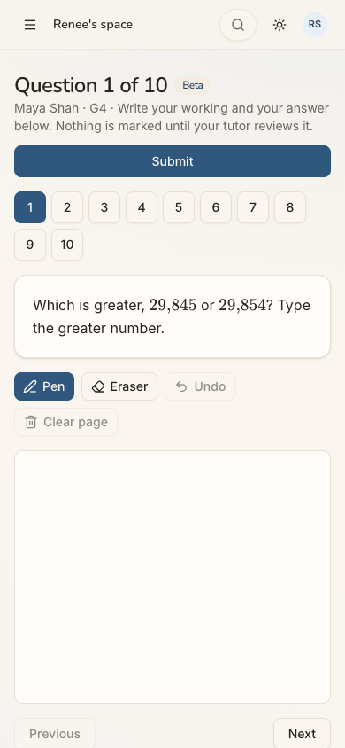 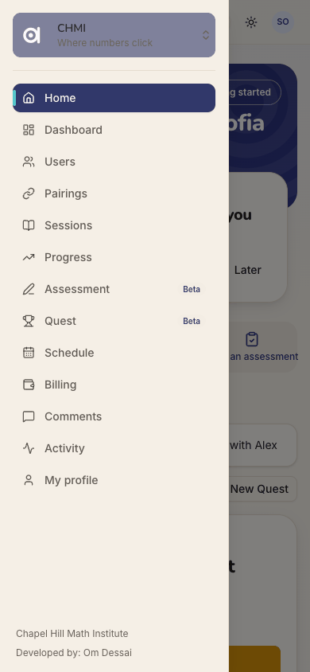 Journeys: J03, J06, J06A, J07, J07A, J09, J11, J15, J15A, J17.
- **Recommended Fix:**
  - Write the copy per kind of space and per reader. "Who looks after this student?" replaces "who is billed". "Your teacher (or parent) looks at it next" names whoever will actually review it.
  - Build the menu from the reader's hats: a student or a parent never sees Pairings, Users or Billing.

### [sev2] One thing goes by several names

- **Issue Description:** The words drift within a single flow.
  - **People:** "Add a person" opens a page titled "Users" whose button is "Add user" (J14 step 5).
  - **Lessons:** "Record a lesson" opens "Record a session", then "End and record" and "Record session". J16 counts one task across four forms and nine button names (J16 steps 4-21).
  - **Quest:** the menu's "Quest" opens "Question Quest", which has "Games" and "New Quest". A game is "Game" on the web and "Quest game" in the app (J17 step 16, J19 step 10, J01A step 22).
  - **Space:** the platform's word is "space", yet the welcome speaks of "the portal" (J15 step 3).
- **Framework Violation:** Nielsen #4 (consistency and standards); frontend-design: "An action keeps the same name through the whole flow".
- **Severity:** 2. Every renamed step makes a person check that they are still in the right place. Nothing is blocked.
- **Evidence:** 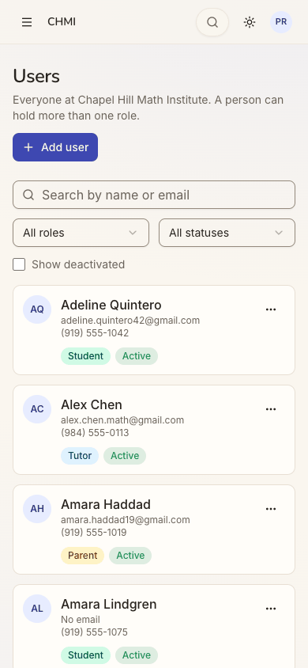 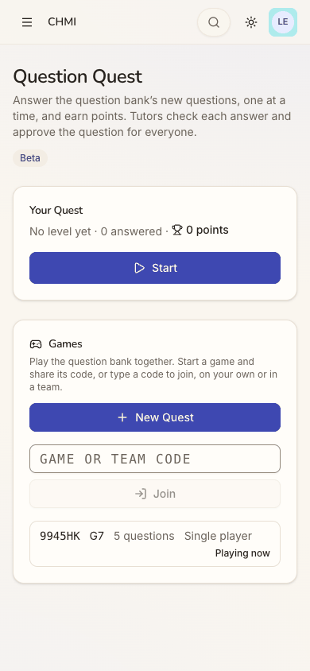 Journeys: J01A, J14, J15, J16, J17, J19.
- **Recommended Fix:** Keep one short glossary in shared code (person, lesson, game, quest, space) that both clients read. The button that opens a form names the form, and the form's save button repeats it.

### [sev2] "Sign in" opens a sheet titled "Sign up free"

- **Issue Description:** On the guest page, the header's "Sign in" calls the sign-up handler. Its sheet is titled "Sign up free" whenever sign-up is open, so returning, approved and invited people are all told to sign up. It happened in 18 of the 19 web journeys (J01 step 11, J03 step 12, J04 step 9, J06 step 9, J07 step 12, J09 step 2, J10 step 12, J11 step 2, J14 step 2, J15 step 2, J16 step 2, J17 step 2, J18 step 2, J19 step 2, and in J02, J05, J08, J13). The app's "Sign in" opens a sign-in screen (J01A, J04A, J06A, J07A, J15A).
- **Framework Violation:** Nielsen #4 (consistency and standards) and #2 (match between system and the real world).
- **Severity:** 2. It is the most frequent hesitation in the audit. No one is blocked: one Google tap still signs a member in.
- **Evidence:**  Code: "Sign in" calls `signUp` (`apps/web/src/features/guest/guest-home.tsx:99`); the sheet's title is `'Sign up free'` (`apps/web/src/features/guest/signup-sheet.tsx:86`).
- **Recommended Fix:** Title the sheet "Sign in or sign up", or "Continue with Google", with the line "New here? We'll set up your account." Keep "Sign up free" for the hero's button only.

### [sev2] Phone-width layouts break on a dozen screens

- **Issue Description:** At 390 px these overflow, collide or truncate what the reader needs:
  - **Game results:** 430 px wide, with the score and "Challenge a friend" cut off (J15 step 19).
  - **The parent Dashboard's Recent sessions:** rows overlap, reading "wi2026-09-15" (J18 step 10).
  - **Activity:** the filters overlap (J10 step 22, J11 step 12).
  - **Schedule:** cards are squeezed into a narrow column beside five icon buttons (J14 steps 23-27).
  - **Invite people:** the invited row shows "a.." for the email (J06 step 18).
  - **Add a student:** the family card runs off the dialog (J06 step 21).
  - **Join requests:** emails are cut at "example.co…", with "asked 3 minutes ago" off the edge (J11 step 4).
  - **Spaces and the invitation:** "Marcus's spa…", "Ferreira Family Pra…", "Riverside Tutori…" and "Rivera …" (J10 step 19, J04 step 17, J09 step 3).
  - **The countdown:** "Get ready" starts off the left edge (J12 step 9, J19 step 6).
  - **The grade row:** it hides Grade 8, even when 8 is the remembered grade (J01 steps 11 and 14, J01A step 19).
  - **The app's assessment:** the fourth answer is hidden below the card (J06A step 37).
- **Framework Violation:** WCAG 2.2 SC 1.4.10 (reflow); the project's own rule of zero horizontal overflow at 390 px (`responsive.spec.ts`, in CLAUDE.md); design-critique usability.
- **Severity:** 2. Each break costs a guess, or hides a fact the reader came for. Most people here use a phone.
- **Evidence:** 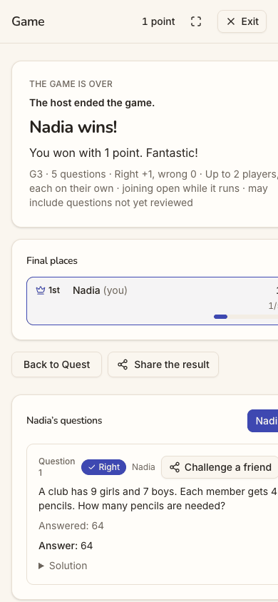 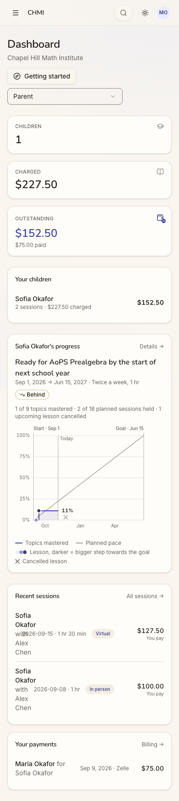 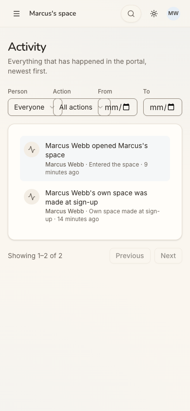 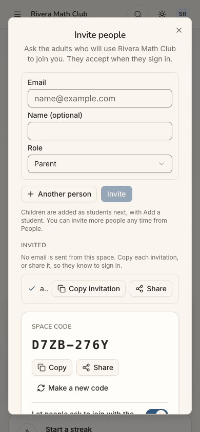 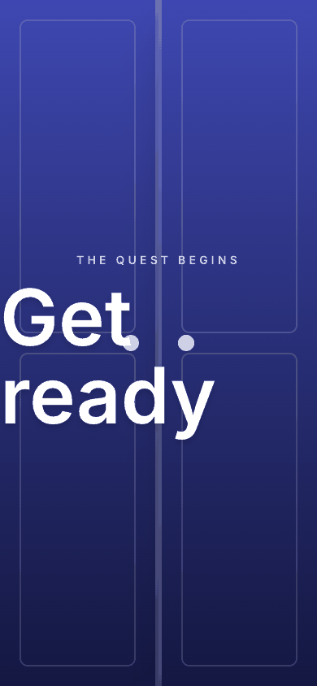 Journeys: J01, J01A, J04, J06, J06A, J09, J10, J11, J12, J14, J15, J18, J19.
- **Recommended Fix:**
  - Stack rows below `sm`, with the text first and the actions on a line of their own.
  - Let names wrap to two lines rather than truncate.
  - Show a scroll cue on the grade row, and scroll the chosen grade into view.
  - Size the countdown word with `clamp()`.
  - Add the game results and the Dashboard to `responsive.spec.ts`.

### [sev2] The tour and its offers cover what they introduce

- **Issue Description:**
  - **The offer covers the page.** "New here on this device?" floats over the bottom of the home and covers the To record buttons and the Needs you list (J16 step 4, J14 step 4, this audit's Riverside screenshot).
  - **It appears where it should not.** The welcome wizard offers "Take the tour" in a space without Tutoring (J06 step 20, J06A step 28), although the 2d6e7d3 rule keeps the tour for Tutoring.
  - **It comes back at once.** It is offered again straight after the tour is finished (J15 steps 10 and 20, J15A step 11).
  - **On a phone it points at the menu.** Six of its eight stops light the hamburger (J15) or the More tab (J15A), and the parent's tour never shows playing together.
- **Framework Violation:** Nielsen #3 (user control and freedom) and #8 (aesthetic and minimalist design); design-critique ("Are interactive elements obvious?", here hidden under an overlay).
- **Severity:** 2. It covers the very buttons a new tutor or office admin needs on their first visit, and it repeats itself.
- **Evidence:**  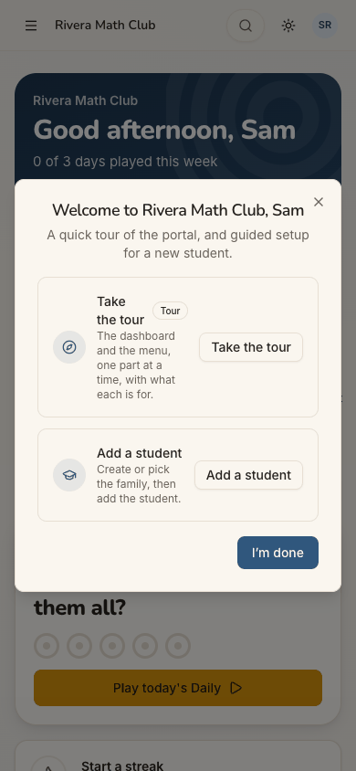 Code: the wizard's "Take the tour" option has no `tourOffered` check (`apps/web/src/features/onboarding/onboarding-wizard.tsx:119`), while the home's offer does (`apps/web/src/features/home/member-home.tsx:158`, `apps/web/src/features/onboarding/onboarding-provider.tsx:87`). Journeys: J06, J06A, J14, J15, J15A, J16.
- **Recommended Fix:**
  - Make the offer an inline card in the page's flow, not a layer floating over it.
  - Offer the tour once per person, not per device.
  - Apply `tourOffered` in the welcome wizard too.
  - On a phone, point each stop at the section on the page, not at the menu.

### [sev2] The habit card contradicts itself and leads with a zero

- **Issue Description:**
  - **One card, two states.** A returning player's card says "Start a streak", "Welcome back! A fresh week starts now.", "4 weeks in a row" and "Next badge: 12 weeks in a row · 4 of 12", all at once (J19 step 4).
  - **A zero as the first fact.** The band opens with "0 of 3 days played this week" minutes after a newcomer played as a guest (J01 step 13, J12 step 6), and for people who did not come to play (J06 step 10, J09 step 4).
  - **A count that cannot move.** A child's card says "Played 0 days this week (aim: 3)", and it stays at 0 even after the parent and child play together (J15 step 21, J15A step 23).
- **Framework Violation:** Nielsen #1 (visibility of system status) and #2 (match between system and the real world); frontend-design ("Let each written element do exactly one job").
- **Severity:** 2. The streak is the product's reason to come back three days a week. A card that contradicts itself, or leads with a zero, weakens it on every visit.
- **Evidence:** 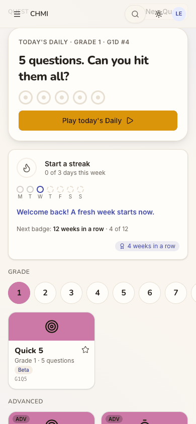 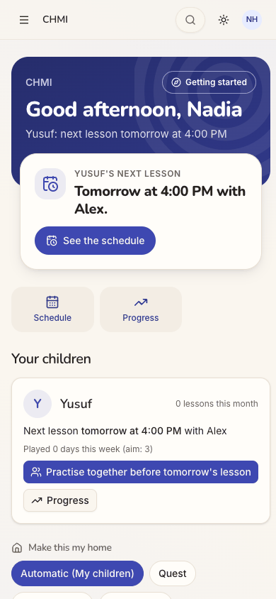 Journeys: J01, J06, J09, J12, J15, J15A, J19.
- **Recommended Fix:**
  - Give the card one state: "4-week streak: play 3 days this week to keep it", or "Start a streak", never both.
  - Lead the band with the next step, not a zero.
  - Count a practise-together game towards the child's days.

### [sev2] Ways out of full-screen play are missing or lead somewhere else

- **Issue Description:**
  - **No way out.** The Daily has no close, back or home control: only the browser's Back leaves it (J17 step 5).
  - **Exit goes elsewhere.** On the web, a game's Exit lands on the Question Quest page, which reads "0 points", instead of the home it was started from (J15 step 20, J19 steps 9-10).
  - **Back drops the game.** In the app, Back from the waiting screen abandons the quest in progress (J01A step 14).
  - **The clients disagree.** The app returns home from a game (J15A step 22).
- **Framework Violation:** Nielsen #3 (user control and freedom) and #4 (consistency and standards).
- **Severity:** 2. A player who leaves lands somewhere unexpected. For a student, the "0 points" page reads as lost work.
- **Evidence:** 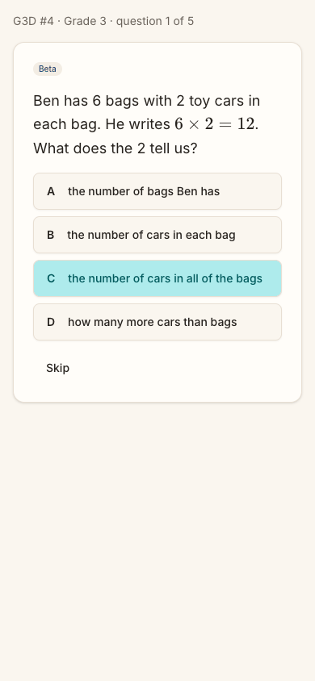  Journeys: J01A, J15, J15A, J17, J19.
- **Recommended Fix:** Give every full-screen play surface the same Exit, in the same corner, returning to where it was opened, on the web and in the app.

### [sev2] The guest page speaks only to families with young children

- **Issue Description:** The guest page's words address one audience: "Grades 1-8", "Play with your family", "Is it safe for my child?", "Create a free family space" and "Under 13? Ask a grown-up". Nothing speaks to the other people who arrive there:
  - an adult learner (J01, J01A, J02);
  - a teen who competes (J04, J04A);
  - a parent sent by a tutor, who wonders whether she signed up for a children's game (J07 step 10);
  - a tutoring centre's family, since the front door never mentions the centre (J15, J15A step 1);
  - a parent after a refusal, met by the "family space" button (J13 step 9).
- **Framework Violation:** Nielsen #2 (match between system and the real world); frontend-design ("Ground your designs in the subject matter"; "Write from the end user's perspective").
- **Severity:** 2. Four cohorts read "not for me" on the page that decides conversion. They can still sign up.
- **Evidence:**  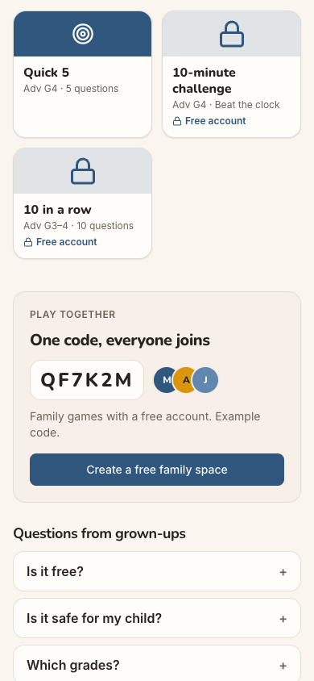 Journeys: J01, J01A, J02, J04, J04A, J07, J13, J15, J15A.
- **Recommended Fix:**
  - Add a line to the hero for adults and classes, such as "For curious learners of any age, families and clubs".
  - Add a "Have a code from a tutor or club?" door beside "Sign up free".
  - Word the age note neutrally, without "18" for adults.

### [sev2] Web and app: the same screens differ in words and controls

- **Issue Description:** The two clients share their tokens and blocks, but the same screen behaves and reads differently. The full list is under "Web and app"; the ones that cost a person something are:
  - **Have a code?** In the app it opens a dialog that crashes ("Render Error: useToast must be used inside <ToastProvider>"), then shows a white screen (J07A steps 14-17).
  - **Invitations.** The app has Share but no "Copy invitation" (J06A step 25).
  - **The Spaces page.** The app keeps the web's line "Each tab can be in a different one.", though it has no tabs (J04A step 15, J06A step 21, J07A step 23).
  - **The (+) button.** It offers everything except Start a space (J06A step 17).
  - **Leaving a game.** "End the game now" asks to confirm in the app but ends at once on the web, and Exit goes home in the app but to Question Quest on the web (J15A).
- **Framework Violation:** Nielsen #4 (consistency and standards, across platforms); the project's parity rule (CLAUDE.md, "Feature parity is the default").
- **Severity:** 2 for the set. The crash alone was rated 3 in J07A, which records it as its own finding.
- **Evidence:** 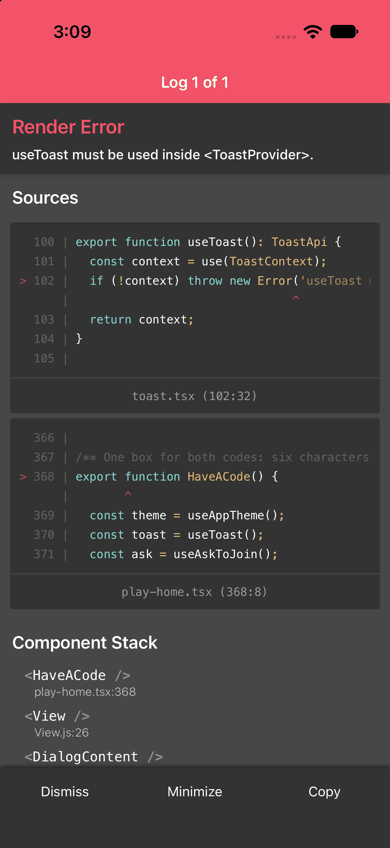 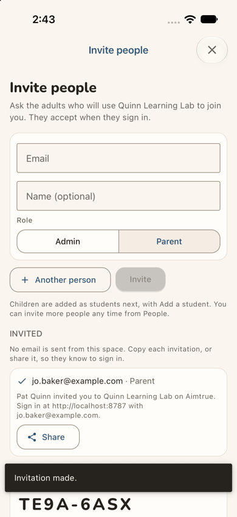 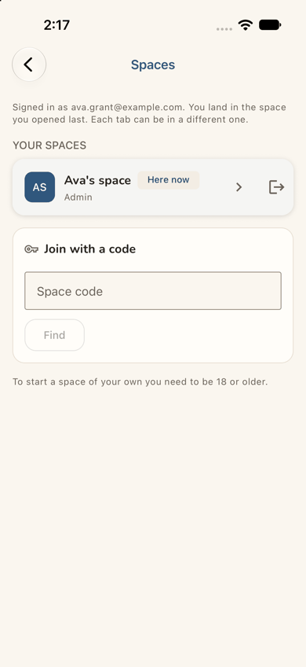 Code: `apps/mobile/src/features/organizations/spaces-screen.tsx:89` and `apps/web/src/features/organizations/spaces-page.tsx:94` (the same "Each tab" copy).
- **Recommended Fix:**
  - Put the copy for these screens into shared constants.
  - Mount the app's code dialog inside the toast provider.
  - Add Copy to the app's invitation rows.
  - Word the app's Spaces page without "tab".
  - Agree one end-game and exit rule for both clients.

### [sev1] All-caps eyebrows and 10-11 px text remain, against the U1 spec

- **Issue Description:** The U1 spec made uppercase micro-labels sentence case (`docs/ui-upgrades-spec.md:59-61`). The screens still carry "TODAY'S 5 · GRADE 4", "YOUR GRADE", "QUEST", "NEEDS YOU", "LESSON FINISHED", "START AN ASSESSMENT", "ASSESSMENTS", "GAME CODE", "SPACE CODE" and "THE QUEST BEGINS", often two on one card. On J01 step 13, for example, "QUEST" sits over "TODAY'S DAILY · GRADE 8 · G8D #4".
  - **Counts:** 68 `uppercase` classes in `apps/web/src` outside `components/ui`, and 14 in the app. The web has 64 places with 10-11 px text; the app has 3.
  - **The docs are stale:** `docs/branding.md:134-136` and the comment at `apps/web/src/index.css:820` still say Poppins, while the build loads Nunito (`apps/web/index.html:27`).
- **Framework Violation:** frontend-design ("Avoid … all caps for labels; adding unnecessary typographic labels above content"); the U1 spec.
- **Severity:** 1. Cosmetic: the eyebrows add noise and the 10 px text is hard to read, but nothing is lost.
- **Evidence:**  
- **Recommended Fix:**
  - Sentence-case the eyebrows at 12-13 px semibold, or drop them where the heading already says it.
  - Set a 12 px floor on the web.
  - Update `branding.md`.

### [sev1] Birth-year lists start at this year, and the web prints ISO dates

- **Issue Description:**
  - **The web's year list** is a 100-row select that opens at 2026, so an adult scrolls 40 to 50 rows to their year (J04 step 4, J06 step 5, J08, J10 step 6).
  - **The app's lists:** the month list hides October below its edge, and the year list also starts at 2026 (J06A steps 7-8, J04A step 5).
  - **Dates in prose:** the web prints "from 2026-11-04", "2026-11-03 · 4:00" and "wi2026-09-15" (J15 step 11, J16 step 23, J18 step 10), where the app writes "from Nov 4" (J15A step 13).
- **Framework Violation:** Nielsen #7 (flexibility and efficiency of use) and #2 (match between system and the real world).
- **Severity:** 1. Cosmetic, with a small cost in scrolling.
- **Evidence:**   Code: `apps/web/src/features/auth/signup-form.tsx:38-39` (100 years counted down from this year).
- **Recommended Fix:** Open the list near a typical adult's year, or take the year typed on a number pad, as the app's search does. Format every date through the shared formatter, on both clients.

### [sev1] The glass header lets content show through behind the space's name

- **Issue Description:** Scrolling the member home slides the amber "Play today's Daily" button under the translucent header. Its label then shows between "Jordan's space" and the search button (this audit's screenshot, Slate, light).
- **Framework Violation:** WCAG 2.2 SC 1.4.3 (advisory: text over a busy background); design-critique legibility.
- **Severity:** 1. Cosmetic, and only while scrolling.
- **Evidence:** 
- **Recommended Fix:** Raise the header's background to at least 92% opacity, or switch it to a solid fill once the page scrolls.

## Consistency across spaces and palettes

The block system holds in every kind of space. Each home has the same parts:
- a band in the space's colour, with the greeting;
- one Next up card;
- up to three quick-action tiles;
- section headings;
- the cream foundation and Nunito headings.

A palette changes only the brand ramp: the band, the primary buttons, the avatars and the drawer's active item. What drifts is shown in the table.

| Kind of space | Seen in | Palette | Band's second line | Quick actions | Phone menu | Tour |
| --- | --- | --- | --- | --- | --- | --- |
| Personal ("Jordan's space") | J01 step 13, J04 step 10, J07 step 21 | Slate, the guest page's navy | "0 of 3 days played this week" | New quest · Have a code? · Start an assessment | Home, Users, Assessment, Quest, Activity, My profile, Space (J04 step 11) | none |
| Self-serve club (Rivera Math Club) | J06 step 20, J09 step 4 | Slate | "0 of 3 days played this week" (a parent) | New quest · Have a code? · Start an assessment | Home, Users, Assessment, Quest, Activity, My profile (J09 step 6) | the wizard offers it (J06 step 20) |
| Self-serve, Assessment only (Ferreira Family Practice) | J07 step 24, J11 step 3 | Slate | "Ready when you are." (parent), "2 asking to join" (admin) | Start an assessment; Add a person | Home, Users, Assessment, Activity, My profile (J07 step 29) | none |
| Tutoring (Chapel Hill Math Institute, "CHMI") | J14-J19 | Indigo, with a teal accent | "24 to record · 1 invited" (office), "Yusuf: next lesson tomorrow at 4:00 PM" (parent) | Add a person · Schedule · Record a lesson (office); Record a lesson · Start a lesson (tutor) | 13 items, Pairings and Billing included, for a parent and a student too (J15 step 13, J17 step 7) | "Getting started" pill and the offer |
| Tutoring (Riverside) | this audit's shot | Teal | "1 to record · 3 asking to join" | Add a person · Schedule | not opened | "Getting started" and the offer |
| Tutoring, paid directly (Brooks & Ramos) | this audit's shot | Slate | "Today: 0 lessons" | Record a lesson · Start a lesson · Add a person | not opened | "Getting started" and the offer |

  

- **Slate is worn by four different things:** the guest page, every personal space, every self-serve space and one tutoring space. The palette, the one signal meant to say "you are here", says nothing (finding "Nothing on screen tells one space from another").
- **The band's second line changes in kind** between space kinds. In a personal or self-serve space it is a count of play days, for everyone, parents and teachers included. In a tutoring space it is an agenda for the reader's role. The learner wording is the default wherever there is no Tutoring.
- **Only CHMI has a tagline** ("Where numbers click") and a short name ("CHMI"). Ferreira's short name, "Ferreira", reads as a surname in its own header (J07 step 24).
- **Indigo is the only palette with a second hue:** its teal accent fills the hovered or focused row in lists, the command palette and the hovered answer (J17 steps 5 and 9, J16 step 17, J18 step 9). Slate and Teal use a pale tint of their own hue for the same states (J03 step 30), so Indigo's lists and pickers light up in a colour no other space uses.
- **The phone menu is built from the space, not the reader.** A student and a parent in CHMI get the office's 13 items, while Ferreira's parent gets 5. The menu's length signals the space's kind more than the reader's job.
- **"Getting started" and the tour belong to Tutoring spaces,** as intended, except for the welcome wizard's own tour option (finding "The tour and its offers cover what they introduce").

## Web and app

The app reads its colours from the same tokens (`apps/mobile/src/theme/palettes.generated.ts`). In both clients the bands, cards, the cream base and Nunito headings match. The app keeps to a 12-point floor (`labelSmall` is 12 in `apps/mobile/src/theme/paper-theme.ts:39`), where the web has 64 places at 10-11 px. The differences are in controls and words:

| Screen | Web | App | Better on |
| --- | --- | --- | --- |
| Sign in | a sheet titled "Sign up free" (J15 step 2) | a sign-in screen headed by the brand (J01A step 16, a developer variant here) | app |
| About you | a dialog; a 100-row year select from 2026 (J06 step 5) | full screen; a type-to-search year list, and a month list that hides October (J06A steps 7-8) | app, apart from the month list |
| Waiting for approval | a dialog, "Almost there" over "Waiting for approval"; its X returns to the question (J01 step 10) | full screen with Contact us and Back; Back drops the quest (J01A steps 13-14) | neither |
| The offer after question 1 | "Good try" with no mark; Keep playing first, with an X (J01 step 4) | "Nice! That one is right."; Sign up free first (J01A step 5) | app on the mark, web on the order |
| Finding your spaces | drawer switcher, then "All spaces" (J07 step 23) | the account sheet behind the initials (J07A step 25); "Each tab can be in a different one." in an app with no tabs | app, apart from the copy |
| Creating | no global create; "Start a space" at the foot of Spaces (J06 step 14) | a yellow (+) offering everything except a space (J06A step 17); Start a space at the top of Spaces (J06A step 21) | neither |
| Invite people | phone row shows "a..", with Copy invitation and Share (J06 step 18) | full email and the whole text, Share only (J06A step 25) | split |
| Add a student | one dialog, then the Add user form (J06 steps 21-23) | a four-step flow with a review (J06A steps 30-33) | app |
| Have a code? | scrolls to the box at the foot of the home (J07 steps 13-14) | a dialog that crashes the app (J07A steps 14-17) | web |
| A parent with no child | an empty list below the screen, and Add user that refuses at Save (J07 steps 26-34) | "No students to choose from.", and no Add user (J07A steps 28-31) | app |
| Game header | "Game" (J12 step 10) | "Quest game · G8", cut at "AoPS Geom…" (J01A step 22, J04A step 29) | neither (both are codes) |
| End and exit a game | ends at once; Exit goes to Question Quest (J15 steps 19-20) | asks to confirm; Exit goes home (J15A steps 20-22) | app |
| Tour | 6 of 8 stops light the hamburger (J15) | lights the real tab, "under More" (J15A steps 5-8) | app |
| Dates | "from 2026-11-04" (J15 step 11) | "from Nov 4" (J15A step 13) | app |
| Resume a quest after a restart | the question is still there after a reload (J01 step 16) | no Continue on the home, found only under More > Quest (J04A step 31); Continue starts over (J01A step 24) | web |
| Page titles | ink, in the page body | large titles in the brand colour, e.g. "Schedule" in indigo (J15A step 13) | a deliberate platform difference; noted, not a finding |

In dark mode the app is now right: header buttons, back chevrons and the tab bar all render on dark materials (J01A step 18 dark, J04A step 15 dark, J06A step 23 dark, J07A step 26 dark). That closes the earlier audit's F-4.

## Colour and themes

The token system is sound:
- **Two layers.** A brand ramp per palette sits under one warm neutral foundation laid over every palette (`apps/web/src/index.css:676-738`).
- **One set of grade hues**, the Okabe-Ito colours, the same in every palette and theme (`:73-88`).
- **Dark blocks** restate every token.

These pass, computed from the tokens with the WCAG formula:
- the primary button in Slate, Indigo and Teal, light and dark: 6.54-7.62:1;
- the Daily button's ink on amber: 6.51:1;
- muted text on the page and on a card: 5.48 and 5.81:1;
- a control's edge: 3.33:1;
- every grade icon or label on its band: 4.68-13.72:1;
- the guest hero's amber "Hit the target." on navy: 3.93-4.89:1, which is large text, so 3:1 is enough.

Dark mode holds on every landing shot (J01 step 13, J07 step 24, J14 step 4, J16 step 4, J18 step 8, J19 step 6, and this audit's Riverside and Grade 8 shots).

 

The problems are smaller than the system:

| Element | Foreground | Background | Ratio | Needs | Seen in |
| --- | --- | --- | --- | --- | --- |
| Selected grade chip, Grade 4 (state shown by fill only) | `#F0E442` | card `#FFFDF9` | 1.30:1 | 3:1 (1.4.11) | J03 step 15 |
| Selected grade chip, Grade 3 | `#E69F00` | `#FFFDF9` | 2.21:1 | 3:1 | J09 step 15 |
| Selected grade chip, Grade 6 | `#57B4E9` | `#FFFDF9` | 2.26:1 | 3:1 | tokens only (no journey chose 6 as a member) |
| "ADV" pill, 10 px bold, on Grade 1 / 2 / 5 | `#181513` | black 20% over each hue | 3.97 / 3.22 / 3.59:1 | 4.5:1 | J04 step 19 |
| Tile code, 10 px mono (muted text at 80%) | `#88827A` | `#FFFDF9` | 3.75:1 | 4.5:1 | J01 step 14 |
| Indigo drawer switcher: the space's name (hover state) | `rgb(46,41,36)` | `rgb(127,129,155)` | 3.78:1, measured from pixels | 4.5:1 | J14 step 18 |
| Indigo drawer switcher: tagline (hover state) | `rgb(120,119,134)` | `rgb(127,129,155)` | 1.15:1, measured from pixels | 4.5:1 | J14 step 18, J17 step 7 |
| Space mark in the phone drawer (Slate) | white glyph `rgb(249,250,252)` | `rgb(234,237,239)` | 1.13:1, measured from pixels | decorative, but the space's identity is lost | J04 step 11, J07 step 18, J10 step 17 |
| Daily button amber against Grade 3 cards (telling them apart) | `#DA950B` | `#E69F00` | 1.13:1 | not a WCAG rule: two meanings, one colour | J09 step 15 |
| `--highlight` against Grade 3 | `#F6B740` | `#E69F00` | 1.26:1 | as above | tokens |
| Placeholder against a filled value | muted `#6B635A` | ink `#423C36`-ish on the same card | 5.81:1 vs 14.7:1 | advisory: a placeholder reads as data | J14 step 30 |
| Highlighted row in a list or picker (Indigo teal / Slate tint) | `#AEEBEC` / `#E6EEF6` | `#FFFDF9` | 1.30 / 1.15:1 | advisory (2.4.7 is met by the fill; 2.4.13 is AAA) | J17 step 9, J03 step 30 |
| Grade 8 band on a dark card | `#882255` | `#24201C` | 1.85:1 | advisory: the band is decoration, and its icon is 8.72:1 | this audit's dark Grade 8 shot |

**From the guest page to the member pages.**
- **The guest page** always wears Slate. Its hero sits on the brand ramp (`guest-home.tsx:86`), and its tiles use mode colours: the primary for a count, amber for timed.
- **Member pages** wear the space's palette, and their tiles wear the grade hues. The same "Quick 5" card is navy on the guest page and wine, yellow or pink after sign-up (finding "Amber carries five meanings").
- **Focus rings** follow `--ring`: brand-600 in light, a teal in Indigo's dark theme. Error states use `--destructive` red toasts with an icon (J04 step 15, J07 step 34). Success uses a green-tinted toast (J03 step 26). Warnings and notices reuse amber, which makes the overload worse.

## Earlier audits: fixed or still present

Status as seen in these 24 journeys at 2d6e7d3. "Not seen" means no journey reached that screen, platform or condition. It does not mean fixed.

| Item | Source | Status | Evidence |
| --- | --- | --- | --- |
| 1. No primary action for the web tutor; the form defaults to 16:00-17:00 | member-home-plan, ten problems | FIXED | J16 step 4: "You finished a lesson with Sofia." with Record it now; step 5: the form opens on 11/03, 4:00-5:00 PM from the schedule |
| 2. Five stitched layouts, ordered differently on web and app | ten problems | FIXED | One home everywhere: band, Next up, quick actions, sections (J01 step 13, J14 step 4, J15 step 4, J16 step 4, J17 step 3, J01A step 18). Small residue: the app's band reads "Start a streak" where the web reads "0 of 3 days" (J01A) |
| 3. The parent's web home leads with money, never the next lesson | ten problems | FIXED | J15 step 4, J18 step 3: the next lesson first, no money |
| 4. Several roles land on the wrong one | ten problems | STILL PRESENT | The home is right (J18 step 3 leads with Sofia), but /dashboard opens on the empty Tutor view and forgets the Parent choice (J18 steps 8-14) |
| 5. A newcomer loses what the guest page promised | ten problems | STILL PRESENT | The carry-over is fixed: grade and favorite kept, NC 2026 tiles (J01 step 14, J03 step 15). Teens are still offered admin actions refused later (J04 step 15, J04A step 21); the assessment's Student list is still empty without a word (J03 step 16) |
| 6. Member tiles are flat codes in identical grey cards | ten problems | FIXED | Coloured bands, icons, human titles, Today's rings (J01 step 14, J17 step 3). Codes remain on favorites and under titles (finding "Codes where people expect names") |
| 7. Quest is invisible or doubled | ten problems | STILL PRESENT | Doubled in a new form: Today's 5 and Today's Daily on one home (J01 step 13); the menu's Quest is a different page, "Question Quest", where Exit lands (J17 step 16, J19 step 10) |
| 8. The phone's first screen is mostly chrome | ten problems | FIXED | The greeting band starts right under the header, with Next up inside the first screen (J11 step 3, J14 step 4) |
| 9. Only a player sees the habit layer; a parent cannot see a child's week | ten problems | FIXED | The child card shows "Played 0 days this week (aim: 3)" (J15 step 4, J09 step 5), though it cannot move for a child with no sign-in (J15 step 21) |
| 10. Empty states lead nowhere; unrecorded lessons are not flagged | ten problems | STILL PRESENT | Unrecorded lessons are flagged now (J14 step 4 "24 lessons not recorded", J16 step 4 To record). Empty states still lead nowhere (J03 step 16, J07 step 26, J07A step 28) |
| F-1. The iOS switcher shows money | docs/mobile/ux-audit.md | NOT SEEN | No journey backgrounded the app on a money screen |
| F-2. Toasts cover the tab bar | mobile ux-audit | FIXED | J07A step 20: "Asked to join…" sits above the tab bar |
| F-3. Swipe-down loses a half-filled form | mobile ux-audit | NOT SEEN | No sheet was dismissed half-filled |
| F-4. iOS header buttons nearly invisible in dark mode | mobile ux-audit | FIXED | J01A step 18 dark, J04A step 15 dark, J06A step 23 dark, J07A step 26 dark: search, avatar, back and close are readable |
| F-5. Icon targets under 44 pt / 48 dp | mobile ux-audit | NOT SEEN | Not measured. The code now has `MIN_TARGET` and `CHIP_HIT_SLOP` (`apps/mobile/src/theme/tokens.ts:10-22`) |
| F-6. A tutor's start of a lesson is four taps | mobile ux-audit | NOT SEEN | No app journey played a tutor (J16 was web only) |
| F-7. Three gate flows are intermittent | mobile ux-audit | NOT SEEN | Test infrastructure, outside these journeys |
| F-8. No swipe actions or long-press menus | mobile ux-audit | NOT SEEN | Not exercised |
| F-9. A cancel has no Undo | mobile ux-audit | NOT SEEN | No app cancel. On the web, Decline has no undo either (J11 step 9) |
| F-10. No live lesson on the lock screen | mobile ux-audit | NOT SEEN | No live lesson in the app journeys |
| F-11. Home's first load is a spinner | mobile ux-audit | NOT SEEN | Screenshots were taken after loading |
| F-12. The largest text sizes break layouts | mobile ux-audit | NOT SEEN | No run at AX5 or 2.0 |
| F-14. Android tab labels only on the selected tab | mobile ux-audit | NOT SEEN | Android not covered |
| F-15. List header chrome pushes content below the fold | mobile ux-audit | STILL PRESENT | J04A step 19: Users with one person, who sits about halfway down, under search, four role chips, status, sort and "Show deactivated" |
| F-16. No offline state | mobile ux-audit | NOT SEEN | Not exercised |
| F-17. No home-screen quick actions | mobile ux-audit | NOT SEEN | Not exercised |
| F-18. "Add to calendar" is an .ics file | mobile ux-audit | NOT SEEN | "Add all to calendar" shown, not tapped (J15A step 13) |
| F-19. Paper ignores Reduce Motion; no haptics switch | mobile ux-audit | NOT SEEN | Not exercised |
| F-20. Screen-reader roles | mobile ux-audit | STILL PRESENT | Same class of problem: the parent rows in Add a student have no accessible name (J06A, its sev2) |
| F-21. Rows are not tappable to act | mobile ux-audit | NOT SEEN | Billing not visited |
| F-22. Form errors off-screen after a failed save | mobile ux-audit | NOT SEEN | No failed save in the app. The web has the same class: "correct the highlighted fields" with nothing highlighted (J16 step 16) |
| F-23. The record sheet makes a tutor search a list | mobile ux-audit | NOT SEEN | Not in the app. On the web, Next up opens the form already filled (J16 step 5) |
| F-24. Raw ISO dates in prose | mobile ux-audit | FIXED | App: "from Nov 4" (J15A step 13). The web still prints ISO dates (finding "Birth-year lists…") |
| F-25. Copy that doesn't match the reader | mobile ux-audit | STILL PRESENT | "billed" in a free class (J06A), "portal" in the parent's welcome (J15A step 4), "Each tab" in an app with no tabs (J04A step 15) |
| F-26. The progress chart has no draw-on or scrub | mobile ux-audit | NOT SEEN | Ken's progress opened empty (J15A step 24) |
| F-27. `.map` lists that grow with the data | mobile ux-audit | NOT SEEN | Code-level; not inspected |
| F-28. Pull-to-refresh missing | mobile ux-audit | NOT SEEN | Not exercised |
| F-29. Shared-element session cards | mobile ux-audit | NOT SEEN | Not exercised |

## Appendix

- **Mode:** hybrid. The sources were:
  - the 24 journey reports and their screenshots, recorded live at 2d6e7d3;
  - 7 extra screenshots taken for this audit on the local Worker (`cuj-design-*`): Riverside (Teal) in phone, desktop and dark; a personal space's Grade 8 board in phone, desktop and dark; Brooks & Ramos (Slate) in phone;
  - the code at 2d6e7d3, read in the worktree.

  Contrast ratios are computed from the OKLCH tokens in `apps/web/src/index.css` with the WCAG 2 luminance formula. Three ratios were measured from screenshot pixels, and the table says which.
- **Frameworks applied:** frontend-design (colour, typography, visual structure, writing), design-critique (first impression, usability, hierarchy, consistency, accessibility), WCAG 2.2 AA (SC 1.4.1, 1.4.3, 1.4.10, 1.4.11, 3.3.1, 3.3.2), Nielsen's 10 heuristics.
- **Access:** the journeys signed in through the simulated Google step (each report's Appendix). The app journeys used the developer sign-in. The extra screenshots used the local Worker with sign-in off, acting as seeded people through the driver's developer header. No account is recorded.
- **Coverage / not inspected:**
  - **Palettes:** Forest, Crimson, Amber and Plum. No seeded space wears them, so they were judged from the tokens only.
  - **Teal in the app:** not seen.
  - **Platforms:** Android; iPad layouts.
  - **Sign-in providers:** Microsoft, Apple and Facebook buttons, and production's Google screen.
  - **Out of scope:** the platform console, including the Stickiness page.
  - **Inside features:** the quests and assessments beyond their first question, and reviewing an assessment.
  - **Accessibility checks not run:** the largest text sizes (iOS AX5, Android 2.0); a screen reader (VoiceOver, TalkBack) and keyboard-only use, so focus order and announcements are unverified; reduced motion; 200% zoom on the web.
  - **Grade hues as a member:** the hue on a member's selected Grade 6 chip was not seen; it was computed from the tokens.
  - **Code not read:** the app's welcome-wizard code, so the app's tour gate is inferred from J06A step 28, not read.
