# Workflow Audit — redundant and inconsistent paths, and web against app

## Executive summary

Over 69 phases each everyday task has gained several doors, and the doors no longer agree. A tutor can open a
lesson's record form from seven places on the web and twelve in the app, through six different forms, and only the
doors that stand for a scheduled lesson know which one is owed; none of them knows the tutor's draft. The worst problem is a dead end rather
than a duplicate: a parent let in with a space's code arrives with no child linked, and no door a parent can reach adds
one (J07 and J07A both failed there). Quest repeats the pattern: one screen offers six ways to start, the Daily has
four names at two levels, three code boxes take different codes, and "Continue" starts a new game instead of resuming
the one left open. Outcomes are told just as unevenly: an invitation is announced in three places, while an approval,
a let-in or a decline is found only by going to look. On most of these the app is ahead of the web (the "as planned"
record sheet, the family-first Add a student on the (+) button, a real sign-in screen, Exit back to the home), but the
app's own "Have a code?" quick action crashes. The consolidations below keep one door per task and copy the better
client's version to the other.

| Severity | Count |
| --- | --- |
| sev4 (blocks a cohort's core task) | 1 |
| sev3 (major) | 11 |
| sev2 (minor) | 7 |
| sev1 (cosmetic) | 1 |
| **Total** | **20** |

## Prioritized fixes

1. [sev4] [A parent let in by code gets no child, and no door they can reach adds one](#sev4-a-parent-let-in-by-code-gets-no-child-and-no-door-they-can-reach-adds-one): Let in asks "which child?", and a parent with no child here can ask the admin from the Student picker (J07, J07A, J11).
2. [sev3] [Ending a live lesson is a second record form that cannot say why it fails](#sev3-ending-a-live-lesson-is-a-second-record-form-that-cannot-say-why-it-fails): Stop opens the same record surface as Next up, prefilled with the measured times (J16).
3. [sev3] [A saved draft is found only on Sessions or the app Dashboard, and the home starts the lesson over](#sev3-a-saved-draft-is-found-only-on-sessions-or-the-app-dashboard-and-the-home-starts-the-lesson-over): every door with a lesson opens the writer's draft of it (J16).
4. [sev3] [Continue replays the last tile as a new game instead of resuming the open one](#sev3-continue-replays-the-last-tile-as-a-new-game-instead-of-resuming-the-open-one): Continue means the reader's open game, with its progress (J19, J01A, J04A, J09).
5. [sev3] [Three code boxes take different codes, none is on the guest page, and a game in another space reads as missing](#sev3-three-code-boxes-take-different-codes-none-is-on-the-guest-page-and-a-game-in-another-space-reads-as-missing): one "Have a code?" sheet everywhere, signed out too (J07, J08, J10, J07A, J04).
6. [sev3] [The app Have a code quick action is a second copy of the code box, and it crashes](#sev3-the-app-have-a-code-quick-action-is-a-second-copy-of-the-code-box-and-it-crashes): render it under the toast provider, or open the one code sheet (J07A).
7. [sev3] [Play with a child opens an online game the child cannot join, on both clients](#sev3-play-with-a-child-opens-an-online-game-the-child-cannot-join-on-both-clients): play together on this device, at the child's grade (J15, J15A, J09).
8. [sev3] [Adding a person has six doors on the web, and the family-first one is the hardest to reach](#sev3-adding-a-person-has-six-doors-on-the-web-and-the-family-first-one-is-the-hardest-to-reach): one Add chooser on both clients, led by "A family" (J14, J03, J06, J06A, J11).
9. [sev3] [Add user is offered to people who cannot add, and web and app hide it in opposite places](#sev3-add-user-is-offered-to-people-who-cannot-add-and-web-and-app-hide-it-in-opposite-places): one shared rule for showing add actions (J07, J04, J04A, J07A).
10. [sev3] [Each outcome of a request is told a different way, and three of four are told nowhere](#sev3-each-outcome-of-a-request-is-told-a-different-way-and-three-of-four-are-told-nowhere): pending requests and their outcomes in Next up and on the switcher, until dismissed (J01-J04, J06-J10, J01A, J04A, J06A, J07A).
11. [sev3] [Spaces are reached three ways and Start a space only from the Spaces page](#sev3-spaces-are-reached-three-ways-and-start-a-space-only-from-the-spaces-page): Join with a code and Start a space in the switcher and the account sheet (J06, J06A, J04, J04A, J18, J07, J10).
12. [sev3] [Home and Dashboard pick opposite hats, and the wizard still calls the home the dashboard](#sev3-home-and-dashboard-pick-opposite-hats-and-the-wizard-still-calls-the-home-the-dashboard): the Dashboard opens on the home's lead hat and remembers the last one (J18, J15, J15A).
13. [sev2] [Recording a lesson has seven doors on the web and twelve in the app, with four titles and nine verbs](#sev2-recording-a-lesson-has-seven-doors-on-the-web-and-twelve-in-the-app-with-four-titles-and-nine-verbs): the app's two-stage model on both clients, one noun and one verb (J16).
14. [sev2] [Start a lesson behaves three ways on the web and a fourth way in the app](#sev2-start-a-lesson-behaves-three-ways-on-the-web-and-a-fourth-way-in-the-app): every Start opens the Start sheet, prefilled when a lesson is known (J16).
15. [sev2] [To record lives only on the home, and every more link leads to a Sessions page without it](#sev2-to-record-lives-only-on-the-home-and-every-more-link-leads-to-a-sessions-page-without-it): put To record at the top of Sessions and let the office record from it (J16, J14).
16. [sev2] [Invite people and its invitation text are offered once, right after starting a space](#sev2-invite-people-and-its-invitation-text-are-offered-once-right-after-starting-a-space): Invite by email in the Add chooser, with Copy and Share on every invited row (J06, J06A, J14).
17. [sev2] [One screen offers six ways to start a quest, and the Daily has four names at two levels](#sev2-one-screen-offers-six-ways-to-start-a-quest-and-the-daily-has-four-names-at-two-levels): one Daily, one New quest, one level rule (J19, J17, J01, J01A, J12, J04, J04A).
18. [sev2] [A game ends and exits differently on the web and in the app](#sev2-a-game-ends-and-exits-differently-on-the-web-and-in-the-app): Exit returns where the game started; End asks first, on both (J19, J09, J15, J15A).
19. [sev2] [On the web Sign in opens the Sign up free sheet, while the app has its own sign-in screen](#sev2-on-the-web-sign-in-opens-the-sign-up-free-sheet-while-the-app-has-its-own-sign-in-screen): title and word the web sheet by the button that opened it (18 web journeys).
20. [sev1] [The same quick actions are worded differently on the web and in the app](#sev1-the-same-quick-actions-are-worded-differently-on-the-web-and-in-the-app): one label per action, shared (J14, J16, J06A).

## Findings

### [sev4] A parent let in by code gets no child, and no door they can reach adds one

- **Issue Description:** The let-in path and the parent's paths do not meet.
  - **The admin's side (J11).** "Let in" opens the generic Add user form, titled "Let Lena Fischer in", with no role
    ticked and the button "Add user" (step 6). Ticking Parent asks nothing about which child is hers (step 7). After
    saving, the home says nothing about Lena or a child (step 10). Decline, beside it, is one tap with no confirmation
    and no undo (step 9).
  - **The parent's side, web (J07).** Lena lands in the space with "Start an assessment" as the home's first card (step
    24). The Student picker opens empty, and Start stays grey with no reason (steps 26-28). The only door she finds,
    Users → "Add user", lets her fill in her child's whole record and then refuses: "Only an administrator can make
    this change." (steps 30-34). After a reload the home still offers the assessment (step 35).
  - **The parent's side, app (J07A).** "No students to choose from." (step 28). Users lists only Elena, with no Add
    (step 31); her own record names Ines only in its activity (step 32); Search finds nothing for "child" (step 33).
    After a relaunch the home still offers the assessment (step 34).

  Both journeys ended 0/1. The next step, a text to the admin, happens outside the app.
- **Framework Violation:** entry-point-map: the let-in door creates a state (a parent with no child) that no
  parent-facing door can leave. Nielsen #5 Error prevention (a parent is let in without the one link the space's
  feature needs); Nielsen #9 Help users recover (the empty picker says nothing, and the refusal names no one); Nielsen #3
  User control (Decline cannot be undone). parity: the same dead end on both clients.
- **Severity:** 4. It blocks the core task of cohort C7 (give my child an assessment) for every parent who joins a
  self-serve space by its code, which is the path the platform offers families of a tutor's space. C1 admins are hit too:
  they decide with no prompt to link a child.
- **Evidence:** 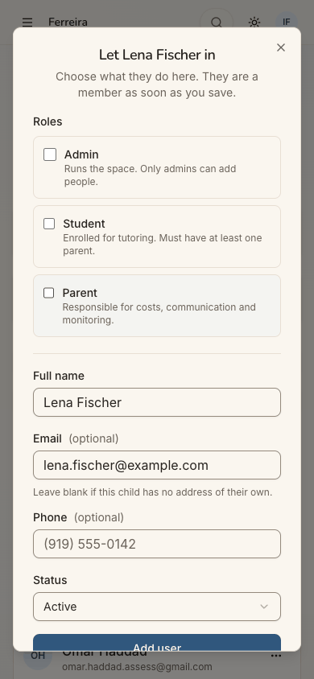 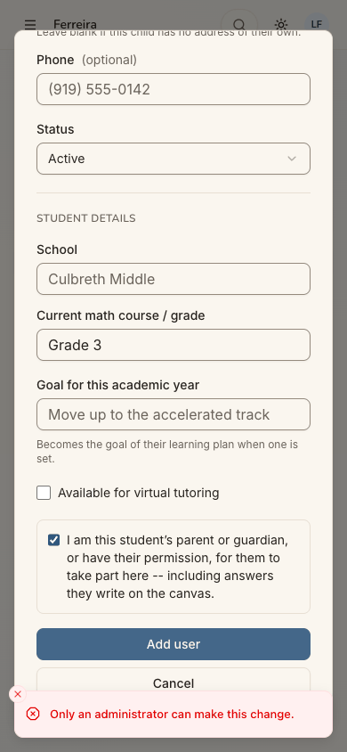 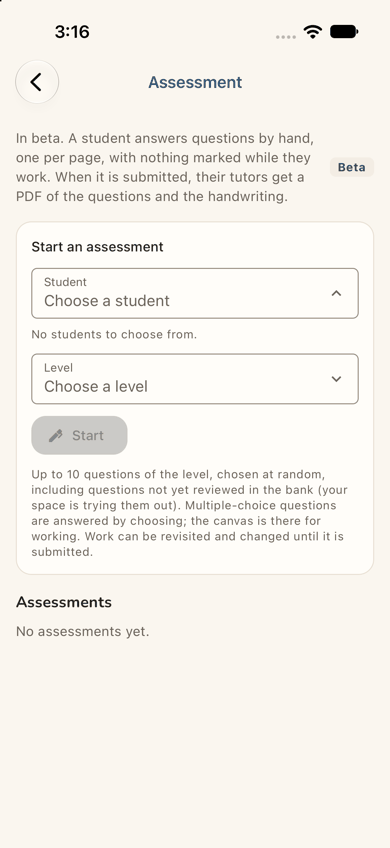
  J11 steps 6-10; J07 steps 24-35; J07A steps 26-34.
  - `apps/web/src/features/users/join-requests-panel.tsx:53-62`: Let in is `UserFormDialog` with `preset={{ roles: [],
    full_name, email }}`, nothing about children.
  - `apps/web/src/features/users/join-requests-panel.tsx:40-48`: Decline fires at once.
  - `apps/web/src/features/users/users-page.tsx:168-175`: "Add user" is shown to every reader (finding 9).
  - `apps/mobile/src/features/users/people-screen.tsx:116-134`: the app shows no Add on People, so a parent there has
    no door at all.
- **Recommended Fix:**
  - Make Let in a short sheet, not the user form: the role preselected from the request (Parent), and for a parent a
    "Which child is theirs?" step (pick a student here, or add one now with the family flow).
  - Give a parent with no child here an action in the empty Student picker and in Next up: "Ask Ines to add your child",
    which lands in the admin's "Needs you".
  - Never offer "Start an assessment" in Next up while the reader has no student to start one for.
  - Give Decline an Undo in its toast.

### [sev3] Ending a live lesson is a second record form that cannot say why it fails

- **Issue Description:** The live timer's Stop opens its own form, "End the session with Yusuf Hassan?", which collects
  notes only and tells the tutor that "the rest of the write-up … can be added by editing the session afterwards" (J16
  step 15). It shares the server's rules with the full record form but not its error display. "End and record" failed
  twice with "Please correct the highlighted fields." and nothing highlighted (steps 16, 27). The full form, opened for
  the same student, printed the reason under the duration: "No in-person price is set for this student…" (step 28).
  "Keep going" dropped the typed note (step 26), and the only way out was Discard, losing ten minutes of a real lesson
  (step 29). The reason is attached to the `mode` field, which the stop form does not have. The app's stop sheet prints
  only a notes error or the envelope message, so it would read the same (potential — unverified: no app tutor journey).
- **Framework Violation:** Nielsen #4 Consistency (two forms for one task, and only one can show why it fails); Nielsen
  #9 Help users recognise and recover from errors; Nielsen #5 Error prevention (Start accepts a pairing that can never be
  recorded). entry-point-map: the stop is a separate, weaker record door.
- **Severity:** 3. Cohort C2 tutors end every timed lesson here, often with the student watching. The lesson is either
  discarded or recorded later by hand once the office sets a price.
- **Evidence:** 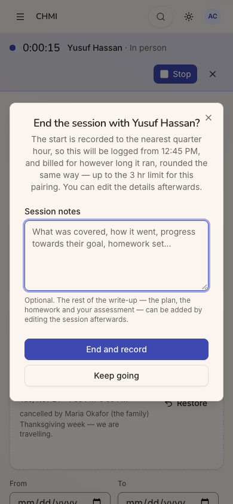 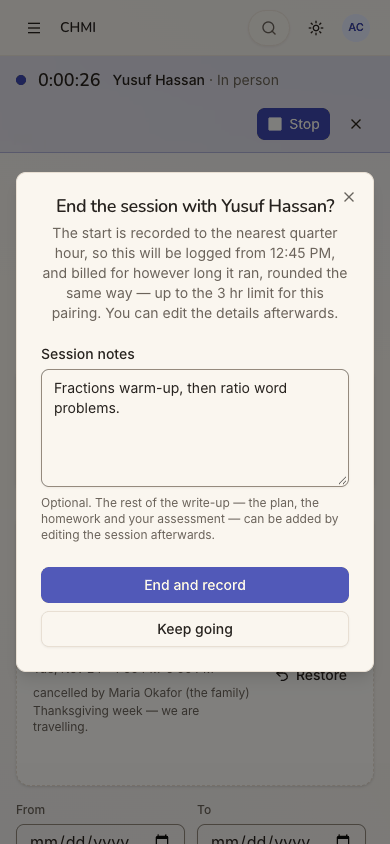 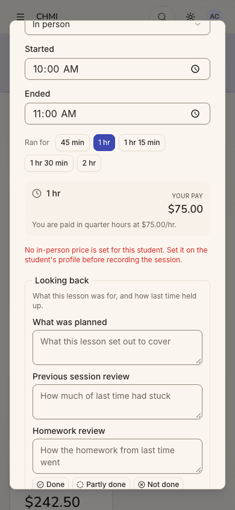
  J16 steps 15-16, 26-29, 31.
  - `apps/api/src/lib/pricing.ts:97-103`: the refusal is `ApiError.validation('Please correct the highlighted fields.',
    { mode: [...] })`.
  - `apps/web/src/features/teaching/live-session-bar.tsx:169-172`: the stop dialog shows `error.message` only;
    `:180-211` is its own title and buttons.
  - `apps/mobile/src/features/teaching/stop-lesson-sheet.tsx:83-87`: `failure.fieldErrors.notes ?? failure.message`.
- **Recommended Fix:**
  - Let Stop end the clock and open the same record surface as Next up: the app's "as planned" sheet, prefilled with the
    measured times, then "Write up the lesson". One form, one error display.
  - Until then, print every field error in the stop form as text, whatever its field.
  - Check the rates at Start with the rule the stop uses, and word the refusal for a tutor ("Ask the office to set
    Yusuf's price").
  - Keep notes typed in the stop form when "Keep going" is chosen.

### [sev3] A saved draft is found only on Sessions or the app Dashboard, and the home starts the lesson over

- **Issue Description:** Alex opened Next up's "Record it now", typed notes and saved a draft ("Saved as a draft. Only
  you can see it.", J16 steps 21-22). The home did not change: Next up and To record still offered the same lesson (step
  22, and at the end, step 33). "Record it now" then opened a fresh form with empty notes, which would autosave a second
  draft of the same lesson (step 25). The draft lives only under Sessions → Your drafts, where its button is "Post" and
  its form is titled "Finish this draft" (steps 23-24). In the app, drafts are on the Sessions tab and on More →
  Dashboard's "Finish write-up", and not on the home either. The app's "as planned" sheet records directly and its
  write-up is an edit, so an earlier draft of that lesson would be left behind (potential — unverified).
- **Framework Violation:** Nielsen #1 Visibility of system status (the draft is invisible where the work began);
  Nielsen #3 User control (work is not where it was left); Nielsen #4 Consistency (doors for one lesson do not share
  state). entry-point-map: the drafts door and the lesson doors are disconnected.
- **Severity:** 3. For C2 ("did I record the last one?") the notes look lost, and a tutor who carries on ends up with
  two write-ups of one lesson.
- **Evidence:** 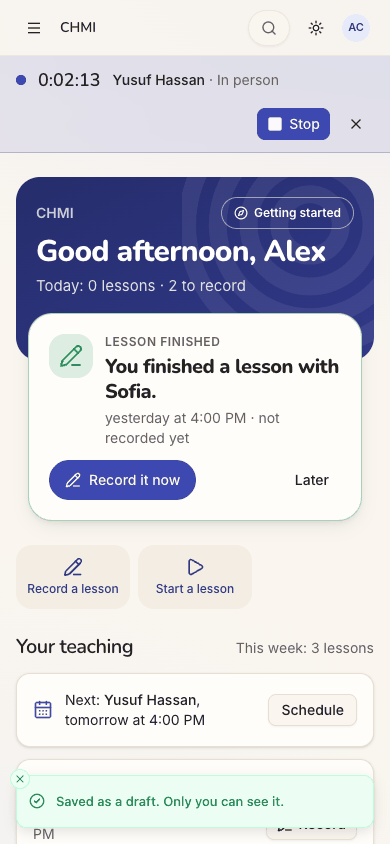 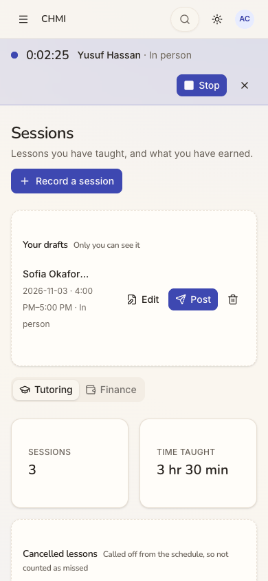 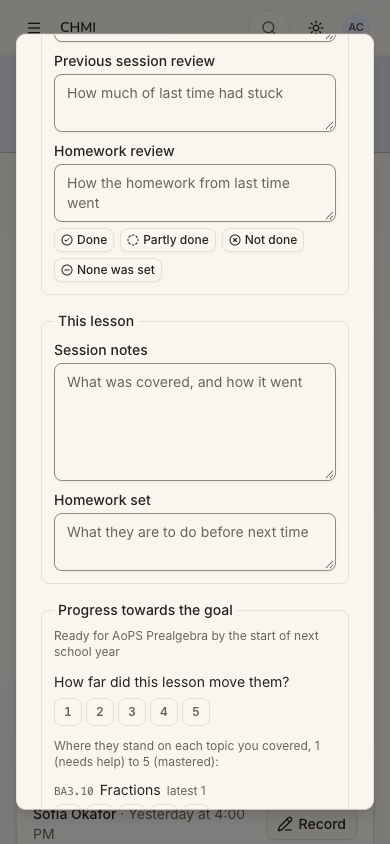
  J16 steps 21-25, 33.
  - `apps/web/src/features/teaching/session-form-dialog.tsx:226-234`: a `fromSchedule` lesson sets the pairing, date,
    times and mode; nothing looks up a draft.
  - `apps/web/src/features/teaching/sessions-page.tsx:509-518`: the only `DraftsPanel` on the web.
  - `apps/mobile/src/features/dashboard/tutoring-views.tsx:143` and `finish-write-up.tsx:71`: the app's "Finish
    write-up" sits on More → Dashboard; `features/home/` has no draft card.
  - `apps/mobile/src/features/teaching/session-form/record-as-planned-sheet.tsx:7-9`: "the write-up that follows is an
    edit of a lesson on the record, so it is never a draft".
- **Recommended Fix:**
  - One rule for every door that stands for a lesson (Next up, To record, the Dashboard carousel, Stop): open the
    writer's draft for that pairing and date when there is one, titled like any other record.
  - Mark the lesson on the home: "Draft saved 12:43 PM · Continue", and count drafts in the band.
  - Move the app's "Finish write-up" card to the home's tutor section.

### [sev3] Continue replays the last tile as a new game instead of resuming the open one

- **Issue Description:** "Continue" exists on the Quest board and as a Next up item, on both clients, and as the
  iPhone's home-screen "Play <tile>" action. All of them create a new game from the last tile's settings.
  - J19 (web): "Continue G7Q5" started a new countdown and Question 1 of 5 at 0 points (steps 13-14). Leila's real game
    was one of two identical "Playing now" rows on the Question Quest page (steps 15-16).
  - J01A (app): after a relaunch, "Continue G8Q10" gave Question 1 of a different set (step 24).
  - J04A (app): a game started from New Quest got no Continue at all; only More → Quest listed it (steps 30-32).
  - J09 (web): "Continue With Leo" opened a second empty lobby with a new code (steps 14-16).

  The one door that really resumes is the game list on the Question Quest page, and it shows codes, not progress.
- **Framework Violation:** Nielsen #2 Match with the real world ("Continue" promises a resume); Nielsen #4 Consistency
  (two meanings for one word); Nielsen #1 Visibility of system status (no progress shown). entry-point-map: three false
  resume doors and one real one. parity: the same on both clients.
- **Severity:** 3. For C6 players, coming back mid-quest is the stickiness moment, and it sends them back to the start.
  C4 parents meet it as a second empty lobby.
- **Evidence:** 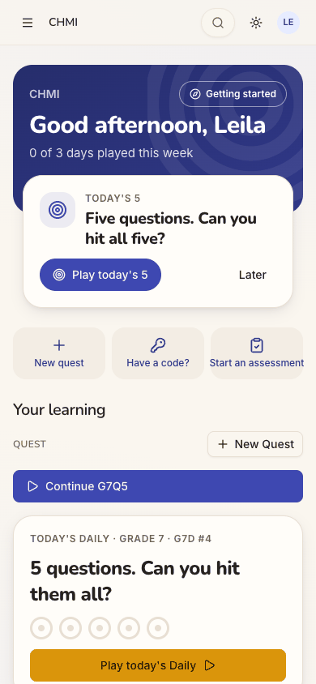 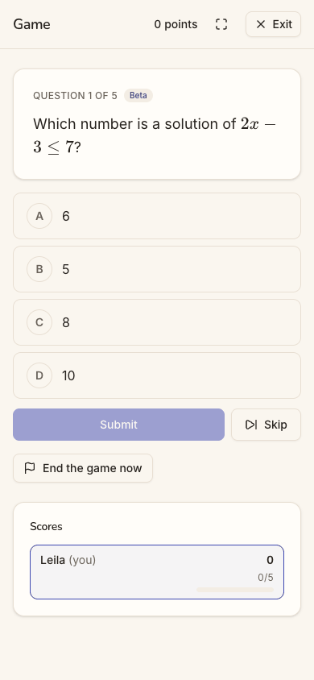 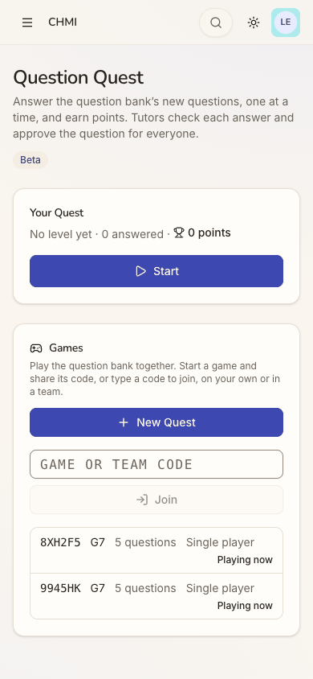 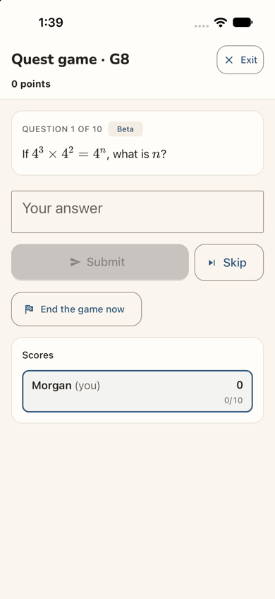
  J19 steps 12-16; J01A steps 23-24; J04A steps 30-32; J09 steps 14-16.
  - `apps/web/src/features/play/play-home.tsx:47-63` (`useStartQuest` creates the game and writes the last request),
    `:229-239` (the board's Continue calls `start(last.label, last.request)`).
  - `apps/web/src/features/home/next-up.tsx:414-440` (Next up's Continue, the same call).
  - `apps/mobile/src/features/play/play-home.tsx:284-287` and `features/home/next-up-card.tsx:421-434` (the app's).
  - `apps/mobile/src/features/shell/quick-actions.ts:27-35` (the home-screen "Play <tile>").
  - Only `useStartQuest` remembers a quest (`apps/web/src/features/play/play-home.tsx:60`,
    `apps/mobile/src/features/play/play-api.ts:66-75`), so a game from the New Quest wizard never gets a Continue.
  - `apps/web/src/features/quest/games-card.tsx:101-128`: the list that resumes, by code.
- **Recommended Fix:**
  - Make "Continue" the reader's open game (running, or waiting in a lobby), read from the server's game list, labelled
    with words and progress: "Grade 7 Quick 5 · question 3 of 5 · 2 points".
  - When no game is open, offer the replay under its own name: "Play Grade 7 Quick 5 again".
  - Show the open game in Next up, and on the Question Quest list label each game by its progress.

### [sev3] Three code boxes take different codes, none is on the guest page, and a game in another space reads as missing

- **Issue Description:** A newcomer holding a code meets five places that look like code boxes:
  - **the guest page**: an example code in a white box that does nothing (J07 step 3, J08 step 2, J10 step 3, J07A
    step 3);
  - **the home's "Have a code?" quick action**, which scrolls the page about 1,900 px to the board's box (J07 step 14,
    J08 step 10, J10 step 14). That box takes a 6-character game code or an 8-character space code, and sends a space
    request at once, with a toast that does not name the space (J10 step 16);
  - **the board's box itself**, the same component, at the bottom of the home;
  - **the Spaces page's "Space code"**, which finds the space and names it before "Ask to join", and names it again in
    the toast (J10 steps 25-26, J04 steps 16-18);
  - **the Question Quest page's "Game or team code"**, which takes 6 characters only (J08 steps 14-15).

  A game code from another space is refused in both game boxes with "No game or team has that code." although the game
  exists (J08 steps 12, 15). The friend's tile link `/play/G4Q10` is dropped too (J08 step 1).
- **Framework Violation:** Nielsen #4 Consistency (one job, different rules per box); Nielsen #9 (the refusal says the
  game does not exist); Nielsen #6 Recognition rather than recall (no code box before sign-up). entry-point-map: five
  doors, of which one is a picture.
- **Severity:** 3. Codes are how C6 players (a friend's game) and C7 parents (a tutor's space) arrive. The code has
  nowhere to go until after sign-up, approval and a second sign-in, and a friend's game code never works across spaces.
- **Evidence:** 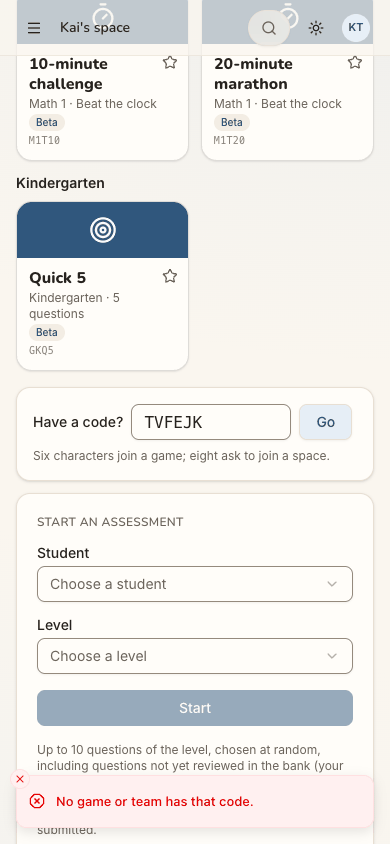 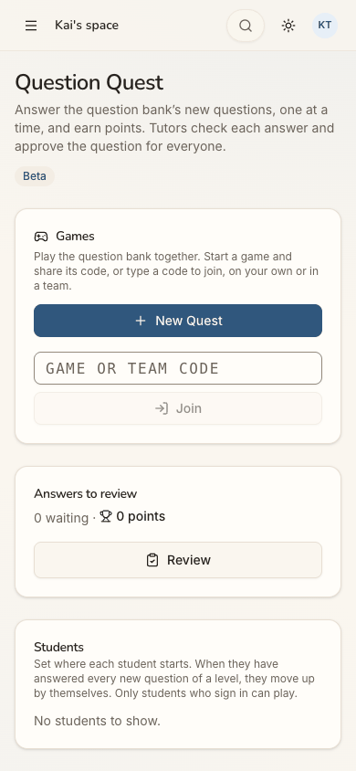 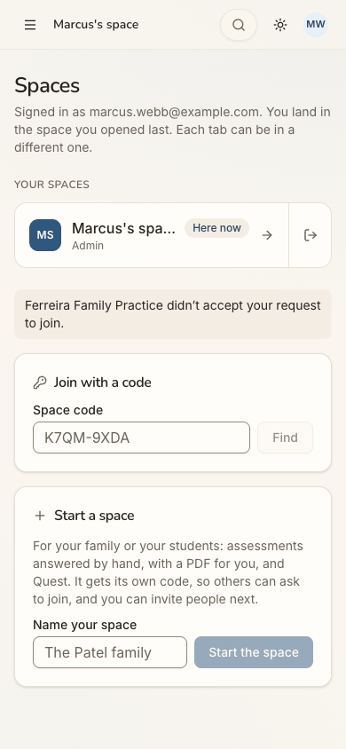
  J07 steps 3, 14-16; J08 steps 1-2, 10-15; J10 steps 3, 14-16, 25-26; J04 steps 16-18; J07A steps 3, 18-20.
  - `apps/web/src/features/home/member-home.tsx:246-249`: the quick action scrolls to `#play-code`.
  - `apps/web/src/features/play/play-home.tsx:317-366`: the board's box; `:333-336` sends a space request and toasts
    "Asked to join. Its admins will let you in." without the space's name.
  - `apps/web/src/features/organizations/welcome.tsx:139-187`: the Spaces page's Find, then "Ask to join", toast with
    the name (`:144`).
  - `apps/web/src/features/quest/games-card.tsx:78-86`: the Quest page box cuts input to `GAME_CODE_LENGTH`.
- **Recommended Fix:**
  - One "Have a code?" sheet, opened from the guest page, the home's quick action, the board, the Quest page and the
    Spaces page. It takes game, team and space codes, and always shows what it found (the space's name, or the game and
    the space it is in) before sending.
  - Take a code signed out, and carry it through sign-up and approval.
  - For a game in another space, say so, and offer what can be done (ask the friend to invite you to their space, or
    start your own game and share its code); decide whether a game code may admit a non-member to that one game.

### [sev3] The app Have a code quick action is a second copy of the code box, and it crashes

- **Issue Description:** In the app, "Have a code?" on the home opens the board's code box inside a dialog. Tapping it
  showed the development build's red "Render Error: useToast must be used inside <ToastProvider>.", then a blank white
  screen with nothing to tap (J07A steps 14-15). It did the same on a second try (step 17). After a relaunch the same box
  at the bottom of the home worked, and the request was sent (steps 18-20). The duplicate door is the broken one.
- **Framework Violation:** Nielsen #9 (no way back from the blank screen); Nielsen #4 Consistency (two copies of one
  control behave differently). entry-point-map: a second door to the same control. parity: the web's quick action
  scrolls to the box and works.
- **Severity:** 3. The first-choice route to the code fails for C7 parents and C6 players in the app, and recovering
  costs two relaunches and a long scroll. It does not block outright, because the second box works.
- **Evidence:** 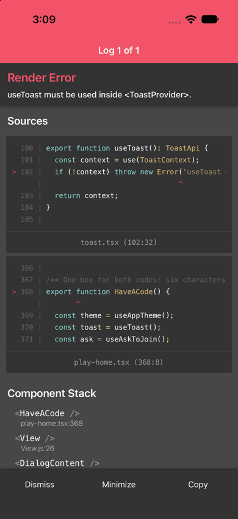 
  J07A steps 14-20.
  - `apps/mobile/src/features/home/quick-actions.tsx:40-49`: the quick action renders `<HaveACode />` in a Paper
    `Portal` dialog.
  - `apps/mobile/src/features/play/play-home.tsx:368-371`: `HaveACode` calls `useToast()`.
  - The red screen's text names the cause; the provider tree beyond that was not traced.
- **Recommended Fix:**
  - Render the dialog inside the toast provider (or hand the box a toast function), and give the app an error screen
    with a way home.
  - Better, drop the dialog copy and open the single code sheet of the previous finding.

### [sev3] Play with a child opens an online game the child cannot join, on both clients

- **Issue Description:** The parent's card offers "Play with <child>", or "Practise together before <day>'s lesson".
  One tap makes a two-player online game with the child invited (J15 step 15, J15A step 16, J09 step 11). A child added
  by the space has no email and never signs in, so no one can take the code or the QR code. The game ends "Nadia wins!"
  (J15 step 19, J15A step 21) and the child's card still says "Played 0 days this week (aim: 3)" (J15 step 21, J15A step
  23). The level is the space's first tile, not the child's grade: G3 for a grade-4 child (J15, J09). Cancelling the
  empty game in J09 congratulated Ana on a win and gave her two badges (steps 12, 15), and "Continue With Leo" opened a
  second empty lobby (step 16).
- **Framework Violation:** Nielsen #2 Match with the real world (the parent and child are side by side; the feature
  treats them as two devices); Nielsen #1 Visibility (the child's progress does not move). entry-point-map: Play with
  reuses the multiplayer invite door. parity: identical on both clients.
- **Severity:** 3. It is the primary action the home gives cohorts C3 and C4, and the counter that should bring the
  family back cannot move for a child who cannot sign in.
- **Evidence:** 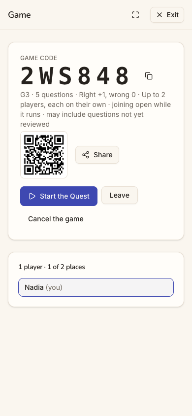 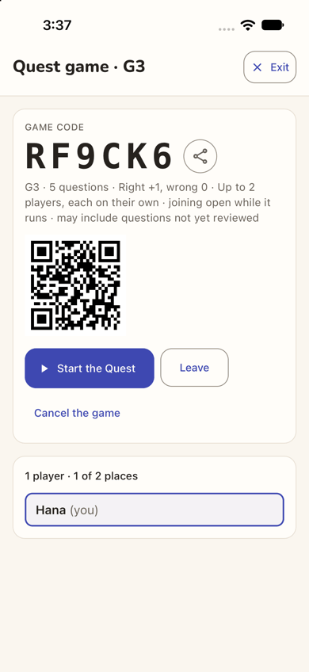 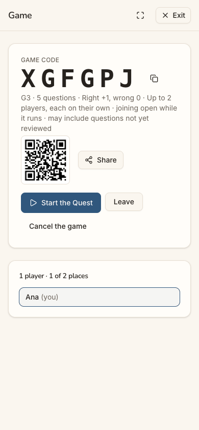
  J15 steps 14-21; J15A steps 16-23; J09 steps 11-16.
  - `packages/shared/src/home.ts:280-292`: `playWithRequest` is `players: 'multi'` with `invite_user_ids: [child]`.
  - `apps/web/src/features/home/member-home.tsx:516-526`: the level is `child.play_level_id ?? firstTileLevel`, and the
    game is remembered as `With <child>` for Continue.
- **Recommended Fix:**
  - Make Play with a game on this device, played together, credited to the child (and the parent), at the child's grade
    from the profile.
  - Keep the online invite only for a child who signs in, and show them in the lobby as invited.
  - Let Continue resume that game, not open a new lobby; a cancelled game earns nothing.

### [sev3] Adding a person has six doors on the web, and the family-first one is the hardest to reach

- **Issue Description:** On the web, a new person can be added through:
  1. the home's "Add a person" quick action, which only opens the Users list (J14 step 5);
  2. Users → "Add user", one person at a time (J14 steps 6-14);
  3. "New parent…" inside the student form (J03 steps 21-23);
  4. Getting started → "Add a student", the family-first flow with "This is my child", and "Add a tutor" (J14 steps
     31-32);
  5. Invite people, once, right after starting a space (J06 steps 16-19);
  6. Let in, from a join request (J11 step 6).

  The guided family flow is the best of them, and the hardest to reach. The wizard opens only where Tutoring is on, or
  once after "Start the space" (J06 steps 20-24). In a personal space it never appears, so Renee needed 29 taps, a
  refusal of her own email as the parent ("Someone in this space already has that email address.") and an edit of her
  own roles to add her daughter (J03 steps 16-28). Priya, an office admin, added the parent and the child separately
  because nothing pointed to the family flow (J14 steps 6-14). The app puts the same family-first flow on its (+)
  button any time: "Add a student" in four steps with a review, beside "Add someone else" (J06A steps 17, 29-34).
- **Framework Violation:** Nielsen #6 Recognition rather than recall (the good path is hidden in the wizard); Nielsen #4
  Consistency (the quick action opens a list, Users opens a one-person form, the wizard a family flow); Nielsen #7
  Flexibility (no shortcut to the family flow). entry-point-map: six doors, three forms. parity: the app's (+) is ahead.
- **Severity:** 3. C1 offices add families every week, and the first door they meet sets the habit (J14). For a C4
  parent in a personal space adding a child takes a workaround (J03).
- **Evidence:** 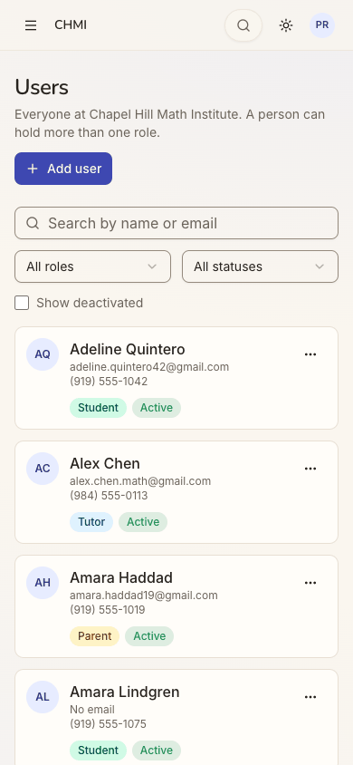 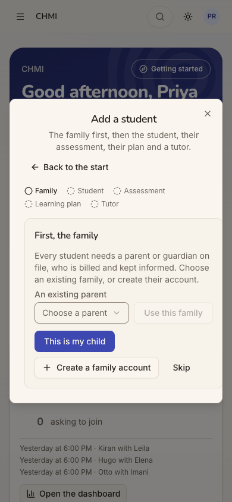 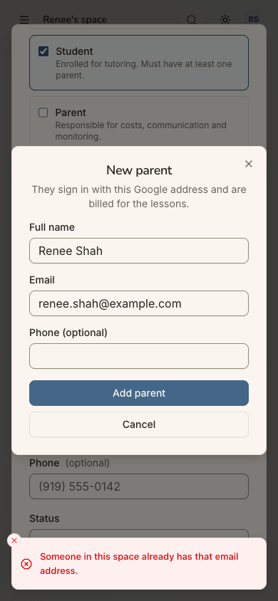 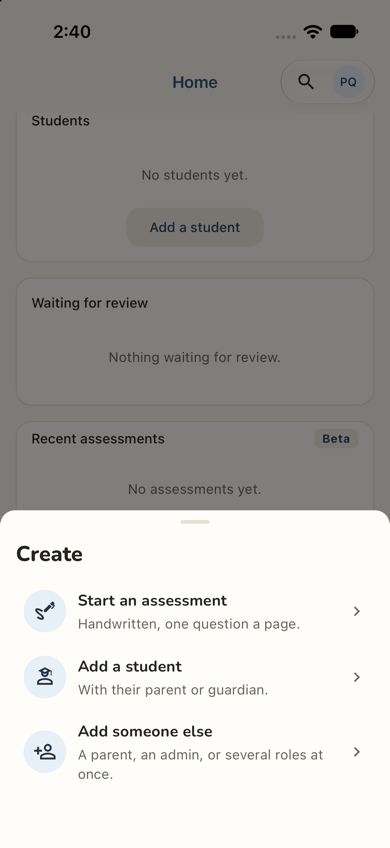
  J14 steps 5-14, 31-32; J03 steps 16-28; J06 steps 16-24; J06A steps 17, 29-34; J11 step 6.
  - `apps/web/src/features/home/member-home.tsx:233`: `add_person` goes to `/users`.
  - `apps/web/src/features/onboarding/onboarding-provider.tsx:76-92`: the wizard opens for the invite step, never in a
    personal space, and otherwise only where `tourOffered`; `packages/shared/src/onboarding.ts:38-40`: `tourOffered` is
    Tutoring on. `member-home.tsx:150-163`: "Getting started" is shown on the same rule.
  - `apps/mobile/src/features/shell/create-actions.ts:63-85, 120-138`: the app's (+) offers Add a student, Add a tutor
    and Add someone else to admins.
- **Recommended Fix:**
  - One "Add" chooser on both clients, opened by the home's quick action, the Users header and the app's (+): "A family
    (parent and child)", "A tutor" (where Tutoring is on), "Someone else", "Invite by email".
  - "A family" is the wizard's flow, reachable in every space. In a personal space it starts with "This is my child",
    making the signed-in adult the parent.
  - Drop "Add a person → Users list" and the separate first-time-only routes into the same flow.

### [sev3] Add user is offered to people who cannot add, and web and app hide it in opposite places

- **Issue Description:** The web's Users page shows "Add user" to every reader. The server refuses only after the whole
  form is filled: a parent got "Only an administrator can make this change." (J07 steps 30-34), and a 15-year-old admin
  of his own space got "Adding people to a space is for adults. Ask a parent to start a family space." (J04 steps
  14-15). A tutor's Users rows offer Edit, Deactivate and Delete permanently (J16, Appendix). The app hides Add on People
  for everyone except an empty, filtered list (J07A step 31, J04A step 19), but its (+) offers a 13-17 admin "Add a
  student", which opens on a billed family (J04A steps 20-22). The home's own quick action already checks the teen rule.
- **Framework Violation:** Nielsen #5 Error prevention (the refusal comes after the work); Nielsen #4 Consistency (three
  places, three rules). parity: web and app hide the action in opposite places.
- **Severity:** 3. C7 parents lose a whole form and trust (J07, sev3 there); C6 teens are offered a family form that is
  not theirs (J04, J04A).
- **Evidence:** 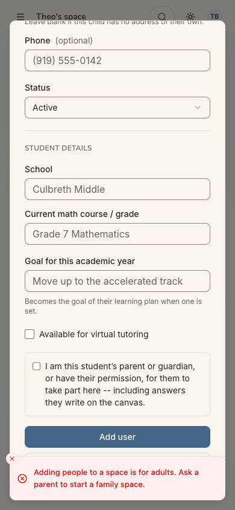 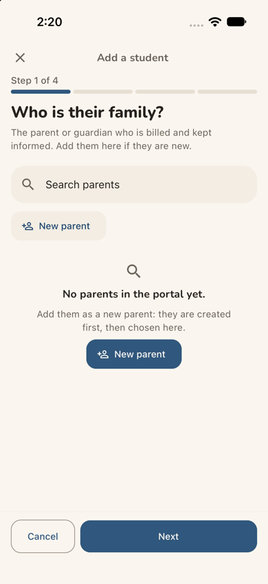
  J07 steps 30-34; J04 steps 14-15; J04A steps 19-22; J07A step 31.
  - `apps/web/src/features/users/users-page.tsx:168-175`: the header's Add user has no role check.
  - `apps/mobile/src/features/users/people-screen.tsx:116-134`: the app's People adds only from an empty list.
  - `apps/mobile/src/features/shell/create-actions.ts:131-137`: (+) checks `isAdmin` only.
  - `apps/api/src/repositories/member-home.ts:580` (`may_bring_people: account?.age_band !== '13-17'`) and
    `packages/shared/src/home.ts:516`: the rule the home's quick action uses.
- **Recommended Fix:** Share one rule ("may add people here": admin, and not 13-17, the existing `may_bring_people`)
  and apply it to Users, People, the (+) sheet and the Add chooser alike. For anyone else, say who can ("Only Ines can
  add people here") with a way to ask.

### [sev3] Each outcome of a request is told a different way, and three of four are told nowhere

- **Issue Description:** A newcomer waits on up to two people (the platform, then a space's admins), and an invited
  person on none. Each outcome reaches them differently:
  - **An invitation** is the best told: Accept on the first screen after Google (J09 step 3), a banner in any space, a
    count on the switcher, and a card on the Spaces page.
  - **The platform's approval** is told nowhere. The waiting screen does not say who decides, how long it takes or how
    they will hear (J01 step 10, J03 step 11, J06 step 7, J07 step 10, J08 step 6, J06A step 11, J01A step 13), and the
    next day the guest page is unchanged (J01 step 11, J04 step 8, J06 step 8, J07 step 11, J08 step 7, J10 step 11,
    J01A step 15, J04A step 9, J06A step 12).
  - **The platform's decline** is found only by signing in again, as "Access not approved" (J02 steps 12, 17).
  - **A join request sent from the home** gets a toast that does not name the space, and leaves no trace on the home
    (J07 steps 16-17, J10 steps 16-17, J07A steps 20-21). It is listed only under All spaces → Requests sent (J07 step
    20, J10 step 19, J07A step 23).
  - **Being let in** is told nowhere: the space quietly appears in the switcher (J07 steps 21-23) or the account sheet
    (J07A steps 24-25).
  - **A decline** is one grey line on the Spaces page, shown once, and gone after a new request is withdrawn (J10 steps
    20-24, 27-28).

  The admin's side, by contrast, says "2 asking to join" three times on the first screen (J11 step 3).
- **Framework Violation:** Nielsen #1 Visibility of system status; Nielsen #4 Consistency (four outcomes, four ways of
  telling). entry-point-map: outcomes have no door of their own. parity: the same gaps on both clients.
- **Severity:** 3. It is the main conversion leak between sign-up and the first feature, for C6 players, C4 and C7
  parents and C1 owners alike. Each journey continued only because the persona came back and looked.
- **Evidence:** 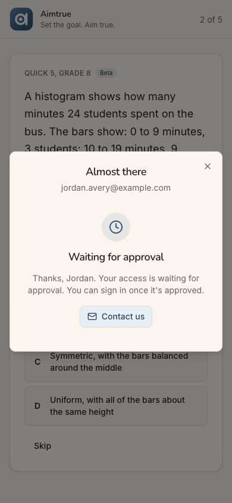 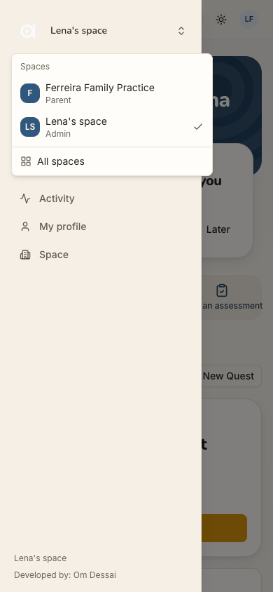 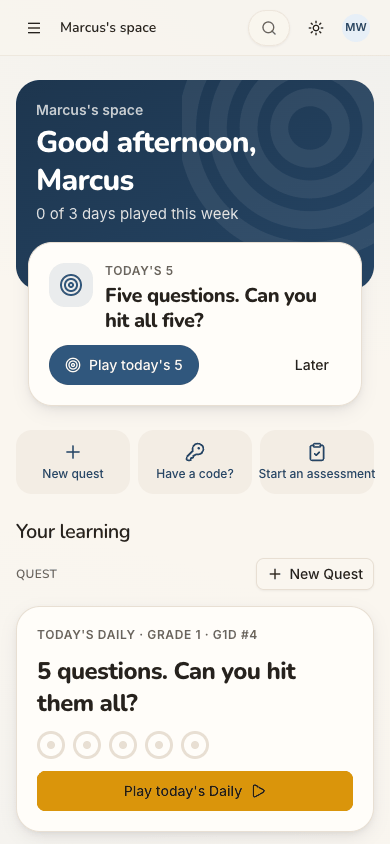 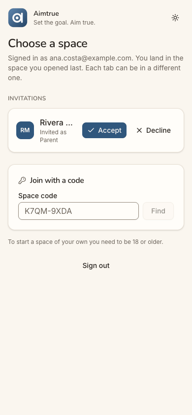
  The journeys and steps above.
  - `apps/web/src/features/organizations/invitation-banner.tsx:25` (mounted at `components/layout/app-shell.tsx:224`)
    and `org-switcher.tsx:44-50, 72-76`: invitations only.
  - `apps/web/src/features/organizations/welcome.tsx:40-58`: a decline is shown once, on the Spaces page only.
  - `apps/web/src/features/auth/access-refused.tsx:8, 36-37`: the waiting state's title and its one action, Contact us.
- **Recommended Fix:**
  - Treat every pending request as a Next up item while it waits ("Waiting for Ferreira Family Practice to let you
    in"), and every outcome as a Next up item and a switcher badge until dismissed: approved, let in, declined.
  - When someone is let in, land them in that space once with "You're in Ferreira Family Practice".
  - On the waiting screen, say who decides, how long it usually takes and how they will hear, and keep "Keep playing"
    as the main button.

### [sev3] Spaces are reached three ways and Start a space only from the Spaces page

- **Issue Description:** The person's spaces are behind the web's space switcher (menu → space card), the switcher's
  "All spaces", and in the app the account sheet behind the initials. "Join with a code" and "Start a space" are only on
  the Spaces page.
  - Sam (J06) tried the menu's "Space" item first, which is the current space's settings, then the switcher, which has
    no "New space", then found the card at the bottom of All spaces (steps 11-14).
  - Pat (J06A) found it in the fifth place Pat looked: the home, the yellow (+), More → Space, then the account sheet's
    All spaces (steps 15-21).
  - Theo and Ava (J04 steps 11-13, J04A steps 13-15) went through the same pages to be told they are under 18.
  - Lena and Marcus found their join requests only through switcher → All spaces (J07 steps 18-20, J10 steps 17-19).
  - Maria (J18 steps 6-7) saw a one-space switcher and an All spaces page offering "Start a space … for your students",
    a tempting wrong door for a tutor.
- **Framework Violation:** Nielsen #6 Recognition rather than recall; Nielsen #4 Consistency (a menu item called
  "Space" that is not about spaces). entry-point-map: three doors to the list, one to Start. parity: web switcher
  against app account sheet, and the app's (+) offers everything but a space.
- **Severity:** 3. A C1 owner who signed up to start a space for a club cannot find how (J06 and J06A, sev3 there).
- **Evidence:** 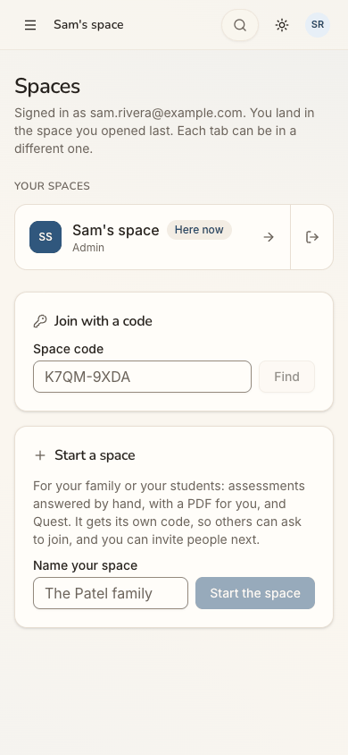 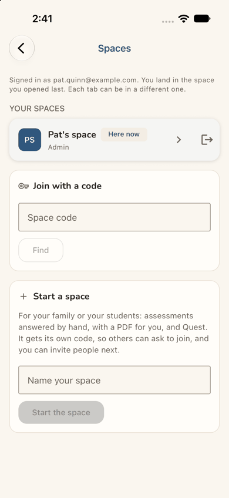 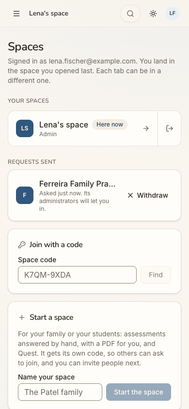
  J06 steps 11-14; J06A steps 15-21; J04 steps 11-13; J04A steps 13-15; J18 steps 6-7; J07 steps 18-20; J10 steps
  17-19, 23-24.
  - `apps/web/src/features/organizations/org-switcher.tsx:59-81`: spaces, invitations, All spaces, the console.
  - `apps/web/src/features/organizations/welcome.tsx:70-71, 197`: Join with a code and Start a space, on the Spaces
    page only.
  - `apps/web/src/components/layout/app-shell.tsx:70`: the menu's "Space" is `/organization`, with keywords "code" and
    "join".
  - `apps/mobile/src/app/(org)/account.tsx:108`: the app's All spaces; `features/shell/create-actions.ts:31-90`: no
    space action in (+).
- **Recommended Fix:**
  - Put "Join with a code" and "Start a space" (adults) directly in the switcher and the account sheet, under the list.
  - Rename the menu's "Space" to "Space settings".
  - On an adult's personal space home, offer "Start a space for a class or club" once.

### [sev3] Home and Dashboard pick opposite hats, and the wizard still calls the home the dashboard

- **Issue Description:** Maria is a parent and a tutor with no students yet. Her home shows only the parent hat ("Your
  children"), because a hat appears only with content (J18 steps 3-4). The Dashboard opens on "Tutor", all zeros (step
  8); her real parent data ($152.50 outstanding, Sofia behind on her plan) is behind an unlabelled dropdown (steps 9-10),
  and the Dashboard forgets the choice on the next visit (step 14). The two pages choose by different rules. Separately,
  the welcome wizard ends with "Go to my dashboard", which closes the wizard and stays on the home, and is followed at
  once by the tour offer again (J15 step 10, J15A step 11).
- **Framework Violation:** Nielsen #4 Consistency (two homes, two rules); Nielsen #2 Match ("dashboard" names the home).
  entry-point-map: Home and Dashboard overlap without agreeing.
- **Severity:** 3. Cohort C8 ("what's urgent across my hats?") gets one answer on the home and the opposite one on the
  Dashboard, and the money she would act on is the hardest view to reach.
- **Evidence:** 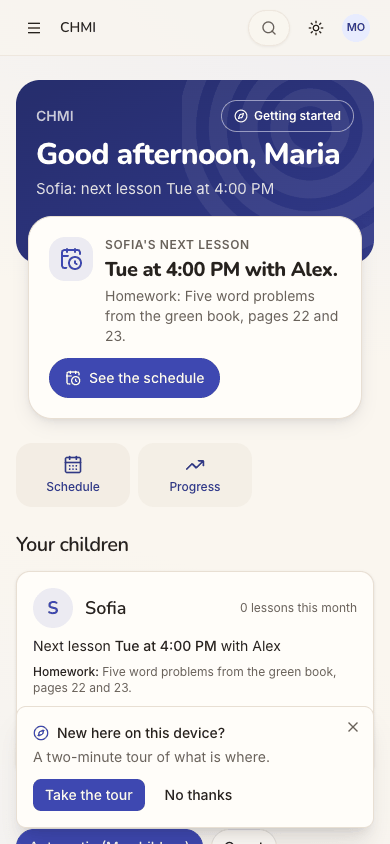 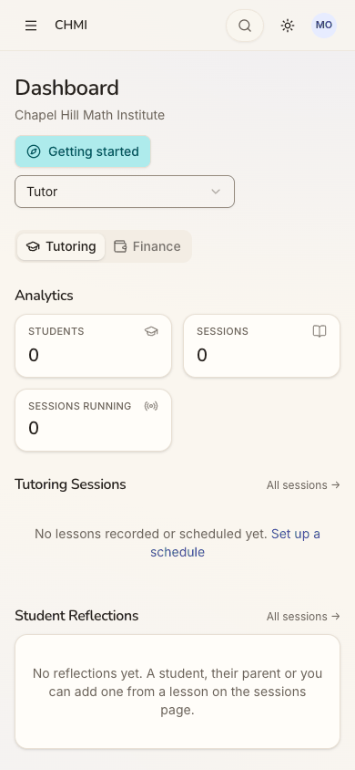 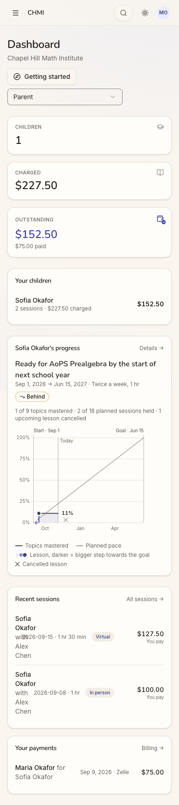
  J18 steps 3-4, 8-10, 14; J15 step 10; J15A step 11.
  - `packages/shared/src/home.ts:481-488`: `orderHats`, content and focus first.
  - `packages/shared/src/dashboard.ts:207-210`: `defaultDashboardRole`, a fixed admin, tutor, parent, student order.
  - `apps/web/src/pages/dashboard-page.tsx:55`: the choice lives in `?role=` only.
  - `apps/web/src/features/onboarding/onboarding-wizard.tsx:42, 177`: "Getting started on the dashboard brings this
    back." and "Go to my dashboard", which calls `onClose`.
- **Recommended Fix:**
  - Open the Dashboard on the role of the home's leading hat, and remember the last role chosen per space.
  - Label the role switch ("Viewing as: Tutor"), or show the roles as tabs.
  - Rename the wizard's last button "Done", and its line "Getting started on your home brings this back."

### [sev2] Recording a lesson has seven doors on the web and twelve in the app, with four titles and nine verbs

- **Issue Description:** On the web, J16 opened the record form from Next up, To record, the quick action, Sessions
  (both tabs), the timer's Stop, a draft and the Edit pencil (steps 5-32). Three of them sit on the home's first screen
  and lead to the same lesson (step 4), but only Next up and To record prefill it; the quick action and Sessions open a
  blank form dated today at 4:00-5:00 PM, so yesterday's lesson can be recorded as today's (steps 8, 11). The forms are
  titled "Record a session", "Finish this draft", "End the session with …?" and "Edit session", and the verbs are Record
  it now, Record, Record a lesson, Record a session, Record session, End and record, Post, Post session and Save changes.
  The home says "lesson", the forms "session". The app (from code) has twelve doors into four components:
  - a quick "as planned" sheet for a known lesson ("It ran as planned", or "Different times", then "Write up the
    lesson");
  - a step flow for a new one;
  - the full sheet for the Finance tab and edits;
  - the stop sheet.

  The app's rule is better (a known lesson gets one tap), but its words are mixed too: "Record this lesson", "Record
  lesson", "Record a session", "Session recorded."
- **Framework Violation:** Nielsen #4 Consistency and standards; Nielsen #5 Error prevention (the blank form's date
  default); Nielsen #8 Aesthetic and minimalist design (three twins on one screen). entry-point-map: seven and twelve
  doors. parity: different forms behind the same door on each client (code; not walked in the app).
- **Severity:** 2. Friction and a real dating risk for C2 tutors and C1 offices, but every door works when the data is
  right.
- **Evidence:** 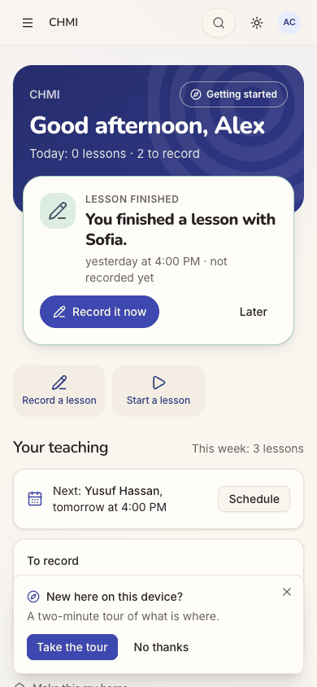 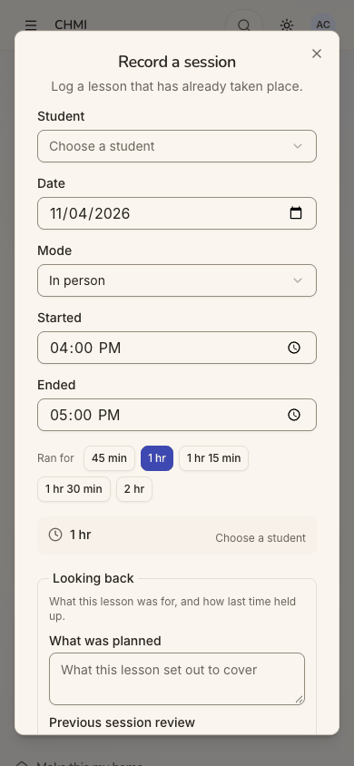 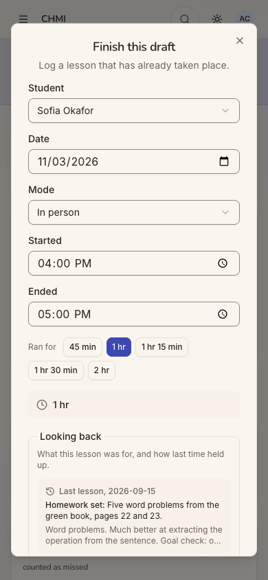 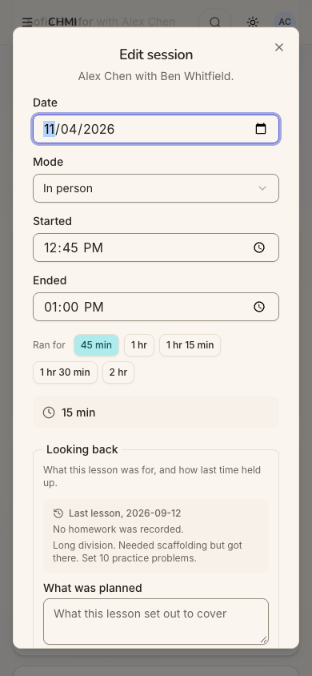
  J16 steps 4-12, 15, 23-24, 32; the map below.
  - `apps/web/src/features/home/member-home.tsx:110-112`: the quick action passes `lesson: null`.
  - `apps/web/src/features/teaching/session-form-dialog.tsx:567-569, 822`: the titles and the primary button's three
    names.
  - `apps/mobile/src/features/teaching/session-form/record-as-planned-sheet.tsx:171-173, 275` and
    `features/teaching/sessions-screen.tsx:103-106, 187-188`: the app's words and its split between the step flow and
    the sheet.
- **Recommended Fix:** Adopt the app's two-stage model on both clients, and cut the doors (see "Entry-point maps →
  Recording a lesson"):
  - a known lesson (Next up, To record, the carousel, Stop) opens "Record a lesson" prefilled, with "It ran as planned"
    and then "Write up the lesson";
  - the quick action and the Sessions button open a picker of the lessons to record, with "Another lesson" for a blank
    one;
  - one noun on screen ("lesson") and one verb ("Record"): "Post" becomes "Record", "Edit session" becomes "Edit
    lesson".

### [sev2] Start a lesson behaves three ways on the web and a fourth way in the app

- **Issue Description:** On the web, Next up's "Start lesson" (within `START_LEAD_MINUTES` of a lesson) starts the clock
  at once and moves to Sessions (from code; no journey had a lesson that close). The home's "Start a lesson" quick action
  only changes page to Sessions, where a second tap opens "Start a session" with nothing prefilled (J16 steps 13, 30).
  With a lesson running it lands on Sessions with no Start button and no word why (step 20). In the app every Start
  (Next up, the quick action, (+), the Sessions tab, the iPhone home-screen action) opens the Start sheet, prefilled
  with the student and mode when a lesson is known.
- **Framework Violation:** Nielsen #4 Consistency (the paired quick actions: "Record a lesson" opens a form, "Start a
  lesson" changes page); Nielsen #1 Visibility (a running lesson is not on the home). parity: the app is consistent, the
  web is not.
- **Severity:** 2. An extra screen and tap on the most time-critical path for C2 tutors; not blocking.
- **Evidence:** 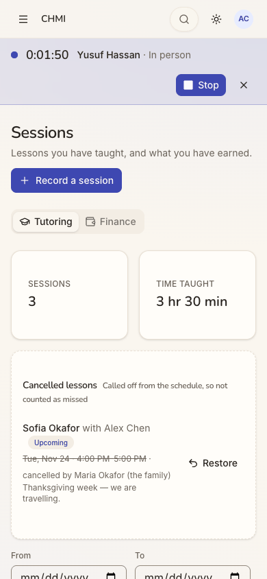 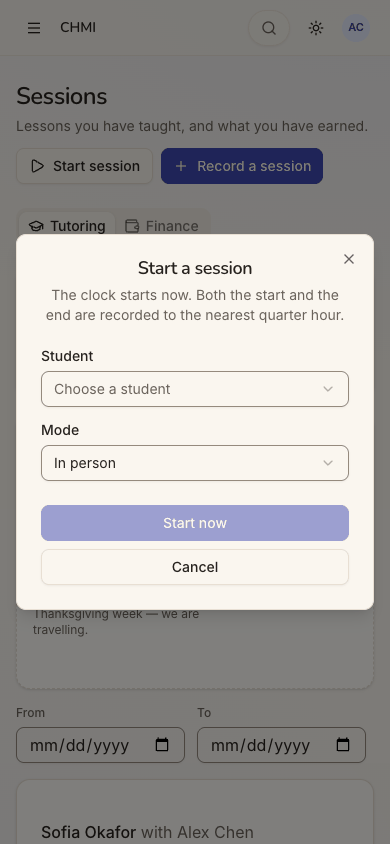
  J16 steps 13-14, 20, 30.
  - `apps/web/src/features/home/next-up.tsx:186-191, 253`: Next up starts the session and navigates.
  - `apps/web/src/features/home/member-home.tsx:229`: `start_lesson` is `to: '/sessions'`.
  - `apps/web/src/features/teaching/start-session-button.tsx:70-128`: the Sessions dialog.
  - `apps/mobile/src/features/home/member-home-model.ts:208`, `features/home/now-card.tsx:295-306`,
    `features/shell/create-actions.ts:41-46`: every app Start opens `/start-lesson`.
- **Recommended Fix:** On the web, make every Start open the Start sheet in place, prefilled from the next or current
  scheduled lesson; while a lesson runs, swap the quick action for "Stop" and make the running lesson Next up's first
  item.

### [sev2] To record lives only on the home, and every more link leads to a Sessions page without it

- **Issue Description:** Lessons scheduled and never recorded are listed only on the home: five for a tutor, three
  lines for the office. Every link for the rest leads to Sessions, which has no such list (J16 step 10):
  - the tutor's "+N more on the Sessions page";
  - the office's "lessons not recorded (last 7 days)";
  - the office's Next up "Open sessions".

  The Dashboard's carousel skips them (J16 step 18). The office's lines are plain text, so an office admin with "24 to
  record" (J14 step 28) cannot record or chase any of them from the home.
- **Framework Violation:** Nielsen #4 Consistency; Nielsen #1 Visibility of system status (the count has no list).
  entry-point-map: three doors lead to a page that does not hold what they promise.
- **Severity:** 2. C2 tutors with more than five owed lessons, and C1 offices with any, lose the list at the point
  they act on it; the count still reminds them.
- **Evidence:** 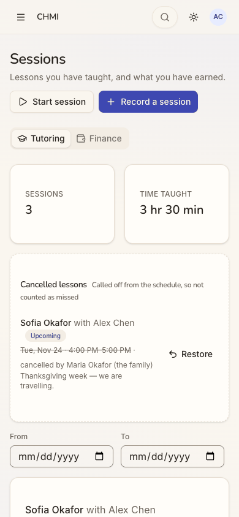 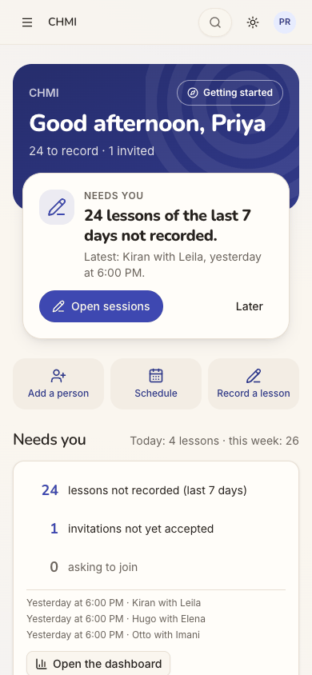
  J16 steps 6, 10, 18; J14 step 28.
  - `apps/web/src/features/home/member-home.tsx:378-381`: "+N more on the Sessions page"; `:410-433`: the office's
    rows link to `/sessions` and its lessons are plain list items.
  - `apps/web/src/features/home/next-up.tsx:303-315`: "Open sessions".
  - `apps/api/src/repositories/member-home.ts:179, 297`: five rows for a tutor, three for the office.
  - `apps/mobile/src/features/home/home-sections.tsx:144`: the app's "+N more" goes to `/sessions` as well.
  - Unrecorded lessons appear in no file outside `features/home/` (and the tour's text) in either client.
- **Recommended Fix:** Put the full To record list at the top of Sessions' Tutoring tab (the office's across tutors),
  with Record on each row, and let the office record or nudge the tutor from it; make the home's links open it.

### [sev2] Invite people and its invitation text are offered once, right after starting a space

- **Issue Description:** "Invite people", with its ready-made invitation text, opens only right after "Start the space"
  (J06 steps 16-19, J06A steps 23-27). Later, the only way to invite is Users → Add user with Status "Invited", a choice
  the form does not explain (J14 step 7), and no text to send. A self-serve space sends no email, so the admin must
  write their own message (from code; not walked). The web's row has "Copy invitation" (J06 step 19); the app's has only
  Share, whose Copy gives no confirmation (J06A steps 26-27).
- **Framework Violation:** Nielsen #7 Flexibility (a good path available only once); Nielsen #4 Consistency (invited
  through Users, no text). entry-point-map: one-shot door. parity: Copy on the web, Share in the app.
- **Severity:** 2. C1 owners of self-serve spaces inviting a second family later must improvise; not blocking.
- **Evidence:** 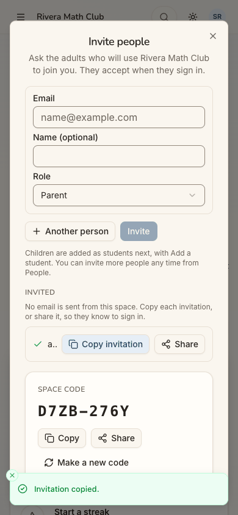 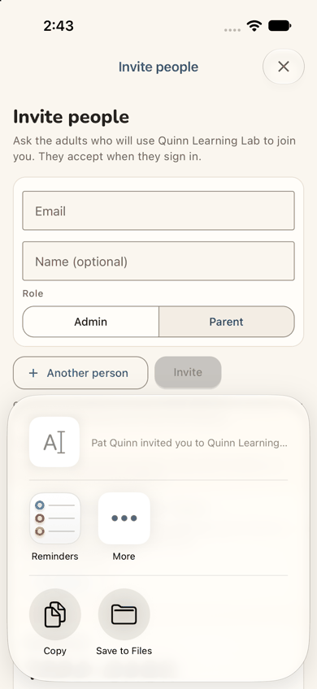
  J06 steps 16-19; J06A steps 23-27; J14 step 7.
  - `packages/shared/src/spaces.ts:273` (`invitationText`), used only in `apps/web/src/features/organizations/invite-people.tsx:50`
    and `apps/mobile/src/features/organizations/invite-people.tsx:67`.
  - `apps/web/src/features/organizations/welcome.tsx:214` marks the invite step after a new space;
    `features/onboarding/onboarding-provider.tsx:76-80` and `onboarding-wizard.tsx:108-113` show it then only.
- **Recommended Fix:** Make "Invite by email" an option of the Add chooser, at any time; give every invited row on
  Users and People "Copy invitation" and "Share", with a confirmation; explain Active, Invited and Suspended in the form.

### [sev2] One screen offers six ways to start a quest, and the Daily has four names at two levels

- **Issue Description:** Leila's home (J19 step 12) offers, on one phone screen: Next up's "Play today's 5", the quick
  actions "New quest" and "Have a code?", the board's "New Quest", "Continue G7Q5" and "Play today's Daily". The Daily
  goes by four names:
  - "Today's 5" (Next up);
  - "Today's Daily · Grade 7 · G7D #4" (the board);
  - "Play today's Daily" (Welcome back);
  - "Practise 5" (before a lesson).

  Next up and the board pick its level by different rules. Sofia's Next up Daily was Grade 3 while the board's was
  Grade 1, and her profile says Grade 7 (J17 steps 5, 12-15). New players saw the same daily twice under two names (J01
  step 13, J01A steps 18-19, J12 step 6). "New quest" and "New Quest" are both on screen. The menu's "Quest" is the
  Question Quest page, while the home's board is headed "Quest" (J17 step 16). Teens reached their level only through
  the four-step wizard (J04 steps 19-24, J04A steps 23-29).
- **Framework Violation:** Nielsen #8 Aesthetic and minimalist design; Nielsen #4 Consistency (one set, four names, two
  levels). entry-point-map: six doors on one screen. parity: the same duplicates in the app, plus the (+) button.
- **Severity:** 2. C6 and C5 learners can start in one tap, but they cannot tell which button is which, and the two
  Dailies disagree on their level.
- **Evidence:**  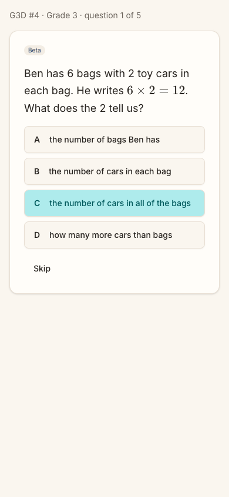 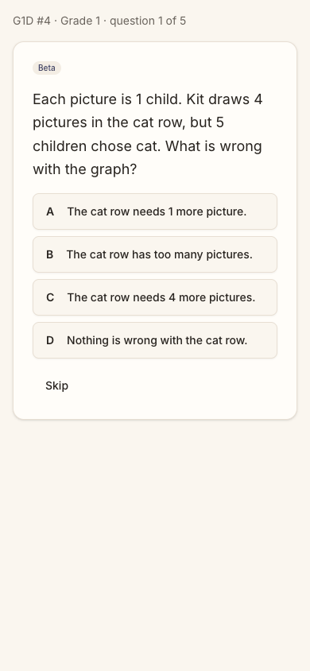
  J19 step 12; J17 steps 5, 12-16; J01 step 13; J01A steps 18-19; J12 step 6; J04 steps 19-24; J04A steps 23-29.
  - `apps/web/src/features/home/next-up.tsx:64-68`: Next up's Daily level is the last quest's, else the first tile's;
    `apps/web/src/features/play/play-home.tsx:138-141`: the board's is the last quest's, else the chosen grade's first
    tile.
  - `next-up.tsx:318-320, 345, 358` and `play-home.tsx:299-311`: the four names.
  - `member-home.tsx:230` and `next-up.tsx:368` ("New quest"); `play-home.tsx:225` and `quest/games-card.tsx:67` ("New
    Quest").
- **Recommended Fix:**
  - One Daily: one name ("Today's 5"), one level rule (the board's grade, which Next up follows), one card.
  - One "New quest": keep the board's button; drop the quick action when the board is on the same screen.
  - Name the menu item and the page "Question Quest", keeping "Quest" for the board.
  - Start the board at the learner's grade from the profile, when there is one.

### [sev2] A game ends and exits differently on the web and in the app

- **Issue Description:** On the web, a game's Exit always goes to the Question Quest page, whatever started the game:
  the home, a tile, Play with or Continue (J19 step 10, J09 steps 13 and 17, J15 step 20). In the app, Exit returns to
  the home that started it (J15A step 22). "End the game now" (J15 step 19) and "Cancel the game" (J09 step 12) end at
  once on the web, with no confirmation; the app asks first (J15A step 20).
- **Framework Violation:** Nielsen #3 User control and freedom; Nielsen #4 Consistency. parity: the app is ahead.
- **Severity:** 2. An extra trip through the menu, and an accidental end, for C4, C5 and C6 players on the web.
- **Evidence:** 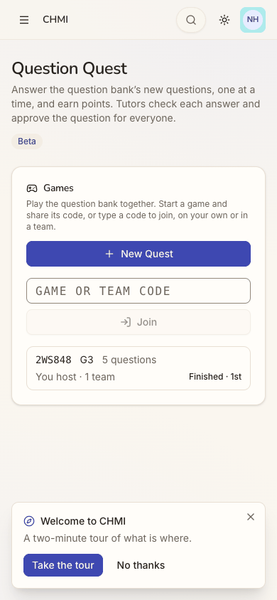 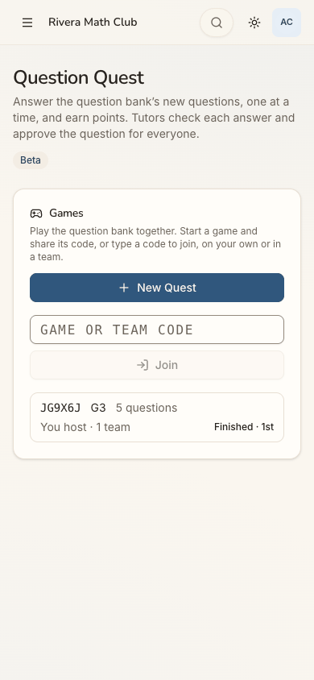
  J19 step 10; J09 steps 12-13, 17; J15 steps 19-20; J15A steps 20-22.
  - `apps/web/src/features/quest/fullscreen-frame.tsx:75-76`: Exit is a link to `/quest`.
  - `apps/mobile/src/features/play/play-home.tsx:83-86`: the app opens a game with `from: 'home'`, and Exit goes back
    there.
- **Recommended Fix:** On the web, pass where the game was started and return there on Exit, as the app does; confirm
  "End the game now" on both.

### [sev2] On the web Sign in opens the Sign up free sheet, while the app has its own sign-in screen

- **Issue Description:** On the web guest page, the header's "Sign in" runs the same handler as "Sign up free". The
  sheet is titled "Sign up free", "Keep your scores, unlock every quest and play with your family.", for every returning
  member, tutor, office admin and parent. Eighteen web journeys met it. In the app, "Sign in" opens a separate sign-in
  screen headed by the brand (seen as the developer variant; J01A step 16, J04A step 10, J06A step 3, J15A step 2).
- **Framework Violation:** Nielsen #2 Match between the system and the real world; Nielsen #4 Consistency (button and
  sheet disagree). parity: the app is ahead.
- **Severity:** 2. Every returning web member hesitates at the only door in ("am I making a second account?"); none
  was blocked.
- **Evidence:** 
  J01 step 12; J02 step 11; J03 step 13; J04 step 9; J05 step 15; J06 steps 3, 9; J07 step 12; J08 steps 3, 8; J09 step 2; J10 step
  12; J11 step 2; J13 steps 10-11, 18; J14 step 2; J15 step 2; J16 step 2; J17 step 2; J18 step 2; J19 step 2.
  - `apps/web/src/features/guest/guest-home.tsx:97-104`: the header's Sign in has `onClick={signUp}`.
  - `apps/web/src/features/guest/signup-sheet.tsx:86-87`: the title depends only on `signup_open`.
- **Recommended Fix:** Open the sheet in a sign-in mode from "Sign in": titled "Sign in", "Welcome back", with the same
  Google button, and a small "New here? Sign up free" link. Keep "Sign up free" for the sign-up calls to action.

### [sev1] The same quick actions are worded differently on the web and in the app

- **Issue Description:** The home's quick actions come from one shared list, but each client labels them itself. The
  web says "Add a person", "New quest" and, on Sessions, "Start session" and "Record a session". The app says "Add
  someone", "New Quest" and, on Sessions, "Start a lesson" and "Record a session"; its (+) says "Add someone else".
- **Framework Violation:** Nielsen #4 Consistency and standards. parity: the same action under different words.
- **Severity:** 1. Cosmetic: a person who uses both clients learns two names for one thing.
- **Evidence:**  
  J14 step 5; J16 step 10; J06A step 17.
  - `apps/web/src/features/home/member-home.tsx:227-236` against `apps/mobile/src/features/home/member-home-model.ts:206-215`.
  - `apps/web/src/features/teaching/sessions-page.tsx:501` and `start-session-button.tsx:70` against
    `apps/mobile/src/features/teaching/sessions-screen.tsx:184, 188`.
- **Recommended Fix:** Move the labels into `packages/shared` beside `QUICK_ACTIONS` and use them on both clients: "Add
  people", "New quest", "Start a lesson", "Record a lesson".

## Entry-point maps

Taps are counted from the space's home at phone width. "Code" means the entry point was mapped from the source at
`2d6e7d3` and not walked in a journey. Web files are under `apps/web/src/`, app files under `apps/mobile/src/`.

### Recording a lesson

| # | Entry point | Client | Taps from home | Prefilled | Opens (component) | Seen |
| --- | --- | --- | --- | --- | --- | --- |
| 1 | Next up "Record it now" | web | 1 | student, date, start, end, mode, Looking back | `SessionFormDialog` "Record a session" (`features/home/next-up.tsx:216-233`, `member-home.tsx:128-136`) | J16 step 5 |
| 2 | To record row "Record" | web | 1 | the same, for that row | the same (`member-home.tsx:340-376`) | J16 step 7 |
| 3 | Quick action "Record a lesson" | web | 1 | today, 4:00-5:00 PM; student blank | the same, with no lesson (`member-home.tsx:110-112`) | J16 step 8 |
| 4 | Sessions "Record a session", Tutoring tab | web | 3 (2 on desktop) | as 3 | the same, no money (`features/teaching/sessions-page.tsx:489-503, 522-531`) | J16 step 11 |
| 5 | Sessions "Record a session", Finance tab | web | 4 | as 3, plus YOUR PAY | the same, with money | J16 step 12 |
| 6 | Live strip "Stop", then "End and record" | web | 1 while a lesson runs | notes only | `StopDialog` "End the session with …?" (`live-session-bar.tsx:141-211`) | J16 steps 15-16, 26-27, 31 |
| 7 | Sessions, Your drafts "Edit" or "Post" | web | 3 | everything saved | `SessionFormDialog` "Finish this draft" (`sessions-page.tsx:509-518`) | J16 steps 23-24 |
| 8 | Session card pencil | web | 3 | everything, no Student field | `SessionFormDialog` "Edit session" (`sessions-page.tsx:360-367`) | J16 step 32 |
| — | Office: Next up "Open sessions", "lessons not recorded" | web | 1, to Sessions | — | no record action (`next-up.tsx:303-315`, `member-home.tsx:410-433`) | J14 step 28 (count); code |
| — | Command palette, Dashboard, Schedule, Pairings, Users | web | — | — | no record action | J16 steps 17-19 |
| 9 | Next up "Record it now" (celebration card) | app | 1 | student, tutor, date, times, mode, place, last homework | `RecordAsPlannedSheet` "Record this lesson": "It ran as planned" or "Different times", then "Write up the lesson" (`features/home/now-card.tsx:32-46, 148-151`) | code |
| 10 | To record row "Record" | app | 1 (+ scroll) | the same | `RecordAsPlannedSheet` (`features/home/home-sections.tsx:130-139`) | code |
| 11 | Quick action "Record a lesson" | app | 1 | nothing | `RecordLessonFlow`: Student, When, four cards (`features/home/member-home-model.ts:207`) | code |
| 12 | (+) "Record a lesson" | app | 2 | nothing | `RecordLessonFlow` (`features/shell/create-actions.ts:32-40`) | code |
| 13 | Sessions tab "Record a session", Tutoring | app | 2 | nothing | `RecordLessonFlow` (`features/teaching/sessions-screen.tsx:103-106`) | code |
| 14 | Sessions tab "Record a session", Finance | app | 3 | nothing; money preview | `RecordSessionSheet` (`sessions-screen.tsx:105`) | code |
| 15 | Sessions tab drafts "Continue" | app | 2 | the draft | `RecordLessonFlow ?draft` (`sessions-screen.tsx:200`, `drafts-panel.tsx:107`) | code |
| 16 | More → Dashboard "Finish write-up" | app | 3 | today's draft | `RecordLessonFlow ?draft` (`features/dashboard/finish-write-up.tsx:45, 71`) | code |
| 17 | More → Dashboard, carousel's Next up "Record" | app | 3 | as 9 | `RecordAsPlannedSheet` (`features/dashboard/next-up-actions.ts:96-117`) | code |
| 18 | Session row or detail "Edit" | app | 3 | everything | `RecordSessionSheet ?id` (`features/teaching/session-row-actions.ts:104-108`, `session-detail-screen.tsx:136`) | code |
| 19 | Live banner "Stop" | app | 1 while a lesson runs | notes | `StopLessonSheet` (`features/teaching/live-session-banner.tsx:230`) | code |
| 20 | iPhone home-screen action "Record a lesson" | app | 0 (outside the app) | nothing | `RecordLessonFlow` (`features/shell/quick-actions.ts:25-26, 59-64`) | code |

Rows 4 and 5 are one button on two tabs, so the web has the seven doors J16 counted; rows 9-20 are the app's twelve.

**Starting the clock**, the record path's other half:

| Entry point | Client | Taps from home | Prefilled | Opens | Seen |
| --- | --- | --- | --- | --- | --- |
| Next up "Start lesson" (lesson within `START_LEAD_MINUTES`) | web | 1 | student, mode | starts at once, then Sessions (`next-up.tsx:186-191, 253`) | code |
| Quick action "Start a lesson" | web | 1, then 1 more | nothing | Sessions, no dialog (`member-home.tsx:229`) | J16 steps 20, 30 |
| Sessions "Start session" | web | 3-4 | nothing | "Start a session" dialog (`start-session-button.tsx:70-128`) | J16 step 13 |
| Next up / Now card "Start lesson" | app | 1 | student, mode | `StartLessonSheet` (`now-card.tsx:295-306`) | code |
| Quick action, (+), Sessions "Start a lesson" | app | 1 / 2 / 2 | nothing | `StartLessonSheet` | code |
| iPhone home-screen "Start a lesson" | app | 0 | nothing | `StartLessonSheet` (`shell/quick-actions.ts:25, 62`) | code |

- **Redundant:** on the web, Next up, To record and the quick action lead to one lesson from one screen (J16 step 4).
  In the app, two separate drafts doors (Sessions and Dashboard) and two "known lesson" doors on the Dashboard and the
  home.
- **Inconsistent:**
  - Prefill: only doors 1-2 and 9-10, 17 know the lesson.
  - Form: the web has one dialog with four titles plus a notes-only stop form; the app has three record components
    plus the stop sheet.
  - Result: the stop form cannot show the server's reason (finding 2); no door finds a draft (finding 3).
  - Words: nine verbs on the web, five more in the app.
- **Consolidation:**
  - **Keep:**
    - Next up (one lesson);
    - To record (on the home and, new, at the top of Sessions);
    - one "Record a lesson" button per client (the home's quick action and the Sessions header), which opens a picker of
      lessons to record with "Another lesson";
    - Stop;
    - Edit on a recorded lesson.
  - **Merge:** every known-lesson door into the app's "as planned" sheet followed by the write-up, on both clients.
    Drafts surface on the lesson they belong to.
  - **Drop:** the app's separate step flow for a blank lesson once the picker exists (the write-up cards remain), the
    Dashboard's "Finish write-up" (moved to the home), and the web's "Finish this draft" and "Post" names.

### Adding a person

| Entry point | Client | Taps from home | Prefilled | Opens (component) | Seen |
| --- | --- | --- | --- | --- | --- |
| Quick action "Add a person" | web | 1, then "Add user" | nothing | the Users list, not a form (`features/home/member-home.tsx:233`) | J14 step 5 |
| Users "+ Add user" | web | 2 (menu, Users), then 1 | nothing; "One person, one record" | `UserFormDialog` "Add user" (`features/users/users-page.tsx:168-175, 287`) | J14 steps 6-14; J03 19-28; J04 14-15; J07 30-34 |
| "New parent…" inside the student form | web | inside Add user | — | a nested parent sheet | J03 steps 21-23 |
| Getting started → "Add a student" / "Add a tutor" | web | 1-2; only where Tutoring is on | family picker, "This is my child" | wizard flows over `UserFormDialog` (`features/onboarding/onboarding-wizard.tsx:122-140`, `student-flow.tsx:269-287`, `tutor-flow.tsx:153-177`) | J14 steps 31-32 |
| Invite people, then the wizard's "Add a student" | web | once, right after "Start the space" | rows of email and role; then the family picker, invited parents included | `InvitePeople` (`features/organizations/invite-people.tsx`), wizard | J06 steps 16-24 |
| Requests to join → "Let in" | web | 1 (Next up "Open people"), then 1 | name, email; no role | `UserFormDialog` "Let X in", button "Add user" (`features/users/join-requests-panel.tsx:53-62`) | J11 steps 3-8 |
| ⌘K palette | web | — | finds people, cannot add | — | J14 step 29 |
| Quick action "Add someone" | app | 1 | nothing | `PersonForm` (`features/home/member-home-model.ts:212`) | code |
| (+) "Add a student" (four steps, family first, review) | app | 2 | family picker, invited parents included | `AddStudentFlow` (`features/shell/create-actions.ts:63-70`) | J06A steps 17, 29-34; J04A 20-22 |
| (+) "Add a tutor" / "Add someone else" | app | 2 | — | `add-tutor`, `PersonForm` (`create-actions.ts:71-85`) | J06A step 17 (offered) |
| People "Add" (empty, filtered list only) | app | — | — | `people-screen.tsx:116-134` | J04A step 19; J07A step 31 |
| People "Let in" | app | 2 | the request | `PersonForm ?request` (`features/users/join-requests-section.tsx:88-93`) | code |
| Invite people, then the wizard | app | once, after "Start the space" | rows; Share only | `InvitePeople` (app), `AddStudentFlow fromWizard` | J06A steps 23-34 |

- **Redundant:** the web's quick action and Users lead to the same one-person form; the wizard and Add user add a
  student in two different ways; the app has the person form behind both its quick action and (+).
- **Inconsistent:**
  - Form: a family flow (the wizard, app (+)), a one-person form (Users, Let in, the app's quick action), a row form
    (Invite people).
  - Words: "Add a person", "Add user", "Add someone", "Add someone else", "Let in" with an "Add user" button.
  - Who sees it: the web shows Add user to every reader, the app hides it on People and shows it to a teen on (+)
    (finding 9).
  - Result: a parent let in gets no child (finding 1).
- **Consolidation:**
  - **Keep:** one "Add" chooser (A family, A tutor, Someone else, Invite by email), opened by the home's quick action,
    the Users/People header and the app's (+).
  - **Merge:** Let in into a short confirm sheet that preselects the requested role and asks for the child; "This is my
    child" into "A family" in every space.
  - **Drop:** "Add a person → Users list", the one-time-only route to the family flow, and Add actions for anyone the
    API would refuse.

### Starting a quest

| Entry point | Client | Taps from home | Prefilled | Opens | Seen |
| --- | --- | --- | --- | --- | --- |
| Next up "Play today's 5" | both | 1 | Daily level: the last quest's, else the first tile's | `/quest/daily/:level` (`features/home/next-up.tsx:64-68, 316-321`) | J17 step 5; J19 step 12; J01 step 13 |
| Next up "Practise 5" (lesson within 3 days) | both | 1 | the board's lead level | a single game (`next-up.tsx:348-360`) | not offered (J17 step 11); code |
| Next up "Play today's Daily" (Welcome back) / "New quest" (focus) | both | 1 | — | Daily / wizard (`next-up.tsx:335-347, 361-370`) | code |
| Next up "Continue" | both | 1 | the last tile's settings | a **new** game (`next-up.tsx:414-440`) | code (as the board's Continue) |
| Next up game invite | both | 1 | the invited game | the lobby | code |
| Quick action "New quest" / "New Quest" | web / app | 1 | — | the four-step wizard (`member-home.tsx:230`; app `member-home-model.ts:209`) | J04 step 20; J04A step 25 |
| Quick action "Have a code?" | web | 1 + scroll ~1,900 px | — | the board's box (`member-home.tsx:246-249`) | J07 14, J08 10, J10 14 |
| Quick action "Have a code?" | app | 1 | — | a dialog that crashes (`features/home/quick-actions.tsx:40-49`) | J07A steps 14-17 |
| Board "New Quest" | both | 1 | — | the wizard (`features/play/play-home.tsx:218-226`; app `:272`) | J19 step 12; J04A 25 |
| Board "Continue <code>" | both | 1 | the last tile's settings | a **new** game (`play-home.tsx:229-239`; app `:284-287`) | J19 steps 12-14; J01A 23-24 |
| Board "Play today's Daily" | both | 1 (+ scroll) | the board's grade | the Daily (`play-home.tsx:290-315`) | J17 step 12; J01A step 19 |
| Board tiles and favorites | both | 1 (+ scroll) | the tile | a single game (`play-home.tsx:165-170`) | J01 15; J08 17; J12 9; J19 6; J01A 21 |
| Board "Have a code?" box | both | scroll to the end | `?code=` from a lobby QR (web) | lookup, or a space request (`play-home.tsx:317-366`) | J08 10-12; J07A 18-20 |
| Menu → Quest: "New Quest", "Game or team code", game rows | both | 2+ | — | wizard, 6-character join, the real resume (`features/quest/games-card.tsx:65-128`; app `games-panel.tsx:34-49`) | J08 14-15; J19 15-16; J04A 31-32 |
| Parent card "Play with <child>" / "Practise together before <day>" | both | 1 (+ scroll) | child's last level, else the first tile; child invited | a two-player online game (`member-home.tsx:516-526`, `packages/shared/src/home.ts:280-292`) | J15 15; J15A 16; J09 11 |
| iPhone home-screen "Play <tile>" | app | 0 | the last tile's settings | a **new** game (`features/shell/quick-actions.ts:27-35`) | code |

- **Redundant:** six starts on one screen (J19 step 12); two Dailies (Next up and the board); two New Quest buttons;
  two Continue buttons, which replay rather than resume; four code boxes (finding 5).
- **Inconsistent:**
  - Names: the Daily under four names; "New quest" and "New Quest"; "Quest" for both the board and the Question Quest
    page.
  - Levels: Next up and the board choose them by different rules.
  - Result: Continue makes a new game, the Quest list resumes; Exit goes to Question Quest on the web and home in the
    app (finding 18).
- **Consolidation:**
  - **Keep:** Next up (one item); the board with its tiles, favorites and one "New quest"; one Daily card; one
    "Continue" that resumes.
  - **Merge:** every code box into one sheet; Play with into a game on this device.
  - **Drop:** the quick action "New quest" while the board is on the same screen, the replay-as-Continue, and the
    Question Quest page's separate code box.

### Joining a space

| Entry point | Client | Taps from home | Takes | Result | Seen |
| --- | --- | --- | --- | --- | --- |
| Guest page "Play together" example code | both | signed out | nothing (static) | dead end | J07 3; J08 2; J10 3; J07A 3 |
| Home "Have a code?" → the board's box | web | 1 + type + Go | 6 or 8 characters | 8 sends a request at once, toast without the space's name (`play-home.tsx:328-336`) | J07 14-16; J10 14-16 |
| Home "Have a code?" dialog | app | 1 | — | crash (finding 6) | J07A 14-17 |
| The board's box at the end of the home | app | many scrolls | 6 or 8 | as the web's | J07A 18-20 |
| Spaces → "Join with a code" | web | 3 (menu, switcher, All spaces) | 8 | Find names the space, then "Ask to join" (`features/organizations/welcome.tsx:139-187`) | J04 16-18; J10 25-26 |
| Spaces → "Join with a code" | app | 2 (initials, All spaces) | 8 | the same | J04A 14-18; J07A 22-23 |
| Question Quest "Game or team code" | both | 2+ | 6 only | no space codes (`games-card.tsx:78-86`) | J08 14-15 |
| Invitation: "Choose a space" at sign-in | web | 0 after Google | — | Accept enters at once (`spaces-page.tsx:64-77`) | J09 steps 3-4 |
| Invitation: banner in any space; count on the switcher or account sheet | both | 0 | — | Accept | code (`invitation-banner.tsx:25`, `org-switcher.tsx:44-50`) |
| A space joined: switcher row / account sheet row | web / app | 3 / 2 | — | opens the space | J07 23-24; J07A 25-26 |
| Start a space | both | 3 / 2, on the Spaces page only | — | the new space, Invite people | J06 11-16; J06A 15-23 |

- **Redundant:** two ways to send the same space request (the home's box and the Spaces page), with different
  feedback; the switcher and All spaces both list the spaces.
- **Inconsistent:** the home's box sends without naming the space, the Spaces page names it twice; the Question Quest
  box refuses space codes; Start a space has no door outside the Spaces page; the web lists spaces in a switcher, the
  app in an account sheet.
- **Consolidation:**
  - **Keep:** the switcher (web) and the account sheet (app) as the one place for spaces, with "Join with a code" and
    "Start a space" under the list.
  - **Merge:** all code entry into the one code sheet, which always names what it found; a code typed signed out is kept
    through sign-up.
  - **Drop:** the menu's "Space" as a name for settings (rename it), and the guest page's static code box in favour of
    a real one.

### Where a person learns what happened

| Event | Where told (web) | Where told (app) | When | Seen |
| --- | --- | --- | --- | --- |
| Sign-up waits for the platform | "Waiting for approval" under "Almost there", Contact us | full-screen, Contact us and Back | at once | J01 10; J03 11; J07 10; J01A 13; J06A 11 |
| The platform approves | nowhere; the guest page is unchanged | nowhere | only on the next sign-in | J01 11; J06 8; J08 7; J10 11; J01A 15; J04A 9; J06A 12 |
| The platform declines | "Access not approved", on the next sign-in, then reopening unasked | not walked | on the next sign-in | J02 12, 17, 19 |
| Not on the pre-approved list | "Sign-up is by invitation" at once | not walked | at once | J13 3 |
| Under 13 | "Ask a parent to add you" at once | not walked | at once | J05 6 |
| A join request sent | toast (the home's without the space's name); "Requests sent" on Spaces | the same; Spaces behind the initials | at once; then only on Spaces | J07 16-20; J10 16-19; J07A 20-23 |
| Let in | nowhere; a new switcher row | nowhere; a new account sheet row | when they look | J07 21-23; J07A 24-25 |
| Declined | one line on Spaces, shown once | the same (`space-welcome.tsx:51-66`) | when they look, once | J10 20-24, 27-28 |
| Invited | Accept at sign-in; banner in a space; switcher count; Spaces card | banner; account sheet count; Spaces | at once | J09 3 |
| Someone asks to join (admin side) | band, Next up and Needs you; Users "Requests to join" | Needs you; People | at once | J11 3-4 |

- **Redundant:** an invitation is told in four places, while other outcomes have none.
- **Inconsistent:** each event uses a different surface (a sheet, a toast, a page line, a banner, nothing), and only
  the invitation persists until acted on.
- **Consolidation:** one model: a pending request is a Next up item while it waits; every outcome (approved, let in,
  declined, invited) is a Next up item plus a badge on the switcher or account sheet until dismissed; a let-in lands in
  the space once. Keep the invitation banner as it is.

### Home, Dashboard and Sessions

| Surface | Where | Holds | Record action | Role choice | Seen |
| --- | --- | --- | --- | --- | --- |
| Home `/` | web; the app's Home tab | Next up, at most 3 quick actions, a section per hat with content, To record (5 for a tutor, 3 lines for the office), no money | yes (Next up, To record, quick action) | hats by content and focus (`packages/shared/src/home.ts:481-488`) | J16 4; J18 3-4 |
| Dashboard `/dashboard` | web menu; app More → Dashboard | role dashboards, Tutoring and Finance tabs, the sessions carousel | web: none; app: the carousel's Record and "Finish write-up" | fixed admin, tutor, parent, student; `?role=` only (`packages/shared/src/dashboard.ts:207-210`) | J16 18; J18 8-10, 14 |
| Sessions `/sessions` | web menu; app tab | the log, Start, Record, drafts, Tutoring and Finance | yes (header, drafts, Edit) | — | J16 10-12, 23 |

- **Redundant:** the Dashboard's Tutoring tab and the home both carry "what's next"; the app shows a tutor's draft on
  the Dashboard and the Sessions tab, the web on Sessions only.
- **Inconsistent:** the home and the Dashboard lead with different hats (finding 12); "+N more on the Sessions page"
  points to a page without the list (finding 15); the wizard's "Go to my dashboard" closes onto the home.
- **Consolidation:**
  - **Home:** what to do now, including drafts and the running lesson.
  - **Sessions:** the full To record list, the log and drafts.
  - **Dashboard:** figures and money, opening on the home's lead hat and remembering the last role.

## Web and app differences

`docs/mobile/parity.md` records the app's step flows, quick sheet and (+) button as deliberate, app-only designs (its
rows for `teaching/session-form-dialog.tsx` and `users/*`, and its "Web | Mobile" table). Everything else below is
meant to be equal.

| Workflow | Web | App | Which is better | What to align |
| --- | --- | --- | --- | --- |
| Record a known lesson (Next up, To record) | full dialog, prefilled | "as planned" sheet: one tap, then "Write up the lesson" | app | the web adopts the two-stage sheet |
| Record from the quick action, (+), Sessions | blank dialog dated today | blank step flow | neither | both open a picker of lessons to record |
| Drafts | Sessions only | Sessions and More → Dashboard | app, slightly | both show the draft on the lesson's home row |
| Start a lesson | Next up starts at once; quick action changes page; Sessions dialog | always the Start sheet, prefilled when known | app | the web opens the sheet in place |
| Stop | notes-only dialog, message only | notes-only sheet, notes error or message | neither | one record surface after Stop, every error shown |
| Dashboard record actions | none | the carousel's Record, "Finish write-up" | app | move both to the home on both clients |
| Add a person (quick action) | "Add a person" → the Users list | "Add someone" → the person form | app | the Add chooser on both |
| Add a student, family first | the wizard only (Tutoring, or once) | (+) any time, four steps with a review | app | "A family" in the chooser, both |
| Add user shown to | every reader, refused after the form | admins on (+), teen included; People hides it | neither | the shared "may add people" rule |
| Let in | the user form, no role | the person form with the request | neither | a short confirm sheet that asks for the child |
| Invitation text | "Copy invitation" | Share only | web for copy, app for share | both offer Copy and Share, at any time |
| Have a code? (quick action) | scrolls ~1,900 px to the box | a dialog that crashes | web | one code sheet on both |
| Continue | replays the last tile | replays the last tile, plus the home-screen "Play <tile>" | equal (both wrong) | resume the open game on both |
| Exit from a game | always the Question Quest page | back to where it started | app | the web returns where it started |
| End the game now | no confirmation | asks first | app | confirm on both |
| Sign in | opens the "Sign up free" sheet | its own sign-in screen | app | the web sheet gets a sign-in mode |
| Waiting for approval | sheet titled "Almost there", Contact us | full screen, Contact us and Back (Back drops the quest, J01A step 14) | neither | say who, how long, how they will hear; "Keep playing" first |
| Where spaces live | menu → switcher → All spaces (3 taps) | initials → account sheet → All spaces (2 taps) | app, by a tap | Join with a code and Start a space in both lists |
| Tour stops on a phone | six stops light the menu icon (J15 step 7) | each stop lights its tab (J15A steps 5-8) | app | the web's phone tour points at real parts |
| Quick action words | "Add a person", "New quest", "Start session" | "Add someone", "New Quest", "Start a lesson" | — | shared labels |

## Appendix

- **Mode:** hybrid. The live half is the 24 journey reports and their screenshots in `docs/userjourney/` (J01-J19 on
  the web at 390×844, with desktop and dark captures at landing steps; J01A, J04A, J06A, J07A and J15A in the iOS
  simulator). The static half is the source at commit `2d6e7d3`, read in `.claude/worktrees/ux-audit`. This audit drove
  no browser or device of its own, made no API calls and read no database.
- **Access:** not applicable to this audit; the journeys' own Access lines apply (their provider step was simulated).
- **Frameworks applied:**
  - nielsen-10: each finding names the heuristics it breaks.
  - entry-point-map: every place that opens the record form, the add-person forms, a quest, a code box, the spaces list
    and an outcome message was found in the code (`grep` for the components and routes) and matched against the
    journeys that used it.
  - parity: each workflow was compared across the two clients, and against `docs/mobile/parity.md` for what is meant to
    be equal.
- **Coverage / not inspected:**
  - **The app's tutor and office paths were not walked.** No app journey played a tutor or an office admin, so the
    app's twelve record doors, its Start doors, its stop sheet, the Dashboard's carousel and "Finish write-up", Let in
    in the app and the app's Add chooser rows are mapped from code only. Claims about what a person would perceive there
    are marked "potential — unverified" or "code".
  - **Web paths not reached in any journey:** Next up's "Start lesson" (no lesson was within `START_LEAD_MINUTES`),
    "Practise 5", "Welcome back" as Next up, a game invite in Next up, favorites with a roster, team codes, and the
    lobby's QR code (`/?code=`).
  - **The office recording or chasing a tutor's lesson** was not walked; the office's To record lines were seen as a
    count only (J14 step 28).
  - **Invitations in the app** (J09 had no app replay), the platform's decline, Pre-approved refusals and the under-13
    refusal in the app were not walked.
  - **Android** was not run; the app findings are from iOS and the source.
  - **Out of scope:** the platform console, payments, schedules beyond adding a family's lesson (J14), assessment
    review, and other sign-in providers.
  - **Root causes not traced:** the app crash (finding 6) beyond the error text and the component that raised it.
