# Recommendations

This page is input for the owner. It ranks changes drawn from the 24 journeys recorded on 2026-11-04 at commit
`2d6e7d3`: J01-J19 on the web, and J01A, J04A, J06A, J07A and J15A in the iOS app. It also draws on the two audits
built from them, [audit-design.md](audit-design.md) and [audit-workflows.md](audit-workflows.md). Each item is judged
on three things: can a person do it (usability), do they get from the guest page into a space and to a feature
(conversion), and is there a reason to come back (stickiness). The ranks are:
- **P0:** blocks a cohort's core task, or loses newcomers at sign-up or join;
- **P1:** major friction on a main path, or a reason not to come back;
- **P2:** friction or inconsistency;
- **P3:** polish.

Duplicates are merged, so each item is one underlying problem and cites every journey that hit it. Cohorts are C1-C8
of [docs/member-home-plan.md](../member-home-plan.md). There are 37 items: 3 P0, 14 P1, 17 P2 and 3 P3. **None of it is
scheduled.** A feature is built only once the owner writes it into `docs/plan.md`.

Every P0 and P1 item carries a **Checked** line from a second pass, made to refute it. That pass re-read the cited
steps, opened the embedded screenshots and the code at `2d6e7d3`, and looked for a plan that made the behaviour
deliberate. Where a rule is deliberate, the item says so and the change is the owner's decision. All 17 items held up
in substance, and none changed rank. Six claims were corrected:
- the `/play/<tile>` route exists;
- Continue's replay is the plan's design, so it is the owner's decision;
- what `may_bring_people` means;
- who pays the approval wait;
- the guest page's "Example code." label;
- one caption.

One P2 part, the app's hidden answer choice, should be treated as P1.

## The ten that matter most

1. [P0. A parent let in by code cannot reach her child](#p0-a-parent-let-in-by-code-cannot-reach-her-child): the only
   blocked journeys of the 24 (J07 and J07A) end here, on the web and in the app alike.
2. [P0. Say what the approval wait means, and tell people when it ends](#p0-say-what-the-approval-wait-means-and-tell-people-when-it-ends):
   every self sign-up under Post-approved (production's mode) pays this wait, and nobody is told when it is over.
3. [P0. The app's Have a code button crashes](#p0-the-apps-have-a-code-button-crashes): the first door a parent with
   a code tries in the app breaks it; the fix is small.
4. [P1. One Have a code door, from the guest page on](#p1-one-have-a-code-door-from-the-guest-page-on): a code has
   nowhere to go until after sign-up, approval and a second sign-in.
5. [P1. Tell people the space's answer to their request](#p1-tell-people-the-spaces-answer-to-their-request): being
   let in or declined is found only by going to look.
6. [P1. Lead the first home with what the person came for](#p1-lead-the-first-home-with-what-the-person-came-for):
   teachers and parents land on a child's practice board.
7. [P1. Continue resumes the open game](#p1-continue-resumes-the-open-game): coming back to a quest starts it over,
   on both clients.
8. [P1. Start the board at the learner's grade, and remember it](#p1-start-the-board-at-the-learners-grade-and-remember-it):
   teens, adults and a 7th grader all open on Grade 1.
9. [P1. Play with a child on one device, credited to the child](#p1-play-with-a-child-on-one-device-credited-to-the-child):
   the family's main action makes a game the child cannot join, and the child's count never moves.
10. [P1. A missing price hides behind 95.00 until a live lesson cannot end](#p1-a-missing-price-hides-behind-9500-until-a-live-lesson-cannot-end):
    the office's form saved a student with no price, and the next day the tutor could not end that student's lesson.

## Conversion

### P0. A parent let in by code cannot reach her child

> **Status (JF1):** done in Phase 71 (2026-11-04). Let in is a short sheet (the role, a parent by default, then "Which child is theirs?": link, add now, later); "Start an assessment" is offered only with someone to assess (`may_assess`); an empty picker names the space's admins. Asking the role and a note in the request is Phase 72.

- **What:**
  - **Let in.** Make it a short sheet, not the generic Add user form. Preselect the role the newcomer asked for. For a
    parent, ask "Which child is theirs?": pick a student here, or add one now with the family flow. Name the button
    "Let in".
  - **An empty Student picker** (web and app) says why, and who can help: "No children are linked to you in Ferreira
    Family Practice. Ines Ferreira adds them." Add an "Ask Ines" button that puts a line in the admin's Needs you.
  - **Next up and the quick actions** never offer "Start an assessment" while the reader has no student to start one
    for.
- **Why:**
  - **Who it hits.** C7 givers and C4 parents who join a tutor's or teacher's space with its code, which is the way in
    Phase 61 offers them. The space's one feature is out of their reach, and nothing says why.
  - **What happens today.** Both journeys ended 0/1. The next step is a text to the admin, outside the app. These are
    the only blocked journeys in the run (22 of 24 reached their end, [README](README.md)).
  - **C1 admins** decide with no prompt to link a child.
- **Evidence:**
  - **Web:** [J07 steps 24-35](J07-space-code-let-in.md). The home leads with Start an assessment (24). The picker
    opens empty with no message (26). Start stays grey (28). Users → Add user lets her fill in the child's whole record,
    then refuses: "Only an administrator can make this change." (30-34). After a reload, the home still offers the
    assessment (35).
  - **App:** [J07A steps 26-34](J07A-space-code-let-in-app.md). "No students to choose from." (28). Users has no Add
    (31). Only her own record's activity names Ines (32).
  - **The admin's side:** [J11 steps 6-10](J11-space-admin-decides.md). Let in is the Add user form, with no role ticked
    (6). Ticking Parent asks nothing about a child (7). The home says nothing afterwards (10).
  - **The same empty picker in a personal space:** [J03 step 16](J03-parent-after-guest-play.md).
  - **Audits:** design sev4,
    [An empty picker and late refusals stop a parent…](audit-design.md#sev4-an-empty-picker-and-late-refusals-stop-a-parent-at-the-one-feature-her-space-offers);
    workflows sev4,
    [A parent let in by code gets no child…](audit-workflows.md#sev4-a-parent-let-in-by-code-gets-no-child-and-no-door-they-can-reach-adds-one).
  - **Code:** `apps/web/src/features/users/join-requests-panel.tsx:53-62`. Let in opens `UserFormDialog` with
    `roles: []`.

  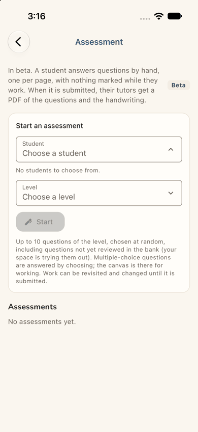
- **Size:** M.
- **Owner decides:**
  - Whether a join request should say what the person joins as (parent, student, tutor). Today it carries a name and
    an email only ([J11 step 4](J11-space-admin-decides.md)).
  - Whether a parent may propose their own child for the admin to confirm. Today only a space's admins add people
    (CLAUDE.md, "only admins of the organization may mutate its users").
- **Checked:** confirmed, and the rank holds (J07 and J07A both end "0/1 journeys passed").
  - **Screenshots.** [J07A step 28](./assets/cuj-j07a-step-28.png) shows "No students to choose from." with Start grey.
    J07 steps 24-35 read as the item says.
  - **Code: why the home offers it.** In a space without Tutoring, anyone who plays gets the learner hat
    (`apps/api/src/repositories/member-home.ts:542`). The learner's quick actions include `start_assessment`
    (`packages/shared/src/home.ts:527`), and its Next up falls to `focus_default` "assessment" (`home.ts:443-444`).
    Nothing checks for a student to start one for.
  - **Code: the empty picker.** The web's student picker has no empty state
    (`apps/web/src/features/canvas-assessments/assessments-page.tsx:96-105`). The app's says "No students to choose
    from." (`apps/mobile/src/features/canvas-assessments/assessments-screen.tsx:128`).
  - **Code: Let in.** It is `UserFormDialog` with `roles: []` (`join-requests-panel.tsx:57`).
  - **Deliberate.** Let in reusing the user form, and a request carrying no free text, were both planned
    ([open-signup-plan.md:513, 518-521](../open-signup-plan.md)). The "short sheet" is therefore a change to Phase 52's
    design, for the owner to decide, as the item's Owner decides already suggests.

### P0. Say what the approval wait means, and tell people when it ends

> **Status (JF2):** done in Phase 70 (2026-11-04), as decided: one heading; who checks and "usually within a day"; Keep playing back to the question; the address in full; the same said before the sign-up buttons. No notice when the wait ends (the owner chose words only for now).

- **What:**
  - **The waiting screen:**
    - one heading, where the web shows "Almost there" above "Waiting for approval";
    - who decides, a time the platform admins can keep, and how the person will hear;
    - "Keep playing" as the main button, back to the question they left;
    - "Contact" as a secondary link to a product address, shown in full.
  - **The end of the wait.** When the account is approved, tell the person. The cheapest way: the device that signed up
    checks on its next visit and shows "Your account is ready: Sign in" on the guest page (or in the app). An email is
    the other way (see Owner decides).
  - **Before sign-up** under Post-approved, say that a person checks new accounts. Casey first learned it after the
    whole form ([J02 step 9](J02-adult-declined.md)).
- **Why:**
  - **Who it hits.** Every self sign-up under Post-approved in the run: C6 players, C4 and C7 parents and C1 teachers,
    on both clients. (J12's sign-up ran under Pre-approved and did not wait.)
  - **How the journeys went on.** Each one continued only because the persona came back unprompted and tried "Sign in"
    on a hunch.
  - **What the persona sees.** Coming back, the guest page is unchanged. In the app, Back from the wait drops the quest
    in progress.
  - **Where it costs most.** An adult with no stake yet is most likely to leave for good here. J01, J01A, J02, J03,
    J06, J06A, J07 and J08 each list this screen among their three most noticed.
  - **It is today's production path.** Both platforms have run Post-approved since 2026-11-03 (CLAUDE.md, Phase 65).
- **Evidence:**
  - **The wait and the return, web:**
    - [J01 steps 10-12](J01-adult-player.md);
    - [J02 step 9](J02-adult-declined.md);
    - [J03 steps 11-12](J03-parent-after-guest-play.md);
    - [J04 steps 7-8](J04-teen.md);
    - [J06 steps 7-8](J06-start-a-space.md);
    - [J07 steps 10-11](J07-space-code-let-in.md);
    - [J08 steps 6-7](J08-friend-game-code.md);
    - [J10 steps 10-11](J10-space-code-declined.md).
  - **The wait and the return, app:**
    - [J01A steps 13-15](J01A-adult-player-app.md), where Back drops the quest (14);
    - [J04A steps 8-10](J04A-teen-app.md);
    - [J06A steps 11-12](J06A-start-a-space-app.md);
    - [J07A step 10](J07A-space-code-let-in-app.md).
  - **Audits:** design sev3,
    [The waiting and refusal screens stop the journey cold](audit-design.md#sev3-the-waiting-and-refusal-screens-stop-the-journey-cold);
    workflows sev3,
    [Each outcome of a request is told a different way…](audit-workflows.md#sev3-each-outcome-of-a-request-is-told-a-different-way-and-three-of-four-are-told-nowhere).
  - **Code:**
    - `apps/web/src/features/guest/signup-sheet.tsx:69` keeps "Almost there" over the waiting state;
    - `apps/web/src/features/auth/access-refused.tsx:36` makes "Contact us" a `mailto:`;
    - `packages/shared/src/guest-board.ts:146` sets `PLATFORM_CONTACT_EMAIL` to a personal Gmail address.

  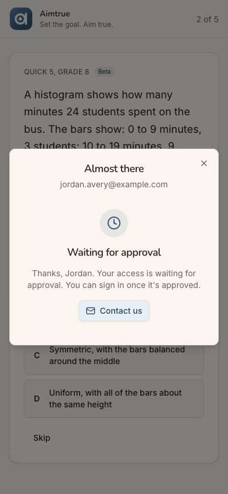
- **Size:** S for the words and "Keep playing". M for the device telling the person they are approved.
- **Owner decides:**
  - **The promise:** who "we" are, and a time frame the platform admins can keep.
  - **Email.** Production's sender reaches only verified addresses on the free plan (CLAUDE.md, Phase 32: "only
    verified destination addresses receive mail"). So the device's own check is the route that works today.
  - **The mode.** Whether Post-approved stays the default. Under Pre-approved, Grace went from a stranger to a question
    in six taps with no wait ([J12](J12-preapproved-on-list.md)).
  - **The support address** that replaces the personal one.
- **Checked:** confirmed, with one correction of emphasis.
  - **Screenshot.** [J01 step 10](./assets/cuj-j01-step-10.png) shows "Almost there" over "Waiting for approval", with
    only Contact us.
  - **Code.** The refusal renders inside `SignupForm` (`apps/web/src/features/auth/signup-form.tsx:67`), under the
    sheet's "Almost there" header (`signup-sheet.tsx:69`). The words are `accessPendingMessage`
    (`packages/shared/src/access.ts:41-44`): no who, no time frame and no notice.
  - **Deliberate in part.** Those exact words were specified in Phase 65
    ([access-approval-plan.md:39-40](../access-approval-plan.md), A4). That plan never planned a way to tell a person
    they were approved, so the missing notice is a gap in the plan, not a bug. That is why the time frame and the notice
    are the owner's decisions above.
  - **Rank.** P0 holds: Post-approved is production's mode, and eight journeys list this screen among the three their
    persona noticed most.

### P0. The app's Have a code button crashes

> **Status (JF3):** done in the fix-up (2026-11-04). The dialog gets the toast through a bridge, the app has an error screen with Try again and Go to Home, and a Maestro flow taps the quick action.

- **What:**
  - Render the home's "Have a code?" dialog inside the toast provider, or hand the box a toast function.
  - Give the app an error screen with a way home.
  - Add a Maestro flow that taps the quick action.
  - Better still, replace the dialog with the single code sheet of the next item.
- **Why:**
  - **Who it hits.** C7 parents and C6 players in the app who were told "join with my code". The quick action is the
    first door they try.
  - **What happens today.** The app shows a red "Render Error: useToast must be used inside <ToastProvider>.", then a
    blank screen with nothing to tap, twice. Recovering took two relaunches and a long scroll to a second box at the
    bottom of the home.
  - **On the web,** the same quick action works.
- **Evidence:**
  - [J07A steps 14-20](J07A-space-code-let-in-app.md): the crash (14), the blank screen (15), the same again (17), then
    the box at the bottom of the home works (18-20).
  - **Audit:** workflows sev3,
    [The app Have a code quick action… crashes](audit-workflows.md#sev3-the-app-have-a-code-quick-action-is-a-second-copy-of-the-code-box-and-it-crashes).
  - **Code:** `apps/mobile/src/features/home/quick-actions.tsx:40-49` renders `<HaveACode />` in a Paper `Portal`
    dialog. `HaveACode` calls `useToast()` (`apps/mobile/src/features/play/play-home.tsx:368-371`, per the workflows
    audit).
  - **Not verified:** this was seen in a development build. What a release build shows was not checked.

  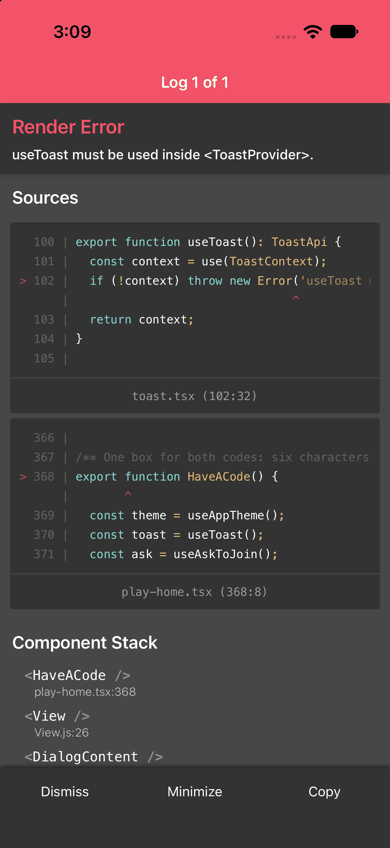
- **Size:** S.
- **Owner decides:** no.
- **Checked:** confirmed, and the provider tree is now traced.
  - **Screenshot.** [J07A step 14](./assets/cuj-j07a-step-14.png) shows the Render Error, from `play-home.tsx (368:8)`.
  - **The provider order.** `ToastProvider` sits inside `ThemeProvider` (`apps/mobile/src/app/_layout.tsx:154-160`).
    Paper's `PaperProvider`, which hosts every `Portal`, is in `ThemeProvider`
    (`apps/mobile/src/providers/theme-provider.tsx:61`). So the quick action's `Portal` dialog
    (`quick-actions.tsx:41-52`) mounts outside the toast context, and `HaveACode`'s `useToast()`
    (`play-home.tsx:370`) throws (`apps/mobile/src/components/toast.tsx:102`).
  - **No error screen.** No route exports an error boundary (no `ErrorBoundary` anywhere in `apps/mobile/src`). A
    release build therefore cannot show the dialog either, as J07A itself argues; only what it shows instead is
    unobserved.
  - **Rank.** J07A rated it sev3, because a second box works further down the home. It stays P0 under "loses newcomers
    at join": the quick action is on the first home of every new personal space in the app (`home.ts:525-527`).

### P1. One Have a code door, from the guest page on

> **Status (JF4):** done in Phase 72 (2026-11-05) on both clients: one sheet from the guest page, the home's quick action and the Quest board (and, on the web, a shared game link); it names the space before "Ask to join", and opens a game's join choices; signed out it keeps the code on the device, and the first home offers it once. The Question Quest page keeps its game-only box, and the Spaces page its own join card, which names the space too.

- **What:**
  - **One "Have a code?" sheet** on both clients. It opens from:
    - the guest page, signed out;
    - the home's quick action;
    - the Quest board;
    - the Question Quest page;
    - the Spaces page.
  - **What it takes:** a game or team code (6 characters) or a space code (8). It always shows what it found before
    sending: the space's name, or the game and the space it is in. Its toasts name the space.
  - **Signed out,** it keeps the code on the device through sign-up and approval. The first home then offers it: "You
    have a code for Ferreira Family Practice: Ask to join".
  - **The guest page's example code** is drawn as an illustration labelled "Example", not as a box that looks like a
    field.
- **Why:**
  - **Who it hits.** Codes are how C7 parents reach a tutor's space and C6 players reach a friend's game.
  - **When the code finally fits.** Marcus could first type his code at step 14, after sign-up, the approval and a
    second sign-in ([J10](J10-space-code-declined.md)).
  - **A false field.** The example code looks like a field, and three web journeys met it as a dead end at the front
    door.
  - **Two boxes, two behaviours.** The home's box sends a space request at once, with a toast that does not name the
    space. The Spaces page names it twice.
  - **A third box.** The Question Quest page takes 6 characters only.
- **Evidence:**
  - **The example code:**
    - [J07 step 3](J07-space-code-let-in.md);
    - [J08 step 2](J08-friend-game-code.md);
    - [J10 step 3](J10-space-code-declined.md);
    - [J07A step 3](J07A-space-code-let-in-app.md).
  - **The home's box,** after a long scroll: [J07 steps 14-16](J07-space-code-let-in.md),
    [J08 steps 10-12](J08-friend-game-code.md), [J10 steps 14-16](J10-space-code-declined.md).
  - **The Spaces page's box:** [J04 steps 16-18](J04-teen.md), [J10 steps 25-26](J10-space-code-declined.md).
  - **The Question Quest box:** [J08 steps 14-15](J08-friend-game-code.md).
  - **Audits:** workflows sev3,
    [Three code boxes take different codes…](audit-workflows.md#sev3-three-code-boxes-take-different-codes-none-is-on-the-guest-page-and-a-game-in-another-space-reads-as-missing);
    design sev3, [Example values look like saved data](audit-design.md#sev3-example-values-look-like-saved-data).
  - **Code:**
    - `apps/web/src/features/home/member-home.tsx:246-249`: the quick action scrolls to `#play-code`;
    - `apps/web/src/features/play/play-home.tsx:333-336`: the toast without the space's name;
    - `apps/web/src/features/quest/games-card.tsx:78-86`: 6 characters only;
    - `apps/web/src/features/guest/guest-home.tsx:181`: the example code in a bordered `kbd`.

  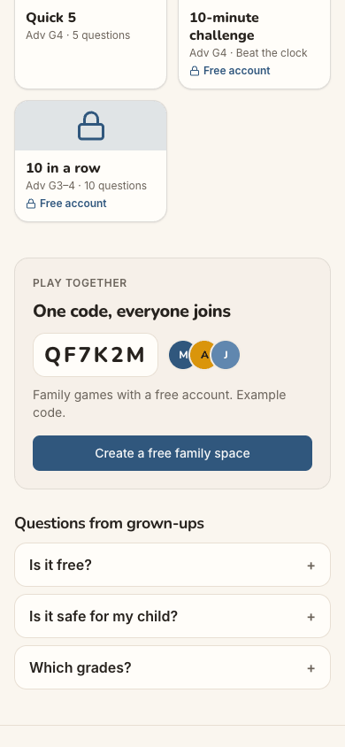
- **Size:** M for one sheet on both clients. L with the code carried through approval.
- **Owner decides:** whether a code typed signed out may be kept on the device and sent once the account is approved.
  Today only a signed-in member can send a join request.
- **Checked:** confirmed, with one detail corrected.
  - **Code.** Every citation holds:
    - the quick action only scrolls to `#play-code` (`member-home.tsx:246-249`);
    - the home's box sends a space code at once, with a toast that names no space (`play-home.tsx:333-335`);
    - Question Quest's box cuts input to 6 characters (`games-card.tsx:80`);
    - the guest page draws `QF7K2M` in a bordered `kbd` (`guest-home.tsx:181`).
  - **Screenshot.** [J08 step 2](./assets/cuj-j08-step-2.png) shows the bordered code box.
  - **Correction.** The page already prints "Example code." in small type beside the box (J08 step 2). The fix is how
    it is drawn, not a missing label.
  - **Deliberate.** The Play home's "Have a code?" was planned as one box for both codes
    ([stickiness-plan.md:395-396](../stickiness-plan.md)). No plan put a code door on the guest page.

### P1. Tell people the space's answer to their request

> **Status (JF5):** done in Phase 71 (2026-11-04): a "Your requests" card on every home (waiting, "You're in" with Open, declined with its date and Ask again), each answer until dismissed; the switcher's and the account button's badge count them. Not as a Next up item.

- **What:**
  - **A pending request** is a row on the home ("Asked to join Ferreira Family Practice · waiting for its admins") and a
    Next up item.
  - **Being let in** is a Next up item, "You're in Ferreira Family Practice: Open". The next arrival lands in that space
    once.
  - **A decline** is a Next up item and a band line, with its date, "Ask again", "Contact" and a dismiss. It stays in
    the person's history even if a later request is withdrawn.
  - **Asking again** after a decline says the space declined before.
  - **A badge** on the switcher (web) or the account sheet (app) until the outcome is dismissed.
  - **Keep the invitation banner as it is.** It is the one outcome told well.
- **Why:**
  - **Who it hits.** C7 and C4 parents, and C6 teens asking to join a club.
  - **Let in.** Lena found her new space by chance in the switcher ([J07 step 23](J07-space-code-let-in.md)).
  - **Declined.** Marcus's first guess, Activity, was a dead end. The answer was one grey line, three taps away. It
    vanished when he withdrew a second request ([J10](J10-space-code-declined.md)).
  - **The admin's side, by contrast,** says "2 asking to join" three times on the first screen
    ([J11 step 3](J11-space-admin-decides.md)).
- **Evidence:**
  - **Web:**
    - [J07 steps 16-17, 20-23](J07-space-code-let-in.md);
    - [J10 steps 16-28](J10-space-code-declined.md) (home unchanged 20, the decline 24, asking again 25-26, erased
      27);
    - [J04 steps 17-18](J04-teen.md).
  - **App:** [J07A steps 20-25](J07A-space-code-let-in-app.md), [J04A steps 17-18](J04A-teen-app.md).
  - **Audits:** design sev3,
    [Outcomes that happen elsewhere leave no trace on screen](audit-design.md#sev3-outcomes-that-happen-elsewhere-leave-no-trace-on-screen);
    workflows sev3,
    [Each outcome of a request is told a different way…](audit-workflows.md#sev3-each-outcome-of-a-request-is-told-a-different-way-and-three-of-four-are-told-nowhere).
  - **Code:**
    - `apps/web/src/features/organizations/org-switcher.tsx:44-50`: the switcher's count is invitations only;
    - `apps/web/src/features/organizations/welcome.tsx:40-58`: a decline is shown once, on the Spaces page.

  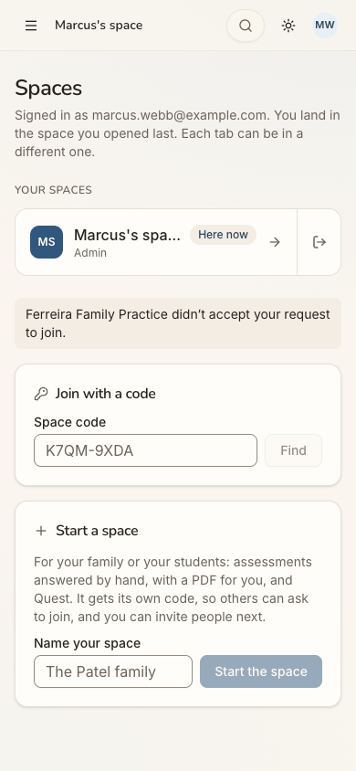
- **Size:** M.
- **Owner decides:** no.
- **Checked:** confirmed.
  - **Screenshot.** [J10 step 24](./assets/cuj-j10-step-24.png) shows the one decline line on the Spaces page, with no
    date and no action.
  - **Steps.** J10 steps 20-28 match: the home is unchanged (20), Activity is a dead end (22), and after Withdraw the
    decline does not come back (27-28).
  - **Code.** The switcher's badge counts invitations only (`org-switcher.tsx:44-50`). The decline is a plain `
`
    (`welcome.tsx:54-58`).
  - **Deliberate.** "A decline is shown once" (`welcome.tsx:46-50`, marked seen on view) is a coded choice. The Phase 52
    plan only says the person sees "<space> didn't accept your request"
    ([open-signup-plan.md:522](../open-signup-plan.md)). So "Owner decides: no" stands for the let-in notice. Keeping a
    decline after it is seen reverses that choice, which the owner should confirm.

### P1. Lead the first home with what the person came for

> **Status (JF6):** done in Phase 74 (2026-11-05) on both clients, as decided: where Tutoring is off, a parent's child leads, then the office of a space they help run, then the board; an office with nothing says so in one line and counts open assessments; a learner who never played gets three doors in the band (Play · Join with a code · Start a space).

- **What:**
  - **Finish the arrivals H4 planned.** Invited or let in as a parent → the family focus, with the child's card first.
    Started a space → the office focus in that space: Needs you, invitations not yet accepted, open assessments.
  - **An adult who has not played** lands on a personal home whose band offers three doors (Play · Join with a code ·
    Start a space), not "0 of 3 days played this week".
  - **Explain the personal space** in one line ("Just you: your own practice lives here"). When a join request is
    pending, lead with it.
- **Why:**
  - **Who it hits.** C1 makers, C4 and C7 parents and pilot teachers. The learner's board is their first screen, and
    what they came to do is screens down.
  - **Leo** was on Ana's fourth screen, 2,928 px down ([J09](J09-invited-by-space.md)).
  - **Sam** found nothing leading to Start a space ([J06 step 10](J06-start-a-space.md)).
  - **Code holders** land as admin and learner of a space they never asked for
    ([J07 step 13](J07-space-code-let-in.md), [J10 step 13](J10-space-code-declined.md)).
- **Evidence:**
  - **Space makers:**
    - [J06 steps 10, 20](J06-start-a-space.md);
    - [J06A steps 14, 39-41](J06A-start-a-space-app.md).
  - **Parents:**
    - [J09 steps 4-5, 18](J09-invited-by-space.md);
    - [J03 steps 14, 29](J03-parent-after-guest-play.md);
    - [J07A steps 13, 22](J07A-space-code-let-in-app.md).
  - **A pilot teacher:** [J12 step 6](J12-preapproved-on-list.md).
  - **A parent who also tutors:** [J18 step 3](J18-several-hats.md).
  - **Audit:** design sev3,
    [The first screen talks to a learner…](audit-design.md#sev3-the-first-screen-talks-to-a-learner-when-the-person-came-to-run-a-space-or-for-their-child).
  - **Code:**
    - `ARRIVALS` holds only `guest_quest`, `guest_assessment` and `direct` (`packages/shared/src/home.ts:213`). H4
      planned "invited as a tutor → Tutoring; as a parent → Family; made a space → Office"
      ([member-home-plan.md:96-101](../member-home-plan.md)).
    - With no pin, activity or arrival, `deriveHomeFocus` falls to the first hat (`home.ts:253-276`).

  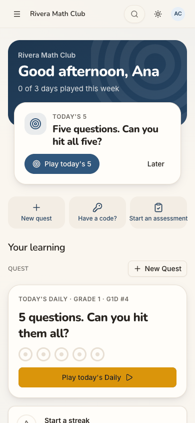
- **Size:** M.
- **Owner decides:**
  - The arrivals list: it changes what each newcomer sees first.
  - Whether a code holder who joins a space still needs the personal space made at sign-up (Phase 63), or should land
    in the space they asked for.
- **Checked:** confirmed. The item missed the rule that causes most of it, which is deliberate.
  - **Screenshot.** [J09 step 4](./assets/cuj-j09-step-4.png) shows Ana's club home leading with "0 of 3 days played"
    and Today's 5. J09 measured Leo's card at 2,928 px of a 3,262 px page.
  - **Code.** `ARRIVALS` is the guest's three words (`home.ts:213`), while H4 planned five
    ([member-home-plan.md:96-101](../member-home-plan.md)). The fall-back hat is as cited (`home.ts:269-272`).
  - **The deliberate rule.** In a space without Tutoring, anyone who plays wears the learner hat, and that hat is moved
    first: "Where there is no Tutoring, playing leads (the space is for practice)" (`member-home.ts:542, 550-551`).
    That is why Ana (a parent) and Sam (an admin) open on a learner's board in a club.
  - **Why the arrivals cannot help.** People a space invites or adds have no platform account (Phase 65, A5), so
    `arrived_via` cannot carry "invited as a parent" for them.
  - **Owner decides, besides the above.** Whether a parent's or an admin's hat should lead over playing in a space
    without Tutoring.

### P1. Put Start a space where a teacher looks

> **Status (JF7):** done in Phase 72 (2026-11-05): "Join with a code" and "Start a space" (adults) under the list of spaces (the web's switcher, the app's account sheet); the app's (+) ends with Start a space for adults where it offers anything; "Space settings"; a teen's club card in place of the age line.

- **What:**
  - **Under the list of spaces,** put "Join with a code" and "Start a space" (adults). On the web that is the switcher;
    in the app, the account sheet.
  - **In the app's (+),** add "Start a space" for adults.
  - **Rename the menu's "Space"** to "Space settings".
  - **For 13-17,** replace the grey footnote with a card: "A club needs an adult to start its space. Ask a teacher or
    parent to start it, then join with its code."
- **Why:**
  - **Who it hits.** C1 owners who signed up to start a space for a class or club.
  - **What happens today.** Sam found it on the third try, Pat in the fifth place Pat looked.
  - **Teens** who run clubs are told no, with no route forward.
  - **A tutor** sees "Start a space … for your students" on All spaces, a tempting wrong door.
- **Evidence:**
  - **Web:**
    - [J06 steps 11-14](J06-start-a-space.md), including the dead end at "Space" (12);
    - [J04 steps 11-13](J04-teen.md);
    - [J18 steps 6-7](J18-several-hats.md).
  - **App:**
    - [J06A steps 15-21](J06A-start-a-space-app.md), where the yellow (+) is a dead end (17);
    - [J04A steps 13-15](J04A-teen-app.md).
  - **Audit:** workflows sev3,
    [Spaces are reached three ways and Start a space only from the Spaces page](audit-workflows.md#sev3-spaces-are-reached-three-ways-and-start-a-space-only-from-the-spaces-page).
  - **Code:**
    - `apps/web/src/features/organizations/welcome.tsx:70-71, 197`: on the Spaces page only;
    - `apps/web/src/components/layout/app-shell.tsx:70`: the menu's "Space" is `/organization`;
    - `apps/mobile/src/features/shell/create-actions.ts:31-90`: no space action in (+).

  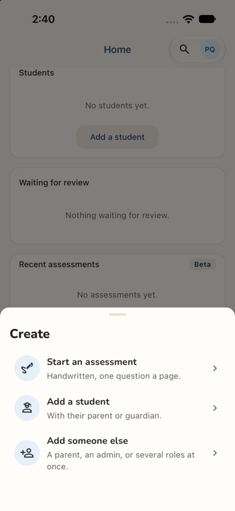
- **Size:** S.
- **Owner decides:** no.
- **Checked:** confirmed.
  - **Screenshot.** [J06A step 17](./assets/cuj-j06a-step-17.png): Create offers Start an assessment, Add a student
    and Add someone else.
  - **Code.** `MakeSpace` is rendered only by the Spaces page (`welcome.tsx:70-71`; the web's `spaces-page.tsx` and the
    app's `space-welcome.tsx` are its only hosts). Neither (+) branch has a space action (`create-actions.ts:126-137`).
  - **Why it is buried.** Phase 61 put Join and Start side by side for a newcomer in no space yet (`sideBySide`,
    `welcome.tsx:44`, with `spaces-page.tsx:161`). Since Phase 63, a self sign-up always has a personal space, so that
    Welcome "remains only for someone in no space" (CLAUDE.md, Phase 63) and no newcomer sees it.
    This is a side effect of two deliberate phases, not a choice anyone made.

### P1. Refusals give a next step and never reopen unasked

> **Status (JF8):** done in the fix-up and Phase 70 (2026-11-04): a refused sign-up never reopens by itself; every refusal leads with Keep playing; "Ask a grown-up", remembered on the device as a one-way key; under Pre-approved the note before Google, the checked address, Ask for an invitation (a prefilled mail) and Use another account; a decline stops offering sign-up in that tab. Not done: a reason category for a decline.

- **What:**
  - **Clear the refused sign-up** when a refusal is shown. The "Almost there" form must never reopen by itself, with or
    without the email (J05). A refusal must not reopen over the guest page (J02, J13). Add J05's repro as an e2e check.
  - **Every refusal** says guest play is still open, with "Keep playing" as its main button.
  - **Under 13:** "Ask a grown-up", with something a parent can act on.
  - **Pre-approved:**
    - an "Ask for an invitation" action that carries the email, in place of a blank `mailto:`;
    - the sign-up buttons say "invitation only" before Google;
    - the refusal names the account checked and offers "Use another Google account".
  - **Declined:** stop offering sign-up in that tab.
- **Why:**
  - **Who it hits.** C6 adults who are declined, children under 13 (who can join only through a parent), and parents
    not on the list.
  - **The under-13 form** re-asks the age question seconds after a no, with her email filled in. That invites picking an
    older year, so it is a hole in the age gate, not only friction ([J05](J05-under-13.md), sev3).
  - **Not on the list:** "Contact us" did nothing visible, and every door still said "free"
    ([J13](J13-preapproved-not-on-list.md)).
- **Evidence:**
  - **Declined:** [J02 steps 12-13, 15-17, 19-20](J02-adult-declined.md).
  - **Under 13:** [J05 steps 6-7, 11, 13, 16-17](J05-under-13.md).
  - **Not on the list:** [J13 steps 3-4, 9-10, 15, 17, 20](J13-preapproved-not-on-list.md).
  - **Audit:** design sev3,
    [The waiting and refusal screens stop the journey cold](audit-design.md#sev3-the-waiting-and-refusal-screens-stop-the-journey-cold).
  - **Code:** `apps/web/src/features/auth/access-refused.tsx:36-37`, whose only action is a `mailto:` to
    `PLATFORM_CONTACT_EMAIL`.

  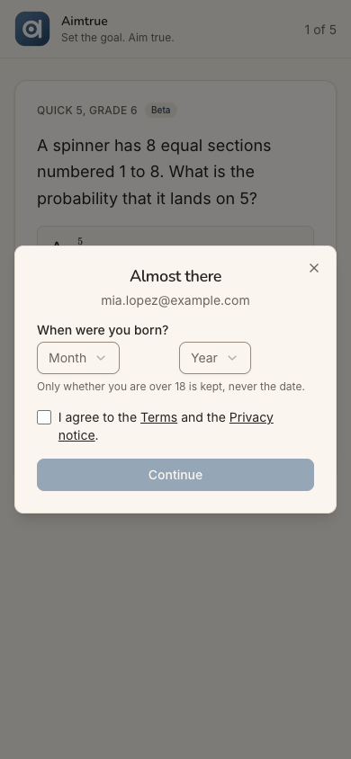
- **Size:** S to M.
- **Owner decides:**
  - Whether the device may remember an under-13 refusal ([J05](J05-under-13.md), finding 3), given the promise
    "Nothing about you has been kept".
  - What an "Ask for an invitation" request stores: the email of someone with no account.
  - Whether a decline gives a reason category.
- **Checked:** confirmed, and the cause is found in code.
  - **Screenshot.** [J05 step 11](./assets/cuj-j05-step-11.png) shows "Almost there" with `mia.lopez@example.com` over
    the quest she chose.
  - **The cause.** `completeSignup` clears `pendingSignup` only after a successful `POST /auth/signup`
    (`apps/web/src/providers/auth-provider.tsx:389-397`). The under-13 refusal and Phase 65's refusals throw before
    that (`signup-form.tsx:59-60`). The guest page reopens the sheet whenever `pendingSignup` is set
    (`guest-home.tsx:53-55`). The sheet's "too young" flag is local state, so a remounted sheet is back at the form
    (`signup-sheet.tsx:27, 58`).
  - **Not deliberate.** It is a client bug, not a rule. The server keeps nothing of an under-13 answer, as Phase 52
    planned.
  - **The age gate.** A fresh Google sign-in can re-answer the age anyway (J05 steps 15-17). The reopen makes that
    immediate, so the item's word "hole" is fair. Whether to guard it on the device stays the owner's decision.
  - **Code.** `access-refused.tsx:36-37` is the `mailto:` as cited.

### P1. A friend's game code and tile link reach the friend's game

> **Status (JF9):** done in Phase 72 (2026-11-05), as decided: a game code from another space gets the same honest answer as no game at all ("ask your friend to invite you there, or start your own game"), revealing nothing (R13 kept); a quest link a guest cannot play is kept on the device, named on the guest page and offered on the first home. A code admitting a non-member to one game is not scheduled.

- **What:**
  - **Now:**
    - a game code from another space gets an honest answer, not "No game or team has that code.": "This game is in
      another space. Ask your friend to invite you, or start your own game and share its code";
    - stop `/play/<tile>` dropping a tile that guests cannot play. The route exists, but a locked tile sends a
      signed-out visitor to `/` (see Checked). Signed out, put the sent tile first ("You were sent: 10 in a row ·
      Grade 4"). Keep it on the device through sign-up, and open the space on it, as `guestLeadLevel` does for the
      grade.
  - **Later, if allowed:** let a game code admit a non-member to that one game.
- **Why:**
  - **Who it hits.** C6 players. "A friend asked me to play" is their reason to come, and the invitation died at
    [J08 step 12](J08-friend-game-code.md).
  - **What Kai did instead.** He played the friend's tile alone, found by hand.
  - **A promise half kept.** Phase 63 built `/play/<code>` links ([docs/plan.md](../plan.md), Phase 63). This link
    was to a tile locked for guests, so it was rewritten to `/` and forgotten by the time Kai signed in.
- **Evidence:**
  - [J08 steps 1-2, 7, 9](J08-friend-game-code.md): the tile link dropped.
  - [J08 steps 10-15](J08-friend-game-code.md): the code refused twice.
  - [J08 steps 16-17](J08-friend-game-code.md): played alone.
  - **Audit:** workflows sev3,
    [Three code boxes…](audit-workflows.md#sev3-three-code-boxes-take-different-codes-none-is-on-the-guest-page-and-a-game-in-another-space-reads-as-missing).
  - **Rules:** game codes are found only in their own space (CLAUDE.md, Phase 46). R13 says nothing crosses spaces.

  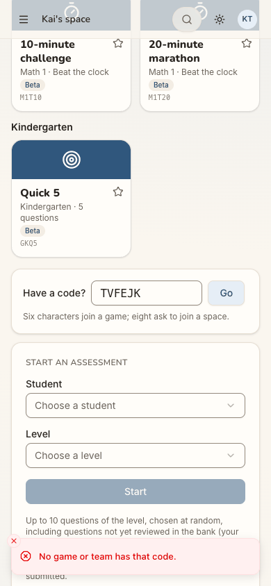
- **Size:** S for the wording and the tile link. L for play across spaces.
- **Owner decides:**
  - Whether a game may take players from outside its space.
  - Whether a refusal may even say that the code exists in another space, which itself crosses R13.
- **Checked:** corrected.
  - **The correction.** The item said "make `/play/<tile>` a real route". It already is one: `App.tsx:60` routes it to
    `PlayLink`.
  - **What the route does.** Signed in, it starts the tile (`play-link.tsx:36-37`). Signed out, it plays only a tile
    open to guests (`play-link.tsx:33`). Any other tile is `<Navigate to="/" replace />` (`play-link.tsx:39`), which
    drops the code.
  - **Why J08 lost it.** G4Q10, "10 in a row", is locked for guests ([J08 step 2](./assets/cuj-j08-step-2.png) shows
    it locked). Kai then signed in from `/` (step 9), so the link never reached the member branch.
  - **The plan was silent.** Phase 63's P14 lists signed-out and signed-in checks, but not a locked tile
    ([stickiness-plan.md:663-676](../stickiness-plan.md)). The What and Why are corrected above.
  - **Confirmed: the code refusal.** [J08 step 12](./assets/cuj-j08-step-12.png) shows "No game or team has that code."
    That refusal is deliberate: game codes are found only in the person's own spaces (CLAUDE.md, Phase 46;
    [stickiness-plan.md:395](../stickiness-plan.md)). That is why it is the owner's decision.

### P2. The guest page speaks to every visitor and keeps its promises

> **Status (JF10):** done in Phases 70 and 72 (2026-11-04/05): the audience line, "Can adults play?", the offer marks the answer, no "Save this score"; and "30%" is right where the question asks for a percent (398 numeric questions of the bank; the blind solve stays exact). Levels above Grade 8 on the guest board are not scheduled.

- **What:**
  - **The hero:** a line for adults, teens and classes, and "Can adults play?" in the FAQ.
  - **The guest board:** levels above Grade 8 on it.
  - **A code door** for "Have a code from a tutor or club?" (see the code item).
  - **An age note** without "18".
  - **The sign-up offer:**
    - mark the answer before pitching, as the app does ("Nice! That one is right.");
    - accept "30%" as well as "30" (whether "30%" was marked right was not checked);
    - either carry the guest's best score into the account (on the device, as the grade and tiles are) or stop saying
      "Save this score".
- **Why:**
  - **C6 adults and teens** read "Grades 1-8" and "Is it safe for my child?" as "not for me", on the page that decides
    conversion.
  - **A parent sent by a tutor** wonders whether she signed up for a children's game
    ([J07 step 10](J07-space-code-let-in.md)).
  - **A right answer reads as wrong** at the moment of the offer ([J01 step 4](J01-adult-player.md)).
  - **The child's 5 of 5** was gone after sign-up ([J03](J03-parent-after-guest-play.md)).
- **Evidence:**
  - **Who the page speaks to:**
    - [J01 steps 1, 4-5](J01-adult-player.md);
    - [J01A steps 1, 5-6](J01A-adult-player-app.md);
    - [J02 steps 1-2, 4](J02-adult-declined.md);
    - [J04 steps 1-2, 9](J04-teen.md);
    - [J04A steps 1-2, 9](J04A-teen-app.md);
    - [J13 steps 8-9](J13-preapproved-not-on-list.md);
    - [J15A steps 1-2](J15A-tutoring-parent-first-sign-in-app.md), where the centre is never mentioned.
  - **The offer:** [J01 steps 3-4](J01-adult-player.md) ("Good try" with no mark);
    [J03 steps 7, 12, 15](J03-parent-after-guest-play.md) (the score not kept).
  - **Audit:** design sev2,
    [The guest page speaks only to families with young children](audit-design.md#sev2-the-guest-page-speaks-only-to-families-with-young-children).

  
- **Size:** S.
- **Owner decides:**
  - The words: who the product says it is for.
  - Whether the guest's best score may carry over on the device.

### P2. Sign in opens a sheet titled Sign up free

> **Status (JF11):** done in Phase 70 (2026-11-04) on the web; the app already had its own sign-in screen.

- **What:**
  - Open the sheet in a sign-in mode from "Sign in": titled "Sign in", "Welcome back", with the same Google button and
    a small "New here? Sign up free".
  - Keep "Sign up free" for the calls to action.
- **Why:**
  - **The most frequent hesitation in the audit.** Every returning member, tutor, office admin and parent on the web is
    told to sign up. It is worst for an approved newcomer who was never told of the approval: "am I making a second
    account?" ([J01 step 12](J01-adult-player.md)).
  - **The app** has its own sign-in screen.
- **Evidence:**
  - **Web, 18 journeys:**
    - J01 step 12, J02 step 11, J03 step 13, J04 step 9, J05 step 15;
    - J06 steps 3, 9, J07 step 12, J08 steps 3, 8, J09 step 2, J10 step 12;
    - J11 step 2, J13 steps 10-11, J14 step 2, J15 step 2;
    - J16 step 2, J17 step 2, J18 step 2, J19 step 2.
  - **The app:** its own sign-in screen ([J01A step 16](J01A-adult-player-app.md),
    [J15A step 2](J15A-tutoring-parent-first-sign-in-app.md)).
  - **Audits:** design sev2,
    ["Sign in" opens a sheet titled "Sign up free"](audit-design.md#sev2-sign-in-opens-a-sheet-titled-sign-up-free);
    workflows sev2,
    [On the web Sign in opens the Sign up free sheet…](audit-workflows.md#sev2-on-the-web-sign-in-opens-the-sign-up-free-sheet-while-the-app-has-its-own-sign-in-screen).
  - **Code:** `apps/web/src/features/guest/guest-home.tsx:97-104` (the header's Sign in calls `signUp`);
    `apps/web/src/features/guest/signup-sheet.tsx:86-87` (the title).

  
- **Size:** S.
- **Owner decides:** no.

### P2. An invitation link opens on the invitation

> **Status (JF12):** done in Phase 72 (2026-11-05): the invitation text links to the Spaces page; the card wraps the space's name and says who invited ("Invited as Parent by Ines"); no age line while an invitation waits; and, as decided, an invited person accepts the terms and the privacy notice once, at their first sign-in. The child is not named: a mistyped address would learn a child's name (R32).

- **What:**
  - **The link.** The invitation text links to the invitation itself, naming the space and who invited, not to the
    guest game page.
  - **The invitation card:**
    - wraps the space's name ("Rivera …" today);
    - says who invited her and for which child;
    - drops "you need to be 18 or older" for an adult.
- **Why:**
  - **The best moment in J09.** For an invited C4/C7 parent, the invitation waiting on the first screen after Google,
    with no form and no approval, was the best moment of the journey.
  - **The way there.** It starts on a children's game page and a "Sign up free" sheet.
- **Evidence:**
  - [J09 steps 1-3](J09-invited-by-space.md).
  - J09's Outcome notes that an invited person is never shown the terms or the privacy notice.

  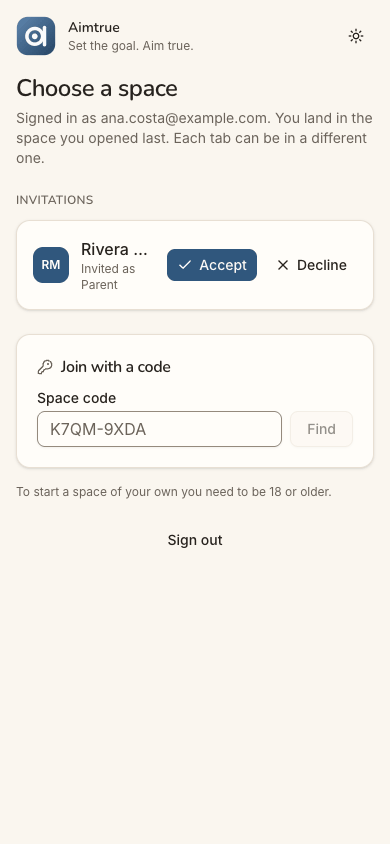
- **Size:** S to M.
- **Owner decides:** whether an invited person must see and accept the terms and the privacy notice before entering.
  J09 left this to the owner and did not count it as a finding.

## Stickiness

### P1. Continue resumes the open game

> **Status (JF13):** done in Phase 73 (2026-11-05) on both clients: Continue -- the board, Next up and the iPhone's home-screen action -- opens the reader's open game, running or in its lobby, read from the server and said in words ("Grade 7 Quick 5 · question 3 of 5 · 2 points"); with none open, "Play Grade 7 Quick 5 again". A New Quest game gets one too, and the games list says games in words.

- **What:**
  - **Continue** (the board, Next up, the iPhone's home-screen action) opens the reader's open game, running or in a
    lobby. It reads the server's list, and is labelled in words with progress: "Grade 7 Quick 5 · question 3 of 5 · 2
    points".
  - **With no open game,** offer the replay under its own name: "Play Grade 7 Quick 5 again".
  - **A game started from New Quest** gets a Continue too.
  - **The home moves after a game:** the open game shows in Next up, and the day counts.
- **Why:**
  - **C6 and C5 players.** Coming back mid-quest is the stickiness moment, and it sends them back to Question 1 with 0
    points.
  - **C4 parents** meet it as a second empty lobby.
  - **The way back** was 4 taps, landing in the wrong game. The one real resume is a list of identical rows that differ
    only by code.
- **Evidence:**
  - **Web:** [J19 steps 12-17](J19-returning-player.md); [J09 steps 14-16](J09-invited-by-space.md).
  - **App:** [J01A steps 23-24](J01A-adult-player-app.md); [J04A steps 30-32](J04A-teen-app.md), where a New Quest game
    gets no Continue.
  - **Audit:** workflows sev3,
    [Continue replays the last tile as a new game…](audit-workflows.md#sev3-continue-replays-the-last-tile-as-a-new-game-instead-of-resuming-the-open-one).
  - **Code:**
    - `apps/web/src/features/play/play-home.tsx:229-239`: Continue calls `start(last.label, last.request)`, which makes
      a new game;
    - `apps/web/src/features/home/next-up.tsx:414-440`: Next up's Continue, the same call;
    - the app: `apps/mobile/src/features/play/play-home.tsx:284-287`.

  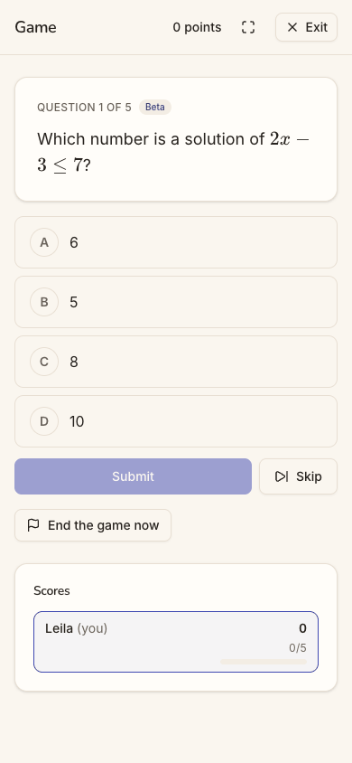
- **Size:** M.
- **Owner decides:** yes, corrected from "no" (see Checked). Continue was planned as "the last settings, kept on the
  device; one tap" ([stickiness-plan.md:393](../stickiness-plan.md)). Resuming the open game is a change to that design.
- **Checked:** behaviour confirmed; the rule turns out to be deliberate.
  - **Screenshot.** [J19 step 14](./assets/cuj-j19-step-14.png) shows Question 1 of 5 and 0 points after Continue.
    J19 steps 13-16 show the new game address and the older game, still at question 3, on Question Quest.
  - **Code.** `useStartQuest` always creates a game (`play-home.tsx:51-61`). Every Continue calls it with the device's
    last request: the board (`play-home.tsx:229-239`), Next up (`next-up.tsx:414-440`) and the app
    (`apps/mobile/src/features/play/play-home.tsx:278-289`). The last quest is written only by `useStartQuest`
    (`play-home.tsx:60`), so a game made in the New Quest wizard gets no Continue (J04A steps 30-32).
  - **Deliberate, but at odds with its own words.** Replaying the last settings is the plan
    ([stickiness-plan.md:393](../stickiness-plan.md), and the member-home plan's "Continue (the device's last quest)",
    [member-home-plan.md:207](../member-home-plan.md)). Yet Next up's card says "Pick up where you left off" over it
    (`next-up.tsx:428`; the app's `next-up-card.tsx:423`). That promise is broken as built, which is what keeps this
    a P1.

### P1. Start the board at the learner's grade, and remember it

> **Status (JF14):** done in Phase 73 (2026-11-05), as decided: the board and the Daily lead with the grade picked on the row (saved per space), else the level recorded for a student, else the last level played, else for 13+ the top of the row; a guest's grade beats only that age guess; only when nothing says, "Which grade?" once (with Not in school). One Daily rule and one name, "Today's Daily".

- **What:** lead the Quest board, and the Daily in Next up, with:
  1. the grade the space records for a student;
  2. the last level the person played, read from the server rather than the device;
  3. for anyone 13 or older, the top of the row or "More levels";
  4. only then Grade 1.

  Remember a grade picked on the row, for that person. Next up's Daily and the board's Daily use one level, and name it.
- **Why:**
  - **"For little kids."** That is what teens, adults and pilot teachers read before they play (C6).
  - **Sofia's practice** (C5) was 4 to 6 grades below her: a Grade 3 Daily for a 7th grader. Her chosen Grade 7 was
    lost on reload ([J17](J17-tutored-student-practice.md)).
  - **A returning player** must find their grade again on every new device.
- **Evidence:**
  - **Teens:** [J04 steps 10, 19-20](J04-teen.md); [J04A steps 12, 23-24](J04A-teen-app.md).
  - **Adults and parents:**
    - [J06 step 10](J06-start-a-space.md);
    - [J07 step 13](J07-space-code-let-in.md);
    - [J09 step 4](J09-invited-by-space.md);
    - [J10 step 13](J10-space-code-declined.md);
    - [J12 steps 6-7](J12-preapproved-on-list.md).
  - **Learners:** [J17 steps 3, 5, 12-15](J17-tutored-student-practice.md); [J19 steps 3-5](J19-returning-player.md).
  - **Next up and the board disagree:** [J08 step 9](J08-friend-game-code.md).
  - **Audits:** design sev3,
    [The Quest board leads with Grade 1, whoever is playing](audit-design.md#sev3-the-quest-board-leads-with-grade-1-whoever-is-playing);
    workflows sev2,
    [One screen offers six ways to start a quest…](audit-workflows.md#sev2-one-screen-offers-six-ways-to-start-a-quest-and-the-daily-has-four-names-at-two-levels).
  - **Code:**
    - `apps/web/src/features/play/play-home.tsx:114-125`: the lead comes from device storage, and the chosen grade is
      component state;
    - `packages/shared/src/tile-look.ts:72-77`: `boardLeadGrade` falls to the first grade;
    - `next-up.tsx:64-68` against `play-home.tsx:138-141`: two level rules.

  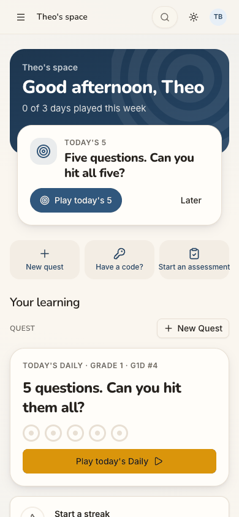
- **Size:** M.
- **Owner decides:** whether to ask a newcomer's grade once. One more question at sign-up costs a little; a one-tap
  "What grade?" card on the first home costs less.
- **Checked:** confirmed, with one precision.
  - **Screenshot.** [J04 step 10](./assets/cuj-j04-step-10.png) shows "Today's Daily · Grade 1" for a 15-year-old.
  - **Steps.** J17 steps 3, 5 and 12-15 show it for Sofia: the board opens on Grade 1, Next up's Daily is Grade 3,
    and her Grade 7 is lost on reload while My profile reads "Grade 7 Mathematics".
  - **Code.**
    - the lead is the device's last quest, else the guest's grade (`play-home.tsx:113, 118-119`);
    - the chosen grade is component state (`play-home.tsx:123-124`);
    - `boardLeadGrade` falls to the first grade (`tile-look.ts:72-77`);
    - Next up's Daily falls to `list[0]` (`next-up.tsx:66-67`), the board's to the chosen grade's first tile
      (`play-home.tsx:139`).
  - **The precision.** "The grade the space records" is free text today (`student_profiles.current_math_course`,
    "Grade 7 Mathematics"). The structured one is Question Quest's `quest_level_id` (Phase 42), which a tutor or an
    admin sets. Item 1 of What should read that column, or parse the course.
  - **Deliberate.** Phase 67's order (last quest, then the guest's grade) is the plan; it says nothing of a student's
    grade or of Grade 1 as a fall-back. So this extends the plan rather than reversing it.

### P1. Play with a child on one device, credited to the child

- **What:**
  - **For a child who does not sign in** (no email), "Play with <child>" and "Practise together" become a game on this
    device. The two play side by side, at the child's grade from the profile, and the child's days played count.
  - **For a child who signs in,** keep the online invite, and show the child as invited in the lobby.
  - **Continue** resumes that game rather than opening a new lobby.
- **Why:**
  - **The family's primary action.** It is what the home gives C3 and C4 (H10).
  - **What happens today.** It makes a two-player online game the child cannot join. It ends "Nadia wins!", at Grade 3
    for a Grade 4 child.
  - **The count that should bring the family back,** "Played 0 days this week (aim: 3)", cannot move.
  - **Children a space adds often cannot sign in.** Yusuf, Ken and Leo had no email. In production, students and
    parents "have not really signed in yet" ([member-home-plan.md:22-23](../member-home-plan.md)).
- **Evidence:**
  - **Web:** [J15 steps 14-21](J15-tutoring-parent-first-sign-in.md); [J09 steps 11-16](J09-invited-by-space.md).
  - **App:** [J15A steps 16-23](J15A-tutoring-parent-first-sign-in-app.md).
  - **Audit:** workflows sev3,
    [Play with a child opens an online game the child cannot join…](audit-workflows.md#sev3-play-with-a-child-opens-an-online-game-the-child-cannot-join-on-both-clients).
  - **Code:**
    - `packages/shared/src/home.ts:280-292`: `playWithRequest` is `players: 'multi'` with `invite_user_ids: [child]`;
    - `apps/web/src/features/home/member-home.tsx:516-526`: the level is the child's last, else the first tile.

  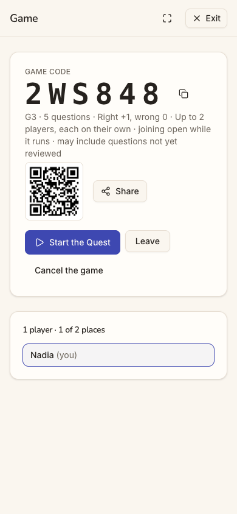
- **Size:** M to L.
- **Owner decides:**
  - **A new mode.** H10 defined Play with as a game with the child invited
    ([member-home-plan.md:131](../member-home-plan.md)). A shared-device game is a new mode.
  - **What the counts mean.** Crediting a child who never signed in changes what R29's counts mean.
- **Checked:** confirmed; it is deliberate, and the item already says so.
  - **Screenshot.** [J15 step 15](./assets/cuj-j15-step-15.png) shows a lobby of "1 of 2 places" holding only Nadia,
    with the game at G3.
  - **Steps.** J15 steps 19 and 21 give "Nadia wins!", then "Played 0 days" after a reload.
  - **Code.** `playWithRequest` is as cited (`home.ts:280-292`). The child's level is their last game's level
    (`apps/api/src/repositories/member-home.ts:380-389`), else the first tile (`member-home.tsx:513-518`), never the
    child's grade. Days played count only the child's own answers (`member-home.ts:366-372`), so a game the child
    never joins cannot move them.
  - **Rank.** P1 holds: no journey was blocked, but the family's main action fails for every child without an email.

### P2. My progress shows one state, and never a zero first

> **Status (JF16):** done in Phases 73 and 74 (2026-11-05): one headline, never "0 of 3" first; an empty game wins nothing; the band never leads with a zero and offers doors to a newcomer. A guest's play day is not counted (owner, 2026-11-05).

- **What:**
  - **One state per habit card:** "4-week streak: play 3 days this week to keep it", or "Start a streak", never both.
    Count streak badges from the current run.
  - **The band** leads with the next step, not "0 of 3 days played this week". The app already says "Start a streak".
  - **A cancelled or empty game** is not a result and earns nothing.
  - **After a game,** the week and Next up update.
- **Why:**
  - **The streak is the reason to come back** three days a week (H8), for C6 and C5.
  - **A returning player** read four messages on one card that disagree ([J19 step 4](J19-returning-player.md)).
  - **New members** read a zero minutes after playing as a guest.
  - **Cancelling an empty game** congratulated Ana on a win and gave her two badges
    ([J09 steps 12-15](J09-invited-by-space.md)).
- **Evidence:**
  - **The contradicting card, and a home that does not move:** [J19 steps 4, 12](J19-returning-player.md).
  - **A zero first:**
    - [J01 step 13](J01-adult-player.md);
    - [J12 step 6](J12-preapproved-on-list.md);
    - [J06 step 10](J06-start-a-space.md);
    - [J09 step 4](J09-invited-by-space.md).
  - **The app's softer band:** [J01A step 18](J01A-adult-player-app.md).
  - **Audit:** design sev2,
    [The habit card contradicts itself and leads with a zero](audit-design.md#sev2-the-habit-card-contradicts-itself-and-leads-with-a-zero).

  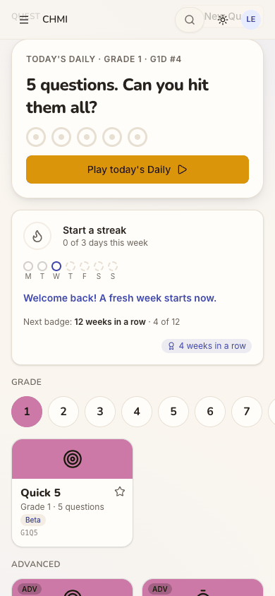
- **Size:** S.
- **Owner decides:** whether a guest's play day may count as a new member's first day. The device knows it, but Phase
  63 sends nothing about a guest.

### P3. Lesson cards say where, and lead to practice

> **Status (JF17):** done in Phase 74 (2026-11-05): lesson lines name the place ("Tue at 4:00 PM with Alex · Institute, room 2"); the learner's lesson line leads to practice; "Practise before" opens the week before (owner, 2026-11-05).

- **What:**
  - **The next-lesson cards** name the place ("Thu 4:00 PM with Alex · Institute, room 2").
  - **A tap on the lesson line** opens the lesson and offers practice for it.
  - **Practise before:** consider offering it earlier than three days ahead.
- **Why:**
  - **C3 parents** asked "when's the next lesson?" and got when, not where.
  - **C5 students** six days before a lesson found nothing on the home about it. The lesson line does nothing.
- **Evidence:**
  - [J15 step 4](J15-tutoring-parent-first-sign-in.md) and [J15A steps 12-14](J15A-tutoring-parent-first-sign-in-app.md):
    when, not where.
  - [J17 step 11](J17-tutored-student-practice.md): the lesson line does nothing.
  - **Code:** `PRACTISE_BEFORE_DAYS = 3` (`packages/shared/src/home.ts:300`).

  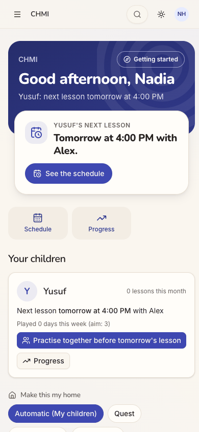
- **Size:** S.
- **Owner decides:** the "Practise before" window.

## Usability

### P1. A missing price hides behind 95.00 until a live lesson cannot end

> **Status (JF18):** done in Phase 75 (2026-11-05) on both clients, as decided: the price stays optional, its field empty with helper text ("For example 95.00"); "No price set" on the student, the pairing and the schedule (to a tutor too, by a flag that carries no amount); Start refuses up front in the reader's words ("Ask the office to set Yusuf's price."); the Stop dialog prints the reason and keeps the typed note.

- **What:**
  - **The price field.** Use helper text ("For example 95.00") in place of a realistic placeholder, and leave the field
    visibly empty.
  - **A missing price** shows as "No price set" on the student's record and wherever the student is paired or
    scheduled.
  - **At Start,** check the rule the stop uses. Word the refusal for a tutor: "Ask the office to set Yusuf's price".
  - **The stop dialog** prints every field error as text, and "Keep going" keeps the typed note. The longer fix, Stop
    opening the full record surface, is in the record item below.
- **Why:**
  - **What happened.** The two journeys are one story. Priya (C1) saved Yusuf with an empty price behind a grey
    "95.00". Later, Alex (C2) started a timer for Yusuf.
  - **What the tutor saw.** "End and record" failed twice with "Please correct the highlighted fields.", with nothing
    highlighted. Discard, losing the lesson, was the only way out. Tomorrow's lesson cannot be recorded either.
  - **Who it costs.** Tutors are the cohort with real use in production: one tutor recorded 22 lessons on 19 days
    ([member-home-plan.md:19](../member-home-plan.md)).
- **Evidence:**
  - **The placeholder:** [J14 steps 13, 30](J14-office-adds-family.md).
  - **The failed stop:** [J16 steps 15-16, 26-29](J16-tutor-record-entry-points.md). The full form names the reason
    (28). Another student records normally (31).
  - **Audits:** design sev3, [Example values look like saved data](audit-design.md#sev3-example-values-look-like-saved-data);
    workflows sev3,
    [Ending a live lesson is a second record form that cannot say why it fails](audit-workflows.md#sev3-ending-a-live-lesson-is-a-second-record-form-that-cannot-say-why-it-fails).
  - **Code:**
    - `apps/web/src/features/users/user-form-dialog.tsx:886`: the "95.00" placeholder;
    - `apps/api/src/lib/pricing.ts:97-103`: the refusal is attached to the `mode` field;
    - `apps/web/src/features/teaching/live-session-bar.tsx:169-172`: the stop dialog shows `error.message` only.
    - The app's stop sheet is likely the same, but no app tutor journey ran (potential, unverified).

  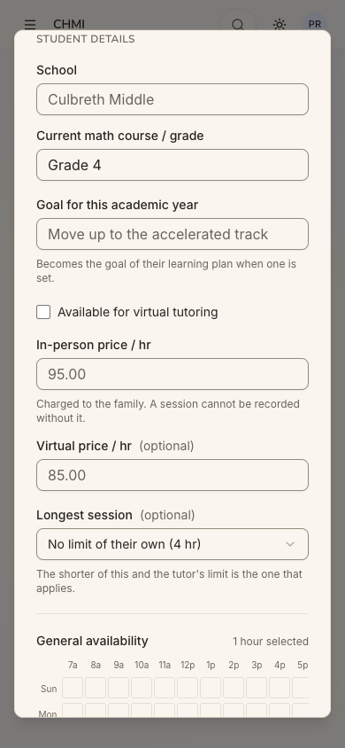
- **Size:** S to M.
- **Owner decides:** whether a price is required to save a student in a space that bills, or allowed empty and flagged.
- **Checked:** confirmed, with one nuance.
  - **Screenshot.** [J14 step 30](./assets/cuj-j14-step-30.png) shows the grey "95.00" in an empty field.
  - **The nuance.** The field's own hint already reads "Charged to the family. A session cannot be recorded without it."
    (`user-form-dialog.tsx:877`). It is not marked optional, yet the shared schema accepts it empty
    (`charge_rate_in_person_cents: optionalCentsField`, `packages/shared/src/profiles.ts:167`). So the form warns and
    saves anyway.
  - **Code.** Starting a lesson checks only the pairing, never a price (`apps/api/src/routes/sessions.ts:692-730`).
    Stopping prices it (`apps/api/src/lib/live-sessions.ts:47`), and the refusal is a validation error keyed to `mode`
    (`pricing.ts:97-103`). The web's stop dialog toasts only `error.message` (`live-session-bar.tsx:169-172`).
  - **Not observed, from code.** The cron's auto-stop goes through the same pricing. It catches the failure
    (`live-sessions.ts:120-123`), so it cannot close an unpriced lesson either.
  - **Rank.** P1 holds: the block depends on the office's data (Ben's lesson recorded, J16 step 31), not on the path.

### P1. A saved draft disappears from the home

> **Status (JF19):** done in Phase 75 (2026-11-05): a saved draft shows "Draft saved 12:43 PM · Continue" on the home's To record, Next up, Sessions and the lessons owed, and opening that lesson opens the draft, never a second one; recording refreshes the home.

- **What:**
  - **Every door for one lesson** (Next up, To record, the Dashboard's carousel, Stop) opens the writer's draft for that
    pairing and date, when there is one.
  - **Mark the lesson on the home:** "Draft saved 12:43 PM · Continue".
  - **In the app,** move "Finish write-up" from More → Dashboard to the home.
- **Why:**
  - **The question.** C2's is "did I record the last one?".
  - **What happens today.** After a draft is saved, the home is unchanged. "Record it now" opens an empty form for the
    same lesson, which autosaves a second draft. The notes look lost.
  - **It is a real habit.** Production's one active tutor uses drafts ([member-home-plan.md:19-20](../member-home-plan.md)).
- **Evidence:**
  - [J16 steps 21-25, 33](J16-tutor-record-entry-points.md).
  - **Audit:** workflows sev3,
    [A saved draft is found only on Sessions or the app Dashboard…](audit-workflows.md#sev3-a-saved-draft-is-found-only-on-sessions-or-the-app-dashboard-and-the-home-starts-the-lesson-over).
  - **Code:**
    - `apps/web/src/features/teaching/session-form-dialog.tsx:226-234`: a scheduled lesson sets the pairing and times;
      nothing looks up a draft;
    - `apps/web/src/features/teaching/sessions-page.tsx:509-518`: the only drafts panel on the web.

  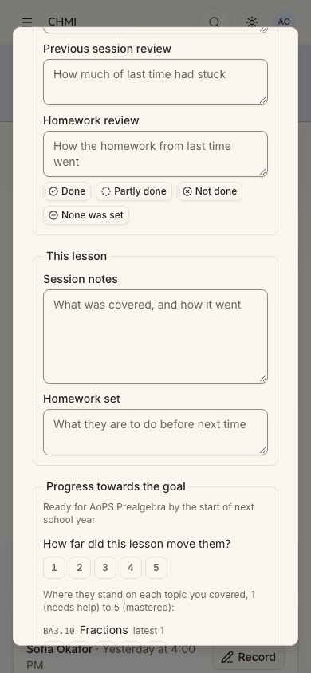
- **Size:** M.
- **Owner decides:** no.
- **Checked:** confirmed, and one caption corrected.
  - **The caption.** [J16 step 25](./assets/cuj-j16-step-25.png) shows the form with empty Session notes. The draft
    itself is not in the shot (it is on Sessions, step 23), so "beside a saved draft" became "though a draft … is
    saved".
  - **Code.** The `fromSchedule` branch fills the pairing and times and clears the notes, with no draft lookup
    (`session-form-dialog.tsx:226-238`). The web's only `DraftsPanel` host is Sessions (`sessions-page.tsx:509-518`).
    The app's are Sessions and the Dashboard's `finish-write-up.tsx`.
  - **Not deliberate.** No rule ties drafts to the home. The draft rules (CLAUDE.md) cover autosave and scope only.

### P1. A guardian cannot open her child's assessment

- **What:**
  - **Opening it.** Let a guardian open a child's in-progress assessment on her own device ("Hand the device to Leo").
    Or, where that is not allowed, say on the row who started it and where the child answers it.
  - **Starting another.** Warn on Start when the child already has one in progress.
- **Why:**
  - **Who it hits.** C4 and C7 parents in a club, which is the self-serve path the platform offers.
  - **What happens today.** The one piece of work the club set for her child, "Leo Costa G4 In progress", is shown twice
    and opens nowhere. Leo cannot sign in.
  - **The workaround,** starting a second assessment, splits his work.
  - **Together with Play with,** both of the family's actions fail for this child.
- **Evidence:** [J09 steps 5, 8-10](J09-invited-by-space.md).

  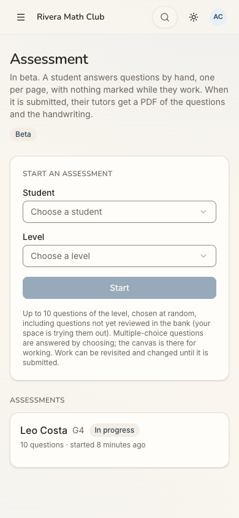
- **Size:** M.
- **Owner decides:**
  - Who may open a child's assessment to take it. Today it is the person who started it ([J06A](J06A-start-a-space-app.md):
    "hand them the phone or tablet").
  - R17 keeps the answers' PDF for the student's tutors and admins. Taking the assessment is a different act from
    reading that PDF.
- **Checked:** confirmed; the rule is deliberate.
  - **Screenshot.** [J09 step 9](./assets/cuj-j09-step-9.png) shows "Leo Costa G4 In progress · 10 questions · started
    8 minutes ago", with no button and no starter.
  - **Code.** Continue is `can_continue: mine && in_progress`
    (`apps/api/src/repositories/canvas-assessments.ts:125`). The starter's name is blanked for a reader who neither
    started nor reviews it (`canvas-assessments.ts:112`). So the row cannot even say "started by Sam".
  - **Deliberate.** "Continue: for whoever started it, while it is in progress"
    ([canvas-assessment-plan.md:40](../canvas-assessment-plan.md)). Both halves of What are therefore the owner's to
    decide: who may open it, and whether a guardian may see who started it.

### P1. One Add chooser, led by A family

> **Status (JF21):** done in Phase 76 (2026-11-05) on both clients: one Add chooser (A family / My child, A tutor, Someone else, Invite by email) from the home, the People header and the app's (+); in a personal space the adult adding "My child" becomes the parent; after a save, the next steps (Pair with a tutor, Set a weekly lesson, Record an assessment) open their forms preset; the student's record shows their tutors and weekly lessons.

- **What:**
  - **One "Add" chooser** on both clients, opened by the home's quick action, the Users header and the app's (+). It
    offers:
    - "A family (parent and child)";
    - "A tutor" (where Tutoring is on);
    - "Someone else";
    - "Invite by email".
  - **"A family"** is the wizard's guided flow, in every space.
    - In a personal space it starts with "This is my child", which makes the signed-in adult the parent.
    - For an office it leads with "Create a family account".
  - **After each save,** offer the next step ("Pair Yusuf with a tutor", "Set a weekly lesson") rather than a toast.
  - **The student's details** show the tutor and the lessons.
- **Why:**
  - **C1 offices** add families every week, and the first door they meet sets the habit. Priya's was a list called
    Users with "Add user", one person at a time.
  - **A C4 parent** in her own space needed 29 taps, a refusal of her own email as the parent ("Someone in this space
    already has that email address.") and an edit of her own roles to add her daughter.
  - **The app's (+)** already has the family-first flow.
- **Evidence:**
  - **The office:** [J14 steps 5-14, 17, 22, 31-32](J14-office-adds-family.md).
  - **A parent in her own space:** [J03 steps 16-28](J03-parent-after-guest-play.md).
  - **A new club:** [J06 steps 20-24](J06-start-a-space.md); [J06A steps 17, 29-34](J06A-start-a-space-app.md).
  - **Let in:** [J11 step 6](J11-space-admin-decides.md).
  - **Audit:** workflows sev3,
    [Adding a person has six doors on the web…](audit-workflows.md#sev3-adding-a-person-has-six-doors-on-the-web-and-the-family-first-one-is-the-hardest-to-reach).
  - **Code:**
    - `apps/web/src/features/home/member-home.tsx:233`: `add_person` goes to `/users`;
    - `apps/web/src/features/onboarding/onboarding-provider.tsx:76-92`: the wizard opens only where Tutoring is on, or
      once after a new space.

  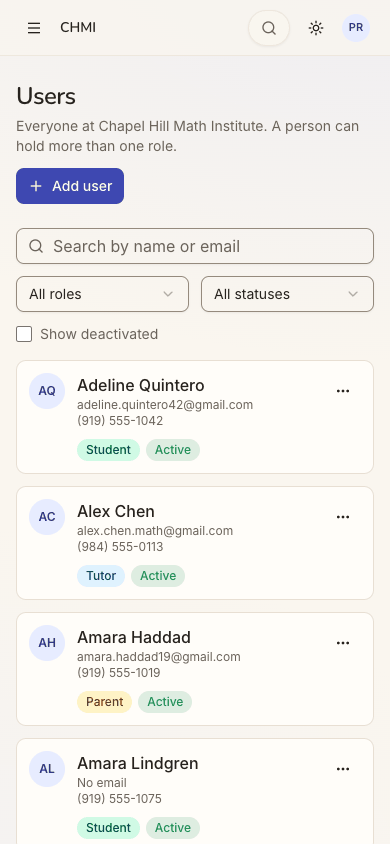
- **Size:** L.
- **Owner decides:**
  - In a personal space, whether "This is my child" makes the signed-in adult the parent by itself.
  - `docs/mobile/parity.md` records the app's (+) flows as deliberate, app-only designs. Making them the model for both
    clients is a change of course.
- **Checked:** confirmed.
  - **Screenshot.** [J14 step 5](./assets/cuj-j14-step-5.png) shows Users with "Add user" after "Add a person".
  - **Steps.** J03 counts 29 taps from home to Maya's first question, and quotes the email refusal (J03 step 23).
  - **Code.** `add_person` goes to `/users` (`member-home.tsx:233`). The wizard is gated: invite step first in a new
    space, never in a personal space, and only where Tutoring is on (`onboarding-provider.tsx:76-92`).
  - **Deliberate.** The app's family-first (+) is recorded as app-only (UI upgrade U2,
    [mobile/parity.md:18](../mobile/parity.md)). The tour's Tutoring-only rule is the owner's (2026-11-04).
  - **Rank.** P1 holds for offices: no journey was blocked, but the path costs a form per person.

### P1. Offer adding people only to those who may add

> **Status (JF22):** done in Phase 71 (2026-11-04): one shared rule (`mayAddPeople`) on Users, People, the home and the app's (+); a non-admin's row menu is View details only.

- **What:**
  - **One shared rule,** "may add people here": an admin, and not aged 13-17. Today that is two checks: the office
    hat (an admin) and `may_bring_people` (not 13-17), which `quickActionsFor` combines (see Checked). Apply the one
    rule to Users, People, the (+) sheet and the Add chooser alike.
  - **For anyone else,** say who can ("Only Ines can add people here"), with a way to ask.
- **Why:**
  - **A C7 parent** filled in her child's whole record before "Only an administrator can make this change."
  - **A C6 teen** filled in the whole form before "Adding people to a space is for adults".
  - **In the app,** (+) offered a 16-year-old "Add a student", which opens on a billed family.
  - **Each refusal after the work** costs a form and trust.
- **Evidence:**
  - **Web:** [J07 steps 30-34](J07-space-code-let-in.md); [J04 steps 14-15](J04-teen.md).
  - **App:** [J04A steps 19-22](J04A-teen-app.md); [J07A step 31](J07A-space-code-let-in-app.md).
  - **A tutor.** On Users, a tutor was also offered Edit, Deactivate and Delete permanently. This was seen, not clicked
    ([J16, Appendix](J16-tutor-record-entry-points.md)).
  - **Audit:** workflows sev3,
    [Add user is offered to people who cannot add…](audit-workflows.md#sev3-add-user-is-offered-to-people-who-cannot-add-and-web-and-app-hide-it-in-opposite-places).
  - **Code:**
    - `apps/web/src/features/users/users-page.tsx:168-175`: Add user has no role check;
    - `apps/api/src/repositories/member-home.ts:580`: `may_bring_people`, which only the home uses;
    - `apps/mobile/src/features/shell/create-actions.ts:131-137`: (+) checks `isAdmin` only.

  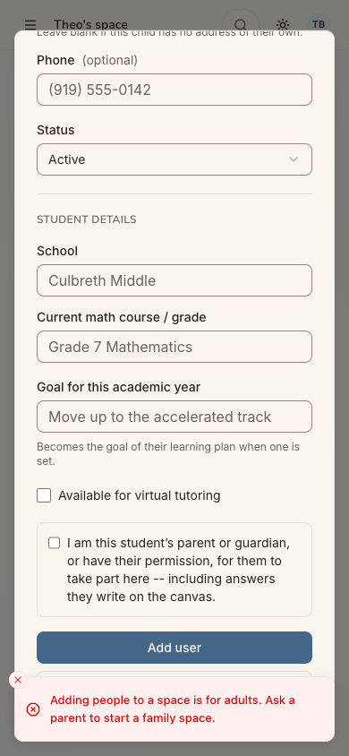
- **Size:** S.
- **Owner decides:** no.
- **Checked:** confirmed, and one claim corrected.
  - **Screenshot.** [J04 step 15](./assets/cuj-j04-step-15.png) shows "Adding people to a space is for adults" under
    the filled form.
  - **The correction.** `may_bring_people` is only `age_band !== '13-17'` (`member-home.ts:580`). It is not "an admin":
    the admin half is the office hat (`member-home.ts:540`), which `quickActionsFor` combines with it
    (`home.ts:515-516`). The What is corrected above.
  - **Code, web.** Users computes `isAdminViewer` (`users-page.tsx:57`) and uses it for join requests (178), but not for
    Add user (170-173) or the row menu (`users-table.tsx:99-121`).
  - **Code, app.** The app's (+) checks `isAdmin` only: in a space without Tutoring, Ava's personal space, that is
    `create-actions.ts:127`; with Tutoring, `create-actions.ts:137`.
  - **Deliberate.** That a teen adds nobody is a rule (CLAUDE.md, Phase 63). Only its enforcement is late.

### P2. The home repeats its own Next up

> **Status (JF23):** done in Phases 73 and 74 (2026-11-05): one Daily rule and name; when Next up shows the Daily or a game the board's own is quiet; the quick actions leave out the board's twins before the cut to three; the band does not repeat Next up.

- **What:**
  - **Twins.** When an item is in Next up, collapse its twin below to a one-line reference.
  - **Weight.** Give Next up the heaviest button on the page.
  - **One Daily:** one name, one card, one level rule.
  - **New quest.** Drop the "New quest" quick action while the board is on the same screen.
  - **Counts.** Show each count once.
- **Why:**
  - **Everyone, on every visit,** hesitates over which button is which.
  - **The heavier twin wins the eye.** The lower "Play today's Daily" is a full-width amber button, so the eye lands on
    the second item first.
  - **The plan's own rule.** H1 asks for one Next up card.
- **Evidence:**
  - **The Daily twice:**
    - [J01 step 13](J01-adult-player.md);
    - [J01A steps 18-19](J01A-adult-player-app.md);
    - [J12 step 6](J12-preapproved-on-list.md);
    - [J17 steps 3, 5, 12](J17-tutored-student-practice.md).
  - **Six starts on one screen:** [J19 step 12](J19-returning-player.md).
  - **"Start an assessment" three times:** [J07 step 24](J07-space-code-let-in.md),
    [J07A step 26](J07A-space-code-let-in-app.md).
  - **Counts three times:** [J11 step 3](J11-space-admin-decides.md), [J14 step 4](J14-office-adds-family.md).
  - **Three record doors to one lesson:** [J16 step 4](J16-tutor-record-entry-points.md).
  - **Audits:** design sev2,
    [The home repeats one action two or three times…](audit-design.md#sev2-the-home-repeats-one-action-two-or-three-times-in-competing-styles);
    workflows sev2,
    [One screen offers six ways to start a quest…](audit-workflows.md#sev2-one-screen-offers-six-ways-to-start-a-quest-and-the-daily-has-four-names-at-two-levels).

  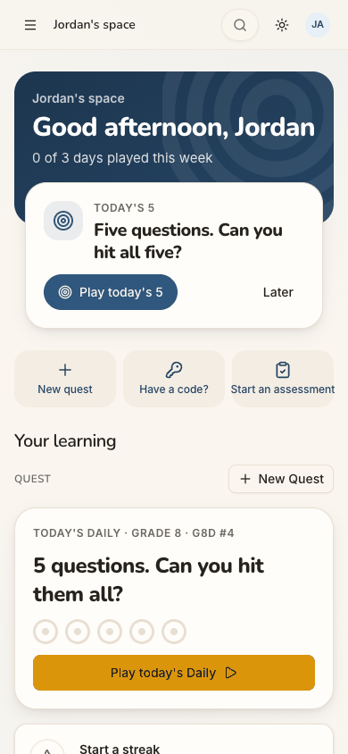
- **Size:** S to M.
- **Owner decides:** the Daily's one name. It is "Today's 5", "Today's Daily", "Play today's Daily" and "Practise 5"
  today.

### P2. The Dashboard opens on the wrong hat

> **Status (JF24):** done in the fix-up and Phase 74 (2026-11-05): the Dashboard opens on the home's hat (or the role asked for or last chosen in the space), under "Viewing as"; the wizard's last button is "Done".

> **Status (JF24):** in part, in the fix-up (2026-11-04): the wizard's last button reads "Done". The rest is Phase 74.

- **What:**
  - **The Dashboard** opens on the role of the home's leading hat, remembers the last role chosen per space, and labels
    the role switch ("Viewing as: Tutor").
  - **A tutor with no students yet** gets a one-line section and a Teaching choice in "Make this my home".
  - **Pinning a focus** visibly reorders the page and says so.
  - **The wizard's last button** reads "Done", not "Go to my dashboard".
- **Why:**
  - **C8 gets two answers.** For "what's urgent across my hats?", the home answers one way and the Dashboard the other.
  - **Maria's money and plan.** Her $152.50 outstanding and Sofia "Behind" sit behind an unlabelled dropdown, and are
    forgotten on the next visit.
  - **One of the plan's own problems.** Problem 4 of the member-home plan's ten is still present on the Dashboard (design
    audit, "Earlier audits").
- **Evidence:**
  - [J18 steps 3-4, 8-14](J18-several-hats.md).
  - [J15 step 10](J15-tutoring-parent-first-sign-in.md), [J15A step 11](J15A-tutoring-parent-first-sign-in-app.md):
    "Go to my dashboard" stays on the home.
  - **Audit:** workflows sev3,
    [Home and Dashboard pick opposite hats…](audit-workflows.md#sev3-home-and-dashboard-pick-opposite-hats-and-the-wizard-still-calls-the-home-the-dashboard).
  - **Code:** `packages/shared/src/dashboard.ts:207-210`, a fixed admin, tutor, parent, student order, against
    `orderHats` (`packages/shared/src/home.ts:481-488`).

  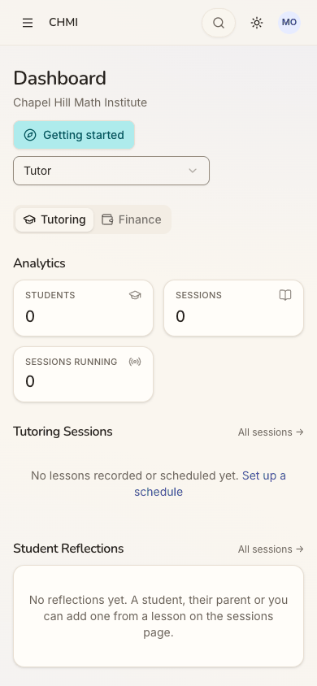
- **Size:** S.
- **Owner decides:** whether a role with nothing in it yet gets a one-line section. H3 says hats exist only with
  content ([member-home-plan.md:93](../member-home-plan.md)).

### P2. The tour covers what it introduces, and appears without Tutoring

> **Status (JF25):** done in the fix-up and Phase 74 (2026-11-05): the tour only where Tutoring is on, once per person (not per browser), offered inline on the home; it no longer comes back right after closing; no Billing step for a parent.

> **Status (JF25):** in part, in the fix-up (2026-11-04): the wizard offers the tour only where Tutoring is on, on both clients. The rest is Phase 74.

- **What:**
  - **Tutoring only.** Apply `tourOffered` to the welcome wizard's "Take the tour" as well. This is a bug against the
    owner's rule of 2026-11-04 (the tour is Tutoring's).
  - **Inline.** Make the offer a card in the page's flow, not a layer over it.
  - **Once.** Offer it once per person, not per browser, and count the wizard's tour as seen.
  - **On a phone,** point each stop at the section on the page, not at the menu, and tour a parent's own blocks
    (Practise together).
  - **Words.** Drop "portal" and "the dashboard and the menu".
- **Why:**
  - **The offer covers the work.** It sat over the To record buttons and Needs you on a tutor's and an office's first
    visit (C2, C1).
  - **It repeats.** It came back at once after the tour (C3).
  - **It appears where the rule says not.** The wizard offered it in clubs without Tutoring.
- **Evidence:**
  - **Covering the page:** [J16 step 4](J16-tutor-record-entry-points.md), [J14 step 4](J14-office-adds-family.md).
  - **Offered without Tutoring:** [J06 step 20](J06-start-a-space.md), [J06A step 28](J06A-start-a-space-app.md).
  - **Repeated, pointing at the menu:** [J15 steps 3, 7, 10, 20](J15-tutoring-parent-first-sign-in.md);
    [J15A steps 4-11](J15A-tutoring-parent-first-sign-in-app.md).
  - **Audit:** design sev2,
    [The tour and its offers cover what they introduce](audit-design.md#sev2-the-tour-and-its-offers-cover-what-they-introduce).
  - **Code:** `apps/web/src/features/onboarding/onboarding-wizard.tsx:119` has no `tourOffered` check, while the home's
    offer has one (`apps/web/src/features/home/member-home.tsx:158`).

  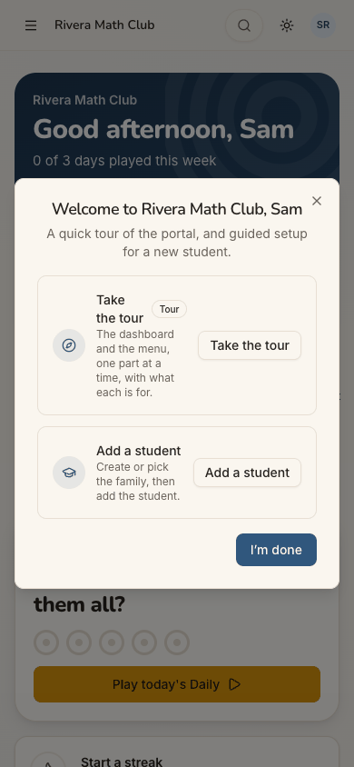
- **Size:** S.
- **Owner decides:** no.

### P2. Join requests say who is asking, and Decline can be undone

> **Status (JF26):** done in Phases 71 and 72 (2026-11-04/05): the whole address and the time at every width; Decline asks first; a request carries the role asked for and a note, read by the space's admins only, and Let in starts on that role. Declined requests are not kept findable for the admins.

- **What:**
  - **A request shows:**
    - the role the person asks for;
    - a short note from them;
    - the full email and when they asked, at every width.
  - **Decline** gets an Undo in its toast, or a confirmation.
  - **Declined requests** stay findable for a while.
- **Why:**
  - **C1 admins of spaces for children's families** decide who gets in on a name alone. On a phone, the email is cut
    and the time is hidden.
  - **Decline** is one tap, with no way back.
- **Evidence:**
  - [J11 steps 4-5, 9](J11-space-admin-decides.md).
  - [J10 steps 25-28](J10-space-code-declined.md): the declined person's history erased.
  - **Audit:** workflows sev4,
    [A parent let in by code gets no child…](audit-workflows.md#sev4-a-parent-let-in-by-code-gets-no-child-and-no-door-they-can-reach-adds-one),
    for Decline's undo.
  - **Code:** `apps/web/src/features/users/join-requests-panel.tsx:40-48`: Decline fires at once.

  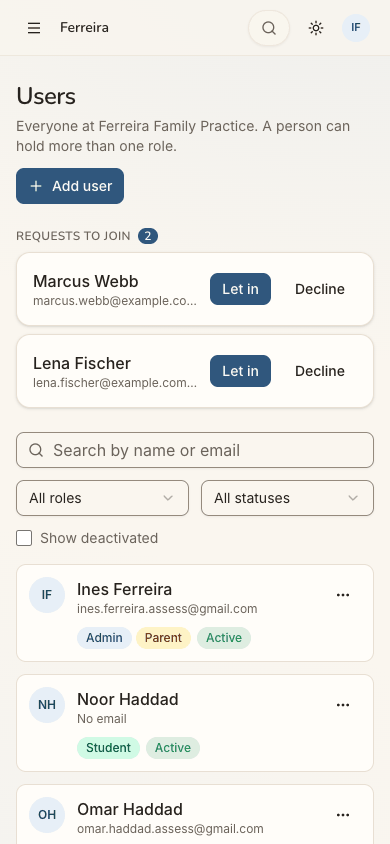
- **Size:** S to M.
- **Owner decides:** whether the join request asks for a role and a note. This is shared with the first P0.

### P2. A pairing that keeps the tutor's rates is saved as custom

> **Status (JF27):** done in Phase 75 (2026-11-05): the pairing form no longer copies the tutor's default into the override ("Tess's default, $60.00"; "Tutor pay, in person/virtual"), and an override equal to the current default reads as the default (no data change).

- **What:**
  - **Empty by default.** Leave the pairing's rate fields empty, with the tutor's default as a labelled placeholder
    ("Alex's default, $75.00"). An untouched pairing then follows the default, and only a typed value is custom.
  - **Labels.** Name the fields "Tutor pay, in person" and "Tutor pay, virtual".
- **Why:**
  - **C1 offices.** Accepting the prefilled default freezes it as an override, marked "custom". If the tutor's rate
    later changes, this pairing's pay silently stays behind.
  - **Two ways for the same values.** Sofia's pairing at the same rates has no badge.
- **Evidence:** [J14 steps 21-22](J14-office-adds-family.md).

  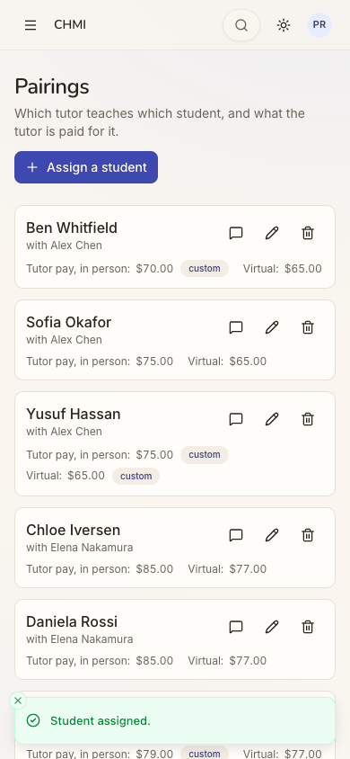
- **Size:** S.
- **Owner decides:** no.

### P2. Phone-width layouts break on a dozen screens

> **Status (JF28):** in part, in the fix-up (2026-11-04): the app's question card shows every answer choice (half the screen for a choice question, and a "More choices below" cue). The rest is Phase 78.

- **What:**
  - **First, the app's question card.** Make every answer choice visible, or show a scroll cue. The fourth choice was
    hidden below the card, with nothing to say the card scrolls.
  - **Rows** stack below `sm`: text first, actions on a line of their own.
  - **Names** wrap rather than truncate.
  - **The grade row** shows a scroll cue and scrolls the chosen grade into view.
  - **The countdown** is sized with `clamp()`.
  - **The spec.** Add the game results, the Dashboard and Activity to `responsive.spec.ts`.
- **Why:**
  - **Most people here use a phone.** Each break costs a guess, or hides a fact.
  - **The project's own rule.** Game results 430 px wide break "zero horizontal overflow at 390 px" (CLAUDE.md,
    responsive rule).
- **Evidence:**
  - **The hidden choice:** [J06A steps 37-38](J06A-start-a-space-app.md).
  - **Overflow and overlap:**
    - [J15 step 19](J15-tutoring-parent-first-sign-in.md): game results;
    - [J18 step 10](J18-several-hats.md): "wi2026-09-15";
    - [J10 step 22](J10-space-code-declined.md), [J11 step 12](J11-space-admin-decides.md): Activity filters;
    - [J14 steps 23-27](J14-office-adds-family.md): Schedule.
  - **Cut text:**
    - [J06 steps 18, 21](J06-start-a-space.md): "a..";
    - [J11 step 4](J11-space-admin-decides.md);
    - [J04 step 17](J04-teen.md), [J09 step 3](J09-invited-by-space.md): space names;
    - [J04A step 29](J04A-teen-app.md): the game title.
  - **The countdown off the edge:** [J12 step 9](J12-preapproved-on-list.md), [J19 step 6](J19-returning-player.md).
  - **The grade row hides Grade 8:** [J01 steps 11, 14](J01-adult-player.md).
  - **The (+) covers a row:** [J06A step 40](J06A-start-a-space-app.md).
  - **Audit:** design sev2,
    [Phone-width layouts break on a dozen screens](audit-design.md#sev2-phone-width-layouts-break-on-a-dozen-screens).

  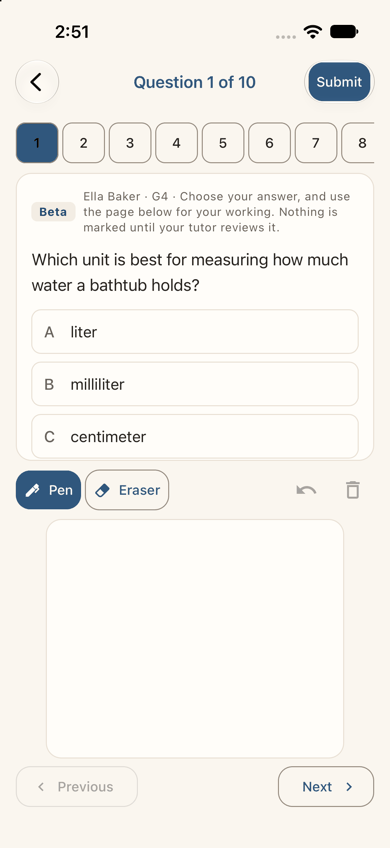
- **Size:** M.
- **Owner decides:** no.
- **Checked (rank only):** the first bullet of What deserves P1, ahead of the rest of this item.
  - **Screenshot.** [J06A step 37](./assets/cuj-j06a-step-37.png) shows A-C, with D below the card and no cue.
  - **Code.** On a phone the question card is a `ScrollView` capped at a third of the screen
    (`maxHeight: Math.max(160, window.height * 0.34)`,
    `apps/mobile/src/features/canvas-assessments/take-assessment-screen.tsx:238`). Any question with four longer
    choices will clip.
  - **Why P1.** Code marks the choice (Phase 38), so a child who never sees the right answer is marked wrong, and the
    tutor's PDF reports it. That falsifies the one result C7's giver came for ("give one, see results"). The rest of
    the item stays P2. Its counts are left as they are.

### P2. Contrast and accessibility gaps

- **What:**
  - **The selected grade chip:** a 2 px ring or a tick.
  - **The ADV pill:** at least 12 px, white on a dark pill.
  - **Tile codes:** full muted contrast at 12 px or more, or dropped (see the words item).
  - **The drawer:** restate `--sidebar-accent` in the warm foundation for every palette.
  - **The app's parent rows** in Add a student get an accessible name and a radio role.
- **Why:**
  - **Low-vision readers, and parents on a phone outdoors.** Nothing is blocked, because labels repeat the grade.
  - **The platform's own bar.** These pieces fall below the WCAG minimums the grade tiles already meet.
- **Evidence:**
  - **Measured from the tokens:**
    - Grade 4's selected chip is 1.30:1 ([J03 step 15](J03-parent-after-guest-play.md));
    - the ADV pill is 3.22-3.97:1 ([J04 step 19](J04-teen.md));
    - the tile code is 3.75:1 ([J01 step 14](J01-adult-player.md)).
  - **Measured from pixels:** the Indigo drawer's tagline is 1.15:1 ([J14 step 18](J14-office-adds-family.md)).
  - **The unnamed rows:** [J06A steps 30-31](J06A-start-a-space-app.md).
  - **Audit:** design sev2,
    [Measured contrast failures…](audit-design.md#sev2-measured-contrast-failures-on-the-quest-board-and-in-the-phone-drawer).
  - **Not checked:** screen readers, keyboard-only use and the largest text sizes were not run.

  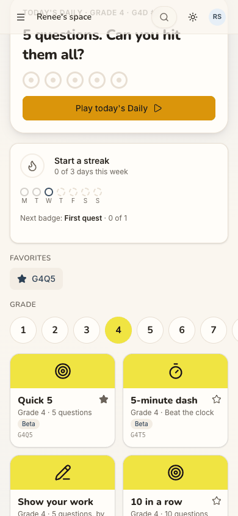
- **Size:** S.
- **Owner decides:** no.

## Consistency

### P2. Record and start a lesson one way, on both clients

> **Status (JF30):** done in Phase 75 (2026-11-05), adopted on the web as decided: a known lesson opens "Record a lesson" with "It ran as planned" and "Write up the lesson"; the quick action and the Sessions button open the lessons still owed with "Another lesson" (a blank form with no date); To record at the top of Sessions; every Start opens the Start dialog in place; a running lesson leads Next up with Stop; "lesson" and "Record" on these screens.

- **What:** adopt the app's two-stage model on the web, and cut the doors.
  - **A known lesson** (Next up, To record, the carousel, Stop) opens "Record a lesson", prefilled. It offers "It ran as
    planned", then "Write up the lesson".
  - **The quick action and the Sessions button** open a list of lessons still owed, with "Another lesson" for a blank
    form. No form defaults to today at 4:00-5:00 PM.
  - **To record** sits at the top of Sessions. The office's list covers every tutor, and each row has Record.
  - **Every Start** opens the Start sheet in place, prefilled. A running lesson becomes Next up's first item, with
    Stop.
  - **One noun and one verb on screen:** "lesson" and "Record".
- **Why:**
  - **C2 and C1, the cohorts with real use.**
  - **Seven doors on the web, twelve in the app,** with four form titles and nine verbs.
  - **A dating risk.** The blank form is dated today, so yesterday's lesson can be recorded as today's.
  - **A dead end.** "Start a lesson" only changes page, and with a lesson running it shows no Start and no reason.
  - **Lists that are not there.** The home's "+N more" and the office's count lead to a Sessions page without the list.
- **Evidence:**
  - [J16 steps 4-14, 20, 23-24, 30, 32-33](J16-tutor-record-entry-points.md).
  - [J14 step 28](J14-office-adds-family.md): "24 to record" as plain text.
  - **Audits:** workflows sev2,
    [Recording a lesson has seven doors…](audit-workflows.md#sev2-recording-a-lesson-has-seven-doors-on-the-web-and-twelve-in-the-app-with-four-titles-and-nine-verbs),
    [Start a lesson behaves three ways…](audit-workflows.md#sev2-start-a-lesson-behaves-three-ways-on-the-web-and-a-fourth-way-in-the-app)
    and
    [To record lives only on the home…](audit-workflows.md#sev2-to-record-lives-only-on-the-home-and-every-more-link-leads-to-a-sessions-page-without-it).
  - **Code:**
    - `apps/web/src/features/home/member-home.tsx:110-112`: the quick action passes `lesson: null`;
    - `member-home.tsx:229`: `start_lesson` is `/sessions`;
    - `apps/web/src/features/teaching/session-form-dialog.tsx:567-569, 822`: the titles and button names.
  - **Not walked:** the app's doors are mapped from code only. No app journey played a tutor.

  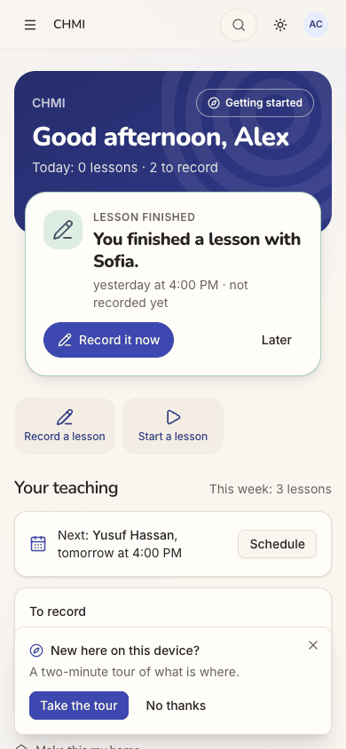
- **Size:** L.
- **Owner decides:** whether the app's model, recorded in `docs/mobile/parity.md` as a deliberate app-only design,
  becomes the model for both clients.

### P2. Tutoring words and the office menu reach readers who have neither

> **Status (JF31):** done in Phase 74 (2026-11-05): Users, Pairings and Billing only for admins and tutors; Tutoring's fields hidden where it is off; "billed", "your tutor reviews it" and "portal" reworded.

- **What:**
  - **Copy per kind of space and per reader:**
    - "Who looks after this student?" in place of "who is billed";
    - "Your teacher (or parent) looks at it next" in place of "your tutor reviews it".
  - **Tutoring's fields and sections** are hidden where Tutoring is off: a student's virtual-session fields, and
    comments refused with "Tutoring is not part of this space".
  - **The menu** is built from the reader's hats. A student or a parent never sees Users, Pairings or Billing.
  - **Words that are not ours:** drop "portal", and the app's "Each tab can be in a different one."
- **Why:**
  - **A C1 teacher** about to invite families doubts at "billed".
  - **A child** in a space with no tutor is told a tutor will mark the work (C5).
  - **A CHMI student or parent** gets the office's 13-item menu.
  - **The project's own rule.** R23 says a space without Tutoring leaves Tutoring's sections out.
- **Evidence:**
  - **"Billed" in a free club:** [J06 step 21](J06-start-a-space.md), [J06A steps 30, 32](J06A-start-a-space-app.md).
  - **"Your tutor":** [J03 step 32](J03-parent-after-guest-play.md), [J06A step 37](J06A-start-a-space-app.md).
  - **Tutoring roles:** [J07 step 31](J07-space-code-let-in.md), [J11 step 6](J11-space-admin-decides.md).
  - **Tutoring fields and a refused comment:** [J09 steps 8, 18-19](J09-invited-by-space.md).
  - **The office's menu:** [J17 step 7](J17-tutored-student-practice.md), [J15 step 13](J15-tutoring-parent-first-sign-in.md).
  - **Web words in the app:** [J04A step 15](J04A-teen-app.md).
  - **Audit:** design sev2,
    [A tutoring office's words reach spaces and readers without one](audit-design.md#sev2-a-tutoring-offices-words-reach-spaces-and-readers-without-one).
  - **Code:** `apps/mobile/src/features/organizations/spaces-screen.tsx:89`, the "Each tab" copy.

  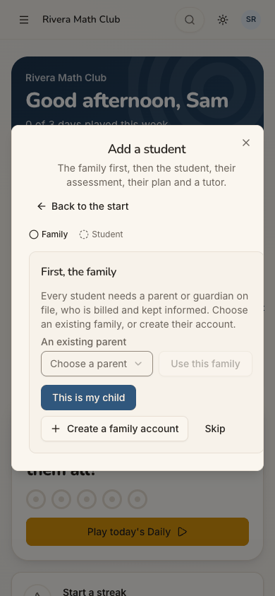
- **Size:** M.
- **Owner decides:** whether a student's and a parent's menus drop Users.

### P2. One word per thing, and words rather than codes

> **Status (JF32):** in part, in Phase 73 (2026-11-05): games and "Waiting for you" are said in words, the code after. The glossary and the rest are Phase 78.

- **What:**
  - **Words.** Name every surface with the words `tileLook` already builds ("Quick 5 · Grade 8"). This covers
    favorites, the Daily's eyebrow, the game header, the lobby and the assessment's level list. Keep codes for the
    console and support.
  - **Games** are listed with their progress.
  - **"Beta":** one line per board, not a pill on every tile and question.
  - **A glossary in shared code** (person, lesson, game, quest, space), read by both clients, with the quick actions'
    labels moved beside `QUICK_ACTIONS`.
- **Why:**
  - **Every cohort decodes "G8Q5", "G8D #4" and "G4".**
  - **Favorites,** the most personal row, are the least readable.
  - **One task, several names.** "Add a person" opens "Users" and "Add user". The menu's "Quest" opens "Question
    Quest". Web and app name the same quick actions differently.
- **Evidence:**
  - **Codes:**
    - [J01 steps 13-15](J01-adult-player.md);
    - [J01A steps 19, 22-24](J01A-adult-player-app.md);
    - [J03 steps 15, 30](J03-parent-after-guest-play.md);
    - [J12 steps 7-10](J12-preapproved-on-list.md);
    - [J15 step 15](J15-tutoring-parent-first-sign-in.md);
    - [J19 step 15](J19-returning-player.md).
  - **Names:**
    - [J14 step 5](J14-office-adds-family.md): Add a person and Users;
    - [J17 step 16](J17-tutored-student-practice.md): Quest and Question Quest;
    - [J06A step 17](J06A-start-a-space-app.md): the app's own labels.
  - **Audits:** design sev2,
    [Codes where people expect names](audit-design.md#sev2-codes-where-people-expect-names) and
    [One thing goes by several names](audit-design.md#sev2-one-thing-goes-by-several-names); workflows sev1,
    [The same quick actions are worded differently…](audit-workflows.md#sev1-the-same-quick-actions-are-worded-differently-on-the-web-and-in-the-app).
  - **Code:** `apps/web/src/features/play/quest-card.tsx:97`, the code under each title.

  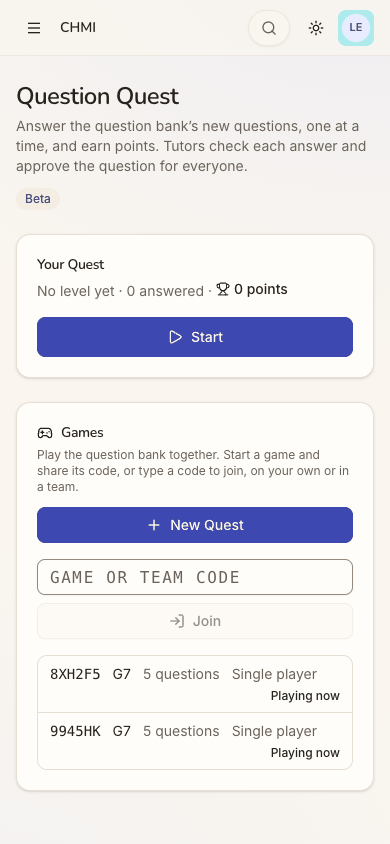
- **Size:** M.
- **Owner decides:**
  - The glossary's words: lesson or session; Quest or Question Quest.
  - Whether "Beta" stays on each question.

### P2. Each space looks like itself

> **Status (JF33):** done in Phase 72 (2026-11-05): each new self-serve space takes the palette its maker's other spaces wear least (never plum); a personal space stays slate and reads "Just you"; the mark's gradient id is per instance.

- **What:**
  - **A palette per new space.** Rotate through the palettes, or let the maker choose one in Start a space.
  - **Slate** is kept for the platform, the guest page and personal spaces, and the personal space reads "Just you" in
    the switcher.
  - **The mark** gets a per-instance gradient id, so it shows in the phone drawer.
- **Why:**
  - **Everyone with two spaces** (C7 parents, C1 makers) holds two that look alike. That is part of why being let in
    went unnoticed.
  - **The wrong space.** Misreading which space is open is how a person ends up added, or an assessment started, in the
    wrong one.
- **Evidence:**
  - [J07 steps 21, 23-24](J07-space-code-let-in.md).
  - [J06 steps 10, 20](J06-start-a-space.md).
  - **The drawer's mark at 1.13:1:** [J04 step 11](J04-teen.md), [J10 step 17](J10-space-code-declined.md).
  - **Audit:** design sev2,
    [Nothing on screen tells one space from another](audit-design.md#sev2-nothing-on-screen-tells-one-space-from-another).
  - **Code:**
    - `apps/api/src/repositories/organizations.ts:1175`: every self-serve space is inserted with the `'platform'`
      palette;
    - `apps/web/src/components/brand/logo.tsx:53, 59`: a fixed gradient id.

  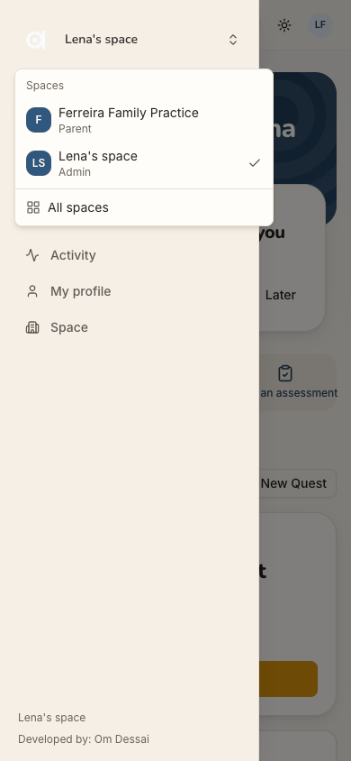
- **Size:** S to M.
- **Owner decides:** rotate the palettes, or let the maker choose.

### P3. Amber does one job

- **What:**
  - **One meaning.** Keep amber for the call to action ("notice this first").
  - **Grade 3 and the Daily.** Move Grade 3's hue, or draw the Daily and Today's 5 buttons in the space's primary.
  - **Optionally,** use the grade hues on the guest page too, with the mode shown by its icon.
- **Why:**
  - **Five jobs for one colour.** Amber is a timed mode, Grade 3, the Daily button, a hit ring and the highlight.
  - **A button that blends in.** On a Grade 3 board, the Daily button sits on cards of nearly the same colour (1.13:1
    apart).
  - **A code that changes.** The colour code learned on the guest page changes after sign-up.
  - **Nothing is blocked.** WCAG 1.4.1 is met, because every card names its level.
- **Evidence:**
  - [J01 steps 1, 14](J01-adult-player.md): guest mode colours, then member grade hues.
  - [J09 step 15](J09-invited-by-space.md): the amber button over Grade 3 cards.
  - **Audit:** design sev2,
    [Amber carries five meanings…](audit-design.md#sev2-amber-carries-five-meanings-and-the-tile-colours-change-meaning-after-sign-up).

  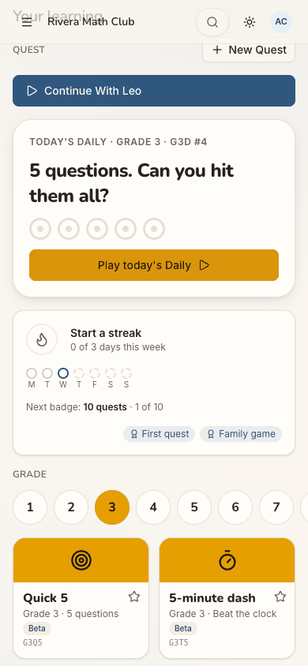
- **Size:** S to M.
- **Owner decides:** grade hues on the guest page would reverse Decision 1 of the member-home plan ("The guest home
  keeps its mode colours", [member-home-plan.md:155](../member-home-plan.md)).

### P3. Small type, all-caps labels, year lists and dates

- **What:**
  - **Labels.** Make the all-caps eyebrows sentence case at 12-13 px, or drop them where the heading says it, and set a
    12 px floor on the web.
  - **The birth year** opens near an adult's year, or is typed. Show all twelve months in the app's list.
  - **Dates.** Format every date through one shared formatter.
  - **The header** becomes solid once the page scrolls.
  - **The wizard** preselects "Single player" for a solo quest.
  - **All spaces** labels its Leave icon.
- **Why:**
  - **Polish.** Each costs a little on every visit.
  - **Stale docs.** `docs/branding.md` still names Poppins, while the build loads Nunito (design audit).
- **Evidence:**
  - **Labels:** 68 `uppercase` classes and 64 places at 10-11 px on the web (design audit).
  - **Year lists:**
    - [J06 step 5](J06-start-a-space.md);
    - [J04 step 4](J04-teen.md);
    - [J10 step 6](J10-space-code-declined.md);
    - [J06A steps 7-8](J06A-start-a-space-app.md), where October is hidden.
  - **ISO dates on the web:** [J15 step 11](J15-tutoring-parent-first-sign-in.md), [J16 step 23](J16-tutor-record-entry-points.md).
  - **Multiplayer preselected:** [J04 steps 20-23](J04-teen.md), [J04A steps 25-28](J04A-teen-app.md).
  - **Leave unlabelled:** [J18 step 7](J18-several-hats.md).
  - **Audits:** design sev1,
    [All-caps eyebrows and 10-11 px text remain…](audit-design.md#sev1-all-caps-eyebrows-and-10-11-px-text-remain-against-the-u1-spec),
    [Birth-year lists start at this year…](audit-design.md#sev1-birth-year-lists-start-at-this-year-and-the-web-prints-iso-dates)
    and
    [The glass header…](audit-design.md#sev1-the-glass-header-lets-content-show-through-behind-the-spaces-name).

  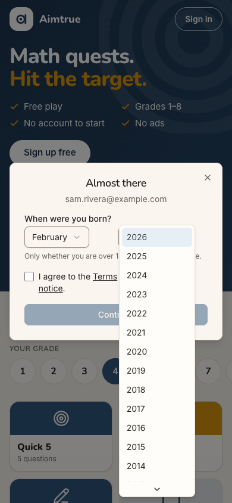
- **Size:** S.
- **Owner decides:** no.

## Web and app

### P2. Leaving a game works the same on both clients

> **Status (JF36):** done in Phases 70 and 73 (2026-11-04/05): Exit returns to where the game was opened on both clients; Cancel and End ask first on the web as in the app; the web's Daily has a close; results refresh the home.

- **What:**
  - **One Exit,** in the same corner of every full-screen play surface, returning to where play was opened. The web
    passes the origin, as the app does.
  - **Ending.** Confirm "End the game now" and "Cancel the game" on the web, as the app does.
  - **The Daily** gets a close control that says what leaving keeps.
  - **The app's waiting screen.** Its Back returns to the question.
- **Why:**
  - **C4, C5 and C6 players on the web** land on Question Quest reading "0 points", which looks like lost work.
  - **An accidental end.** A game ends with one tap.
  - **A dead end.** The Daily can be left only with the browser's Back.
- **Evidence:**
  - **Exit goes to Question Quest:**
    - [J19 steps 9-10](J19-returning-player.md);
    - [J15 step 20](J15-tutoring-parent-first-sign-in.md);
    - [J09 steps 13, 17](J09-invited-by-space.md).
  - **No way out of the Daily:** [J17 steps 5-6](J17-tutored-student-practice.md).
  - **The web ends at once:** [J15 step 19](J15-tutoring-parent-first-sign-in.md), [J09 step 12](J09-invited-by-space.md).
  - **The app confirms, then goes home:** [J15A steps 20-22](J15A-tutoring-parent-first-sign-in-app.md).
  - **The app's Back drops the quest:** [J01A step 14](J01A-adult-player-app.md).
  - **Audits:** design sev2,
    [Ways out of full-screen play…](audit-design.md#sev2-ways-out-of-full-screen-play-are-missing-or-lead-somewhere-else);
    workflows sev2,
    [A game ends and exits differently…](audit-workflows.md#sev2-a-game-ends-and-exits-differently-on-the-web-and-in-the-app).
  - **Code:** `apps/web/src/features/quest/fullscreen-frame.tsx:75-76`: Exit is a link to `/quest`.

  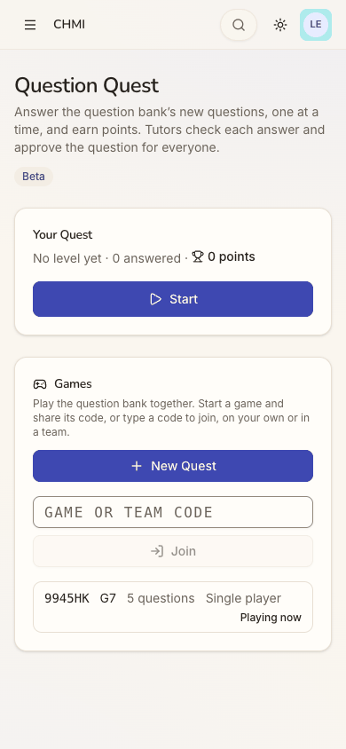
- **Size:** S.
- **Owner decides:** no.

### P2. Invite people at any time, with Copy and Share on both

> **Status (JF37):** done in Phase 76 (2026-11-05): Invite by email at any time from the chooser; every invited row has Copy invitation and Share (the app: Share, whose sheet copies), each confirmed; the invitation says how to sign in and what the space is for; the form explains Active, Invited and Suspended.

- **What:**
  - **Invite by email** is an option of the Add chooser, at any time.
  - **Every invited row,** on Users and People, has "Copy invitation" and "Share", with a confirmation.
  - **The invitation text** says how to sign in (Google, with which address), what the space is, and who sent it.
  - **The form** explains Active, Invited and Suspended.
- **Why:**
  - **Once only.** C1 owners of self-serve spaces get the ready-made invitation only right after starting the space.
    Such spaces send no email (CLAUDE.md, Phase 51), so a second family later means writing their own message.
  - **A link that misleads.** The text Ana received led to a children's game page ([J09 step 1](J09-invited-by-space.md)).
  - **Uneven controls.** The app has no Copy, and its Share sheet's Copy gives no confirmation.
- **Evidence:**
  - **Web:** [J06 steps 16-19](J06-start-a-space.md); [J14 step 7](J14-office-adds-family.md), where "Invited" is not
    explained.
  - **App:** [J06A steps 23-27](J06A-start-a-space-app.md).
  - **Audit:** workflows sev2,
    [Invite people and its invitation text are offered once…](audit-workflows.md#sev2-invite-people-and-its-invitation-text-are-offered-once-right-after-starting-a-space).
  - **Code:** `packages/shared/src/spaces.ts:273` (`invitationText`) is used only in the two `invite-people.tsx` screens.

  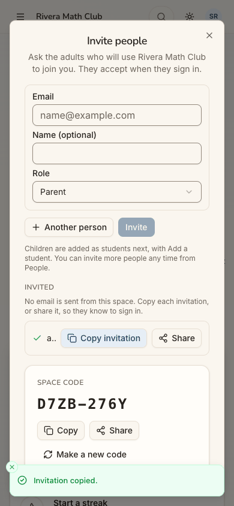
- **Size:** S to M.
- **Owner decides:** the invitation's wording.

## Already good

Keep these. The journeys found them working, and several fix problems the member-home plan set out to fix.

- **Pre-approved for a listed person.** Grace went from a stranger's first screen to a question in six taps, with no
  typing and no wait ([J12](J12-preapproved-on-list.md)).
- **An invitation is told best.** Accept sits on the first screen after Google, with no form and no approval
  ([J09 step 3](J09-invited-by-space.md)).
- **The tutoring parent's home answers C3's question at once:** "Yusuf: next lesson tomorrow at 4:00 PM"
  ([J15 step 4](J15-tutoring-parent-first-sign-in.md), [J15A step 12](J15A-tutoring-parent-first-sign-in-app.md)).
- **The tutor's Next up.** "Record it now" opens the form prefilled from the schedule, which fixes the member-home
  plan's first problem ([J16 steps 4-5](J16-tutor-record-entry-points.md)).
- **The admin sees who is waiting at once:** "2 asking to join", with one obvious button
  ([J11 step 3](J11-space-admin-decides.md)).
- **What the guest played carries over:** the grade and the played tile as a favorite
  ([J01 step 14](J01-adult-player.md), [J01A step 19](J01A-adult-player-app.md), [J03 step 15](J03-parent-after-guest-play.md)).
- **Welcome back.** It is warm, with no loss message ([J19 step 4](J19-returning-player.md)).
- **Starting a space hands on well, once found.** Invite people leads to Add a student, then to Start an assessment.
  The app says "hand them the phone or tablet" ([J06 steps 16-27](J06-start-a-space.md),
  [J06A steps 22-37](J06A-start-a-space-app.md)).
- **Refusals cost nothing to reach.** "Sign-up is by invitation" comes before any personal question
  ([J13 step 3](J13-preapproved-not-on-list.md)). The under-13 refusal is polite, and keeps nothing
  ([J05 step 6](J05-under-13.md)).
- **The real hook.** A competition-style AoPS question is the strongest reason to come back
  ([J04 step 24](J04-teen.md), [J04A step 29](J04A-teen-app.md)).
- **The code hint:** "Six characters join a game; eight ask to join a space." ([J10 step 14](J10-space-code-declined.md)).
- **The foundations hold** ([audit-design.md](audit-design.md)):
  - every grade hue passes contrast in light and dark;
  - dark mode holds on every landing shot;
  - the app's header buttons now read in dark mode;
  - a web quest survives a reload ([J01 step 16](J01-adult-player.md)).

## How this was made

- **The journeys.** 24 journeys were recorded on 2026-11-04 against commit `2d6e7d3` on `member-home-stickiness`
  ([README](README.md)).
  - **The stack.** It ran in a frozen worktree, with the worktree's own Worker and local D1 and sign-in on.
  - **The settings were production's:** Post-approved access, guest play and the Daily on.
  - **The web, J01-J19.** At phone width, with desktop and dark captures at landing screens, through a stand-in for
    Google's script.
  - **The app, J01A, J04A, J06A, J07A and J15A.** On the iOS simulator, with the developer sign-in.
  - **The approvals and declines** were made by a platform-admin agent in the console.
  - **The findings.** 22 journeys reached their end and 2 were blocked. They recorded 184 findings.
- **The two audits.** [audit-design.md](audit-design.md) (23 findings) and [audit-workflows.md](audit-workflows.md)
  (20 findings) read every report and contact sheet, and the code at `2d6e7d3`.
- **This page.** It merges all three into 37 items. Code references are to `2d6e7d3`, read in
  `.claude/worktrees/ux-audit`.
- **What no journey covered**, so this page says nothing about it:
  - Android;
  - the platform console;
  - Microsoft, Apple and Facebook sign-in, and production's Google screen;
  - the inside of quests and assessments;
  - the app's tutor and office paths, mapped from code only;
  - screen readers and the largest text sizes.
- **Where the run differs from production:**
  - J19's history was inserted into the local database;
  - "a day later" was a pause, not a real day;
  - the app's crash was seen in a development build.
